# PCB Thermal Lab

[](CHANGELOG.md) [](tests)

Thermal simulation of printed circuit boards. Draw copper zones, heaters, vias and heatsinks on a multi-layer board, run the models and inspect temperatures,
gradients, hotspots, component junction temperatures and the heat evolution in time.

## Features

**Modelling**
- **Five models on one board description** (finite volumes, finite differences, 3D solid, thermal network, analytical series), cross-checked against each other and against an independent 3D solid, each reporting an exact energy balance.
- **Stack-up**: a simple mode (equal layers, one laminate) and an **advanced mode** with a thickness per copper layer and a thickness and material per dielectric (FR-4, polyimide, PTFE-ceramic, metal-core, alumina, AlN presets), in **all five models**, with a **cross-section diagram** in µm and mm and typical stack-ups of 1 to 12 layers with inner copper of 0.5 oz (default) or 1 oz.
- **Any board shape**: an outline polygon (presets, vertex table, drawing tool) in the FVM, FDM and 3D solid.
- **Parts**: junction temperature from a datasheet resistance (worst case), junction limit with margin and power limit, ψJB estimate, a power that grows with temperature (with runaway detection) and a **heatsink on the package** (θJC(top) + interface + θSA).
- **Metal blocks** (heat spreaders with an interface resistance, optional fins) in all five models (the Lumped and Analytic have them in steady state only), plated vias (hollow or filled), heatsinks.
- **Computed heat transfer coefficients**: natural or forced convection plus radiation from the board temperature, with a calibration multiplier; the vertical-board correlation has a general and a laminar form (`Board.natural_form`; the laminar form is the default of new projects, old files keep the general one, and a low face Rayleigh number is warned).
- **Power profiles**: square waves and CSV tables per heater, averaged or simulated in time automatically (a part over bare laminate is read at its face; a fast wave on a part with copper under it is held at its average power with its temperature wave, computed in closed form from the layers, added at the heater); animation of the heat evolution with GIF export.

**Tools**
- **Power Calculator** (with a *Board description* level that adds the doubt about how the board is drawn to the best / nominal / worst band): the power of a part from a temperature measured on the board ring, under the part, in the junction or on the top of the package (by the drawn board, or from a datasheet ψ/θ parameter); validated against datasheets (`docs/calculators.md`).
- **Interactive editor** (PySide 6): rectangles and polygons, rulers and a scale bar, undo/redo, background photo, dark and light themes, a tooltip on every field.
- **Simulations run in a separate process**: the window never freezes, a run can be **cancelled** at any moment and nothing is left running when you close the program.
- **Built-in help**: an HTML user guide (**Help - User guide**, `F1`), an About box, and a keyboard shortcut list.
- **Memory guard**: the memory of every finite model (FVM, FDM, 3D solid) is estimated from its unknown count before anything is allocated; a run above the **Memory limit** (Preferences, 60 % of the physical memory by default) is refused with the cell that fits, the solver panel shows the verdict and Auto picks a cell that fits.
- **Gerber reader** (`pcbthermal.gerber`, used by **File - Import Gerber board**, `docs/models.md` 19.4): our own reader of Gerber RS-274X with X2 attributes, Excellon, XNC and X2 drill files, the board outline, layer-function detection and ZIP sets, with the copper rasterised to a one-byte coverage per pixel; refuses what it cannot draw naming the file and the feature (`docs/models.md` 19, `docs/theory.md` 1.6). It also recognises which CAD program wrote a set of files (KiCad, Altium, EAGLE, Allegro and others) from their headers, only to propose layer names, never to decide (`docs/models.md` 19.3).
- **Gerber import window** (**File - Import Gerber board**, three steps: files and layers, parts, model): parts from the paste layers, the placement file and X3 component layers, with the heat source shaped as the exposed pad or tab (proposed for QFN, DFN, SOT-223, DPAK), the convex hull or the bounding box; plated holes become vias; re-import with Replace, Update or Add files keeps what you did in the editor; a project with imports is saved in **project format 2** (needs 2.5.0 or later; older programs refuse it, `.bak` copies are kept). The user guide has a walkthrough, a glossary of the warnings and a table of what is validated and what is not.
- **Imported copper**: the copper of each layer from the files, mapped to the finite-volume and finite-difference conductances by the flow-based faces on the laminate-reduced sheet (View - Imported copper draws it in the editor); the Lumped and Analytic models read the copper only as the average of a cell, so the pads and narrow tracks of small parts are invisible to them, and they warn that they read too cool (on 42 parts of three imported boards 25 to 82 % and 17 to 77 % at a 0.5 mm cell; a sample, not a bound).
- **Views of the result maps**: Current, Smooth and Terrain (relief with contour lines), the copper of the layer under the map with an adjustable opacity, and all layers in a 2 x 2 grid (display only). One **Layer** box in the main tool bar is the drawing layer, the layer of the map on the board and the layer of every Results map (Temperature adds All layers, All (2 x 2) and the metal block); the model name in the card of the map on the board opens a menu of the models.
- **Display control** (display only): the **Map** button (key `T`) shows the temperature map on the board (a card with the model, the maximum and the minimum, and a ring on each point), and the **Display** button of the tool bar sets how every map is drawn: Underlay (nothing, the copper or the background image; only the entries valid for the project), Map opacity (default 70 %), View (Current, Smooth, Terrain), Contour every and Colour map. One choice for the Temperature and Gradients maps, the Animation and the board.
- **Input checks**, live under the Run button (one line per warning, the full measured text on hover): heater off the board, no copper under a heater, a copper edge crossing a heater, a neck of the outline too narrow, the limits of the selected models and the via warnings; what only a run can know (thick plates, close fins, low Rayleigh number, the Lumped zone model) is added to the Results summary.
- **Laminate options**: the longest sub-gap and the most sub-gaps of the laminate between copper nodes (FVM and FDM; Simulation panel and `run --laminate-s-max-mm`, `--laminate-n-max`).
- **Command line and Python API** for scripts and parameter sweeps; project files in plain JSON that store every parameter (saved atomically, with a `.bak` copy when a save changes the format; a project with imported boards uses format 2 and needs 2.5.0 or later).

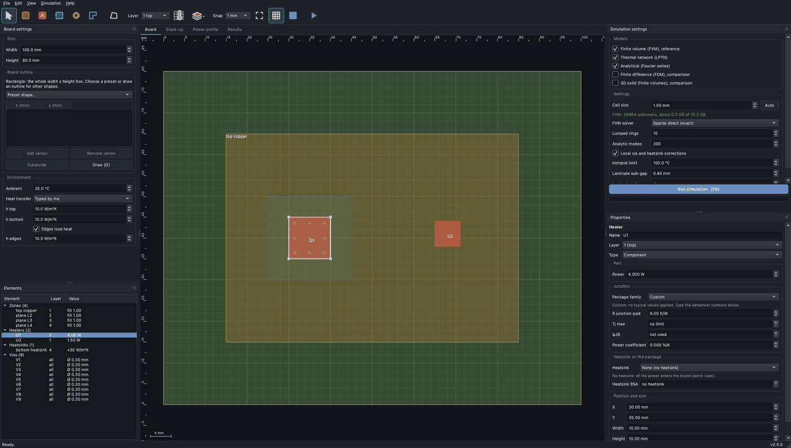

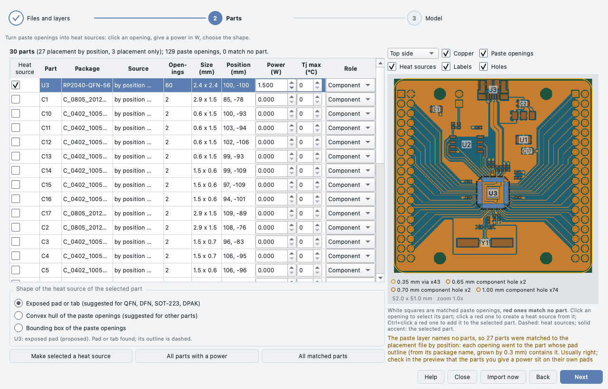

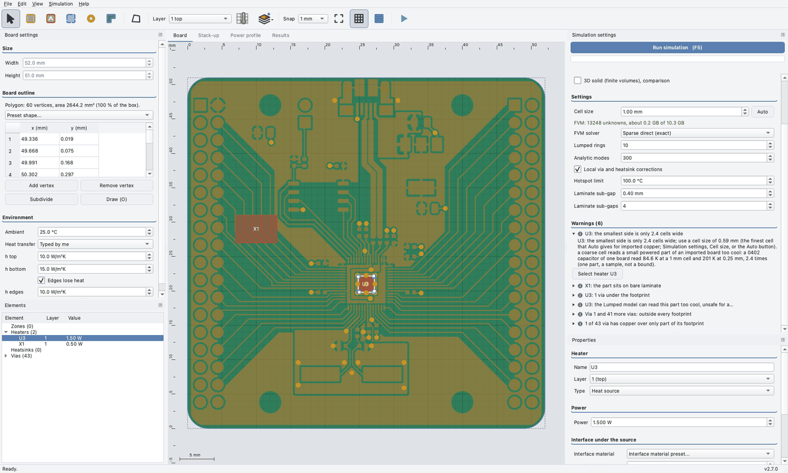

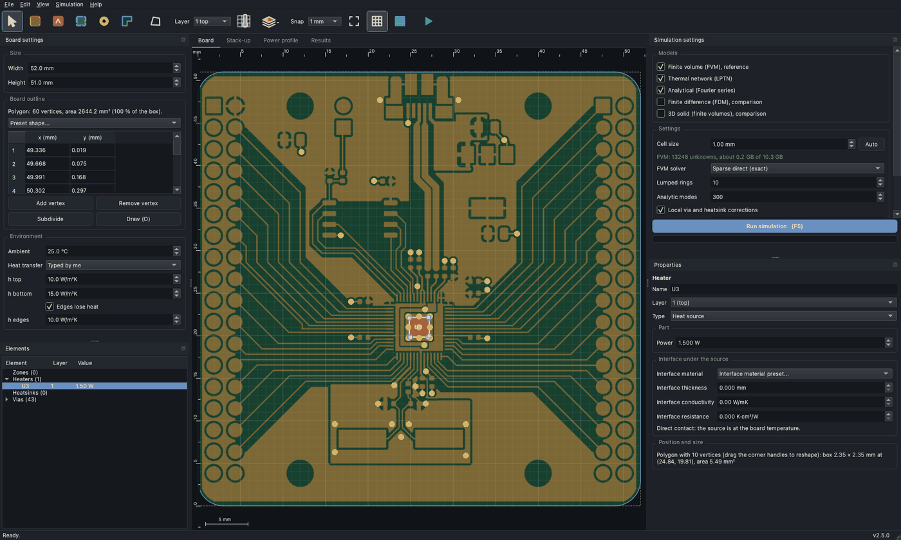

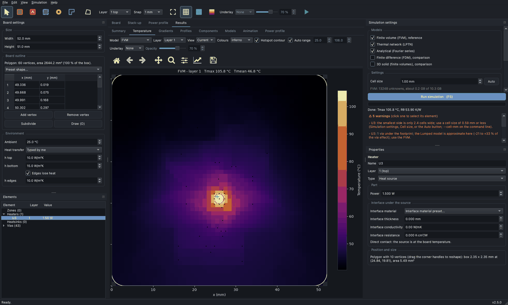

*The screenshots of an imported board show the RP2040 minimal design (Raspberry Pi, BSD-3-Clause), imported from its Gerber files and drawn by `examples/make_screenshots.py --import <folder>`.*

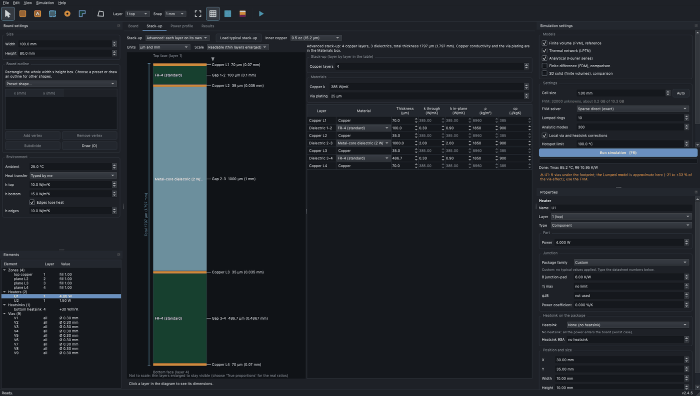

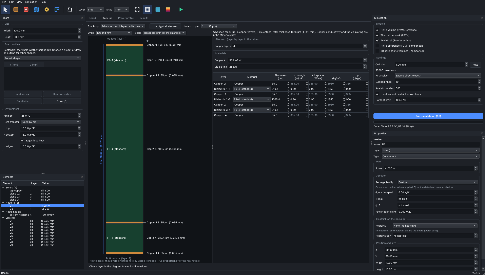

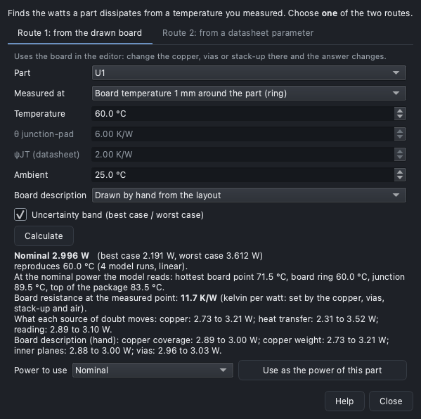

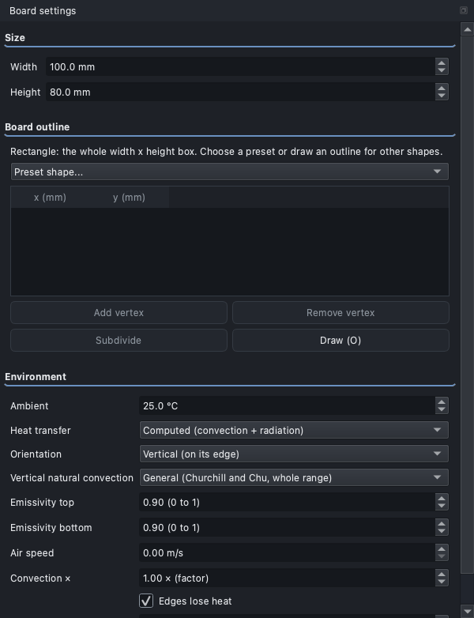

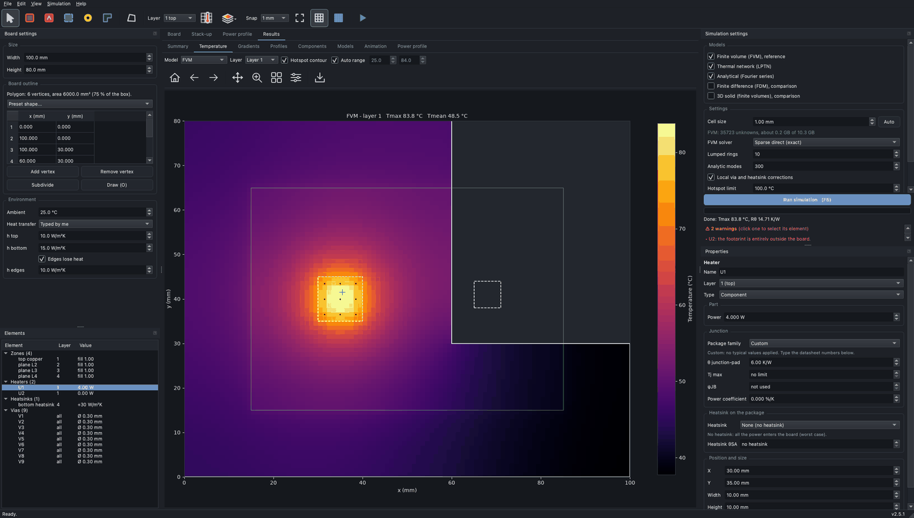

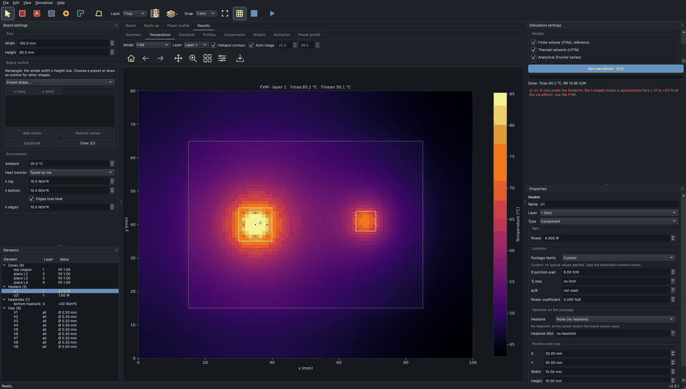

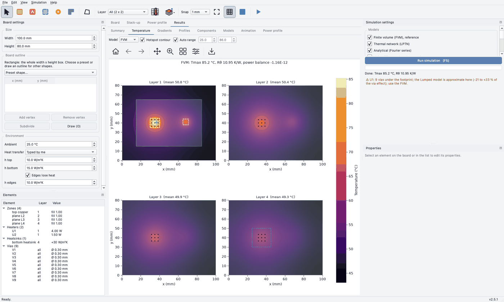

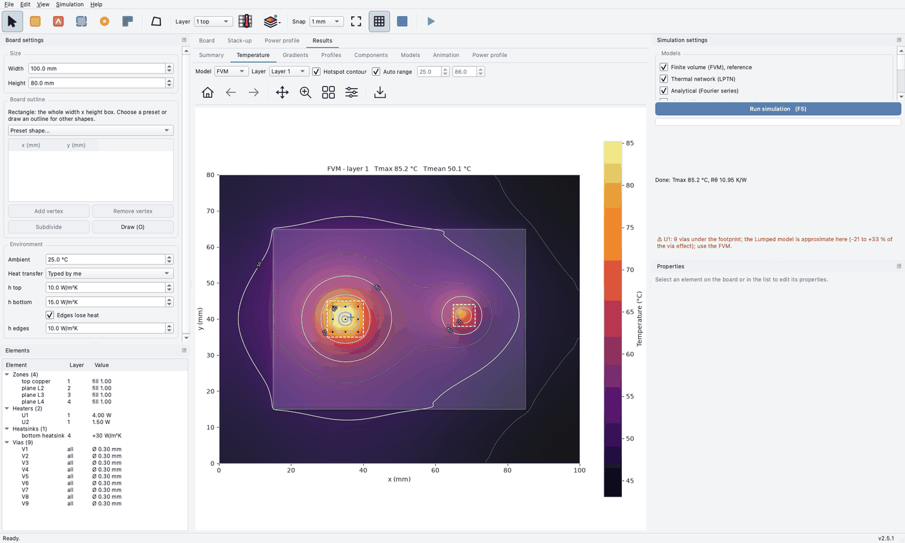

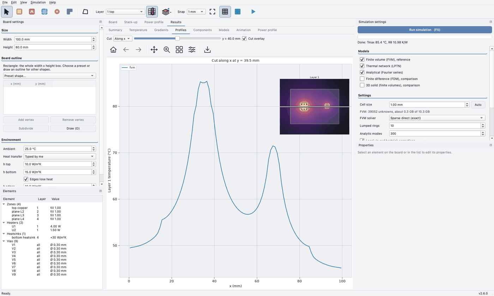

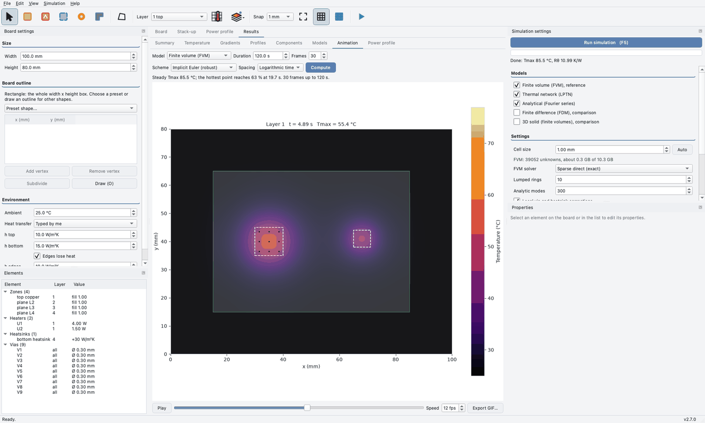

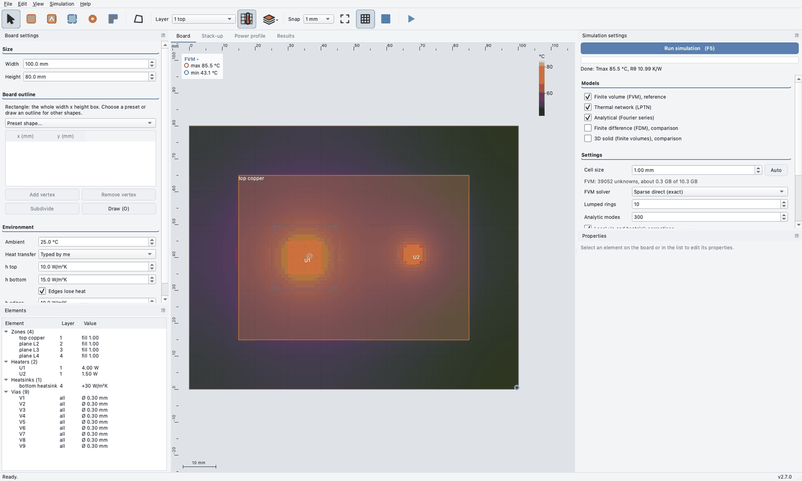

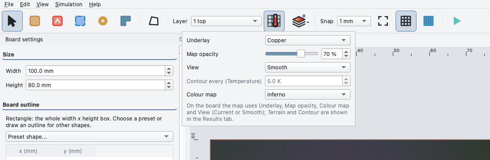

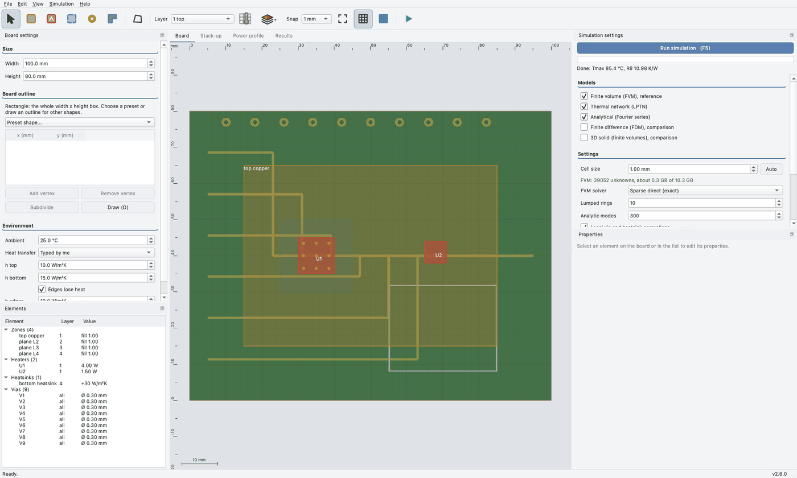

Every equation, discretisation and approximation of every model is in [`docs/theory.md`](docs/theory.md); the auxiliary calculators (today the Power Calculator, with its validation against datasheets) in [`docs/calculators.md`](docs/calculators.md).

What is new in each version: see [`docs/versions.md`](docs/versions.md) (summary at the top) and [`CHANGELOG.md`](CHANGELOG.md).

## Which model should I use?

| Model | Advantage | Apply it to | Error on the rise vs a 3D solid | Time (example board) |
| :-- | :-- | :-- | :-- | :-- |
| **FVM** (finite volumes) | reference, any geometry, full field, transient and animation | final answers, any board with a warning, via arrays, heat-up behaviour | 0.1 to 0.7 % (up to 3 % on a one-sided pad no larger than the heater) | 0.13 s (1 mm) |
| **FDM** (finite differences) | the same equations on grid points, independent check of the FVM | comparing discretisations (steady state, animation, power profiles) | 0.4 to 2.4 % | 0.12 s |
| **3D solid** (finite volumes in 3D) | real slabs for every copper layer and gap, vias with their copper area, metal blocks; no "one node per layer" assumption | checking the layered models on your own board (small pads, copper edges, thick blocks); steady state only | 0 to 1.6 % | 0.1 to 10 s |
| **Lumped** (thermal network) | fastest, built from the real footprint and outline, several heaters heat each other; a part over a dense group of vias has the footprint in two zones (core and rest), on a 0.5 mm cell | design exploration, parameter sweeps, ranking layouts | 0.1 to 4.6 % | about 10 ms |
| **Analytic** (cosine series) | exact on uniform boards, independent of the FVM, shows the physics | quick estimates with solid planes, checking the FVM, teaching | 0 to 1.5 % on uniform boards and with vias, 24 % with a small copper pad | about 50 ms without vias, a few tenths of a second with vias |

The lumped network and the analytic series need a rectangular board: on a board with an outline they run on the rectangle of the same area (the Results summary says so with a warning); every model reads the advanced stack-up.

Rule of thumb: run them all (`--model compare`); if they agree within about 5 % and there are no warnings the numbers are consistent; if not, trust the FVM.
**No model has been compared with a measurement of a physical board yet**; see the limits in [`docs/validation.md`](docs/validation.md).

## Install

```sh
git clone https://github.com/silvapmm/pcb-thermal-lab.git
cd pcb-thermal-lab
python3 -m venv .venv
.venv/bin/pip install -r requirements.txt     # numpy, scipy, matplotlib, PySide6, pytest
```

## Use

```sh
.venv/bin/python -m pcbthermal gui                                         # application
.venv/bin/python -m pcbthermal convert board.pcbt.json board.pcbtz         # project package (a ZIP: project, image and, on request, the Gerber and placement files); every command reads a .pcbtz
.venv/bin/python -m pcbthermal run examples/example_board.pcbt.json        # command line: all models, report, plots (--model compare adds the FDM and the 3D solid)
.venv/bin/python -m pcbthermal run --duration cycles --cycles 4 examples/profile_board.pcbt.json
.venv/bin/python -m pcbthermal transient examples/example_board.pcbt.json --gif   # animation
.venv/bin/python -m pcbthermal solvers examples/example_board.pcbt.json    # direct matrices vs CG vs SOR
.venv/bin/python -m pcbthermal run examples/example_board.pcbt.json --memory-fraction 0.5   # limit of this run; exit code 3 if a model is refused (PCBTHERMAL_MEMORY_BYTES states the memory when it is not visible)
.venv/bin/python -m pcbthermal run examples/example_board.pcbt.json --laminate-s-max-mm 0.2 --laminate-n-max 8 --natural-form laminar
.venv/bin/python -m pcbthermal --version
.venv/bin/python -m pytest -q tests
```

```python
from pcbthermal import Problem, SolverOptions, simulate

p = Problem.new(width_mm=100, height_mm=80, layers=4)
p.add_full_copper().add_heater(1, 4.0, rect=(30, 35, 40, 45), name="U1", theta=6.0)
sim = simulate(p, SolverOptions(cell_mm=1.0))
print(sim.to_markdown())          # models, errors against the reference, warnings
sim.save("results")               # report, JSON, CSV fields, figures
```

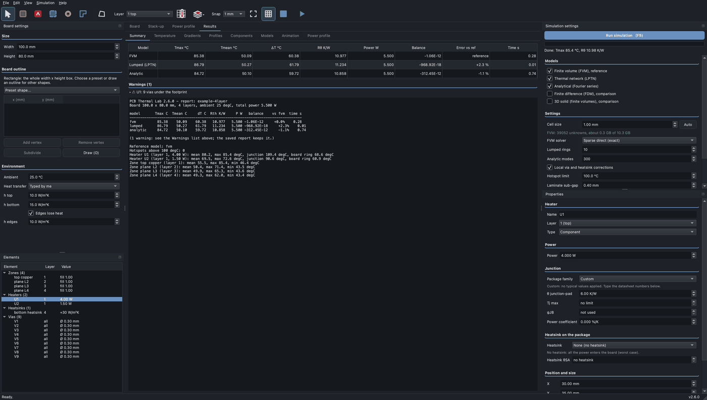

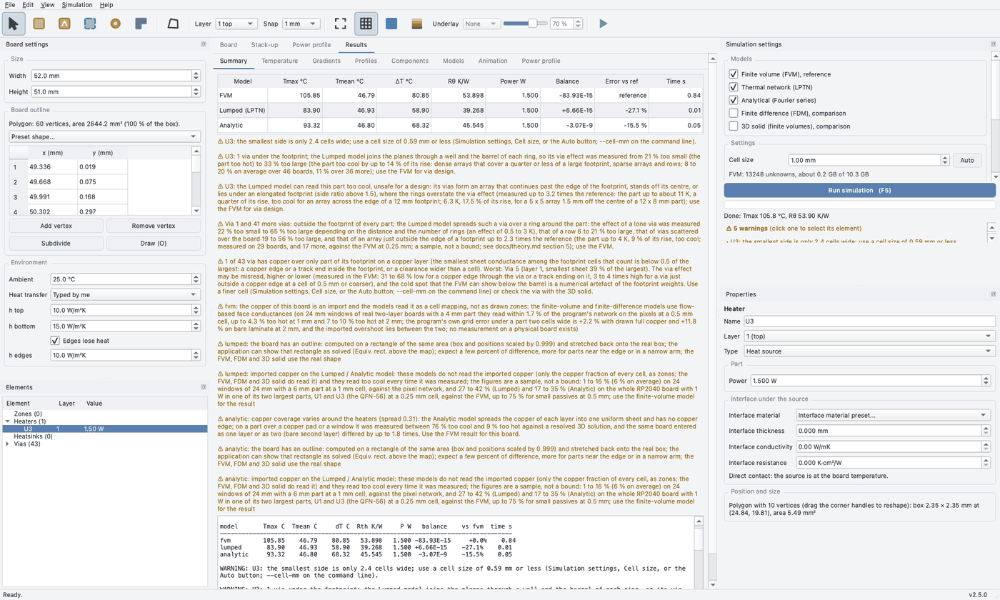

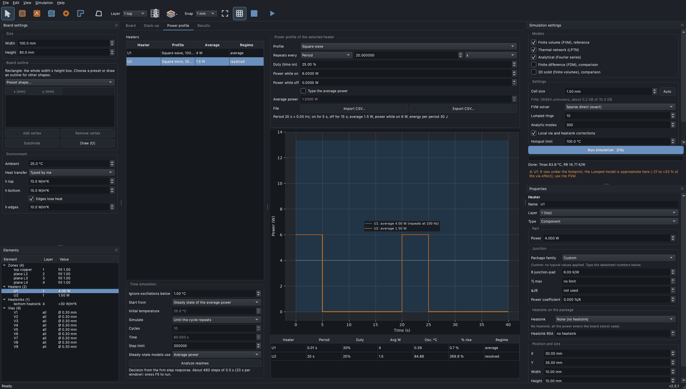

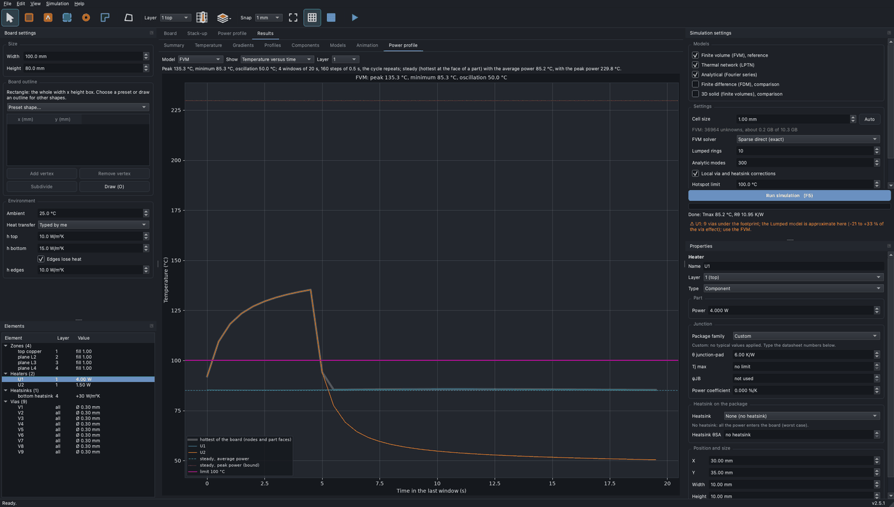

## Help us test your CAD tool

PCB Thermal Lab reads Gerber, Excellon and placement files with its own reader, and recognises the program that wrote them from the headers of the files. It was tested on files from KiCad, Altium, EAGLE, Allegro, Xpedition and several others (the honest list, with the number of sample sets of each, is in `docs/models.md` 19.3). Not tested: Zuken CR-8000 and CR-5000, CADSTAR, PADS Professional, Allegro X, OrCAD X, a recent Xpedition, EasyEDA Pro, Horizon. If you use one of them or a version we have not seen, a sample helps more than anything else.

* **What to send**: one complete fabrication output (Gerber, drill and placement files, and the output settings if you can) of a board you are free to share, such as a demonstration or open-hardware board. If you cannot share a board, the first 30 lines of one copper Gerber and one drill file are already useful. Remove or replace anything private first (file headers may hold a user name, a computer name or a folder path).
* **How**: open an issue on the project's GitHub page and attach the files, or say there how you would rather send them. The program never uploads anything: no file leaves your computer unless you send it.
* **What we do with it**: we only read which program wrote the files and how it writes them (the header lines, the units and formats, the names of the layers) and check that the reader understands them. We do not commit your files to the repository or publish them; we keep only the counts and the conventions we learned, and we credit you if you wish. Tell us the licence under which we may keep the files for testing.

## Documentation

In the program: **Help - User guide** (`F1`; the same file is `pcbthermal/help/index.html`) explains every parameter, model and result. In the repository:
[`docs/versions.md`](docs/versions.md) (what was implemented in every version, where and how it is tested, and what is planned),
[`docs/models.md`](docs/models.md) (the models, power profiles, computed heat transfer, which model to use),
[`docs/theory.md`](docs/theory.md) (every equation and approximation),
[`docs/validation.md`](docs/validation.md) (the same scenarios in every model, against a 3D solid, the old program and the solvers),
[`docs/calculators.md`](docs/calculators.md) (the Power Calculator) and the release notes [`CHANGELOG.md`](CHANGELOG.md). An example with power profiles from CSV files: [`examples/csv_profiles`](examples/csv_profiles).

## Versions

Semantic versioning; the version is defined in `pcbthermal/__init__.py` and shown in the title bar, status bar, About box and every report. Details of each version are in [`docs/versions.md`](docs/versions.md).

- **2.7.0** (2026-11-13): the GUI redesign (boxes, a collapsible Warnings list, layer keys), the cut overlay of the profile plots, the coldest-point marker, the edge film from the centroid for drawn and imported copper, the physical slabs of the simple stack-up, the harmonic FDM face and the FDM copper-edge faces, the ray rule of the via rim on imported copper, the Lumped lone via, the hole categories, edge warnings quoting an independent finite-element solution (`research/independent-fem-edge`), and the five small bug fixes; the frozen numbers refrozen once (details in [`CHANGELOG.md`](CHANGELOG.md)).
- **2.6.0** (2026-11-07): model corrections after the independent reviews (cut cells, laminate edge band, via barrel, Analytic per-layer edge, 3D solid slabs, face-down convection, fast square waves), the project package `.pcbtz`, a single Layer box, the Display views on the board; the frozen numbers refrozen once.
- **2.5.2** (2026-11-07): fixes: non-finite and absurd lengths refused on load and never written, the Pulsonix placement preamble, the licence header on every file, the re-import of a different board, theory text corrections (details in [`CHANGELOG.md`](CHANGELOG.md)).
- **2.5.1** (2026-11-06): the Display control and the map card, the Smooth and Terrain views and the underlay of the Results maps, copper drawn at 4096 pixels, the re-import of Gerber files, the checks of project files, the faster outline check, the memory estimate fix, warning texts by context and the toolbar icons; no model changes.
- **2.5.0** (2026-11-05): the Gerber import and the imported copper, parts from the paste layers with the exposed pad as the heat source, the memory guard, a faster direct solver for boards with many vias, the zonal Lumped model, the convective edge in the Analytic model, the mirror image of a board edge for vias, laminate options and more live warnings; the list with the numbers is in [`CHANGELOG.md`](CHANGELOG.md).
- **2.4.5** (2026-11-01): fixes only: vias converge with the cell in the FVM and FDM and are coupled in the SOR, the Lumped and Analytic models carry the constriction of the heat on a via, laminate nodes for patterned copper, a part across the board outline is weighted by its intersection, one factorisation for the top-path split, the SOR relaxation factor, and warnings of the limits of the models. Details in [`CHANGELOG.md`](CHANGELOG.md).
- **2.4.4** (2026-10-29): the Simulation footer stays in sight on a low window, a decimal comma pasted from the right-click menu is read as a point, and the warning for plate fins that are too close is now a check after the run on the channel Rayleigh number, with a text that follows the orientation of the board; no result changes.
- **2.4.3** (2026-10-29): corrections found by the investigations: a metal block is cut at the board outline, zones that meet inside a cell keep the copper of both, the top path exists only on a component, the 3D solid keeps the copper of a large via, the unknowns shown are the ones the models have, the via field is the drill diameter, plus an input warning for a source with component fields and small interface cleanups.
- **2.4.2** (2026-10-29): a reviewed interface (wider panels, Preferences as a list of sections, the decimal point everywhere, engineering notation for very small and very large numbers, a list of the input warnings), the Power Calculator with the uncertainty of the board description, an inner copper choice of 1 oz, corrections for one-layer boards, board outlines, the top path and finned blocks, measured run times and shorter documents.
- **2.4.1** (2026-10-22): the MIT licence stated the same way in LICENSE, README and the About box, and a note that results are not validated against a physical board; no change to the models.
- **2.4.0** (2026-10-22): parts with a junction temperature and a heatsink on the package, advanced stack-up with a cross-section view, any board outline, calculations that can be cancelled, the Power Calculator, a built-in user guide, tooltips and Preferences.
- **2.3.0** (2026-10-17): the finite-difference model also does animation and power profiles, metal blocks (heat spreaders) and the 3D solid model.
- **2.2.0** (2026-10-16): power tables from CSV files, a finite-difference model, a better analytic time response, a 3D check and a stress-tested application.
- **2.1.0** (2026-10-16): square-wave power profiles and heat transfer coefficients computed from the board temperature.
- **2.0.0** (2026-10-16): first release of the rebuilt program (the original wxPython program was 1.0.0, tag `legacy-wxpython-1.0.0`).

## Research

The investigations behind the models (what was simulated, compared and read, with figures) are in [`research/`](research/README.md), one folder per investigation; the scripts that reproduce the tables of `docs/validation.md` are there.

## Author and license

Pedro Silva, PMS Labs. Released under the MIT License (see `LICENSE`). The licence covers **everything that is ours** in this repository: the code (`pcbthermal/`, `examples/`, `tests/`), the documents (`README.md`, `CHANGELOG.md`, `docs/`, the user guide in `pcbthermal/help/`), the investigations (`research/`: documents, scripts and figures), the screenshots in `docs/images/` and the application icon in `ico/`. What is not ours keeps its owner's licence: the libraries below, the quoted sources (figures, catalogue numbers and short extracts are cited with their origin) and any downloaded board, which is never committed.

The results are a design aid and have not been validated against measurements of a physical board (see `docs/validation.md`); verify critical results by measurement. Third-party libraries are **not** part of this repository (they are installed from `requirements.txt` by `pip`) and keep their own licences. Read from the installed packages on 2026-10-23 (the exact text is in each package):

| Library | Used for | Licence |
| :-- | :-- | :-- |
| NumPy 2.5 | physics core | BSD-3-Clause (the wheel also carries 0BSD, MIT, Zlib and CC0 parts) |
| SciPy 1.18 | sparse solvers, physics | BSD-3-Clause |
| Matplotlib 3.11 | figures | Matplotlib licence (based on the Python Software Foundation licence, BSD-compatible) |
| PySide 6.12 (Qt for Python) | the desktop application | LGPL-3.0 **or** GPL-2.0 **or** GPL-3.0 (Qt also sells a commercial licence) |
| pytest, pytest-qt, pytest-timeout | tests only | MIT |
| **pypdfium2 5.15.2** (developer tool only: `tools/ocr/`, never imported by `pcbthermal`, not in `requirements.txt`) | rendering PDF pages and reading their text layer for the OCR tool | **BSD-3-Clause or Apache-2.0** (the `License` field of the metadata of the package installed from PyPI in a scratch virtual environment outside the repository reads `BSD-3-Clause, Apache-2.0, dependency licenses`, with the notices in `licenses/` of the wheel; checked on 2026-11-12, version 5.15.2); it bundles the Google PDFium library (Apache-2.0 / BSD-3-Clause) and permissive third-party libraries whose notices ship in the wheel; no Python dependency |

The Gerber reader adds **no dependency** (NumPy and SciPy only; the comparison tools of the Gerber research stay in `research/`). The developer tool `tools/ocr/` (not part of the program, never imported by `pcbthermal`) uses the standard library for its providers (Gemini, Anthropic and OpenRouter over HTTPS, key in the environment or `.ocr_keys`); its page rendering, text-layer, `assemble` and `map` commands import pypdfium2 (and Pillow, which Matplotlib already brings; Pillow 13.0.0 reads `MIT-CMU` in its metadata, the permissive HPND-style licence), which is not in `requirements.txt` and not installed in the project environments (the tool is run from a separate environment that has it). pypdfium2 is permissive (BSD-3-Clause or Apache-2.0) and is **installed with `pip` and imported, never copied or vendored into the repository**.

The MIT licence of this project and these licences are compatible: the code here only imports the libraries. If you **distribute a bundled application** that contains PySide 6 and Qt (for example a frozen executable), the LGPL conditions of Qt apply to that bundle (include the LGPL text and the notices, allow the Qt libraries to be replaced, and provide or offer the Qt source); this repository does not bundle them. This is not legal advice. The studies in `research/` may also use scikit-fem (BSD) as an offline cross-check; downloaded boards are never committed and keep their own licences.
