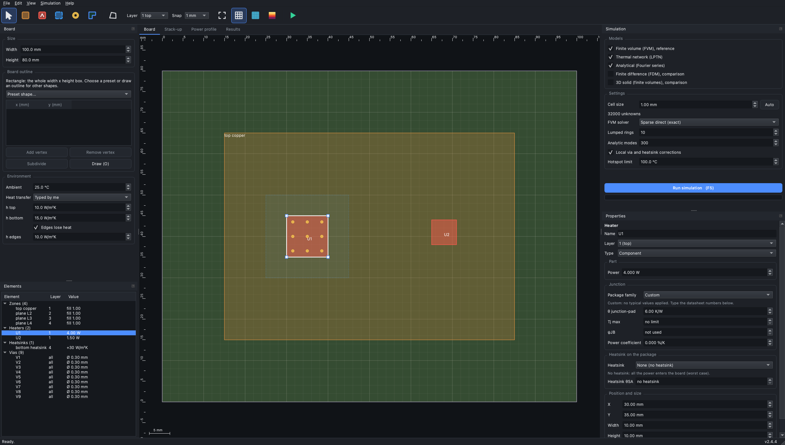
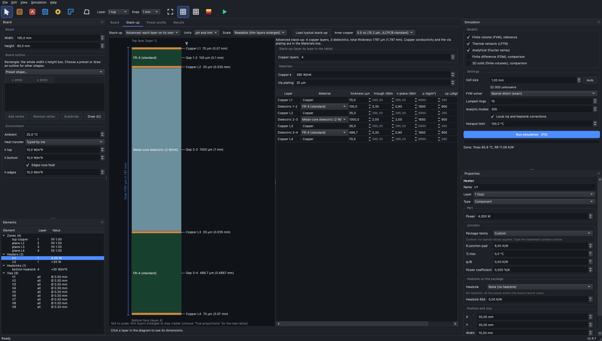
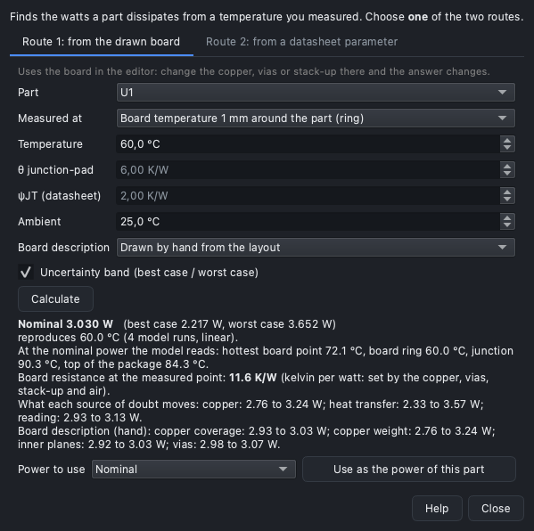
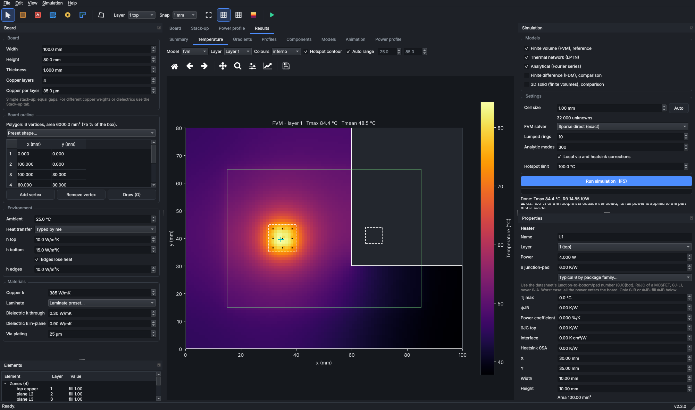
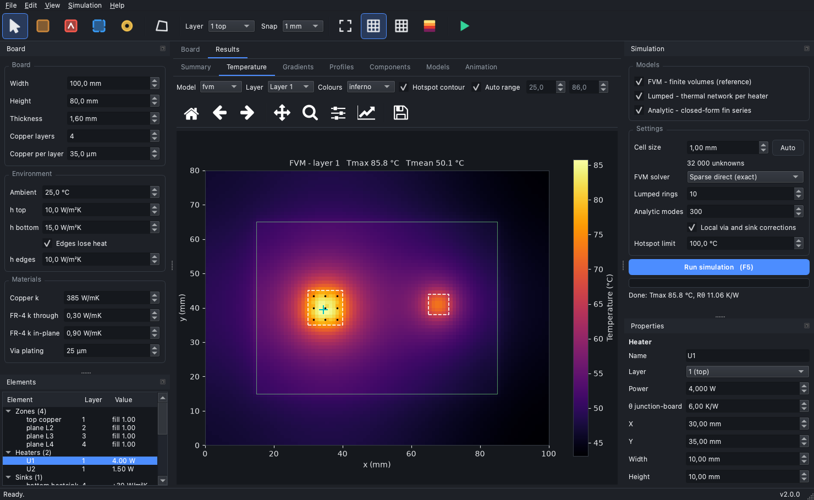
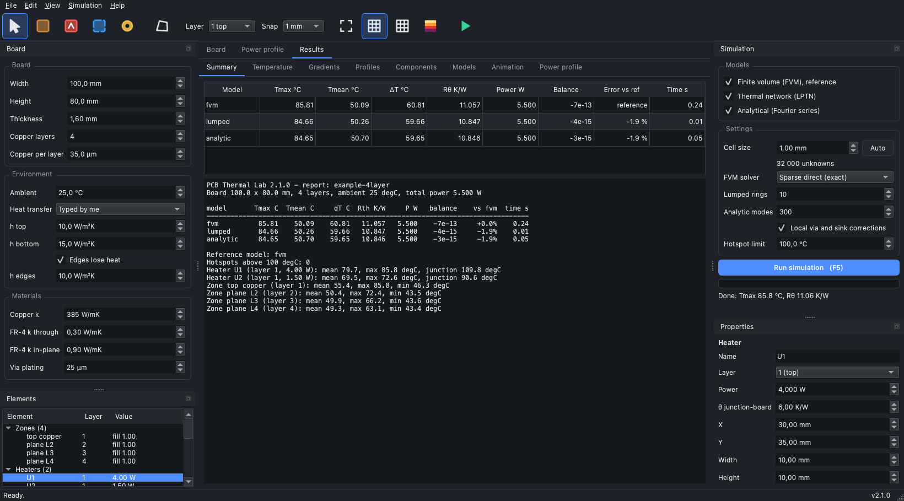
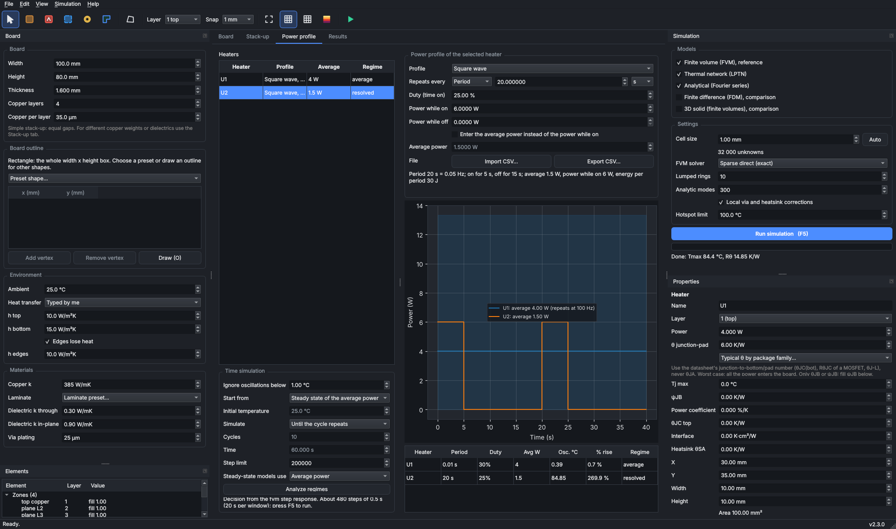
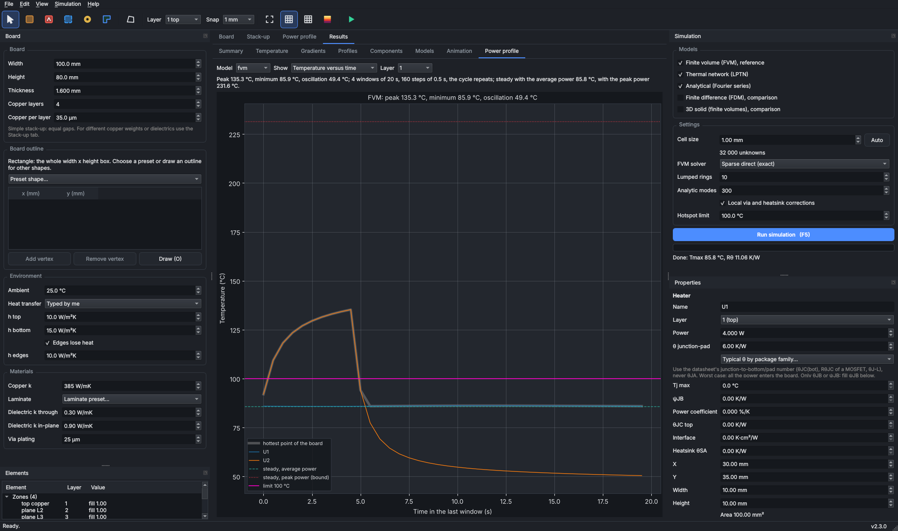

# PCB Thermal Lab

[](CHANGELOG.md) [](tests)

Thermal simulation of printed circuit boards. Draw copper zones, heaters, vias and heatsinks on a multi-layer board, run the models and inspect temperatures,
gradients, hotspots, component junction temperatures and the heat evolution in time.

## Features

**Modelling**
- **Five models on one board description** (finite volumes, finite differences, 3D solid, thermal network, analytical series), cross-checked against each other and against an independent 3D solid, each reporting an exact energy balance.
- **Stack-up**: a simple mode (equal layers, one laminate) and an **advanced mode** with a thickness per copper layer and a thickness and material per dielectric (FR-4, polyimide, PTFE-ceramic, metal-core, alumina, AlN presets), in **all five models**, with a **cross-section diagram** in µm and mm and typical stack-ups of 1 to 12 layers with inner copper of 0.5 oz (default) or 1 oz.
- **Any board shape**: an outline polygon (presets, vertex table, drawing tool) in the FVM, FDM and 3D solid.
- **Parts**: junction temperature from a datasheet resistance (worst case), junction limit with margin and power limit, ψJB estimate, a power that grows with temperature (with runaway detection) and a **heatsink on the package** (θJC(top) + interface + θSA).
- **Metal blocks** (heat spreaders with an interface resistance, optional fins) in all five models (the Lumped and Analytic have them in steady state only), plated vias (hollow or filled), heatsinks.
- **Computed heat transfer coefficients**: natural or forced convection plus radiation from the board temperature, with a calibration multiplier; the vertical-board correlation has a general (default) and a laminar form (`Board.natural_form`).
- **Power profiles**: square waves and CSV tables per heater, averaged or simulated in time automatically; animation of the heat evolution with GIF export.

**Tools**
- **Power Calculator** (with a *Board description* level that adds the doubt about how the board is drawn to the best / nominal / worst band): the power of a part from a temperature measured on the board ring, under the part, in the junction or on the top of the package (by the drawn board, or from a datasheet ψ/θ parameter); validated against datasheets (`docs/calculators.md`).
- **Interactive editor** (PySide 6): rectangles and polygons, rulers and a scale bar, undo/redo, background photo, dark and light themes, a tooltip on every field.
- **Simulations run in a separate process**: the window never freezes, a run can be **cancelled** at any moment and nothing is left running when you close the program.
- **Built-in help**: an HTML user guide (**Help - User guide**, `F1`), an About box, and a keyboard shortcut list.
- **Input checks** that warn when a model is doubtful (heater off the board, no copper under a heater, a copper edge crossing a heater, a neck of the outline too narrow, ...).
- **Command line and Python API** for scripts and parameter sweeps; project files in plain JSON that store every parameter.













Every equation, discretisation and approximation of every model is in [`docs/theory.md`](docs/theory.md); the auxiliary calculators (today the Power Calculator, with its validation against datasheets) in [`docs/calculators.md`](docs/calculators.md).

## Which model should I use?

| Model | Advantage | Apply it to | Error on the rise vs a 3D solid | Time (example board) |
| :-- | :-- | :-- | :-- | :-- |
| **FVM** (finite volumes) | reference, any geometry, full field, transient and animation | final answers, any board with a warning, via arrays, heat-up behaviour | 0.4 to 2.2 % | 0.13 s (1 mm) |
| **FDM** (finite differences) | the same equations on grid points, independent check of the FVM | comparing discretisations (steady state, animation, power profiles) | 0.5 to 4 % | 0.12 s |
| **3D solid** (finite volumes in 3D) | real slabs for every copper layer and gap, vias with their copper area, metal blocks; no "one node per layer" assumption | checking the layered models on your own board (small pads, copper edges, thick blocks); steady state only | 0 to 1.6 % | 0.1 to 10 s |
| **Lumped** (thermal network) | fastest, built from the real footprint and outline, several heaters heat each other | design exploration, parameter sweeps, ranking layouts | 0.1 to 4.5 % | about 10 ms |
| **Analytic** (cosine series) | exact on uniform boards, independent of the FVM, shows the physics | quick estimates with solid planes, checking the FVM, teaching | 0 to 1.5 % on uniform boards and with vias, 24 % with a small copper pad | about 50 ms |

The lumped network and the analytic series need a rectangular board: on a board with an outline they run on the rectangle of the same area (the Results summary says so with a warning); every model reads the advanced stack-up.

Rule of thumb: run them all (`--model compare`); if they agree within about 5 % and there are no warnings the numbers are consistent; if not, trust the FVM.
**No model has been compared with a measurement of a physical board yet**; see the limits in [`docs/validation.md`](docs/validation.md).

## Install

```sh
git clone https://github.com/silvapmm/pcb-thermal-lab.git
cd pcb-thermal-lab
python3 -m venv .venv
.venv/bin/pip install -r requirements.txt     # numpy, scipy, matplotlib, PySide6, pytest
```

## Use

```sh
.venv/bin/python -m pcbthermal gui                                         # application
.venv/bin/python -m pcbthermal run examples/example_board.pcbt.json        # command line: all models, report, plots (--model compare adds the FDM and the 3D solid)
.venv/bin/python -m pcbthermal run --duration cycles --cycles 4 examples/profile_board.pcbt.json
.venv/bin/python -m pcbthermal transient examples/example_board.pcbt.json --gif   # animation
.venv/bin/python -m pcbthermal solvers examples/example_board.pcbt.json    # direct matrices vs CG vs SOR
.venv/bin/python -m pcbthermal --version
.venv/bin/python -m pytest -q tests
```

```python
from pcbthermal import Problem, SolverOptions, simulate

p = Problem.new(width_mm=100, height_mm=80, layers=4)
p.add_full_copper().add_heater(1, 4.0, rect=(30, 35, 40, 45), name="U1", theta=6.0)
sim = simulate(p, SolverOptions(cell_mm=1.0))
print(sim.to_markdown())          # models, errors against the reference, warnings
sim.save("results")               # report, JSON, CSV fields, figures
```







## Documentation

In the program: **Help - User guide** (`F1`; the same HTML file is `pcbthermal/help/index.html`) explains every parameter, every model and the results. In the repository:
[`docs/versions.md`](docs/versions.md) (what was implemented in every version, where and how it is tested), and three technical documents: [`docs/models.md`](docs/models.md) (what the models are, how they work, power profiles, computed heat transfer coefficients, which one to use),
[`docs/validation.md`](docs/validation.md) (the same scenarios in every model, against a 3D solid, the old program, solvers, time-dependent checks) and
[`docs/roadmap.md`](docs/roadmap.md) (planned work and its evidence, and the ideas taken from similar projects such as the KiCad thermal plug-ins). A documented example with power profiles from CSV files: [`examples/csv_profiles`](examples/csv_profiles).
Short release notes: [`CHANGELOG.md`](CHANGELOG.md).

## Versions and branches

- Version **2.4.1** (2026-10-22): the MIT License stated consistently (LICENSE, README, About box, CLAUDE.md) and a note that results are not validated against a physical board; no change to the models.
- Version **2.4.0** (2026-10-22): parts with junction temperature, a heatsink on the package, advanced stack-up, board outlines, cancellable calculation process, power calculator, help and tooltips (details in [`docs/versions.md`](docs/versions.md)).
- Version **2.3.0** (2026-10-17): the finite-difference model also does animation, step responses and power profiles; metal blocks; the 3D solid model.
- Version **2.2.0** (2026-10-16): power tables from CSV files, a finite-difference model, a per-heater analytic transient, a 3D-solid validation and clean documents.
- Version **2.1.0** (2026-10-16): power profiles (square wave) and computed heat transfer coefficients.
- Version **2.0.0** (2026-10-16): first release of the rebuilt program. The original wxPython program was 1.0.0 (git tag `legacy-wxpython-1.0.0`).
- `main`: released versions, tagged `vMAJOR.MINOR.PATCH`. `develop`: integration branch for the next version. Work happens on feature branches.
- Semantic versioning; the version is defined in `pcbthermal/__init__.py` and shown in the application (title bar, status bar, About) and in every report.

## Research

The investigations behind the models (what was simulated, compared and read, with figures) are in [`research/`](research/INDEX.md), one folder per investigation; the scripts that reproduce the tables of `docs/validation.md` are there.

## Author and license

Pedro Silva, PMS Labs. Released under the MIT License (see `LICENSE`). The licence covers **everything that is ours** in this repository: the code (`pcbthermal/`, `examples/`, `tests/`), the documents (`README.md`, `CHANGELOG.md`, `docs/`, the user guide in `pcbthermal/help/`), the investigations (`research/`: documents, scripts and figures), the screenshots in `docs/images/` and the application icon in `ico/`. What is not ours keeps its owner's licence: the libraries below, the quoted sources (figures, catalogue numbers and short extracts are cited with their origin) and any downloaded board, which is never committed.

The results are a design aid and have not been validated against measurements of a physical board (see `docs/validation.md`); verify critical results by measurement. Third-party libraries are **not** part of this repository (they are installed from `requirements.txt` by `pip`) and keep their own licences. Read from the installed packages on 2026-10-23 (the exact text is in each package):

| Library | Used for | Licence |
| :-- | :-- | :-- |
| NumPy 2.5 | physics core | BSD-3-Clause (the wheel also carries 0BSD, MIT, Zlib and CC0 parts) |
| SciPy 1.18 | sparse solvers, physics | BSD-3-Clause |
| Matplotlib 3.11 | figures | Matplotlib licence (based on the Python Software Foundation licence, BSD-compatible) |
| PySide 6.12 (Qt for Python) | the desktop application | LGPL-3.0 **or** GPL-2.0 **or** GPL-3.0 (Qt also sells a commercial licence) |
| pytest, pytest-qt, pytest-timeout | tests only | MIT |

The MIT licence of this project and these licences are compatible: the code here only imports the libraries. If you **distribute a bundled application** that contains PySide 6 and Qt (for example a frozen executable), the LGPL conditions of Qt apply to that bundle (include the LGPL text and the notices, allow the Qt libraries to be replaced, and provide or offer the Qt source); this repository does not bundle them. This is not legal advice. The studies in `research/` may also use scikit-fem (BSD) as an offline cross-check; downloaded boards are never committed and keep their own licences.
