# PCB Thermal Lab: User Manual

Program version 2.8.0 · PMS Labs · MIT licence

This manual is for engineers and technicians who want to know how hot a printed circuit board
and its parts will run. It explains how to install the program, walks through every window,
gives step-by-step tutorials, lists every setting, and explains how to read the results, the
warnings, the files and the command line.

It is a manual of *what to do and what you see*. The physics (every equation, approximation and
constant) is in [docs/theory.md](theory.md); the checks of every model against independent
solutions are in [docs/validation.md](validation.md); the models in more depth are in
[docs/models.md](models.md); the Power Calculator's formulas and checks are in
[docs/calculators.md](calculators.md). Inside the program, **Help - User guide** (`F1`) is the
short reference of the same material.

All screenshots come from real runs of the program, made by `examples/make_screenshots.py`.
The screenshots of an imported board show the RP2040 minimal design (Raspberry Pi,
BSD-3-Clause licence), imported from its Gerber files. The numbers in an annotated screenshot
match the numbered list after it. Some screenshots were taken with an earlier 2.x version (the
status bar shows it); the controls they show are unchanged.

Features marked "since 2.9.0" are in the development tree and come with the next release.

## Contents

1. About the program
2. Installation
3. A tour of the window
4. Tutorials
5. Reading the results
6. Settings reference
7. The models
8. The Power Calculator
9. Importing Gerber files
10. Files and formats
11. Command-line reference
12. Limits of the models
13. Troubleshooting and FAQ
14. Glossary

## 1. About the program

### 1.1 What it does

PCB Thermal Lab computes the temperature of a printed circuit board (PCB). You describe:

- the **board**: its size and shape, the number of copper layers and the stack-up (copper and
  dielectric thicknesses and materials);
- the **copper**: zones (planes, pours, pads) drawn on each layer, or the real copper read from
  the Gerber files of the board;
- the **heaters**: the parts that dissipate power, with their power in watts and, if you want,
  the datasheet numbers of the part (junction-to-pad resistance, maximum junction temperature);
- the **vias** that carry heat between the layers, and the **heatsinks** or metal blocks that
  cool an area;
- the **cooling**: the ambient temperature and the heat transfer coefficients of the faces and
  edges, typed or computed from natural or forced convection plus radiation.

The program then solves the heat equation and shows:

- temperature maps of every layer, the hottest and coldest points, the gradients and profiles
  along a cut;
- for each part: the board temperature under it, the junction temperature, the margin to its
  limit and the largest power it can take on this board;
- the same numbers from several independent models side by side, so that you can see how far
  they agree;
- how the board heats up in time (an animation of a power step) and how it follows power that
  changes in time (square waves, tables from CSV files);
- reports, CSV tables and figures for your own documents.

### 1.2 The six models in brief

All models solve the same board. They differ in how they cut it up and how fast they are.
Every model has one long name (in the Models box) and one short name (on cards, tabs, tables and
legends).

| Short name | Long name | In one sentence |
| :-- | :-- | :-- |
| FVM | Finite volume (FVM), reference | The board cut into cells, one node per copper layer and cell; the reference of the program. |
| LPTN | Thermal network (LPTN) | A small network of thermal resistances around each heater; the fastest. |
| Analytic | Analytical (Fourier series) | A closed-form series solution of a uniform layered board, with local corrections. |
| FDM | Finite difference (FDM) | The same layered equations on grid points; an independent check of the FVM. Off by default. |
| 3D solid | 3D solid (finite volumes) | The board as a real 3D solid, every copper layer and gap a slab; steady state only. Off by default. |
| FEM | Finite elements (FEM) | Hexahedral finite elements, several through thick copper, hollow vias resolved. Off by default. |

The first three are the **main models** (ticked by default). The last three are **cross-check
models**: they are off by default and are used to check the main ones. Chapter 7 says what each
model is for and when it is weak. The README of the project has a table "Which model should I
use?" with the error of each model against an independent solution.

**Rule of thumb.** Run the FVM first. Add the others to check the answer. If they agree within
about 5 % and there are no warnings, the numbers are consistent. If they do not, trust the FVM.

### 1.3 What it does not do

- **No model has been compared with a measurement of a physical board.** The models are checked
  against each other, against an independent 3D finite-element solution, against closed-form
  solutions and against published cases. Every report starts with the line "PCB Thermal Lab is
  a design aid. Its models have not yet been compared with measurements of a real board:
  validate critical designs by measurement."
- The package of a part is not modelled: a part is a heat source on its footprint, with a
  junction-to-pad resistance θ from its datasheet.
- The computed heat transfer coefficients are published correlations of a plate in open air. A
  board in an enclosure, a tilted board or air blocked by other parts is not modelled.
- Electrical current in the copper (Joule heating of the tracks) is not computed: you give the
  power of each heater.

Chapter 12 lists the limits of each model and points to the documents that measure them.

### 1.4 Where to find more

| Document | What it holds |
| :-- | :-- |
| **Help - User guide** (`F1`) | The in-program guide: every parameter, short. The same file is `pcbthermal/help/index.html`. |
| `README.md` | Features, install, the model table, versions. |
| `docs/models.md` | The models, power profiles, computed heat transfer, the Gerber reader. |
| `docs/theory.md` | Every equation and approximation, with the sources. |
| `docs/validation.md` | The same scenarios in every model and against independent references. |
| `docs/calculators.md` | The Power Calculator: formulas, checks against datasheets. |
| `CHANGELOG.md`, `docs/versions.md` | What changed in each version. |
| `examples/csv_profiles/README.md` | A worked example of power profiles from CSV files. |

## 2. Installation

### 2.1 Requirements

- macOS, Linux or Windows.
- To run from the source code: Python 3.13 and about 1.5 GB of disk space for the virtual
  environment (Qt is the largest part).
- Memory: a typical board needs well under 1 GB. Fine cells, the 3D solid and the FEM need more;
  the program estimates the memory of every run before it starts (section 6.4).

The libraries are installed by `pip` from `requirements.txt`: NumPy and SciPy (the physics),
Matplotlib (figures), PySide 6 (the window), pyamg (the finite-element model on large meshes;
optional at run time) and pytest (the tests).

### 2.2 Ready-to-run packages

Ready-to-run packages (no Python needed) come with version 2.9.0 (their build is in the
development tree; no earlier version has them). A release that carries them attaches them to
the release on the project's GitHub page (*Releases*), one per system:

| System | Package |
| :-- | :-- |
| Windows (64-bit) | `PCB-Thermal-Lab-<version>-windows-x64.zip` |
| Linux (64-bit, glibc 2.35 or newer) | `PCB-Thermal-Lab-<version>-linux-x64.tar.gz` |
| macOS (Apple silicon, macOS 14 or newer) | `PCB-Thermal-Lab-<version>-macos-arm64.zip` |

Each package is a **folder**, not a single file. Unpack the whole archive somewhere you can
write to and start the program inside it. Keep the folder intact: the files next to the program
are needed. Nothing is installed on the system.

To check a package, run `PCB-Thermal-Lab --selftest` (on Windows the `PCB-Thermal-Lab-cli`
program prints the result). It checks the imports, the files, the window, a solve through the
calculation process and the energy balance, and exits with a code that says the result.

**First run.** The packages are not signed, so the first start asks for a confirmation:

1. **macOS**: open the app once and click **Done** on the warning. Then open **System Settings -
   Privacy & Security**, find the line about PCB Thermal Lab under *Security*, click **Open
   Anyway**, confirm and authenticate with your password or Touch ID.
2. **Windows**: SmartScreen says "Windows protected your PC". Click **More info**, then **Run
   anyway**.
3. **Linux**: the package is built on Ubuntu 22.04 and needs glibc 2.35 or newer (Ubuntu 22.04
   and later, Debian 12 and later, Fedora 36 and later). Older systems (Ubuntu 20.04, Debian 11,
   RHEL and Rocky 8 and 9) are not supported by the package: install from source (section 2.3).
   A normal desktop already has the system libraries Qt needs.

**Checking the download.** The release lists the SHA-256 checksum of each package
(`SHA256SUMS.txt`). Compare it with `shasum -a 256 FILE` (macOS), `sha256sum FILE` (Linux) or
`Get-FileHash FILE` (PowerShell on Windows).

**Qt.** The packages include Qt and PySide 6 under the LGPL-3.0 as separate, replaceable files.
The licence texts, `SOURCE-OFFER.txt` and `REPLACING-QT.txt` are in each package, and the exact
Qt source is attached to the release.

### 2.3 From the source code

Open a terminal and run:

```
git clone https://github.com/silvapmm/pcb-thermal-lab.git
cd pcb-thermal-lab
python3 -m venv .venv
.venv/bin/pip install -r requirements.txt
```

The virtual environment `.venv` keeps every library inside the project folder; nothing is
installed system-wide. Always start the program with the Python of that environment
(`.venv/bin/python`).

On Windows the same steps work with a Windows Python 3.13 (`py -3.13 -m venv .venv`, then
`.venv\Scripts\pip install -r requirements.txt` and `.venv\Scripts\python -m pcbthermal gui`).
The program is developed and tested on macOS; the Windows path from source is not part of the
regular tests.

**pyamg is optional at run time.** Without it the program runs, and the finite-element model is
limited to small meshes (30 000 unknowns for a steady run). It is in `requirements.txt`, so the
steps above install it.

### 2.4 Checking the installation

```
.venv/bin/python -m pcbthermal --version
```

prints `PCB Thermal Lab 2.8.0` (the version you installed). `.venv/bin/python -m pcbthermal gui
--selftest` checks the installation without leaving a window open (imports, files, a solve and
the energy balance). Then start the window:

```
.venv/bin/python -m pcbthermal gui
```

The window opens on an empty 100 × 80 mm two-layer board (Figure 1). The title bar and the right end of
the status bar show the version. To check the physics core without the window, run the example
board on the command line:

```
.venv/bin/python -m pcbthermal run examples/example_board.pcbt.json --out output
```

It prints a table of the three main models and writes 11 files to the `output` folder (section
4.1 gives the numbers to expect). The test battery (`.venv/bin/python -m pytest -q tests`) runs
for about 50 minutes; it is for developers, not needed to use the program.

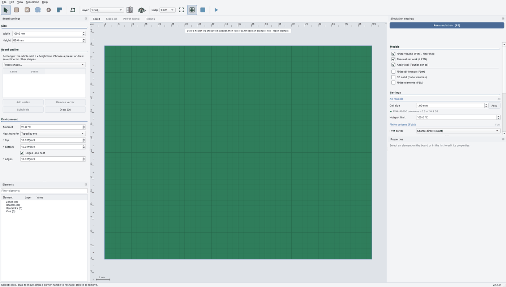

*Figure 1. The window at the first start (light theme). The hint above the board says the first
steps: "Draw a heater (H) and give it a power, then Run (F5). Or open an example: File - Open
example."*

### 2.5 Where the program keeps its settings

- **Window state** (size and place of the docks, theme, the boxes you collapsed, the list of
  recent projects) is kept by Qt in the settings of your user account.
- **Your own defaults** (Preferences, section 6.6) are in `user_defaults.json` in the
  configuration folder: `~/Library/Application Support/PCBThermalLab` (macOS),
  `%APPDATA%\PCBThermalLab` (Windows), `~/.config/pcbthermal-lab` (Linux), or the folder in
  the environment variable `PCBTHERMAL_CONFIG`. The file exists only after **Save as my
  defaults**.
- **Projects** are files you save where you want (chapter 10). A project never depends on the
  defaults of the machine that opens it: it stores every value it uses.

## 3. A tour of the window

### 3.1 The window at a glance

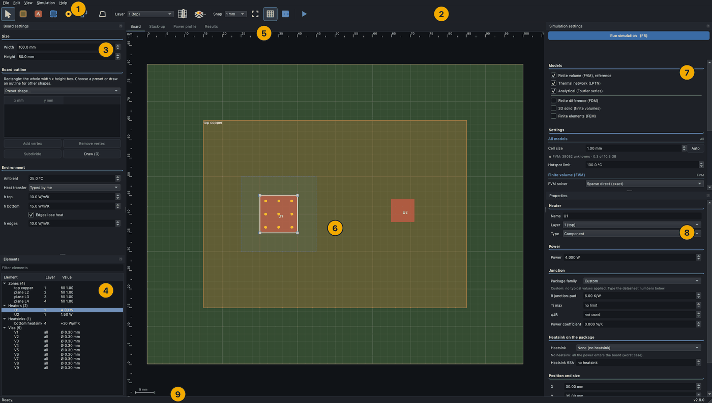

*Figure 2. The main window with the 4-layer example board (File - Open example - Example 4-layer
board) in the dark theme, heater U1 selected. The numbers match the list below.*

1. **Menu bar**: File, Edit, View, Simulation and Help (section 3.2). On macOS the menus are in
   the menu bar at the top of the screen.
2. **Tool bar**: the drawing tools, polygon mode, the Layer box, the Map and Display buttons,
   snap, fit, the grids and Run (section 3.3).
3. **Board settings** dock: size, board outline and environment (section 3.4).
4. **Elements** dock: the list of every zone, heater, heatsink and via, with a filter field
   (section 3.5).
5. **Main tabs**: Board, Stack-up, Power profile and Results (section 3.6).
6. **The board** (Board tab): the drawing canvas with rulers along the top and left edges and a
   scale bar at the bottom left.
7. **Simulation settings** dock: the Run button, the models to run, the settings and the live
   warnings (section 3.7).
8. **Properties** dock: every field of the selected element (section 3.8).
9. **Status bar**: what the selected tool does, the state of a run, messages; the version at
   the right end.

Every dock can be moved, resized, closed and reopened (View menu, at the bottom). The program
remembers the size and place of the docks for the next start. The side panels scroll when the
window is short; use the mouse wheel over a panel to reach the last boxes.

The groups inside the docks are **boxes**: the title row of a box is its button. Click it to
collapse or open the box. A collapsed box shows a dashed line and an ellipsis. The state of each
box is remembered between sessions.

### 3.2 The menus

| Menu | Entries |
| :-- | :-- |
| **File** | New board… (`Ctrl+N`), Open… (`Ctrl+O`), Open recent (the last eight projects; Clear the list), Import Gerber board…, Open example (Reference board 100 × 100 mm, 2 layers; Example 4-layer board with vias, heatsink, 2 heaters), Save (`Ctrl+S`), Save as… (`Ctrl+Shift+S`), Export package…, Export results to a folder…, Export report (TXT)…, Export summary (JSON)…, Quit (`Ctrl+Q`). |
| **Edit** | Undo (`Ctrl+Z`), Redo (`Ctrl+Shift+Z` or `Ctrl+Y`), Duplicate (`Ctrl+D`), Delete (`Del`), Select all on layer (`Ctrl+A`), Filter elements (`Ctrl+F`), Preferences… (`Ctrl+,`). |
| **View** | Fit board (`Ctrl+0`), Zoom in, Zoom out, Grid (`G`), Solver grid (`Shift+G`), Temperature map on the board (`T`), Display settings… (`D`), Model of the map… (`M`), Next layer (`L`), Previous layer (`Shift+L`), Imported copper, Holes (vias, component, non-plated), Element names, Background image…, Light / dark theme (`Ctrl+Shift+T`), the four tabs (`Ctrl+1` to `Ctrl+4`), and the four docks. |
| **Simulation** | Run simulation (`F5`), Stop calculation (`Ctrl+.`), Power Calculator…. |
| **Help** | User guide (`F1`), User guide in the browser, Keyboard shortcuts, About PCB Thermal Lab (version, system, loaded Qt and PySide versions, **Copy version info** for a bug report, and **Licences…**, a window with three groups: the package (LICENSE and notices), Qt and PySide (LGPL and GPL texts) and the bundled libraries (table of names, versions and licences, one entry per library); choose an entry to read it). |

On macOS, `Ctrl` in this manual is the Command key (⌘).

### 3.3 The tool bar

From left to right:

| Control | Key | What it does |
| :-- | :-- | :-- |
| Select | `S` | Click to select, drag to move, drag a corner handle to reshape. |
| Zone | `Z` | Draw a copper zone on the current layer. |
| Heater | `H` | Draw a heater (a part that dissipates power). |
| Heatsink (cooling) | `C` | Draw a heatsink or metal block on an outer face. |
| Via | `V` | Click to place a plated via. |
| Outline | `O` | Draw the board outline. |
| Polygon mode | `P` | Draw polygons by clicking their corners instead of dragging rectangles. |
| Layer | `L`, `Shift+L`, `1` to `9`, `0` | The one layer choice of the program: the layer you draw on, the layer of the map on the board and of every Results map. |
| Map | `T` | Show the temperature map on the board (after a run). |
| Display | `D` | How every map is drawn: underlay, opacity, view, contours, colour map (section 5.9). |
| Snap | | The step that positions snap to (for example 1 mm). |
| Fit | `Ctrl+0` | Zoom to the whole board. |
| Grid, Solver grid | `G`, `Shift+G` | Show the drawing grid; show the cells the solver will use. |
| Run | `F5` | Run the selected models. While a calculation runs it turns red and reads **Stop** (`Ctrl+.`). |

### 3.4 The Board settings dock

Three boxes:

- **Size**: Width and Height of the box that holds the board, in mm. On a board imported from
  Gerber files they are greyed (the copper was read for that size).
- **Board outline**: a preset shape, the vertex table, Add vertex, Remove vertex, Subdivide and
  Draw (O). Section 4.6 shows how to use it.
- **Environment**: Ambient (°C), Heat transfer (Typed by me or Computed), and the coefficients or
  the inputs of the computed mode. Section 6.1 lists every field.

The stack-up and the materials are on the **Stack-up** tab (section 4.7).

### 3.5 The Elements dock

The list holds four groups: Zones, Heaters, Heatsinks and Vias, with the layer and the main value
of each element (fill, power, extra h, diameter). Click a row to select the element on the board;
right-click for actions.

The **Filter elements** field above the list (`Ctrl+F`) hides the rows that do not match what you
type (name, type, layer or value, any case; several words must all be found). `Esc` clears the
filter and `Down` goes to the first match. Typing in the field never fires the tool keys of the
window, and `Ctrl+Z` there undoes the typed text, not the board. The filter is not saved in the
project.

### 3.6 The main tabs

| Tab | Key | What it holds |
| :-- | :-- | :-- |
| **Board** | `Ctrl+1` | The drawing canvas. |
| **Stack-up** | `Ctrl+2` | The cross-section of the board, the layer table and the material boxes. |
| **Power profile** | `Ctrl+3` | The power of each heater in time and the analysis of the regimes. |
| **Results** | `Ctrl+4` | Eight pages: Summary, Temperature, Gradients, Profiles, Components, Models, Animation and Power profile (chapter 5). |

Before the first run each Results page says what to do ("No results yet"). Opening, creating or
importing another board forgets the results of the previous one.

### 3.7 The Simulation settings dock

At the top, always in sight:

- the **Run simulation** button (`F5`). It becomes **Stop** while any calculation runs;
- a thin progress bar while a run is going;
- the **status line**: "Done: FVM, Tmax 85.5 °C, Rθ 10.99 K/W" after a run, "Cancelled." or
  "Failed." with the cause, or "Cannot run:" with the reason and the cell to use when a model
  would be refused.

Below them, three boxes:

- **Models**: six check boxes. A thin line separates the three main models (FVM, LPTN, Analytic)
  from the three cross-check models (FDM, 3D solid, FEM), which are off by default.
- **Settings**: grouped by the models they serve. The models of each group are named in grey at
  the right of its title (All, FVM, FVM·FDM, LPTN, Analytic, FEM). A group whose models are all
  unticked is greyed and marked *not ticked*. Section 6.4 lists every field.
- **Warnings (N)**: the live input warnings, one closed row per warning (section 5.11).

### 3.8 The Properties dock

The Properties dock shows every field of the selected element: name, layer, the values of its
type, and **Position and size** (X, Y, Width and Height of a rectangle, or the vertex count, box
and area of a polygon). Type a value and press `Enter` or leave the field (`Tab` goes to the
next field); a typed number counts only then. Fields that cannot affect the result are greyed or
hidden, and their tooltip says why.

Hover the pointer over any field for a short description: what it means, its unit, a typical
range and where the number comes from.

### 3.9 Numbers, units and the status bar

- Numbers are written with a **decimal point** and no thousands separator (0.45, 1234.5),
  whatever the language of the system. A decimal comma typed or pasted in a number field is read
  as a point (0,45 is 0.45).
- Numbers from 0.01 up to 10000 are written plainly; smaller and larger ones in engineering
  notation, with an exponent that is a multiple of three: 10.03E-3, 120.50E6.
- Temperatures are in **°C**; temperature differences (rises, margins, errors) are in **K**.
- Lengths are typed in mm; the files store millimetres too.
- The status bar names the selected tool and what it does, says what a run is doing ("Calculating"
  with the stage and the seconds), keeps the last result line, and names files that are missing.

### 3.10 Themes and screens

**View - Light / dark theme** (`Ctrl+Shift+T`) switches the whole window, the figures, the user
guide and the calculator help. The theme is remembered.

The docks can be made narrower or closed to give the board more room; the panels scroll when
they do not fit. Every field has a name for screen readers, and the warning dots always come
with a word ("Warning:" or "Note:").

## 4. Tutorials

Each tutorial is a short sequence of numbered steps. Do them in order the first time: each one
builds on the previous.

### 4.1 First run with the example board

1. Start the program (section 2.4).
2. Choose **File - Open example - Example 4-layer board (vias, heatsink, 2 heaters)**. The board
   is 100 × 80 mm with four copper layers: a copper pour on the top, three full planes, two
   parts (U1, 4 W, and U2, 1.5 W), nine vias under U1 and a heatsink on the bottom (Figure 2).
3. Leave the models as they are (FVM, LPTN and Analytic ticked) and the cell size at 1.00 mm.
4. Press **Run simulation** (`F5`). The button turns red and reads Stop while the models run;
   after a second or so the **Results** tab opens on its **Summary** page (Figure 3).
5. Read the table. With version 2.8.0 at a 1 mm cell the example board gives:

| Model | Tmax °C (column) | ΔT K | Rθ K/W | Error vs FVM (of ΔT) |
| :-- | --: | --: | --: | --: |
| FVM | 85.47 | 60.47 | 10.994 | reference |
| LPTN | 86.91 | 61.91 | 11.256 | +2.4 % |
| Analytic | 84.80 | 59.80 | 10.872 | −1.1 % |

6. Open the one row of **Warnings (1)** under the table ("U1: 9 vias under the footprint"). It
   says that the LPTN model has a wide error on vias and that the FVM should be used for via
   design.
7. Go through the other pages of the Results tab: Temperature, Gradients, Profiles, Components,
   Models, Animation (chapter 5 explains each one).

The three models agree within 2.4 % and the only warning is about the LPTN: the FVM number,
85.5 °C at the hottest point, is the one to use. The same numbers come from the command line:
`python -m pcbthermal run examples/example_board.pcbt.json`.

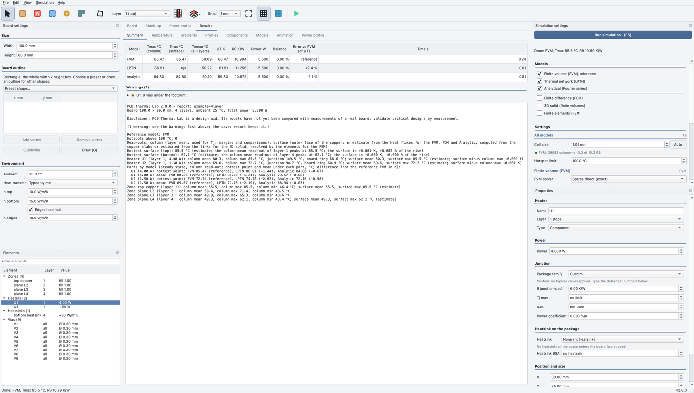

*Figure 3. Results - Summary after the run of the example board: the table of the models with
two-line headers that name each read-out, the Warnings (1) box and the text report.*

### 4.2 Draw a board from scratch

1. Choose **File - New board…** (`Ctrl+N`). The dialog asks for the Width, the Height (5 to
   1000 mm) and the number of Copper layers (1 to 12). Type 60, 40 and 2 and press OK.

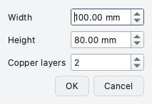

*Figure 4. File - New board: width, height and copper layers.*

2. Check the **Environment** box of the Board settings: Ambient 25.0 °C, Heat transfer *Typed by
   me*, h top 10, h bottom 15 and h edges 10 W/m²K (the shipped defaults of a new board).
3. Choose the layer in the **Layer** box of the tool bar: **1 (top)**.
4. Press **Zone** (`Z`) and drag a rectangle on the board where the copper is. The zone appears
   in the Elements list. In the Properties dock type its exact X, Y, Width and Height in mm and
   its **Copper fill** (1 = solid, 0.5 = hatched).
5. For a ground plane on the bottom, choose layer **2 (bottom)** in the Layer box and draw a zone
   that covers the whole board.
6. For a shape that is not a rectangle, switch on **Polygon mode** (`P`), click the corners one
   by one and finish with a double click, `Enter` or a right click.

Tips:

- **Right-click** an empty spot of the board to add a heater, zone, heatsink or via centred on
  the click. Right-click a shape to add or delete a vertex, duplicate or delete it.
- Zoom with the mouse wheel; pan with the middle button or `Space`+drag; `Ctrl+0` fits the board.
- Arrow keys nudge the selection; `Ctrl+D` duplicates it; `Del` deletes it; `Ctrl+Z` undoes.
- Elements cannot be dragged off the board.

### 4.3 Add a heater and make it a part

1. Press **Heater** (`H`) and drag the footprint of the part on its layer (for example a 5 × 5 mm
   square on layer 1).
2. In the Properties dock type its **Name** (U1) and its **Power** in W (for example 2). Press
   `Enter`: a typed number counts when you press Enter or leave the field.
3. Choose the **Type**:
   - **Heat source**: a power over a footprint and nothing else. It has one more field, the
     *Interface under the source* (solder, paste or adhesive between the source and the board).
   - **Component**: a part with a junction. It adds the fields of the next step.
4. For a component, open the **Package family** list and pick the closest family (QFN, power
   QFN, DFN, D2PAK, TO-220, SOT-223, diodes, 0603 resistor). It fills typical values of θ
   junction-pad, θJC top and Tj max; replace them with the numbers of your datasheet.
5. Type **θ junction-pad** (K/W): the junction-to-pad or junction-to-bottom resistance of the
   datasheet (θJC(bot), RθJC of a MOSFET, θJ-L of a diode, Rth j-sp of an LED). **Never use
   θJA**: it includes the manufacturer's test board and air. The program computes
   Tj = (hottest board point under the part) + P × θ.
6. Type **Tj max** (°C). The results then give the margin to that limit and the power limit of
   the part on this board.
7. Optional fields: **ψJB** (a second estimate from the board ring around the package), a
   **Power coefficient** in %/K for a power that grows with temperature (the program detects
   thermal runaway), and a **Heatsink** on the package (section 6.3).

### 4.4 Add vias

1. Press **Via** (`V`) and click where the via is. A via joins every copper layer (a through
   via).
2. In the Properties dock set the **Drill diameter** in mm and the **Fill**: Open, Epoxy resin,
   Conductive paste or Copper (Figure 5). The fill fills in a typical conductivity, which you can
   change for that via.
3. To make an array, place one via, select it and press `Ctrl+D` to duplicate it, then move the
   copies with the arrow keys or type their X and Y.

What the fill means for heat: a fabricator's "filled via" is normally an epoxy plug, which
conducts about as little as FR-4, so for heat it is the same as an open via. A conductive paste
adds about 5 %. Only an electroplated copper fill is a real heat path (a 0.3 mm via through
1.6 mm: 59 instead of 192 K/W).

A via conducts into a layer only where the copper of that layer (or the footprint of a part)
touches the drilled hole. A via that touches no copper on a layer is not connected there, and
the Warnings box says so.

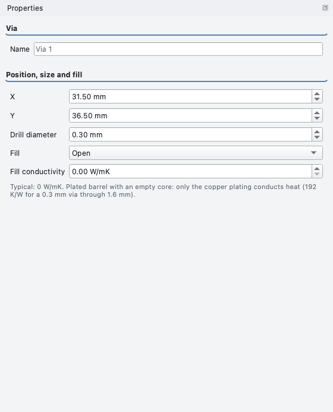

*Figure 5. The Properties dock of a via of the example board: drill diameter, fill and its
conductivity, position.*

### 4.5 Add a heatsink or a metal block

1. Choose the outer layer where it sits (1 or the last layer) and press **Heatsink** (`C`).
   Drag its area.
2. Choose the **Cooling model**:
   - **Manual input: I give h or θSA** (Figure 6). In **Input as** choose *Heat transfer
     coefficient h (W/m²K)* and type the extra h, or *Heatsink resistance θSA (K/W)* and type
     the θSA of the datasheet. The other one is shown below as its equivalent:
     h = 1 / (θSA × area).
   - **Metal block: the program computes it**. Give the block thickness and material (or its
     conductivity k), the **Interface** to the board (an interface material preset, or its
     thickness and conductivity, or the resistance in K·cm²/W; *Direct contact* is the
     optimistic limit) and, if it has them, the **Fins** (height, thickness, pitch).
3. A metal block touches the board only over the copper it overlaps, through the interface. It
   spreads heat in the metal, stores heat, and cools from its exposed surface with the board's
   face coefficient.

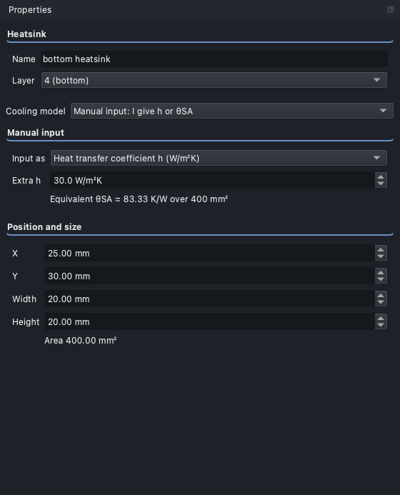

*Figure 6. The Properties dock of the bottom heatsink of the example board: Manual input, an
extra h of 30 W/m²K, which is a θSA of 83.33 K/W over its 400 mm².*

Typical interface resistances, K·cm²/W: good paste 0.33, default paste 0.5, soft gap pad 1.7,
gap pad 5, hard gap pad 10.

### 4.6 Give the board a shape (outline)

By default the board is the whole width × height rectangle.

1. In the **Board outline** box of the Board settings open **Preset shape…** and choose one:
   Rectangle (full box), L shape, T shape, Circle / ellipse, Chamfered corners or Rounded
   corners. Or press **Draw (O)** (or the Outline tool, `O`) and draw it with a rectangle or in
   polygon mode.
2. Edit the vertices in the table (millimetres from the lower-left corner of the box). **Add
   vertex**, **Remove vertex** and **Subdivide** (a vertex in the middle of every edge) refine it.
3. Outside the outline there is no board: no copper, no heat, no heat loss. The outline must be
   a simple polygon (no crossing edges) inside the box.

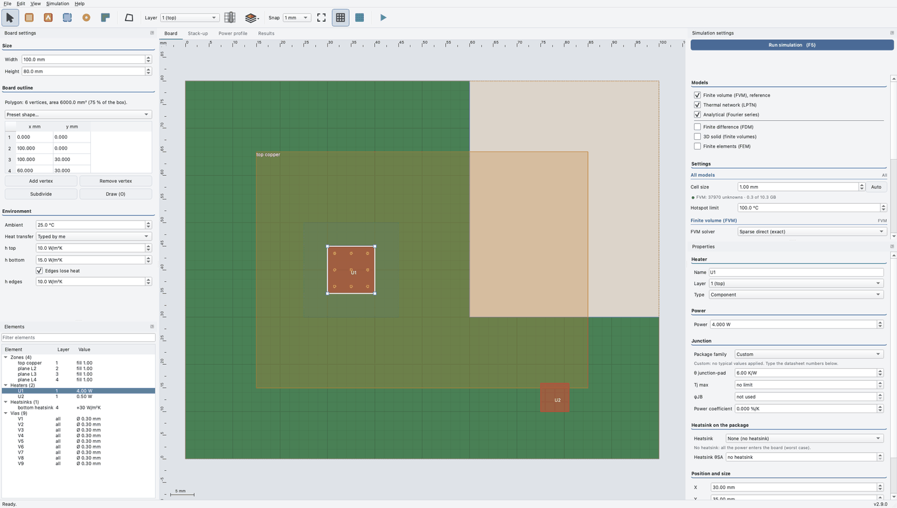

*Figure 7. The example board with an L-shaped outline drawn in the editor.*

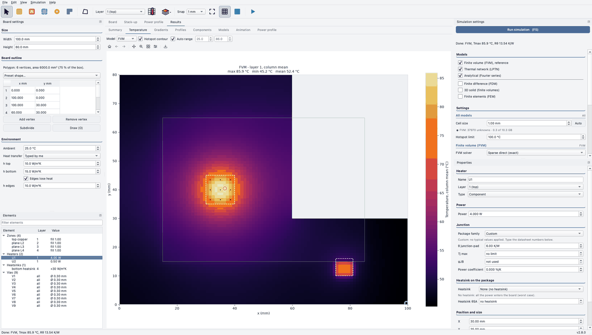

*Figure 8. The temperature map of the same board (FVM). Cells off the outline are blank.*

The FVM, FDM, 3D solid and FEM (straight-sided outlines) solve the real shape. The LPTN and
Analytic models need a rectangle: on a board with an outline they run on a rectangle of the same
area and the Results summary says so with a warning. Use the FVM for a part near the edge or in a
narrow arm. Keep the cell several times smaller than the narrowest neck of the board.

### 4.7 Set the stack-up

1. Open the **Stack-up** tab (`Ctrl+2`).
2. In the **Stack-up** list choose **Simple: equal layers, one FR-4** (the default) or
   **Advanced: each layer on its own**.
3. In the simple stack-up the boxes on the right set the **Total thickness**, the number of
   **Copper layers**, the **Copper per layer** (17.5 µm = 0.5 oz, 35 µm = 1 oz, 70 µm = 2 oz) and
   the dielectric: a **Laminate preset**, its conductivity **through** the board (FR-4 about
   0.3 W/mK) and **in-plane** (FR-4 about 0.9 W/mK).
4. In the advanced stack-up each copper layer has its own thickness and each dielectric gap its
   own thickness and material, in the table (Figure 9). **Load typical stack-up** loads the
   typical build for the layer count; for 3 or more layers, **Inner copper of the typical
   stack-up** chooses 0.5 oz (15.2 µm, the default) or 1 oz (35 µm).
5. Click a layer in the cross-section to see its thickness, conductivities, density and specific
   heat. **Units** chooses µm, mm or both; **Scale** chooses *Readable* (thin layers enlarged) or
   *True proportions*.

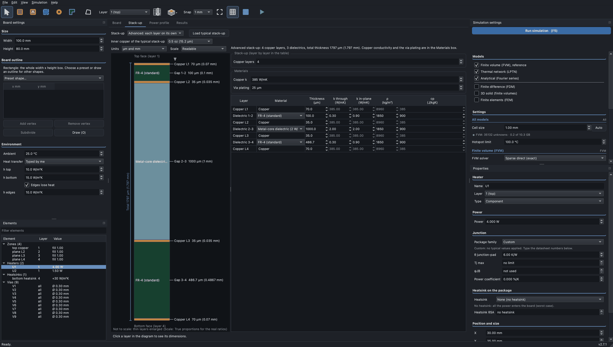

*Figure 9. The Stack-up tab in the advanced mode: 70 µm outer copper, a 0.1 mm FR-4 gap, a 1 mm
metal-core dielectric and the layer table.*

The typical stack-ups are starting points, not your fabricator's build: replace them with the
numbers of your fabricator. Changing the number of copper layers loads the typical stack-up of
that count (undoable).

### 4.8 Choose the models and run

1. In the **Models** box of the Simulation settings tick the models you want. Start with the FVM
   alone; add the LPTN and Analytic for a fast comparison; tick the FDM, 3D solid or FEM to
   cross-check (chapter 7).
2. Set the **Cell size**, or press **Auto** (a quarter of the smallest part, enlarged if the
   memory limit needs it). The line under the cell size gives, for each selected model, the
   unknowns and the memory: for example "FVM: 39052 unknowns · 0.3 of 10.3 GB". Green fits,
   amber is slow, red will not run.
3. Read the **Warnings (N)** box before running (section 5.11).
4. Press **Run simulation** (`F5`). The window stays usable; the status bar says the stage and
   the seconds. Press **Stop** (`Ctrl+.`) to cancel; nothing is kept from a stopped run.
5. When the run ends the Results tab opens. A result marked *outdated* means you edited the
   design after the run: run again.

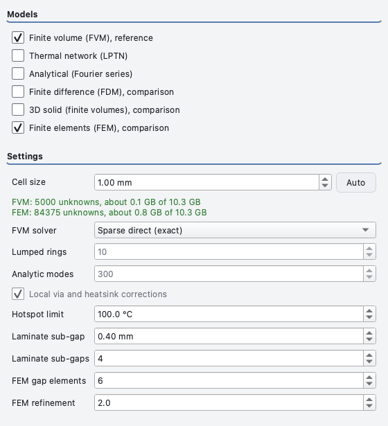

*Figure 10. The Models and Settings boxes with the FVM and the FEM ticked: the line under the cell
size gives the unknowns and the memory of each model, and the two FEM boxes are enabled.*

### 4.9 Check the cell size

The answer of the FVM, FDM, 3D solid and FEM depends on the cell. Check it once per design:

1. Run with the cell you chose (for example 1 mm) and note the Tmax of the part that matters.
2. Halve the cell (0.5 mm) and run again.
3. If the two numbers agree within the accuracy you need, the cell is fine. If not, halve again.

For imported copper use 1 mm or less. Near vias use 1 mm or less (a 2 mm cell makes a via a
fraction of a cell). A part should be several cells wide.

### 4.10 Give a heater a power profile

1. Open the **Power profile** tab (`Ctrl+3`). The **Heaters** table lists each heater with its
   profile, average power and regime.
2. Select a heater. In **Power profile of the selected heater** choose the **Profile**:
   - **Constant**: the power of the heater.
   - **Square wave**: **Repeats every** (a Period or a Frequency), **Duty (time on)**, **Power
     while on**, **Power while off**. Tick **Type the average power** to give the average
     instead.
   - **Table (CSV file)**: **Import CSV…** reads a table of times and powers (section 10.4);
     **Repeat the table** makes it periodic. **Export CSV…** writes the profile of the heater.
3. In **Time simulation** set **Ignore oscillations below** (default 1 K), **Start from**
   (*Steady state of the average power* or *A temperature I choose*), **Simulate** (*Until the
   cycle repeats*, *A number of cycles* or *A fixed time*) and **Steady-state models use**
   (*Average power* or *Peak power (worst-case bound)*).
4. Press **Analyze regimes**. For each heater the table under the plot says whether its
   oscillation is small enough to be replaced by its average power (**averaged**), must be
   simulated in time (**resolved**), or is too fast to step but too large to ignore (**average
   + ripple**: the board runs at the average and the temperature wave of a closed form is added
   at the heater).
5. Press **Run simulation** (`F5`). The **Results - Power profile** page shows the temperature
   versus time, the peak temperature map and the last window frame by frame (section 5.8).

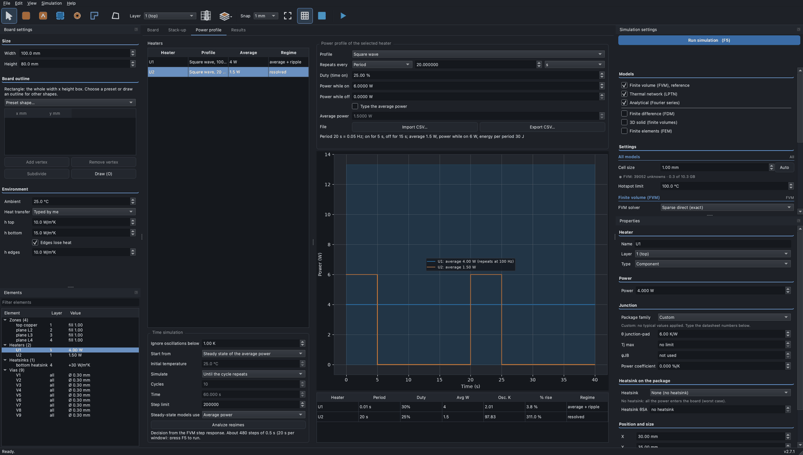

*Figure 11. The Power profile tab of the profile example: U1 with a 100 Hz square wave (average
+ ripple) and U2 with a 20 s square wave (resolved), the plot of the powers and the table of the
decisions.*

A worked example with CSV tables (a motor driver cycle and a regulator start-up) is in
`examples/csv_profiles/README.md`.

### 4.11 Watch the board heat up (animation)

1. Open **Results - Animation**. It computes the response of the board to the powers of the
   heaters switched on at t = 0.
2. Choose the **Model** (FVM, FDM, Analytic and, while it is ticked in the Models box, the FEM),
   the **Duration** (default 300 s) and the number of **Frames** (10 to 400, default 60).
3. Choose the **Scheme** (**Implicit Euler (robust)** or **Crank-Nicolson (accurate)**) and the
   **Spacing** of the frames (**Logarithmic time** or **Linear time**).
4. Press **Compute**. When it is ready, press **Play**, drag the slider, change the **Speed**, or
   press **Export GIF…** to save the animation.

The first seconds after a power step read too slowly in every layered model (section 12.3).
Choose the FEM with Crank-Nicolson to read the first seconds.

### 4.12 Import a board from its Gerber files

You need the fabrication files of the board: a folder or a ZIP with the copper layers, the
outline and the drill files; the paste layers and the placement file give the parts.

1. Choose **File - Import Gerber board…**. A window with three steps opens (chapter 9).
2. **Files and layers**: pick the folder or ZIP. Check that every file has the right function
   (top copper, bottom copper, outline, drill, paste), that no two files claim one function (red),
   and the line that names the CAD tool. Check the layer count and the outline in the Board box,
   and look at the preview: the copper must look like your board. Press **Next**.
3. **Parts**: check in the preview that the parts that dissipate sit on their own pads. Tick
   **Heat source** for each part that dissipates and type its **Power**; give a **Tj max** and,
   for a part with an exposed pad, its θJC(bottom) as θ. Read the **Source** column. Press
   **Next**.
4. **Model**: leave the mapping on faces. Press **Auto** for the pixel and the cell (1 mm or less
   for imported copper). Read the memory verdict (green or amber is fine, red needs a coarser
   cell) and the warnings. Press **Import**.
5. After the import, check the stack-up in the Stack-up tab (the files do not carry the
   dielectrics: the typical stack-up of the program is used), the Layer box and **View -
   Imported copper**.
6. Choose the FVM, press **Run** and read the warnings. For a design, confirm with a cell half as
   large.

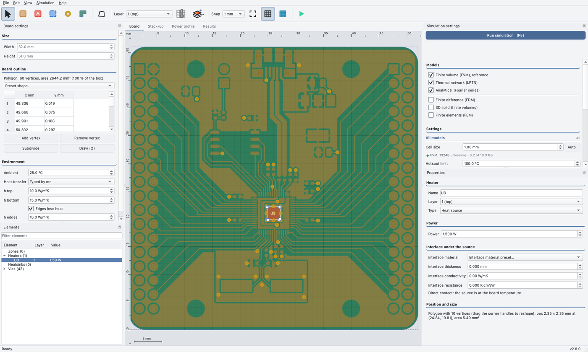

*Figure 12. The imported RP2040 board in the editor: the copper of the top layer under the
elements, the vias, and a part selected.*

### 4.13 Save and reopen a project

1. **File - Save** (`Ctrl+S`) the first time asks for a name. Choose the type:
   - **.pcbt.json**: a plain JSON text file, readable by other programs;
   - **.pcbtz**: a project package, one ZIP file that also holds the background image and, on
     request, the source Gerber files (section 10.2).
2. **File - Open** (`Ctrl+O`) opens either type; **File - Open recent** lists the last eight.
3. **File - Export package…** writes a package; tick **Include the source files (Gerbers,
   drills, placement, BOM)** to store the files the board was imported from.

The save is safe: the text goes to a temporary file that replaces the old one only when it is
complete. When a save changes the format on disk, the old file is first copied to
`name.pcbt.json.bak`.

### 4.14 Export the results

After a run, the **File** menu offers:

- **Export results to a folder…**: maps, tables, CSV fields, figures, the report and the JSON
  summary;
- **Export report (TXT)…**: the text report with the table of the models and every warning in
  full;
- **Export summary (JSON)…**: the machine-readable summary.

Every figure has a save button in its own tool bar, to save that picture alone. Section 10.5
lists the files.

### 4.15 Find the power of a part from a measured temperature

1. Draw the board and the part (or open the project).
2. Choose **Simulation - Power Calculator…**.
3. On **Route 1: from the drawn board** pick the part, where you measured (**Measured at**: the
   board ring around it, the hottest point or the mean under it, the junction, or the top of the
   package), the temperature and the ambient. Choose the **Board description** (how sure you are
   that the drawn board is the real one).
4. Press **Calculate**. The answer is a band: Best case, Nominal and Worst case.
5. Choose the **Power to use** and press **Use as the power of this part**. It writes the power
   into the heater (undoable).

Chapter 8 explains the calculator and its two routes.

## 5. Reading the results

The **Results** tab has eight pages. Every number names its read-out (column, surface, mean,
peak) and its model.

### 5.1 Summary

The Summary page (Figure 3) has three parts.

**The table of the models**, one row per model, with two-line headers:

| Column | Meaning |
| :-- | :-- |
| Model | The short name of the model. |
| Tmax °C (column) | The hottest layer-mean value of any copper layer (for the LPTN, the peak of its ring network at the heater). |
| Tmax °C (surface) | The hottest point of the top face of the copper: an estimate for the FVM and FDM, resolved for the FEM, n/a for the others (section 5.10). The column is left out when no model has it. |
| Tmean °C (all layers) | The mean over all copper layers, each layer counting equally. |
| ΔT K | Tmax (column) minus the ambient. |
| Rθ K/W | The rise of the hottest point divided by the total power: a board resistance, not a junction value. |
| Power W | The power of the run. |
| Balance | The energy balance in percent: power in minus heat out. Below 0.005 % it reads 0.00 %; the raw value is in the tooltip. |
| Error vs FVM (of ΔT) | The error of the rise against the reference model. |
| Time s | The time the model took. |

**The Warnings (N) box**: the same rows as in the Simulation settings plus what only a run can
know (section 5.11). Click a row to read it.

**The text report** of the run: the reference model, the hotspots, the read-outs, the hottest
surfaces, each heater (column mean and max, junction, board ring, surface), the parts by model
and the zones. It ends with a line that points to the Warnings box. The saved report (**File -
Export report (TXT)…**) keeps the table and every warning in full.

### 5.2 Temperature

The temperature map of one layer for one model (Figure 13).

- **Model**: which model's map. The map on the board follows this choice.
- **Layer**: the Layer box of the tool bar. Here it also offers **All layers** (side by side),
  **All (2 × 2)** (a grid of two columns with one colour bar), **Surface (top)** and **Surface
  (bottom)** (section 5.10) and, when there is one, the **Metal block**.
- **Hotspot contour**: draws the line of the Hotspot limit (Simulation settings).
- **Auto range** or your own colour limits.
- **Equiv. rect.**: only for the LPTN and Analytic on a board with an outline (section 4.6).

The hottest sample is marked with a **red ring** and the coolest with a **blue ring**. The title
gives the two ringed values of the layer shown and the mean of that layer. Cells off a
non-rectangular board are blank.

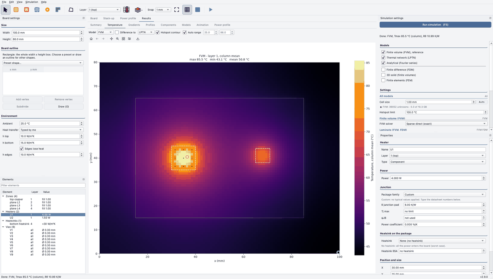

*Figure 13. Results - Temperature of the example board (FVM, layer 1).*

### 5.3 Gradients

The magnitude of the temperature gradient in K/mm, with its own Model list. Steep gradients mark
where heat is squeezed: a narrow neck of copper, the edge of a pour, the footprint of a part.

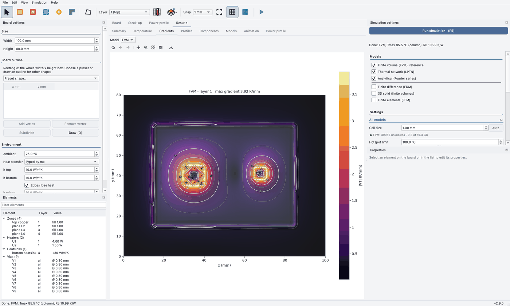

*Figure 14. Results - Gradients of the 4-layer example board, drawn with View Terrain and the
copper underlay; the contour step is picked by the program.*

### 5.4 Profiles

The temperature along a cut through the board, for every model that ran. Choose **Along x** or
**Along y** and move the **Cut** slider; the title quotes the position of the row or column
plotted. The **Cut overlay** box shows a small picture of the board with the cut line, inset in
the corner with the fewest curve points (Figure 15). The picture is part of the figure, so it is
also in a saved PNG.

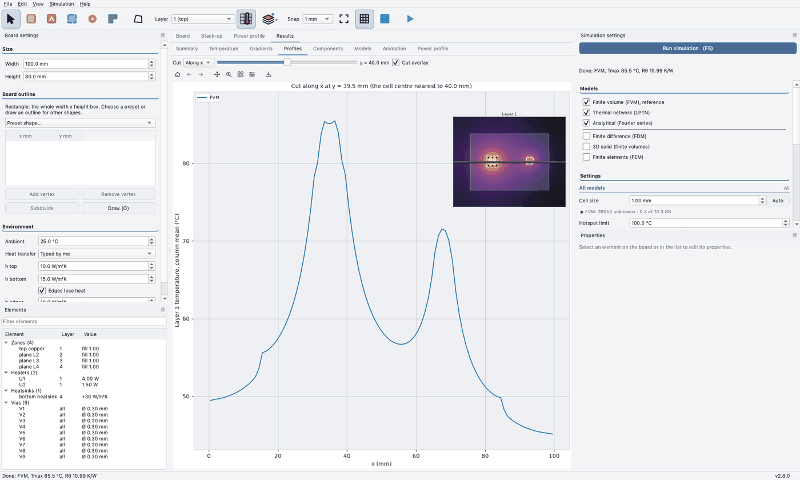

*Figure 15. Results - Profiles: the temperature along a cut of the board and, in a corner, the
cut overlay with the cut line over the map of the reference model.*

### 5.5 Components

Per heater: the power (and the nominal power), the mean and maximum board temperature under it
(column), one surface column (*Max °C (surface, estimate)*), the junction temperature, the
margin to Tj max, the **power limit** (the power that brings the part to its limit on this
board) and the top-path power; then the zones, the hotspots and the metal block. All values come
from the reference model (the FVM when it ran, otherwise the first model that ran); the line
above the tables names it.

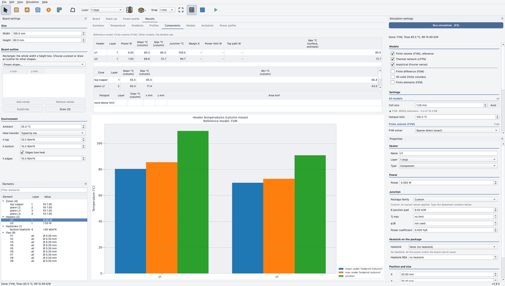

*Figure 16. Results - Components of the example board: heaters, zones and the chart of the
parts.*

### 5.6 Models

The models side by side. Two tables in one scroll area: **Tmax** (the hottest point under each
part, °C, column) and **Tmean** (the mean under each part, °C, column); one row per part, one
column per model that ran, the reference first and in bold. Hover a cell for the value with two
decimals and the difference from the reference. Below the tables, a bar chart of the whole
board (Tmax column and Tmean all layers, one bar per model). The same numbers are in the text
report and in `parts_by_model.csv`.

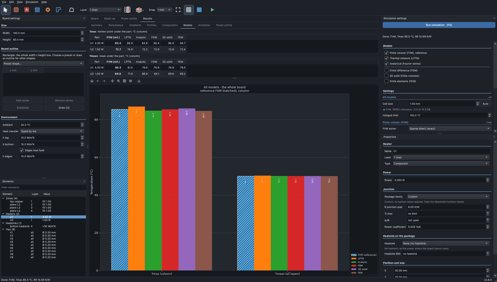

*Figure 17. Results - Models of the example board with the six models ticked.*

The LPTN has one node per part (two for a part over a group of vias): read its column as a coarse
model of the part, not as a map.

### 5.7 Animation

The heating of the board in time after the power is switched on (section 4.11). The frame is
drawn with the Display choice (section 5.9; Terrain is drawn as Current in motion). A status
line under the controls says what to do, the state of the computation and any warning of the
time model.

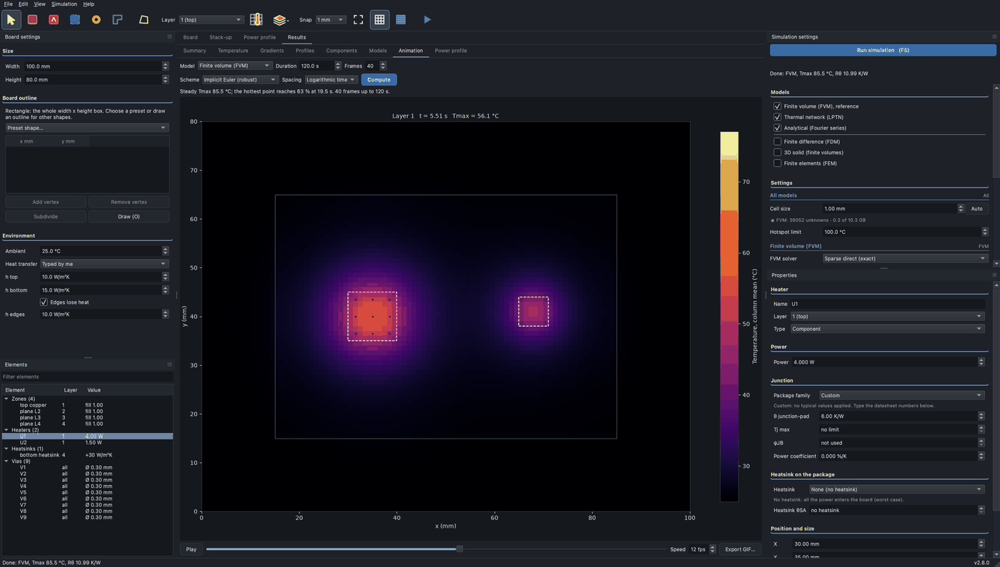

*Figure 18. Results - Animation of the example board, a frame at about half the duration.*

### 5.8 Power profile

The results of a run with power profiles (section 4.10). The list offers three views:
**Temperature versus time** (the hottest point of each heater and of the board, for every model
that ran in time), **Peak temperature map** and **Last window, frame by frame**. A heater
decided *average + ripple* carries its wave on its curve, with a shaded band of its full height.
The Summary and the report list every heater with a ripple and its height.

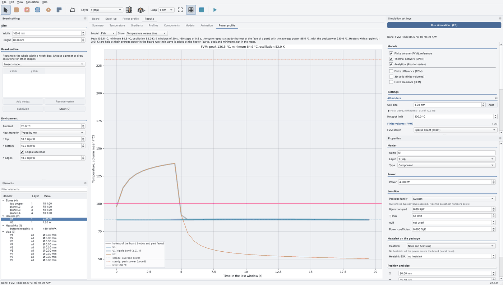

*Figure 19. Results - Power profile of the profile example: temperature versus time.*

### 5.9 The map on the board and the Display control

**The map on the board.** After a run, the **Map** button of the tool bar (`T`, or **View -
Temperature map on the board**) paints the result over the board you are editing (Figure 20). A
card at the top left names the model (click it, or press `M`, to change the model) and gives the
max and min of the layer shown, with a red and a blue ring on the board. The first edit of the
design makes the result outdated: the map leaves the board until you run again.

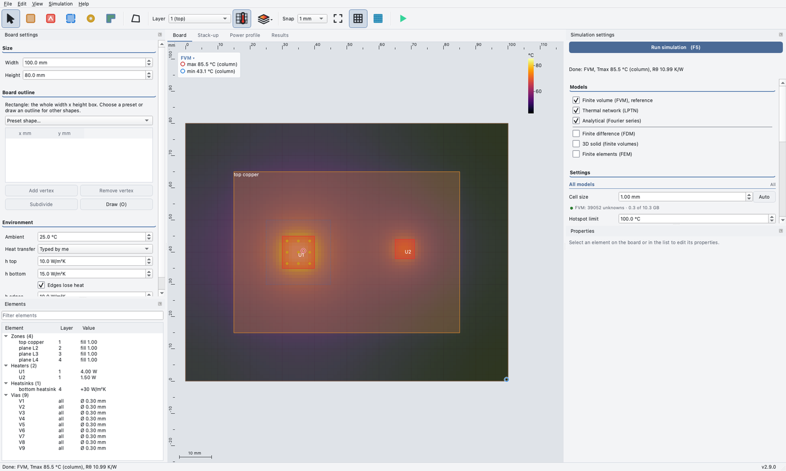

*Figure 20. The Map button (T): the map of the Temperature tab over the 4-layer example board,
with the card, the colour bar beside the board and the Map and Display buttons.*

**The Display control.** The **Display** button of the tool bar (`D`, or **View - Display
settings…**) opens a small panel that sets how every map is drawn: the Temperature and Gradients
pages, the Animation and the board (Figure 21). Nothing is solved again: only the drawing changes.

| Control | Choices |
| :-- | :-- |
| View | **Current** (the cells as solved), **Smooth** (interpolated between cells; cosmetic), **Terrain** (a relief with contour lines; Results maps only). |
| Contour every | The step of the contour lines in Terrain: K for Temperature (default 5 K), K/mm or auto for Gradients. |
| Underlay | What is drawn under the map: **None**, **Copper** (the copper of the layer) or **Image** (the background image). Only the entries valid for the project are listed. |
| Map opacity | 0 to 100 %, default 70 %: how much the map covers the underlay. |
| Colour map | One choice for every map. |

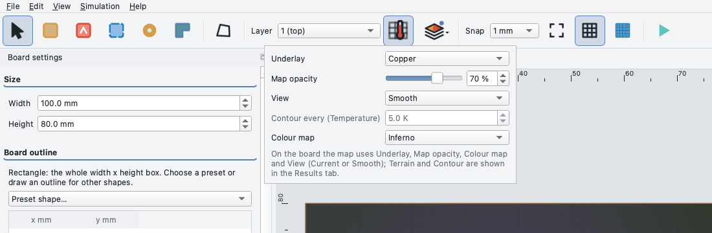

*Figure 21. The Display panel opened from the Board tab: on the board Terrain and Contour are
greyed, and the note says why.*

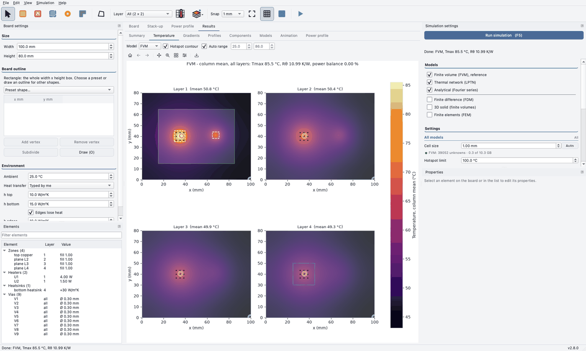

*Figure 22. Results - Temperature with Layer All (2 × 2), View Smooth and the copper underlay at
70 % opacity.*

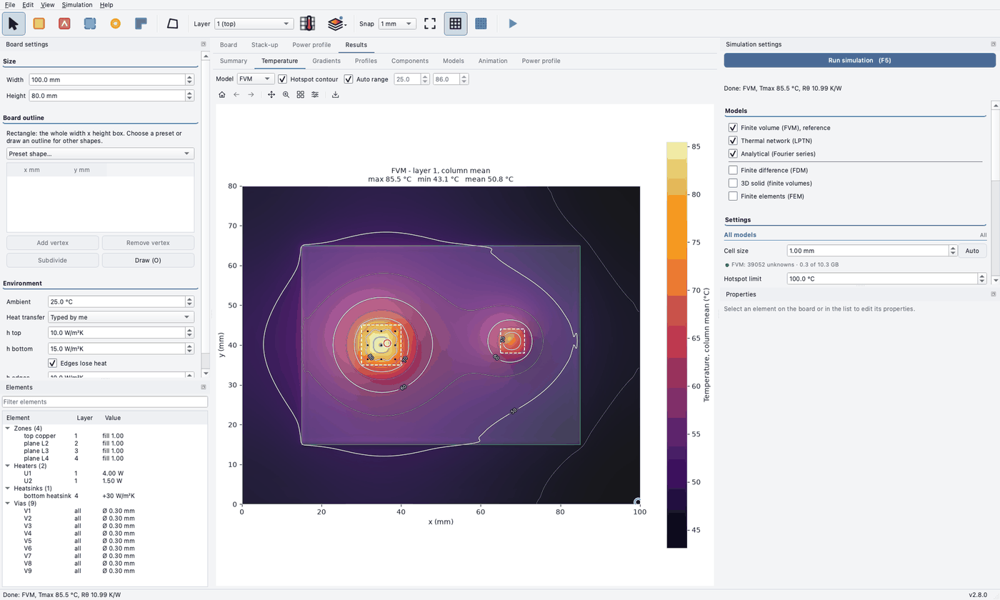

*Figure 23. View Terrain on layer 1 with Contour every 5.0 K: every second line is thicker and
labelled.*

### 5.10 Column mean and surface read-out

The layered models (FVM, FDM) keep one temperature per copper layer and cell: the mean through the
thickness of the copper, the **column** read-out. A thermocouple, an infrared camera or a paper
that reports "the temperature under the source" reads the **surface**, the face of the copper
where the heat enters, which is hotter.

The program always computes and shows both, each with its name:

- **Column** is what every table, the junction temperature, the margin, the power limit, the top
  path, the power coefficient and the Power Calculator use. Every map is titled *column mean*.
- **Surface** is an estimate of the outer face (FVM, FDM) or a resolved value (FEM). It is a
  *view*, never a mode: it changes nothing that is solved and nothing is saved in the project.

Where you find the surface:

1. The Layer box, on the Temperature page: **Surface (top)** and **Surface (bottom)**. The title
   gives the maximum and, on a second line, the column maximum with the difference in K and in %
   of the rise (Figure 24).
2. The Components page: the column *Max °C (surface, estimate)*; hover a cell for the difference
   to the column (Figure 25).
3. The report and the command line: the lines *Read-outs:* and *Hottest surface (top)*.
4. Files of the surface, only on request: `run --surface-files`.

On 35 µm copper the two differ by milli-kelvin and the difference is written out (for example
+0.001 K). On a thick plate or a metal core it can be several kelvin. **If your result differs
from a paper or a thermocouple that reports the surface, compare it with the surface number, not
with the column.** The LPTN, the Analytic and the 3D solid show n/a; the Animation and Power
profile pages show the column. The full explanation and its limits are in the user guide
(*Surface temperature and column mean*) and in `docs/theory.md` 1.2c.

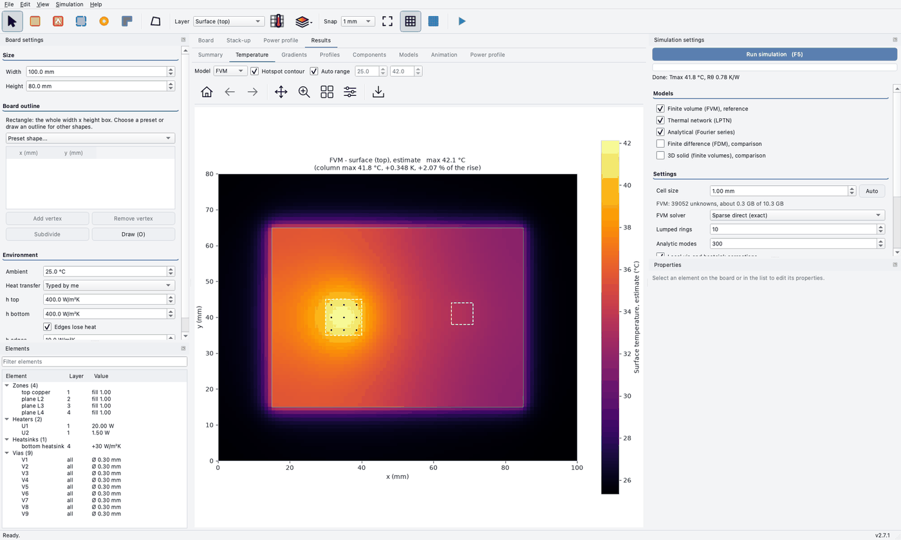

*Figure 24. The Temperature page of a 4-layer board with 2 mm of outer copper (the example board
at 400 W/m²K, 20 W on U1), Layer on Surface (top): the title says surface, estimate, and gives the
column maximum with the difference.*

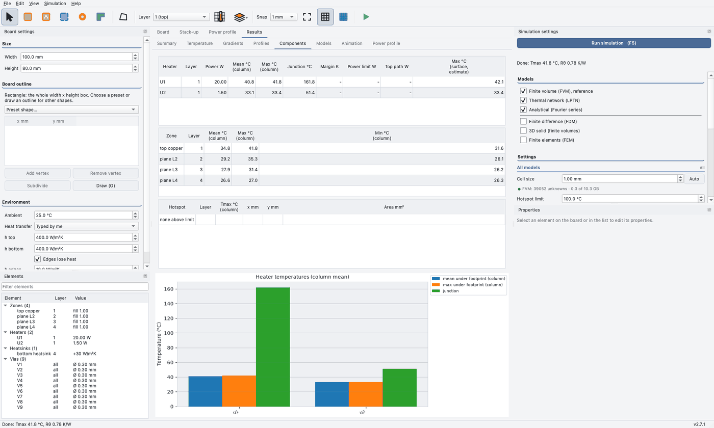

*Figure 25. The Components table of the same run: Mean and Max (column) and the one surface
column (estimate). The junction, margin and power limit stay on the column.*

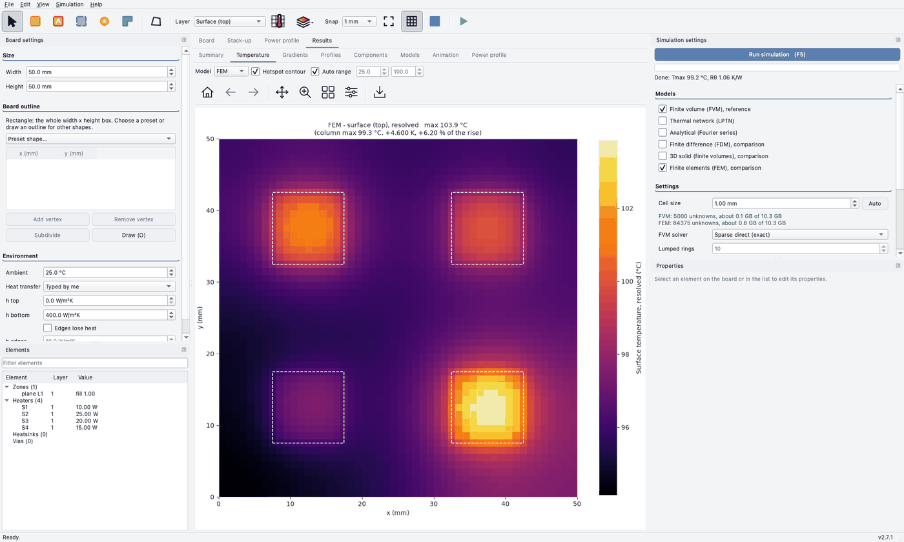

*Figure 26. The plate of case 2 of Muzychka, Culham and Yovanovich on the FEM, Layer on Surface
(top): the title says resolved.*

### 5.11 Warnings: how to read them

The program checks the input as you edit and checks the run when it ends. A warning never
blocks a run (except a model refused for memory); it says what a model cannot be trusted for and
what to do.

**Where they appear.**

- **Live**, in the **Warnings (N)** box of the Simulation settings: the validity of the design
  (a heater off the board, no copper under a heater, a copper edge across a heater, a neck of the
  outline too narrow), the limits of the models you ticked and the via warnings. They update when
  you edit, change the models or change the cell.
- **After the run**, in the Results Summary: the same plus what only a run can know (a thick
  plate, close fins, a low Rayleigh number, the notes of the LPTN zone model, the models' own
  notes).
- **On the command line**: printed under the table, with the options of the command line
  instead of the names of the controls.

**How a row reads** (Figure 27). Each warning is one closed row with:

1. a **dot**: red for a *warning* (the model will not run, a part is off the board or heats
   nothing, a loop does not converge, the power runs away), amber for a *note* (a limit of a
   model, a coarse cell, a measured error);
2. an arrow to open the row and a short **title** (for example "U1: 9 vias under the
   footprint");
3. at the end, a **label** with the icon and name of the element it is about: click it to select
   that element on its layer.

Click the row to read the full text: what was measured, by how much a model can be off, and what
to do. A row you opened stays open when the list refreshes.

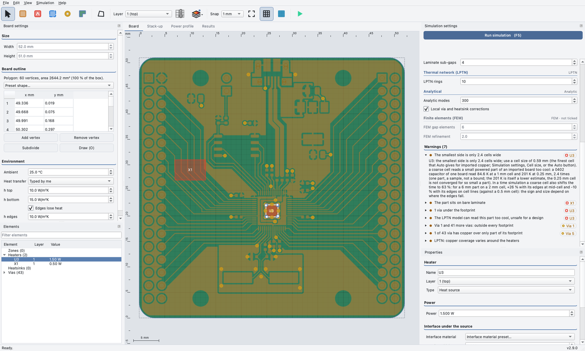

*Figure 27. The imported RP2040 board with the Warnings (8) box of the Simulation settings: one
row per warning with its dot and the label of its element, the first one opened.*

**The common warnings and what to do.**

| Warning (key words) | When | What to do |
| :-- | :-- | :-- |
| Heater outside the board / no copper under a heater / copper edge crosses a heater | Live | Move the part or draw the copper; confirm with the FVM. |
| Memory: red verdict, Run greyed | Live | Use the cell the message names, or raise the memory limit in Preferences if the machine can take it. |
| Centre of the part sits on bare laminate | Live | Use the 3D solid for the final value. |
| Part is small against the sub-layer of laminate | Live | Reduce *Laminate sub-gap* or raise *Laminate sub-gaps*. |
| Copper coverage varies around the heaters | Live | Use the FVM (the Analytic spreads each layer into one sheet). |
| Vias in the LPTN model; can read this part too cool, unsafe for a design | Live | Use the FVM for via design. |
| Copper over only part of its footprint (via) | Live | Use a finer cell, or compare with the 3D solid. |
| Via touches no copper on a layer | Live | Draw the pad or plane if the via is connected there. |
| Via touching the board edge / cell coarse for the vias | Live | Use a cell of 1 mm or less near vias. |
| Edge convection: the edge takes … % of the loss coefficient (Analytic) | Live | Use the FVM. |
| Imported copper: a zone on an imported layer is ignored; LPTN and Analytic read too cool; cell above 1 mm | Live | Use the FVM at 1 mm or less. |
| Thick and poorly conducting plate | After the run | Read the surface estimate (section 5.10); for a block, read the bound. |
| Channel Rayleigh number below 90 (fins) | After the run | Open the fin gap or check against a datasheet. |
| Low face Rayleigh number | After the run | Treat the absolute temperature as uncertain; fit *Convection ×*. |
| Computed coefficients are not measured | After the run | Keep a margin; calibrate with a measurement. |
| Analytic time simulation with a heatsink | After the run | Use the FVM or FDM for the time behaviour. |
| Top-path split did not converge / thermal runaway | After the run | Check θ, the pad and the power coefficient. |
| SOR not used | After the run | Nothing: the direct solver gave the same answer. |

The complete list, with when each warning appears and what it means, is the *Glossary of the
warnings* in the user guide (`F1`, section 19).

## 6. Settings reference

Every field has a tooltip with the same information. Defaults are those of a new project with the
shipped Preferences.

### 6.1 Board and environment (Board settings dock)

| Field | Meaning | Default |
| :-- | :-- | :-- |
| Width, Height | Size of the box that holds the board, mm (5 to 1000 in the New board dialog). | 100 × 80 mm |
| Board outline | A preset shape, the vertex table or the Draw (O) tool (section 4.6). | Rectangle (the box) |
| Ambient | Air temperature, °C. All results are temperatures above it. | 25 °C |
| Heat transfer | **Typed by me** (one coefficient per face and for the edges) or **Computed (convection + radiation)** (from the board temperature, repeated until the coefficients settle). | Typed by me |
| h top, h bottom | Coefficient of each face (convection plus radiation), W/m²K. Still air is about 5 to 15. Shown only when typed. | 10, 15 W/m²K |
| Edges lose heat, h edges | Whether the edges exchange heat with the air, and the coefficient. Unticked, the edges are insulated. | Ticked, 10 W/m²K |
| Orientation | (Computed.) **Horizontal (layer 1 = top faces up)** or **Vertical (on its edge)**. Tilted boards are not modelled. | Horizontal |
| Vertical natural convection | (Computed, vertical.) **General (Churchill and Chu, whole range)** or **Laminar (Churchill and Chu, Ra below 1.00E9)**. Old project files keep General. | Laminar |
| Emissivity top / bottom | (Computed.) Radiation, 0 to 1: solder mask about 0.9, bare copper 0.05 to 0.1. | 0.9 |
| Air speed | (Computed.) 0 is still air; above 0, forced convection along the board, m/s. | 0 |
| Convection × | (Computed.) A multiplier of the convection (not of the radiation), to fit a measurement. | 1 |

The coefficient of a face over copper is applied through the half copper layer (always on;
negligible on 35 to 105 µm copper).

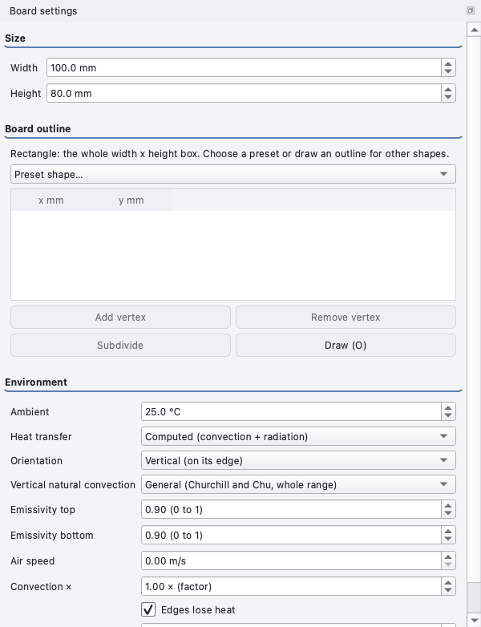

*Figure 28. The Board settings dock with the heat transfer Computed on a vertical board: the
orientation, the vertical natural convection form, the emissivities, the air speed and the
multiplier.*

### 6.2 Stack-up and materials (Stack-up tab)

| Field | Meaning |
| :-- | :-- |
| Stack-up | **Simple: equal layers, one FR-4** or **Advanced: each layer on its own**. Switching keeps the board. |
| Total thickness | Of the board, mm. In the advanced stack-up it is the sum of the layers and read-only. |
| Copper layers | 1 to 12. Layer 1 is the top face, the last is the bottom face. |
| Copper per layer | Simple stack-up: one thickness for every layer, µm (17.5 = 0.5 oz, 35 = 1 oz, 70 = 2 oz). |
| Copper k | Conductivity of the copper, W/mK (385 by default; 385 to 400). |
| Laminate preset | Typical dielectric materials; fills the next values (indicative, not your datasheet). |
| Dielectric k through | Conductivity across the board between copper layers, W/mK (FR-4 about 0.3). |
| Dielectric k in-plane | Conductivity along the board, W/mK (FR-4 about 0.9). It matters for a part on bare laminate. |
| Via plating | Copper plating of the via barrel, µm (typically 20 to 25). |
| Inner copper of the typical stack-up | Advanced, 3 layers or more: 0.5 oz (15.2 µm, default) or 1 oz (35 µm). |
| Units, Scale | How the cross-section is drawn (display only). |

The laminate presets (k through, k in-plane in W/mK): FR-4 standard 0.3 / 0.9; FR-4 high Tg or
filled 0.4 / 1.0; polyimide (flex) 0.15 / 0.15; PTFE ceramic (RO4350B type) 0.69 / 0.69;
metal-core dielectric 2 / 2; alumina ceramic 96 % 24 / 24; aluminium nitride 170 / 170.

The typical stack-ups by layer count: 1, 2, 4, 6 and 8 layers on 1.6 mm; 10 layers on 2.0 mm;
12 layers on 2.4 mm. They are in `pcbthermal/data/stackups.json`; your own `stackups.json` in the
configuration folder (section 2.5) replaces them.

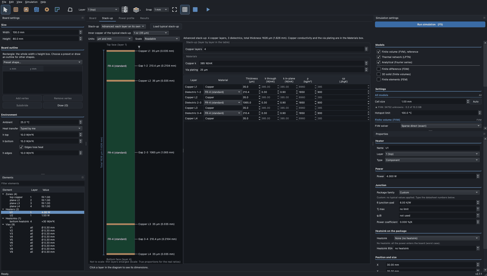

*Figure 29. The Stack-up tab with the inner copper of the typical stack-up set to 1 oz.*

### 6.3 Elements (Properties dock)

**Copper zone** (`Z`): Name, Layer, position and size (or polygon), **Copper fill** (1 = solid,
0.5 = hatched). A zone drawn on a layer that has imported copper is ignored by every model.

**Heater** (`H`): Name, Layer, position and size, **Power** (W), **Type** (Heat source or
Component). A heat source has only the **Interface under the source**. A component adds:

| Field | Meaning |
| :-- | :-- |
| Package family | Fills typical θ junction-pad, θJC top and Tj max of the family (QFN 5 K/W, power QFN 3, DFN 10, D2PAK 0.75, TO-220 1.5, SOT-223 15, diodes SMA/SMB/SMC 20, 0603 resistor 1000). Replace with your datasheet. |
| θ junction-pad | Junction-to-pad resistance, K/W. Tj = hottest board point under the part + P × θ (worst case: all the power into the board). |
| Tj max | Maximum junction temperature, °C. Gives the margin and the power limit. Zero means no limit. |
| ψJB | Junction-to-board parameter, K/W: a second estimate Tj = T(ring 0.5 to 1.5 mm around the package) + ψJB × P. |
| Power coefficient | %/K: P = P0 (1 + c (Tj − 25 °C)). A MOSFET's Rds(on) gives about 0.3 to 0.7 %/K. Runaway is detected. Steady state only. |
| Heatsink, Air flow | A typical heatsink from the library (Preferences) with the flows of its catalogue; fills θSA. None, or Custom for your own number. |
| θJC top, Interface, Heatsink θSA | The top path: heat also leaves through the top of the package, θJC(top), the interface (divided by the contact area) and the heatsink. Active with both θ and θSA above zero. Steady state only. |
| Body thickness, Body material, Contact area | For a part without a θJC(top): θ = thickness / (k × area), an upper bound. |

**Heatsink** (`C`): Name, Layer (an outer layer), area, and the **Cooling model**:

- *Manual input: I give h or θSA*: **Input as** h (W/m²K) or θSA (K/W); h = 1 / (θSA × area).
- *Metal block: the program computes it*: **Block thickness**, **Block material** or **Block k**,
  the **Interface** (material preset, thickness and conductivity, or resistance in K·cm²/W;
  *Direct contact (no material, R = 0)* is the optimistic limit), the **Fins** (height,
  thickness, pitch) and an optional extra cooling of the exposed surface.

**Via** (`V`): position, **Drill diameter** (mm; the plating is inside it), **Fill** (Open, Epoxy
resin, Conductive paste, Copper) and **Fill conductivity** (W/mK, filled in by the fill, editable).

**Board outline** (`O`): the vertex table in the Board settings (section 4.6).

### 6.4 Simulation settings

| Field | Group | Meaning | Default |
| :-- | :-- | :-- | :-- |
| Models | | Which models run (chapter 7). | FVM, LPTN, Analytic |
| Cell size | All | Size of the solver cells, mm. Smaller is more accurate and slower. **Auto** picks a quarter of the smallest part, enlarged until the memory guard accepts the selected models. | 1.00 mm |
| (memory line) | All | Per model: unknowns and "x of y GB". Green fits, amber is slow, red will not run (Run greyed, the message gives the cell that fits). | |
| Hotspot limit | All | Temperature above which an area is reported as a hotspot, °C. | 100 °C |
| FVM solver | FVM | **Sparse direct (exact)**, **Conjugate gradients**, or **SOR (iterative, for comparison)**. The SOR relaxation factor is chosen by the program. | Sparse direct |
| Laminate sub-gap / Laminate sub-gaps | FVM·FDM | The longest sub-gap of the laminate between copper nodes (0.05 to 5 mm) and the most sub-gaps in one gap (1 to 16; 1 turns the cutting off). More is closer to a 3D solid and slower. Greyed with a metal block. | 0.40 mm, 4 |
| LPTN rings | LPTN | Number of rings of the network of each heater. More than the cell can show change nothing. | 10 |
| Analytic modes | Analytic | Cosine modes per direction (more resolve smaller parts). | 300 |
| Local via and heatsink corrections | Analytic | Apply vias and heatsinks locally instead of smearing them (steady run). | |
| FEM gap elements / FEM refinement | FEM | Elements across every dielectric gap (2 to 24) and the ratio of the cell to the fine element near parts and vias (1 to 4). Greyed until the FEM is ticked. The defaults are enough. | 6, 2 |

**The memory guard.** Before a run, the program estimates the peak memory of each finite model
(FVM, FDM, 3D solid, FEM) from its number of unknowns and compares it with a share of the
physical memory of the computer: the **Memory limit**, 60 % by default (Preferences - Solver,
0.10 to 0.95). A model above the limit is refused with the cell that fits. A 3D solid next to
other models is skipped with a warning and the others still answer. The animation and the power
profiles are checked too (they need about twice the memory of a steady solve). The LPTN and
Analytic are not checked.

**Run and Stop.** While any calculation runs (a simulation, an animation, a power-profile run or
its analysis, the Power Calculator) the Run button reads **Stop** (`Ctrl+.`): it stops the
calculation at once and nothing is kept from it. There is no pause.

### 6.5 Typical values without a source

Some defaults are typical values with no recorded source, and their notes in Preferences say so:
the copper conductivity of a new board (385 W/mK), the in-plane FR-4 conductivity (0.9 W/mK),
the emissivity (0.9), the films of a new board (10, 15 and 10 W/m²K) and the presets of the
dielectric and interface libraries. Type your own numbers when you have them; the in-plane
conductivity matters most for a part on bare laminate.

### 6.6 Preferences

**Edit - Preferences…** (`Ctrl+,`) edits what the program starts with (Figure 30). The list of
sections on the left:

| Section | What it holds |
| :-- | :-- |
| Via fills, Metals (heatsink blocks), Interface materials, Dielectrics (stack-up), Package families (typical θ), Package heatsinks (typical θSA) | The six **libraries**, as tables. A row you add appears in the matching list of the program; a row you edit changes its values; a row you delete is hidden. |
| Defaults for new projects | New board (size, layers, ambient, coefficients, edges, via plating, computed convection), new elements (power of a heater, fill of a zone, via diameter and fill, extra h of a heatsink, block thickness, metal and interface, size of dropped shapes), materials, solver (models, cell, solver, rings, modes, hotspot limit). |
| Solver | **Memory limit** (key `solver.memory_fraction`, 0.10 to 0.95, default 0.6). |
| Results | **Summary table in the report text** (key `results.summary_table_in_report`, default off). |
| Gerber import | **Largest Gerber or drill file** (key `gerber.max_file_mb`, 16 to 4096 MB, default 256). |
| Project package | **Largest package (MB)** (key `package.max_mb`, 64 to 4096, default 512). |
| Power Calculator | The uncertainties of the band (copper, heat transfer, θ, ψJT, reading). |

The buttons at the bottom:

- **Save as my defaults** writes only what differs from the shipped values to
  `user_defaults.json` in the configuration folder (section 2.5).
- **Reset to shipped** deletes that file.
- **Open folder**, **Export…** and **Import…** help to share the file.

When the file exists the status bar says *Custom defaults*, a message appears at start-up and the
About box lists it. A broken file is ignored, never fatal. Open boards keep their values; new
boards and new elements use the defaults. The Solver, Results, Gerber import and Project package
settings belong to the machine and are never saved in project files.

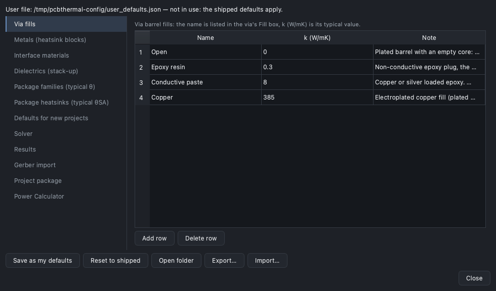

*Figure 30. Edit - Preferences on its first section, the Via fills library. The line at the top
names the user file and says whether it is in use.*

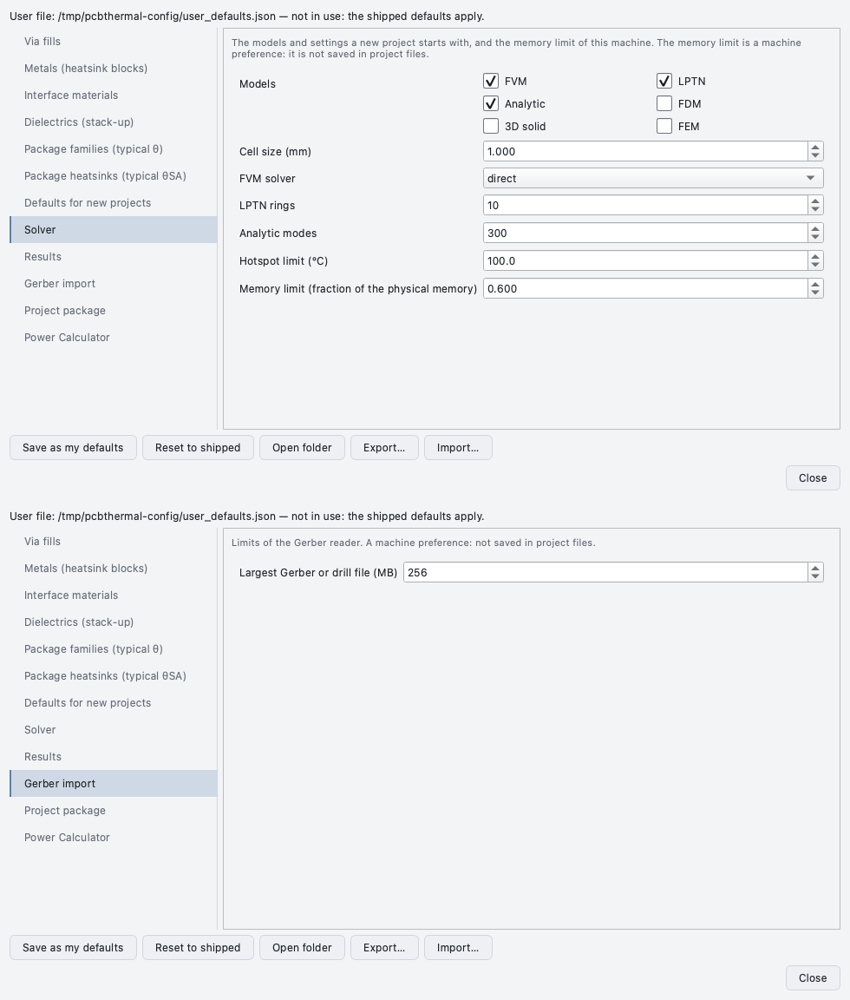

*Figure 31. The Solver section (the memory limit) and the Gerber import section (the largest
file), one above the other.*

**Reproducing a textbook case.** A new board has h top 10, h bottom 15 and edges that lose heat
(10 W/m²K). For a case with an adiabatic top and insulated sides, set h top to 0 and untick
*Edges lose heat* in the project (or change the defaults here). On a 50 × 50 × 10 mm copper plate
with h bottom 400 and 70 W in four sources, the defaults lower the hottest point from 98.3 to
95.3 °C (FVM, 1 mm cell).

## 7. The models

This chapter says what each model is for, what it needs and when it is weak, in the words of a
user. The equations are in `docs/theory.md`; the measured errors in `docs/validation.md`.

### 7.1 Which model to use

| You want | Use |
| :-- | :-- |
| The number you sign off; any geometry; hotspots; junction temperatures; heat-up in time | **FVM** |
| A second opinion on the FVM's discretisation | **FDM** |
| Fast exploration and parameter sweeps; ranking layouts | **LPTN** |
| An instant answer on a near-uniform board; an independent check | **Analytic** |
| A check of the "one node per layer" idea on your board (small pads, copper edges, thick blocks) | **3D solid** |
| Thick copper or plates, hollow vias under a part, the first seconds after a power step | **FEM** |

### 7.2 What each model can do

| | FVM | FDM | LPTN | Analytic | 3D solid | FEM |
| :-- | :-- | :-- | :-- | :-- | :-- | :-- |
| Ticked by default | yes | no | yes | yes | no | no |
| Time (animation, power profiles) | yes | yes | power profiles yes, animation no | yes | no (steady only) | yes, since 2.9.0 |
| Board outline | yes | yes | equivalent rectangle (warned) | equivalent rectangle (warned) | yes | sides parallel to the axes (slanted or curved refused) |
| Metal blocks and fins | yes | yes | steady only | steady only | yes | yes |
| Imported copper | read exactly (faces) | read exactly (faces) | cell average (too cool, warned) | cell average (too cool, warned) | cell fraction | element mean (warned) |
| Surface read-out | estimate | estimate | n/a | n/a | n/a | resolved |
| Memory checked | yes | yes | no | no | yes | yes |
| Typical time (example board) | 0.1 to a few s | similar | about 10 ms | about 50 ms (with vias a few tenths) | 0.1 to 10 s | seconds |

### 7.3 FVM: the reference

The board is cut into cells; each copper layer has one node per cell. Where copper is absent the
laminate between two copper layers is cut into sub-gaps (Laminate sub-gap, sub-gaps). It solves
any outline, the metal blocks, vias (through the mean temperature of the cells around each via),
the time response and the power profiles. Choose the solver in *FVM solver*; the direct solver is
exact and the default. It is weak when the cell is too coarse for the smallest part.

### 7.4 FDM: finite differences

The same layered equations on grid points instead of cells: an independent check of how the FVM
discretises the board. Same features as the FVM, including time. Use it to compare
discretisations; for a small outer pad use the FVM.

### 7.5 LPTN: thermal network

A small network of resistances per heater, built from the real footprint and outline, with rings
around each heater; several heaters heat each other. A part over a dense group of vias has its
footprint in two zones (core and rest). It is the fastest model (about 10 ms) and the one for
sweeps. It is weak with a copper edge across the heater, corners, thin heaters, vias (wide
errors, warned) and imported copper (too cool, warned). Use the FVM for via design.

### 7.6 Analytic: Fourier series

A closed-form series of a uniform layered board, with local corrections for vias and heatsinks.
Exact on uniform boards and independent of the FVM, it shows the physics. It is weak when the
copper is not uniform near the heater (up to about 28 % low with a copper edge across the heater),
on outlines and with a strongly cooled edge on a thick board.

### 7.7 3D solid

The board as a real 3D solid: every copper layer and gap is a slab, vias have their copper area,
metal blocks are slabs. Steady state only. It checks the "one node per layer" assumption on your
own board. A 3D solid above two million unknowns never runs.

### 7.8 FEM: finite elements (steady and time)

The board as a 3D mesh of hexahedral elements: several elements through thick copper, graded
elements in every gap, a conforming hollow barrel for a via that has room, the film on the real
face. Off by default.

**To use it:**

1. Tick **Finite elements (FEM)** in the Models box. It is never greyed.
2. Read its line under the cell size: "FEM: N unknowns · x of y GB", then slow or "above the
   memory limit, it will not run: use a cell of c mm or more".
3. Leave **FEM gap elements** (6) and **FEM refinement** (2) at their defaults unless you check
   convergence.
4. Run. The status says *Solving FEM*; on a large board it can take minutes; Stop cancels it.

**What you get:** the FEM is one more entry in every model list, with the same maps, tables and
Layer box. Its **Surface (top)** and **Surface (bottom)** say *resolved*. The column read-out is
the headline, like for like with the other models.

**Needs and refusals:** a mesh of more than 30 000 unknowns needs the optional package pyamg for a
steady run (a time run factorises its matrix up to 100 000 unknowns and needs pyamg only above
that). A slanted or curved outline, a block with a slanted side and a mesh above the memory limit
are refused with the reason; the other models still answer.

**FEM in time** (since 2.9.0): while ticked, the FEM also runs the animation (choose it in the
Model box of the Animation page) and the power profiles, beside the other curves. With the
default mesh it is the model to believe from about 0.3 s after a power step. Choose
Crank-Nicolson to read the first seconds (with implicit Euler its first frames carry a few
percent of error). The FEM never decides the regime of a power profile and cannot run alone in
the Power profile tab. A profile run predicted to take more than 10 minutes is refused before it
starts.

On an ordinary board with 35 µm copper the FEM reads 0.4 to 0.9 % below the FVM at the same cell;
with vias and a part only a few cells wide, halve the cell before reading a difference.

## 8. The Power Calculator

**Simulation - Power Calculator…** finds how many watts a part dissipates from a temperature you
measured. It is a window of its own; its **Help** button has the full explanation. The two
routes are independent tabs: fill only one.

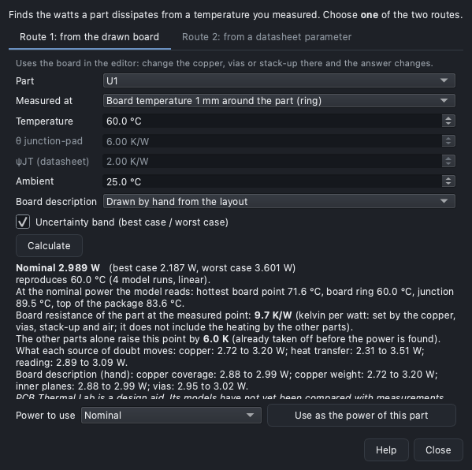

*Figure 32. The Power Calculator, Route 1, with the Board description list and the terms of the
band.*

### 8.1 Route 1: from the drawn board

1. Pick the **part**.
2. Choose **Measured at**: the board ring 0.5 to 1.5 mm around the part, the hottest point or the
   mean under it, the junction, or the top of the package. The junction needs the part's θ
   junction-pad; the top of the package also needs the datasheet's ψJT
   (Ttop = Tj − ψJT × P). Fields that the point does not use are greyed.
3. Type the measured **temperature** and the **Ambient**.
4. Choose the **Board description**: none, drawn from the real fabrication files, drawn by hand,
   or estimated. It adds the doubt about the drawn board (copper coverage, copper weight, inner
   planes, vias) to the band.
5. Press **Calculate**. The program solves the board you drew at two powers and finds the power
   that makes the model read your temperature at that point.
6. Read the band: **Best case** (lowest plausible power), **Nominal**, **Worst case** (highest
   plausible power), from the uncertainty of the copper (±25 %), the heat transfer (±30 %), θ
   (±20 %), ψJT (±30 %) and the reading (±1 K), added as the root of the sum of squares (the
   values are in Preferences).
7. Choose **Power to use** and press **Use as the power of this part**: it writes that power into
   the heater (undoable). Use the worst case to check margins.

### 8.2 Route 2: from a datasheet parameter

P = (Tj − Tref) / parameter for a known junction temperature (a sense diode) with ψJB (reference:
the board next to the package), ψJT (the top of the case) or θ. No board model: it is exact only
on the datasheet's own board. It updates as you type and has its own **Use as the power of a
part** button.

### 8.3 How good it is

On a datasheet's own board the model returns the datasheet's thermal resistance within 2.4 % of
the power (TI CSD17308Q3: 47.1 against 46 K/W). When the drawn board is not the real one the error
is large: everything depends on the copper (a hatched top copper gives 16 % too little power, a
missing inner plane 36 %, missing vias 12 %). Formulas, validation tables and sources:
`docs/calculators.md`.

## 9. Importing Gerber files

**File - Import Gerber board…** opens a window with a stepper of three steps: **Files and
layers**, **Parts** and **Model**. **Back** and **Next** are at the bottom; Next becomes
**Import** on the last step. After step 1, **Import now** imports with the defaults of the later
steps. The reader is the program's own (Gerber RS-274X with X2 attributes, Excellon and X2 drill
files, the outline, ZIP sets); nothing is uploaded anywhere.

### 9.1 Step 1: files and layers

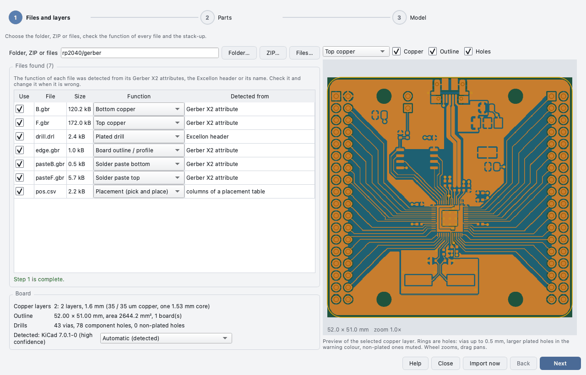

*Figure 33. Step 1 on the RP2040 minimal design: every file with its function, the Board box with
the detected CAD tool, the copper preview.*

- Choose a **folder**, a **ZIP archive** (read in memory, never extracted to disk) or files one by
  one, or type a path and press `Enter`.
- Each file gets the **function** detected from its X2 attributes, its Excellon header or its
  name. The function is a list you can change; the **Use** box leaves a file out. Two files that
  claim one function are shown in red and stop the import until you change one.
- A line names the **CAD tool** that wrote the files (for example *Detected: KiCad*). It only
  gives better defaults for the file-name rules; your own choice of a function always wins.
- The **Board** box gives the number of copper layers and the typical stack-up for that count,
  the outline (size and area) and the drills: plated holes up to 0.5 mm are vias, larger plated
  holes are component holes (not modelled), non-plated holes are not modelled. Blind, buried
  and micro vias are treated as through vias, with a warning (the board then reads too cool).
- The **preview** draws the selected copper layer, the outline and the holes. The wheel zooms,
  a drag pans, a double click shows the whole board.

### 9.2 Step 2: parts

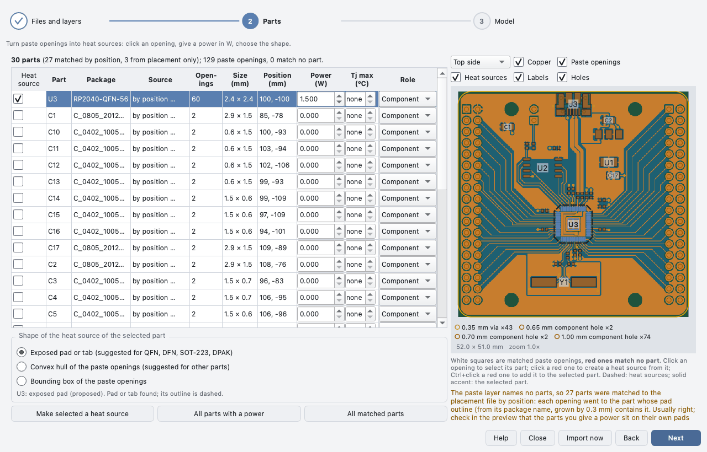

*Figure 34. Step 2: the parts table, the preview with the designators and the holes, and the
RP2040 chip (a QFN) selected with Exposed pad or tab chosen; the pad outline is dashed.*

- The paste layers, the placement (pick and place) file and an X3 component layer give a table of
  parts. The **Source** column says how each part was found: *X3 component layer (exact)*, *paste
  TO.C + placement*, *by position (approx.)*, *paste only* or *placement only*.
- Tick **Heat source** and give a **Power** in W (a power above zero ticks it), a **Tj max** and
  a **Role**.
- The **shape** of the heat source: the convex hull of the paste openings (default), the **exposed
  pad** (proposed for QFN, DFN, SOT-223, DPAK: all the power on the pad, the worst case) or the
  bounding box. Give a part with an exposed pad θ = θJC(bottom) of its datasheet.
- In the preview, white squares are matched paste openings and red ones match no part: a click
  on a red opening makes a heat source from it, `Ctrl`+click adds it to the selected part.
- When the placement file seems to use another origin, the page offers to move it by the offset
  that puts most parts on their openings. Accept it only if more parts then sit on their
  openings.

### 9.3 Step 3: model

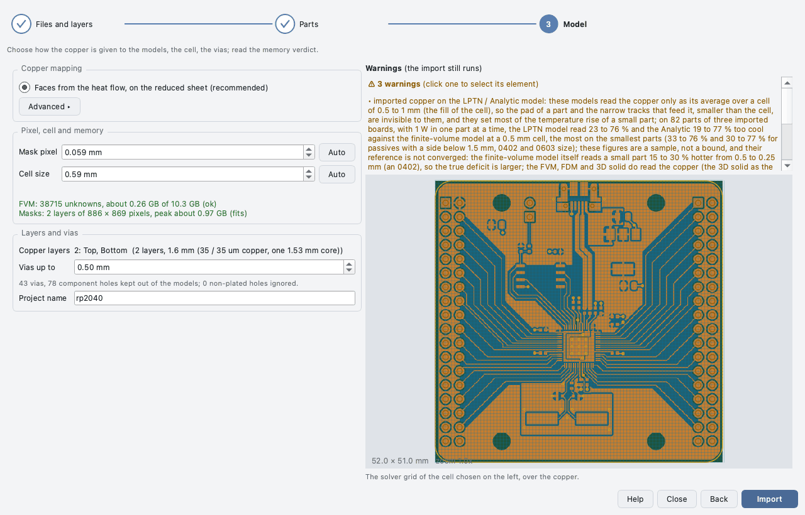

*Figure 35. Step 3: the copper mapping, the pixel and the cell, the memory verdict and the
warnings.*

- The copper **mapping** is the flow-based faces (recommended). *Advanced* holds the older
  mappings, kept for comparison.
- The **mask pixel** and the **cell** have an **Auto** button (the pixel is the thinnest line of
  the files and at most a tenth of the cell). Use a cell of 1 mm or less.
- The **memory verdict** comes before anything is drawn.
- **Vias up to** sets the largest plated hole that is a via.
- The warnings list says what the LPTN and Analytic do with imported copper, a coarse cell or
  pixel, and where a Gerber job file disagrees with the file list.

**Import** builds a new project in project format 2 (needs 2.5.0 or later to open).

### 9.4 Re-import after a layout revision

When the open project already holds an import, the window first asks what to do:

- **Replace**: read the board again, keeping what you did in the editor (the powers and fields
  of the parts, matched by name; the heaters, zones, heatsinks and vias you drew; the stack-up
  when the layer count is the same).
- **Update after a layout revision**: the same, with a table of the parts that moved, were
  resized, rotated, new or removed.
- **Add files**: add a placement file, a paste layer or a component layer and their new parts
  (never a copper, outline or drill file).
- **New project from these files**: preselected when the files look like **another board**; the
  dialog then says so in red with the reasons, and **Cancel** is the default button.

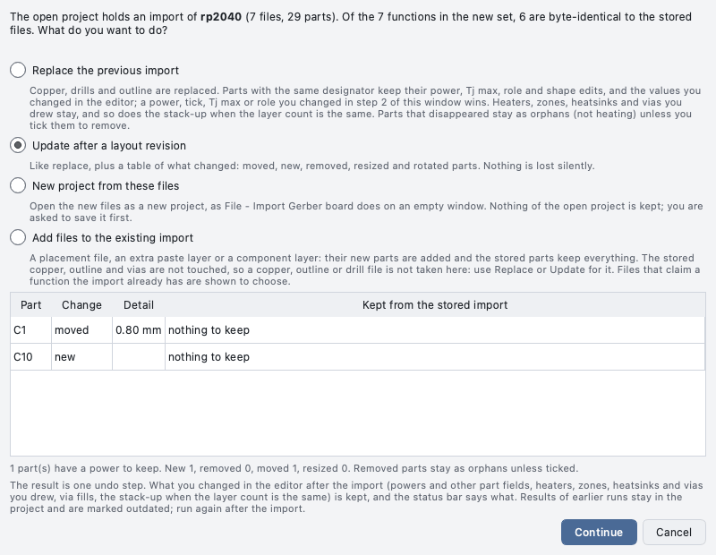

*Figure 36. The re-import dialog: Replace, Update or Add files, and the table of what changed.*

A part that left the files is an **orphan**: kept with its power, not heating. The status bar
gives the numbers of what was replaced, added, moved, orphaned and kept.

### 9.5 Imported copper on the board

- **View - Imported copper** (on by default) draws the copper of the layer in the Layer box.
- **View - Holes** (vias, component, non-plated) shows or hides the drills (display only).
- Imported copper **replaces the zones** of its layer; a zone drawn on an imported layer is
  ignored, and the warnings say so. To change the copper, change the Gerber files and re-import.
- The FVM and FDM read the imported copper exactly (flow-based faces). The LPTN and Analytic read
  only the average of a cell and warn that they read too cool. Use the FVM.
- **View - Background image** is disabled for a project from Gerber files (the files already give
  the exact copper).

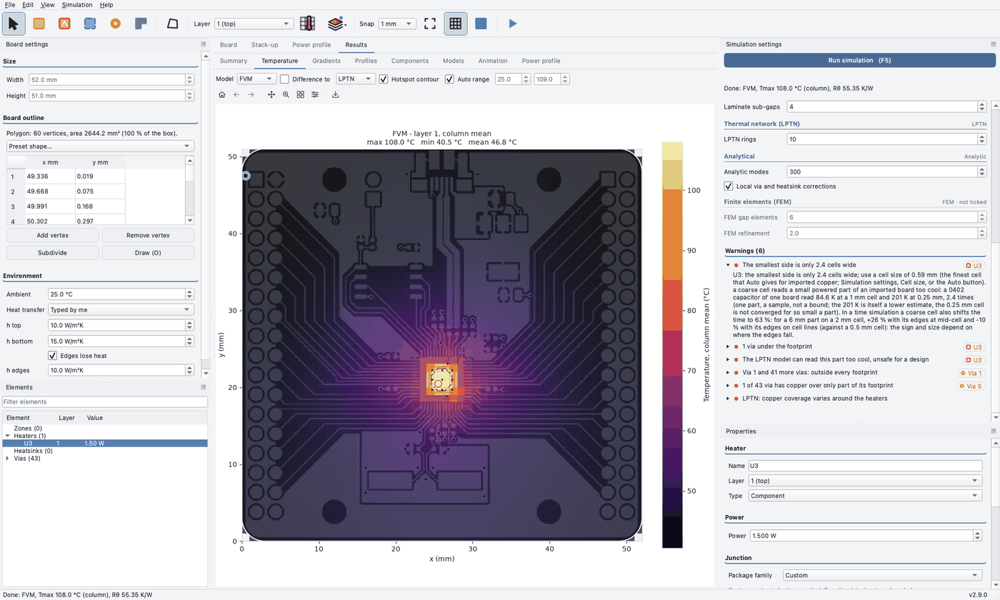

*Figure 37. Results - Temperature of the imported RP2040 board (FVM).*

Help us test your CAD tool: the README of the project says which CAD programs were tried and how
to send a sample set.

## 10. Files and formats

### 10.1 Project files (.pcbt.json)

A project is a plain JSON text file with millimetres and 1-based layers. It stores everything: the
board size and outline, the stack-up, the materials, the environment, all elements and their part
fields, the power profiles and the solver options. It never stores results, the layer you were
looking at or the settings of the machine (memory limit, file limits).

- **Format 1** is a project drawn by hand; **format 2** is a project with an imported board (it
  holds the copper masks as text). Format 2 needs 2.5.0 or later: an older program answers
  *Cannot open file* and does not touch the file.
- A file written by a newer program is refused with the version that wrote it.
- A damaged file, a file that is not JSON or a value of the wrong type gives a message that names
  the key (for example `zones[2].polygon_mm[0]`). A length above 1 km or a number above 1e100 is
  refused on load and never written.
- Old editor files of the original wxPython program (1.0.0) still open (they are converted on
  load; `convert` on the command line writes the new format).
- A read-only file is not overwritten: use **Save as**.

### 10.2 Project packages (.pcbtz)

A package is one ordinary ZIP file (any zip tool opens it) that holds:

| Member | What it is |
| :-- | :-- |
| `project.pcbt.json` | Exactly what a .pcbt.json file holds. |
| `manifest.json` | The size and SHA-256 of every member. |
| `images/` | The background image of the project. |
| `sources/` | Only on request: the files the board was imported from (Gerber, drill, placement, X3 component layers, a BOM). |

- **File - Export package…** writes a package; **Include the source files (Gerbers, drills,
  placement, BOM)** is off by default and remembered on this machine. Gerber headers may carry
  folder paths and user names: the export names the files whose first 8 kB carry such text (it
  says what kind of text, never the text itself). A third-party board keeps its owner's licence.
- **File - Open** and the command line recognise a package by its content. **Save** keeps the type
  of the open file; **Save as** offers both.
- A package is read as a hostile file: unsafe names, links, duplicates, bombs and members that do
  not match their hash are refused or dropped with a message.
- A package above **Largest package (MB)** (Preferences, 512 MB by default) is refused. A real
  package is a few MB.
- An older program (2.5.0 and before) answers *Cannot open file*.

### 10.3 Backups

When a save changes the format of the file on disk, the old file is first copied to
`name.pcbt.json.bak` (then `.bak2`, `.bak3`, never overwriting an older copy).

### 10.4 Power profile tables (CSV)

```
# free comment lines start with #
# repeat: yes        (yes: the table repeats; no: it runs once and the last power is held)
time_s,power_w
0,12.0
2,5.0
10,0.5
30,0.5               (the last row is the END of the profile; its power is ignored)
```

- Row *i* gives the power from its time until the next row: a step, not a ramp.
- The first time must be 0 and the times must increase. Powers cannot be negative.
- Units in the header: `time_s`, `time_ms`, `time_us`, `time_min`, `time_h`; `power_w`,
  `power_mw`, `power_kw`. Separators: comma, semicolon or tab; the decimal separator is a point.
- A wrong file gives a message with the line number and the reason.

Examples: `examples/csv_profiles/profiles/`.

### 10.5 Exported results

**File - Export results to a folder…** and the `run` command write the same files:

| File | Contents |
| :-- | :-- |
| `report.txt` | The text report: the disclaimer, the table of the models, the read-outs, each heater and zone, every warning in full. |
| `summary.json` | The machine-readable summary (the version of the program, the models, the parts, the warnings). |
| `field_<model>.csv` | The temperature field of each model. |
| `fields_<model>.png` | The maps of each model. |
| `comparison.png`, `profiles.png` | The comparison of the models and the profiles along a cut. |
| `parts_by_model.csv` | The part rows of each model, when two or more models ran. |
| `surface_<model>.csv` and the surface pictures | Only with `run --surface-files`. |

The `run` command of the example board writes 11 files (three models). From the window, the maps
are drawn with the Display choice (view, underlay, colour map) and the status bar gives the
number of files written. Every report, the JSON
summary and the command-line output start with the disclaimer line of section 1.3.

## 11. Command-line reference

Every command is `python -m pcbthermal <command>` with the Python of the environment
(`.venv/bin/python` from source). Add `--help` to any command for its options.

### 11.1 Commands

| Command | What it does |
| :-- | :-- |
| `gui [project]` | Open the window, optionally with a project. |
| `run config` | Solve the steady state (and the power profiles); report, CSV and figures. |
| `transient config` | The response to a power step (an animation with `--gif`). |
| `solvers config` | Compare the direct, CG and SOR solvers of the FVM on one board. |
| `calibrate config --measured T` | Fit the convection multiplier to a measured steady temperature. |
| `convergence config` | An FVM grid refinement study. |
| `convert in out` | A legacy editor file to the native JSON; .pcbt.json to .pcbtz and back. |
| `example [output]` | Write an example board (`--which` reference, example, profile or block). |
| `--version` | Print the version (`PCB Thermal Lab 2.8.0`). |

`config` is a project file: .pcbt.json, .pcbtz or a legacy editor file.

### 11.2 Options shared by run, transient and solvers

| Option | Meaning |
| :-- | :-- |
| `--out DIR` | Output folder (default `output`). |
| `--cell-mm X` | Cell size in mm, or `auto` (default: from the project). |
| `--no-plots` | Skip the figures. |
| `--memory-fraction F` | Share of the physical memory a solve may use, 0.1 to 0.95 (default: the Preferences value, 0.6). A larger model is refused with exit code 3. |

### 11.3 Options of run

| Option | Meaning |
| :-- | :-- |
| `--model M` | `fvm`, `lumped`, `analytic`, `fdm`, `solid3d`, `fem`; `all` (the three main models) or `compare` (all six; a model that cannot run is skipped with a warning). |
| `--surface-files` | Also write `surface_<model>.csv` and the surface maps. |
| `--solver S` | FVM linear solver: `direct`, `cg`, `sor`. |
| `--laminate-s-max-mm S`, `--laminate-n-max N` | The laminate sub-gaps (FVM and FDM). |
| `--fem-gap-elements N`, `--fem-refine R` | The FEM mesh (2 to 24; 1 to 4). |
| `--computed-h`, `--air-speed`, `--orientation`, `--natural-form`, `--emissivity`, `--h-multiplier` | Computed heat transfer (any of them switches to computed mode). |
| `--profile HEATER=FILE.csv` | A power profile from a CSV file (heater name or `#number`; repeat for several heaters). |
| `--steady-power` (average or peak), `--threshold-c`, `--duration` (stable, cycles or time), `--cycles`, `--time-s`, `--initial-c` | The settings of the time simulation of the power profiles (section 4.10). |

### 11.4 Options of transient and calibrate

`transient`: `--t-end` (s), `--steps` (number of output times), `--model fvm|fdm|fem|analytic`,
`--theta` (1 = implicit Euler, 0.5 = Crank-Nicolson), `--gif`.

`calibrate`: `--measured` (°C, required), `--heater` (the heater whose footprint maximum was
measured; default the board maximum), `--model fvm|lumped|analytic`, `--cell-mm`,
`--memory-fraction`.

### 11.5 Examples

```
# all models, report and figures of the example board
.venv/bin/python -m pcbthermal run examples/example_board.pcbt.json --out output
# the six models side by side
.venv/bin/python -m pcbthermal run examples/example_board.pcbt.json --model compare
# a power profile run for four cycles
.venv/bin/python -m pcbthermal run --duration cycles --cycles 4 examples/profile_board.pcbt.json
# the heat-up animation as a GIF, with the finite elements
.venv/bin/python -m pcbthermal transient examples/example_board.pcbt.json --model fem --gif
# a package with the source files, and back
.venv/bin/python -m pcbthermal convert board.pcbt.json board.pcbtz
.venv/bin/python -m pcbthermal convert board.pcbtz board.pcbt.json
```

**Exit codes**: 0 success; 2 a file that cannot be read (the message names the key); 3 a model
refused by the memory guard.

### 11.6 Python

```python
from pcbthermal import Problem, SolverOptions, simulate

p = Problem.new(width_mm=100, height_mm=80, layers=4)
p.add_full_copper().add_heater(1, 4.0, rect=(30, 35, 40, 45), name="U1", theta=6.0)
sim = simulate(p, SolverOptions(cell_mm=1.0))
print(sim.to_markdown())          # models, errors against the reference, warnings
sim.save("results")               # report, JSON, CSV fields, figures
```

The builder takes millimetres. The estimate of the memory and the measured peak are written to
the Python logger `pcbthermal.memory` at level INFO.

## 12. Limits of the models

This chapter lists what to keep in mind; the numbers behind each point are in the user guide
(*Limits and good practice*, *What is validated and what is not*), `docs/theory.md` and
`docs/validation.md`.

### 12.1 What is checked and against what

- **Conduction** in the layered board (FVM, FDM) is checked against an independent 3D solver,
  closed forms and published cases: within 0.3 to 3 % on the cases tried.
- The **LPTN and Analytic** were fitted mostly against the program's own FVM: a few percent on
  uniform copper, wide errors on vias and non-uniform copper (warned).
- The **heat transfer coefficients** are published correlations, checked against textbook
  examples, a glass and a ceramic plate and one datasheet resistance, **never against a measured
  copper board**. Treat the absolute temperature as uncertain by the uncertainty of h; fit
  *Convection ×* to a measurement when you have one.
- **No model has been compared with a measurement of a physical board.**

### 12.2 The layered idealisation

The FVM, FDM, LPTN and Analytic keep one temperature per copper layer (the column). Small parts on
bare laminate, thick plates and the faces of thick copper are where this matters; the program
warns there, and the 3D solid and the FEM check it.

### 12.3 The first seconds of a power step

Every layered model rises too slowly in the first seconds after a power step (on a two-layer
board about 58 % too low at 0.3 s, 30 % at 1 s, 9 % at 3 s); later it agrees. Read the first
seconds of a time result of these models as a lower estimate, or use the FEM in time
(section 7.8).

### 12.4 Fast power waves

A layered model cannot follow a wave faster than a few seconds per stretch. The program adds the
swing from a closed form for a part with copper under it (*average + ripple*, section 4.10). The
closed form does not know vias, other heaters, heatsinks or the board edge.

### 12.5 Datasheet numbers and presets

θ and ψ of datasheets belong to the manufacturer's test board and are estimates on yours. The
material presets are typical values for orientation, not datasheet values: type your laminate's.

### 12.6 Good practice

1. Check the cell size once (halve it).
2. Read every warning.
3. Confirm the fast models with the FVM before relying on them.
4. Compare a measurement of the surface with the surface read-out, not the column.
5. Validate critical designs by measurement.

## 13. Troubleshooting and FAQ

**Run is grey.** Hover it: its tooltip says why. Usually the memory line of a model is red: use
the cell the message names, press **Auto**, or untick that model. With the FEM alone, Run is also
greyed when its mesh cannot be built (a slanted outline) or needs pyamg.

**"Cannot run:" under the Run button.** A model would be refused (memory, or a FEM mesh that
cannot be built). The line gives the reason and the cell to use.

**The run is slow.** The cell is fine, or the 3D solid or the FEM is ticked. The status bar gives
the stage and the seconds. Press **Stop** (`Ctrl+.`) and use a coarser cell; amber in the memory
line means tens of seconds or more.

**The models disagree by more than 5 %.** Trust the FVM. Read the warnings: they usually say
which model is weak on this board (vias, copper edges, outline, imported copper).

**My temperature is lower than the paper's (or the thermocouple's).** The tables show the column
mean; the paper or the thermocouple reads the surface. Choose **Surface (top)** in the Layer box
or read the surface column of the Components table (section 5.10).

**A textbook case does not match.** Check the films: a new board has h top 10, h bottom 15 and
edges that lose heat. Set the faces and edges of the textbook case (section 6.6).

**The map is not on the board after an edit.** The result is outdated: run again. The Map button
is grey until a result exists.

**The LPTN or Analytic map looks stretched on an outline board.** They solve a rectangle of the
same area. Untick **Equiv. rect.** to stretch it back over the board, or use the FVM.

**A zone I drew on an imported board does nothing.** Imported copper replaces the zones of its
layer. Change the Gerber files and re-import.

**A via has no effect on one layer.** The drilled hole touches no copper on that layer; the
Warnings box says so. Draw the pad or the plane if the via is connected there.

**The program says "Cannot open file".** The file is damaged, not a project, written by a newer
version, or a format-2 project or a package opened in a version older than 2.5.0. The message
says which.

**Typing in the filter field moved the board / deleted something.** It cannot: keys typed in the
filter field never reach the board. `Ctrl+Z` in the filter undoes the text; click the board first
to undo the board.

**A decimal comma.** It is read as a point (0,45 is 0.45) in every number field and in the
Preferences tables.

**Where are my defaults?** In `user_defaults.json` in the configuration folder (section 2.5).
**Preferences - Open folder** opens it. The status bar says *Custom defaults* when the file is in
use.

**The FEM is skipped "pyamg missing".** Install it in the environment
(`.venv/bin/pip install pyamg`) or use a coarser cell (a steady mesh up to 30 000 unknowns runs
without it).

**macOS refuses to open the downloaded app.** See section 2.2 (Open Anyway in Privacy &
Security).

**Where is the version?** The title bar, the right end of the status bar, **Help - About**, the
first line of every report, and `--version`.

**How do I report a problem?** Open an issue on the project's GitHub page with the project file
(or a package), the version, what you did and what you saw.

## 14. Glossary

| Term | Meaning |
| :-- | :-- |
| Ambient | The air temperature around the board; every result is a rise above it. |
| Average + ripple | The decision for a fast wave: the board runs at the average power and the temperature wave of a closed form is added at the heater. |
| Column (read-out) | The mean temperature through the thickness of a copper layer: the node of the layered models. |
| Component | A heater with a junction: θ junction-pad, Tj max and optional fields. |
| Cell | The square of the solver grid, set by the Cell size. |
| Copper fill | The share of a zone that is copper (1 solid, 0.5 hatched). |
| Exposed pad | The thermal pad under a QFN, DFN, SOT-223 or DPAK, through which the part puts almost all its heat into the board. |
| FEM, FDM, FVM, LPTN | Finite elements, finite differences, finite volumes, lumped parameter thermal network (chapter 7). |
| Heat source | A heater that is only a power over a footprint. |
| Heat transfer coefficient h | The heat a face loses per unit area and kelvin of rise, W/m²K (convection plus radiation). |
| Hotspot | An area above the Hotspot limit. |
| Imported copper | The copper of a layer read from its Gerber file, one mask per layer. |
| Interface | The sheet (paste, gap pad, solder) between a part or a block and the board; K·cm²/W. |
| Junction temperature Tj | The temperature of the die: the board under the part plus P × θ. |
| Laminate sub-gap | A slice of the dielectric between two copper layers, where the FVM and FDM cut it into nodes. |
| Margin | Tj max minus the junction temperature, K. |
| Metal block | A heatsink drawn as a piece of metal pressed on the board through an interface. |
| Outline | The shape of the board inside the box. |
| Package (.pcbtz) | A project in one ZIP file with its image and, on request, its source files. |
| Power limit | The power that brings a part to its Tj max on this board. |
| Power profile | The power of a heater in time: constant, square wave or table. |
| ψJB, ψJT | Datasheet characterisation parameters from the junction to the board, to the top of the case. |
| Rθ | The rise of the hottest point divided by the total power, K/W: a board resistance. |
| Reference model | The model the others are compared with: the FVM when it runs. |
| Stack-up | The layers of the board from top to bottom: copper and dielectric thicknesses and materials. |
| Surface (read-out) | The temperature of the outer face of the copper: an estimate (FVM, FDM) or resolved (FEM). |
| θ junction-pad | Junction-to-pad resistance of a part, K/W, from its datasheet (not θJA). |
| θSA | Sink-to-ambient resistance of a heatsink, K/W. |
| Top path | The heat that leaves a part through the top of its package into a heatsink. |
| Via | A plated hole that joins every copper layer and carries heat through its copper barrel. |

## Appendix A. Keyboard and mouse

The same list is in **Help - Keyboard shortcuts** (Figure 38). On macOS, `Ctrl` is the Command
key (⌘).

| Keys | Action |
| :-- | :-- |
| `S` `Z` `H` `C` `V` `O` | Select, Zone, Heater, Heatsink (cooling), Via, board Outline tools |
| `P` | Polygon mode: click the vertices; double-click, `Enter` or right-click finishes |
| Right-click on the board | On a shape: add or delete a vertex, duplicate, delete. On a via: duplicate, delete. On an empty spot: add a heater, zone, heatsink or via here |
| Wheel, middle-drag, `Space`+drag | Zoom, pan |
| `Ctrl+0`, `Ctrl++` (or `Ctrl+=`), `Ctrl+-` | Fit the board, zoom in, zoom out |
| `Ctrl+A` | Select all on the active layer |
| `Del` or `Backspace`, `Ctrl+D`, arrows | Delete, duplicate, nudge the selection |
| `Esc` | Cancel the drawing, clear the selection |
| `G`, `Shift+G`, `T` | Grid, solver grid, temperature map on the board |
| `L`, `Shift+L`, `1` to `9`, `0` | Next layer, previous layer, that layer, all layers (Temperature page only) |
| `D` | Display settings |
| `M` | Model of the map |
| `Ctrl+Shift+T` | Light / dark theme |
| `F5`, `Ctrl+.` | Run, stop the calculation |
| `Ctrl+Z`, `Ctrl+Shift+Z` or `Ctrl+Y` | Undo, redo |
| `Ctrl+1` to `Ctrl+4` | Board, Stack-up, Power profile, Results tabs |
| `Ctrl+N`, `Ctrl+O`, `Ctrl+S`, `Ctrl+Shift+S`, `Ctrl+Q` | New board, open, save, save as, quit |
| `Ctrl+F` | Filter field of the Elements dock |
| `Ctrl+,` | Preferences |
| `F1` | The user guide |

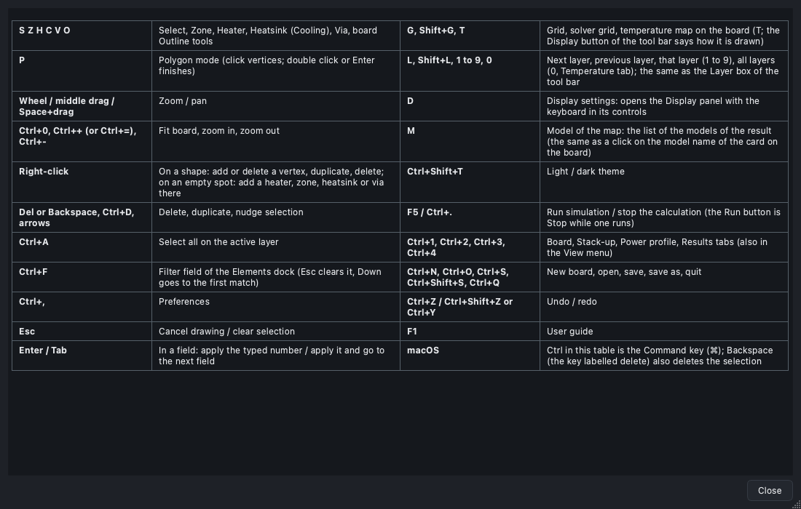

*Figure 38. Help - Keyboard shortcuts: the keys in two columns.*
