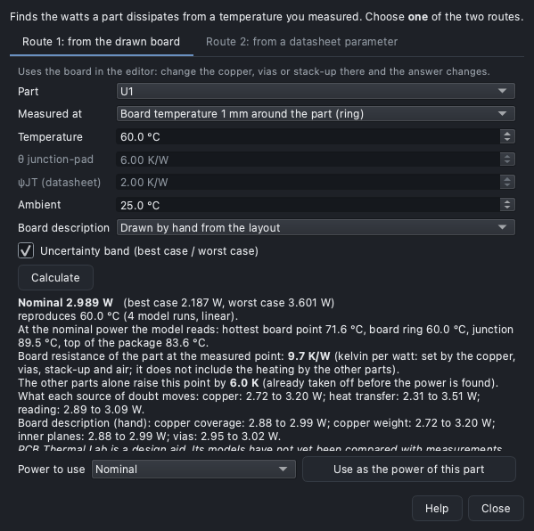

# Calculators

The auxiliary tools of the program that answer a question with a few numbers instead of a simulation of a whole board. Today there is one, the **Power Calculator** (Simulation menu); this file documents what it does, which formulas and parameters it uses, how it was validated, what it cannot do, and the sources. A new calculator gets its own section here.

## 1. Power Calculator: the watts a part dissipates, from a temperature you measured

**Window.** *Simulation → Power Calculator…*. Two tabs, **one per route; they are independent ways to the same number and you fill only one** (route 2 updates as you type and has its own *Use as the power of a part* button; route 1 has *Calculate*). The window keeps one size: the parameters a point does not use (θ, ψJT) are greyed, not removed. Every field and every option of *Measured at* and of *Power to use* has a hint, and the **Help** button opens a formatted explanation (`pcbthermal/help/calculator.html`).

**The question.** You measured a temperature on a board (a thermocouple next to a part, a sense diode in it, an infrared reading of its top) and you want to know how many watts that part dissipates. It is the simulation run backwards. Code: `pcbthermal/inverse.py` (the maths), `pcbthermal/gui/calculator.py` (the window), `pcbthermal/jobs.py` (the calculation runs in the separate process, so the window never freezes).

### 1.1 Route 1: from the drawn board

**Idea.** For fixed heat transfer coefficients the board problem is linear: the temperature of any point is `T(P) = T(0) + R·P`, where `T(0)` is the temperature caused by the *other* heaters and `R` (kelvin per watt) is the **board resistance seen by that point**. So the power that reproduces your measurement is

```
P = (T_measured − T(0)) / R          R = (T(P_run) − T(0)) / P_run
```

and two model runs (the part at 0 W and at any `P_run`) give `T(0)` and `R`; a third run checks the answer. With computed convection (the coefficients grow with temperature) the relation is not linear and a secant iteration finishes it (a few more runs; on the CSD17308Q3 board the junction is 6 K below the two-run line at 2 W with computed convection). One last run reports what the model reads at the power found. At manual coefficients the runs share one factorisation of the board matrix (`fvm.factor_reuse`): the results are bit-identical to separate solves (84 of 84 cases) and the calculation is about 3.8 times faster; with computed coefficients the matrix changes at every step, nothing is reused and the time is as before (up to about 17 % more for the hash and the extra factorisation).

Times at manual h (example board, one call and the band at design level *hand*): 1 mm, one call 0.34 to 0.11 s, band 4.8 to 1.5 s; 0.5 mm, one call 4.80 to 1.28 s (679 to 605 MB), band 84.5 to 21.6 s (2024 to 1952 MB).

**What the copper does.** The program does not "see" the heat in the copper. The copper, the vias, the stack-up and the air decide `R`, how many kelvin each watt raises at the point you measured: a plane under the part spreads the heat, `R` is small and the same temperature means more watts; a bare board has a large `R` and the same temperature means fewer watts. That is why the board you draw must be the real one, and why the result window shows `R`.

**Where the measurement is taken** (the *Measured at* list; each option has a hint in the window):

| Point | What it is | Needs | Typical use |
| :-- | :-- | :-- | :-- |
| Board ring (1 mm around the part) | mean board temperature 0.5 to 1.5 mm outside the package outline (the program's own band, all four sides): an approximation of the board point of ψJB, which TI SPRA953 (read on the page image, PDF page 11, section 5) defines as the temperature of the centre package pin, measured by JESD51-6 (not read); the 1 mm from the package edge is the reading of vendor summaries (Renesas, S), not of a page read | nothing from the datasheet | thermocouple taped on the copper next to the part |
| Hottest board point under the part | maximum board temperature under the footprint | nothing | a probe under the package |
| Mean board temperature under the part | average under the footprint | nothing | comparison with the model's mean |
| Junction | `Tj = T_board,max + θ·P` | θ of the part | a sense diode or the part's own sensor |
| Top of the package | `T_top = Tj − ψJT·P = T_board,max + (θ − ψJT)·P` | θ and ψJT | thermocouple or infrared reading of the case |

**The parameters and where they are.** They are entered in the calculator itself, not elsewhere, and only the ones the chosen point needs appear:
* **θ junction-to-pad** (K/W): the datasheet's junction-to-case (bottom or exposed pad), junction-to-lead or junction-to-solder-point resistance; never θJA. It starts at the value in the part's Properties and the number typed in the calculator is used for that calculation only. The convention is the program's worst case: all the power enters the board, and the junction is `θ·P` above the hottest board point under the part.
* **ψJT** (K/W): the datasheet's junction-to-top characterisation parameter, `Tj − Ttop = ψJT·P`. It is not a resistance (only part of the heat flows through the top) and belongs to the datasheet's test board.
* **Ambient**: the air temperature at the time of the measurement.

The result window gives the power, the temperatures the model reads at that power (hottest board point, ring, junction, top), and the board resistance `R` at the measured point. *Use as the power of this part* writes the power into the heater.

### 1.1b The uncertainty band and the case selector

The nominal power is what the calculator returns for the inputs as typed. Because the board, the heat transfer, θ, ψJT and the reading are known only approximately, `inverse.power_band` also gives a **best case** (lowest plausible power) and a **worst case** (highest plausible power, the one to check margins with):

1. Each source is moved **alone** to both ends of its uncertainty and the calculator is run again: the **copper** (thickness of every layer, ±25 %), the **heat transfer** (both face coefficients, or the convection multiplier when computed, ±30 %), **θ** (±20 %, only for the junction and the top), **ψJT** (±30 %, only for the top) and the **reading** (±1 K). The defaults are in *Preferences → Power Calculator* (the `calculator` section of `defaults.json`). These are uncertain **numbers**; the doubt about the **drawing** of the board is the design uncertainty of section 1.1c, which is added by the same rule.
2. A source moves the power down on one side and up on the other (more copper means a lower board resistance, so more watts for the same reading). The downward deviations of all the sources are added as the **root of the sum of squares**, and so are the upward ones: `best = P − √Σ(P − low_i)²`, `worst = P + √Σ(high_i − P)²`. This is the usual way to add independent uncertainties; stacking all of them at once would give a range nobody has seen.
3. The selector **Power to use** (Best case / Nominal / Worst case) says which of the three the button *Use as the power of this part* writes into the heater, with undo. **Nothing else in the program changes**: the simulation uses that single number when you next run it.

Example (the board of table 2.2, U1 at 2 W, θ 6, ψJT 2, 1 mm resolution), numbers only (design level *None*, which is the band as it was before the design uncertainty was added):

| Measured at | nominal | best case | worst case | what each source moves (W) |
| :-- | --: | --: | --: | :-- |
| board ring | 2.00 W | 1.62 W | 2.31 W | copper 1.81–2.15, heat transfer 1.68–2.25, reading 1.89–2.11 |
| top of the package | 2.00 W | 1.68 W | 2.27 W | copper 1.80–2.16, heat transfer 1.82–2.13, θ 1.87–2.15, ψJT 1.93–2.07, reading 1.94–2.06 |

With the default board description (*Drawn by hand from the layout*, section 1.1c) the same example gives **ring 2.00 / 1.56 / 2.34 W** and **top 2.00 / 1.58 / 2.31 W** (nominal / best / worst); the design terms add, for the top: coverage 1.84–2.00, copper weight 1.80–2.16, inner planes 1.94–2.00, vias 1.97–2.02 W. The worst case rises by 0.03 to 0.04 W, the best case falls by 0.06 to 0.10 W. (On this board every zone is solid, so coverage and planes have no upward side.) The nominal never changes.

**Same board or a variant?** The power is fitted to the drawn board. Simulating *that same board* with it reproduces the measurement (the copper's error cancels); simulating *variants* (more copper, a heatsink) keeps the power, which is physically right, but the board's error does not cancel, so use the worst case for margins (and a board description level that matches how the board was drawn: without the design uncertainty the worst case holds only when the board is drawn right).

### 1.1c Design uncertainty: how well the drawing matches the board

The terms of section 1.1b are uncertain *numbers* on a board that is assumed drawn right. The review of the calculator showed that this band does **not** cover a wrongly drawn board: in three of four drawing errors the true 2 W was above the worst case (in all four on the program of 2.4.5, the missing vias falling 0.002 W short). The **Board description** list of the calculator adds four more one-at-a-time sources, moved to both ends like the others and combined with them by the root of the sum of squares (`inverse.power_band`, `design_*` entries of the `calculator` section of `defaults.json`, editable in *Preferences → Power Calculator*):



*Screenshot: `docs/images/calculator_design.png`, made by `examples/make_screenshots.py`.*

| Source | what is moved | the drawn board is changed by | measured sensitivity (table 2.2) | source of the percentage |
| :-- | :-- | :-- | :-- | :-- |
| copper coverage | the fill of every zone of the outer layers (the inner ones belong to the planes term, so that the same doubt is not counted twice) | fill × (1 ∓ a), limited to 1 (a pour that is already solid cannot be more solid) | top pad half filled: −16 % of power | assumed (a hatched pour is about 50 %) |
| copper weight | the thickness of every layer, on top of the 25 % of the copper number | thickness × (1 ∓ a) | copper 17.5 instead of 35 µm: −24 % | assumed (0.5 oz taken for 1 oz is 50 %) |
| inner planes | the inner layers | down: fill × (1 − a); up: a board-sized plane at fill a in an inner layer that has none, fill × (1 + a) in one that has a zone | no inner planes: −36 % | assumed |
| vias | the barrel copper (number or plating) | plating × (1 ∓ a) | no vias under the part: −12 % | assumed |

**Levels.** `a` is the amplitude of the source at the level *Estimated* (defaults: coverage 40 %, weight 50 %, planes 50 %, vias 50 %) times the multiplier of the level: **None** 0, **Drawn from the real fabrication files** 0.2, **Drawn by hand from the layout** 0.5 (the default), **Estimated** 1. The sensitivities in the table are *measured* (table 2.2); the amplitudes and the multipliers of the levels are *assumed* judgements of how wrong each kind of drawing usually is, they are not fitted to any data, and are editable. Every amplitude (and the copper uncertainty) is limited to 99 % when read, so a thickness or a plating never reaches 0 or below, and the best case is never below 0 W (`tests/test_calculator_design.py`). The internal key of the level *Drawn from the real fabrication files* stays `cad`. A source with nothing to change (no vias, no inner layer, no zone) is left out. With the level *None*, or a multiplier of 0, no design source is run and the band is **bit-identical** to the one of section 1.1b (`tests/test_calculator_design.py`).

**What it covers and what not** (the four drawing errors of table 2.2, power recovered at the top of the package, true power 2 W, computed with the default uncertainties, 1 mm):

| Drawn board (real board: the example, 2 W) | nominal | numbers only (None) | **Drawn by hand** | **Estimated** |
| :-- | --: | :-- | :-- | :-- |
| top copper half filled (hatched) | 1.683 | 1.443–1.882, **out** | 1.373–1.928, **out** | 1.168–2.008, **in** (2 W is 0.008 W from the edge) |
| copper 17.5 µm instead of 35 µm | 1.521 | 1.289–1.718, **out** | 1.202–1.768, **out** | 0.993–1.859, **out** |
| no vias under the part (no via term: nothing drawn to move) | 1.768 | 1.494–2.001, in (0.001 W over) | 1.393–2.050, in | 1.166–2.144, in |
| no inner planes (only the top copper drawn: the bottom plane is missing too) | 1.286 | 1.087–1.455, **out** | 0.996–1.631, **out** | 0.799–1.808, **out** |

*(Audit 2.8.0 A5: re-run on `development` 5fc91430 with `study_design_term_coverage.py`; the earlier table (nominals 1.686 / 1.521 / 1.766 / 1.297 W) was of the program before 2.7.0. The column None now holds the missing vias by 0.001 W, where it fell 0.002 W short: the verdicts at the edge flip with the program, as the next paragraph says. The column Drawn from the real fabrication files prints hatched 1.432–1.891 out, half-weight copper 1.272–1.728 out, no vias 1.475–2.010 in, no planes 1.070–1.510 out; the example band 2.00 / 1.61 / 2.32 W at the ring, as below.)*

So the design term brings **1 of the 4** drawing errors inside the band at the level *Drawn by hand* (no vias, which the numbers-only band now also just holds) and 2 of 4 at *Estimated* (no vias, and the hatched pour only just); these counts are not a coverage rate: three of the sixteen verdicts lie within 0.012 W of the true 2 W, and the changes of 2.4.5 to the board model (0.002 to 0.05 W on these boards) flipped two of them; it does **not** cover a copper weight half the real one nor a missing set of inner planes, even at the widest level (worst case 1.86 and 1.81 W against a true 2 W). The amplitudes were not enlarged to cover them: the missing plane can only be added at a fill `a` (50 %), and the copper weight at +50 %, while the real errors were +100 % of copper and a full plane. The cases are the boards of the band study (section 4, part 2), run with `inverse.power_band(..., uncertainty={"design_level": ...})`; the table is measured with the coverage study of section 4 (several minutes, too long for a test): its columns none, hand and estimated reproduce the table to the last digit, and it also prints the column *Drawn from the real fabrication files* (numbers in the note under the table); the column *None* also reproduces part 2 of the band study (`none`). At the level *Drawn from the real fabrication files* the band is only a little wider than *None* (example at the ring: 1.607–2.317 W against 1.616–2.311 W).

The design term is an honest widening, not a guarantee: a drawing error larger than the amplitude of the chosen level is not covered, and the "up" moves reach only as far as their amplitude (a plane that is missing can be added at the fill `a`, not at 100 %). Choose *Estimated* when the board is a guess. Errors of kinds not listed (a missing heatsink or metal block, a wrong stack-up, a different air flow, a different `h` model, a part near the board edge) are not covered either. Limits of the four terms: the vias term moves the plating, so it adds no via where none is drawn and barely moves a via filled with copper (its core already conducts like copper); the copper weight term is the same change as the copper number term, added as a second independent cause (fabrication tolerance and a wrong weight), so at the level *Drawn by hand* the two together are about ±35 % of copper (root sum of squares of 25 and 25); an amplitude of 100 % or more (Preferences accepts it) makes a thickness or a plating zero or negative, which is not a meaningful board.

### 1.2 Route 2: from a datasheet parameter

`P = (Tj − T_reference) / parameter`, for a known junction temperature, with the reference point and the parameter of the same definition: ψJB (board 1 mm from the package), ψJT (top of the case) or θ. It uses no board model, so it is exact only on the datasheet's own board.

### 1.3 The shortcut that is not offered

From the definitions `Tj − Ta = θJA·P` and `Tj − Ttop = ψJT·P` follows `P = (Ttop − Ta)/(θJA − ψJT)`. It was not found stated in any datasheet read, its denominator is a difference of two similar numbers, and θJA belongs to the JEDEC board, not to yours. With a θJA 30 % below or above the real board's it gives +50 % or −25 % (table 2.2), so it is not offered.

## 2. Validation

### 2.1 Against datasheets (`tests/test_calculator_validation.py`)

A datasheet gives RθJA for a *stated* board. Built in the program, that board must return the datasheet's thermal resistance: the calculator must give 1 W when the junction is `RθJA` above ambient. Computed natural convection and radiation, horizontal board, still air.

| Case | datasheet RθJA (K/W) | model RθJA (K/W) | power returned for 1 W | error |
| :-- | --: | --: | --: | --: |
| TI CSD17308Q3 on its datasheet board (38.1 × 38.1 mm, 1.52 mm FR-4, 71 µm copper, 1 in² pad), RθJA typical | 46 | 46.7 | 0.986 W | −1.4 % |
| JESD51-7 2s2p board, exposed-pad QFN with 9 thermal vias (TPS7A47, **via array assumed**) | 32.5 | 31.6 | 1.029 W | +2.9 % |
| the same, measured on the top with ψJT 0.3 K/W | 32.5 | 31.6 | 1.029 W | +2.9 % |
| the same JEDEC board **without** the thermal vias | - | 74.6 (0.5 mm; 70.9 in 2.6.0, 68.1 before 2.4.5; 73 to 88 K/W at other cell sizes) | (0.44 W) | the exposed pad needs the vias (JESD51-5) |
| the JEDEC board **as ROHM 64AN113E prints it** (a 74.2 mm plane of 70 µm on the backside, vias joined to layers 1, 2 and 4 only) | 32.5 | 27.6 | 1.181 W | +18.1 % |

* **Numbers of the table re-run on the 2.7.0 program** (`research/power-calculator/scripts/calculator_validation.py`, 0.5 mm cell, run by the review of `fix/enter-focus-and-calculator-test`; `tests/test_calculator_dialog.py` gets the same numbers through the dialog): the JEDEC rows read 31.6 K/W, 1.029 W, +2.9 % (they read 31.4 K/W, 1.034 W, +3.4 % on the 2.6.0 program; the table had kept those after the 2.7.0 release) and the board without vias 74.6 K/W (70.9); the CSD17308Q3 rows did not move (46.7 K/W, 0.986 W; maximum 45.6 K/W, 1.271 W). The two-layer CSD17308Q3 board is untouched by the 2.7.0 model items and the four-layer simple JEDEC board is not, so the move is attributed to the physical slabs of the simple stack-up (2.7.0); the items were not separated one by one. Cell sweep of the JEDEC row with vias (`study_cell_size.py --case jedec --cell MM`): 32.23 K/W (+0.8 %) at 1 mm, 31.59 K/W (+2.9 %) at 0.5 mm; 0.25 mm not run (resident memory 5.1 GB, over the 4 GB limit of the review). Before that, the face-down law of 2.6.0 and the other 2.6.0 model items had moved the rows (CSD17308Q3 47.5 to 46.7 K/W, 0.968 to 0.986 W; the JEDEC rows 1.039 / 1.040 to 1.034 W). The next note describes the earlier move and keeps its own numbers.
* *History (program of 2.4.5, superseded by the rows of the table):* the CSD17308Q3 row moved with the laminate nodes of the rule (`docs/theory.md` 1.4) from 0.983 W (−1.7 %) to 0.968 W (−3.2 %), and the JEDEC rows from 31.6 K/W (1.030 W, +3.0 %) to 31.3 K/W (1.039 W, +3.9 %); the face-down law of 2.6.0 took the CSD17308Q3 row to 0.986 W (−1.4 %). The test tolerances are 4 % (CSD17308Q3) and 5 % (JEDEC).
* The CSD17308Q3 datasheet also gives 58 K/W as a *maximum* and 165 K/W for the minimum pad (also a maximum). A maximum covers the spread of parts and boards, not this board, so it is not a target (the model gives 46.4 K/W, 45.7 before 2.4.5, when the junction is 58 K above ambient because the computed convection improves with temperature). The pad of the minimum-pad case is not stated, so that case cannot be built.
* The JEDEC 2s2p board follows ROHM application note 64AN113E (JESD51-3/5/7/9/10): 114.3 × 76.2 × 1.6 mm, 70 µm top and bottom traces, two 74.2 × 74.2 mm planes of 35 µm, thermal vias Ø0.30 mm at 1.2 mm pitch. The traces are not drawn. The TPS7A47 values used (RθJA 32.5, θJC(bot) 1.7, ψJT 0.3 K/W) are from its datasheet (SBVS204G); the 5 × 5 mm body and the 3.15 mm pad are from its package drawing RGW0020A; the 3 × 3 via array is an assumption, so this row is an indication (+3 %), not a proof.
* **Cell size and model error** (re-run in the audit 2.8.0 A5 on `development` 5fc91430). CSD17308Q3: 47.02 K/W at 0.25 mm, −2.2 % of power (`study_cell_size.py --case csd --cell 0.25`; 46.7 K/W, −1.4 % at 0.5 mm). JEDEC with vias: 32.23 K/W at 1 mm, 31.59 K/W at 0.5 mm; 0.25 mm not run (5.1 GB resident). The no-via board depends strongly on the cell (its heat leaves through a source a few cells wide) but needs the vias at every size. **Model error on the CSD17308Q3 board** (`study_independent_datasheet_board.py`, the board with the converged face coefficients and FR-4 isotropic so that the independent solver represents the same board, 0.3 mm): the FVM's board resistance is 47.65 K/W against 48.00 K/W of the independent 3D solver (−0.7 %), the 3D solid 48.00 (+0.0 %); with the program's FR-4 the FVM gives 47.1 and the 3D solid 47.4 K/W of RθJA. So the −1.4 % of the row is not a model error cancelling: with the 3D solid the calculator would read about 0.6 % fewer watts (the ratio 47.1 / 47.4, an estimate, not printed). The earlier text (FVM 2.4 % below the independent solver, about 0.96 W with the 3D solid, −2.3 % and +1.3 % at 0.25 mm) was measured on programs before 2.4.5 and 2.6.0 and is withdrawn; the A2 review of the audit printed the same −0.7 %.
* **The JEDEC board as its cited source prints it** (audit 2.8.0 A5; `research/power-calculator/scripts/study_jedec_board_readings.py`, 0.5 mm, computed h, 4.6 minutes, 2.1 GB). ROHM 64AN113E (PDF page 3, read on the page image by the audits S1 and A5; cells not merged) prints for the 2s2p board a backside copper of 74.2 × 74.2 mm, 70 µm, and NOTE1 joins the thermal vias to layers 1, 2 and 4 only; the rows above draw no backside copper and join every layer. The two differences separated (model RθJA at 1 W, K/W; calculator power for the datasheet's 32.5 K/W):

  | board | RθJA | pad mean instead of the hottest point | calculator | error |
  | :-- | --: | --: | --: | --: |
  | A as drawn above (no backside copper, vias to every layer) | 31.62 | 30.95 | 1.029 W | +2.9 % |
  | B backside plane, vias to every layer | 26.74 | 26.10 | 1.222 W | +22.2 % |
  | C **as printed** (backside plane, vias to layers 1, 2, 4: an anti-pad of 0.7 mm around each via in layer 3) | 27.64 | 26.99 | 1.181 W | +18.1 % |
  | D no backside copper, vias to layers 1, 2, 4 | 36.06 | 35.34 | 0.899 W | −10.1 % |

  The backside plane is worth 5 K/W, the third layer's connection 1 K/W with the plane and 4 K/W without it. **So the +2.9 % of the JEDEC row is not a validation**: the datasheet's 32.5 K/W lies between the readings (27.6 to 36.1 K/W, −10 to +22 % of power), and on the board as its cited source prints it the model reads 15 % below the datasheet's RθJA (a board that cools better than the datasheet's, the unsafe side for a junction temperature). Which board JESD51-7 and JESD51-5 prescribe (the backside 'trace' layer, the layers the vias join) cannot be settled without the standards, which are not in the library; the TPS7A47's own test board is not described in its datasheet. The JEDEC rows are an **indication of order**, not a check of the calculator; the CSD17308Q3 row, whose board the datasheet states, is the check. The earlier 26.4 K/W of this bullet (and 26.2 in the research README 4.5) was the plane with every layer joined on older programs; now 26.7 K/W.
* The ψJT row only checks that the top-of-package point is consistent with the junction point; the model has no top path in the JEDEC case, so ψJT cannot be predicted (that needs the junction node of the roadmap).
* Tests: the three rows above with tolerances of 4 % (CSD17308Q3) and 5 % (JEDEC), and the factor of about two for the missing vias.

### 2.2 Sensitivity to the board and to the data (`docs/validation.md` section 19)

Part of 2 W, θ = 6 K/W, ψJT = 2 K/W on the example board; the top reading is made on the real board and the power is recovered on a drawn board that differs:

| What differs between the drawn board and the real one | recovered power (W) | error |
| :-- | --: | --: |
| nothing | 2.000 | 0.0 % |
| top copper half filled (hatched) | 1.683 | −15.8 % |
| copper 17.5 µm instead of 35 µm | 1.521 | −24.0 % |
| no inner planes | 1.286 | −35.7 % |
| no top copper pad | 1.044 | −47.8 % |
| no vias under the part | 1.768 | −11.6 % |
| heat transfer coefficients +30 % / −30 % | 2.127 / 1.817 | +6.3 % / −9.2 % |
| θ +20 % / −20 % | 1.873 / 2.146 | −6.4 % / +7.3 % |
| ψJT 1 / 3 K/W instead of 2 | 1.893 / 2.120 | −5.4 % / +6.0 % |
| measured top temperature 3 K low / high | 1.830 / 2.170 | −8.5 % / +8.5 % |
| datasheet shortcut with θJA 30 % below / above the board's (19.7 K/W) | 3.003 / 1.499 | +50.1 % / −25.0 % |

*(Audit 2.8.0 A5: printed by `power_from_top_study.py` on `development` 5fc91430; this table and `docs/validation.md` 19 had two different older sets, now one; the coverage table of 1.1c below keeps the boards of the band study, whose nominal powers 1.686 / 1.521 / 1.766 / 1.297 W were not re-run.)*

**Reading it.** On the CSD17308Q3's own datasheet board the calculator is within 1.4 % (2.2 % at 0.25 mm; table 2.1; the JEDEC rows are an indication, not a check); the large deltas appear only when the drawn board is not the real one. The copper dominates (12 to 48 % for a wrong copper, planes or vias), the heat transfer, θ, ψJT and a 3 K measurement error each move the answer by 5 to 9 %.

### 2.3 Self-consistency (`tests/test_inverse.py`)

On a known board the model's own temperature at every point (max, mean, ring, junction, top) gives back the power within 0.1 %, with constant and with computed heat transfer coefficients; a part without θ is refused for the junction and the top; a board with less copper gives a lower power for the same top temperature; a larger ψJT gives a larger power.

### 2.4 How to reduce the error

The large deltas of table 2.2 come from one thing: the board resistance `R` (kelvin per watt at the measured point) of the *drawn* board is not that of the *real* board, mostly because of the copper. Three ways to cope were tried on the same example (U1 at 2 W; the drawn board has half or a quarter of the real copper; thermocouples at 1 mm and 10 mm from the part; the study is not part of the program yet):

| Drawn board | plain calculator (1 mm point) | **A.** known-power reference (1 W) | **B.** two points (1 and 10 mm): P and a copper multiplier fitted together |
| :-- | --: | --: | --: |
| copper 0.5 × the real | −22.9 % | 0.0 % | 0.0 % (finds copper ×2.00) |
| copper 0.25 × the real | −42.0 % | 0.0 % | 0.0 % (finds ×4.00) |
| 0.5 × copper, readings ±1 K off | −19 to −27 % | **−4.7 to +5.7 %** | −17 to +17 % (the copper multiplier comes out between 1.05 and 3.9) |

* **A. A known-power reference** (best): read the same thermocouple once with the part at a power you know (a dummy load, or the part in a state whose dissipation is known) and scale the model so that it reproduces that reading before looking for the unknown power. It does not need the copper at all, only that the board answers linearly (constant heat transfer; with computed convection a few percent of non-linearity remain, which the model can correct). It survives ±1 K of reading error with ±5 %. This is what the literature does: a heater of known input is used to calibrate the board before the unknown source is estimated (Chen-type inverse heat-transfer methods, ~10 % in the studies found) and resistors of known power calibrate thermal-imaging power estimates (mean error 10 % with consumer cameras above 300 mW).
* **B. Two measurement points**: two board temperatures at different distances give the power and the copper at once (the fall with distance tells how well the board spreads the heat, the level tells the power). With perfect readings it is exact, but it is **badly conditioned**: ±1 K moves the fitted copper multiplier from 1.05 to 3.9 and the power by ±17 %, because a copper change and a power change look alike at two close points. It is worth it only with good thermocouples and points far enough apart; it is not a substitute for A.
* **C. An uncertainty band**: run the calculator with the copper and the heat transfer at the ends of their uncertainty and report the range, instead of one number. On the example: copper ×0.75 / ×1.25 gives 1.80 / 2.16 W (−9.8 % / +7.8 %), heat transfer −30 % / +30 % gives 1.69 / 2.24 W (−15 % / +12 %). It does not remove the error but says how big it can be.
* **D. Measure the right thing**: an electrical temperature-sensitive parameter of the junction (the diode forward voltage at a low sensing current, calibrated with the K-factor of JESD51-1) gives Tj without θ and ψ; a black paint of known emissivity on the case makes an infrared reading usable; a thermocouple touching the board disturbs the field, so its contact resistance matters. These remove errors of the *measurement*, not of the board.
* **E. Know the board better**: weigh or measure the copper (area and thickness of every layer), count the vias, take the stack-up from the fabricator, and measure `h` with a part of known power (that is A again).

**Decisions (maintainer):** the uncertainty band (C) with the best / nominal / worst selector is implemented (section 1.1b). The two-point fit (B) stays a study and is not offered in the program. The known-power reference (A) is not implemented: it fits only parts whose dissipation can be fixed (resistors, LEDs, diodes, LDOs, MOSFETs at a known current, or a test resistor soldered in their place), not a CPU or a module, and its main benefit, correcting a copper that was drawn wrongly, disappears when the copper comes from Gerber or KiCad files; it remains useful against errors in the air flow, so it is kept as a possible later option.

## 3. Limits

* It is only as good as the drawn board (copper, vias, stack-up, air) and the measurement: a thermocouple that touches the board cools it a little and an infrared spot is too large for a small part; the emissivity of a package top is about 0.9 and of bare copper 0.05 to 0.1.
* The board is solved in steady state with constant power; a time-varying part is not covered.
* The top of the package is taken as `Tj − ψJT·P`; the program has no top path model in this calculator (the heat is assumed to go into the board), so with a heatsink on the package use the part's θSA fields and the simulation, not this route.
* ψJT, ψJB and θ come from the datasheet's board and are estimates on yours (ψJB within about 15 % of θJB, from the Renesas white paper read as a web page, status S; TI SPRA953 says only that ψJB is close to RθJB because the board takes 75 to 95 % of the heat). The ring of the program is a mean over a band on all four sides; a thermocouple on the trace of the centre pin, the reference of ψJB in SPRA953, is hotter than that mean on a part whose heat leaves through its pins, so the ring route reads a little more power than a pin reading would give (not measured).

## 4. Reproduce

Evidence for the tables of sections 1 and 2: each script below prints the table named in its comment.

```sh
.venv/bin/python research/power-calculator/scripts/calculator_validation.py     # table 2.1
.venv/bin/python research/power-calculator/scripts/power_from_top_study.py       # table 2.2
.venv/bin/python research/power-calculator/scripts/calculator_calibration_study.py  # table 2.4
# longer studies:
.venv/bin/python research/power-calculator/scripts/study_power_band.py [level]     # the example of 1.1b; level none = numbers-only band
.venv/bin/python research/power-calculator/scripts/study_design_term_coverage.py   # the coverage table of 1.1c
.venv/bin/python research/power-calculator/scripts/study_cell_size.py              # cell sweep of table 2.1 (about 30 minutes)
.venv/bin/python research/power-calculator/scripts/study_jedec_board_readings.py   # the JEDEC board read four ways, and the heater shapes of validation 29.2 (about 5 minutes)
.venv/bin/python -m pytest -q tests/test_calculator_validation.py tests/test_inverse.py
```

## 5. Sources

1. Texas Instruments, *Semiconductor and IC Package Thermal Metrics*, SPRA953B (the local copy read is revision D, 2024: the same definitions; the share of the heat through the board is 70-95 %, 60-95 % or 75-95 % depending on the section), https://e2e.ti.com/cfs-file/__key/communityserver-discussions-components-files/171/4745.TI_5F00_PackageThermalMetrics_5F00_spra953b.pdf (definitions of θJC, θJB, ψJT, ψJB; ψJT to get Tj from a measured case temperature).
2. Renesas, *Thermal Characterization of Packaged Semiconductor Devices*, https://www.renesas.com/en/document/whp/thermal-characterization-packaged-semiconductor-devices; Richtek, AN061, https://www.richtek.com/Design%20Support/Technical%20Document/AN061?sc_lang=en (the ψJB and ψJT estimates and their measured check).
3. ROHM, *Thermal resistance and thermal characterization parameter*, 64AN113E, https://fscdn.rohm.com/en/products/databook/applinote/ic/power/switching_regulator/thermal_resistance_appli-e.pdf (JEDEC test boards: 114.3 × 76.2 mm, 70 µm traces, 74.2 mm planes of 35 µm, thermal vias Ø0.30 mm at 1.2 mm pitch); ROHM, *θJA and ψJT*, 65AN114E, https://fscdn.rohm.com/en/products/databook/applinote/common/theta_ja_and_psi_jt_an-e.pdf (why θJA and ψJT change in other applications).
4. Texas Instruments, CSD17308Q3 datasheet (SLPS262C), https://www.ti.com/lit/ds/symlink/csd17308q3.pdf (RθJC 4.5, RθJA 46 typical and 58 maximum on 1 in² of 2 oz copper); TPS7A47 datasheet, https://www.ti.com/lit/ds/symlink/tps7a47.pdf (RθJA 32.5, θJC(bot) 1.7, ψJT 0.3, ψJB 11.9 K/W).
5. JEDEC JESD51 family (JESD51-2A still air, -3 low-k board, -5 thermal vias, -7 high-k 2s2p board, -9, -10, -12): as summarised in Electronics Cooling, *JEDEC Thermal Standards: Developing a Common Understanding* (2019), https://www.electronics-cooling.com/2019/11/jedec-thermal-standards-developing-a-common-understanding/ (the standards themselves were not read).
6. Microchip, *Thermal parameters of an IC*, https://support.microchip.com/s/article/Thermal-parameters-of-an-IC; Texas Instruments, SLRR012 one-page thermal reference, http://www.ti.com/lit/pdf/SLRR012.
7. *A method to measure heat dissipation from component on PCB*, https://www.researchgate.net/publication/241629467_A_method_to_measure_heat_dissipation_from_component_on_PCB (inverse heat-transfer estimate of the power of a component; calibration with a heater of known input; about 10 % error; multi-layer boards need an adjustment for the board conductance).
8. *Component-wise Power Estimation of Electrical Devices Using Thermal Imaging*, https://arxiv.org/html/2307.08354v2 (resistors of known power; mean error of 10 % with consumer infrared cameras above 300 mW).
9. *Theoretical and experimental characterization of heat dissipation in a board-level microelectronic component*, https://www.osti.gov/etdeweb/biblio/21026063 (black paint for a usable infrared reading; validation against finite elements and a thermal test die).
10. JEDEC JESD51-1 (electrical test method, K-factor of a temperature-sensitive parameter), index pages https://www.jedec.org/node/3931 and https://www.vektrex.com/news-articles/measuring-led-junction-temperature-tj/ (K-factor definition, low sensing current; the standard itself is behind a login and was not read).
11. Estimation of conductivity and heat transfer from board temperatures: IIT Palakkad, *Studies on influence of anisotropic thermal conductivity* (inverse estimation of in-plane conductivity of PCBs with different copper layouts), https://publications.iitpkd.ac.in/publication/studies-on-influence-of-anisotropic-thermal-conductivity-1; Pohanka and Raudensky, thermocouple disturbance of the field in inverse problems, https://engmechx.it.cas.cz/improc/2002/Pohanka.pdf; a Missouri S&T poster notes that fitting k and h together is weakly identifiable for a good conductor.
