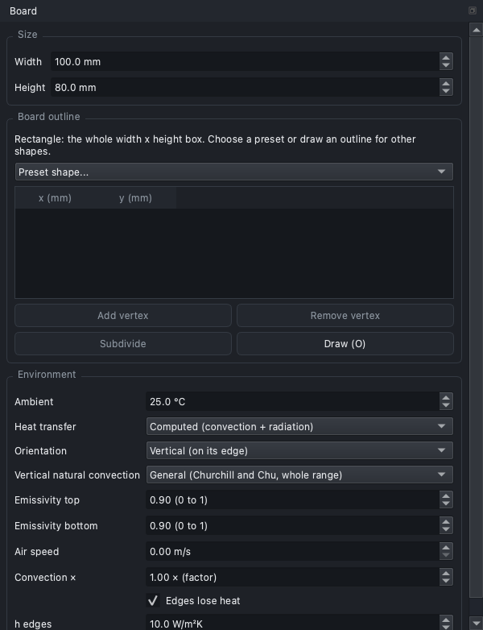
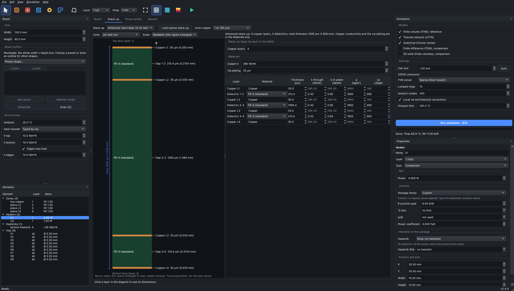

# Models: what they are, how they work, which one to use

PCB Thermal Lab solves the steady and time-dependent temperature of a PCB with **five models** (four of the same layered description plus a 3D solid). This document
explains the description, each model, the features built on top of them (power profiles, computed heat transfer coefficients, parts), and gives a decision
guide. **Every equation, discretisation and approximation is stated in [`theory.md`](theory.md)** (section numbers are quoted below as "theory §n"); the numbers that back every statement are in [`validation.md`](validation.md); what is planned is in the chapter 'Planned' of [`versions.md`](versions.md); open investigations are in [`research.md`](research.md).

## 1. The physical description (theory §1)

A board has `N` copper layers (layer 1 = top), a total thickness, copper zones (polygons with a fill factor; where zones of one layer overlap or touch, the fill of a point is the largest fill of the zones that contain it), heaters (power over a footprint on one layer),
plated vias (the diameter is the **drill**: the plating is inside it and the finished hole is the drill minus twice the plating), heatsinks (extra heat transfer on an outer face) and boundary conditions: ambient temperature and a heat transfer coefficient `h` on the top, bottom and edges.

* SI units inside the package; project files and the builder API use millimetres and 1-based layers.
* **Layered model**: every copper layer is a thin conducting sheet with in-plane sheet conductance
  `S = f·k_cu·t_cu + k_lam·(slab − f·t_cu)` (`f` copper fill; simple stack-up: `slab = thickness/N` and `k_lam` the FR-4 in-plane value; advanced stack-up: the slab is the copper plus half of each adjacent gap and `k_lam` the thickness-weighted mean of the two gaps, section 8); the dielectric between two layers is a vertical conductance `k/d` of that gap
  per unit area (anisotropic FR-4 by default: 0.3 W/mK through, 0.9 in plane; each gap can have its own thickness and material in the advanced stack-up); a via adds `k_cu·A_via/d` between all layers with `A_via = π[(d_v/2)² − (d_v/2 − t_plating)²] + (k_fill/k_cu) π (d_v/2 − t_plating)²` (a barrel that is open or filled with resin or paste; `Via.thermal_area`) or `π(d_v/2)²` (electroplated copper fill; `VIA_FILLS`: a fabricator's usual "filled via" is an **epoxy resin plug** that conducts as little as FR-4, +0.1 % for a 0.3 mm via; a conductive paste +5 %; only copper is a real heat path, ×3.3; `docs/validation.md` section 18);
  the top and bottom faces lose heat with `h_top`, `h_bottom`, heatsinks add `h_extra`, edges `h_side`.
* **Copper that dissipates is already in the model, with no extra element.** A copper zone on an outer layer is both the spreader (its sheet conductance `S` carries the heat sideways) and the radiator: every cell of the outer face loses heat with `h_top` or `h_bottom` (typed or computed, radiation included), whether it is bare laminate or copper. Copper on the inner layers spreads the heat and sends it to the faces through the vias and the dielectrics. The copper fill `f` of a cell sets how well it spreads, so a larger zone cools better (more face area, more conduction), and the effect saturates at the length `sqrt(S/h)`. Solder mask and tinning are not modelled; a bare or tinned copper area differs only in emissivity (`emissivity_top/bottom`) and, if you want a different coefficient there, a heatsink with `h_extra` over the area. `docs/validation.md` section 3.1 checks it against a 3D solid: pad of 20 to 80 mm within 2.5 % in the FVM, and a heatsink only works through the copper under it.
* **Heater power** is injected exactly (it does not depend on the grid). Total heat out through the faces and edges equals the power in; every result reports that energy balance.
* Dependencies: NumPy, SciPy, Matplotlib; PySide 6 for the application; scikit-fem only for the offline 3D check. Virtual environment: `python3 -m venv .venv && .venv/bin/pip install -r requirements.txt`.

## 2. The five models

Four of them are layered models (one node per copper layer); the **3D solid** (section 2.7) is a different kind of model and the independent check of all of them.

| | **FVM** | **FDM** | **Lumped** (thermal network, LPTN) | **Analytic** (Fourier series) |
| :-- | :-- | :-- | :-- | :-- |
| Role | reference | comparison | fast estimate | fast estimate, independent check |
| What it is | board cut into cells, one node per layer and cell, sparse matrices | the same equations on grid **points** (node-centred finite differences) | one small network per heater, built from the real footprint and outline | exact closed-form solution of a uniform multilayer board, with corrections for vias, heatsinks and copper |
| Time on the example board | 0.13 s (1 mm cells) | 0.12 s | about 10 ms | about 50 ms |
| Output | full field per layer | full field per layer (at nodes) | approximate field | field per layer |
| Power profiles in time, step animation | yes | yes (same time stepping on the nodes) | profiles yes, animation no | yes (vias calibrated per heater) |
| Needs a mesh | yes (cell size, Auto) | yes | no | no |

### 2.1 FVM (finite volumes), the reference (theory §2)

Cell-centred finite volumes (`fvm.py`). One node per layer and cell; between neighbouring cells the conductance uses the harmonic mean of the two sheet
conductances (`G_x = 2 S₁S₂/(S₁+S₂)·dy/dx`), so a copper/FR-4 jump is a series combination. The steady problem is the sparse symmetric positive definite system `K θ = Q`
(`θ = T − T_amb`) solved with a **direct sparse LU** (default, with a symmetric minimum-degree ordering: half the fill and about 40 % less time than the default ordering), conjugate gradients, or red-black SOR (kept for
comparison). Transient: `C dθ/dt + K θ = Q`, theta-method (implicit Euler or Crank-Nicolson), time step doubling in ten stages so that only ten factorisations are needed.

*Use it* for final temperatures, any geometry (partial or hatched copper, copper edges anywhere, via arrays, thin or L-shaped heaters), whenever a warning appears, and to
confirm the fast models. Cost grows with cells × layers; the **Auto** cell size (about four cells across the smallest heater) is a good start.

### 2.2 FDM (finite differences), the comparison (theory §3)

Node-centred finite differences (`fdm.py`) of the same layered model: nodes on the board edges (`nx+1` by `ny+1`), edge nodes with half control volumes, the conductivity between
two nodes is the mean of the nodal values (arithmetic or harmonic), vias go to the nearest node. How the copper and the heater footprint reach the nodes is selectable:

* `sampling="area"` (default): the covered fraction of the control volume around each node. It removes the grid-to-grid scatter of point sampling and is exact for geometry that does not lie on the grid.
* `sampling="point"`: the classic "is the node inside the polygon" test (left and bottom edge in, right and top edge out).

Same equations as the FVM, so on boards without vias the two agree to about 0.1 % (table in `validation.md`). Differences: the FDM treats a via (a point feature) at the nearest node, which costs
about 2 % on the example board at 1 mm; near a copper edge that crosses a heater it is 3.5 % below the FVM. It also does the power-step transient (animation), the step response and the power-profile time simulation, with the same theta-method as the FVM on the nodes (on the example the hottest point follows the FVM within 1 °C at every time).
*Use it* to check the FVM's discretisation or to see what a classic scheme gives; for design work the FVM is preferred (smoother with the grid, conservative by construction).
FDM is **not** the removed wxPython solver, which also had modelling errors (see `validation.md`).

**FDM or FVM, in one table**

| | FDM (finite differences) | FVM (finite volumes) |
| :-- | :-- | :-- |
| Idea | replace derivatives by differences between **node values** | integrate the equation over a **cell** and balance the heat through its faces |
| Unknown | temperature at a grid node | mean temperature of a cell |
| Conservation | by construction only with care at boundaries and interfaces | exact: what leaves one cell enters the next |
| Material jumps | need care at interfaces | the face conductance is the series of the two half cells |
| Point features (vias, sources) | sampled at the nearest node | averaged over the cell |

The linear solver (direct, CG, SOR) is a separate choice from the discretisation.

### 2.3 Lumped (thermal network) (theory §5)

A reduction of the FVM network (`lumped.py`). For every heater the cells are grouped in rings by their **distance to the heater footprint** (ring 0 is the footprint, outer rings grow geometrically),
so any heater shape and the real board outline are followed. For every layer and ring the geometry is aggregated; heat crosses offset contours of length `L_k = A_k/Δ_k`:
`R_{k,k+1} = Δ_k/(2 S_k L_k) + Δ_{k+1}/(2 S_{k+1} L_{k+1})`. The interior of the heated footprint comes from the logarithmic potential of the uniformly heated footprint, with the exact disc solution with vertical
losses (modified Bessel functions `I₀, I₁`: factors `f_R = 4(I₀ − 2I₁/x)/(x I₁)` for the resistance and `f_P = 4(2/x² − 1/(x I₁))` for the peak, `x = a/λ`, `λ = √(S/g_eff)`). Each heater gives a small dense
system; the problem is linear so the board is the sum over heaters (mutual heating is one heater's profile read at the distance of the other). Rings narrower than a cell are merged (`lumped.ring_edges`), so the result does not depend on the ring count (10, 20 and 40 rings within 0.2 % of each other on the coupon of `validation.md` section 21).
*Use it* for fast exploration and sweeps; it is weak when a copper edge crosses the heater, at corners (−8.7 %) and for thin heaters (+9.5 %).

### 2.4 Analytic (Fourier series) (theory §6)

The multilayer fin equation on the rectangle with insulated edges, expanded in `cos(mπx/W) cos(nπy/H)`: every mode is a small tridiagonal system over the layers (`analytic.py`). Exact on a uniform board. Refinements:

* **copper weighted by influence, layer by layer**: `f_eff,l = Σ w f_l / Σ w` with `w = Σ_i P_i K₀(r_i/λ_l)` and the layer's own fin length `λ_l = √(S_l/(h_l + n_l g))` (about 5 mm for a layer that carries a heater, not the 34 mm of the whole stack);
* **local vias and heatsinks** by a Green-function (Woodbury) update on 2.5 to 5 mm tiles: `(I + G C) y = y₀`;
* **warnings** when the copper around the heater is strongly non-uniform or edge convection is significant.

*Use it* for instant answers on boards close to uniform, to understand a design, and as an independent check. It fails when the copper is not uniform near the heater (24 % low with a 20 mm pad, 25 % when an edge crosses it);
the input checks warn.

### 2.4.1 One-layer boards (theory §1.4)

A one-layer board has its copper on the top face and the laminate under it. The FVM, FDM and Lumped models give it two laminate nodes under the copper node (`laminate.py`), so the heat crosses the laminate on its way to the bottom face and spreads sideways in it; the Analytic model puts the laminate in series with the bottom film. Against an independent 3D solver: full copper within 0.1 % (FVM, FDM), a bare 20 mm pad −2.5 % (FVM), −7.4 % (FDM), −15 % (Lumped), −29 % (Analytic); the 3D solid +0.2 % (`validation.md` section 21). For a board with little copper on one layer use the FVM or the 3D solid.

### 2.5 Which model for which job

| You want | Use |
| :-- | :-- |
| the number you sign off, any geometry, hotspots, junction temperatures, time behaviour | **FVM** |
| to check the layered models on your board (small copper pad, copper edge under a heater, thick blocks) | **3D solid** (steady state; slower) |
| a quick exploration or a parameter sweep | **Analytic** (uniform-ish boards) or **Lumped** (partial copper, several heaters), then confirm with the FVM |
| to see whether the grid or the scheme matters | compare **FVM** and **FDM** at two spacings |
| to know whether a fast model can be trusted on your board | run all of them (`--model compare`); a spread above about 5 % means "use the FVM" |

Workflow: explore with Analytic/Lumped, refine with the FVM at the **Auto** cell size, change the cell size once to confirm convergence, read the warnings.

### 2.6 Metal block (heat spreader) (theory §7)

A **Heatsink with a thickness** (`thickness_mm > 0`, aluminium by default) is a metal block pressed on the outer face. FVM and FDM add one more node layer under it:
lateral conductance `k·t` per cell, heat capacity `ρ·c·t` (time simulation), a **contact to the board layer** `G = A [ f/R'' + (1−f)/(R'' + d/k_FR4) ]` where `f` is the copper fill of that layer, `R''` the interface resistance (m²K/W; K cm²/W in the application) and `d` half a layer slab,
and an exposed surface to the air `G = h_exp·A` plus the side walls `G = h_wall·t·L_edge`, with `h_exp = h_face·(fin ratio) + h_extra` and `h_wall = h_face + h_extra` (top or bottom coefficient of the board plus the heatsink's extra h; the fin ratio is 1 without fins and applies to the exposed face only, never to the sides). The heat therefore enters the block **where the block overlaps copper** (the intersection of the two planes);
over bare laminate it must also cross the FR-4. The board face under the block no longer loses heat on its own. The block is taken as an isotropic plate with no gradient across its thickness (thin blocks; a 1 to 10 mm aluminium or copper plate is within 0.6 % of a 3D solid).
`block_stats` and the report give its mean and maximum temperature and the heat entering and leaving; the Temperature tab has a "Metal block" view. A heatsink with thickness 0 stays the plain extra coefficient.
| Model | Metal block | Time simulation with a block | Error against the FVM (74 cases) |
| :-- | :-- | :-- | :-- |
| FVM, FDM | one more node layer under the block | yes | reference / compared with the 3D solid within 1.8 % |
| 3D solid | pad slabs of the block | no (steady state only) | within 1 % of the FVM on a finned block |
| Lumped | one more layer of the ring network | no | 1.9 % mean, 4.7 % max |
| Analytic | graph of tiles in the Green-function correction (Schur complement) | no | 1.1 % mean, 4.3 % max |

**Lumped and Analytic have the block in steady state** (Lumped: one more layer of the ring network; Analytic: a graph of tiles in the Green-function correction; `theory.md` section 7; both within about 5 % of the FVM in 74 cases, `validation.md` section 17). Their time simulation does not support a block and the summary says so; the FVM, FDM and 3D solid have it in time too. SOR does not support blocks (direct and CG do). `python -m pcbthermal example block` runs the example board with a block.

### 2.7 3D solid (finite volumes in three dimensions) (theory §4)

`solid3d.py` solves the board as a real solid on a structured grid: the **same plan cells** as the FVM and, across the thickness, **real slabs**: each copper layer one slab of its own thickness, each dielectric gap four slabs (`n_diel`; on a one-layer board the laminate under the copper, four slabs), a metal block one pad slab (the interface, thickness `R''` at 1 W/mK) plus up to six slabs of metal.
The unknown is the temperature of every cell of every slab; heat spreads in the gaps and in the blocks and a heater feels the real vertical path. Cell properties are volume averages (the tiled-conductivity method used for PCB models in industry): copper slab with fill `f`: in-plane `f k_Cu + (1−f) k_FR4,ip`, through `f k_Cu + (1−f) k_FR4,th`;
a via adds the **real copper area of its barrel** in parallel in every slab of its cell; faces use the harmonic mean of the half-cell resistances; convection, edges, heatsinks and blocks as in the other models (a block hides the board face under it and loses heat on its exposed face and sides); the heater power is spread exactly over its footprint on the copper slab of its layer.
The result has the same layout as the FVM (the temperature of the copper slab of each layer) and the block temperatures, so every plot and table works. **Steady state only** (the time simulation and the animation are the layered models' job). The model needs only SciPy; a direct sparse solve of 0.1 to 10 s on an ordinary board (it grows quickly with layers and cell count; the application shows the number of 3D unknowns, and a model over 250 000 unknowns is refused before it is built, with the cell that fits, while the others still run; the reason is memory. Measured on a quiet 16 GB machine, on the example board of 16 slabs: 247 000 unknowns 15.3 s and 3.5 GB, 392 000 unknowns 32.8 s and 7.4 GB, 512 000 unknowns 57.7 s and 9.9 GB resident; on a plain two-layer board 500 000 unknowns take 9.3 s and 3.3 GB. The figures depend on the machine, on the board and on the computed-h loop, which repeats the solve 3 to 6 times; the old limit of 2 million let a run go on for hours. Evidence: `research/solid3d-verification/docs/for-the-project-documents.md`).
What it is for: it does **not** use the "one node per copper layer" idea, so it measures the error of that idea on your own board (largest with a copper pad hardly bigger than the heater, a copper edge across a footprint, and thick or small blocks). It is verified in turn against an independent offline finite-element solid (scikit-fem; `docs/validation.md` section 3).
It is not a truth either: the barrel is a lumped copper area (no plating geometry), copper is one slab thick, the contact of a block is perfect over the pad, and there are no measurements of a real board in this project yet.

## 3. Input checks

`check_problem` (also run by `simulate` and live in the application under the Run button) never blocks a run; it warns about inputs that make a result doubtful: a heater partly outside the board
(its power would be moved onto the part inside), no copper under a heater, a copper edge or hatching crossing a footprint (Lumped and Analytic unreliable), a heater only a few cells wide, overlapping
heaters, vias or zones outside the board, a zone whose outline crosses itself (the even-odd fill leaves the crossed part empty), a metal block with no copper under it (or an almost perfect contact), a footprint of zero area, zones or metal blocks partly outside the board or its outline (a block is cut at the outline in the FVM, FDM and 3D solid; Lumped and Analytic take it whole on the rectangle of the same area), two heatsinks that overlap (only the later one is used in the overlap) and zero total power. After the run, the thick-plate check of section 4b and the close-fin check of section 15.

## 4. Power profiles (time-dependent power) (theory §10)

A heater may carry a **square wave** (`SquareWave`: `p_on`, `period`, `duty`, `p_off`) or a **table** (`TableProfile`: times and powers, repeating or one-shot, read from and written to CSV files:
`profile_io.py`, format and a worked example in [`examples/csv_profiles/README.md`](../examples/csv_profiles/README.md)). The heater's `power` stays equal to the average, so steady models and old files work unchanged.

1. **Step response** `Z_i(t)` of every heater's own hottest point to a unit step of its power, from the reference model (FVM, else Lumped, else Analytic).
2. **Decision, per heater** (`profiles.decide`): by superposition the periodic response of a piecewise-constant power is `T(u) = Σ_j P_j [G(σ₂) − G(σ₁)]` with
   `G(σ) = Σ_{m≥0} [Z(σ + mT) − Z(mT)]` plus the tail `σ/T·(R_th − Z(MT))`; for a square wave `peak = P_off R_th + ΔP·G(t_p)`. The oscillation (peak minus valley) is in **°C**. Heaters are sorted by oscillation and
   *averaged* (smallest first) while their cumulative oscillation stays below the threshold (default 1 °C); the others are *resolved* in time. One-shot tables are always resolved. Percentages are shown for information only.
3. **Run** (`profiles.run_windows`, one runner for the models through an adapter): the step is a tenth of the shortest stretch, each step's power is the **exact mean** of the profile over the step, averaged heaters keep their
   constant power in the same run, the window is the least common multiple of the periods, and windows repeat until peak and minimum change by less than 0.1 °C ("until the cycle repeats"), for N cycles, or for a fixed time;
   more than 200,000 steps is refused with an explanation. Start: the steady state of the average power (the first power for a one-shot table) or a uniform temperature typed in °C.
4. **Results**: peak, minimum, oscillation, temperature of every heater versus time, peak-temperature map, frames of the last window, steady temperatures with the average and with the peak power (the bound).
5. **Analytic transient with vias and heatsinks**: one modal system per heater with the smeared via (or heatsink) conductance scaled so that its steady response equals the locally corrected steady model (factor 65 above the via
   array of the example, 1 for the distant heater); a single global factor cooled the distant heater by 18 %.

Interfaces: `SolverOptions.profile`, `steady_power` ("average" or "peak"); CLI `run --profile U1=file.csv --duration --cycles --time-s --initial-c --threshold-c --steady-power`; the "Power profile" tab with
**Import CSV…** / **Export CSV…**; outputs `profile_<model>.csv/.png`, `peak_map_<model>.png`.

## 4b. The thick-plate warning

The layered models keep one temperature per layer and per metal block, the mean through its thickness. Under a source of flux `q''` the surface can be hotter than that node by at most `q'' t / (2 k)` (all the heat crossing the plate under the source; with sideways spreading the measured gradient is 0.6 to 0.8 of it; evidence: `research/effective-conductivity/README.md` 4.6). After the solve, `checks.check_thick_plates` compares this bound with the rise of every heater, for its own copper layer and for every metal block under the centre of its footprint, and warns when it exceeds 5 % of the rise. For the copper layer `q''` is the power into the board over the footprint (the heat enters the copper there); for a block it is the largest flux that enters the block under the footprint in the solved FVM or FDM result (`arrays["block_flux"]`, W/m² of block area): a block under the board is fed through the laminate and its copper, which spread the heat, so the footprint flux would overstate it 5 to 70 times (8 to 22 % of the footprint flux on the 74 cases below, 1 to 3 % under a 2 or 3 mm part). With only the Lumped, the Analytic or the 3D solid, a quiet auxiliary FVM run of the same problem (cell of at least 2 mm, `api._block_flux_result`) gives the flux, so the warning rests on a simulation; the footprint flux remains only as the stated fallback of `check_thick_plates` called without such a result. The dielectric gaps are not checked: a gap is a series resistance between two nodes, so its drop is already in the model. The text gives the bound in kelvin; it is never added to the result. A 35 um copper layer gives about 1e-4 K; the 74 metal-block cases of `validation.md` section 17 give a median of 0.07 % and a maximum of 0.34 % (0.50 and 1.78 % with the footprint flux; 0.04 and 0.42 % in the research, flux over the copper pad, which is not conservative: the peak flux into the block is 1.6 times the pad mean at the median), so it does not fire on the boards the program is built for. Against the 3D solid (`validation.md` section 22) the bound is above the real effect of the block thickness on the hottest point in every case tested.

## 5. Heat transfer coefficients: typed or computed (theory §8)

`Board.h_mode` is `"manual"` or `"computed"`. Computed (`convection.py`): each face gets `h = calibration × (h_n³ + h_f³)^(1/3) + h_radiation`, with natural convection on a horizontal plate
(up: `Nu = 0.54 Ra^(1/4)` to Ra = 1e7 then `0.15 Ra^(1/3)`; down: `0.27 Ra^(1/4)`; length = area/perimeter) or Churchill and Chu for a vertical board (`Board.natural_form`: `"general"`, the default, the form for the whole Rayleigh range, or `"laminar"`, the same authors' laminar form for Ra < 1e9; the two forms come from a compilation of sources, not from the 1975 paper, and differ by −0.7 to +0.2 % of the rise on the example board turned vertical; CLI `--natural-form`); forced laminar `Nu = 0.664 Re^(1/2) Pr^(1/3)` (mixed above Re = 5e5);
radiation `ε σ (T_s² + T_a²)(T_s + T_a)` to surroundings at the air temperature; air properties from Sutherland-type fits checked against textbook values. `h` depends on the mean face temperature, so `simulate`
repeats the model until the coefficients change by less than 0.01 W/m²K (3 or 4 solves). Settings: emissivity per face (default 0.9), orientation, air speed, a global multiplier of the convection (not of the radiation).



*Screenshot: `docs/images/environment_natural_form.png` (the *Vertical natural convection* list appears for a vertical board in computed mode).*
`api.calibrate_convection` / `pcbthermal calibrate board.json --measured 85 [--heater U1]` fits that multiplier to one measured steady temperature. Time simulation and animation use the steady-state coefficients with the average power.
Limits: isothermal-plate correlations are uncertain by 20 to 30 % on a board with hot spots; the edge coefficient is not computed; the radiation view factor is 1.

## 6. Parts: the junction temperature (theory §9)

A heater is a **source**: its power enters the board under the footprint and the report gives the board temperature there. A part (an IC, a MOSFET, a diode, a resistor) is a heater with optional extra fields; with none of them set nothing changes.

| Field | Meaning | What the program does |
| :-- | :-- | :-- |
| `theta` (K/W) | junction-to-pad resistance of the part | `Tj = T_max under the footprint + P·θ`; the board is solved with the same power (**worst case**: all the heat enters the board, no top path), so θ changes the report and not the board |
| `tj_max` (°C) | maximum junction temperature | margin `tj_max − Tj`, the **power limit** `P·(tj_max − T_amb)/(Tj − T_amb)` (the dissipation that brings the part to its limit on this board; linear for constant coefficients) and a warning when exceeded |
| `psi_jb` (K/W) | junction-to-board characterisation parameter | second estimate `Tj = T_ring + ψJB·P`, `T_ring` the mean board temperature in the ring 0.5 to 1.5 mm outside the package outline (the reference of the JEDEC definition); the least pessimistic route when the datasheet has no junction-to-pad number |
| `power_tc` (1/K; %/K in the application) | temperature coefficient of the power | `P = P0 (1 + tc (Tj − 25 °C))`, solved together with the board by a fixed-point loop (like the computed `h`); the powers used are reported; **thermal runaway** (no stable point: the device passes 1500 °C or the power grows 50 times) is detected and warned. Steady-state models only |
| `theta_jc_top` (K/W), `interface` (K·cm²/W), `theta_sa` (K/W) | **top path**: junction-to-case (top) resistance, interface between package and heatsink (divided by the footprint area) and heatsink to ambient | active on a **component** when `theta` and `theta_sa` are set (a pure source has no junction to hang it on: `Heater.has_top_path()`; `theta`, `theta_jc_top`, `theta_sa`, `interface`, `contact_area` and the sheet of the top are ignored on a source, as the interface already does, and the input check says so; `tj_max`, `psi_jb` and the power coefficient do work on a source, with the hottest point under the footprint as the device temperature): `R_top = θJC(top) + interface/A + θSA`; the part is a junction node joined to the board by θ and to the ambient by `R_top`, so `P_board = P − (Tj − T_amb)/R_top` and `Tj − T_amb = (T_max − T_amb + P·θ)/(1 + θ/R_top)`. The split is the root of `P_b − P + p_top(T_max(P_b)) = 0`, found by a secant (one part) or a quasi-Newton iteration (several parts) with the board solved for each trial `P_b` (any model; a fixed-point iteration diverges on small pads and is not used, see `theory.md` section 9); with the power coefficient, its loop goes around this solve; the report gives the top-path power and its share. If the root is not found the result warns "the top-path split did not converge". A bare mould is not a path (it carries about 1 % of the heat): without `theta_sa` the worst case holds. Steady-state models only (the time simulation sends all the power into the board and says so) |

**Which datasheet number is θ.** The junction-to-pad (or junction-to-bottom, junction-to-terminal) resistance: `θJC(bot)` of the TI converters and LDO, `RθJC` of a power MOSFET (its "case" is the drain pad), `θJ-L` of an SMA diode, `Rth j-sp` of an LED. Never `θJA` (chip, board and air of the manufacturer's test together; manufacturers say so themselves). The program already computes the spreading in **your** board, so `θJB`, which includes the spreading in the manufacturer's test board, counts it twice if used as θ: entering `θJB` instead of `θJC(bot)` adds 15 K to the 1.5 W LDO and 7 K to the 0.8 W converter of the study (20 to 25 % of the rise). The datasheets read: the MOSFET and the SMA diode give one downward number, the converter and the LDO give `θJC(bot)`, `θJB`, `ψJB`, `θJC(top)`, `ψJT` and `θJA`, the SMC diode only `θJA` and the Vishay power resistor no resistance (only its power rating at 70 °C).
**Source or component.** A heater has a type (`Heater.role`): a **heat source** (power and, if wanted, the interface under it: `base_interface` in K·cm²/W or a sheet `base_pad_thickness`/`base_pad_k`; `junction_theta()` is that resistance over the footprint, so the report gives the source temperature = hottest board point + P·R) or a **component** (junction θ, limits, top path). Without a role the type is inferred (any component field set → component), so old files behave as before. The package family list fills θ, θJC(top) and Tj max from the library `package_theta` of the defaults.

**When the datasheet has no usable number**, in order: (1) fill `psi_jb` (if only `θJB`/`ψJB` exist): the ring-temperature estimate is 6 K above the `θJC(bot)` route on the LDO against 15 K for `θJB` as θ; (2) pick the **package family** (typical θ, indicative values, not from a datasheet: QFN 5, power QFN 3, DFN 10, D2PAK 0.75, TO-220 1.5, SOT-223 15, SMA/SMB/SMC diode 20, 0603 resistor 1000 K/W derived from a 0.1 W rating at 70 °C and a 170 °C limit); (3) leave θ = 0: the report is the board temperature under the part and the junction is hotter by an unknown amount. `θJA` is not usable to derive θ when the datasheet's board is not fully stated (on the SS12 it gives a negative result).
**Sanity check**: if `θ·P` is larger than the board's own rise under the part the program warns that θ is probably a `θJA`. For two-terminal parts the heat enters by the terminals, so draw the source as the two terminal areas.
**How much it matters** (docs/validation.md section 9): θ adds 2 to 28 % of the rise for chips and diodes (about 90 % for a small resistor); ±30 % in θ moves `Tj` by 0.8 to 3 K for chips. The power coefficient is the larger effect for a power MOSFET (2 W at 25 °C reaches 138 to 210 °C instead of 108 °C for 0.33 to 0.67 %/K).
**The top path** (heatsink on the package): the interface matters on a small package (10 K·cm²/W over 11 mm² is 92 K/W, more than the heatsink): use 0.3 to 0.5 for paste, 1.7 for a soft gap pad, 5 to 10 for a gap pad; 0 means perfect contact (optimistic; 0.01 changes the result by 0.05 K). `θJC(top)` is the datasheet number (or `Rth j-case top`); `θSA` the heatsink's value at your air flow. The junction node uses the hottest board point under the footprint, which is about 0.4 to 0.8 K above the same network with a uniform conductance (`docs/validation.md` section 9).
**Not in this version** (noted in `docs/versions.md` (chapter 'Planned'), "What we want to implement", Component element): heatsink scenarios driven by the air speed, the heatsink as a plate layer with spreading, an interface with its own area and the air gap, the Foster chain for pulses.

## 7. Python API and command line

```python
from pcbthermal import Problem, SolverOptions, simulate, suggest_cell_mm

p = Problem.new(width_mm=100, height_mm=80, layers=4)
p.add_zone(1, rect=(15, 15, 85, 65)).add_full_copper([2, 3, 4])
p.add_heater(1, 4.0, rect=(30, 35, 40, 45), name="U1", theta=6.0)      # theta: junction-to-pad K/W (section 6)
p.add_via_array((30, 35, 40, 45), 3, 3, diameter=0.3)
p.add_heatsink(4, 30.0, rect=(25, 30, 45, 50))                               # extra h on the bottom layer

sim = simulate(p, SolverOptions(models=("fvm", "fdm", "lumped", "analytic"), cell_mm=suggest_cell_mm(p)))
print(sim.to_markdown())      # models, error against the FVM, energy balance, warnings
sim.save("results")           # report, JSON, CSV fields, figures
```

```sh
python -m pcbthermal gui [board.pcbt.json]                      # application
python -m pcbthermal run board.pcbt.json [--model all|compare|fvm|fdm|lumped|analytic] [--cell-mm auto]
python -m pcbthermal run board.pcbt.json --computed-h --air-speed 1 --emissivity 0.85
python -m pcbthermal run board.pcbt.json --profile U1=u1.csv --profile U2=u2.csv
python -m pcbthermal calibrate board.pcbt.json --measured 85 --heater U1
python -m pcbthermal transient board.pcbt.json --t-end 300 --gif   # power step animation (FVM)
python -m pcbthermal solvers|convergence|convert|example ...        # solver comparison, grid study, legacy file, example boards
```

The sparse solvers of SciPy must not run in two threads at once (the application serialises its background calculations; do the same in your own code). `simulate` runs the selected models, the input checks, the power-profile decision and time simulation, and returns a `Simulation` (table, report, `save`).

## 8. The application (PySide 6)

Board canvas with zoom/pan, grid snap, polygons, vias, heatsinks, undo/redo, background photo, dark and light themes; docks for the board, environment (typed or computed `h`), materials, element tree, models and settings,
live input checks and the property inspector; tabs **Board**, **Power profile** (heater list, constant / square wave / table with CSV import and export, decision table, run settings) and **Results** (summary, temperature,
gradients, profiles, components, model comparison, step-power animation, power-profile results). The temperature of the last run can be painted on the board (key T). The version is shown in the title bar, status bar and About box.

## 8b. Stack-up: simple and advanced

`Board` describes the vertical build in one of two ways, and **every model** (FVM, FDM, Lumped, Analytic, 3D solid) reads it through the same four helpers (`slab_thicknesses`, `gap_thicknesses`, `gap_properties`, `layer_laminate`):

| | Simple (default) | Advanced (`Board.dielectrics` set) |
| :-- | :-- | :-- |
| Total thickness | typed | copper plus dielectrics (read-only) |
| Copper thickness | one value per layer in the data, one value in the panel | any value per layer |
| Dielectric gaps | `layers − 1` equal gaps of `(thickness − Σ copper)/(layers − 1)`, one material (`Materials`) | one `Dielectric` per gap: thickness, `k_through`, `k_inplane`, density, specific heat, material label |
| Layer node | slab `thickness/N` | copper plus half of each adjacent gap (the slabs add up to the total thickness) |
| Vertical conductance between layers l and l+1 | `k_through/d` | `k_through,l/d_l` of that gap; a via adds `k_Cu A_via/d_l` in every gap |
| In-plane laminate of a layer node | FR-4 `k_inplane` | thickness-weighted mean of the two adjacent gaps |
| Heat capacity | FR-4 `ρ c` of the slab | `ρ c` of the adjacent gaps |

Switching to advanced (`make_advanced`) keeps the same board with equal gaps (within 0.1 K of the simple result: the laminate of the layer nodes is shared by half-gaps instead of thickness/N); switching back (`make_simple`) keeps the total thickness. Project files store `dielectrics` only for an advanced board; simple boards are unchanged.
The through-board resistance between two layers is `Σ d/k` of the gaps in between, so a thin prepreg under a hot part and a thick core elsewhere, or a metal-core dielectric, change the result a lot (`validation.md` section 12).
The 3D solid takes every gap as `n_diel` real slabs of its own thickness and conductivities. Presets (`DIELECTRICS`) are typical indicative values: FR-4 0.3/0.9 W/mK, high-Tg 0.4/1.0, polyimide 0.15, PTFE-ceramic (RO4350B type) 0.69, metal-core dielectric 2, alumina 24, aluminium nitride 170;
the FR-4 and RO4350B figures agree with vendor data found on the web (about 0.3 and 0.69 W/mK), the others are general values to replace with your datasheet.
The Stack-up tab draws the cross-section with the thickness of every layer in µm and mm and the total, and edits the advanced table.

## 9. Board outline

`Board.outline` (polygon, metres, inside the width × height box; `None` = the whole rectangle). Cell cover: every solver cell carries the fraction of it that is board (`Board.cover`; cells under 1 % are off the board).

* **FVM**: sheet conductance, capacity, vertical conductances, face and heatsink losses are multiplied by the cover of the cell; the harmonic mean between neighbours is zero next to an off-board cell, so no heat crosses the outline; the heat lost through the **edge** is `h_edge × slab × length of the outline inside the cell` (`geometry.edge_length_on_board`; every sample of the outline is nudged a thousandth of a cell towards the inside of the board before it is given to a cell, so a side that lies exactly on a grid line is not given to the cell off the board, and the length that falls in a cell taken as off the board, a sliver of a slanted or curved side, goes to the nearest cell on the board: the edge counted is the perimeter of the polygon), which for a rectangle gives the same conductance as before; cells off the board are pinned to ambient (1 W/K on the diagonal, kept apart as `g_pin`) and carry no heat; the pin is left out of the board time constant (which sets the length of the step responses of the power profiles and the animation suggested) and the cells off the board are left out of the board mean of a transient.
* **FDM**: the same with the control volume of every node; faces that touch an off-board node conduct nothing (the arithmetic mean would leak half the conductivity).
* **3D solid**: lateral conductivities and the vertical/convective areas of the board slabs scale with the cover; the edge loss goes through half a cell of the slab's own material.
* **Lumped and Analytic**: need a rectangle (rings measured on a rectangular grid, cosine series on a rectangle). On a board with an outline they run on the **rectangle of the same area** (`Problem.equivalent_rectangle`): the box is scaled by `s = sqrt(outline area / box area)` in both directions, heater centres, vias, zones and heatsinks are scaled by the same `s`, parts keep their size (so the power density is unchanged), and the field is stretched back over the real box. The result carries a warning (shown with the warning sign in the Results summary). The error against the FVM on the real shape is in `docs/validation.md` section 13: 0.4 to 2.9 % of the rise on an ellipse or a T for a part away from the edge (6 to 10 % too cool with the bounding box on the ellipse), 6 to 18 % too cool for a part near the edge or in the arm of a T; use the FVM there. There is no time simulation of these two models on an outline.
* **Parts**: the power of a heater is spread over the part of its footprint that is on the board; a part entirely off the board puts its power in the nearest board cell (and the input check warns).
* **Results**: the field outside the board is ambient and is blanked in the plots (`arrays["board_mask"]`); means are weighted by the cover; `Tmax` and `Tmin` are taken on the board; computed convection uses the real area and perimeter.
* **Parametrisation**: a polygon in the file (`outline_mm`); in the application presets (rectangle, L, T, ellipse, chamfered corners), a vertex table, and the outline tool (`O`).

## 10. Power from a measured temperature (the Power Calculator)

**The formulas, the parameters, the validation tables, the limits and the sources of this calculator are in [`calculators.md`](calculators.md)**; what follows is the summary.

`inverse.power_from_temperature(problem, index, measured_c, point, ambient_c)` finds the power of one heater that makes the board model reproduce a measured temperature at one point of the part: `ring` (board 0.5 to 1.5 mm around it, the JEDEC point of ψJB), `max` or `mean` (under the footprint), `junction` (needs θ) or `top` (the top of the package: needs θ and the datasheet ψJT, `T_top = T_board,max + (θ − ψJT) P`) or `junction` (needs θ).
With the other heaters at their powers the temperature is affine in the power of the part, so two runs (the part at 0 and at one power) give the power and a third checks it; with computed convection the problem is not linear and a secant iteration finishes (typically a few more runs). `power_from_theta(Tj, T_ref, parameter)` is the datasheet relation `P = (Tj − T_ref)/θ` with ψJB, ψJT or θ.
Why this approach: JESD51-12 and the manufacturers' notes define `Tj = T_board + ψJB·P` with the board temperature measured about 1 mm from the package; ψ is not a thermal resistance and belongs to the datasheet's test board, so the power cannot come from the board temperature and ψ alone (the junction temperature is also needed); the drawn board, on the other hand, gives the board temperature as a function of power directly.
**Everything depends on the board** (`docs/validation.md` section 19): the same top temperature gives powers 11 to 45 % lower on a drawn board with less copper than the real one, and the datasheet shortcut `P = (T_top − T_amb)/(θJA − ψJT)` is 25 to 50 % off for a θJA 30 % away from your board's. It is an estimate: as good as the drawn board (copper, vias, stack-up, heat transfer) and the measurement (a thermocouple that touches the board cools it; an IR gun's spot is too large for a small part). Sources read: TI datasheets and Electronic Design notes on ψJB/ψJT, the Diodes Inc. note on thermal parameters, a summary of JEDEC JESD51-12 (the standard itself is behind a registration).

## 11. The calculation process

The application runs the calculations (simulation, animation, profile analysis, power calculator) in **one separate process** (`pcbthermal/jobs.py`, `gui/compute.py`), started with `spawn` at the first job and kept for the next ones.
Reasons: a job can be **cancelled at any moment** (the process is stopped, which a thread cannot do inside a sparse factorisation), the window never freezes, the rule that a sparse factorisation never runs twice in one process holds (jobs run in order), and when the program closes the process is stopped so nothing remains.
Arguments and results are pickled (a four-model result with a profile is 22 MB, 0.04 s).

## 12. What is inside the stack-up, and the typical stack-ups

**What is between two copper layers.** A rigid board is built from **cores** and **prepregs**. A core is a cured laminate (woven glass cloth in epoxy resin: FR-4) with copper foil on both faces; a prepreg is glass cloth with uncured resin that flows and bonds the cores and the outer foils during lamination, and fills the gaps between etched copper features.
So a "dielectric gap" of the model is glass-reinforced epoxy (one core, or one to three prepreg sheets), not an empty or generic layer; the weave makes it **anisotropic** (about 0.3 to 0.4 W/mK through the thickness, 0.8 to 1 W/mK along the plane, the program's defaults 0.3 / 0.9), and the measured thickness over an etched area is a little larger than over a plane because the resin fills the gaps.
Other things that can be in a stack-up: **plated copper** on the outer layers (a 18 µm foil plus 17 to 20 µm of plating makes the finished 35 µm of "1 oz"; finished inner 0.5 oz copper is 15 to 17.5 µm, JLCPCB quotes 15.2 µm for 4 to 8 layers), **solder mask** on the outer faces (15 to 25 µm of polymer), **thermally conductive or metal-core dielectrics** (1 to 3 W/mK, on aluminium or copper plates), **ceramics** (alumina 24, AlN 170 W/mK), **microvias** (HDI) and **plane voids** (clearance holes around vias).
The program describes the glass-epoxy gaps (thickness and material per gap), the copper of every layer (zones with a fill, the vias with their barrel) and the metal-core and ceramic choices as materials; it does **not** model the solder mask, because its resistance is negligible next to the air film (20 µm / 0.25 W/mK = 8e-5 m²K/W against 1/h = 0.1 m²K/W at 10 W/m²K, a thousandth), nor the plane voids (draw them as a zone with a fill below 1 or as a hole in the zone).

**Typical stack-ups by layer count** (`pcbthermal/data/stackups.json`, one JSON file you can edit; loaded when the number of layers changes and by the *Load typical stack-up* button; the cross-section of the Stack-up tab shows the result). Layers and dielectrics are listed from the top face down, thicknesses in µm.

| Layers | Total | Copper (top to bottom) | Dielectrics (prepreg / core), µm | Source |
| --: | --: | :-- | :-- | :-- |
| 1 | 1.6 mm | 35 | laminate (simple board) | typical |
| 2 | 1.6 mm | 35 / 35 | core 1530 | typical |
| 4 | 1.586 mm | 35 / 15.2 / 15.2 / 35 | 210.4 / 1065 / 210.4 | JLCPCB JLC04161H-7628 |
| 6 | 1.6 mm | 35 / 4 × 15.2 / 35 | 115.2 / 519.4 / 200 / 519.4 / 115.2 | constructed from fabricator guides |
| 8 | 1.6 mm | 35 / 6 × 15.2 / 35 | 76.4 / 351.9 / 115.2 / 351.9 / 115.2 / 351.9 / 76.4 (high-Tg) | constructed (Weller, JHYPCB, JLCPCB data) |
| 10 | 2.0 mm | 35 / 8 × 15.2 / 35 | 76.4 / 327.5 / 115.2 / 327.5 / 115.2 / 327.5 / 115.2 / 327.5 / 76.4 (high-Tg) | constructed |
| 12 | 2.4 mm | 35 / 10 × 15.2 / 35 | 76.4 / 312.9 / 115.2 / 312.9 / 115.2 / 312.9 / 115.2 / 312.9 / 115.2 / 312.9 / 76.4 (high-Tg) | constructed |

Only the 4-layer entry is a published fabricator table that was found (JLCPCB: 35 µm outer copper, 7628 prepreg 210.4 µm, 1065 µm core, 15.2 µm inner copper); the others are built from the same prepreg and copper values (1080 about 76 µm, 2116 about 115 to 130 µm) so that the layers add up to the nominal thickness, because published tables for 6 and 8 layers disagree with each other and some of them do not add up. They are a starting point: **replace them by the stack-up of your fabricator**.
Odd layer counts (3, 5, 7, 9, 11) use outer 35 µm, inner 15.2 µm and equal gaps up to the total of the next smaller listed template. In the simple stack-up a layer change loads the total thickness and the outer copper only.

**Inner copper weight: 0.5 oz or 1 oz.** The table above is the **0.5 oz** set (15.2 µm inner copper; the default; the 4-layer entry reproduces the JLCPCB table JLC04161H-7628 as read; its 210.4 µm prepreg could not be confirmed again, see `validation.md` section 14). The Stack-up tab (*Inner copper*) and `Board.template_inner_oz` switch the templates of 3 or more layers (advanced stack-up) to **1 oz (35 µm)**: every inner copper layer becomes 35 µm and every dielectric keeps the thickness of the template, so the board is thicker than the nominal by (35 − 15.2) µm per inner layer (1.586 → 1.626 mm for 4 layers, 2.400 → 2.598 mm for 12; 2.5 to 8 %). That is what fabricators do: they pick another build for a new copper weight, they do not thin the dielectrics in proportion, and against their 1 oz builds the unscaled rule is the closest one tried (`validation.md` section 14.1). The 1 oz set is **derived from the shipped templates; it is not a JLCPCB product table** (JLCPCB's 1 oz inner copper is 30 µm; PCBWay, PCBGOGO, Bittele and AdvancedPCB list 35 µm). With a plane on every inner layer it makes the example board 6.9 to 7.5 K (10.6 to 13.3 % of the rise; 4, 6, 8, 10 and 12 layers) cooler; with copper only on the outer layers under 0.3 K.



*Screenshot: `docs/images/stackup_inner_copper.png`.*


## 13. Where the heat of a part goes: junction, paste, heatsink, metal block

```
junction --θ junction-pad--> board copper (spreads sideways, vias to the other layers) --> faces: convection + radiation --> ambient
    |                                                                                      \--> edges
    +-- θJC(top) -- interface (paste, pad) -- heatsink θSA ---------------------------------> ambient      (optional top path)
board bottom/top face -- interface (paste, pad) -- metal block (spreads, has mass) -- exposed surface (h + extra) --> ambient   (optional block)
```

* **A heater with only watts** is a heat source on the board: the report gives the board temperature under it.
* **With a thermal junction** (θ junction-pad, Tj max, ψJB, power coefficient) the report adds the junction temperature `Tj = T_board_max + P_board·θ`, the margin and the power limit (section 6).
* **Typical θSA for the top of a package** (library `heatsinks` in Preferences, shown as **two lists**: the heatsink and the air flow of its catalogue value, with only the flows the catalogue gives; the stored name is "heatsink, flow", for example "BGA 40×40×18, 2 m/s". The air speed of the board does **not** change θSA: the flow is part of the choice, or you type your own θSA; a catalogue value for each part's own test conditions, so a starting point and not your θSA, which depends on the air flow, the orientation and the mounting; natural-convection values are quoted at a 75 K rise by Boyd/Aavid and fall as the rise grows):

| Heatsink | θSA (K/W) | Source |
| :-- | --: | :-- |
| Pin-fin 10 × 10 mm, push-pin, for a BGA/QFN: natural / forced air | 11.4 / 5.97 | Wakefield-Vette 901-10-1-18-2-B-0 (https://zenode.ai/parts/1mpl5f4e6o) |
| Adhesive pin heatsink 10 × 10 × 12.5 mm, natural convection | 26.3 | Fischer Elektronik ICK (archived sheet, https://static.chipdip.ru/lib/016/DOC041016446.pdf) |
| TO-220 clip-on, thin | 26 | Fischer FK 242 SA 220 O (https://befr.rs-online.com/web/p/heatsinks/2835907) |
| TO-220 clip-on, 21.8 × 19.1 × 10 mm | 23.1 | Aavid / Thermalloy PF745 (https://www.rapidonline.com/catalogue/product/36-0216) |
| TO-220 clip-on | 16 | Fischer FK 240 SA 220 O (https://befr.rs-online.com/web/p/heatsinks/2858106) |
| TO-220 board-level: natural convection / 400 LFM (about 2 m/s) | 10.5 / 3.6 | Wakefield-Vette 272-AB (https://www.digikey.com/en/products/detail/wakefield-vette/272-AB/340341) |
| BGA 40 × 40 × 18 mm, adhesive: natural (75 K rise) / 200 LFM (about 1 m/s) / 400 LFM (about 2 m/s) | 7.68 / 2.5 / 1.5 | SAME Sky HSB16-404018 (https://www.sameskydevices.com/product/thermal-management/heat-sinks/bga-heat-sinks/hsb16-404018); the same part gives 10.8 K/W at 1 W |

  Without a datasheet, a rough estimate by volume (Electronics Cooling, *How to select a heat sink*, https://www.electronics-cooling.com/1995/06/how-to-select-a-heat-sink/, a guide only): `θSA ≈ volumetric resistance / volume` with 500 to 800 cm³·K/W in natural convection, 150 to 250 at 1 m/s, 80 to 150 at 2.5 m/s and 50 to 80 at 5 m/s (a 20 × 20 × 10 mm clip-on, 4 cm³, is then 125 to 200 K/W in still air). Flow bypass can cost up to 50 % and radiation is up to 25 % of the natural-convection heat. The Boyd/Aavid board-level catalogue defines the natural-convection resistance at a 75 K rise and the forced one at 1.0 m/s (https://www.mouser.com/datasheet/2/2/AAvid_6_14_2024_BoydBoardLevelHeatsinksCatalog-3464682.pdf). The values of distributor listings are not datasheets: check the manufacturer's sheet.
* **Thermal paste or gap pad** can be used in two places, both with the same controls and typical-value presets: between the **package top and a heatsink** (the part's interface) and between the **board and a metal block** (the Heatsink element's interface). In both there is **one dielectric sheet** between the two surfaces, with **its own material and thickness**: *Interface material* (a preset that fills the next two), *Interface thickness* (mm) and *Interface conductivity* (W/mK), and the result *Interface resistance* (K·cm²/W) = thickness / conductivity; typing the resistance directly replaces the sheet. Stored in the file as `pad_thickness_mm` and `pad_k_w_per_mk` of the part or of the heatsink (the resistance alone as `interface_kcm2_per_w` or `contact_r_m2k_per_w`, as before). Under the package the solder and thermal pad are inside the datasheet's junction-to-pad number (θJC(bot)); a thick layer of solder or an air gap under the pad is not modelled.
  Presets (resistance per area of the whole joint, K·cm²/W, from `INTERFACES`): good paste 0.33 (1.5 W/mK apparent, 50 µm), default paste 0.5 (2 W/mK, 100 µm), soft gap pad 1.7 (3 W/mK, 0.5 mm), gap pad 5 (1 W/mK, 0.5 mm), hard gap pad 10 (1 W/mK, 1 mm); perfect contact is 0.01. The resistance of a joint is `BLT/k + contact resistances`; vendor glossaries give greases at 0.5 to 10 W/mK with 25 to 75 µm bond lines and pads at 1 to 15 W/mK with 50 to 500 µm; the measured values (ASTM D5470 round robin, Electronics Cooling 2014) are 0.32 K·cm²/W for a good paste and 12.1 K·cm²/W for a 1.6 mm gap pad. On a package the resistance is `R''/A`: 0.5 K·cm²/W over 3.3 × 3.3 mm is 4.6 K/W.
* **A heatsink: you choose how to describe it** (the *Cooling model* of the Heatsink element). (1) **Manual input: I give h or θSA**: the element adds an **extra h** (W/m²K) over a polygon of an outer face; in *Input as* you choose to type `h` or the datasheet resistance θSA, and the program sets `h_extra = 1/(θSA × area of the polygon)` (the other value is shown). (2) **Metal block: the program computes it**: you give a plate (thickness, metal, interface, optional fins) and the program computes the spreading and the dissipation (section 15). On a package the part's *Heatsink θSA* describes a heatsink on top (section 16).
* **A piece of metal** (the Metal block of the Cooling model, section 2.6): it spreads the heat sideways in the metal (`k·t`), stores heat (time simulation), touches the board through the interface resistance **only over the copper it overlaps** (over bare laminate the heat also crosses the FR-4), and loses heat from its exposed surface and sides with the face coefficient (typed or computed, orientation included) times the fin ratio plus the extra h. What matters is the block's thickness and area and the cooling of its surface, not the metal: aluminium and copper differ by 0.1 K, stainless steel by 1 K (`docs/research.md` R2).
* **Board orientation**: it matters when the coefficients are **computed**, and it is simple because **layer 1 is the top face and looks up**: a *horizontal* board has the top face up and the bottom face (last layer) down, so there is nothing more to choose (a board mounted upside down is a board whose layers are numbered the other way round); the only choice is *horizontal* or *vertical* (on its edge). The face that looks up loses more heat (natural convection of a hot plate: Nu = 0.54 Ra^(1/4) facing up, 0.27 Ra^(1/4) facing down, characteristic length area over perimeter, Lloyd and Moran), a vertical board uses the vertical-plate correlation with the board height on both faces. With **typed** coefficients the orientation is ignored: type the h of the real mounting.
  Not modelled: a tilted board, an enclosure or a board close to another one (the radiation view factor is 1).
* **Heatsink orientation**: a heatsink's thermal resistance in natural convection depends on how it is mounted. Studies found vertical baseplate with vertical fins the usual best case, horizontal facing up next, and horizontal facing down or fins horizontal the weakest, with differences of tens of percent (one trapezoidal-fin test: sideways-vertical 12 % above facing up, 26 % above facing down and 120 % above sideways-horizontal; geometry- and Rayleigh-specific). The correlations in the literature disagree and no generic derating factor exists, so the program applies none: **enter θSA (or h) for your orientation and air flow, as the datasheet gives it** (datasheets quote natural convection for the orientation they tested, usually vertical fins).
* **Heat leaves a board by**: top and bottom faces (convection and radiation, copper or laminate alike), the edges (edge coefficient), heatsinks, blocks; the energy balance of every result says how much goes by each path.

## 14. Curved boards

A board edge is a polygon: a curve is a polygon with many short edges. The application offers presets (ellipse with 32 edges, **rounded corners** with 8 edges per corner, chamfers), **Subdivide** (a vertex in the middle of every edge, repeat to refine) and a vertex table; `geometry.rounded_rectangle(width, height, radius, segments)` builds a rounded rectangle for scripts.
Accuracy: the polygon lies inside the true arc, so it loses a sliver of area; for a 60 × 40 mm board with 12 mm corners the whole-board area error is 0.51 % with 4 edges per corner, 0.13 % with 8, 0.03 % with 16 and 0.008 % with 32 (the corner piece itself: 9.3, 2.4, 0.6 and 0.15 %); the solver then treats the edge with the cell cover (a cell on the outline conducts with its covered fraction and loses heat along the outline length inside it). With corners of 12 mm radius, a heater 2 mm from the corner and 0.5 mm cells, going from 8 to 16 edges per corner changes the temperature by less than 1 % (`tests/test_templates.py`).
Rule: use edges not much longer than a few cells and cells smaller than a fifth of the radius of curvature; a neck narrower than two or three cells is poorly resolved. Splitting the structure into more points ("subdividing") only refines the outline; the solver grid is the cell size.

## 15. The metal block as a computed heatsink: fins, interface and contact area

In the *Metal block* cooling model nothing has to be drawn besides the polygon of the plate:

* **Contact area of the interface to the board** = the overlap of the plate polygon with the copper of that face (the heat enters only there). There is no separate paste polygon: the one dielectric sheet between the board and the block (its own material and thickness, resistance t/k in K·cm²/W) applies per area over that overlap, over bare laminate the heat also crosses the FR-4. A plate larger than the copper under it simply has less contact than surface; a plate smaller than a copper pad touches all of its own area.
* **Fins** (optional: fin height, thickness and pitch, plate fins perpendicular to the base): the exposed face gets the area gain of the fins with their efficiency (the fins stand on the face, so the side walls of the base plate keep the plain coefficient `h_face + h_extra`). Per unit of base area the exposed conductance is `h·[(1 − t/p) + 2·Hc·η/p]` with `Hc = H + t/2` the corrected height, `η = tanh(m Hc)/(m Hc)` and `m = √(2h/(k t))` (thin fin, adiabatic tip, textbook fin theory), `h` the face coefficient. Example (aluminium, 15 × 1.5 mm fins, pitch 8 mm, h = 10 W/m²K): ratio 4.7; 30 mm tall fins: 8.3; a poor conductor wastes the tall fins (k = 1 W/mK gives less than half).
  The same ratio is used by all five models (in the Lumped and Analytic models, which have the block in steady state only, it is part of the exposed-surface conductance of the block layer / tile graph).
* **Limits**: the model does not slow the air between the fins. In still air fins closer than about 4 to 6 mm choke the natural convection (the optimum spacing found in the studies is 6 to 12 mm depending on the height, Bar-Cohen and Rohsenow's classic result) and the model then overestimates the cooling: the program warns after the run when the channel Rayleigh number `Ra_b = g β θ b⁴ Pr / (ν² L)` is below 90 (`checks.check_fin_channels`; `θ` the mean excess of the block over the air from the result, `b` the air gap, `L` the longer side of the block, the air at ambient + θ/2, β = 1/T_film), that is when the channel keeps less than 90 % of the coefficient of an isolated plate (`φ = [1 + (14.16/Ra_b^(3/4))²]^(-1/2)`, 0.9 at 90, 0.75 at 40, 0.5 at 16.5); the text gives `Ra_b`, `φ` and the loss and is for a vertical board (a horizontal one is not quantified); it changes no result. On the 1080-case grid of `research/fin-channel` the rule misses 1 case where the old gap rule missed 367. Forced air gets through narrow channels (no warning when the air speed is above zero). The fin ratio ignores the orientation of the fins: for a bought heatsink prefer its datasheet θSA at your air flow (mode 1).
* `validation.md` section 12 has the numbers: a 3 mm aluminium plate under a 3 W part: 88.3 K rise plain, 65.0 K with 15 mm fins at 8 mm pitch, 56.6 K with 30 mm fins (FVM, 1 mm cells); the FVM, FDM and 3D solid agree within 1 %, the Lumped and Analytic 1 to 4 % hot on this board.

## 16. Thermal paste on top of a part, processors, and the body of the package

* **Where the paste goes**: between the package top and the heatsink, as **one dielectric sheet** with its own material (conductivity) and thickness. You do not draw it: the part has the sheet (or its resistance in K·cm²/W, with the preset list) and a **contact area** (the area of the package top that touches the heatsink; empty = the footprint), and the joint is `R = (t/k)/A_contact`. Between the board and a metal block the contact is the overlap with the copper (section 15). For a bought heatsink bolted on the package use mode 1 with its θSA, the interface material and the contact area.
* **Processors and other lidded packages** (CPU, GPU, FPGA with a heat spreader): the heat leaves the die through TIM1 (solder or paste) into the lid (IHS), then through TIM2 (the paste you apply) into the heatsink. The datasheet's junction-to-case θJC is measured to the centre of the lid and **already contains TIM1, the die and the lid's spreading**, so the model is: heat source = the package footprint on the board (the heat that goes down through the balls), **θJC(top)** from the datasheet, **interface** = your TIM2 over the **contact area = the lid area**, **θSA** of the heatsink (with the fan you use). Nothing about the die size is needed as geometry: the die being smaller than the lid is inside θJC. The lid's own spreading is a datasheet property (θJC is measured with a cold plate on the lid; with a smaller heatsink the extra spreading resistance appears as a larger θSA).
* **Does the thickness of the component make sense?** As geometry, no: the height of a part matters for the mechanics (clearance for the heatsink), its side walls convect a negligible area, and the heat path through the body is a resistance, which is what θJC(top) is. For a part with no θJC(top) in its datasheet the application has an estimate helper: *Body thickness* and *Body material* give `θJC(top) = t/(k·A_contact)` (one-dimensional through the body above the die: mould compound 0.88 to 0.9 W/mK (vendor datasheets), thermally enhanced mould 2.3 to 6, alumina 24, copper 385). For a 5 × 5 mm QFN with 0.3 mm of mould it gives 13 K/W, an upper bound because the heat spreads. A bare plastic top carries about 1 % of the heat anyway; it matters only with a heatsink.
* **Sources of the numbers**: processor stacks (TIM1 die-to-lid, TIM2 lid-to-heatsink) from the Indium Corporation and patent literature; mould compound conductivities from vendor datasheets (Hysol GR900 0.9 W/mK, Caplinq EMC-G845 0.88, EMC-5013 2.3, Kyocera 6); TIM ranges from the Nordson glossary (greases 0.5 to 10 W/mK at 25 to 75 µm, pads 1 to 15 W/mK at 50 to 500 µm). No measurement of a real package was made in this project.

## 17. Prepreg in the stack-up

A **prepreg** is glass cloth with uncured resin; after lamination it is a dielectric sheet like a core. In the model every gap between two copper layers is a thickness with a conductivity, so a prepreg enters as its **pressed thickness** (after lamination, not the nominal pre-press thickness) and its conductivity, exactly as a core does:

* **Thickness**: the pressed thickness is smaller than the nominal one because resin flows into the etched copper (a patent formula subtracts the volume displaced by the copper from the pre-press thickness; the loss grows with the residual copper ratio and the copper height). Fabricator numbers: JLCPCB 7628 prepreg 210.4 µm pressed (8.6 mil nominal = 218 µm), 1080 about 70 to 76 µm, 2116 about 115 to 130 µm, 3313 about 107 µm (Eurocircuits lists PR1080 70 µm, PR2116 120 µm, PR7628 180 µm and cores of 100, 200, 360 and 710 µm, final board within ±10 % of the calculated thickness). Resin content: 40 to 50 % standard, 50 to 60 % medium, over 60 % for heavy copper.
* **Conductivity**: the glass raises it a little above the pure resin (0.2 to 0.3 W/mK for standard resin systems); FR-4 laminates measure 0.29 to 0.34 W/mK through the thickness; filled prepregs reach 0.8 to 2 W/mK. The published values for 1080, 2116 or 7628 separately were not found, so prepreg and core use the same FR-4 properties by default; per gap you can choose another material.
* **Several sheets in one gap** (optional: a gap is normally one sheet, with one thickness and one material; sheets are for a prepreg and a core with no copper between, or two plies of different glass styles or materials): `combine_sheets` makes one gap of the **sum of the thicknesses**, with `k_through = Σt / Σ(t/k)` (resistances in series), `k_inplane = Σ(t·k)/Σt` (conductances in parallel), thickness-weighted density and mass-weighted specific heat. A template entry can give `"sheets": [...]` instead of one thickness (`stackups.json`).
* **How much it matters** (`validation.md` section 12, typical 4-layer stack-up, 3 W under a 6 × 6 mm part with nine vias): ±30 % in the through-thickness conductivity of all the dielectrics changes the rise by about -0.8 / +1.0 %; ±10 % in all the thicknesses (the fabricator's tolerance) by ∓0.4 %; a prepreg of 0.25 W/mK against cores of 0.35 by 0.1 %; without vias the same ±30 % gives -2.3 / +3.3 %. The **copper thickness** matters more: ±15 % moves the rise by ∓5 %. So the exact prepreg is not critical to the temperature, but the copper weight and the vias are: enter them carefully.

## 18. Board orientation, kept simple

The mounting follows from the layer numbering: **layer 1 is the top face and looks up**, the last layer looks down. The Board panel therefore has only two orientations, **horizontal** (layer 1 faces up) and **vertical** (on its edge); it changes the computed natural convection only, typed coefficients ignore it, tilted boards are not considered.
Theory behind it (textbook correlations): horizontal plate, hot surface **facing up** Nu = 0.54 Ra^(1/4) (Ra from 1e4 or 1e5 to 1e7; 0.15 Ra^(1/3) above), hot surface **facing down** Nu = 0.27 Ra^(1/4) (1e5 to 1e10), characteristic length L = A/P (Lloyd and Moran 1974, which collapses circular, square, rectangular and triangular plates); a surface colder than the air swaps up and down; vertical plate Churchill and Chu. At the same Rayleigh number the facing-down coefficient is half the facing-up one up to Ra = 1e7 (above it the facing-up law is 0.15 Ra^(1/3) and the ratio falls, 0.32 at 1e9).
The tests (`tests/test_orientation.py`) check the program against these numbers and against the behaviour they imply: the upper face of a horizontal board takes more of the heat than the lower one, a vertical board treats both faces alike, a cold board swaps the faces, the facing-down coefficient is half the facing-up one at the same Rayleigh number, the numbers agree with the formulas written out by hand, and typed coefficients are indifferent to the orientation. A heatsink's own orientation is inside its θSA (section 13).
Measured PCB studies show that the orientation effect also depends on the components on the board (ribs and protrusions change the flow): the correlation is for a bare plate and the uncertainty stays at 20 to 30 %.
