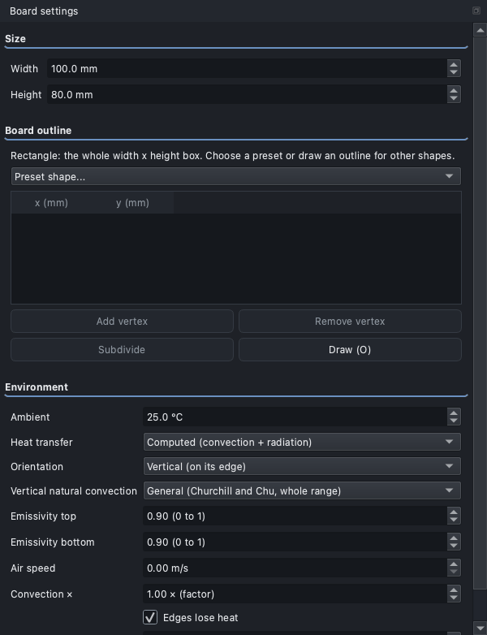
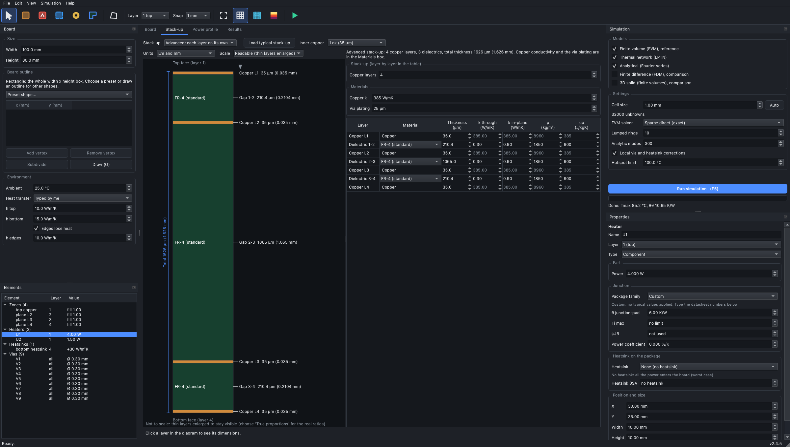

# Models: what they are, how they work, which one to use

PCB Thermal Lab solves the steady and time-dependent temperature of a PCB with **five models** (four of the same layered description plus a 3D solid). This document
explains the description, each model, the features built on top of them (power profiles, computed heat transfer coefficients, parts), and gives a decision
guide. **Every equation, discretisation and approximation is stated in [`theory.md`](theory.md)** (section numbers are quoted below as "theory §n"); the numbers that back every statement are in [`validation.md`](validation.md); what is planned is in the chapter 'Planned' of [`versions.md`](versions.md); open investigations are in [`research.md`](research.md).

## 1. The physical description (theory §1)

A board has `N` copper layers (layer 1 = top), a total thickness, copper zones (polygons with a fill factor; where zones of one layer overlap or touch, the fill of a point is the largest fill of the zones that contain it), heaters (power over a footprint on one layer),
plated vias (the diameter is the **drill**: the plating is inside it and the finished hole is the drill minus twice the plating), heatsinks (extra heat transfer on an outer face) and boundary conditions: ambient temperature and a heat transfer coefficient `h` on the top, bottom and edges.

* SI units inside the package; project files and the builder API use millimetres and 1-based layers.
* **Layered model**: every copper layer is a thin conducting sheet with in-plane sheet conductance
  `S = f·k_cu·t_cu + k_lam·(slab − f·t_cu)` (`f` copper fill; simple stack-up: `slab = thickness/N` and `k_lam` the FR-4 in-plane value; advanced stack-up: the slab is the copper plus half of each adjacent gap and `k_lam` the thickness-weighted mean of the two gaps, section 8); the dielectric between two layers is a vertical conductance `k/d` of that gap
  per unit area (anisotropic FR-4 by default: 0.3 W/mK through, 0.9 in plane; each gap can have its own thickness and material in the advanced stack-up); a via joins all layers with the conductance `k_cu·A_via/d` per gap (FVM and FDM: through the mean temperature of a footprint of cells and a well, so that it converges with the cell, "The via on the grid" in `docs/theory.md`; a via within one cell of the board edge or a cell of 2 mm and more is warned) with `A_via = π[(d_v/2)² − (d_v/2 − t_plating)²] + (k_fill/k_cu) π (d_v/2 − t_plating)²` (a barrel that is open or filled with resin or paste; `Via.thermal_area`) or `π(d_v/2)²` (electroplated copper fill; `VIA_FILLS`: a fabricator's usual "filled via" is an **epoxy resin plug** that conducts as little as FR-4, +0.1 % for a 0.3 mm via; a conductive paste +5 %; only copper is a real heat path, ×3.3; `docs/validation.md` section 18);
  the top and bottom faces lose heat with `h_top`, `h_bottom`, heatsinks add `h_extra`, edges `h_side`.
* **Copper that dissipates is already in the model, with no extra element.** A copper zone on an outer layer is both the spreader (its sheet conductance `S` carries the heat sideways) and the radiator: every cell of the outer face loses heat with `h_top` or `h_bottom` (typed or computed, radiation included), whether it is bare laminate or copper. Copper on the inner layers spreads the heat and sends it to the faces through the vias and the dielectrics. The copper fill `f` of a cell sets how well it spreads, so a larger zone cools better (more face area, more conduction), and the effect saturates at the length `sqrt(S/h)`. Solder mask and tinning are not modelled; a bare or tinned copper area differs only in emissivity (`emissivity_top/bottom`) and, if you want a different coefficient there, a heatsink with `h_extra` over the area. `docs/validation.md` section 3.1 checks it against a 3D solid: pad of 20 to 80 mm within 2.5 % in the FVM, and a heatsink only works through the copper under it.
* **Heater power** is injected exactly (it does not depend on the grid). Total heat out through the faces and edges equals the power in; every result reports that energy balance.
* Dependencies: NumPy, SciPy, Matplotlib; PySide 6 for the application; scikit-fem only for the offline 3D check. Virtual environment: `python3 -m venv .venv && .venv/bin/pip install -r requirements.txt`.

## 2. The five models

Four of them are layered models (one node per copper layer); the **3D solid** (section 2.7) is a different kind of model and the independent check of all of them.

| | **FVM** | **FDM** | **Lumped** (thermal network, LPTN) | **Analytic** (Fourier series) |
| :-- | :-- | :-- | :-- | :-- |
| Role | reference | comparison | fast estimate | fast estimate, independent check |
| What it is | board cut into cells, one node per layer and cell, sparse matrices | the same equations on grid **points** (node-centred finite differences) | one small network per heater, built from the real footprint and outline | exact closed-form solution of a uniform multilayer board, with corrections for vias, heatsinks and copper |
| Time on the example board | 0.13 s (1 mm cells) | 0.12 s | about 10 ms | about 0.4 s with its nine vias (about 50 ms without vias; the via correction is a dense system) |
| Output | full field per layer | full field per layer (at nodes) | approximate field | field per layer |
| Power profiles in time, step animation | yes | yes (same time stepping on the nodes) | profiles yes, animation no | yes (vias calibrated per heater) |
| Needs a mesh | yes (cell size, Auto) | yes | no | no |

### 2.1 FVM (finite volumes), the reference (theory §2)

Cell-centred finite volumes (`fvm.py`). One node per layer and cell; between neighbouring cells the conductance uses the harmonic mean of the two sheet
conductances (`G_x = 2 S₁S₂/(S₁+S₂)·dy/dx`), so a copper/FR-4 jump is a series combination. The steady problem is the sparse symmetric positive definite system `K θ = Q`
(`θ = T − T_amb`) solved with a **direct sparse LU** (default, with a symmetric minimum-degree ordering: half the fill and about 40 % less time than the default ordering, factorised in SuperLU's symmetric mode with a residual-checked fallback to the default mode: same temperatures to 1e-11 K, much less time and memory on via-dense boards), conjugate gradients, or red-black SOR (kept for
comparison). Transient: `C dθ/dt + K θ = Q`, theta-method (implicit Euler or Crank-Nicolson), time step doubling in ten stages so that only ten factorisations are needed.

*Use it* for final temperatures, any geometry (partial or hatched copper, copper edges anywhere, via arrays, thin or L-shaped heaters), whenever a warning appears, and to
confirm the fast models. Cost grows with cells × layers; the **Auto** cell size (about four cells across the smallest heater) is a good start.

### 2.2 FDM (finite differences), the comparison (theory §3)

Node-centred finite differences (`fdm.py`) of the same layered model: nodes on the board edges (`nx+1` by `ny+1`), edge nodes with half control volumes, the conductivity between
two nodes is the harmonic mean of the nodal sheets (the default since 2.7.0: the arithmetic mean let half of a copper node's sheet leak into a bare neighbour and read a bare-pad board 13 % low at 1 mm against an independent 3D solver, 7 % with the harmonic mean; `mean="arithmetic"` stays for studies), vias are mean-potential couplings of a footprint of nodes (as in the FVM). How the copper and the heater footprint reach the nodes is selectable:

* `sampling="area"` (default): the covered fraction of the control volume around each node. It removes the grid-to-grid scatter of point sampling and is exact for geometry that does not lie on the grid.
* `sampling="point"`: the classic "is the node inside the polygon" test (left and bottom edge in, right and top edge out).

Same equations as the FVM, so on boards without vias the two agree to about 0.1 % (table in `validation.md`). Differences: the FDM treats a via with the same footprint and well as the FVM, on its nodes (on the 2.7.0 tree the example board at 1 mm is 85.30 °C against 85.38 °C; with the via at the nearest node it was 84.38 against 85.81); near a copper edge that crosses a heater it is 1.9 % below the FVM (3.4 % with the arithmetic face mean before 2.7.0, `validation.md` 2 and 41). It also does the power-step transient (animation), the step response and the power-profile time simulation, with the same theta-method as the FVM on the nodes (on the example the hottest point follows the FVM within 1 °C at every time).
**The via in the FVM and FDM.** A via is a vertical conductor between the planes. It is reached from each plane through the mean temperature of a few cells around its centre and a well resistance: on coarse cells a point with a well, on fine cells a disc. The temperature changes by less than 1 % of the via effect from 1 mm to 0.0625 mm cells, and the radius `0.78 r_v` that the model reproduces is one constant that keeps the via within a few percent of a 3D barrel on common stack-ups (details and limits in `docs/theory.md`, "The via on the grid"; evidence `research/point-via-convergence`). A via within about one cell of a straight board edge (the box, or an axis-parallel side of an outline) also sees the **mirror image of the edge** in its well (FVM only): the via effect of a via 0.16 mm from an insulated edge reads +14.5 % high at a 1 mm cell without it and +0.7 % with it (`docs/validation.md` 28); the FDM and the 3D solid have no image and keep the warning. The barrel conductance of a gap uses the length `d + 0.5 t_cu` (the copper nodes are at the mid-planes) in the FVM, FDM, Lumped and Analytic (the 3D solid draws the barrel through its copper slabs): the part reads 0.02 to 0.16 K hotter on the frozen boards with vias, and the earlier barrel was 5 to 29 % too conductive on multilayer boards with thick copper and thin prepregs (`docs/validation.md` 34). A copper layer whose zones (or heaters) touch none of the rim of the drill is left uncoupled from the via (a via just outside a copper edge no longer over-reads); a via at the corner of a copper region is not solved and the partial-copper warning says so. The SOR solver treats the cells of the vias as dense blocks and falls back to the direct solver, saying so, when a block is too large.

**The via in the Lumped and Analytic models.** Both carry an area mean (a ring, a tile), and the barrel sees the temperature at its wall: the difference is the constriction resistance of the heat converging on the barrel (Krogh cell, `viaconstriction.py`, `docs/theory.md` sections 1.5, 5.1 and 6.1). The Lumped model gives each plane of a ring that holds vias a well in series with the barrel (the barrel nodes are eliminated, the ring gets couplings between all its planes); the Analytic model uses 1 mm tiles at most, shares a lone via among four tiles and adds a self-term to the diagonal of the tile response. Before this the two models joined the planes through the barrel conductance alone and overstated the via effect by 35 to 60 %. Boards without vias are unchanged. The accuracy (`validation.md` sections 18 and 21) is the better for the Analytic (mean 1.8 % on the study boards, 2.9 % on boards not used to build it) than for the Lumped (8 % and 20 %; the Lumped model warns, and for an array that continues past the edge of the footprint, stands off its centre or lies under an elongated footprint the part is up to about 11 K, a quarter of its rise, too cool: `research/lumped-zones-adoption` 8.4).

*Use it* to check the FVM's discretisation or to see what a classic scheme gives; for design work the FVM is preferred (smoother with the grid, conservative by construction).
FDM is **not** the removed wxPython solver, which also had modelling errors (see `validation.md`).

**FDM or FVM, in one table**

| | FDM (finite differences) | FVM (finite volumes) |
| :-- | :-- | :-- |
| Idea | replace derivatives by differences between **node values** | integrate the equation over a **cell** and balance the heat through its faces |
| Unknown | temperature at a grid node | mean temperature of a cell |
| Conservation | by construction only with care at boundaries and interfaces | exact: what leaves one cell enters the next |
| Material jumps | need care at interfaces | the face conductance is the series of the two half cells |
| Point features (sources); vias | sources sampled at the nodes; vias as a footprint of nodes with a well | averaged over the cell; vias as a footprint of cells with a well |

The linear solver (direct, CG, SOR) is a separate choice from the discretisation.

### 2.3 Lumped (thermal network) (theory §5)

A reduction of the FVM network (`lumped.py`). For every heater the cells are grouped in rings by their **distance to the heater footprint** (ring 0 is the footprint, outer rings grow geometrically),
so any heater shape and the real board outline are followed. For every layer and ring the geometry is aggregated; heat crosses offset contours of length `L_k = A_k/Δ_k`:
`R_{k,k+1} = Δ_k/(2 S_k L_k) + Δ_{k+1}/(2 S_{k+1} L_{k+1})`. The interior of the heated footprint comes from the logarithmic potential of the uniformly heated footprint, with the exact disc solution with vertical
losses (modified Bessel functions `I₀, I₁`: factors `f_R = 4(I₀ − 2I₁/x)/(x I₁)` for the resistance and `f_P = 4(2/x² − 1/(x I₁))` for the peak, `x = a/λ`, `λ = √(S/g_eff)`). Each heater gives a small dense
system; the problem is linear so the board is the sum over heaters (mutual heating is one heater's profile read at the distance of the other). The first ring is at most one equivalent radius of the footprint wide (never below 1.5 cells), so a small part does not read cool on a large board (a 1 mm part on 200 x 150 mm uniform sheet was -25 % of the FVM, now +2.5 %; rectangles of aspect 3 can read +9 to +12 % hot, `validation.md` 31). Rings narrower than a cell are merged (`lumped.ring_edges`), so the result does not depend on the ring count (10, 20 and 40 rings within 0.2 % of each other on the coupon of `validation.md` section 21).
*Use it* for fast exploration and sweeps; it is weak when a copper edge crosses the heater, at corners (−8.7 %) and for thin heaters (+9.5 %). A part within one side (at least 5 mm) of a side of the board reads too cool, on average 8 to 9.5 % of the rise and up to 22 % at a corner; the live check warns (`checks.check_lumped_near_edge`, `validation.md` 35). A heat source narrower than two cells makes the raster finer (half its side, not below 0.125 mm, one per board, only if about 1.7 KB per cell stays within 1 GB and the memory-guard limit; `lumped.small_part_cell`).

**Zones under a part with a dense group of vias** (theory §5.2). When the footprint of a part holds a group of two or more vias, the cells within `0.7071` nearest-neighbour distances of the vias are the **core** and the rest of the footprint is the **rest**: two nodes per layer instead of one, joined by a lateral link in the source layer; the vias reach the planes at the core node, and the source is divided between the two by the covered area. The capacities of the nodes are the sums of their cells', so the step response and the power profiles follow the same network (the profile runner applies the power through the same split). Rules to know:

* **One cell per board, 0.5 mm, only when a part will be zoned.** The core must be a handful of cells across, so a board with a part that will be zoned runs the Lumped model on a 0.5 mm cell; the other boards keep the 0.5 to 1 mm clip of the options (2 mm equals 1 mm). The cell is one per board, so the other parts of such a board move by the raster too (two small parts on bare laminate of a Gerber-like test board moved by 9 to 18 K between 1.0 and 0.5 mm, nearer the FVM at 0.5 mm).
* **The footprint stays one node** (the program's network, line for line) when there is no group in it, when a via is alone in it, or when the core covers **more than 92 %** of the footprint, counted on the Lumped grid **and** on a 0.1 mm grid so that the choice does not jump with the raster (the nine vias of the example board are a core of 98 to 100 % of the footprint of U1, so the example board is unchanged). A board with an outline is decided on the rectangle of the same area, the board the model solves.
* **Limits** (warned): an array across or just outside the footprint edge (the part up to 16 % of its rise too cool), an off-centre cluster, an elongated footprint, vias that conduct nothing, a raster coarser than a tenth of the core; several groups under one footprint are one core. `validation.md` 18.2 has the numbers.

### 2.4 Analytic (Fourier series) (theory §6)

The multilayer fin equation on the rectangle, expanded in `cos(mπx/W) cos(nπy/H)`: every mode is a small tridiagonal system over the layers (`analytic.py`). Exact on a uniform board. With a board edge coefficient (`h_side`) the series is made of the **eigenfunctions of the convective edge** instead of the cosines (even `cos(λu)` and odd `sin(λu)`, `λ (L/2) tan(λ L/2) = β (L/2)` and `λ (L/2) cot(λ L/2) = −β (L/2)`; Muzychka, Culham and Yovanovich 2003, Part II, eqs. 12 to 21), so the edge loss happens at the edge; `β = h_side Σ s_l / Σ S_l` (1/m) is the common parameter of the basis, with the perimeter of the real outline on a board with an outline; each layer's own parameter `β_l = h_side s_l / S_l` is restored by an extra modal source solved with GMRES (the **per-layer edge**, 4 to 9 products; layers with the same `s_l / S_l` skip it). Without `h_side` the basis is the cosine one and the result is identical to the insulated code, bit for bit. Against the FVM at 0.5 mm the hottest rise of 135 uniform boards is within 0.12 % on average and 0.32 % at most (`validation.md` 4.1); with very different copper in the layers the error against the FVM at 0.5 mm is -4.1 to +0.1 % on 48 boards (the common parameter alone was -8.6 to +5.8 %); the rest is the one laminate link per gap of the idealisation and is cool, so against the 3D solid the same boards are -0.5 to -5.8 % and small boards with a small corner part and a strong edge -5 to -10 % (review, `validation.md` 4.1), and a warning appears for one layer (up to about 9 % either way) and for layers with very different copper with the edge taking more than 30 % of the loss (the range of the case is in the text). Refinements:

* **copper weighted by influence, layer by layer**: `f_eff,l = Σ w f_l / Σ w` with `w = Σ_i P_i K₀(r_i/λ_l)` and the layer's own fin length `λ_l = √(S_l/(h_l + n_l g))` (about 5 mm for a layer that carries a heater, not the 34 mm of the whole stack);
* **local vias and heatsinks** by a Green-function (Woodbury) update on 2.5 to 5 mm tiles: `(I + G_mod C_loc) y = y₀`; with vias the tile follows the via pitch (`min(1 mm, 0.75` of the median nearest-neighbour distance, at least 0.25 mm) and the via is read at its wall through a constriction self-term (section 6.1 of `docs/theory.md`; at most 4800 unknowns of the dense system);
* **warnings** when the copper around the heater is strongly non-uniform or edge convection is significant.

*Use it* for instant answers on boards close to uniform, to understand a design, and as an independent check. It fails when the copper is not uniform near the heater (24 % low with a 20 mm pad, 25 % when an edge crosses it);
the input checks warn.

### 2.4.1 One-layer boards (theory §1.4)

A one-layer board has its copper on the top face and the laminate under it. The laminate is a gap down to a bottom node that carries the bottom film, and the FVM and FDM cut it into sub-gaps by the rule of theory §1.4 (sub-gaps of at most 0.4 mm, at most 4, only in the cells where copper is absent next to the gap plus a margin; elsewhere one link). The Lumped model keeps two laminate nodes in every cell; the Analytic model puts the laminate in series with the bottom film. Against an independent 3D solver: full copper within 0.1 % (FVM, FDM), a bare 20 mm pad -2.5 % (FVM, two laminate nodes, the earlier version; -1.80 % with the rule for a 10 mm pad, `validation.md` section 21.2), -7.4 % (FDM), -15 % (Lumped), -29 % (Analytic); the 3D solid +0.2 % (`validation.md` section 21). For a board with little copper on one layer use the FVM or the 3D solid.

**The laminate band along the board edge.** With an edge coefficient (`h_side` above zero) and two or more copper layers, the gaps that are cut also carry their interior laminate nodes in a band along the board edge (the cells or nodes that touch the edge, grown by the margin of the rule), even over full copper, so that the edge film acts on the laminate, which is cooler than the copper, and not on the copper node (theory §1.4; `laminate.edge_band`). Without it a thick board with a cooled edge read cold (−15 % of the rise on 3.2 mm at 200 W/m²K); with it the FVM and FDM are within −2.3 % and −2.6 % of a converged 3D solver at 200 W/m²K or less. The band costs unknowns (about 1.9 times on a 30 × 20 mm, 3.2 mm board at 0.5 mm; the interface counts them). Above 200 W/m²K the laminate at the edge is under-resolved by the sub-gaps and the program warns (a larger `N_MAX`, a smaller cell); a board in air has 5 to 50 W/m²K. The Lumped, Analytic and 3D solid are unchanged; the Lumped and Analytic keep the edge film at the copper temperature and read cool on a thick board with a cooled edge (Analytic −5.2 % at 200 W/m²K on 1.6 mm, −15.2 % on 3.2 mm, against the converged 3D solver), and the program warns for them from `h_side` × thickness = 150 W/m²K·mm.

**The laminate options.** The two numbers of the rule, the longest sub-gap `S_MAX` (0.05 to 5 mm, default 0.4) and the most sub-gaps `N_MAX` (integer 1 to 16, default 4, 1 turns the cutting off), are options of the run (`SolverOptions.laminate_s_max_mm`, `laminate_n_max`; saved in the project only when not the default; two spin boxes in the solver panel, greyed with a metal block, where the rule is not applied; CLI `run --laminate-s-max-mm` and `--laminate-n-max`; the power calculator and `calibrate` use them, the `transient` command the defaults). A gap gets `min(N_MAX, ceil(d / S_MAX))` sub-gaps, so a larger `N_MAX` alone changes nothing when `S_MAX` already gives `N_MAX` sub-gaps (8 sub-gaps of a 1.6 mm gap need `S_MAX` of 0.19 mm or less, 16 need 0.09 mm or less). More sub-gaps are closer to a resolved 3D solid (`validation.md` 21.2) and cost unknowns and memory.

### 2.5 Which model for which job

| You want | Use |
| :-- | :-- |
| the number you sign off, any geometry, hotspots, junction temperatures, time behaviour | **FVM** |
| to check the layered models on your board (small copper pad, copper edge under a heater, thick blocks) | **3D solid** (steady state; slower) |
| a quick exploration or a parameter sweep | **Analytic** (uniform-ish boards) or **Lumped** (partial copper, several heaters), then confirm with the FVM |
| to see whether the grid or the scheme matters | compare **FVM** and **FDM** at two spacings |
| to know whether a fast model can be trusted on your board | run all of them (`--model compare`); a spread above about 5 % means "use the FVM" |

Workflow: explore with Analytic/Lumped, refine with the FVM at the **Auto** cell size, change the cell size once to confirm convergence, read the warnings.

### 2.6 Metal block (heat spreader) (theory §7)

A **Heatsink with a thickness** (`thickness_mm > 0`, aluminium by default) is a metal block pressed on the outer face. FVM and FDM add one more node layer under it:
lateral conductance `k·t` per cell, heat capacity `ρ·c·t` (time simulation), a **contact to the board layer** `G = A [ f/R'' + (1−f)/(R'' + d/k_FR4) ]` where `f` is the copper fill of that layer, `R''` the interface resistance (m²K/W; K cm²/W in the application) and `d` half a layer slab,
and an exposed surface to the air `G = h_exp·A` plus the side walls `G = h_wall·t·L_edge`, with `h_exp = h_face·(fin ratio) + h_extra` and `h_wall = h_face + h_extra` (top or bottom coefficient of the board plus the heatsink's extra h; the fin ratio is 1 without fins and applies to the exposed face only, never to the sides). The heat therefore enters the block **where the block overlaps copper** (the intersection of the two planes);
over bare laminate it must also cross the FR-4. The board face under the block no longer loses heat on its own. The block is taken as an isotropic plate with no gradient across its thickness (thin blocks; a 1 to 10 mm aluminium or copper plate is within 0.6 % of a 3D solid).
`block_stats` and the report give its mean and maximum temperature and the heat entering and leaving; the Temperature tab has a "Metal block" view. A heatsink with thickness 0 stays the plain extra coefficient.
| Model | Metal block | Time simulation with a block | Error against the FVM (74 cases) |
| :-- | :-- | :-- | :-- |
| FVM, FDM | one more node layer under the block | yes | reference / compared with the 3D solid within 1.8 % |
| 3D solid | pad slabs of the block | no (steady state only) | within 1 % of the FVM on a finned block |
| Lumped | one more layer of the ring network | no | 1.9 % mean, 4.7 % max |
| Analytic | graph of tiles in the Green-function correction (Schur complement) | no | 1.1 % mean, 4.3 % max |

**Lumped and Analytic have the block in steady state** (Lumped: one more layer of the ring network; Analytic: a graph of tiles in the Green-function correction; `theory.md` section 7; both within about 5 % of the FVM in 74 cases, `validation.md` section 17). Their time simulation does not support a block and the summary says so; the FVM, FDM and 3D solid have it in time too. SOR does not support blocks (direct and CG do). `python -m pcbthermal example block` runs the example board with a block.

### 2.7 3D solid (finite volumes in three dimensions) (theory §4)

`solid3d.py` solves the board as a real solid on a structured grid: the **same plan cells** as the FVM and, across the thickness, **real slabs**: each copper layer one slab of its own thickness, each dielectric gap slabs of at most 0.2 mm (`ceil(d / 0.2 mm)`, 4 to 16 per gap; the two-layer 1.6 mm board has 8, the laminate under the copper of a one-layer board is cut the same way), and a part over absent copper reads its face value (the half layer of laminate between its node and its face is added, as in the FVM and FDM), a metal block one pad slab (the interface, thickness `R''` at 1 W/mK) plus up to six slabs of metal.
The unknown is the temperature of every cell of every slab; heat spreads in the gaps and in the blocks and a heater feels the real vertical path. Cell properties are volume averages (the tiled-conductivity method used for PCB models in industry): copper slab with fill `f`: in-plane `f k_Cu + (1−f) k_FR4,ip`, through `f k_Cu + (1−f) k_FR4,th`;
a via adds the **real copper area of its barrel** in parallel in every slab, spread over a footprint of cells by the same rule as the FVM (the copper area is conserved); faces use the harmonic mean of the half-cell resistances; convection, edges, heatsinks and blocks as in the other models (a block hides the board face under it and loses heat on its exposed face and sides); the heater power is spread exactly over its footprint on the copper slab of its layer.
The result has the same layout as the FVM (the temperature of the copper slab of each layer) and the block temperatures, so every plot and table works. **Steady state only** (the time simulation and the animation are the layered models' job). The model needs only SciPy; a direct sparse solve of 0.1 to 10 s on an ordinary board (it grows quickly with layers and cell count; the application shows the number of 3D unknowns, and a model whose estimated memory is above the limit of the memory guard (60 % of the physical memory by default; an absolute ceiling of 2 million unknowns) is refused before it is built, with the cell that fits, while the others still run; see the memory guard below and `theory.md` 2.7. Measured on a quiet 16 GB machine, on the example board of 16 slabs: 247 000 unknowns 15.3 s and 3.5 GB, 392 000 unknowns 32.8 s and 7.4 GB, 512 000 unknowns 57.7 s and 9.9 GB resident; on a plain two-layer board 500 000 unknowns take 9.3 s and 3.3 GB. The figures depend on the machine, on the board and on the computed-h loop, which repeats the solve 3 to 6 times; the old limit of 2 million let a run go on for hours. Evidence: `research/solid3d-verification/docs/for-the-project-documents.md`).
What it is for: it does **not** use the "one node per copper layer" idea, so it measures the error of that idea on your own board (largest with a copper pad hardly bigger than the heater, a copper edge across a footprint, and thick or small blocks). It is verified in turn against an independent offline finite-element solid (scikit-fem; `docs/validation.md` section 3).
It is not a truth either: the barrel is a lumped copper area (no plating geometry), copper is one slab thick, the contact of a block is perfect over the pad, and there are no measurements of a real board in this project yet.

## 3. Input checks

`check_problem` (also run by `simulate` and live in the application under the Run button) never blocks a run; it warns about inputs that make a result doubtful: a heater partly outside the board
(its power would be moved onto the part inside), no copper under a heater, a copper edge or hatching crossing a footprint (Lumped and Analytic unreliable), a heater only a few cells wide, overlapping
heaters, vias or zones outside the board, a zone whose outline crosses itself (the even-odd fill leaves the crossed part empty), a metal block with no copper under it (or an almost perfect contact), a footprint of zero area, zones or metal blocks partly outside the board or its outline (a block is cut at the outline in the FVM, FDM and 3D solid; Lumped and Analytic take it whole on the rectangle of the same area), two heatsinks that overlap (only the later one is used in the overlap) and zero total power. After the run, the thick-plate check of section 4b and the close-fin check of section 15.

The checks of parts, zones and metal blocks against the board and against each other use **exact geometry** (`geometry.clip_polygon`, `polygon_overlap_area`, `part_board_share`): the overlap area is exact when one of the two polygons is convex, and self-crossing polygons are measured on a 96 x 96 lattice with the even-odd rule (within 1 % for boards with an outline); a part with none of its area on the board is reported as 100 % outside. The live Warnings box of the Simulation settings shows `check_input` (these checks plus the model-limit and via warnings of the selected models) in a **short form**, one line per warning, with the full text as tooltip and in the Results summary.

`check_model_limits` (called by `simulate`, text only, no result changes) adds warnings about the documented limits of the selected models:
* **A part on bare laminate** (layered models FVM, FDM, Lumped, Analytic): when the smallest copper fill in the central half of the footprint (its polygon shrunk by two about the centroid) is below 0.5 on the part's layer. The layered models read lower than a resolved 3D solution there (the FVM, which cuts the laminate there into sub-gaps, 0 to 3 % on 4- and 6-layer stack-ups and 0.8 to 1.6 mm two-layer boards and up to 10 % on a 3.2 mm laminate or under a window narrower than the laminate is thick, the FDM 2 to 20 %, Lumped and Analytic not systematically; the same text as the warning of `checks.check_model_limits`); use the 3D solid. The central half, not the mean of the footprint, because a 2 or 4 mm window under a 6 mm part has a mean fill of 0.89 or 0.56. It fires in 26 of 26 study cases (0.5, 1, 2 mm cells) and is silent on full copper (`research/bare-spot-under-source`, P3).
* **Analytic copper spread** (in `analytic._effective_sheet`): the larger of the spread of the copper fill under the heater weights and the same spread with the fin length of the layer as full copper, above 0.25. The second test sees the pad edge on a thin gap, where the fin length is about a millimetre and the first test is blind. On 119 boards it warns on 70 and is silent on 49, none of the silent ones beyond 5 % error (`research/analytic-partial-copper` 9.4).
* **Vias in the Lumped and Analytic models**: after the constriction (sections 1.5, 5.1 and 6.1 of `theory.md`) and the zones of the footprint (5.2) the Lumped model warns for a part with vias under its footprint (the via effect measured from 21 % too small (the part too hot) to 33 % too large (the part too cool: dense arrays that cover a quarter or less of a large footprint, sparse arrays and rows), up to 14 % of the rise too cool, 8 to 20 % on average over 46 boards, 11 % over 36 more, and a second warning when the array continues past the edge of the footprint, stands off its centre or lies under an elongated footprint (the part up to about 11 K, a quarter of its rise, too cool, with the one-node footprint; up to 16 % of the rise with the zones; `research/lumped-zones-adoption` 8.4), and a note after the run when a footprint with a group of vias was kept as one node or when the raster is coarser than a tenth of the core) and gives one aggregated message for the vias outside every footprint (a lone via 22 % too small to 65 % too large, a row 6 to 21 % too large, scattered vias 19 to 56 % too large, an array just outside the edge up to 2.3 times (4 K, 9 % of the rise)). The Analytic model warns when the tile of its via correction was coarsened to keep the dense system small, when the median pitch is under 0.45 mm (untested), when the system passes 2400 unknowns (memory and time) and for one or two vias (up to 16 % too small; `research/young-omega-tiles` 3, the review of `fix/via-constriction`).

## 4. Power profiles (time-dependent power) (theory §10)

A heater may carry a **square wave** (`SquareWave`: `p_on`, `period`, `duty`, `p_off`) or a **table** (`TableProfile`: times and powers, repeating or one-shot, read from and written to CSV files:
`profile_io.py`, format and a worked example in [`examples/csv_profiles/README.md`](../examples/csv_profiles/README.md)). The heater's `power` stays equal to the average, so steady models and old files work unchanged.

1. **Step response** `Z_i(t)` of every heater's own hottest point to a unit step of its power, from the reference model (FVM, else Lumped, else Analytic).
2. **Decision, per heater** (`profiles.decide`): by superposition the periodic response of a piecewise-constant power is `T(u) = Σ_j P_j [G(σ₂) − G(σ₁)]` with
   `G(σ) = Σ_{m≥0} [Z(σ + mT) − Z(mT)]` plus the tail `σ/T·(R_th − Z(MT))`; for a square wave `peak = P_off R_th + ΔP·G(t_p)`. The oscillation (peak minus valley) is in **°C**. Heaters are sorted by oscillation and
   *averaged* (smallest first) while their cumulative oscillation stays below the threshold (default 1 °C); the others are *resolved* in time. One-shot tables are always resolved. Percentages are shown for information only.
3. **Run** (`profiles.run_windows`, one runner for the models through an adapter): the step is a tenth of the shortest stretch, each step's power is the **exact mean** of the profile over the step, averaged heaters keep their
   constant power in the same run, the window is the least common multiple of the periods, and windows repeat until peak and minimum change by less than 0.1 °C ("until the cycle repeats"), for N cycles, or for a fixed time;
   more than 200,000 steps is refused with an explanation. Start: the steady state of the average power (the first power for a one-shot table) or a uniform temperature typed in °C.
   **Fast waves** (theory §10.5, `stackimpedance.py`): for a repeating square wave or table on a part with copper under it (fill at least 0.9, no metal block), whatever the model of the step response, the oscillation of the decision is `max(node swing, closed-form swing of the stack under the part)` (the node structure understates a short stretch 2 to 12 times); a heater over the budget whose shortest stretch is below 4 s (2 s with three or more copper layers) has the regime **`average + ripple`**: it is not time-stepped, the run holds its average power and the zero-mean wave of the closed form is added at the heater (curve, peak and minimum of the result, not the maps or frames). The decision's step response is computed at a quarter of the narrow side of the smallest part with a profile (0.25 mm to 2 mm, `api.response_cell_mm`). Warnings: a fast wave on bare laminate, a fast wave on a board with a metal block, a one-shot table with a short stretch and a slow wave near a board side (`checks.check_fast_wave`). Validation and limits (vias, neighbours, edges): `validation.md` 37.
4. **Results**: peak, minimum, oscillation, temperature of every heater versus time, peak-temperature map, frames of the last window, steady temperatures with the average and with the peak power (the bound).
5. **Analytic transient with vias and heatsinks**: one modal system per heater in which the vias and heatsinks stay local, a coupled block of the lowest 16 x 16 modes holding the tile conductances of the steady model, with one factor on the via couplings fitted so that the steady resistance equals the locally corrected steady model (`analytic_local.py`, theory 6); the time to 63 % is -8.1 to +0.5 % of the FVM on 12 test boards (the smeared transient it replaces was -66 to +175 % with a heatsink).

**Parts over absent copper (FVM and FDM).** The curves of a profile show a part at its face (hottest at the face of the part), not only the hottest node: each step adds the quasi-static face term of its power, and the decision adds the swing of that term to the oscillation of the node (theory §10), so a fast square wave that the node alone would average can be resolved. The face is first order and overstates the swing below about ten times the time constant of the half copper layer (0.69, 2.8, 11 ms for 35, 70, 140 µm). The board Tmax of a steady run stays the hottest *node*.

Interfaces: `SolverOptions.profile`, `steady_power` ("average" or "peak"); CLI `run --profile U1=file.csv --duration --cycles --time-s --initial-c --threshold-c --steady-power`; the "Power profile" tab with
**Import CSV…** / **Export CSV…**; outputs `profile_<model>.csv/.png`, `peak_map_<model>.png`.

## 4b. The thick-plate warning

The layered models keep one temperature per layer and per metal block, the mean through its thickness. Under a source of flux `q''` the surface can be hotter than that node by at most `q'' t / (2 k)` (all the heat crossing the plate under the source; with sideways spreading the measured gradient is 0.6 to 0.8 of it; evidence: `research/effective-conductivity/README.md` 4.6). After the solve, `checks.check_thick_plates` compares this bound with the rise of every heater, for its own copper layer and for every metal block under the centre of its footprint, and warns when it exceeds 5 % of the rise. For the copper layer `q''` is the power into the board over the footprint (the heat enters the copper there); for a block it is the largest flux that enters the block under the footprint in the solved FVM or FDM result (`arrays["block_flux"]`, W/m² of block area): a block under the board is fed through the laminate and its copper, which spread the heat, so the footprint flux would overstate it 5 to 70 times (8 to 22 % of the footprint flux on the 74 cases below, 1 to 3 % under a 2 or 3 mm part). With only the Lumped, the Analytic or the 3D solid, a quiet auxiliary FVM run of the same problem (cell of at least 2 mm, `api._block_flux_result`) gives the flux, so the warning rests on a simulation; the footprint flux remains only as the stated fallback of `check_thick_plates` called without such a result. The dielectric gaps are not checked: a gap is a series resistance between two nodes, so its drop is already in the model. The text gives the bound in kelvin; it is never added to the result. A 35 um copper layer gives about 1e-4 K; the 74 metal-block cases of `validation.md` section 17 give a median of 0.07 % and a maximum of 0.34 % (0.50 and 1.78 % with the footprint flux; 0.04 and 0.42 % in the research, flux over the copper pad, which is not conservative: the peak flux into the block is 1.6 times the pad mean at the median), so it does not fire on the boards the program is built for. Against the 3D solid (`validation.md` section 22) the bound is above the real effect of the block thickness on the hottest point in every case tested.

## 4c. The memory guard (theory §2.7)

The memory of a sparse direct solve grows faster than the number of unknowns, and the number follows from the cell. Before any array is allocated, `memory.check` estimates the peak memory of each selected finite model (FVM, FDM, 3D solid; the Lumped and the Analytic are small) from its unknown count and the thickness of its graph, and compares it with a limit:

* **Limit**: a fraction of the physical memory, default **60 %** (10 to 95 %), the Preferences field *Memory limit* (section `solver`). It belongs to the machine, so it is **not saved in the project**. The physical memory is read without a dependency; the variable `PCBTHERMAL_MEMORY_BYTES` states it when the machine's limit is not visible (a container, a test).
* **Verdict** per model: *ok*, *slow* (predicted solve above 30 s) or *refuse* (estimate above the limit, or the 3D solid above 2 million unknowns). A refusal names the cell that fits. A time simulation, an animation and a profile run count twice the steady estimate. An estimate above the memory *available* now only warns.
* **Where it acts**: `api.simulate` (a refused 3D solid next to other models is skipped with a warning, the others run), the calculation process, the solver panel (the unknowns and the verdict under the cell size; **Run is disabled** with the reason when a model is refused; **Auto** chooses a cell that fits), `solid3d.Solid` (its own constructor) and the command line (the same text, **exit code 3**; `--memory-fraction F` for the command). The block SOR is allowed only when the sum of `75 n^2` bytes over its dense blocks is at most 25 % of the limit.
* **Vias**: for the FVM and FDM the estimate of a board with vias is multiplied by `1 + 0.10 (1 - exp(-F/500))`, F the cells of the via footprints (`memory.via_cells`), because the via couplings raised the measured peak (up to 1.6 times in SuperLU's default mode, 0.82 to 1.09 times in the symmetric mode the solver now uses, where the gain was refitted from 0.40 to 0.10); no vias, no change (see `theory.md` 2.7).
* The log gives the estimate and the measured peak of each run, so that the law can be checked on other machines.

## 5. Heat transfer coefficients: typed or computed (theory §8)

`Board.h_mode` is `"manual"` or `"computed"`. Computed (`convection.py`): each face gets `h = calibration × (h_n³ + h_f³)^(1/3) + h_radiation`, with natural convection on a horizontal plate
(up: `Nu = 0.54 Ra^(1/4)` to Ra = 1e7 then `0.15 Ra^(1/3)`; down: `0.475 Ra^(1/5)`; length = area/perimeter) or Churchill and Chu for a vertical board (`Board.natural_form`: `"general"`, the form for the whole Rayleigh range and the value of the class and of old project files, or `"laminar"`, the same authors' laminar form for Ra < 1e9 and the default of new projects; the two forms come from a compilation of sources, not from the 1975 paper, and differ by −0.7 to +0.2 % of the rise on the example board turned vertical; CLI `--natural-form`); forced laminar `Nu = 0.664 Re^(1/2) Pr^(1/3)` (mixed above Re = 5e5);
radiation `ε σ (T_s² + T_a²)(T_s + T_a)` to surroundings at the air temperature; air properties from Sutherland-type fits checked against textbook values. `h` depends on the mean face temperature, so `simulate`
repeats the model until the coefficients change by less than 0.01 W/m²K (3 or 4 solves). Settings: emissivity per face (default 0.9), orientation, air speed, a global multiplier of the convection (not of the radiation).



*Screenshot: `docs/images/environment_natural_form.png` (the *Vertical natural convection* list appears for a vertical board in computed mode).*
`api.calibrate_convection` / `pcbthermal calibrate board.json --measured 85 [--heater U1]` fits that multiplier to one measured steady temperature. Time simulation and animation use the steady-state coefficients with the average power.
Limits: isothermal-plate correlations are uncertain by 20 to 30 % on a board with hot spots; the edge coefficient is not computed; the radiation view factor is 1.

## 6. Parts: the junction temperature (theory §9)

A heater is a **source**: its power enters the board under the footprint and the report gives the board temperature there. A part (an IC, a MOSFET, a diode, a resistor) is a heater with optional extra fields; with none of them set nothing changes.

| Field | Meaning | What the program does |
| :-- | :-- | :-- |
| `theta` (K/W) | junction-to-pad resistance of the part | `Tj = T_max under the footprint + P·θ`; the board is solved with the same power (**worst case**: all the heat enters the board, no top path), so θ changes the report and not the board |
| `tj_max` (°C) | maximum junction temperature | margin `tj_max − Tj`, the **power limit** `P·(tj_max − T_amb)/(Tj − T_amb)` (the dissipation that brings the part to its limit on this board; linear for constant coefficients) and a warning when exceeded |
| `psi_jb` (K/W) | junction-to-board characterisation parameter | second estimate `Tj = T_ring + ψJB·P`, `T_ring` the mean board temperature in the ring 0.5 to 1.5 mm outside the package outline (the reference of the JEDEC definition); the least pessimistic route when the datasheet has no junction-to-pad number |
| `power_tc` (1/K; %/K in the application) | temperature coefficient of the power | `P = P0 (1 + tc (Tj − 25 °C))`, solved together with the board by a fixed-point loop (like the computed `h`); the powers used are reported; **thermal runaway** (no stable point: the device passes 1500 °C or the power grows 50 times) is detected and warned. Steady-state models only |
| `theta_jc_top` (K/W), `interface` (K·cm²/W), `theta_sa` (K/W) | **top path**: junction-to-case (top) resistance, interface between package and heatsink (divided by the footprint area) and heatsink to ambient | active on a **component** when `theta` and `theta_sa` are set (a pure source has no junction to hang it on: `Heater.has_top_path()`; `theta`, `theta_jc_top`, `theta_sa`, `interface`, `contact_area` and the sheet of the top are ignored on a source, as the interface already does, and the input check says so; `tj_max`, `psi_jb` and the power coefficient do work on a source, with the hottest point under the footprint as the device temperature): `R_top = θJC(top) + interface/A + θSA`; the part is a junction node joined to the board by θ and to the ambient by `R_top`, so `P_board = P − (Tj − T_amb)/R_top` and `Tj − T_amb = (T_max − T_amb + P·θ)/(1 + θ/R_top)`. The split is the root of `P_b − P + p_top(T_max(P_b)) = 0`, found by a secant (one part) or a quasi-Newton iteration (several parts) with the board solved for each trial `P_b` (any model; a fixed-point iteration diverges on small pads and is not used, see `theory.md` section 9); with the power coefficient, its loop goes around this solve; the report gives the top-path power and its share. If the root is not found the result warns "the top-path split did not converge". A bare mould is not a path (it carries about 1 % of the heat): without `theta_sa` the worst case holds. Steady-state models only (the time simulation sends all the power into the board and says so) |

**Which datasheet number is θ.** The junction-to-pad (or junction-to-bottom, junction-to-terminal) resistance: `θJC(bot)` of the TI converters and LDO, `RθJC` of a power MOSFET (its "case" is the drain pad), `θJ-L` of an SMA diode, `Rth j-sp` of an LED. Never `θJA` (chip, board and air of the manufacturer's test together; manufacturers say so themselves). The program already computes the spreading in **your** board, so `θJB`, which includes the spreading in the manufacturer's test board, counts it twice if used as θ: entering `θJB` instead of `θJC(bot)` adds 15 K to the 1.5 W LDO and 7 K to the 0.8 W converter of the study (20 to 25 % of the rise). The datasheets read: the MOSFET and the SMA diode give one downward number, the converter and the LDO give `θJC(bot)`, `θJB`, `ψJB`, `θJC(top)`, `ψJT` and `θJA`, the SMC diode only `θJA` and the Vishay power resistor no resistance (only its power rating at 70 °C).
**Source or component.** A heater has a type (`Heater.role`): a **heat source** (power and, if wanted, the interface under it: `base_interface` in K·cm²/W or a sheet `base_pad_thickness`/`base_pad_k`; `junction_theta()` is that resistance over the footprint, so the report gives the source temperature = hottest board point + P·R) or a **component** (junction θ, limits, top path). Without a role the type is inferred (any component field set → component), so old files behave as before. The package family list fills θ, θJC(top) and Tj max from the library `package_theta` of the defaults.

**When the datasheet has no usable number**, in order: (1) fill `psi_jb` (if only `θJB`/`ψJB` exist): the ring-temperature estimate is 6 K above the `θJC(bot)` route on the LDO against 15 K for `θJB` as θ; (2) pick the **package family** (typical θ, indicative values, not from a datasheet: QFN 5, power QFN 3, DFN 10, D2PAK 0.75, TO-220 1.5, SOT-223 15, SMA/SMB/SMC diode 20, 0603 resistor 1000 K/W derived from a 0.1 W rating at 70 °C and a 170 °C limit); (3) leave θ = 0: the report is the board temperature under the part and the junction is hotter by an unknown amount. `θJA` is not usable to derive θ when the datasheet's board is not fully stated (on the SS12 it gives a negative result).
**Sanity check**: if `θ·P` is larger than the board's own rise under the part the program warns that θ is probably a `θJA`. For two-terminal parts the heat enters by the terminals, so draw the source as the two terminal areas.
**How much it matters** (docs/validation.md section 9): θ adds 2 to 28 % of the rise for chips and diodes (about 90 % for a small resistor); ±30 % in θ moves `Tj` by 0.8 to 3 K for chips. The power coefficient is the larger effect for a power MOSFET (2 W at 25 °C reaches 138 to 210 °C instead of 108 °C for 0.33 to 0.67 %/K).
**The top path** (heatsink on the package): the interface matters on a small package (10 K·cm²/W over 11 mm² is 92 K/W, more than the heatsink): use 0.3 to 0.5 for paste, 1.7 for a soft gap pad, 5 to 10 for a gap pad; 0 means perfect contact (optimistic; 0.01 changes the result by 0.05 K). `θJC(top)` is the datasheet number (or `Rth j-case top`); `θSA` the heatsink's value at your air flow. The junction node uses the hottest board point under the footprint, which is about 0.4 to 0.8 K above the same network with a uniform conductance (`docs/validation.md` section 9).
**Not in this version** (noted in `docs/versions.md` (chapter 'Planned'), "What we want to implement", Component element): heatsink scenarios driven by the air speed, the heatsink as a plate layer with spreading, an interface with its own area and the air gap, the Foster chain for pulses.

## 7. Python API and command line

```python
from pcbthermal import Problem, SolverOptions, simulate, suggest_cell_mm

p = Problem.new(width_mm=100, height_mm=80, layers=4)
p.add_zone(1, rect=(15, 15, 85, 65)).add_full_copper([2, 3, 4])
p.add_heater(1, 4.0, rect=(30, 35, 40, 45), name="U1", theta=6.0)      # theta: junction-to-pad K/W (section 6)
p.add_via_array((30, 35, 40, 45), 3, 3, diameter=0.3)
p.add_heatsink(4, 30.0, rect=(25, 30, 45, 50))                               # extra h on the bottom layer

sim = simulate(p, SolverOptions(models=("fvm", "fdm", "lumped", "analytic"), cell_mm=suggest_cell_mm(p)))
print(sim.to_markdown())      # models, error against the FVM, energy balance, warnings
sim.save("results")           # report, JSON, CSV fields, figures
```

```sh
python -m pcbthermal gui [board.pcbt.json]                      # application
python -m pcbthermal run board.pcbt.json [--model all|compare|fvm|fdm|lumped|analytic] [--cell-mm auto]
python -m pcbthermal run board.pcbt.json --computed-h --air-speed 1 --emissivity 0.85
python -m pcbthermal run board.pcbt.json --profile U1=u1.csv --profile U2=u2.csv
python -m pcbthermal calibrate board.pcbt.json --measured 85 --heater U1
python -m pcbthermal transient board.pcbt.json --t-end 300 --gif   # power step animation (FVM)
python -m pcbthermal solvers|convergence|convert|example ...        # solver comparison, grid study, legacy file, example boards
python -m pcbthermal run board.pcbt.json --memory-fraction 0.7      # limit of this command; exit code 3 when a model is refused (section 4c)
```

The sparse solvers of SciPy must not run in two threads at once (the application serialises its background calculations; do the same in your own code). `simulate` runs the selected models, the input checks, the power-profile decision and time simulation, and returns a `Simulation` (table, report, `save`).

## 8. The application (PySide 6)

Board canvas with zoom/pan, grid snap, polygons, vias, heatsinks, undo/redo, background photo, dark and light themes; docks for the board, environment (typed or computed `h`), materials, element tree, models and settings,
live input checks and the property inspector; tabs **Board**, **Power profile** (heater list, constant / square wave / table with CSV import and export, decision table, run settings) and **Results** (summary, temperature,
gradients, profiles, components, model comparison, step-power animation, power-profile results). The temperature of the last run can be painted on the board (key T). The version is shown in the title bar, status bar and About box.

### 8.1 Project files (`pcbthermal/project.py`, `model.py`)

* **Format 1** (`pcbthermal-project-1`, or no `format` key for a bare problem): the problem dict, as in every earlier version. A project without imported boards is always written in this format, **byte-identical** to the earlier versions.
* **Format 2** (`pcbthermal-project-2`): written only when the project holds imported boards (`Project.imports`). The whole format 1 project is **nested under a `project` key**, next to `format`, `app_version` and an `imports` list (`ImportRecord`: source files by name, size and hash, outline box, parts by designator with the user's edits, the copper reference, settings, warnings, plated holes). Nesting is the point of the layout: the released 2.4.x readers read `data["board"]` first, so they fail with `KeyError('board')`, answer "Cannot open file" and never overwrite the file (checked against v2.4.0, v2.4.2 and v2.4.5); a flat layout would have been opened with the imports silently dropped and saved back as format 1. **A project with imported boards needs 2.5.0 or later.**
* **Reading**: `load_problem` and `load_project` read format 1 and 2. A format newer than the program knows is refused with a message that names the writer's version ("this project file is format 3, written by PCB Thermal Lab 2.7.0 ..."); a file that is not JSON (or not UTF-8, or nested thousands of levels deep), not an object, a format 2 file with a missing `project` section or a malformed `imports` section, or a value of the wrong type (text for a number, a list that is not a list of pairs, a missing required key, NaN, an integer beyond the float range) gives a `ProjectFormatError` with a readable message that names the key path (`pcbthermal/fileschema.py`, checked before the constructors run; the ranges stay in `Problem.validate`) instead of a traceback; the command line prints it and exits with 2. `board.h_side` may be null (insulated edges, which the program writes itself).
* **Forward compatibility**: the keys of a format 2 file that this version does not read (at the top level and inside every import record, file, part and copper entry) are kept and written back unchanged, so a later 2.x that adds a field does not lose it through a save by this version. A key that this version writes itself always wins.
* **Saving is atomic**: the text goes to a temporary file in the same folder, is flushed and synchronised to the disk (`fsync`) and renamed over the target (`os.replace`). A crash or a full disk never leaves a truncated project. The permission bits of an existing file are kept; a symbolic link is kept and its target replaced; a read-only file is refused (`PermissionError`) rather than replaced; in a read-only folder with a writable file the file is written in place, as the earlier versions did.
* **Backup**: whenever a save changes the format of the file on disk (a format 1 file becomes format 2, a format 2 file is overwritten by a project without imports) or the old file is not JSON, the old file is first copied to `<name>.bak`; if that exists, to `<name>.bak2`, `.bak3`, ... An older backup is never overwritten. A save that keeps the format makes no backup.
* **Imports in the editor**: the undo snapshots of the document hold the records; the packed masks stay as packed text inside the record so that a snapshot stays cheap.
* Exit code of the command line for a refused file is 2, shared with the usage errors of the argument parser.

### 8.2 Project package (`pcbthermal/package.py`)

A `.pcbtz` is a standard ZIP (deflate): `manifest.json` (`package_format` 1, `writer`, `created`, `members` with `name`, `size`, `sha256`), `project.pcbt.json` (the same JSON and code path as a `.pcbt.json`, format 1 or 2), `images/<name>` (the background; inside a package its `path` is the relative `images/<name>`), `sources/<set>/<original name>` (all the files of an import, only when asked; the manifest entry has `kind` in gerber, drill, placement, bom, x3, other and the `function` the import gave; not tied to Gerber, so a later `sources/odbpp/...` fits), `renders/*` and any unknown member (kept on a round trip). **Detection is by content** (`PK` signature), never by extension; a ZIP without `manifest.json` is not a package. **Reading is hostile-file reading**: a name that is absolute, has a drive letter, a backslash, `..`, an empty component or a control character, a symbolic link, an encrypted member, a duplicate or case-colliding name, more than 5000 members, two names that are one under Unicode normalisation (NFC against NFD), a declared total above the limit `package.max_mb` (shipped 512 MB, range 64 to 4096; a machine preference like `gerber.max_file_mb`: Preferences, Project package, read by `package.max_total_bytes()`, not saved in a project, also checked by the writer; the message names the setting; above 512 MB the page notes that the whole package is held in memory), a compression ratio above 200 (members over 64 kB; 1000 for the project JSON), a package above 64 MB that expands more than 20 times as a whole, a project JSON of more than 8 million structural characters (`[`, `{`, `,`, `:`, each a Python object: a few kB of nested empty lists would otherwise take GB) or a member above its limit refuse the package (the package is read whole into memory, so these limits are tighter than those of the Gerber ZIP reader: the open Gerber sets are at most 4.3 MB and 509 real files above 64 kB compress at most 19 times; the worst package the limits let through takes about 0.6 GB). The project member is read, checked and parsed first, so a refused project costs no more than its own size; every member is read in memory with a bound on the bytes really read and compared with the manifest (a project that does not match refuses the package, another member is dropped with a warning; the warnings are shown in a message box by File - Open and printed by the command line); a damaged ZIP or CRC becomes a `ProjectFormatError`; a newer `package_format` is refused naming the writer; a nested ZIP is an unknown member, never opened. **Writing** builds the whole ZIP in memory, checks it with the reader's limits (the program never writes a package it would refuse) and writes it atomically (temporary file in the same folder, `fsync`, `os.replace`; read-only target refused) with a `.bak` copy when the kind of the file on disk changes. The bytes are deterministic: the `created` time of a package is kept when it is saved again and every member is dated by it, so saving an unchanged project writes the same file. Only a PNG, JPEG, BMP or GIF file is read from the disk into a package, and a background path that the JSON of an opened package names outside it is drawn when the file exists but never copied into a package (a hostile package could name any private file); an image that a save stored is kept from memory when its file is gone. Every reader of a project (`load_project`, `model.load_problem`, every command) detects a package by content. The source files are kept in memory with the open project (`Project.package`, never in the JSON) and written only on request; the stored bytes are the ORIGINAL bytes of each file (a member of a ZIP is read again from the archive, not from the reader's decoded text), and the manifest entry also records the `original` name (a ZIP member keeps its folders) and the `origin` (`folder` or `zip`). An extraction for a re-import goes to a private folder (mode 0700) after the hash is checked again, as a sub-folder named after the set or, for a set that came from a ZIP, as a ZIP with the original member names, so that the re-import sees the same names and hashes as the first import; names are made safe for every file system (no Windows device name, no trailing dot or space, at most 120 characters, never one file over another), and the folder is removed when the import window closes. Export package lists the stored files whose first 8 kB carry a user folder path, a network path, an e-mail address or a `User:`/`Author:`-like field (the kind only, never the text). A failed save leaves the old file and no new `.bak`.

## 8b. Stack-up: simple and advanced

`Board` describes the vertical build in one of two ways, and **every model** (FVM, FDM, Lumped, Analytic, 3D solid) reads it through the same four helpers (`slab_thicknesses`, `gap_thicknesses`, `gap_properties`, `layer_laminate`):

| | Simple (default) | Advanced (`Board.dielectrics` set) |
| :-- | :-- | :-- |
| Total thickness | typed | copper plus dielectrics (read-only) |
| Copper thickness | one value per layer in the data, one value in the panel | any value per layer |
| Dielectric gaps | `layers − 1` equal gaps of `(thickness − Σ copper)/(layers − 1)`, one material (`Materials`) | one `Dielectric` per gap: thickness, `k_through`, `k_inplane`, density, specific heat, material label |
| Layer node | slab `thickness/N` | copper plus half of each adjacent gap (the slabs add up to the total thickness) |
| Vertical conductance between layers l and l+1 | `k_through/d` | `k_through,l/d_l` of that gap; a via joins the layers with `k_Cu A_via/d_l` in every gap (mean-potential footprint, `docs/theory.md`) |
| In-plane laminate of a layer node | FR-4 `k_inplane` | thickness-weighted mean of the two adjacent gaps |
| Heat capacity | FR-4 `ρ c` of the slab | `ρ c` of the adjacent gaps |

Switching to advanced (`make_advanced`) keeps the same board with equal gaps (within 0.1 K of the simple result: the laminate of the layer nodes is shared by half-gaps instead of thickness/N); switching back (`make_simple`) keeps the total thickness. Project files store `dielectrics` only for an advanced board; simple boards are unchanged.
The through-board resistance between two layers is `Σ d/k` of the gaps in between, so a thin prepreg under a hot part and a thick core elsewhere, or a metal-core dielectric, change the result a lot (`validation.md` section 12).
The 3D solid takes every gap as real slabs (`ceil(d / 0.2 mm)` per gap, 4 to 16) of its own thickness and conductivities. Presets (`DIELECTRICS`) are typical indicative values: FR-4 0.3/0.9 W/mK, high-Tg 0.4/1.0, polyimide 0.15, PTFE-ceramic (RO4350B type) 0.69, metal-core dielectric 2, alumina 24, aluminium nitride 170;
the FR-4 and RO4350B figures agree with vendor data found on the web (about 0.3 and 0.69 W/mK), the others are general values to replace with your datasheet.
The Stack-up tab draws the cross-section with the thickness of every layer in µm and mm and the total, and edits the advanced table.

## 9. Board outline

`Board.outline` (polygon, metres, inside the width × height box; `None` = the whole rectangle). Cell cover: every solver cell carries the fraction of it that is board (`Board.cover`; cells under 1 % are off the board).

* **FVM**: sheet conductance, capacity, vertical conductances, face and heatsink losses are multiplied by the cover of the cell; the lateral link between two cells is the harmonic mean of their *physical* sheets times the **open fraction of the shared face** (the aperture, `geometry.face_apertures`; 1 between whole cells, 0 where the face lies on the outline or one side is off the board, so no heat crosses the outline) and the edge film `h_side` is in series with the conduction from the cell centre to the closest outline point (`g = H L / max(1 + H d / S, 0.25)`; the same series term with `d` = half a cell on the border of a rectangle; theory 2.1.1; the imported layers of a board with an outline take the outline per pixel, 19.1; the distance `d` is measured from the centroid of the board part of the cell for every layer, drawn or imported, validation 39 and 40); the heat lost through the **edge** is `h_edge × slab × length of the outline inside the cell` (`geometry.edge_length_on_board`; every sample of the outline is nudged a thousandth of a cell towards the inside of the board before it is given to a cell, so a side that lies exactly on a grid line is not given to the cell off the board, and the length that falls in a cell taken as off the board, a sliver of a slanted or curved side, goes to the nearest cell on the board: the edge counted is the perimeter of the polygon), which for a rectangle gives the same conductance as before; cells off the board are pinned to ambient (1 W/K on the diagonal, kept apart as `g_pin`) and carry no heat; the pin is left out of the board time constant (which sets the length of the step responses of the power profiles and the animation suggested) and the cells off the board are left out of the board mean of a transient.
* **FDM**: the same with the control volume of every node; faces that touch an off-board node conduct nothing (the arithmetic mean would leak half the conductivity); it keeps the cover-scaled links and the film on the node (no sliver defect measured).
* **3D solid**: the vertical and face areas and the capacity of the board slabs scale with the cover; the lateral links of the copper and laminate slabs use the physical conductivity times the aperture of the shared face, as the FVM, and the edge film of the outline is in series with the conduction from the cell centre to the closest outline point (`G = h_side L dz / max(1 + h_side d / k_x, 0.25)`; theory 4, eq. 4.2; `validation.md` 33); block slabs keep the cover-scaled links; on a rectangle the edge loss goes through half a cell of the slab's own material.
* **Lumped and Analytic**: need a rectangle (rings measured on a rectangular grid, cosine series on a rectangle). On a board with an outline they run on the **rectangle of the same area** (`Problem.equivalent_rectangle`): the box is scaled by `s = sqrt(outline area / box area)` in both directions, heater centres, vias, zones and heatsinks are scaled by the same `s`, parts keep their size (so the power density is unchanged), and the field is stretched back over the real box. The result carries a warning (shown with the warning sign in the Results summary) and the scale (`SteadyResult.equivalent_scale`); the temperature and gradient maps show the field as solved with `Equiv. rect.` ticked (the rectangle `s W` x `s H` with its parts, dashed, the real outline dotted) and stretched onto the real box when it is not; the gradient is taken on the solved spacing. The error against the FVM on the real shape is in `docs/validation.md` section 13: 0.6 to 2.2 % of the rise on an ellipse or a T for a part away from the edge (6 to 10 % too cool with the bounding box on the ellipse), 6 to 11 % (Lumped) and 1.5 to 15 % (Analytic) too cool for a part near the edge or in the arm of a T; use the FVM there. There is no time simulation of these two models on an outline.
* **Parts**: the power of a heater is spread over the part of its footprint that is on the board, cell by cell (`geometry.part_weights`: the exact area of the part on the board in each cell, from the part clipped to the outline, over the cell area; the board cover of the model, `Board.cover` and the FDM node cover, is the exact area of the outline in the cell, `geometry.exact_coverage`, since `fix/exact-board-cover`; a concave part on a concave outline is cut into triangles first; only a polygon that crosses itself keeps the sampled 8 × 8 rule, `geometry.BOARD_SAMPLES`); before 2.4.5 a cell cut by the outline got the power density of the whole cell. The FVM, FDM and 3D solid do this; In the Lumped and Analytic models the temperature field, the hottest point and the junction temperatures are unchanged (bit-identical); on a board with an outline the mean under a part is now read on the board only (exact cover) and moves by up to 2 K in the Analytic (1 % of the rise; -1.9 K for a part across the edge at 0.5 mm). Boards without an outline are unchanged in every model. A part entirely off the board puts its power in the nearest board cell (and the input check warns). A via is different: one whose drill disc has no board under it (`geometry.discs_board_share`) is ignored by every model, and the input check says so.
* **Results**: the field outside the board is ambient and is blanked in the plots (`arrays["board_mask"]`); means are weighted by the cover; the heater and zone statistics (mean under the footprint, minimum, the ring of `psi_jb`, the Power Calculator points) leave out the cells or nodes off the board, which read the ambient; `Tmax` and `Tmin` are taken on the board; computed convection uses the real area and perimeter.
* **Parametrisation**: a polygon in the file (`outline_mm`); in the application presets (rectangle, L, T, ellipse, chamfered corners), a vertex table, and the outline tool (`O`).

## 10. Power from a measured temperature (the Power Calculator)

**The formulas, the parameters, the validation tables, the limits and the sources of this calculator are in [`calculators.md`](calculators.md)**; what follows is the summary.

`inverse.power_from_temperature(problem, index, measured_c, point, ambient_c)` finds the power of one heater that makes the board model reproduce a measured temperature at one point of the part: `ring` (board 0.5 to 1.5 mm around it, the JEDEC point of ψJB), `max` or `mean` (under the footprint), `junction` (needs θ) or `top` (the top of the package: needs θ and the datasheet ψJT, `T_top = T_board,max + (θ − ψJT) P`) or `junction` (needs θ).
With the other heaters at their powers the temperature is affine in the power of the part, so two runs (the part at 0 and at one power) give the power and a third checks it; with computed convection the problem is not linear and a secant iteration finishes (typically a few more runs). `power_from_theta(Tj, T_ref, parameter)` is the datasheet relation `P = (Tj − T_ref)/θ` with ψJB, ψJT or θ.
Why this approach: JESD51-12 and the manufacturers' notes define `Tj = T_board + ψJB·P` with the board temperature measured about 1 mm from the package; ψ is not a thermal resistance and belongs to the datasheet's test board, so the power cannot come from the board temperature and ψ alone (the junction temperature is also needed); the drawn board, on the other hand, gives the board temperature as a function of power directly.
**Everything depends on the board** (`docs/validation.md` section 19): the same top temperature gives powers 11 to 45 % lower on a drawn board with less copper than the real one, and the datasheet shortcut `P = (T_top − T_amb)/(θJA − ψJT)` is 25 to 50 % off for a θJA 30 % away from your board's. It is an estimate: as good as the drawn board (copper, vias, stack-up, heat transfer) and the measurement (a thermocouple that touches the board cools it; an IR gun's spot is too large for a small part). Sources read: TI datasheets and Electronic Design notes on ψJB/ψJT, the Diodes Inc. note on thermal parameters, a summary of JEDEC JESD51-12 (the standard itself is behind a registration).

## 11. The calculation process

The application runs the calculations (simulation, animation, profile analysis, power calculator) in **one separate process** (`pcbthermal/jobs.py`, `gui/compute.py`), started with `spawn` at the first job and kept for the next ones.
Reasons: a job can be **cancelled at any moment** (the process is stopped, which a thread cannot do inside a sparse factorisation), the window never freezes, the rule that a sparse factorisation never runs twice in one process holds (jobs run in order), and when the program closes the process is stopped so nothing remains.
Arguments and results are pickled (a four-model result with a profile is 22 MB, 0.04 s).

## 12. What is inside the stack-up, and the typical stack-ups

**What is between two copper layers.** A rigid board is built from **cores** and **prepregs**. A core is a cured laminate (woven glass cloth in epoxy resin: FR-4) with copper foil on both faces; a prepreg is glass cloth with uncured resin that flows and bonds the cores and the outer foils during lamination, and fills the gaps between etched copper features.
So a "dielectric gap" of the model is glass-reinforced epoxy (one core, or one to three prepreg sheets), not an empty or generic layer; the weave makes it **anisotropic** (about 0.3 to 0.4 W/mK through the thickness, 0.8 to 1 W/mK along the plane, the program's defaults 0.3 / 0.9), and the measured thickness over an etched area is a little larger than over a plane because the resin fills the gaps.
Other things that can be in a stack-up: **plated copper** on the outer layers (a 18 µm foil plus 17 to 20 µm of plating makes the finished 35 µm of "1 oz"; finished inner 0.5 oz copper is 15 to 17.5 µm, JLCPCB quotes 15.2 µm for 4 to 8 layers), **solder mask** on the outer faces (15 to 25 µm of polymer), **thermally conductive or metal-core dielectrics** (1 to 3 W/mK, on aluminium or copper plates), **ceramics** (alumina 24, AlN 170 W/mK), **microvias** (HDI) and **plane voids** (clearance holes around vias).
The program describes the glass-epoxy gaps (thickness and material per gap), the copper of every layer (zones with a fill, the vias with their barrel) and the metal-core and ceramic choices as materials; it does **not** model the solder mask, because its resistance is negligible next to the air film (20 µm / 0.25 W/mK = 8e-5 m²K/W against 1/h = 0.1 m²K/W at 10 W/m²K, a thousandth), nor the plane voids (draw them as a zone with a fill below 1 or as a hole in the zone).

**Typical stack-ups by layer count** (`pcbthermal/data/stackups.json`, one JSON file you can edit; loaded when the number of layers changes and by the *Load typical stack-up* button; the cross-section of the Stack-up tab shows the result). Layers and dielectrics are listed from the top face down, thicknesses in µm.

| Layers | Total | Copper (top to bottom) | Dielectrics (prepreg / core), µm | Source |
| --: | --: | :-- | :-- | :-- |
| 1 | 1.6 mm | 35 | laminate (simple board) | typical |
| 2 | 1.6 mm | 35 / 35 | core 1530 | typical |
| 4 | 1.586 mm | 35 / 15.2 / 15.2 / 35 | 210.4 / 1065 / 210.4 | JLCPCB JLC04161H-7628 |
| 6 | 1.6 mm | 35 / 4 × 15.2 / 35 | 115.2 / 519.4 / 200 / 519.4 / 115.2 | constructed from fabricator guides |
| 8 | 1.6 mm | 35 / 6 × 15.2 / 35 | 76.4 / 351.9 / 115.2 / 351.9 / 115.2 / 351.9 / 76.4 (high-Tg) | constructed (Weller, JHYPCB, JLCPCB data) |
| 10 | 2.0 mm | 35 / 8 × 15.2 / 35 | 76.4 / 327.5 / 115.2 / 327.5 / 115.2 / 327.5 / 115.2 / 327.5 / 76.4 (high-Tg) | constructed |
| 12 | 2.4 mm | 35 / 10 × 15.2 / 35 | 76.4 / 312.9 / 115.2 / 312.9 / 115.2 / 312.9 / 115.2 / 312.9 / 115.2 / 312.9 / 76.4 (high-Tg) | constructed |

Only the 4-layer entry is a published fabricator table that was found (JLCPCB: 35 µm outer copper, 7628 prepreg 210.4 µm, 1065 µm core, 15.2 µm inner copper); the others are built from the same prepreg and copper values (1080 about 76 µm, 2116 about 115 to 130 µm) so that the layers add up to the nominal thickness, because published tables for 6 and 8 layers disagree with each other and some of them do not add up. They are a starting point: **replace them by the stack-up of your fabricator**.
Odd layer counts (3, 5, 7, 9, 11) use outer 35 µm, inner 15.2 µm and equal gaps up to the total of the next smaller listed template. In the simple stack-up a layer change loads the total thickness and the outer copper only.

**Inner copper weight: 0.5 oz or 1 oz.** The table above is the **0.5 oz** set (15.2 µm inner copper; the default; the 4-layer entry reproduces the JLCPCB table JLC04161H-7628 as read; its 210.4 µm prepreg could not be confirmed again, see `validation.md` section 14). The Stack-up tab (*Inner copper*) and `Board.template_inner_oz` switch the templates of 3 or more layers (advanced stack-up) to **1 oz (35 µm)**: every inner copper layer becomes 35 µm and every dielectric keeps the thickness of the template, so the board is thicker than the nominal by (35 − 15.2) µm per inner layer (1.586 → 1.626 mm for 4 layers, 2.400 → 2.598 mm for 12; 2.5 to 8 %). That is what fabricators do: they pick another build for a new copper weight, they do not thin the dielectrics in proportion, and against their 1 oz builds the unscaled rule is the closest one tried (`validation.md` section 14.1). The 1 oz set is **derived from the shipped templates; it is not a JLCPCB product table** (JLCPCB's 1 oz inner copper is 30 µm; PCBWay, PCBGOGO, Bittele and AdvancedPCB list 35 µm). With a plane on every inner layer it makes the example board 6.9 to 7.5 K (10.6 to 13.3 % of the rise; 4, 6, 8, 10 and 12 layers) cooler; with copper only on the outer layers under 0.3 K.



*Screenshot: `docs/images/stackup_inner_copper.png`.*


## 13. Where the heat of a part goes: junction, paste, heatsink, metal block

```
junction --θ junction-pad--> board copper (spreads sideways, vias to the other layers) --> faces: convection + radiation --> ambient
    |                                                                                      \--> edges
    +-- θJC(top) -- interface (paste, pad) -- heatsink θSA ---------------------------------> ambient      (optional top path)
board bottom/top face -- interface (paste, pad) -- metal block (spreads, has mass) -- exposed surface (h + extra) --> ambient   (optional block)
```

* **A heater with only watts** is a heat source on the board: the report gives the board temperature under it.
* **With a thermal junction** (θ junction-pad, Tj max, ψJB, power coefficient) the report adds the junction temperature `Tj = T_board_max + P_board·θ`, the margin and the power limit (section 6).
* **Typical θSA for the top of a package** (library `heatsinks` in Preferences, shown as **two lists**: the heatsink and the air flow of its catalogue value, with only the flows the catalogue gives; the stored name is "heatsink, flow", for example "BGA 40×40×18, 2 m/s". The air speed of the board does **not** change θSA: the flow is part of the choice, or you type your own θSA; a catalogue value for each part's own test conditions, so a starting point and not your θSA, which depends on the air flow, the orientation and the mounting; natural-convection values are quoted at a 75 K rise by Boyd/Aavid and fall as the rise grows):

| Heatsink | θSA (K/W) | Source |
| :-- | --: | :-- |
| Pin-fin 10 × 10 mm, push-pin, for a BGA/QFN: natural / forced air | 11.4 / 5.97 | Wakefield-Vette 901-10-1-18-2-B-0 (https://zenode.ai/parts/1mpl5f4e6o) |
| Adhesive pin heatsink 10 × 10 × 12.5 mm, natural convection | 26.3 | Fischer Elektronik ICK (archived sheet, https://static.chipdip.ru/lib/016/DOC041016446.pdf) |
| TO-220 clip-on, thin | 26 | Fischer FK 242 SA 220 O (https://befr.rs-online.com/web/p/heatsinks/2835907) |
| TO-220 clip-on, 21.8 × 19.1 × 10 mm | 23.1 | Aavid / Thermalloy PF745 (https://www.rapidonline.com/catalogue/product/36-0216) |
| TO-220 clip-on | 16 | Fischer FK 240 SA 220 O (https://befr.rs-online.com/web/p/heatsinks/2858106) |
| TO-220 board-level: natural convection / 400 LFM (about 2 m/s) | 10.5 / 3.6 | Wakefield-Vette 272-AB (https://www.digikey.com/en/products/detail/wakefield-vette/272-AB/340341) |
| BGA 40 × 40 × 18 mm, adhesive: natural (75 K rise) / 200 LFM (about 1 m/s) / 400 LFM (about 2 m/s) | 7.68 / 2.5 / 1.5 | SAME Sky HSB16-404018 (https://www.sameskydevices.com/product/thermal-management/heat-sinks/bga-heat-sinks/hsb16-404018); the same part gives 10.8 K/W at 1 W |

  Without a datasheet, a rough estimate by volume (Electronics Cooling, *How to select a heat sink*, https://www.electronics-cooling.com/1995/06/how-to-select-a-heat-sink/, a guide only): `θSA ≈ volumetric resistance / volume` with 500 to 800 cm³·K/W in natural convection, 150 to 250 at 1 m/s, 80 to 150 at 2.5 m/s and 50 to 80 at 5 m/s (a 20 × 20 × 10 mm clip-on, 4 cm³, is then 125 to 200 K/W in still air). Flow bypass can cost up to 50 % and radiation is up to 25 % of the natural-convection heat. The Boyd/Aavid board-level catalogue defines the natural-convection resistance at a 75 K rise and the forced one at 1.0 m/s (https://www.mouser.com/datasheet/2/2/AAvid_6_14_2024_BoydBoardLevelHeatsinksCatalog-3464682.pdf). The values of distributor listings are not datasheets: check the manufacturer's sheet.
* **Thermal paste or gap pad** can be used in two places, both with the same controls and typical-value presets: between the **package top and a heatsink** (the part's interface) and between the **board and a metal block** (the Heatsink element's interface). In both there is **one dielectric sheet** between the two surfaces, with **its own material and thickness**: *Interface material* (a preset that fills the next two), *Interface thickness* (mm) and *Interface conductivity* (W/mK), and the result *Interface resistance* (K·cm²/W) = thickness / conductivity; typing the resistance directly replaces the sheet. Stored in the file as `pad_thickness_mm` and `pad_k_w_per_mk` of the part or of the heatsink (the resistance alone as `interface_kcm2_per_w` or `contact_r_m2k_per_w`, as before). Under the package the solder and thermal pad are inside the datasheet's junction-to-pad number (θJC(bot)); a thick layer of solder or an air gap under the pad is not modelled.
  Presets (resistance per area of the whole joint, K·cm²/W, from `INTERFACES`): good paste 0.33 (1.5 W/mK apparent, 50 µm), default paste 0.5 (2 W/mK, 100 µm), soft gap pad 1.7 (3 W/mK, 0.5 mm), gap pad 5 (1 W/mK, 0.5 mm), hard gap pad 10 (1 W/mK, 1 mm); perfect contact is 0.01. The resistance of a joint is `BLT/k + contact resistances`; vendor glossaries give greases at 0.5 to 10 W/mK with 25 to 75 µm bond lines and pads at 1 to 15 W/mK with 50 to 500 µm; the measured values (ASTM D5470 round robin, Electronics Cooling 2014) are 0.32 K·cm²/W for a good paste and 12.1 K·cm²/W for a 1.6 mm gap pad. On a package the resistance is `R''/A`: 0.5 K·cm²/W over 3.3 × 3.3 mm is 4.6 K/W.
* **A heatsink: you choose how to describe it** (the *Cooling model* of the Heatsink element). (1) **Manual input: I give h or θSA**: the element adds an **extra h** (W/m²K) over a polygon of an outer face; in *Input as* you choose to type `h` or the datasheet resistance θSA, and the program sets `h_extra = 1/(θSA × area of the polygon)` (the other value is shown). (2) **Metal block: the program computes it**: you give a plate (thickness, metal, interface, optional fins) and the program computes the spreading and the dissipation (section 15). On a package the part's *Heatsink θSA* describes a heatsink on top (section 16).
* **A piece of metal** (the Metal block of the Cooling model, section 2.6): it spreads the heat sideways in the metal (`k·t`), stores heat (time simulation), touches the board through the interface resistance **only over the copper it overlaps** (over bare laminate the heat also crosses the FR-4), and loses heat from its exposed surface and sides with the face coefficient (typed or computed, orientation included) times the fin ratio plus the extra h. What matters is the block's thickness and area and the cooling of its surface, not the metal: aluminium and copper differ by 0.1 K, stainless steel by 1 K (`research/component-heatsink/NOTES.md` R2).
* **Board orientation**: it matters when the coefficients are **computed**, and it is simple because **layer 1 is the top face and looks up**: a *horizontal* board has the top face up and the bottom face (last layer) down, so there is nothing more to choose (a board mounted upside down is a board whose layers are numbered the other way round); the only choice is *horizontal* or *vertical* (on its edge). The face that looks up loses more heat (natural convection of a hot plate: Nu = 0.54 Ra^(1/4) facing up, 0.475 Ra^(1/5) facing down, characteristic length area over perimeter, Lloyd and Moran, not obtained, and Goldstein and Lau through Yovanovich and Jafarpur; see the limit below), a vertical board uses the vertical-plate correlation with the board height on both faces. With **typed** coefficients the orientation is ignored: type the h of the real mounting.
  Not modelled: a tilted board, an enclosure or a board close to another one (the radiation view factor is 1).
* **Heatsink orientation**: a heatsink's thermal resistance in natural convection depends on how it is mounted. Studies found vertical baseplate with vertical fins the usual best case, horizontal facing up next, and horizontal facing down or fins horizontal the weakest, with differences of tens of percent (one trapezoidal-fin test: sideways-vertical 12 % above facing up, 26 % above facing down and 120 % above sideways-horizontal; geometry- and Rayleigh-specific). The correlations in the literature disagree and no generic derating factor exists, so the program applies none: **enter θSA (or h) for your orientation and air flow, as the datasheet gives it** (datasheets quote natural convection for the orientation they tested, usually vertical fins).
* **Heat leaves a board by**: top and bottom faces (convection and radiation, copper or laminate alike), the edges (edge coefficient), heatsinks, blocks; the energy balance of every result says how much goes by each path.

## 14. Curved boards

A board edge is a polygon: a curve is a polygon with many short edges. The application offers presets (ellipse with 32 edges, **rounded corners** with 8 edges per corner, chamfers), **Subdivide** (a vertex in the middle of every edge, repeat to refine) and a vertex table; `geometry.rounded_rectangle(width, height, radius, segments)` builds a rounded rectangle for scripts.
Accuracy: the polygon lies inside the true arc, so it loses a sliver of area; for a 60 × 40 mm board with 12 mm corners the whole-board area error is 0.51 % with 4 edges per corner, 0.13 % with 8, 0.03 % with 16 and 0.008 % with 32 (the corner piece itself: 9.3, 2.4, 0.6 and 0.15 %); the solver then treats the edge with the cell cover (a cell on the outline conducts with its covered fraction and loses heat along the outline length inside it). With corners of 12 mm radius, a heater 2 mm from the corner and 0.5 mm cells, going from 8 to 16 edges per corner changes the temperature by less than 1 % (`tests/test_templates.py`).
Rule: use edges not much longer than a few cells and cells smaller than a fifth of the radius of curvature; a neck narrower than two or three cells is poorly resolved. Splitting the structure into more points ("subdividing") only refines the outline; the solver grid is the cell size.

## 15. The metal block as a computed heatsink: fins, interface and contact area

In the *Metal block* cooling model nothing has to be drawn besides the polygon of the plate:

* **Contact area of the interface to the board** = the overlap of the plate polygon with the copper of that face (the heat enters only there). There is no separate paste polygon: the one dielectric sheet between the board and the block (its own material and thickness, resistance t/k in K·cm²/W) applies per area over that overlap, over bare laminate the heat also crosses the FR-4. A plate larger than the copper under it simply has less contact than surface; a plate smaller than a copper pad touches all of its own area.
* **Fins** (optional: fin height, thickness and pitch, plate fins perpendicular to the base): the exposed face gets the area gain of the fins with their efficiency (the fins stand on the face, so the side walls of the base plate keep the plain coefficient `h_face + h_extra`). Per unit of base area the exposed conductance is `h·[(1 − t/p) + 2·Hc·η/p]` with `Hc = H + t/2` the corrected height, `η = tanh(m Hc)/(m Hc)` and `m = √(2h/(k t))` (thin fin, adiabatic tip, textbook fin theory), `h` the face coefficient. Example (aluminium, 15 × 1.5 mm fins, pitch 8 mm, h = 10 W/m²K): ratio 4.7; 30 mm tall fins: 8.3; a poor conductor wastes the tall fins (k = 1 W/mK gives less than half).
  The same ratio is used by all five models (in the Lumped and Analytic models, which have the block in steady state only, it is part of the exposed-surface conductance of the block layer / tile graph).
* **Limits**: the model does not slow the air between the fins. In still air close fins choke the natural convection (the gap below which the channel loses 10 % of the coefficient is 4.4 to 11.7 mm, depending on the length of the channels and the temperature of the block, `research/fin-channel/README.md` 6; the optimum spacing found in the studies is 6 to 12 mm depending on the height, Bar-Cohen and Rohsenow's classic result) and the model then overestimates the cooling: the program warns after the run when the channel Rayleigh number `Ra_b = g β θ b⁴ Pr / (ν² L)` is below 90 (`checks.check_fin_channels`; `θ` the mean excess of the block over the air from the result, weighted by the covered fraction of the block, `b` the air gap, `L` the longer side of the block, the air at ambient + θ/2, β = 1/T_film; the review of Teertstra and others, 1997, takes β = 1/T₀, the inlet air, which makes the program's `Ra_b` about 5 % lower at a 30 K excess, a 4 % shift of the threshold inside its scatter, and for a finite array the low-`Ra` branch is the lower bound of the coefficient, Martin, Raithby and Yovanovich 1991, p 904, so the warning errs on the safe side), that is when the channel keeps less than 90 % of the coefficient of an isolated plate (`φ = [1 + (14.16/Ra_b^(3/4))²]^(-1/2)`, 0.9 at 90, 0.75 at 40, 0.5 at 16.5); the text gives `Ra_b`, `φ` and the loss and is for a vertical board (a horizontal one is not quantified); it changes no result. Of the 667 cases of the 1080-case grid of `research/fin-channel` whose channel costs 10 % or more, the rule misses 1 where the old gap rule missed 367. Forced air gets through narrow channels (no warning when the air speed is above zero). The kept fraction comes from the composite of two vertical plates of Bar-Cohen and Rohsenow, `Nu_b = [(24/Ra_b)² + (0.59 Ra_b^{1/4})^{-2}]^{-1/2}` (`theory.md` 7.4); the check covers vertical channels with a closed front (arrays open in front carry more heat than the closed channel at gaps near 3 mm, so at low `Ra_b` the loss is an upper bound, and below `Ra_b = 14`, `checks.FIN_CHANNEL_RA_BOUND`, the message says "up to"), the longer side of the block stands for the unknown fin direction (the conservative choice), horizontal boards are not covered, radiation between the fins is not included, and the message depends on the orientation and the face of the block (quantified only for a vertical board and for fins up on a horizontal board, the latter from one measured set). The fin ratio ignores the orientation of the fins: for a bought heatsink prefer its datasheet θSA at your air flow (mode 1).
* `validation.md` section 12 has the numbers: a 3 mm aluminium plate under a 3 W part: 88.3 K rise plain, 65.0 K with 15 mm fins at 8 mm pitch, 56.6 K with 30 mm fins (FVM, 1 mm cells); the FVM, FDM and 3D solid agree within 1 %, the Lumped and Analytic 1 to 4 % hot on this board.

## 16. Thermal paste on top of a part, processors, and the body of the package

* **Where the paste goes**: between the package top and the heatsink, as **one dielectric sheet** with its own material (conductivity) and thickness. You do not draw it: the part has the sheet (or its resistance in K·cm²/W, with the preset list) and a **contact area** (the area of the package top that touches the heatsink; empty = the footprint), and the joint is `R = (t/k)/A_contact`. Between the board and a metal block the contact is the overlap with the copper (section 15). For a bought heatsink bolted on the package use mode 1 with its θSA, the interface material and the contact area.
* **Processors and other lidded packages** (CPU, GPU, FPGA with a heat spreader): the heat leaves the die through TIM1 (solder or paste) into the lid (IHS), then through TIM2 (the paste you apply) into the heatsink. The datasheet's junction-to-case θJC is measured to the centre of the lid and **already contains TIM1, the die and the lid's spreading**, so the model is: heat source = the package footprint on the board (the heat that goes down through the balls), **θJC(top)** from the datasheet, **interface** = your TIM2 over the **contact area = the lid area**, **θSA** of the heatsink (with the fan you use). Nothing about the die size is needed as geometry: the die being smaller than the lid is inside θJC. The lid's own spreading is a datasheet property (θJC is measured with a cold plate on the lid; with a smaller heatsink the extra spreading resistance appears as a larger θSA).
* **Does the thickness of the component make sense?** As geometry, no: the height of a part matters for the mechanics (clearance for the heatsink), its side walls convect a negligible area, and the heat path through the body is a resistance, which is what θJC(top) is. For a part with no θJC(top) in its datasheet the application has an estimate helper: *Body thickness* and *Body material* give `θJC(top) = t/(k·A_contact)` (one-dimensional through the body above the die: mould compound 0.88 to 0.9 W/mK (vendor datasheets), thermally enhanced mould 2.3 to 6, alumina 24, copper 385). For a 5 × 5 mm QFN with 0.3 mm of mould it gives 13 K/W, an upper bound because the heat spreads. A bare plastic top carries about 1 % of the heat anyway; it matters only with a heatsink.
* **Sources of the numbers**: processor stacks (TIM1 die-to-lid, TIM2 lid-to-heatsink) from the Indium Corporation and patent literature; mould compound conductivities from vendor datasheets (Hysol GR900 0.9 W/mK, Caplinq EMC-G845 0.88, EMC-5013 2.3, Kyocera 6); TIM ranges from the Nordson glossary (greases 0.5 to 10 W/mK at 25 to 75 µm, pads 1 to 15 W/mK at 50 to 500 µm). No measurement of a real package was made in this project.

## 17. Prepreg in the stack-up

A **prepreg** is glass cloth with uncured resin; after lamination it is a dielectric sheet like a core. In the model every gap between two copper layers is a thickness with a conductivity, so a prepreg enters as its **pressed thickness** (after lamination, not the nominal pre-press thickness) and its conductivity, exactly as a core does:

* **Thickness**: the pressed thickness is smaller than the nominal one because resin flows into the etched copper (a patent formula subtracts the volume displaced by the copper from the pre-press thickness; the loss grows with the residual copper ratio and the copper height). Fabricator numbers: JLCPCB 7628 prepreg 210.4 µm pressed (8.6 mil nominal = 218 µm), 1080 about 70 to 76 µm, 2116 about 115 to 130 µm, 3313 about 107 µm (Eurocircuits lists PR1080 70 µm, PR2116 120 µm, PR7628 180 µm and cores of 100, 200, 360 and 710 µm, final board within ±10 % of the calculated thickness). Resin content: 40 to 50 % standard, 50 to 60 % medium, over 60 % for heavy copper.
* **Conductivity**: the glass raises it a little above the pure resin (0.2 to 0.3 W/mK for standard resin systems); FR-4 laminates measure 0.29 to 0.34 W/mK through the thickness; filled prepregs reach 0.8 to 2 W/mK. The published values for 1080, 2116 or 7628 separately were not found, so prepreg and core use the same FR-4 properties by default; per gap you can choose another material.
* **Several sheets in one gap** (optional: a gap is normally one sheet, with one thickness and one material; sheets are for a prepreg and a core with no copper between, or two plies of different glass styles or materials): `combine_sheets` makes one gap of the **sum of the thicknesses**, with `k_through = Σt / Σ(t/k)` (resistances in series), `k_inplane = Σ(t·k)/Σt` (conductances in parallel), thickness-weighted density and mass-weighted specific heat. A template entry can give `"sheets": [...]` instead of one thickness (`stackups.json`).
* **How much it matters** (`validation.md` section 12, typical 4-layer stack-up, 3 W under a 6 × 6 mm part with nine vias): ±30 % in the through-thickness conductivity of all the dielectrics changes the rise by about -0.8 / +1.0 %; ±10 % in all the thicknesses (the fabricator's tolerance) by ∓0.4 %; a prepreg of 0.25 W/mK against cores of 0.35 by 0.1 %; without vias the same ±30 % gives -2.3 / +3.3 %. The **copper thickness** matters more: ±15 % moves the rise by ∓5 %. So the exact prepreg is not critical to the temperature, but the copper weight and the vias are: enter them carefully.

## 18. Board orientation, kept simple

The mounting follows from the layer numbering: **layer 1 is the top face and looks up**, the last layer looks down. The Board panel therefore has only two orientations, **horizontal** (layer 1 faces up) and **vertical** (on its edge); it changes the computed natural convection only, typed coefficients ignore it, tilted boards are not considered.
Theory behind it (textbook correlations): horizontal plate, hot surface **facing up** Nu = 0.54 Ra^(1/4) (Ra from 1e4 or 1e5 to 1e7; 0.15 Ra^(1/3) above), hot surface **facing down** Nu = 0.475 Ra^(1/5) (the average of the Pr 0.71 integral-method results summarised by Goldstein and Lau, Yovanovich and Jafarpur 1993 p 8; the Incropera 0.52 for 1e4 to 1e9 could not be confirmed and is not used), characteristic length L = A/P (Lloyd and Moran 1974, not obtained: their paper collapses circular, square, rectangular and triangular plates, and the range of the 0.54 law, 2.2e4 to 8e6 on A/P, is quoted by Yovanovich and Jafarpur 1993, p 7). The law is used outside its published range on small boards and above an upper bound on large ones: Lloyd and Moran (1974, not obtained; their range on L = A/P is 2.2e4 to 8e6, as quoted by Yovanovich and Jafarpur 1993, p 7, and it comes from a mass-transfer correlation at Sc about 2300). Boards up to about 100 x 80 mm at a 20 K rise have Ra of 3e2 to 2e4, below that range, and on boards of 60 mm and more the 0.54 law is above the upper bound of Yovanovich and Jafarpur (1993, eq. 25, p 11, a disk with one active face): +4 % on 60 x 40 mm, +13 % on 100 x 80 mm, +24 % on 300 x 200 mm. With both faces on that bound the board maximum moved by -1.1 to +1.0 % and the board mean by -2.0 to +4.0 % (four canonical boards, `research/theory-sources` 9.1, script `study_horizontal_face_limits.py`, with the earlier face-down law; +0.35 to +1.09 % and +0.55 to +4.65 % with the 1/5 law), about the spread of the published forms; the law is kept, the limit is documented (`theory.md` 8). These textbook laws are from memory (Incropera and DeWitt, not opened) and are **not** the ones printed in Lienhard (2024), which gives Raithby-Hollands for the face up (1 < Ra < 1e7) and a 1/5 law for the face down; against Raithby-Hollands the 0.54 law is -7 % at Ra 3e2, -1 % at 1e3, +9 % at 1e4 and +15 % at 1e5. **The face turned down** uses the exponent 1/5 of every published form (0.475 is the Goldstein-Lau average at Pr 0.71; VDI 0.486 and the Goldstein-Lau strip 0.524 are within 10 %); it replaced the McAdams form 0.27 Ra^(1/4), which was 20 % below the 1/5 level at Ra 1e3 and 10 % at 1e4 (`research/face-down-convection`); computed-h horizontal boards read -0.3 to -1.4 % of the rise cooler. The laws assume the air leaves freely at the edges (Lienhard p 436): a board in a case or with components under it has a lower coefficient (edge-circulation limit), and a run warns outside Ra 1e2 to 1e9 on the bottom face. A surface colder than the air swaps up and down; vertical plate Churchill and Chu. At the same Rayleigh number the facing-down Nusselt number is 0.88 Ra^(-1/20) times the facing-up one up to Ra = 1e7 (0.62 at Ra 1e3, 0.49 at 1e5; above 1e7 the facing-up law is 0.15 Ra^(1/3) and the ratio falls).
The tests (`tests/test_orientation.py`) check the program against these numbers and against the behaviour they imply: the upper face of a horizontal board takes more of the heat than the lower one, a vertical board treats both faces alike, a cold board swaps the faces, the facing-down law has the exponent 1/5 (a Rayleigh number 32 times larger doubles its Nusselt number) and rises monotonically, the numbers agree with the formulas written out by hand, and typed coefficients are indifferent to the orientation. A heatsink's own orientation is inside its θSA (section 13).
Measured PCB studies show that the orientation effect also depends on the components on the board (ribs and protrusions change the flow): the correlation is for a bare plate and the uncertainty stays at 20 to 30 %.

## 19. Gerber reader (theory 1.6)

`pcbthermal/gerber/` reads the fabrication files of a board and turns the copper of a layer into a coverage raster. It is a package with no GUI and no third-party dependency (NumPy and SciPy only); the import into a project is the import window of 19.4 (File - Import Gerber board), which keeps the copper as imported copper (19.1) in project format 2. The reader is a port of the research prototype `research/gerber-import/lib/native_gerber.py`, written from the public Ucamco specification.

**Supported.**
- **RS-274X with the X2 attributes**: units, coordinate formats (leading or trailing zeros omitted), the standard apertures C, R, O and P with a hole, draws and flashes, arcs G02/G03 in single and multi quadrant mode (G74/G75), regions (G36/G37), dark and clear polarity (LPD/LPC), image polarity, step and repeat (SR).
- **Aperture macros with arithmetic**, evaluated by our own small parser (no `eval`): `+ - x /`, parentheses, `$n` parameters and the primitives of the specification except the moire; expressions are bounded in length and nesting.
- **Attributes kept apart**: the file attributes (`TF`) and the aperture function (`TA.AperFunction`) are stored; the object attributes `TO.C` (component), `TO.N` (net) and `TO.P` (reference and pin) are three separate fields of every operation, never rewritten into one another.
- **Drill layers**: Excellon, XNC and Gerber X2 drill files, with the plating (plated or not, from the header or the X2 attribute) and routed slots; the unit must be stated by the file.
- **The board outline** from the profile layer: the stroke centre line is chained into closed loops (endpoints joined within 0.01 mm), loops nested by the even-odd rule (a cut-out, or a second board of a panel); an open, branching or self-touching contour is refused with the joint coordinates and the gap.
- **Coverage raster**: one byte per pixel (0 to 255), drawn layer by layer in tiles of 2048 x 2048 sub-pixels with 4 x 4 sub-pixels per pixel (`rasterize`, `estimate_raster_bytes`).
- **Pixel proposal and sample-spacing warning**: `suggest_pixel_mm` proposes the pixel whose sample spacing is half the thinnest feature; `check_sample_spacing` warns when a feature is narrower than two spacings. The error of one feature is at most `s / w` (`s` the spacing, `w` the width): 50 % in the worst case on the thinnest feature at the suggested pixel, and **no mean bias** (theory 1.6).
- **Layer-function detector**: the order of trust is the X2 `TF.FileFunction`, then the Excellon header (including the `;TYPE` and X2 comments), then the file name, with the name tables of KiCad (`-F_Cu`, `-In1_Cu`, `-B_Paste`, `-Edge_Cuts`, `-PTH.drl`), Altium and Protel (`.GTL .GBL .GTP .GBP .GTS .GBS .GKO .GM1`), EAGLE (`.cmp .sol .stc .sts .dim .drd`) and the generic words. The side of every layer, not only the copper, is read (`B_Paste` is bottom). The result is a default for a dialog the user confirms.
- **Safe ZIP**: `GerberArchive` never writes to disk, refuses a member name with `..`, an absolute path or a NUL, an encrypted member, duplicate names and a compression ratio above 1000, and reads only the first 8 KB of each member to detect its function.

**Refused, with a message that names the file and the feature** (an `UnsupportedFeatureError`; each would change the geometry if ignored): aperture blocks (AB); mirrored, rotated or scaled apertures (LM, LR, LS; the identity is accepted); the macro moire and unknown primitives; non-standard aperture shapes; a draw or arc with an aperture other than the solid circle (or the deprecated solid rectangle); an image offset, mirror, scale or rotation (OF, MI, SF, IR); an axis select that swaps the axes (AS); incremental coordinates (FS with I, G91); in an Excellon file, incremental mode or an origin shift (ICI, G91, G93), pattern commands, canned cycles, routed arcs (G02/G03) and a file with no unit information. Silently ignored: what does not draw (G54, IN, LN, M01, other attributes). A truncated file (no M02) is read up to where it stops and `Layer.ended` is False.

**Deviation from the specification, on purpose**: G37 (end of a region) resets the interpolation mode to G01, where the 2026 specification keeps it modal. The Ucamco example `example_level_holes` needs the reset.

**Limits for hostile input** (a `GerberError`, never a hang or a raw traceback): `raster.MAX_RASTER_PIXELS` = 400 million pixels per layer (the window is chosen from the outline, not from a stray object); `parser.MAX_OPERATIONS` = 2 million operations per layer (a step and repeat is checked before it is copied); `excellon.MAX_HOLES` for a drill file; ZIP: `MAX_MEMBERS` = 5000, 2 GB declared in total, one file (a loose Gerber or drill file, or a ZIP member) above `gerber.max_file_mb` = 256 MB by default (an editable machine preference, 16 to 4096, `gerber.limits`; the readers take `max_bytes`), ratio 1000. Files are read as UTF-8. Memory: about 1 byte per stored pixel per layer, a working set per tile of about 90 bytes per sub-pixel capped near 377 MB, and 600 bytes per operation at the parse peak (theory 1.6; the peak measured on 300 000 operations is 200 to 290 bytes per operation, a measurement noted in `raster.py` and not reproduced by a script of the repository; the test of the working memory is `tests/test_gerber_reader.py::test_working_memory_of_the_rasteriser_stays_under_its_estimate`).

**Tolerances** (`fix/gerber-reader-tolerances`; theory 1.6): `G93X0Y0`, `M71,TZ` / `M72,LZ` (the unit; coordinates without a decimal point after the suffix are refused), a stray `%` before `M48` and hyphenated macro names (one warning per name) are read; the detector gives names at most low confidence, does not take masks, paste, assembly drawings or a file that is not Gerber for copper, orders numbered copper over the set and does not take a stroked Gerber drawing for a drill file.

**Parts (heat sources) from the files: `pcbthermal/gerber/parts.py` and `components.py`, shown and edited in step 2 of the import window (19.4).** See "19.2" below.

**Tested**: `tests/test_gerber_reader.py`, `test_gerber_spec.py` (the Ucamco examples), `test_gerber_conformance.py`, `test_gerber_drill_outline.py`, `test_gerber_detect_archive.py`. In the review, **0 raw errors in 1100 mutated files and 300 damaged ZIPs** (every one ended in a `GerberError` or was read), the copper areas of 109 files are within -0.026 % to +0.18 % of the exact vector areas, and the drills are identical hole by hole on 6 boards. Not verified: the suggested pixel at half the thinnest feature (a quarter would halve the worst case at four times the pixels): both wait for the maintainer.

### 19.1 Imported copper (`pcbthermal/copper.py`, theory §1.7)

The copper of an import enters a problem as **masks**: one coverage raster (one byte per pixel, 0 to 255) per copper layer, at the pixel of the import, kept as packed text in the import record of the project (format 2, §8.1) and handed to the problem as `Problem.imported` (`ImportedCopper`: `pix_mm`, `layers`, `mapping`). **This version has no import dialog**: the masks come from `copper.import_copper` (Gerber layers, outline and drills in, an `ImportedBoard` out) or from a project file, and the user guide describes the behaviour for that reason.

* **An imported layer replaces the zones of that layer in every model.** A zone drawn on an imported layer is ignored, and the input check says so (`checks.check_input`); the layers without a mask keep their zones. To change the copper of an imported board, change the Gerber files and re-import (Replace or Update keeps what you drew); drawing a zone over an imported layer has no effect. Heaters, vias, metal blocks and heatsinks drawn by hand do work over an imported board.
* **Mappings** (`ImportedCopper.mapping`, saved only when it is not the default): `faces` (default), `lambda` and `fill`.
  * `faces`: the in-plane conductance between two neighbouring cells of the FVM (or nodes of the FDM) is the effective conductance of the pixels between their centres, from one local conduction problem per pair (transmissibility upscaling). It resolves what the arithmetic fill cannot: heat flows in the copper, not in the average of copper and laminate. **Built on the reduced sheet**: the laminate that the rule of §2 moved into the interior laminate nodes of a cell is taken off every pixel of the cell before the faces are computed.
  * `lambda`: the geometric mean of the Wiener bounds of every cell, much faster, better on 45 degree tracks at about ten pixels per cell.
  * `fill`: the arithmetic copper fraction of the cell (the program's old path), kept for comparison; it reads 10 to 30 % too cool on thin copper.
* **What each model does with it**: FVM and FDM use the faces (and the cell fill for the vertical links and the heat capacity); the **3D solid** reads the fill only and warns (it reads thin copper cooler than the faces); the **Lumped and Analytic** read the fill only (the average of the copper over a cell of 0.5 to 1 mm, so a pad or a track narrower than the cell is invisible to them) and always warn (too cool, a sample and not a bound: on 42 parts of three imported boards, 1 W in one part at a time, Lumped 25 to 82 % and Analytic 17 to 77 % at a 0.5 mm cell, 39 to 81 % for 0402-size passives; the 24 mm windows gave 1 to 16 % and the whole RP2040 board 17 to 42 % for its two largest parts, `docs/validation.md` 27.7); the transient and the profiles need nothing more (the capacity and the vertical links come from the cell fill by the program's formulas, the rule included).
* **A board with an outline** (FVM; `copper.CopperSource._outline_faces`, theory §1.7, `validation.md` 38): the pixel sheet of an imported layer is multiplied by the exact share of the pixel on the board (`geometry.exact_coverage` on the pixel grid), not by the cover of its cell, so a face window that the outline cuts carries only the sheet that is on the board (the open fraction of the shared face) and a copper edge held inside the outline is seen by the same pixels. A face whose end cell has its centre OFF the board (a sliver cell: the pixel problem would have a zero electrode and isolate it with its edge film; measured +7.7 % hot at 0.5 mm) takes the unmasked pixels times the aperture of the shared face, as the drawn layers have it. The edge film is in series with the conduction from the node to the outline, **with the distance measured from the centroid of the board part of the cell** (never negative: a sliver whose centre is off the board has its node where its copper is; `fvm.Network._cut_edge_film`, `geometry.cover_centroids`; `validation.md` 39). From the cell centre the series film had raised an aligned board with the copper 1.2 mm inside the edge by 1.6 % at 1 mm, so it was left on the node until the centroid was found; the drawn layers have it too since fix/drawn-layers-edge-film-centroid (`validation.md` 40: the zones of a board with an outline are 1 to 4 points less cool, copper to the wall on T and L outlines at 1 mm 0.8 to 1.2 points hot). The FDM, the Lumped and the Analytic are unchanged (the first two keep the cover of the cell). Replaces the earlier note 'the outline cuts a cell: the aperture would have to enter as a pixel mask'.
* **Vias through an imported layer** (FVM and FDM wells; `viawell.RimMasks`, theory 2.6, `validation.md` 43): a via is joined to an imported layer only through the rays of its rim that are copper out to a reach of `max(0.5 mm, 3 pixels)` (a pad island inside an antipad is not a contact; a plane, a track or the spokes of a thermal relief are, by their share of the rim); the masks are unpacked once per build, so the cost is negligible (isastm, 1008 vias, 1 mm: 7 s with and without the ray test). Hand-drawn heaters over the via count as contact, zones drawn on the imported layer do not. The Lumped and the Analytic do not read the masks (they always warn on imported copper).
* **Pixels and cells**: the faces use an even number of pixels per cell (the raster pixels per cell rounded up, at most 24; a finer raster is averaged down). A cell that is not a whole number of pixels samples the raster at the centres of the finer grid instead of averaging it (`sample_coverage`). The default pixel of an import is `min(m w / 4, cell / 10)`: a quarter of the thinnest feature `w` (times the `m` sub-pixels of the rasteriser), at most a tenth of the cell. The result carries the warnings: a fixed note on the accuracy of the faces, a warning above a 1 mm cell, and one below 8 pixels per cell.
* **Memory**: `memory.copper_run_bytes` adds the unpacked masks and the working set of the face construction to the base of a run (§4c); `memory.check_import` refuses an import BEFORE anything is drawn and names the pixel that fits.
* **Hostile files**: a mask is checked before it is unpacked (shape, strict text, inflation capped at what the shape needs, extent equal to the board box within a pixel and a half plus 0.2 %); a project file that fails says why and nothing is guessed. Saving a problem that holds copper but no import record writes the masks in a record of its own.
* **Limits**: on windows of 24 mm and above, the FVM at a 2 mm cell reads high (`validation.md` 27.3); the face problems cannot resolve copper finer than the pixel; plated holes are vias of the program (the mean-potential via); nothing was compared with a measurement of a physical board.

**Holes of the record (display only).** The drills of an import are three kinds, all in `ImportRecord.holes` (board mm, project format 2, inside the record, so a 2.6.0 program keeps them): `via` (plated, diameter up to the limit `via_max_mm`, 0.5 mm by default; the only kind that is modelled, as vias of the problem), `component` (plated above the limit: a lead goes through it; not modelled) and `nonplated` (a non-plated hole or any routed slot; a slot also has `x2_mm`, `y2_mm` and `length_mm`; not modelled: no copper, so no meaningful heat path, and a screw to a chassis is a heatsink element). Plating comes per hole, else per file, else from the file role. The editor draws the last two kinds under the elements, light, one path item per kind, in the tones of the import preview (`theme.HOLE_TONE`: via, warn, muted), and **View - Holes** shows or hides each kind (the vias entry hides the via elements; all three on by default, remembered as a machine preference). The re-import merge treats a stored hole as an imported via only when its kind is `via`. A blind or buried via is still a through via (the span warning above).

### 19.2 Parts from the paste layers, the placement file and the X3 component layer

Not a model: the way a part (a heat source with a polygon, to which the user gives a power) is found in the files of a board. The result is `build_parts` (a `PartsResult`) and, saved in a project, an `ImportPart` whose `from_file` holds what the files say (`source`, `value`, `mount`, `rotation_deg`, `height_mm`, `package`, `mpn`, `position_mm`, `n_openings`, `shape_source`, `shape_rule`, `outer_mm` (the hull of all the openings of a part with an exposed pad: the heat-source polygon is then only the pad, and the openings inside this region are the part's own), `grouping`, `heat_source`, `orphan`) and whose `edits` hold the user's (power, shape). The field is rewritten at every import and is never an edit; it is saved only when not empty.

**Order of trust (`source`)**: (1) `x3`, a component layer names every part, with mount type, rotation and outlines; (2) `to.c+placement`, the paste file carries `TO.C` and the placement file adds value, package and rotation; (3) `placement by position`, the envelope rule below; (4) `paste only`, an opening nobody names, taken by a click (the largest opening under the point); a part listed by the placement file with no opening is `placement only` (through-hole parts and connectors: listed, no heat source). A board with an X3 layer and a placement file uses the X3 layer and reports where the two differ.

**The matching rule by position.** For every opening, the part of the placement file whose **pad envelope**, rotated by the angle of the part and grown by `ENVELOPE_TOLERANCE_MM` = 0.3 mm, contains the centre of the opening; if several do, the **smallest envelope wins**, and one part takes all its openings. The envelope comes from the footprint **name** (0402 to 1206, SOIC pins and pitch, SOT-223, pin headers, QFN from the size in the name); no footprint library is read, so the table is small and TSOP, USB-C and batteries are guessed. The tolerance of 0.5 mm is not exceeded because the rule loses a quarter of the openings at 1 mm and assigns wrong designators silently at 5 mm (`research/gerber-real-boards` 11.4). Measured on one real board (cmm2): an opening of a part that the placement file does not list, inside the envelope of a listed neighbour, is taken by it (9 of 494 openings).

**Bottom side.** A bottom part is the top footprint turned over (p. 166 of the 2026 specification): the local x changes sign before the rotation. The placement file of a bottom part may give X as written or negated (a KiCad option), which is detected from the openings (`bottom_convention`), and the footprint of an off-centre bottom part may be mirrored in x (the specification's flip) or turned by 180 degrees (`bottom_mirror`), also detected. The rotation of an off-centre bottom footprint in a KiCad file was not checked on a real board (none has one).

**Frame check (`frame_check`).** The placement file and the Gerber files must share one origin. The score of an offset is the number of SMD parts with a known envelope that have their openings inside it; the search is a 0.5 mm grid over +-10 mm, then 0.1 mm over +-1 mm around the centre of the plateau of the best score. An offset is **proposed** only when it raises the share by at least `FRAME_MIN_GAIN` = 0.1 and by `FRAME_MIN_PARTS` = 2 parts, the share it reaches is at least `FRAME_MIN_BEST` = 0.8 (80 % of the parts with an opening) and it is at least `FRAME_MIN_SHIFT_MM` = 0.5 mm long; it is applied only when the user gives it. The thresholds were measured by the review on four real boards (rp2040, cmm2, isastm, oswlight) with the placement file moved, thinned, rotated, mirrored and read in inches: files that agree, or are off by up to 0.5 mm, give a gain of 0; **36 shifts between 1 and 9.7 mm were found within 0.05 mm** (share 1.000, gain at least 0.60); a shift of 20 mm reaches at most 0.535 by coincidence and **no proposal is made**; a rotated, mirrored or inch file scores 0. When no offset is proposed and the share of the file as given is below `FRAME_MISFIT` = 0.5, the import warns that **the files do not fit** (a rotation, a mirror, a unit or an offset beyond the search); those cases are not corrected.

**The paste openings.** The layer is drawn cluster by cluster at `PASTE_PIXEL_MM` = 0.05 mm (a 0201 pad has an opening of 0.25 mm), so the pixel does not grow with the size of the board; a single cluster wider than 3000 pixels gets a coarser pixel. Objects whose aperture function is `Profile` or `NonMaterial` (a board outline or a drawing in the paste file) are not openings and are left out; a paste layer with a negative image is refused.

**The shape of the heat source.** From the openings of a part: the **convex hull** (default), the **box** around them, the **exposed pad** (default of a part that has one, see below) (the **largest** opening, right only for a single tab, was retired from the window; a stored choice takes the proposed shape). **Exposed pad**: an exposed pad or a tab is proposed instead of the hull when the paste has one: the **dominant group** `G` of the openings, those with an area of at least `EXPOSED_MIN_AREA` = 0.5 of the largest, when `G` is not all the openings, holds at least `EXPOSED_MIN_PASTE` = 0.25 of the paste area, its hull is at most `EXPOSED_MAX_HULL` = 0.75 of the hull of the part, its openings fill at least `EXPOSED_MIN_FILL` = 0.5 of its own hull and no gap between them (the longest link of the minimum spanning tree of their boxes) is wider than `EXPOSED_MAX_GAP` = 0.5 times the side of the largest opening (`parts.dominant_group`); the shape is then the hull of `G` (`exposed`), otherwise the hull of all the openings. A QFN or DFN with an exposed pad (the pad is several windows of paste), a SOT-223 or a DPAK (the tab) qualify; a SOIC, a SOT-23, a passive, a crystal and a connector (whose mounting pads hold most of the paste but span the part, or sit apart at its two ends) do not. The whole power goes on the pad, with theta = theta_JC(bottom) of the datasheet, which is defined to it (the worst-case convention of the program: the few per cent that the leads carry are left out). **Why**: the die of these packages sits on the pad; the hull spreads the power over a mould body that touches the board only through the pad and the leads, and reads the hottest point 11 to 44 % too cool (1 W, FVM at 0.5 mm; RP2040 QFN-56 +37.4 %, its SOT-223 +44.3 %, ISASTM SOT-223 +18.8 %, the QFN-24 and QFN-28 +12.7 and +13.1 %); on a JEDEC 2s2p board with the TPS7A47 the heater on the exposed pad gives 31.9 K/W against 32.5 on the datasheet, on the 5 mm body 40.0 and on the body with the leads 45.1. For parts without a dominant pad the hull, the box, the pad envelope and the openings by area agree within -6 to +9 %, so the hull stays. **What this rests on**: eleven parts of three open KiCad boards compared in the program's own FVM (not a physical board, not Altium or other exports), and one datasheet case (re-run by the review: 31.9 / 40.0 / 45.1 K/W at a 1 mm cell); the thresholds were first set on those eleven parts with a hull limit of 0.5 and no fill or gap test. **The review checked the rule on every part of eight open boards** (RP2040, ISASTM, CMM2, oswlight, co60, StickHub X3, Ucamco X3 coldfire and li-ion; 875 parts with a polygon): that first rule missed the four DPAK (TO-252, group hull 0.60 of the part) and the D2PAK (TO-263, 0.62), on the unsafe side, and took eleven parts with two mounting pads at their ends for an exposed pad (seven JST SH connectors, four tactile switches: group fill 0.34 / 0.39, gap 1.9 to 3.0 sides). With the hull limit at 0.75 and the fill and gap tests, the 14 parts taken are all exposed pads or tabs (QFN, SOT-223, DPAK, D2PAK, exposed-pad TSSOP: fill 0.70 to 1.00, gap at most 0.25, hull at most 0.62) and no other part is; the nearest miss is a micro-USB with three mounting pads (fill 0.59, gap 0.66). No SOT-89, power SO-8 or LGA with a thermal pad was among the parts. The thinnest margin is the RP2040 QFN-56, whose paste share is 0.32 against the line of 0.25. **The pad polygon and the other fields of a part**: θ is θJC(bottom), Tj = hottest point under the pad + θ P (as for a drawn part, `docs/calculators.md` 2.1 uses the 3.15 mm pad of the same JEDEC case); the ψJB ring (0.5 to 1.5 mm outside the polygon) and the interface area of the top path (`interface / A` with A the polygon unless `contact_area` is set) are then those of the pad, inside the package: both on the safe side (the ring reads the leads, hotter; the interface is a smaller area, more resistance). The paste windows are inset in the copper pad (RP2040: 5.5 against 10.2 mm2), so the hull of the windows reads 0.6 to 8.9 % hotter than the pad of the footprint name: conservative. `largest` (the hull of the largest opening) is right only for a single tab; with several equal pads it puts all the heat on one pad (+22 to +299 %). The tests hold the table of the eleven parts and the list of the parts taken on the eight boards (`tests/test_exposed_pad.py`); the numbers are `docs/validation.md` 29 (the shapes, the JEDEC case, the margin study: a margin is not a safety margin and its default is 0, not in this release). The step 2 of the import window offers the shape as a radio button, draws the heater filled and the hull of the part dashed, and says in the Source column and its tooltip that the pad is the proposal; a choice that differs from the proposal is remembered as the user's (`edits["shape_user"]`) and a re-import keeps it, while a part of a project written before the rule (no `from_file["shape_rule"]`) keeps its shape kind at every re-import (drawn from the new openings, so a part moved by a layout revision follows them) until the user chooses the pad, and the re-import says so (review: the first version kept the old coordinates and flipped the part to the pad at the second re-import). For an X3 part the order is the exposed pad of the paste (when it has one), Body, Lead2Lead, the hull of the paste openings linked by `TO.C`, Footprint, Courtyard, the hull of the pins (`components.heat_polygon`); a body is what dissipates, the footprint outline is about the paste hull, a courtyard is a clearance (1.57 times the paste box in area, median of 360 parts) and comes after them. The hull differs from the box by -0.8 to +6.0 % in area on the studied boards (`research/gerber-real-boards` 9).

**X3 components (`components.py`).** A layer is an X3 component layer by its file function (`Component,L<p>,Top|Bot`) or by a `ComponentMain` flash, **never by the file name**. The reader takes the aperture function, the object attributes `.C`, `.P`, `.CRot`, `.CVal`, `.CMnt`, `.CFtp`, `.CHgt`, `.CPgN`, `.CMfr`, `.CMPN` as a dictionary that `TO` adds to and `TD` removes from; lengths in mm, angles in degrees counter-clockwise seen from the top. Only `SMD` parts are heat-source candidates; **`TH`, `Pressfit`, `Other` and `Fiducial`** (the value of files older than revision 2024.05, or any unknown value) are listed with their offered outline and `heat_source` False, and the user may switch one on. Aperture blocks and macros are not read (a component layer does not use them); step and repeat is counted in the notes.

**Re-import (`merge_parts`).** The designator is the key: the power and the edits of a part that is still in the files are kept, its `from_file` is rewritten, a part that left the files is kept with `orphan` True. A part with a name the files do not give (`H<n>` picked by hand, `P<n>` from the proximity fallback; `grouping` "hand" or "proximity") is paired with the new parts by **position** (`move_mm` = 0.3 mm), so that a renumbered group keeps its power.

**Placement file.** The header row (reference, X and Y columns) is searched in the first 40 lines of text (`parts.MAX_PREAMBLE_LINES`; a title, a date and a `Units,<unit>` line above it, as Pulsonix writes, are skipped; lines longer than 4096 characters are not parsed); the unit is the `Units` line, a `## Unit =` comment, a header cell or a value suffix, millimetres by default; the side is Top or Bottom and the rotation degrees counter-clockwise.

**Limits.** The envelope table is small; an origin offset beyond 10 mm, or a rotated, mirrored or inch placement file, is not corrected, only reported; the proximity grouping is a marked fallback. Tested: `tests/test_gerber_parts.py`, `tests/test_gerber_components.py`. Design and numbers: `research/gerber-real-boards` 9 to 12.

### 19.3 CAD profiles: which program wrote the files

Not a model: a layer of defaults for the import (`pcbthermal/gerber/profiles.py`, table `pcbthermal/data/cad_profiles.json`, theory 1.6). The line of the import window ("Detected: ...", with a list to change it) is wired in step 1 (19.4).

* `detect_profile(files)` takes the file names and their first 8 kB and returns `(profile, confidence, version, evidence, candidates, declared)`; `public_evidence` and `summary` give what may be shown (marker ids, file counts, the version cut to 40 printable characters, never text matched in a file, which may hold a path, a user or a computer name); `choose(result, user_key)` gives the profile whose name rules the import uses and who chose it (`detected` or `user`), `ProfileChoice.record()` the dict stored in the import record of the project (`ImportRecord.cad_profile`: `key`, `source`, `table`; written only when present, so format 2 files without it stay byte-identical; read tolerantly; unknown keys are still kept).
* The name rules of the profile are an extra tier of `detect_function(name, head, profile)`, `detect_set(items, profile)` and `detect_file(path, profile)`, below X2, the Excellon header and the content rules and above the generic name rules (a result that the file states itself is bit-identical with any profile). A name rule keeps the confidence `low`.
* **Confidence**: high (decisive markers of one program; when a CAM tool re-exported some files of the set too, the line says so and asks for a check), mixed (two programs; the one with more files is proposed), medium ("probably", flagged: at least one marker in the content of a file), low (names only, whatever their weights: shown, not applied; the program that names the most files is suggested), declared (the X2 generator of an unknown program is shown), unknown. A CAM tool is reported as "re-exported by". The user's choice always wins over the detection; the combo lists `profile_keys()`.
* **What the import window must call**: `detect_profile(heads)` once per import; `summary(result)` for the line and `needs_check(result)` for the warning colour; `public_evidence(result)` for the tooltip; `choose(result, user_key)` for the key passed as `profile=` to `detect_set`, stored with `.record()` in `ImportRecord.cad_profile`; a re-import reuses the stored key (a `user` choice stays `user`). Show `summary` as plain text (escape it in a rich-text label).
* **Honest coverage** (sample sets of `research/gerber-cad-profiles`, development plus held-out): recognised, tested on N sets of real files: KiCad 4 to 9 (18), Altium Designer 17 to 24 (7), EAGLE 7 to 9 and Fusion Electronics (7), Allegro and OrCAD PCB Editor 16.6 to 17.4 (6), EasyEDA Standard (4), Pulsonix (4), Proteus (4), DipTrace (3), LibrePCB (3), DesignSpark (2), PADS Layout (2), CircuitMaker (2), and gEDA, pcb-rnd and P-CAD (1 each); the CAM tools CAM350 (1) and UcamX (2) are reported as re-exports. Siemens Xpedition: tested on 8 sets of one output template (the versions are not printed in the files; newer Xpedition outputs are not tested). Target 3001: 1 set, recognised by its `.Info` file (high); its Gerber files alone carry only names (low, not applied). Fritzing and Upverter: 1 set each, "probably" (medium confidence, from a header sequence). Not tested, no profile (the files are shown as unknown or declared and read with the generic rules): Zuken CR-8000 and CR-5000, CADSTAR, PADS Professional, Allegro X, OrCAD X, EasyEDA Pro, Horizon, and every other tool. The name rules of PADS and EAGLE are from memory.
* **Numbers**: detection reproduces on the sample sets (`PCBT_GERBER_SAMPLES`): 54 of 54 development sets (51 recognised as their tool; the two sets of the Zuken emulation and one set with no marker are correctly left unknown) and 28 of 28 held-out sets (the rules were frozen before those sets were fetched; the sets were found by searching for the banners, so this shows that the rules hold on other files, users and versions of tools that write a banner, not on files without one). With the name rules of the profile, 452 of 453 files that the hand labels of the research judge (`lib/labels.py`, files without X2; development 276 of 276, held-out 176 of 177) get the labelled kind, against 346 of 453 with the generic rules, and 235 of 236 the labelled side (generic 162); both disagreements are errors of the labels (Altium's `Status Report.Txt` is a text report, not a drill file; Xpedition `Layer4.gdo` is the bottom of a 4-layer board, which the set rule reads). The rules of the table were copied from those labels, so this is a consistency check and an upper bound, not an out-of-sample measurement; the figures 292 of 293 and 201 of 293 written here first were not reproduced by any script and are withdrawn. **Independent checks of the review**: (a) the Allegro films carry their layer subclasses in the header (`G04 Layer: ETCH/TOP`), a truth that does not come from the names: of 88 such films (6 sample sets and 2 fresh public sets) the profile reads 84 right against 55 for the generic rules (the other four: two films named only `2.art`, `3.art`, left unknown, and two whose header lists an etch subclass beside the mask, where the header rule of the check is at fault); the branch as first written read 71, with **four copper layers on the wrong side** (`l1_primary`/`l4_secondary` as inner, and `lyr2`/`lyr9` of a 10-layer set taken for the top and bottom by the set rule), corrected. (b) 19 public sets not used to write the rules, found by a search on a generic Gerber statement (not on a banner): the 10 with a banner are all recognised with high confidence (KiCad 3, Allegro 2, Xpedition 4 of which two are copies of the same gerbv example, PADS 1; one KiCad set whose Gerber files were re-exported by CAM350 is now flagged), the 9 without one are never applied (low or unknown); 2 of them get a wrong suggestion from names (EAGLE files with Protel extensions suggested as Altium Designer; before the review a third, an EAGLE set, was suggested as Xpedition), which is why names alone are only shown, never applied. The files were read for these counts only and are not kept. The PADS name rules (from memory) did not match the names of the fresh PADS set (`<board>_SMT.pho`, `_TSP.pho`): those files stay unknown, to be asked.
* **Limits**: the profile never presets the bottom-side X sign of a placement file (it is detected from the openings); no user-file profiles, no outline pruning and no per-tool placement parsers in this version (see 'Planned' in `versions.md`). The set rule for copper that is only numbered (`Layer1` ... `LayerN`) applies only when the numbers are 1 to N and every copper file of the set is one of them; a short word after the number is allowed (`lyr1_GAF`). A drill extension of a profile (Altium `.txt`) is not taken for a file whose head is neither Excellon nor Gerber. The record of the project keeps only a key of the table's shape (lower-case letters, digits, `_`, `-`, `.`), and keeps keys a later version writes inside it.

### 19.4 The import window (`pcbthermal/gui/import_window.py`, `import_session.py`)

The window and its workflow, as implemented (the physics are in 19.1 to 19.3; no model depends on the window). `ImportSession` (no Qt) holds the files, the roles, the board read for the preview, the parts and the choices; the window only talks to it.

1. **Files and layers.** The source is a folder, a ZIP (`GerberArchive`: members read in memory, a member above the limit of Preferences refuses the whole archive) or a list of files; the first 8 kB of every file are read once and give the function (`detect_set` with the profile of the tool, `detect_profile` once per import), the confidence and the CAD-tool line; a file above `limits.max_file_bytes()` is listed with its error and never read. The functions are a list the user changes; problems that stop the import (two files for one function, no copper, a gap in the inner numbering, a copper or paste file the reader refuses) and notes that do not (no outline, no drills, tolerances the reader applied, a role guessed from the name) are separate lists. The copper layers and their order come from this list only.
2. **Parts.** `parts.build_parts` on the paste layers, the placement file and the X3 layers, merged with what the user entered by `merge_parts`; the user's tick, power, Tj max, role and shape are kept when a function changes. A click makes a part named H1, H2 ... by `part_from_openings(grouping="hand")`.
3. **Model.** Mapping, pixel (`min(m w / 4, cell / 10)`), cell (`api.suggest_cell_mm`, capped at 1 mm for imported copper), the largest plated hole that is a via, `memory.check` and `memory.check_import` before anything is drawn, and the warnings of `copper.py` plus the job file's.
4. **Import.** `import_copper` rasterises the layers at the pixel and the project is built (typical stack-up of the layer count or the job file's thickness, the user's defaults of a new board, one heater per heat source, the import record in `Project.imports`); the slow calls run in a worker thread with the window disabled.
5. **Re-import** (the open project holds an import). Replace and Update make a new Problem from the files and merge the parts by designator (a part picked by hand by position), orphans stay with their power and do not heat; **the elements the user drew in the editor are kept** and the environment of the board too; Add files merges only the placement, paste and component layers (the copper, outline and drills are never taken from an added set). The result is one undo step (`Document.reimport`).

