# Theory: the mathematics and physics of every model

This document states **every equation the program solves**, how each model discretises it, which approximations are made and where the code does it, **as implemented**. What earlier versions did is in [`versions.md`](versions.md); every number that tests a statement below (errors, timings, case counts) is in [`validation.md`](validation.md); [`models.md`](models.md) is the guide to choosing a model.
Sources are cited by key; section 12 gives the reading status of each (**R** read, **S** seen as a summary, **M** from memory, **N** not obtained, **L** own derivation checked in the repository). A citation of a source not read is followed by its letter, for example [Peaceman1978] (S).
Units: SI inside the package (m, s, W, K, W/mK, W/m²K, J/m³K); temperatures in the interface are °C and `θ = T − T_amb` is the rise above the ambient. Millimetres and K·cm²/W appear only at the user boundary.

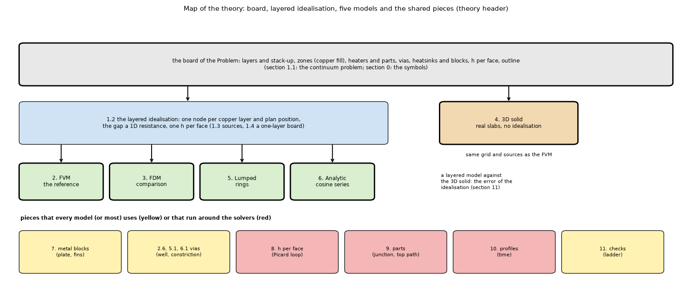

*Figure 38 (`images/fig_38_document_map.png`): the board of the Problem is idealised in layers (section 1.2) for the FVM, FDM, Lumped and Analytic models; the 3D solid builds real slabs from the same board. Underneath, the pieces that the models share (metal blocks, vias (section 1.5), the heat transfer coefficients and their loop, parts, profiles) and the verification (section 11). Schematic, no numbers.*

**Where each part lives in the code, and where it is checked**

| Section | Module | Investigation (`research/`) | `models.md` | `validation.md` |
| :-- | :-- | :-- | :-- | :-- |
| 1 description, geometry, laminate, via | `model.py`, `geometry.py`, `laminate.py`, `viaconstriction.py` | `effective-conductivity`, `laminate-nodes`, `bare-spot-under-source`, `rotated-square-3d`, `outline`, `stackup`, `lumped-analytic-vias` | 1, 2.4.1, 9, 12 | 3, 12, 14, 18, 21, 22, 23 |
| 2 FVM (and the via on the grid) | `fvm.py`, `viawell.py` | `point-via-convergence`, `sor-with-via-couplings`, `young-omega-tiles`, `models-comparison` | 2.1 | 2, 5, 7, 18 |
| 3 FDM | `fdm.py` | `models-comparison`, `point-via-convergence` | 2.2 | 2, 18 |
| 4 3D solid | `solid3d.py` | `solid3d-verification` | 2.7 | 3, 16 |
| 5 Lumped | `lumped.py`, `viaconstriction.py` | `lumped-analytic-vias`, `lumped-via-groups`, `lumped-zones-adoption` | 2.3 | 3, 17, 18.1, 18.2, 21 |
| 6 Analytic | `analytic.py`, `viaconstriction.py` | `analytic-partial-copper`, `lumped-analytic-vias`, `young-omega-tiles` | 2.4 | 3, 4, 13, 18.1 |
| 7 metal blocks | `blocks.py`, `checks.py` (used by `fvm.py`, `fdm.py`, `solid3d.py`, `lumped.py`, `analytic.py`) | `block-and-fins`, `fin-channel`, `fin-channel-sources`, `effective-conductivity` | 2.6, 4b, 15 | 12 D, 15, 17, 22, 24 |
| 8 heat transfer coefficients | `convection.py`, `api.py` (fixed-point loop) | `horizontal-plate-h`, `plate-h-level`, `effective-conductivity` | 5, 18 | 8, 22 |
| 9 parts | `analysis.py` (`heater_stats`, `part_split`), `api.py` (power coefficient, top-path split) | `component-heatsink` | 6, 13 | 9, 19 |
| 10 power profiles | `profiles.py`, `profile_io.py` | | 4 | 7 |
| 11 verification | `tests/`, `research/` | `theory`, `models-comparison` | | all |

## 0. Symbols

Only the symbols used in more than one section are listed; the others are defined where they appear. A symbol of this table has one meaning in the whole document; the standard letters of the convection correlations (`g` gravity, `β` the expansion coefficient of the air in a Rayleigh number, `σ` the Stefan-Boltzmann constant) and the residual `g(P_b)` of section 9.1 are local to their sections and defined there.

| Symbol | Meaning | Unit |
| :-- | :-- | :-- |
| `W, H_b, t_pcb` | board width, height and total thickness | m |
| `N_L` | number of copper layers (layer 1 = top) | – |
| `t_cu,l`, `slab_l` | copper thickness of layer `l`; thickness represented by its node (copper plus half of each adjacent gap, in both stack-ups) | m |
| `d`, `d_j` | thickness of a dielectric gap (gap `j` in the advanced stack-up) | m |
| `f` | copper fill: area fraction of a cell that is copper | – |
| `k_cu, k_ip, k_th` | conductivity of copper, of FR-4 in the plane and through the thickness (385, 0.9, 0.3 W/mK by default) | W/mK |
| `ρc` | volumetric heat capacity | J/m³K |
| `Δx, Δy` | cell size | m |
| `c`, `c_b` | cover of a cell by a polygon (zone, heatsink, block); by the board | – |
| `S` | sheet (in-plane) conductance of a layer: the conductance of a square | W/K |
| `g` | conductance per area between two adjacent layers, `k_th/d` | W/m²K |
| `G` | conductance between two nodes | W/K |
| `A_via`, `G_via` | copper cross-section of a via barrel; its conductance across one gap, `k_cu A_via/(d + 0.5 t_bar)` (2.7b) | m², W/K |
| `h`, `h_top`, `h_bottom`, `h_side`, `h_extra` | heat transfer coefficient of a face (convection plus radiation); top, bottom and edge faces; extra coefficient under a plain heatsink | W/m²K |
| `R''` | interface resistance per area (`t/k` of a paste or pad) | m²K/W |
| `P, Q, q` | power of a heater (W), source vector (W per node), power density (W/m²) | |
| `θ`, `T`, `T_amb` | temperature rise, temperature, ambient | K, °C |
| `K`, `C` | conductance matrix (W/K) and heat capacity vector (J/K) of a network | |
| `ϑ` | parameter of the theta method | – |
| `λ_l` | fin length of layer `l`, `√(S_l/g_loss)` | m |
| `Θ_part`, `Tj` | junction-to-pad resistance of a part (K/W) and junction temperature (°C) | |
| `r_v`, `r_t`, `a` | drill radius of a via; target radius `r_t = e^(−1/4) r_v` of its sink (also written `a`) | m |
| `R_K` | constriction (Krogh-cell) resistance of a via on a plane, eq. (1.8) | K/W |
| `I₀, I₁, K₀` | modified Bessel functions (always with their index) | |

## 1. The physical description

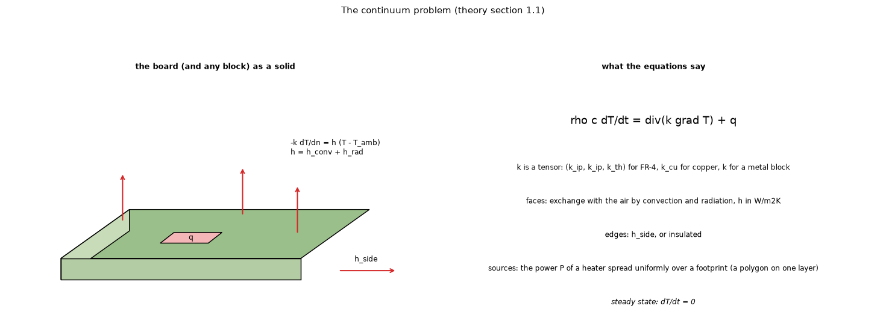

*Figure 20 (`images/fig_20_continuum.png`): the board (and any block) as a solid with the heater as a power over a footprint, the exchange with the air on every face, the edges and the equation.*

### 1.1 The continuum problem

Heat conduction in the board (and in any metal block) is

    ρc ∂T/∂t = ∇·(k ∇T) + q                                                      (1.1)

with `k` a tensor (diagonal: `k_ip, k_ip, k_th` for FR-4, `k_cu` for copper, `k` for a metal block). Every outer face exchanges heat with the air, `−k ∂T/∂n = h (T − T_amb)` with `h = h_conv + h_rad`; the board edges use `h_side` (or are insulated). The sources are the heaters: a power `P` spread **uniformly over a footprint** (a polygon on one layer). In steady state `∂T/∂t = 0`. Section 4 (the 3D solid) solves this problem directly; sections 2, 3, 5 and 6 solve its layered idealisation.

### 1.2 The layered idealisation (FVM, FDM, Lumped, Analytic)

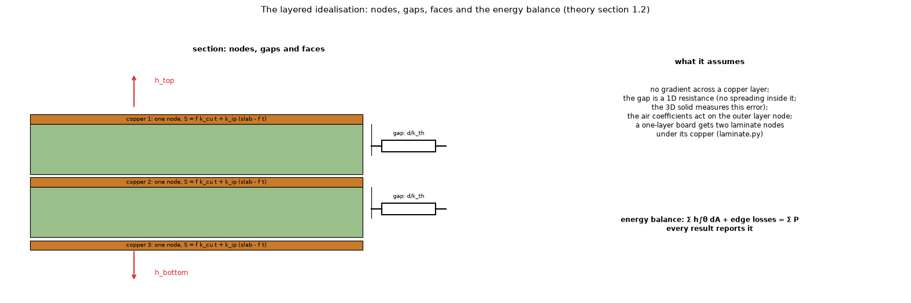

*Figure 1 (`images/fig_01_layered_idealisation.png`): a section of the board as the layered models see it. Each copper layer is one node (one temperature per plan position) with a sheet conductance; the dielectric gap between two layers is a one-dimensional resistance `d/k_th` (cut into laminate nodes where copper is absent, section 1.4); the outer layers exchange heat with the air through `h_top` and `h_bottom`.*

A PCB is a stack of very thin, highly conducting copper layers separated by poorly conducting dielectric. Across the 35 µm of copper the Biot number is `h t_cu / k_cu ≈ 10⁻⁷` and the conduction resistance `t_cu/k_cu ≈ 10⁻⁷ m²K/W` is four orders of magnitude below that of a dielectric gap (`d/k_th ≈ 5·10⁻⁴ m²K/W`), so each copper layer is **isothermal across its thickness**. The model therefore keeps **one temperature per layer and plan position**, `θ_l(x, y)`:

* **In-plane (lateral) conduction** of layer `l` is carried by copper and by the FR-4 in the same slab, in parallel:

      S_l(x,y) = f · k_cu · t_cu,l + k_ip · (slab_l − f · t_cu,l)                  [W/K]       (1.2)

  (`slab_l − f t_cu,l` is the FR-4 left in the slab of the layer). The heat flux per unit length is `−S ∇θ`.
* **Vertical conduction** between layers `l` and `l+1` acts through the dielectric gap, a one-dimensional resistance, `g = k_th / d` [W/m²K] (1.3). Where a via crosses the gap the barrel acts in parallel (a via connects **all** layers):

      G_via = k_cu · A_via / (d + 0.5 t_bar)        A_via = π[(D/2)² − (D/2 − t_plating)²] + (k_fill/k_cu) π (D/2 − t_plating)²      (1.4)
  with `D` the **drill** diameter; the fill is an open barrel (`k_fill = 0`), epoxy resin (0.3 W/mK), conductive paste (8) or electroplated copper, for which `A_via = π(D/2)²`. How the barrel couples to the plane temperatures is section 1.5. The TI application note [TI-AN2020] (page 4, R) prints the barrel resistance of a one-via example, 261 °C/W (drill radius 6 mil, plating 0.00175 cm, length 0.165 cm, copper 4 W/cmK), and (1.4) reproduces it to 0.06 % (plating inside the drill radius; `research/theory-sources` 9.4). The barrel is longer than the gap by half the mean thickness `t_bar` of the two copper layers around it (the nodes are at the mid-planes; the measured effective extra length, section 2.6, equation 2.7b).
* **Ambient exchange**: the top layer loses `h_top` and the bottom layer `h_bottom` per unit area (a one-layer board: `h_bottom` on its last laminate node, section 1.4); a plain heatsink adds `h_extra` over its polygon; an edge cell of a layer loses `h_side · (edge length) · slab` through the board edge.
* **Heat capacity per area** of a layer: `c_l = f ρc_cu t_cu,l + (slab_l − f t_cu,l) ρc_fr4`.

The layer equation (steady) is the **multilayer fin equation**

    ∇·(S_l ∇θ_l) − h_l θ_l − Σ_{n = l±1} g (θ_l − θ_n) = −q_l                       (1)

with `h_l` nonzero only on the outer layers and `q_l` the heater power density on its layer. Transient: add `c_l ∂θ_l/∂t` on the left.

**1.2.1 The advanced stack-up** (`Board.dielectrics`, one entry per gap). Gap `j`, between layers `j` and `j+1`, has its own `d_j`, `k_th,j`, `k_ip,j` and `ρc_j`, and `g_j = k_th,j / d_j`.
* The node of layer `l` stands for its copper plus half of each adjacent gap, `slab_l = t_cu,l + d_{l−1}/2 + d_l/2`, so the slabs add up to the board thickness; its laminate takes the thickness-weighted `k_ip` and `ρc` of the two half gaps.
* A gap of several sheets (`combine_sheets`) is one gap: `k_th = Σt_i / Σ(t_i/k_th,i)` (in series through it), `k_ip = Σ t_i k_ip,i / Σ t_i` (side by side along it).
* The simple stack-up (`dielectrics = None`) has the same slabs (copper plus half of each gap) and equal gaps, so it equals the advanced stack-up with equal gaps bit for bit (until 2.6.x it had `slab = t_pcb/N_L`, which for three or more layers gave the outer copper nodes more laminate than their half gap and, at a cooled edge, an edge film of too much laminate at the copper temperature: `validation.md` 43). A heavier inner copper keeps every `d_j`, so the board grows by `Σ (t_cu,l' − t_cu,l)` (`models.md` 12).

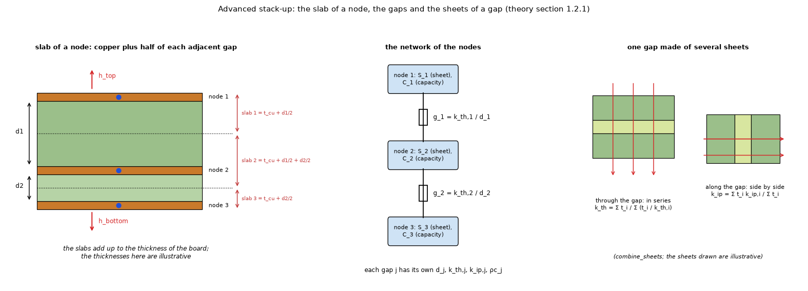

*Figure 39 (`images/fig_39_stackup_slabs.png`): left, three copper layers and two gaps of different thickness (illustrative): the node of a layer represents its copper plus half of each adjacent gap, so the slabs add up to the board thickness; middle, the network the nodes make, with `g_j = k_th,j / d_j` per gap; right, a gap made of several sheets: in series through the gap, side by side along it (`combine_sheets`).*

**Energy balance**: integrating (1) over the board (all internal exchanges cancel) gives `Σ h_l ∫θ_l dA + ∫ edge losses = Σ P`: the heat leaving by every path equals the power injected. Every result reports this balance.

**Limits of the idealisation.** The 3D solid (section 4) measures their sum, the **model error**, on any board.
* A layer has no gradient through its thickness: its one temperature is the mean, and the face under a source is hotter by at most `q'' t / (2 k)`, negligible for copper (section 7.5 for thick plates).
* A gap is a 1D resistance, with no spreading inside it.
* The film acts on the outer node itself; the half copper layer in between, `t_cu/(2k)`, is 5·10⁻⁷ of `1/h` for 35 µm at 10 W/m²K and is neglected (over bare laminate, 6·10⁻⁴, section 1.4 adds it).
* The stack is **not** replaced by an averaged conductivity: any such mean (series, parallel, geometric, harmonic) can be 70 % to 300 % off, through spreading and the order of the layers [CulhamYovanovich1998].
**Where it is checked**: `validation.md` 3 (the 3D solid), 12 (advanced against simple stack-up), 14.1 (inner copper), 22.1 (published coupon cases, `research/effective-conductivity/`).

### 1.3 Sources and geometry

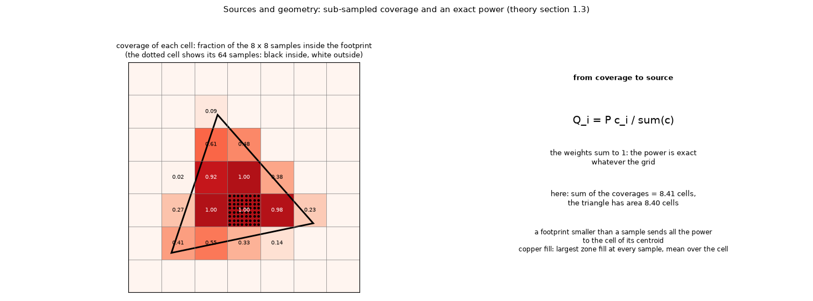

*Figure 21 (`images/fig_21_coverage.png`): a triangular footprint on a grid of cells; each cell is sampled on an 8 x 8 lattice and its coverage is the fraction of samples inside the polygon (computed here); the sum of the coverages times the cell area is the area of the triangle only to the sampling error of the lattice, and the power is exact because the weights are normalised to sum to 1 (1.5).*

#### 1.3.1 Rasterisation

A footprint polygon is rasterised on the grid by **sub-sampling**: every cell is sampled on an `s × s` lattice (`s = 8` for a heater on a rectangular board and for the sampled fallback of 1.3.2 (on a board with an outline the heater weights are exact areas), 4 for zones, heatsinks and blocks on the plan grid, 8 for a plain heatsink on the tiles of the Analytic correction; the Lumped finds the footprint of ring 0 with 4), and the fraction of samples inside the polygon (even-odd ray test) is the **coverage** `c ∈ [0,1]` of the cell. A heater's source vector is

    Q_i = P c_i / Σ c                                                            (1.5)

so the power is **exact** whatever the grid (the weights sum to 1); if the footprint is smaller than a sample, all the power goes to the cell (or node) of the centroid. The copper fill of a cell is the **union of the zones of its layer taken at every sample**: each of the `4 × 4` samples gets the largest `fill` of the zones that contain it, and `f` is the mean over the samples (`geometry.zone_fill`). Overlapping zones are therefore not added, and two zones that meet inside a cell both keep their copper (a maximum per cell would keep only the larger half); a self-intersecting polygon is warned.

#### 1.3.2 A part across the board outline (FVM, FDM and 3D solid; `geometry.part_weights`)

A cell cut by the outline has only a fraction `c_b` of board in it, and a part may cover only some of that board. Neither is sampled: the **board cover** of a cell is the exact area of the outline polygon in it (`geometry.exact_coverage`, used by `Board.cover` for the FVM and the 3D solid and, averaged on the four cells around a node, by the FDM), and the weight of a cell in the heating of a part is the exact area of the part **on the board** in it over the cell area,

    c_i = A(part ∩ outline ∩ cell_i) / A(cell_i) = (A(part ∩ outline ∩ cell_i) / A(outline ∩ cell_i)) · c_b                (1.6)

(the second form is the density rule: the share of the board part of the cell that the part covers, times the board cover the model gives the cell; with exact areas the two are the same number, which a sampled lattice can only approximate). `Q_i = P c_i / Σ c` as in (1.5), so the power stays exact and the power density on the board part of the cut cell is that of the part in the share it really covers. Without an outline `c_i` is the plain coverage, sampled 8 x 8 (`geometry.coverage_fraction` with `BOARD_SAMPLES`; the ring of `ψJB` uses 4 x 4).

*Exact areas without clipping every cell.* The part is clipped to the outline once (Sutherland-Hodgman, `geometry._part_on_board`: a convex part clips the outline, or a convex outline clips the part; when both are concave the part is first cut into triangles by ear clipping, `geometry._triangulate`, and each triangle clips the outline; a concave outline cut by a convex piece may leave zero-width bridges, which have no area). The area of a polygon in every cell of the grid then follows from column sums. For a polygon traversed once, the length of the vertical section that lies inside it between two horizontal grid lines `Y_k` is the sum over the edges that the vertical line crosses of `± (clamp(y_e(x), Y_k, Y_{k+1}) − Y_k)`, the sign being that of the direction of the edge; integrated over a grid column, the cell areas are the differences along `k` of `Φ_j(Y) = Σ_e s_e ∫ min(y_e(x), Y) dx` taken over the part of each edge inside column `j`, a piecewise linear function of `Y` per edge piece. A piece contributes `Y · width` below its lowest point and a constant above its highest point (both by cumulative sums over the grid lines) and an explicit trapezoid-minus-triangle value only on the grid lines it crosses, so the work is that of the cut cells, vectorised (a 200 mm board of 1000 vertices on a 0.25 mm grid: 7 ms, the sampled cover took 1.4 s). Cells whose area is within 1e-9 of 0 or 1 are snapped to them, so the cover is exactly the board mask where nothing is cut, and the cells below 0.01 are off the board as before. A polygon that crosses itself (read by the even-odd rule), or a concave part of more than 400 vertices on a concave outline, is not clipped; it keeps the sampled rule (`n_pb / n_b` of the 8 x 8 samples, times the cover of the model). The statistics of a result (mean and minimum under a heater or a zone, the ring of `ψJB`) are taken over the cells or nodes on the board only (the mask is the same exact cover); a cell off the board reads the ambient. Two simpler rules are wrong: the **product** `c_part · c_b` (right only when one of the two covers the whole cell) and an intersection counted on a lattice other than the one that gives `c_b`.

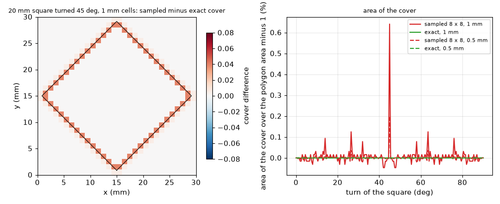

*Figure (`images/exact_board_cover.png`, `research/rotated-square-3d/figures/fig_17_exact_cover.png`): left, the cells of a 20 mm square turned 45 degrees at 1 mm coloured by the sampled 8 x 8 cover minus the exact one (an edge along a lattice direction of the samples reads too thick); right, the area of the cover over the polygon area for every turn, sampled and exact (the exact one is the polygon area to rounding).*

The two pictures below explain why the product and the plain intersection fail in a cut cell; they draw the sampled lattice for the idea (the shares they show are the exact ones in the program).

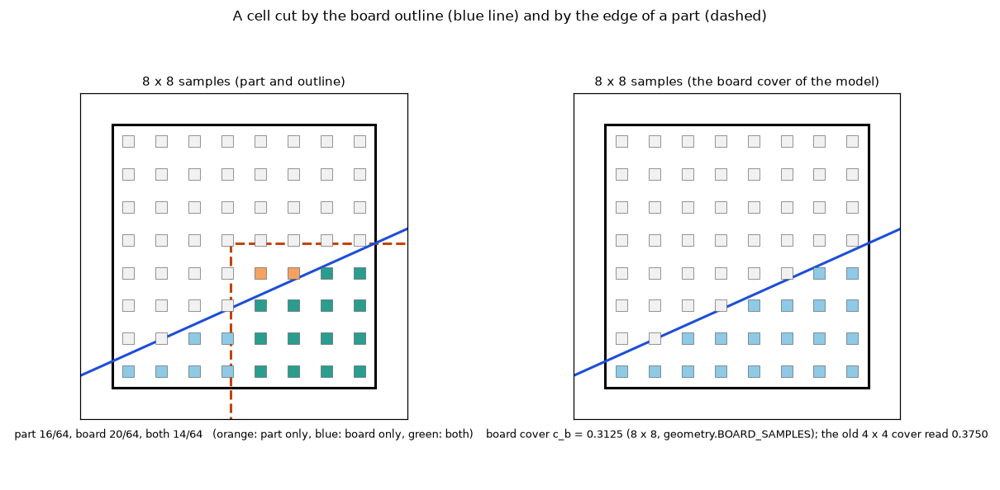

*Figure 34 (`images/fig_34_part_cut_cell.png`): a cell cut by the board outline (solid blue line) and by the edge of a part (dashed); left, the `8 × 8` samples coloured by what they lie in (orange: part only, blue: board only, green: both); right, the same samples counted as board only, from which the sampled rule took the board cover `c_b` (the program now takes the exact area).*

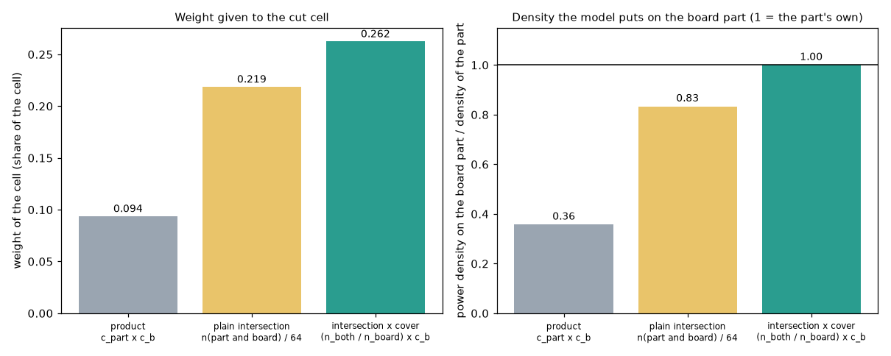

*Figure 35 (`images/fig_35_part_weight_rules.png`): the weight of that cell by the product of the covers, the plain intersection and the intersection normalised to the board cover (left), and the power density each puts on the board part of the cell relative to the density of the part (right; the correct value is 1).*

*Limit.* The exact cover fixed the volumes, the edge length and the weights, not the way a cut cell is joined to its neighbours and to the air: that is the cut-cell links and the edge film of 2.1.1 (the FVM; the FDM keeps the cover-scaled links, 0.65 K of scatter of the small T at 1 mm; the 3D solid joins its cut cells by the aperture of the shared face and the film at the outline, section 4 and `validation.md` 33). *Limits of a hostile outline* (`Board.validate`, `geometry.outline_crossings`): an outline is refused above 100 000 vertices (`OUTLINE_MAX_VERTICES`), above a total edge extent along x and y of 500 m (`OUTLINE_MAX_EXTENT`: `OUTLINE_MAX_CROSSINGS` = 10 million grid lines at the finest cell of 0.05 mm), above 20 million pairs of edges with overlapping boxes (`POLYGON_MAX_PAIRS`, the work of the self-crossing test) or with a coordinate that is not finite; a cell for which the edges would cross more than 10 million grid lines is refused by the cover, the apertures and the edge length (and announced by the live check); the closest-point distance of 2.1.1 uses at most 2 million pieces of the outline (`OUTLINE_MAX_PIECES`). These are bounds on the work, far above real outlines (tens to a few thousand vertices, at most 0.78 m of edges among the imports tried), not physics. **Where it is checked**: `validation.md` 23, 32 and 33 (`research/rotated-square-3d`, `research/cut-cell-links`, `research/outline`).

#### 1.3.3 A board with an outline in the Lumped and Analytic models

The FVM, FDM and 3D solid follow the outline with the cell cover `c_b`. The Lumped and Analytic models are rectangular (rings, cosine series), so they run on the rectangle of the same area (`Problem.equivalent_rectangle`): sides `sW` and `sH` with `s = √(A_outline/(W H_b))`, positions scaled `x → s x`, parts at their own size, and the field stretched back by `1/s`. This keeps the area (hence the total `h A`) and the aspect ratio. A part near a cut corner or in a narrow arm has less board to spread into than the rectangle gives, so it reads too cool (warned). No time simulation on an outline for these two models. **Where it is checked**: `validation.md` 13.

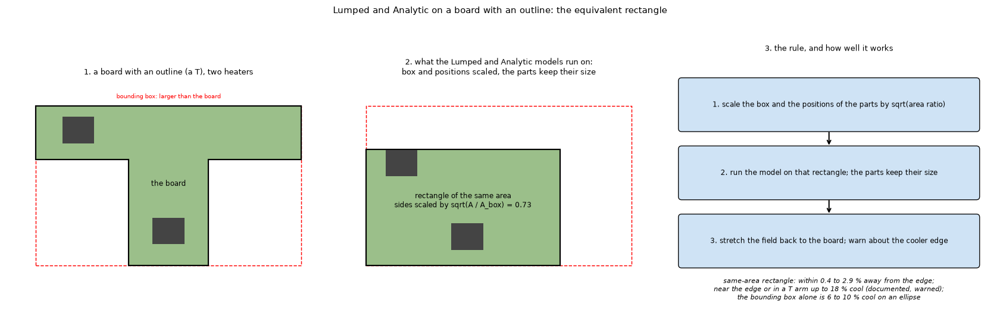

*Figure (`images/outline_equivalent_rectangle.png`, from `research/outline` figure 4): a T with two parts (left), the rectangle of the same area that the Lumped and Analytic models solve, anchored at the origin with the positions scaled by `s` and the parts at their own size (middle), and the three steps of the rule (right). The error figures in the last panel are those of the study when the figure was drawn; the program's are in `validation.md` 13.*

### 1.4 A one-layer board and the laminate nodes

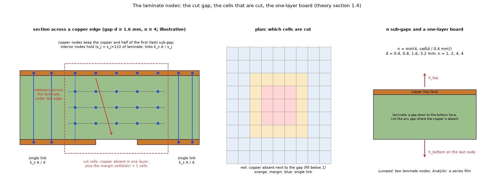

*Figure 44 (`images/fig_44_laminate_nodes.png`): left, a section across a copper edge: the gap between two copper nodes is cut into `n` sub-gaps (here `n = 4`) in the cells where copper is absent plus a margin, and is the single link `k_z A / d` elsewhere; middle, the plan of the cells that are cut; right, the rule for `n` and the one-layer board, whose laminate is a gap down to the bottom face. Illustrative proportions.*

**Why a gap is cut.** Where the copper next to a gap is absent, the laminate carries heat sideways inside the gap (under or beside a copper edge), which one link `g = k_th/d` cannot represent. With copper in every cell nothing is cut. A **one-layer board** has copper on the top face only: its laminate, `t_lam = slab − t_cu`, is a gap down to a bottom node that carries `h_bottom`.

**The rule (FVM and FDM, `laminate.py`).** A gap of thickness `d` between two copper nodes is cut into

    n = min(n_max, ⌈d / s_max⌉)      equal sub-gaps s_j = d / n,      s_max = 0.4 mm,  n_max = 4 (defaults)          (1.7)

(1, 2, 4, 4 sub-gaps for gaps of 0.4, 0.8, 1.6, 3.2 mm at the defaults; `s_max` (0.05 to 5 mm) and `n_max` (an integer, 1 to 16; 1 turns the cutting off) are options of the run, `SolverOptions.laminate_s_max_mm` and `laminate_n_max`, applied with `laminate.using()`. A larger `n_max` alone changes nothing when `s_max` already gives `n_max` sub-gaps: 8 sub-gaps of a 1.6 mm gap need `s_max ≤ 0.19 mm`, 16 need `s_max ≤ 0.09 mm`), **only in the cells where the copper fill of either adjacent layer is below 1, plus a margin of `⌈d/Δx⌉ + 1` cells** (Euclidean distance); every other cell keeps the single link `G = k_th A / d` of section 2. The rule is not applied on a board with a metal block (single links; a one-layer board keeps the two nodes of the next paragraph). In a cut cell:

* the copper nodes keep their copper and half of the adjacent sub-gap; the `n − 1` interior nodes hold `(s_j + s_{j+1})/2` of laminate each (lateral conductance `k_ip` and capacity `ρc` times that thickness); consecutive nodes are joined by `G = k_th A / s_j`. Every copper node holds exactly half of each adjacent gap in both stack-ups (1.2.1), so the moves always fit; the code still scales the moves of a node that would hold less (the simple stack-up of three or more layers did until 2.6.x, `t_pcb/N_L − t_cu`), so no capacity or conductance is created;
* the laminate that takes the place of absent copper lengthens the path, `d → d + (1 − f_a) t_a/2 + (1 − f_b) t_b/2`, split between the first and last sub-gap (or whole in the single link of a bare cell outside the mask);
* the error against a resolved 3D solver falls as `1/n`.

**The band along the board edge** (FVM and FDM, with an edge coefficient `h_side > 0`, two or more copper layers, a gap that is cut). The edge of a cell stands for the film `h_side · slab · L` of its whole slab, and a node that holds the copper and half of each adjacent gap puts that film at the copper temperature. The laminate at the edge is cooler than the copper (it is fed through `k_th`), so with copper in every cell, where nothing is cut, the film is overstated and the board reads cold: against a converged 3D solver −15.2 % of the hottest rise on a 3.2 mm two-layer board at 200 W/m²K (−2.8 % on 0.8 mm), flat in the cell, and up to −42 % at 2000 W/m²K. The fix is the same cut as above in a **band along the edge**: the cells (nodes) that touch the edge (the border of a rectangle, the cells an outline crosses: `edge_length_on_board > 0`) grown by the same margin `⌈d/Δx⌉ + 1` cells carry the `n − 1` interior nodes even over full copper (`laminate.edge_band`, ORed into `GapPlan.flagged` by `plan_gaps(..., edge=)`), so the edge film acts on the laminate nodes. The interior laminate nodes get the film behind half a cell of laminate, `g' = g/(1 + h_side Δx/(2 k_ip))`, by the cut-cell film of the FVM (section 2.1: `Network._cut_edge_film`, which runs after the laminate rule on every node layer, so nothing is added for the band); the FDM, whose node lies on the edge, has no such term. The band is not used without an edge coefficient (`h_side` None or 0: bit for bit the earlier plan), on a one-layer board or with a metal block. Its width does not matter from one gap thickness on (within 0.5 point of the rise between a margin of one gap thickness and the program's). What is left is the `1/n` error of the four sub-gaps, which grows with `h_side`: at most −2.3 % (FVM) and −2.6 % (FDM) of the rise at 200 W/m²K or less (2-layer boards of 0.8 to 3.2 mm, cells 1 to 0.25 mm), −5.5 % at 500 W/m²K and −16 % at 2000 W/m²K on 3.2 mm with four sub-gaps; the program warns above 200 W/m²K (`checks.check_edge_laminate`). On a 1.6 mm four-layer board with 0.49 mm gaps (two sub-gaps) the hottest rise reads −0.4 / −1.4 / −3.2 / −6.0 % at 200 / 500 / 1000 / 2000 W/m²K and 0.25 mm against an independent finite-element solution (a different method from the program, not the cell-centred 3D reference, which reads 0.3 to 1.7 % hot at its cell), and eight sub-gaps read hot there, +0.6 / +1.6 / +2.2 / +2.6 %, because the half-cell film of a cell wider than the sub-gap over-corrects, so the default and eight sub-gaps at a finer cell bracket the truth (`validation.md` 43.2, 44 and 46; a sample, not a bound). On a 0.8 mm board at 2000 W/m²K with a cell larger than the gap and eight sub-gaps the half-cell film over-corrects (+7 % at a 1 mm cell). A board in air has `h_side` of 5 to 50 W/m²K, where the band is enough. The 3D solid, the Lumped and the Analytic are not changed. The Lumped and the Analytic have no laminate nodes, so they keep the edge film at the copper temperature, as the FVM did before the band, and read cool: against the same converged 3D solver the Analytic is −1.2 % (50 W/m²K) and −5.2 % (200 W/m²K) on a 60 × 40 mm, 1.6 mm board with a corner part, where the FVM with the band is −0.2 and −0.6 % at 0.5 mm, and −15.2 % on the 3.2 mm board at 200 W/m²K; the program warns for these two models when `h_side` times the thickness in mm reaches 150 W/m²K·mm (`checks.check_reduced_edge_laminate`; `validation.md` 36.3). The band also changes the transient of a part over it: its copper node holds half a sub-gap of laminate instead of half the gap, so its early response is faster (closer to a resolved laminate; one node per copper layer understates the swing of a fast wave, `validation.md` 36.3).

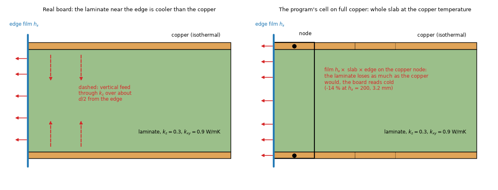

*Figure (`images/laminate_edge_band_section.png`, from `research/laminate-edge-band`, figure 01): a section at the board edge; the laminate loses heat through the edge film at a temperature below the copper's, which one node per copper layer cannot show.*

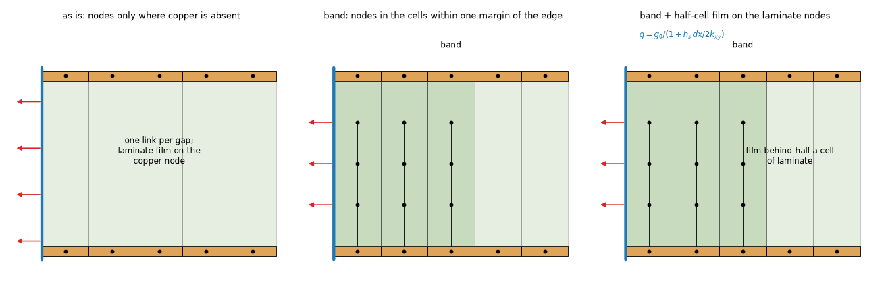

*Figure (`images/laminate_edge_band_cells.png`, from `research/laminate-edge-band`, figure 03): the plan of the cells that carry the interior nodes (the border cells grown by the margin) and the half-cell film of an interior node.*

**The face value of a part.** A part on an outer layer injects its heat at its node, at mid-thickness of the copper layer. Where the copper is absent, the half layer of laminate between the node and the face adds `Q t_cu/(2 k_th A)` to the peak (scaled by `min(1, (1 − f) Δx/(4 t_cu))` for a bare feature narrower than four copper thicknesses) and the bare share `(1 − f)` of it to the mean (`laminate.face_terms`).

**The limit of the rule: a small part over a thick laminate** (`research/paper-case-studies` 16.3; FVM at 0.25 mm against the closed form of Muzychka, Yovanovich and Culham for a source on a thick orthotropic laminate and an extrapolated independent 3D solver under a copper pad). The cut gap is still a stack of `n` nodes, so a source smaller than the sub-gap `s = d/n` is spread too little and the layered FVM and FDM read it too cool. The error follows the ratio `s / w_p` of the sub-gap to the smaller side `w_p` of the part, whatever option pair set `s`:

| `s / w_p` | bare laminate | copper pad under the part |
| :-- | :-- | :-- |
| 0.01 to 0.05 | -2.0 to +0.6 % | -4.0 to +1.9 % |
| 0.07 to 0.10 | -4.8 to -0.8 % | -8.6 to -1.1 % |
| 0.15 to 0.20 | -9.3 to -3.6 % | -13.8 to -6.1 % |
| 0.31 to 0.39 | -20.2 to -11.5 % | -24.0 to -14.2 % |
| 0.78 | -33 % | -35 % |

With the defaults `s` is 0.4 mm up to a 1.6 mm gap and `d/4` above, so the ratio passes 0.15 for a part narrower than about 2.5 mm on a 1.6 mm board and 5.2 mm on a 3.2 mm board, only where the cells under the part are cut (no plane on the other side). A smaller `s_max` or a larger `n_max` reduces it at a cost: `(0.2 mm, 8)` takes 1.4 to 4.6 times the time and 1.2 to 3 times the memory on the boards measured and still leaves -6 / -9 % in the worst case (2 mm part on 3.2 mm); `(0.1 mm, 16)` takes up to 40 times the time and 14 times the memory. The program warns (`checks.check_small_part_laminate`, text only) when `s > 0.15 w_p` on bare laminate and `s > 0.10 w_p` over copper, where `w_p` is the side through which the heat enters the laminate: the part's smaller side on bare laminate, the part grown by the copper around it on its own layer otherwise (the review measured a 2 mm part on a 3 or 4 mm pad at the error of a 3 or 4 mm part on its own pad, and a part under a plane on its layer at 0.02 %, so a plane there is silent). The pad limit is lower because over a pad the error is larger at the same ratio: measured by the review on the rise of the part in air (20 mm two-layer board, h 10 / 15 W/m²K, FVM at 0.25 mm against the FVM extrapolated in its sub-gaps), bare -3.4 % at `s/w_p` 0.14 and -4.1 to -4.3 % at 0.16, over a pad of the part's size -4.3 to -4.8 % at 0.08 to 0.09, -5.4 % at 0.10 and -6.3 to -7.4 % at 0.12 to 0.14 (that reference converges at an order near 1 under a pad, so these pad numbers carry about 1.5 points of uncertainty; against the 16 sub-gap run they are 1.3 to 2.3 points smaller). With the defaults the pad limit fires under about 3.8 mm on 1.6 mm and 7.8 mm on 3.2 mm. A rule that cuts the gap finer only under and around small parts is planned (`docs/versions.md`, chapter 'Planned').

**One coefficient per face.** The computed convection coefficient is one number per face from the mean face temperature. On a thin board of low in-plane conductance with concentrated sources (the glass plate of Lee and Yovanovich, `research/paper-case-studies` 12 and 16.6) this reads the mean temperature of the strips 10.3 % above the conjugate solution (8.6 points from the single coefficient), on the safe side; on the ceramic plate it is 2.0 % below.

**A one-layer board in the other models.**
* **Lumped**, and FVM/FDM with a **metal block**: two laminate nodes under the copper in every cell (`laminate.LAMINATE_NODES = 2`, gaps `t_lam/2`), one link per gap.
* **Analytic**: one node, with the laminate in series with the bottom film, `h_bottom → 1/(1/h_bottom + t_lam/k_th)` (`laminate.series_bottom_problem`).
* **3D solid**: FR-4 slabs of at most 0.2 mm, 4 to 16 of them for a laminate of 0.8 mm and more (section 4); a part reads the centre of its top slab and, over absent copper, the face term of section 1.4 is added to it.

For a uniform board heated all over every treatment is exact, `θ = P / (A (h_top + 1/(1/h_bottom + t_lam/k_th)))`; the partial-copper limits of the Lumped and Analytic are in `validation.md` 21.

**Solving the cut network.** The cycle `a(i) − b(i) − b(j) − [n links] − a(j) − a(i)` of the two copper nodes of neighbouring cells has length `n + 3`, odd for every even `n`, so the nodes cannot be two-coloured and the point red-black SOR does not apply; the SOR relaxes each plan column as a block (section 2.3).

**Where it is checked**: `validation.md` 21 and 21.2 (against an independent 3D solver, `research/laminate-nodes`, `research/bare-spot-under-source`, `research/gap-subdivision`; `tests/test_laminate.py`, `tests/test_laminate_rule.py`) and, for the edge band, `validation.md` 36 (`research/laminate-edge-band`; `tests/test_laminate_edge_band.py`). **Sources**: [CulhamYovanovich1998]; the series and parallel sums of the layered board are those of [Muzychka2004Orthotropic] (R, equations 39, 40); the rule is derived and checked in the repository (L).

### 1.5 The via (all models)

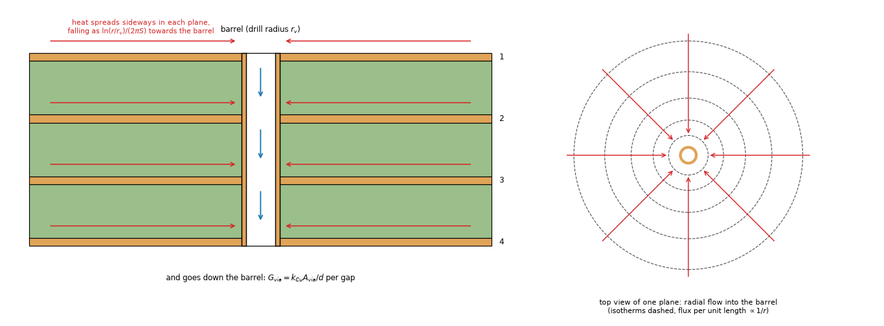

*Figure (`images/via_section_and_flux.png`): a via in section; the heat of each copper plane flows sideways to the barrel (the constriction) and down the barrel through the gaps.*

**The cause.** A via joins all the copper layers through its barrel, `G_via` per gap (1.4). A model carries one temperature per plane and region (a cell, a ring, a tile), the area mean; the barrel sees the copper at its wall, which is cooler, because the heat of the plane converges on the small disc of the barrel. The difference is the **constriction resistance**, in series with the barrel in every plane; leaving it out overstates the via effect. Where each model puts it:
* FVM and FDM: a footprint of cells with a mean-potential coupling and a Peaceman well (section 2.6);
* Lumped: a well in each ring (section 5.1);
* Analytic: a self-term of its tiles (section 6.1);
* 3D solid: a footprint tuned to the target radius of eq. (1.9) (section 4).

**The Krogh cell.** A sink disc of radius `a` at the centre of a circular cell of radius `R`, a uniform source over the annulus and an insulated rim (the Wigner-Seitz cell of a lattice of vias), on a sheet of conductance `S`. The mean temperature of the annulus above the temperature at the wall, per watt taken by the sink, is

    R_K(S, R, a) = (1/(2 π S)) [ ξ⁴ ln ξ/(ξ² − 1)² − ξ²/(2 (ξ² − 1)) − 1/4 ],        ξ = R/a      (1.8)

which tends to `(ln ξ − 3/4)/(2 π S)` for large `ξ`. The closed form is an own derivation (L) checked numerically against a finite-difference cell solver and an axisymmetric solve, and to 10⁻¹² (3·10⁻¹⁶ measured) against a direct integration of the annulus for `R/a` = 3, 10 and 50 (`research/theory-sources` 9.4); it is the mathematics of the pseudo-steady-state well equation of reservoir engineering [Dietz1965] (S), and the Krogh cylinder [Krogh1919] (M) is the same cell.

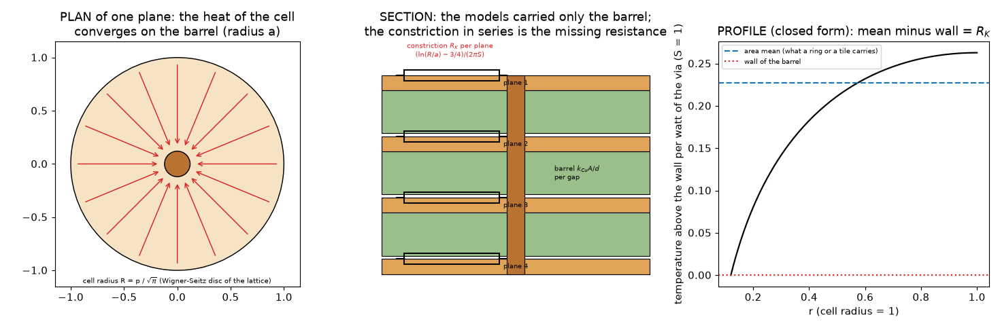

*Figure (`images/via_constriction_krogh_cell.png`): left, the plan of one plane: the heat of a cell converges on the barrel; middle, the section: the constriction `R_K` of each plane is in series with the barrel of each gap; right, the profile of the temperature above the wall in the cell (closed form, `S = 1`): the area mean (what a ring or a tile carries) is above the wall by `R_K`.*

**The target radius.** The layered idealisation spreads the barrel uniformly over its disc, and the mean potential of a uniform disc is that of a circle of `e^(−1/4)` times its radius, so the sink radius used everywhere is

    a = r_t = e^(−1/4) r_v = 0.78 r_v                                                    (1.9)

(`viawell.TARGET_RATIO`). It is one value that is close on average against an axisymmetric 3D solve with the barrel drawn, not the radius of a real barrel (`research/point-via-convergence`, `validation.md` 18).

**Limits.** A lone via is the weak case of every reduced model: its effect depends on where it falls in the grid, ring or tile. A published numerical case that tests the closed form itself was not reproduced; the case of [Fish2017] (chapter 6; the formulation of chapter 7 was read too) tests the microspreading of via cells and was reproduced. The via unit (barrel, pad, pattern) of [ShenWang2019Vias] (R, pages 1 to 17) is the published case quoted in `validation.md` 18; its CFD number was not reproduced. **Where it is checked**: `validation.md` 18 and 18.1; `research/lumped-analytic-vias`, `research/lumped-via-groups`, `research/young-omega-tiles`, `research/point-via-convergence`.

### 1.6 The Gerber reader: sampling the copper (`pcbthermal/gerber/`)

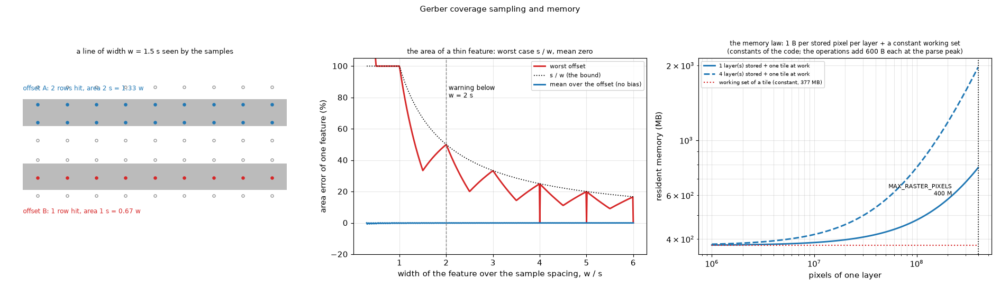

*Figure 47 (`images/fig_47_gerber_sampling.png`): left, a line of width 1.5 s against the lattice of sample centres at two offsets (two rows hit, then one); middle, the area error of one feature against its width over the sample spacing, worst offset against the bound s/w, and the mean over the offset; right, the resident memory of the rasteriser against the pixels of a layer for one and four layers, with the constant working set of a tile and the 400 M pixel limit. Computed in the script from the constants of the code, not from a run: illustrative of the shape.*

The reader turns the copper of a Gerber layer into the **coverage** of a pixel grid, one byte per pixel (0 to 255, the fraction of the pixel that is copper), which the program later averages into the cells of the plan grid. The geometry is exact vector geometry (flashes, strokes, regions, macro primitives with their holes); only the last step samples it.

**Sampling.** A pixel of side `p` is divided into `m x m` sub-pixels (`m` = 4 by default, `DEFAULT_SUPERSAMPLE`), the sample spacing is `s = p / m`, and a sub-pixel is copper when its **centre** lies inside a dark object and outside a later clear one (polarity applied in file order). The pixel byte is the share of copper sub-pixels. For a feature of width `w` that is wider than `s`, the number of sample rows that fall inside it is the integer part or that plus one of `w / s`, so the area counted is `n s` with `n` equal to one of these two integers: the **error of one feature is at most `s / w`** of its area (50 % for `w = 2 s`, 100 % below `s`, zero for `w` a whole multiple of `s`). Over the offsets of the lattice the mean of `n s` is exactly `w`, so there is **no bias**: many features, or one feature at many positions, average to the true area, and the area error of a whole layer is small even when a single thin line is badly sampled (middle panel). The consequence the reader enforces is a rule on the **pixel**: `suggest_pixel_mm` proposes `p = m w_min / 2` (a sample spacing of half the thinnest feature, so that the worst feature is hit by at least two rows), and `check_sample_spacing` warns when the thinnest feature of a layer is narrower than two spacings (a feature of one to two spacings can be drawn by a single row, up to nearly 100 % off; a warning only below one spacing would have left that range silent).

**Arcs.** An arc (G02/G03, single or multi quadrant) is cut into `n` equal chords, each spanning the angle `2 arccos(1 - 0.005 mm / R)` at most, so that the largest distance between a chord and the arc is `ARC_TOLERANCE = 0.005 mm` (`parser.arc_points`; an arc of radius below the tolerance uses steps of 45 degrees). For a full circle cut into chords of central angle `t`, the sagitta is `e = R (1 - cos(t/2)) ~ R t^2 / 8` and the inscribed polygon has the area `(n/2) R^2 sin t`, so its relative deficit is `1 - sin(t)/t ~ t^2 / 6 = (4/3) e / R` at the largest chord (a numerical check with `e = 0.005 mm`, R = 1, 5 and 50 mm gives 1.28, 1.30 and 1.32 times `e / R`, the whole number of chords rounding `t` down); for `R = 5 mm` that is 0.13 % of the circle area, and the agreement with the exact vector areas is checked by the conformance tests. **Deviation on purpose:** the reader resets the interpolation mode to G01 at the end of a region (G37), as the example of Ucamco's own reference files needs, whereas the 2026.05 specification keeps the mode [UcamcoGerber] (R); a file that relies on G02/G03 persisting after G37 would draw a straight segment (`models.md` 19).

**The outline.** The profile layer is a chain of strokes whose centre line is the cut. Endpoints closer than 0.01 mm are joined; each joint must connect exactly two segments, otherwise the contour is open, branched or touching itself and the reader refuses with the joint coordinates and the gap (nothing is guessed). The closed loops are nested by the **even-odd rule**: a loop inside a board is a cut-out, a loop inside a cut-out is another board (a panel).

**The memory law.** The raster is built in tiles of 2048 x 2048 sub-pixels, one layer at a time. The resident bytes are the sum of three terms: **1 byte per stored pixel per layer** (the coverage that is kept), a **working set per tile** of about 90 bytes per sub-pixel (the boolean canvas, the float coordinate grids and the temporaries of the largest stroke) that is constant once the tile is full and is capped near 377 MB (`WORKING_BYTES_PER_SUBPIXEL x TILE_SUBPIXELS^2`), and **600 bytes per drawing operation** at the parse peak (`BYTES_PER_OP`, a margin of two over the 200 to 290 bytes per operation measured on 300 000 operations). Two limits keep a hostile file bounded: `MAX_RASTER_PIXELS = 400 000 000` per layer and `MAX_OPERATIONS = 2 000 000` per layer.

**Tolerances of the reader** (general, not per CAD tool; each one named in the file's warnings or refusals). Excellon: `G93X0Y0` (Xpedition NC drill) is the identity and is accepted when every given coordinate is zero, any other offset and a bare `G93` are refused with the message of the origin shift; `M71` / `M72` take an optional `,TZ` / `,LZ` suffix (not in the Excellon or XNC specifications) that gives the unit; it is read as in `METRIC,TZ` only for coordinates with a decimal point, a coordinate without one after such a suffix is refused (its value would depend on a guess of the suffix, and a wrong guess moves every hole by a power of ten), and the zeros of a `METRIC,TZ` header win over it; a lone `%` line before `M48` (PADS, Fritzing) is skipped by the detector and the reader; a drill file with no `M48` and no unit (Allegro writes the tool sizes as comments) is refused with a message that names the cause (2.6.0 at the earliest). Gerber: a macro name that is not `[_a-zA-Z$][_a-zA-Z0-9]*` (hyphen, dot) is accepted when the `AM` and `AD` texts agree exactly, with one warning per name in `Layer.warnings` (the name cut to 40 printable characters; the warnings of the copper layers go into the record of the import) (the name is only a key, so a wrong reading is impossible: the macro is found or the file is refused as before); `%MIA1B0*%` (image mirror) is still refused. The layer-function detector gives a name rule at most LOW confidence (`LayerFunction.confidence`: "high" for X2 and the Excellon header); a name with `resist`, or with a side word and `solder` or `sm`, is a mask (`solder` alone stays unknown: EAGLE's solder side is the bottom copper), `past` is paste, `asb`, `ast`, `asm`, `assembly`, `fab` and `symbol` (also as the pcb-rnd extensions `.asb`, `.ast`, `.fab`) are another layer, and a file whose head is not Gerber (a placement table, a PDF, a log, a project file) is never copper by its name; numbered copper names (`Layer1` ... `Layer4`) are ordered over the set (`detect_set`: lowest top, highest bottom, the rest inner) when no top or bottom is known; a file with a Gerber head that strokes and flashes nothing is a drawing of the holes ("other"), never an Excellon drill file.

**CAD profiles (which program wrote the files; `pcbthermal/gerber/profiles.py`, table `pcbthermal/data/cad_profiles.json`).** A profile is a bundle of defaults, never an authority, and no model depends on it: it changes only which layer function is *proposed* for a file the file does not describe itself. The order of trust for a file is: the user's assignment of the file; the X2 `TF.FileFunction`; the Excellon header; the content rules (a non-Gerber head is never copper, a Gerber drawing is never a drill file); **the name rules of the profile**; the generic name rules; ask. The user's choice of a profile replaces only the profile tier, never X2 or the header. Detection reads only the names and the first 8 kB of each file (the caller reads them; no I/O in the module) and applies markers with a weight: 9 or more is decisive (the file names its generator or carries a quirk only that tool writes), 4 to 8 a convention, 1 to 3 shared (the Protel extensions are shared by a dozen programs). Confidence: *high* (decisive markers of one eCAD program; a variant such as CircuitMaker wins over its parent Altium), *mixed* (decisive markers of two programs: the one with more files is proposed, to confirm), *medium* (no decisive marker, at least one marker in the content of a file and the weights add to 5 or more: shown as "Probably", flagged), *low* (names alone, whatever their weights: the profile is not applied), *declared* (a generic X2 `TF.GenerationSoftware` names a program the table does not know: shown, generic rules), *unknown*. A CAM tool (CAM350, UcamX) never overrides an eCAD profile and is reported as a re-export (beside an eCAD program, the line says that files were re-exported and asks for a check). Safety: every pattern is bounded, so the work is linear in the 8 kB head (a test with adversarial heads keeps it); the text matched in a file is never kept or shown, because some banners hold a path, a user and a computer name: only marker ids, file counts and a version or declared generator cut to 40 printable characters without markup are shown or saved. **The sign of the X of a bottom-side placement file is never preset by a profile**: it is detected from the paste openings (`parts.bottom_convention`), because two KiCad 5.1 boards write opposite conventions. Only tools with real sample files have a profile (fifteen eCAD programs are recognised and tested on 1 to 18 sample sets each; Xpedition on 8 sets of one output template; Target 3001 on 1 set, by its `.Info` file; Fritzing and Upverter on 1 set each, "probably"); the name rules of PADS and EAGLE are from memory and marked so. **Where it is checked**: `tests/test_cad_profiles.py` (26 banners made from real ones with the private text replaced; the held-out check on the research samples, 54 of 54 development and 28 of 28 held-out sets, runs when `PCBT_GERBER_SAMPLES` is set). **Sources**: own and measured, `research/gerber-cad-profiles` (README 3 to 6 and the review in 10); the formats of the banners were read in the sample files, no vendor document was opened (the name rules of PADS and EAGLE are M in the table).

**File size.** One Gerber, drill or ZIP member above `gerber.max_file_mb` (Preferences, 256 MB shipped, range 16 to 4096, a machine setting that is not saved in a project) is refused from its size before it is read (`limits.check_path`; the readers take an optional `max_bytes`), and the read itself takes at most the limit plus one byte (`limits.read_text`), so a pipe or a file whose size is not reported cannot pass it either. A real file is 0.01 to 2 MB. The decoded text of a file takes about twice its size in memory (the bytes, then the string), and the parser's blocks come on top of it; this is not part of the 600 bytes per operation, which does not count the file text.

**Limits.** The coverage is a sample, not an exact area: a feature below two spacings is warned, not corrected. The 90 bytes per sub-pixel and the 200 to 290 bytes per operation were measured on one machine (the repository holds only the check that the traced peak of a rasterised 100 x 80 mm layer stays under the working estimate, `tests/test_gerber_reader.py::test_working_memory_of_the_rasteriser_stays_under_its_estimate`, and the estimate arithmetic, `test_memory_estimate_grows_with_pixels_and_layers_and_holds_one_byte_per_pixel`; the per-operation figures and the 433 MB resident peak of CO60 at 0.05 mm (78 MB of it the interpreter) are noted in the comments of `pcbthermal/gerber/raster.py` and no script of the repository reproduces them; the later review measured +284 MB against an estimate of 406 MB for CO60 and +281 against 393 for ISASTM at 0.05 mm, again outside the repository). Conformance against exact vector areas is in `validation.md` and `docs/models.md` 'Gerber reader'.

**Where it is checked**: `tests/test_gerber_reader.py`, `test_gerber_spec.py`, `test_gerber_conformance.py`, `test_gerber_drill_outline.py`, `test_gerber_detect_archive.py`. **Sources**: [UcamcoGerber] (R in part: the passages listed in the table of section 12); the sampling error `s / w` and the memory law are derived and measured in the repository (L).

### 1.7 Imported copper: from a mask to the conductances of the grid (`copper.py`)

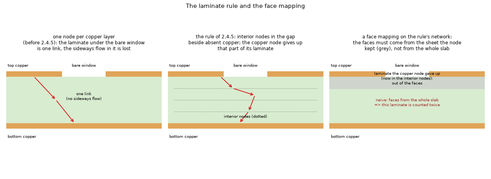

*Figure (`images/imported_copper_reduced_sheet.png`): left, one node per copper layer loses the sideways flow in the laminate beside a bare window; middle, the laminate rule of §1.4 puts interior nodes there and the copper node gives up that part of its laminate; right, the faces of an imported layer must be computed from the sheet the node kept (grey part out), not from the whole slab (the same laminate counted twice).*

A real board is a coverage mask per copper layer (§1.6), not a polygon with a fill. The arithmetic fill of a cell, `f = mean(mask)`, gives the sheet conductance `S = f k_cu t_cu + k_lam (slab - f t_cu)` (§1.2), which is the PARALLEL mixture of copper and laminate and is the upper Wiener bound of the cell in conduction. A real track network conducts through the copper in series where it is cut, so the fill reads thin copper too cool (10 to 30 % in the study). The flow-based mapping takes the conductance of the pixels themselves.

**The pixel sheet.** For a pixel of coverage `c`: `s = b + c (a - b)`, with `a = k_cu t_cu + k_lam (slab - t_cu)` the sheet with copper and `b = k_lam slab` the bare one (the program's two-phase formula, per pixel).

**The faces** (`face_conductances`). The cell grid is `n x n` pixels per cell (`n` even). For two neighbouring cells the window is the `n x n` block of pixels between the two cell centres: a unit potential on its left face, zero on the right face, the top and bottom insulated, half-pixel links to the faces (so a uniform window gives exactly its `S`), the harmonic mean of two pixels as the link between them. The flux is the face conductance in W/K; the same for the faces along `y` with the window turned. Many windows are solved together as one block-diagonal sparse system. A cell that is not square scales the faces by `dy/dx` and `dx/dy`. The `lambda` mapping replaces the local solve by the geometric mean of the Wiener bounds of the cell along each axis, joined by the harmonic mean of the two cells.

**Order of construction (part of the design).** (1) The network is built from the cell fill, so the laminate rule of §1.4 plans its interior laminate nodes on the real copper fraction of each cell and moves `dS` (a sheet conductance) out of the copper node of the flagged cells. (2) `dS` is taken off EVERY pixel of the cell, copper or bare, because the node no longer carries that laminate: `s' = max(s - dS, 0)`, times the board cover of the cell. (3) The faces are computed from `s'`. Faces from `s` count the laminate twice in the flagged cells (the figure) and are worse than the rule off: in the study with the rule on, the faces on the reduced sheet were closer to the 3D reference than the fill in every one of the real windows. The vertical coupling between the layers and the copper heat capacity come from the cell fill by the program's formulas, the rule included.

**A board with an outline (FVM).** The pixel sheet is multiplied by the exact share of the pixel on the board (`exact_coverage` on the pixel grid) and the faces of the two-neighbour windows are computed on it; a window whose end cell has its centre off the board (an electrode of zero sheet, the cell would be isolated) takes the faces of the unmasked pixels times the open fraction of the shared face (the aperture of §2.1.1), which equals the drawn board's link for full copper. The edge film is in series with the conduction to the outline as in 2.1.1, with the distance `d_c = max(distance from the centroid of the board part of the cell to the closest outline point, 0)` instead of the signed distance from the cell centre (the centroid is the exact 8 x 8 cover refined, `geometry.cover_centroids`; a whole cell has it at its centre); the drawn layers take it too (2.1.1). The argument is geometric, not a proof; the laminate nodes of the rule take the same distance, whatever the layers next to them. Where this is checked: `validation.md` 38, 39 and 40.

**FDM.** The windows are centred on the nodes (the plan grid padded by half a cell by mirroring at the board edge), and the faces of the edge rows are half (the control volume of an edge node is half a cell wide).

**Sampling, not averaging.** A cell is almost never a whole number of raster pixels. Averaging the raster onto the `n x n` grid turns every pixel that a copper edge crosses into a partial coverage, and the two-phase sheet of a partial pixel is the parallel mixture, so a clearance of two or three pixels between two copper areas becomes a bridge of half copper and the faces read cool. `sample_coverage` reads the raster at the centres of a grid at least as fine as the raster (nearest neighbour), which keeps the topology of tracks and clearances (a feature moves by at most one output pixel); the cell fill (vertical links, capacity) stays the box average (`resample_coverage`). A raster finer than 24 pixels per cell is averaged down to it (`MAX_PIXELS_PER_CELL`). The import draws the masks at the pixel `min(m w_min / 4, cell / 10)` (`copper.import_copper`; a sample spacing of a quarter of the thinnest feature, half the spacing that the reader alone proposes in section 1.6, and at least ten pixels per cell); fewer than 8 pixels per cell in the face problems is warned (`COARSE_RASTER_PIXELS`).

**Limits.** The face problems cannot resolve copper finer than their pixel; the copper inside a cell larger than a few pixels per feature is represented by two numbers per face; the faces are for the in-plane flow, the vertical links stay those of the fill (the vias are the program's). The Lumped and Analytic models read the copper as the average fill of a cell, so a pad or a neck smaller than the cell is invisible to them, and they read too cool, by a sample and not a bound (25 and 17 % at least, up to 82 and 77 %, on 42 parts of three imported boards at a 0.5 mm cell; 1 to 16 % on 24 mm windows with a 6 mm part; `docs/validation.md` 27.7). **Where it is checked**: `tests/test_imported_copper.py` (simple boards with a known answer, real windows, the 3D reference, the order of construction, unaligned cells, hostile masks), `docs/validation.md` 27. **Sources**: the transmissibility upscaling is the method of reservoir simulation (known from memory, M; no source of it was opened); the study that chose it is `research/gerber-real-boards` 4.1 and 10 (against the program's pixel network and the independent 3D solver `tests/helpers/layered3d.py`, nothing compared with a physical board).

### 1.8 Parts from the files: the envelope rule, the frame and the shape (`pcbthermal/gerber/parts.py`, `components.py`)

A part is the heat source of the model: a polygon on the board and a power. The files give its place (the openings of the solder-paste layer, the X3 component layer) and its name (`TO.C`, the placement file). No equation of heat enters here; this section says what the program assumes when it links the three.

**Envelope rule.** For a part with footprint name `f`, position `c` and angle `theta`, the pad envelope is the rectangle `E(f)` of the pads in the local frame, taken from the name (a table of passives 0402 to 1206, SOIC pins and pitch, SOT-223, pin headers, QFN size). An opening with centre `o` belongs to the part when `R(-theta)(o - c)` lies inside `E(f)` grown by `tau` = 0.3 mm; of several candidates the one with the smallest envelope wins, and one part takes all its openings. A bottom part uses the top footprint turned over: the local x changes sign before the rotation (2026 specification, p. 166). The assumption is that the name determines the pad pattern; it does not for a footprint outside the table (guessed) or for a custom one.

**Frame.** If the placement file is shifted by `d` from the Gerber origin, the score `M(d)` is the number of SMD parts with a known envelope whose openings fall inside the shifted envelope (`N_p` such parts). The offset is the centre of the plateau of the best score on a 0.5 mm grid over +-10 mm, refined on 0.1 mm; it is proposed when it raises `M/N_p` by 0.1 and by two parts, reaches 0.8 and is at least 0.5 mm long (thresholds measured on four real boards: 36 shifts between 1 and 9.7 mm found within 0.05 mm, no proposal at 20 mm). Below 0.5 of the parts with an opening and no proposal, the files are said not to fit.

**Heat-source shape.** The polygon is a choice, not a measurement: the convex hull of the openings (default), their box, or for an X3 part the first available of exposed pad, Body, Lead2Lead, paste hull, Footprint, Courtyard, pin hull. The power is spread uniformly over it, as for a drawn part (section 1.3); the hull differs from the box by -0.8 to +6.0 % in area on the studied boards. Exception to the hull: an **exposed pad or a tab** is proposed instead of the hull when the paste has one: the **dominant group** `G` of the openings, those with an area of at least `EXPOSED_MIN_AREA` = 0.5 of the largest, when `G` is not all the openings, holds at least `EXPOSED_MIN_PASTE` = 0.25 of the paste area, its hull is at most `EXPOSED_MAX_HULL` = 0.75 of the hull of the part, its openings fill at least `EXPOSED_MIN_FILL` = 0.5 of its own hull and no gap between them (the longest link of the minimum spanning tree of their boxes) is wider than `EXPOSED_MAX_GAP` = 0.5 times the side of the largest opening (`parts.dominant_group`); the shape is then the hull of `G` (`exposed`), otherwise the hull of all the openings. A QFN or DFN with an exposed pad (the pad is several windows of paste), a SOT-223 or a DPAK (the tab) qualify; a SOIC, a SOT-23, a passive, a crystal and a connector (whose mounting pads hold most of the paste but span the part, or sit apart at its two ends) do not. The whole power goes on the pad, with theta = theta_JC(bottom) of the datasheet, which is defined to it (the worst-case convention of the program: the few per cent that the leads carry are left out). **Why**: the die of these packages sits on the pad; the hull spreads the power over a mould body that touches the board only through the pad and the leads, and reads the hottest point 11 to 44 % too cool (1 W, FVM at 0.5 mm; RP2040 QFN-56 +37.4 %, its SOT-223 +44.3 %, ISASTM SOT-223 +18.8 %, the QFN-24 and QFN-28 +12.7 and +13.1 %); on a JEDEC 2s2p board with the TPS7A47 the heater on the exposed pad gives 31.9 K/W against 32.5 on the datasheet, on the 5 mm body 40.0 and on the body with the leads 45.1. For parts without a dominant pad the hull, the box, the pad envelope and the openings by area agree within -6 to +9 %, so the hull stays. **What this rests on**: eleven parts of three open KiCad boards compared in the program's own FVM (not a physical board, not Altium or other exports), and one datasheet case (re-run by the review: 31.9 / 40.0 / 45.1 K/W at a 1 mm cell), and the rule was checked on every part of eight open boards (RP2040, ISASTM, CMM2, oswlight, co60, StickHub X3, Ucamco X3 coldfire and li-ion; 875 parts with a polygon; `validation.md` 29.3; how the thresholds were set is in `versions.md`): the 14 parts taken are all exposed pads or tabs (QFN, SOT-223, DPAK, D2PAK, exposed-pad TSSOP: fill 0.70 to 1.00, gap at most 0.25, hull at most 0.62) and no other part is; the nearest miss is a micro-USB with three mounting pads (fill 0.59, gap 0.66). No SOT-89, power SO-8 or LGA with a thermal pad was among the parts. The thinnest margin is the RP2040 QFN-56, whose paste share is 0.32 against the line of 0.25. **The pad polygon and the other fields of a part**: θ is θJC(bottom), Tj = hottest point under the pad + θ P (as for a drawn part, `docs/calculators.md` 2.1 uses the 3.15 mm pad of the same JEDEC case); the ψJB ring (0.5 to 1.5 mm outside the polygon) and the interface area of the top path (`interface / A` with A the polygon unless `contact_area` is set) are then those of the pad, inside the package: both on the safe side (the ring reads the leads, hotter; the interface is a smaller area, more resistance). The paste windows are inset in the copper pad (RP2040: 5.5 against 10.2 mm2), so the hull of the windows reads 0.6 to 8.9 % hotter than the pad of the footprint name: conservative. `largest` (the hull of the largest opening) is right only for a single tab; with several equal pads it puts all the heat on one pad (+22 to +299 %). The tests hold the table of the eleven parts and the list of the parts taken on the eight boards (`tests/test_exposed_pad.py`); the table of the shapes, the JEDEC case and the margin study are `docs/validation.md` 29. A margin around the shape (a larger heat source reads cooler, 0 to -22 % on the exposed pads) is not in the program: the default is 0 and the modes are planned (`docs/versions.md`, 'Planned').

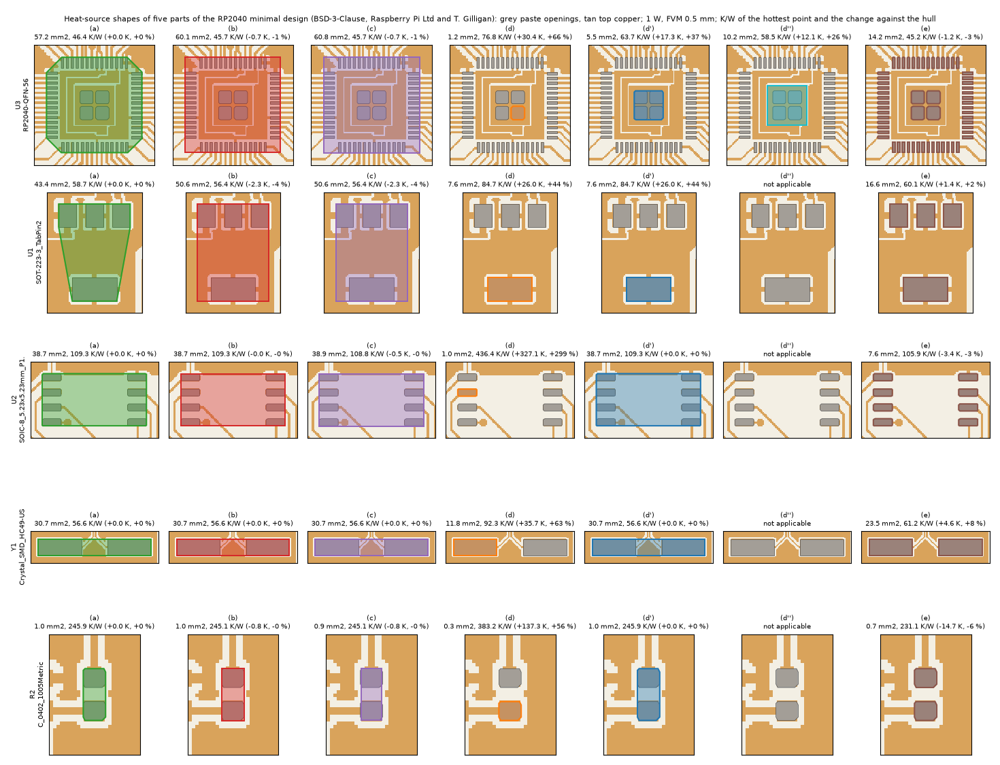

*Figure (`images/heater_shapes_rp2040.png`, from `research/gerber-real-boards/figures/fig_22_heater_shapes_rp2040.png`): five parts of the RP2040 minimal design (BSD-3-Clause, Raspberry Pi Ltd and Tommy Gilligan) with the heat-source shapes of the study, filled, over the top copper (tan) and the paste openings (grey); above each panel the area, the hottest point in K/W and the change against the hull.*

**Limits.** The rule is geometric, not thermal: a wrong designator gives the right polygon with the wrong power, silently, beyond a placement error of about 1 mm; a part that is not SMD (through-hole, press-fit) dissipates through its leads and has no polygon here. **Where it is checked**: `tests/test_gerber_parts.py`, `tests/test_gerber_components.py`; evidence `research/gerber-real-boards` 9 to 12 (real boards). **Sources**: [UcamcoGerber] (the passages of the component layer and the bottom side, read in part, see section 12); the envelope table and the thresholds are own and measured, with no other source.

## 2. FVM: cell-centred finite volumes (the reference)

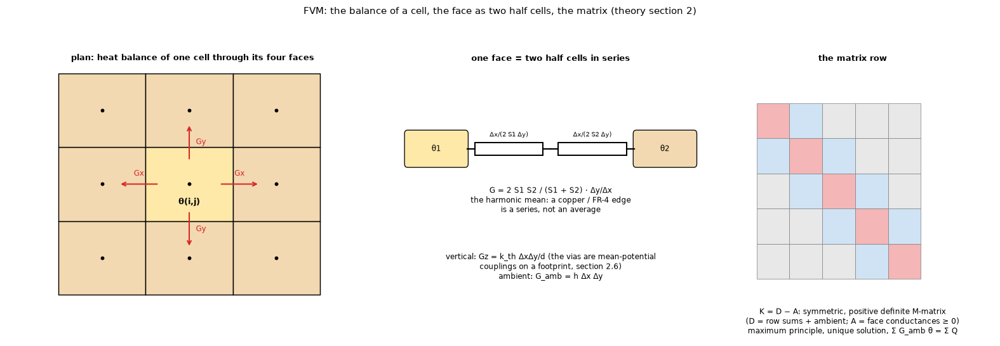

*Figure 2 (`images/fig_02_fvm_cell.png`): left, the heat balance of one cell through its four faces; middle, one face as two half cells in series, which gives the harmonic mean of the two sheet conductances; right, the row of the matrix that the cell produces (a symmetric M-matrix).*

### 2.1 Unknowns and faces

**Unknown**: the mean temperature rise `θ_{l,i,j}` of the copper layer `l` in the cell `(i, j)` of size `Δx × Δy` (plan grid `nx × ny`, `Δx = W/nx`). The program integrates (1) over each cell and balances the heat through its faces, so the discrete energy balance is **exact in every cell**. The conductances (all in W/K):

* *Lateral*: between two neighbouring cells the heat crosses the two half cells in series, `R = Δx/(2 S₁ Δy) + Δx/(2 S₂ Δy)`, so with `S` of each cell

      G_x = (2 S₁ S₂ /(S₁ + S₂)) · Δy/Δx        G_y = (2 S₁ S₂ /(S₁ + S₂)) · Δx/Δy              (2.1)

  the **harmonic mean** of the two sheet conductances (a copper/FR-4 edge is a series, not an average); zero when both are zero [Patankar1980] (M). On a board with an outline `S` is the *physical* sheet and the link carries the open fraction of the shared face, `a` (2.1.1); `a = 1` between whole cells.
* *Vertical*, between layers `l` and `l+1` in a cell: `G_z = k_th Δx Δy / d` (the dielectric alone; in the cells where copper is absent next to the gap the gap is cut into laminate nodes, section 1.4). The barrel of a via is **not** added here: it is a mean-potential coupling of a footprint of cells (section 2.6).
* *Ambient*: `G_amb = (h_top or h_bottom) Δx Δy` on the outer layers, plus `h_extra Δx Δy c_hs` under a plain heatsink (`c_hs` its coverage), plus the edge film on edge cells, `g_side = H Δ_edge / (1 + H d / S)` with `H = h_side · slab` and `d` the distance from the node to the edge (2.1.1); under a metal block the board coefficient is multiplied by `1 − c` (section 7).
* *Outline* (`geometry.edge_length_on_board`, also used by the FDM and the 3D solid): `Δ_edge` is the length of the outline inside the cell. The outline is sampled at a tenth of a cell and every sample is moved a thousandth of a cell inwards, so a side lying on a grid line belongs to the cell on the board; length that falls in a cell off the board goes to the nearest cell on the board. `Σ Δ_edge` is then the perimeter wherever the polygon falls on the grid. Cells off the board are decoupled and pinned to the ambient by 1 W/K (`g_pin`): this keeps the matrix regular and is not a path to the air.

#### 2.1.1 Cut cells: the open-fraction link and the edge film in series (`fvm.Network._lateral_links`, `_cut_edge_film`; `geometry.face_apertures`, `signed_distance_to_outline`)

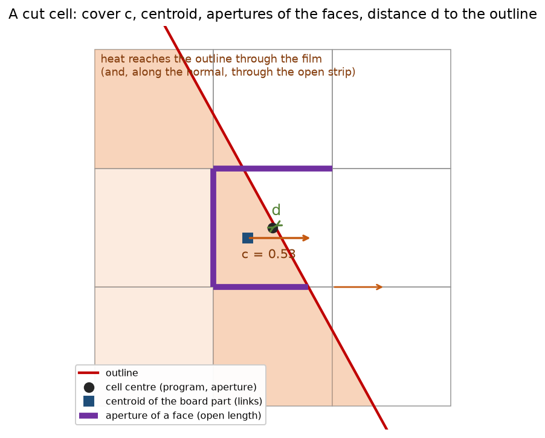

*Figure (`images/cut_cell_quantities.png`, `research/cut-cell-links/figures/fig_01`): a 3 x 3 patch cut by a slanted outline: the board part (shaded), the cover `c` of a cell, its centre (the node), the apertures of the faces (the open length of each face, thick) and the distance `d` from the centre to the closest outline point; the heat leaves the board through the film on the outline.*

A cell cut by the outline has the volume `c Δx Δy` (1.3.2) but its sides to the neighbours are open over a length `a Δ` that is *not* `c Δ`: the heat crosses the whole side that lies on the board. The earlier links scaled the sheet of a cut cell by `c` and took the harmonic mean, a factor about `c` too weak into a sliver; the edge film sat on the node, behind that weak link. The program now uses ([JohansenColella1998] eq. 15 to 16 (R) and [BarrettEtAl2022] eq. 10 to 14 (R), after [BochkovGibou2019] (R, read in the thesis chapter that holds it)):

    G_x = a_x · harmonic(S₁/c₁, S₂/c₂) · Δy/Δx        G_y = a_y · harmonic(S₁/c₁, S₂/c₂) · Δx/Δy           (2.1a)

with `S/c` the physical sheet of the cell and `a` the **aperture**: the fraction of the shared face that has board on both sides (`geometry.face_apertures`: the sorted crossings of the outline with every grid line, even-odd signs and prefix sums, the same signed construction that integrates the cover; 0.02 s for a 20 000-vertex outline on a 400 x 400 grid; a face that lies on an outline side has board on one side only, so `a = 0`; a face between two whole cells is exactly 1, so a rectangle, or an outline on the grid lines, gives the earlier links bit for bit; the edge film below changes on a rectangle too). The nodes stay at the cell centres. The edge film `H Δ_edge` (`H = h_side` times the slab) is put in series with the conduction from the node to the closest outline point (Robin condition at the closest boundary point: the symmetric scheme of [PapacEtAl2010] (N, cited through the thesis); eqs. 1.7, 1.13 and 1.14 of the thesis chapter that holds [BochkovGibou2019] (its numbering, not the paper's; the sign of `d` is opposite, positive outside), whose diagonal `μ α L / (μ − α d)` is the same expression; [BarrettEtAl2022] eq. 12 to 14; the thesis chapter that holds the 2019 paper was read in `research/bochkov-robin-check`, which also shows that the symmetric form chosen here has the same error as the non-symmetric one and keeps the symmetric LU). The ambient term is scaled with the same factor as the conductance (the change goes into `g_amb`), so a constant field is reproduced to round-off for any `h_side` (tested); the condition `μ − α d > 0` of Bochkov and Gibou fails for a node outside the board with a large cell Biot number, which the floor below covers:

    g_side = g₀ / max(1 + g₀ d / (S Δ_edge), 0.25) = H Δ_edge / max(1 + H d / S, 0.25)                     (2.1b)

`d` is, for every copper layer and every laminate node of a board with an outline (drawn or imported), the distance from the CENTROID of the board part of the cell to the closest outline point, never negative (`geometry.cover_centroids`, the exact 8 x 8 cover refined; `geometry.signed_distance_to_outline`): the unknown of a cut cell is the mean over its board part, which sits at the centroid, not at the cell centre, so a sliver cell whose centre is off the board has its node where its copper is and the film is no longer stiffened to the floor. A whole cell has the centroid at its centre, so the aligned board does not change. Only the layers of a metal block keep the cell centre. The centroid of a concave board part (a slot or reflex corner inside one cell) can lie off the board; its distance is then 0 (the series term of that cell is dropped), which changes the heater rise by under 0.3 % in a constructed worst case (a 0.6 mm slot centred in a 1 mm cell row, 200 to 5000 W/m2K). If the centroids cannot be read (the 8 times finer grid exceeds the crossing bound of a hostile outline) the cell-centre distance is used and a warning is logged. Before 2.7.0 the drawn layers used the signed distance from the cell centre (negative off the board); the argument and the measurements are in `validation.md` 39 and 40; limit: where the copper of a cut cell reaches the outline the film from the centroid is too weak, a first-order error on the hot side (+1 to +2 % of the rise against the converged program at 1 mm, about half at 0.5 mm, `validation.md` 40.5); on a rectangle the border cells use `d = Δx/2` (or `Δy/2`; a corner cell has two edges, each with its own `d`), so a rectangle and the same rectangle drawn as an outline give the same network when the cells are square (with `Δx ≠ Δy` the corner cell of the drawn outline takes the smaller half cell for both edges). `Δ_edge` cancels, so the formula needs only the distance. **The floor 0.25** is a rule of the program, not of the sources: it keeps `g_side` positive and at most four times the film alone where the denominator would vanish, which happens only for a node outside the board by more than `S/H` (bare-laminate nodes of a cut cell where the copper stops short of the outline, from about 1000 W/m²K at 1 mm; an edge coefficient beyond any physical film otherwise); with the copper 1.2 mm inside the outline of a turned square at 2000 W/m²K it binds in 80 node cells and the peak moves 0.06 K (0.25 to 0.05) and 0.15 K (0.25 to 0.5) of a 71 K rise (`validation.md` 32.3). Block layers keep the cover-scaled links; the vertical links, the via wells (they keep the cover-scaled sheet), the capacities and the sources are unchanged. The matrix keeps its size and pattern, stays symmetric, has no positive off-diagonal entry without vias and the heat balance closes (tests). The Lumped model, which never sees the links, reads the edge conductance without the series term (`cut_cells=False`). **Not covered**: a board with an outline and imported copper has the open-fraction links at the pixel level (1.7) and the series film from the centroid of the board part of the cell, not from the cell centre (1.7, `validation.md` 39); the FDM keeps the cover-scaled links and the film on the node; the 3D solid joins its copper and laminate slabs by the same apertures and puts its edge film at the closest outline point (section 4, eq. 4.2, `validation.md` 33).

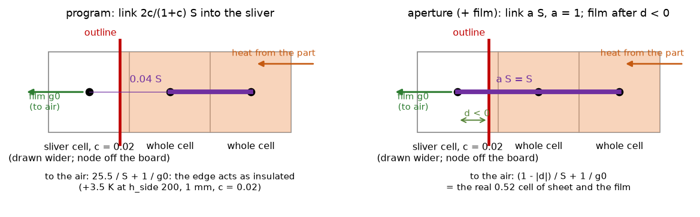

*Figure (`images/cut_cell_sliver_heat_path.png`, `research/cut-cell-links/figures/fig_06`): plan of an edge column whose board part is a sliver. With the cover-scaled link (left) the link into the sliver is about 0.04 S and the film on the sliver node is nearly cut off (the edge acts as insulated, and the peak jumped by +3.6 K at 200 W/m²K between the covers 0.01 and 0.02); with the aperture (right) the face is open (a = 1) and the film follows the real conduction to the edge.*

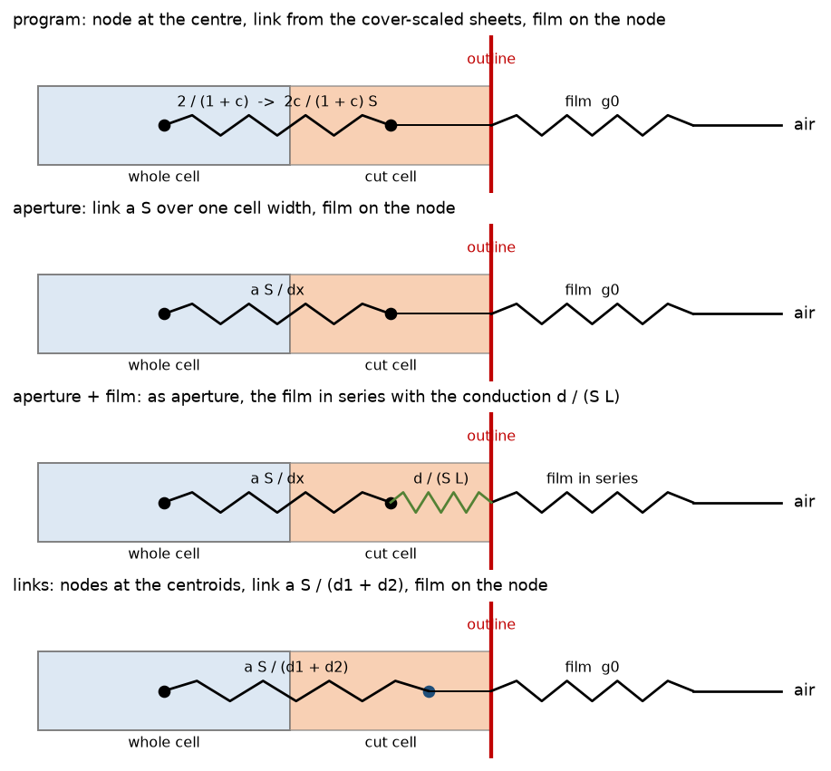

*Figure (`images/cut_cell_scheme_chains.png`, `research/cut-cell-links/figures/fig_02`): the chain of resistances along the normal to the outline for the earlier links, the aperture, and the aperture with the film in series (the scheme of the program); the fourth, centroid nodes, was not adopted.*

**Where it is checked**: `validation.md` 32 (the sliver curve, the spread over the position of the outline against an independent two-sheet solver, the disc, L and T, the frozen records) and `tests/test_cut_cell_links.py`.

### 2.2 The system

    K θ = Q,        K = D − N                                                    (2.2)

with `N` the symmetric matrix of the non-negative face conductances and `D` its row sums plus the ambient conductances (the SOR uses the same split). The row sums of `K` are the ambient conductances, hence `Σ G_amb θ = Σ Q` (energy balance).
* Without vias `K` is a symmetric positive definite **M-matrix** (diagonally dominant, strictly where there is an ambient path, and irreducible): the solution exists, is unique and obeys the maximum principle (`θ ≥ 0`).
* The via couplings (2.6) add symmetric positive semidefinite terms with zero row sums, positive off-diagonal entries inside a footprint. Where the face conductances do not cancel them `K` is no longer an M-matrix: it stays symmetric positive definite (unique solution, energy balance), but the maximum principle does not hold in general. Measured (`tests/test_maximum_principle.py`): 16 positive entries for the FVM and 64 for the FDM on the example board at 1 mm (largest 0.0183 of the diagonal of its row, both models), 832 / 864 at 0.5 mm and 3104 / 3872 at 0.25 mm under a dense 10 × 10 array of 0.3 mm vias (largest 0.74 (FVM) and 1.31 (FDM) times the diagonal at 0.5 mm, up to 2.2 at 0.25 mm, 0.32 to 0.59 of the sum of the negative entries of the row); on copper that covers the footprints the field has no cold spot around the vias. **Limit:** the via takes heat from each footprint cell in proportion to its fixed weight times the difference of the plane means, so on a plane whose copper covers only part of a footprint (a copper edge through the via, a track ending on it) cells that cannot supply that heat become a cold spot: 7.94 K at 0.5 mm and 14.43 K at 0.25 mm (5.49 K and 12.80 K on the 2.7.0 tree, with the rim uncoupling and the barrel length; audit re-run, `releases/2.7.0/research-audit`) under a 2 W part on a two-layer board (h = 10 W/m²K, the copper ending at the via centre; reproduced to the digit by `research/via-partial-copper`, which finds none at 1 mm and none in the FDM). The cold spot is a defect of the field, a numerical artefact of the fixed weights, not physics. The via effect on that board is 7.31 and 7.67 K in the FVM at 0.5 and 0.25 mm; against the 3D solid at 1/16 to 1/20 mm, which agree to 0.2 % on a copper edge, the FVM (cells 0.125 to 1 mm) reads the effect **31 to 47 % low** for a copper edge through the via, **45 to 68 % low** for a track ending on it, and **3 to 4 times high** for a via just outside a copper edge at a cell of 0.5 mm or coarser (the cell fill brings the copper onto the via): the effect is misread in both directions (`validation.md` 30.1, which also records the earlier comparisons that are withdrawn). Antipads (clearances around the barrel) are not a cause: no cold spot, 0.1 to 0.7 K of 44 to 64 K from sub-cell resolution. The program warns of the situation (`checks.check_via_partial_copper`: the smallest sheet conductance among the footprint cells that hold at least 5 % of the largest weight is below half the largest, in some copper layer; silent on the five frozen boards with vias and on antipads). Corrections measured on a copy, not adopted (`docs/versions.md` 'Planned'): weights by sheet conductance per layer (cold spot removed, copper-edge error −37 % to +5 %) or a star coupling (an M-matrix). No cold spot was found on full copper; in 50 random via layouts (FVM and FDM, 0.25 and 0.1 mm) no node went below the ambient at h = 10 to 50 W/m²K, and 3 of 100 runs did at h = 500 to 5000 W/m²K (by at most 0.2 % of the rise), a test that a cold spot well above the ambient does not reveal.

### 2.3 The linear solvers (`fvm.Network.solve_steady`, `solve_sor`)

* **Direct**: sparse LU (SuperLU) with the symmetric minimum-degree ordering (`MMD_AT_PLUS_A`) in SuperLU's **symmetric mode** (`diag_pivot_thresh = 0`, `SymmetricMode`; the setting of [LiSuperLU2005] section 3.2.2 and [SuperLUGuide] section 2.6 (R by image: a diagonal pivot threshold below 1, for example 0.0 or 0.01, with an `Aᵀ + A` column ordering and `options.SymmetricMode = YES`; section 2.5.2: a threshold of 0.0 means "use the diagonal pivot", and an off-diagonal pivot is still taken when a diagonal entry is below the threshold) for a matrix that is diagonally dominant or nearly so: a small diagonal pivot threshold with an `Aᵀ + A` ordering, pivots on the diagonal): K and the step matrices `C/dt + θK` are symmetric positive definite (also with the Kron-reduced via couplings, whose off-diagonals are positive but whose quadratic form stays positive), so the diagonal is a good pivot: the symmetric factor is an LDLᵀ in disguise, and all its pivots are positive on every board checked. The fill is the same as in the default mode; the default mode did not exchange rows either on the boards measured (its row and column permutations are equal), so its extra time and memory on via-dense boards (up to 50 times and 5 times) are SuperLU's pivot search and workspace, not a different factor. `fvm.lu_factor` checks a positive diagonal and symmetry to 1e-12, factorises, and keeps the factor only if a probe solve (`A x0 = b0` with a ramp `x0`) has a relative residual below 1e-8; otherwise, or if the factorisation raises, it falls back to the default mode and logs a warning. The relative residual `‖Kθ − Q‖/‖Q‖` of the field is reported.
* **Conjugate gradients** with a Jacobi (diagonal) preconditioner, tolerance 10⁻¹².
* **Red-black SOR**: `θ_new = (Σ G_m θ_m + Q)/D`, `θ ← θ + ω(θ_new − θ)`, stopped on the **residual** (10⁻⁹), not on the change of a sweep (a step criterion can stop far from the solution, `validation.md` 5).

**The relaxation factor** (`fvm.Network.sor_omega`). For a two-colourable network Young's relation gives the optimum

    ω_opt = 2/(1 + √(1 − ρ_J²))                                                  (2.3)

with `ρ_J` the spectral radius of the Jacobi matrix `D⁻¹N` [Saad2003] (Theorem 4.16, equation 4.47; the original is [Young1950] (N)). `ρ_J` is bounded from below by the Rayleigh quotient of the trial vector `D^{1/2}·1`, restricted to the nodes that have a link (the cells off an outline are decoupled and left out):

    ρ_J ≥ 1 − mᵀ K m / mᵀ D m,        ω = min(ω_opt(ρ_J), 1.999)                  (2.4)

one product with the full `K`, vias and footprints included. Being a lower bound, it gives an `ω` at or below the optimum, the safe side: below the optimum the sweeps grow slowly, above it steeply. With via blocks or laminate columns Young's relation does not hold (no two-colour ordering) and the factor is a safe-side heuristic, not a proved optimum. The proofs, the measurements and the comparison with the factor of a plate with fixed edges are in `research/young-omega-tiles` (README); the sweep counts (example board 2197 -> 676 at 1 mm, 1054 -> 364 at 2 mm, as measured at 2.4.5; the 2.7.0 tree prints 726 sweeps at 1 mm) are in `validation.md` 5 and 25, with the command that reproduces them.

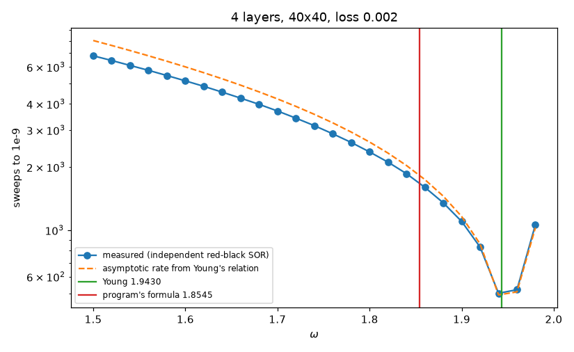

*Figure (`images/sor_sweeps_against_omega.png`): sweeps to a residual of 1e-9 against `ω` on a 4-layer 40 × 40 board (an independent red-black SOR, `research/young-omega-tiles`): the factor of a plate with fixed edges (red) is on the slow flank, Young's optimum (green) at the minimum.*

**Block SOR** (`fvm.Network.solve_sor`, `_sor_columns`). Two couplings are not seen by the six-neighbour point update:
* *Vias*: the cells of a footprint are coupled by the dense via blocks of `K`. After the two colours each group of via blocks that `K` does not couple (greedy colouring [Saad2003]) takes the exact solution of its block, `θ_B += ω K_BB⁻¹ (Q_B − K_B θ)`.
* *Laminate columns* (section 1.4): every plan cell is a block of all its nodes, the blocks (merged where a via footprint joins them) are coloured and each colour is solved exactly.

The point and the block SOR of a symmetric positive definite matrix converge for every `0 < ω < 2` ([Saad2003] Theorem 4.10 states the point case; the block case is the same argument for a block splitting). The dense inverse of a block costs about `75 n²` bytes (`memory.sor_block_bytes`: the dense block, its inverse, LAPACK's copy and the sparse form the iterations keep; 5 000 unknowns take about 1.9 GB, `validation.md` 26). The sum of `75 n²` over **all** the blocks must be at most 25 % of the memory limit of section 2.7 (`memory.sor_block_fits`; the inverses of all the blocks stay alive for the iterations); otherwise the board is solved with the direct solver and the result says so.

### 2.4 Time: the theta method

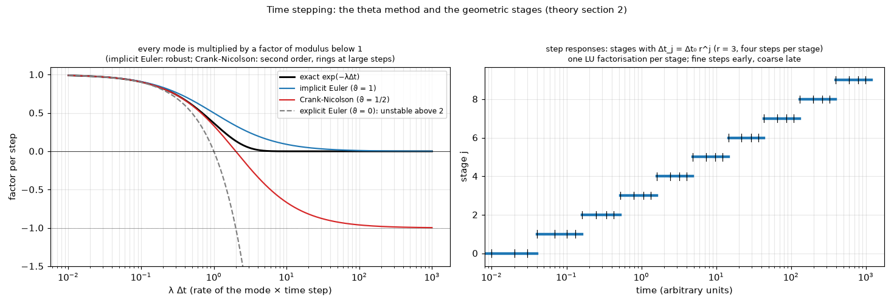

*Figure 7 (`images/fig_07_theta_method.png`): left, the factor by which one step multiplies a mode of rate `λ`, against `λΔt`, for the exact solution, implicit Euler, Crank-Nicolson and explicit Euler; right, the stages used for the step responses: the step grows geometrically (ratio 3) with four steps per stage, so one factorisation serves each stage. Textbook formulas, no program data.*

    C dθ/dt + K θ = Q(t),        C_i = c_l Δx Δy   (J/K)

The **theta method**

    (C/Δt + ϑK) θ^{n+1} = (C/Δt − (1 − ϑ)K) θ^n + Q^{n+1/2}                       (2.5)

with `ϑ = 1` (implicit Euler, first order, robust) or `ϑ = 1/2` (Crank-Nicolson, second order); both are unconditionally stable for the diffusion equation: each eigenmode of rate `λ` is multiplied by `(1 − (1−ϑ)λΔt)/(1 + ϑλΔt)`, of modulus below 1 for `ϑ ≥ 1/2` [Patankar1980] (M).
One LU factorisation is needed per distinct `Δt`, so the steps grow in stages of `m` equal steps whose sum is `t_end`:
* animation: ten stages, `Δt_j = Δt₀ 2^j`, `Δt₀ = t_end/(m(2¹⁰ − 1))`;
* **step responses**: 18 stages of `m = 4`, `Δt_j = Δt₀ r^j`, `r = 3`, `Δt₀ = t_end(r − 1)/(4(r^{18} − 1))`, `t_end = 10 τ` with `τ = ΣC/ΣG_amb` the uniform-board time constant (`ΣG_amb` without the 1 W/K pins).

The board mean of a transient weights every cell by its board area. The **step response** `Z_i(t)` is the rise of the hottest point of heater `i` per watt, and `R_th,i = Z_i(∞)` its steady value.

### 2.5 Accuracy

Second order in the cell size for smooth fields, first order at features (a via, a copper edge, a thin heater). At a cut cell the local truncation is first order over the volume fraction while the temperatures stay second order ([SchwartzEtAl2006] eq. 11 to 13 (R), as read in `research/rotated-square-3d`); the spread of the peak over the position of the outline on the grid is 0.03 to 0.15 K at 1 mm for the square at `h_side` 10 to 2000 W/m²K (the earlier links 0.06 to 3.0 K, `validation.md` 32). The layered idealisation of section 1.2 is the model error that the 3D solid measures; the discretisation error is the change with the cell.

### 2.6 The via on the grid (FVM and FDM; `viawell.py`)

The physics of the via, the constriction and the target radius `r_t` are in section 1.5; this section is how the grid models carry them. The 3D solid uses its own footprint rule (section 4). **Footprint rule:** a via whose drill disc has no board under it (the board tested with the centre plus 6 rings of 24 samples, `geometry.discs_board_share`; the outline, or the box of a rectangular board) is left out of every model, not moved to the nearest board cell; the footprint of a via that is partly on the board is the part of the disc on the board.

**Which sheet the well reads.** `S_l` handed to the wells is the sheet of the copper node before the laminate rule of 1.4 moves the laminate of the interior nodes out of it (only in the cells the rule flags: 0.5 to 1.3 % of the sheet on full 35 µm copper, 2.7 to 6.2 % at fill 0.2). Reading the reduced sheet instead makes the well softer and the hottest rise higher by at most 0.04 K (+0.002 to +0.036 K in the FVM, 3 to 6 times less in the FDM); against a resolved 3D barrel the order used is equal or closer by at most 0.005 K, so it is kept (`research/via-well-sheet-order`; `tests/test_via_well_sheet_order.py` fails if the calls are reordered). The sentence rests on that measurement, not on an argument about which laminate belongs to the well.

**Why the barrel is spread.** A source in one cell of the five-point stencil is a point of the lattice whose potential is that of a hole of radius

    r_eq = exp(−(γ + 1.5 ln 2)) Δx = 0.1985 Δx                                  (2.6)

(γ Euler's constant; computed from the lattice Green function, the exact infinite-lattice value, checked to 2·10⁻⁵ on the infinite lattice; Peaceman's radial argument [Peaceman1978] (S) gives `exp(−π/2) Δx = 0.2079 Δx`, as read in [Ibraguimov2022] (Theorem 1, R); the anisotropic, non-square form is read in [Lie2019Reservoir] (4.34, R) and [Koch2019Well] (5.6, R in part), and printed in [Durlofsky2005] (equations 34, 35, pp 20-21; equation 34, the Peaceman index, prints the logarithm as `log(r_w/r_o)`, negative as printed, read `ln(r_o/r_w)`; the program uses the positive form `ln(r_eq/r_t)/(2π S)` of its well, equation 35 giving `r_eq`)). Putting the barrel in the one cell that holds the via centre would be right only at `r_eq = r_t`, that is `Δx = 3.9 r_v`. On coarser cells the resistance `ln(r_eq/r_t)/(2π S)` is missing, and a series *well* supplies it. On finer cells the point is too constricted by `ln(r_t/r_eq)/(2π S)`, which grows as the cell shrinks and no series resistance can remove: the barrel has to be spread over several cells.

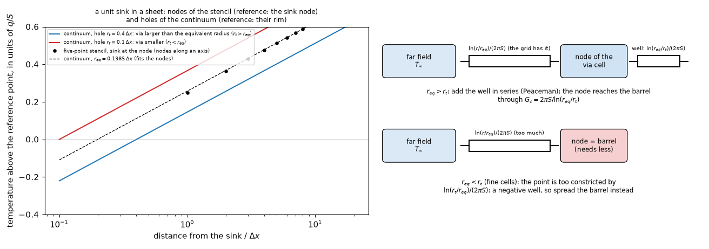

*Figure (`images/via_peaceman_well.png`): left, the potential of the nodes of a point sink on the lattice against the continuum holes (the nodes lie on a hole of radius 0.1985 Δx); right, the bookkeeping of resistances: a well is added when `r_eq > r_t`, and the barrel is spread when `r_eq < r_t`.*

**The construction.** Each via has:

* a **footprint**: weights `w_a` (sum 1) on the cells its disc covers (area of the disc in each cell, times the cover of the cell, restricted to the cells on the board and normalised); if the lattice effective radius of the footprint is smaller than `r_t`, the disc is enlarged (centre fixed) until it equals it. The effective radius of a distribution is

      ln(r_eff/Δx) = (π/2)(E_w − κ_a),      E_w = Σ_ab w_a w_b a(a − b)          (2.7)

  with `a(x)` the potential kernel of the stencil (`a(x) → (2/π) ln|x| + κ_a`, `κ_a = (2γ + 3 ln 2)/π = 1.0294`; a single cell gives `r_eq`);
* the **mean temperature of each plane over the footprint**, `T̄_l = Σ_a w_a T_{l,a}`;
* a **well** between `T̄_l` and the barrel node of plane `l`, `G_c = 2π S_l / ln(r_eff/r_t)` (none when `r_eff ≤ r_t`; `S_l` the sheet conductance per unit of board of the footprint cell with the largest weight, multiplied by the rim share `f_l` below), the barrel nodes joined by `G_via` per gap (2.7b: the length is `d + 0.5 t_bar`) (1.4).

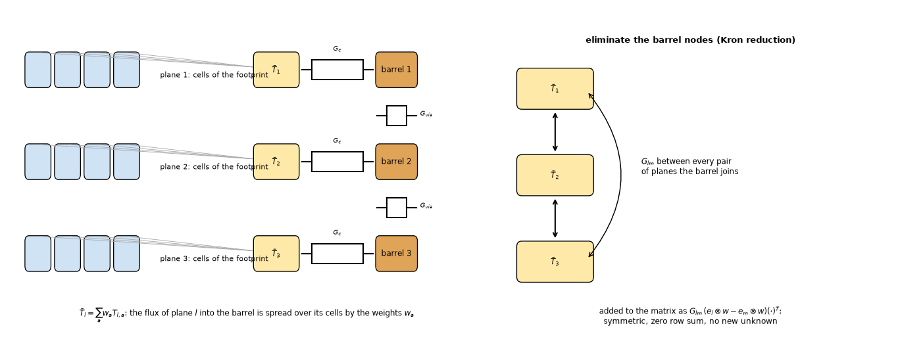

*Figure (`images/via_mean_potential_coupling.png`): the footprint, the mean temperature of each plane, the well and the barrel; after the Kron reduction only the couplings between the plane means remain.*

The barrel nodes are eliminated (Kron reduction, the Schur complement of the network Laplacian [DorflerBullo2013Kron] (R in part: Lemma 2.1, Theorems 3.4, 3.7, 3.9)), which leaves couplings `G_lm` between the plane means; the matrix gets `G_lm (e_l ⊗ w − e_m ⊗ w)(e_l ⊗ w − e_m ⊗ w)ᵀ` for each pair of planes: `K` stays symmetric, positive semidefinite with zero row sum from the via, and no unknown is added. The couplings are the same for the steady state and the transient, and the footprint cells are solved as dense blocks by the SOR (section 2.3). The FDM uses the same footprint and well on nodes. The 3D solid has no well (its cells carry the copper area of the barrel) and uses `viawell.tuned_footprint` (section 4): weights whose effective radius equals `r_t` exactly.

**The via near a board edge (FVM only).** The lattice carries the sheet outside the footprint, edge included, but the footprint sits on cell centres and the via does not: for a 0.3 mm via 0.16 mm from an insulated edge on 1 mm cells the true image of the via is at `D_true = 2 max(δ, r_v) = 0.32 mm` and the image of the footprint has `D_lat ≈ 1.0 mm`. The mean potential of the footprint therefore misses `(I / 2π S) ln(D_lat / D_true)`, and the well carries it (the mirror image of the point source at a plane, the sink of heat reflected by an adiabatic wall [Yovanovich1995ImageMethod] (R, equations 9 and 10 for the image of a source at a plane; the lattice form is derived here and checked against a resolved reference)):

      G_c = 2π S_l / (ln(r_eff/r_t) + c),   c = Σ_walls [ln D_lat − ln D_true]  (+ the diagonal image at a corner)          (2.7a)

with `ln D_lat = ln h + (π/2)(P_img − κ_a)`, `P_img = Σ_ab w_a w_b a(x_a − x'_b)` the potential kernel read (bilinear between the exact integer values) between the cells of the footprint and the mirror images `x'` of the cell centres, `h = √(Δx Δy)`, and `D_true = 2 max(δ, r_v)` (a via cut by the edge is taken at its radius). A negative `c` (a small via at a corner on a fine cell, whose footprint was enlarged to `r_eff = r_t`) enlarges the footprint, centre fixed, until `ln(r_eff/r_t) + c > 0`, so the well never becomes infinite. `viawell.edge_walls` finds the walls within six cells of the via centre: the box sides, or the axis-parallel sides of an outline (at least six cells long, the via projecting inside the side), one per axis (the nearest); a slanted, curved or short side, and a vertex that is not the convex corner of two walls found, make the neighbourhood "not clean" (the warning stays). The well uses only the walls of `viawell.image_walls`: those nearer to the via than every such feature, and none when one is within `EDGE_GUARD_CELLS` = 0.6 cells. Beside a reflex corner the side the via faces ends at the corner, so its infinite mirror overstates the wall; the review measured a via 0.26 mm from the reflex corner of an inverted T at -12.4 % with the mirror against -2.9 % without it at 1 mm (`validation.md` 28.1), and the far side behind a side too short to count was imaged while the near one was not. It acts on the cell-centred grid only; the FDM (half-volume edge nodes) and the 3D solid keep no image.

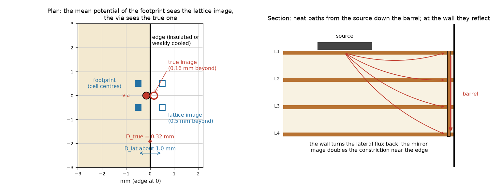

*Figure (`images/via_edge_image.png`): left, the plan: the footprint on cell centres sees the lattice image 0.5 mm beyond the edge, the via sees its true image 0.16 mm beyond it; right, the section: the wall turns the lateral flux back, which is why the image doubles the constriction near the edge.*

The image is that of an **insulated** wall and is used for a cooled edge too: a Robin image (a point image plus a line image of density `exp(−s/l)`, `l = S/(h_side s_l)`) was derived and measured and is **not** adopted: equal to the mirror up to `h_side` = 100 W/m²K, worse at 1000 (+2.9 against +1.5 % at 1 mm), and above 10 000 W/m²K the error is the discretisation of the strongly cooled edge, not of the via (`research/via-edge-image` 3). A real edge (natural convection plus radiation, 10 to 30 W/m²K) is in the range where the mirror is right. The edge nodes are not changed, the matrix keeps its structure (symmetric, positive definite, the row sums of the board without the via), and a via with no wall within six cells is bit-identical to the version without the image.

**Limits.** The image is not applied by the FDM and the 3D solid (the FDM reads the via effect 4 to 10 % too small at 1 mm, the 3D solid about 19 points too large, `checks.check_via_limits`), nor to a slanted or curved outline side or a short step; near a reflex corner it is partial (the via effect -6 to +12 % at 1 mm, -4 to +1 % at 0.5 mm on the T and L of `validation.md` 28.1); a via cut by the edge is taken at its radius; at a cell of 2 mm or more it is applied (a via 0.16 mm from the edge: +24 % to +3 %) but the via is a fraction of a cell (the warning stays for all of these); a narrow board with a wall on each side of the via has only the nearest wall per axis (within 1.5 % of the reference for boards 3 to 8 mm wide, `validation.md` 28.1); from a 2 mm cell the via is a fraction of a cell and the answer depends on where its centre falls in it (a warning).

**The barrel length.** The copper nodes sit at the mid-planes of the layers, so the barrel between two nodes is longer than the dielectric gap `d`: it crosses half of each copper layer. The plane around the barrel shunts that copper, so the effective extra length is a fraction of the copper thickness, measured as `a = 0.5` of the mean thickness `t_bar = (t_l + t_{l+1})/2` of the two layers:

      G_via,k = k_cu A_barrel / (d_k + a t_bar,k)          a = BARREL_COPPER_FRACTION = 0.5          (2.7b)

(`viawell.barrel_length`; one constant, used by the FVM and FDM wells, by the point conductance `gz_via` that the Lumped rings read, by `viaconstriction.ViaSet.g_gap` and by the Analytic tile conductance `sh["d_barrel"]`; the 3D solid draws the barrel through its copper slabs and is not changed). The constant rests on two references that bracket it: an axisymmetric unit cell over 720 boards (best `a` 0.44 to 0.48 for copper of 35 um and more) and a Cartesian 3D cell with the plating resolved on 15 boards (best `a` 0.50 to 0.73 with the planes whole, 0.50 to 0.82 with the inner planes drilled). With `a = 0.5` the FVM via resistance is within -6.5 % (the unsafe side, part too cool) of the 3D cell; the earlier `d` alone read it 5 to 29 % too low (mean -14 % at 35 um and more). Boards with 18 um copper, thin gaps and a small barrel resistance read the opposite error (+29 to +35 %): that is the target radius `r_t` (section 1.5), not the barrel, and a rule `a(t_cu)` would hide it. Measured shift on the five frozen boards with vias: the steady maximum rises by 0.016 to 0.158 K (at most 0.26 % of the rise), the times to 63 % fall by up to 1.0 % (`validation.md` 34.1). Figure: `research/via-contact-geometry/figures/fig_05_barrel_references.png` (the extra length `a` that zeroes the error, case by case, against `t_cu/d`, and the error with `a = 0.5`).

**The contact of the barrel with the plane.** The well is nearly infinite by construction, so what a plane gives the barrel is set by the weights, and a plane whose copper the drill does not touch must not be coupled at all. The share `f_l` of the rim of the drill (48 samples on the circle of radius `phi/2`, offset by half a step so that none lies on a copper edge through the centre) that lies inside a zone of layer `l` with `fill > 0` or inside a heater of that layer (the power of a part enters the board over its footprint, so a via under a part drawn without a zone takes that heat directly) multiplies the well: `G_c,l = f_l 2 pi S_l / ln(r_eff/r_t)`; `f_l = 0` leaves the plane uncoupled (the barrel node of that layer then only passes the heat on), `f_l = 1` is the earlier code bit for bit. The hatching `fill` is not counted here (it is already in `S_l`). When `f_l < 1` for any layer the sheet conductance of the well is the footprint mean of `S/cover` with the footprint weights (not that of the heaviest cell, which can be a bare one). **Imported copper reads the masks by a ray test** (`viawell.RimMasks`): in a real Gerber set every through via has a pad on every layer, so the 48 samples ON the drill circle land on copper on every layer, also where the via sits in an antipad and is not joined to the plane (measured: share below 1 on none of the (via, layer) pairs of five library boards with the circle alone). A sample therefore counts only when the imported copper is continuous along its ray from the drill circle outward over the reach `max(0.5 mm, 3 pixels)` (pixel by pixel, coverage at least one half): a pad island ends in the clearance and gives `f = 0`, a plane or a track gives 1, a thermal relief the share of its spokes; the heaters of the layer still count and the zones drawn over an imported layer do not (the mask replaces them). The reach is a fixed length, not a rule from the pad: the pad size is not known from a raster, and the shares moved 0.05 to 0.2 for reaches from 0.3 to 1.2 mm (`research/imported-via-rim` 2); a via reached by a single track on an outer layer reads the share of the track. A via 0.3 mm outside a copper edge then conducts nothing in that plane (the 3D solid keeps 1.05 K of effect through the laminate around the barrel, which the model loses: the safe side, bounded by the via effect) instead of the +2.9 K (3.5 % of the rise at 1 mm) over-reading of the geometric weights. The corner of a copper region (a quarter of the rim on copper) and the end of a track are **not solved**: the footprint was tuned for a full plane and the correct well is that of a sector; the via effect reads 22 to 85 % low there in the FVM (0 to 76 % in the FDM with its harmonic face) (the part up to 11 % of the rise too hot, safe side, confirmed by an independent resolved 3D reference, `validation.md` 34.2). Weights by sheet conductance, which would remove the cold spot of 2.2, were examined and not adopted: they put a via at a copper corner on the unsafe side (+2.3 K at 1 mm, 3.8 % of the rise) and a via beside a part on bare laminate 84 to 93 % too weak. The local numerical upscaling that would solve the corner (a fine raster around the barrel, the Schur complement as the coupling) is open.

**Partial copper under the footprint.** The weights are geometric and fixed, so on a copper layer whose copper covers only part of the footprint the bare cells draw heat they cannot supply (the cold spot of 2.2) and the via effect is misread (22 to 85 % low in the FVM, 0 to 76 % in the FDM, at a copper corner or a track end with the contact rule above, 31 to 68 % before it; a via just outside a copper edge loses its effect, drawn or imported (on imported copper by the ray test; before it the full contact read the effect 1.5 to 5 times high, `validation.md` 45)); `checks.check_via_partial_copper` warns when the smallest sheet conductance among the footprint cells holding at least 5 % of the largest weight is below half the largest (`research/via-partial-copper`, `research/via-contact-geometry`, `validation.md` 30 and 34).

**Where it is checked**: `validation.md` 2.1, 5, 7, 18, 28 and 30 (convergence with the cell, the copper-fill gain of the 3 × 3 board, the via near an edge, copper over part of the footprint); `research/point-via-convergence`, `research/via-edge-image`, `research/sor-with-via-couplings`, `research/models-comparison`; `tests/test_sor_omega.py`.

### 2.7 The memory guard (`memory.py`)

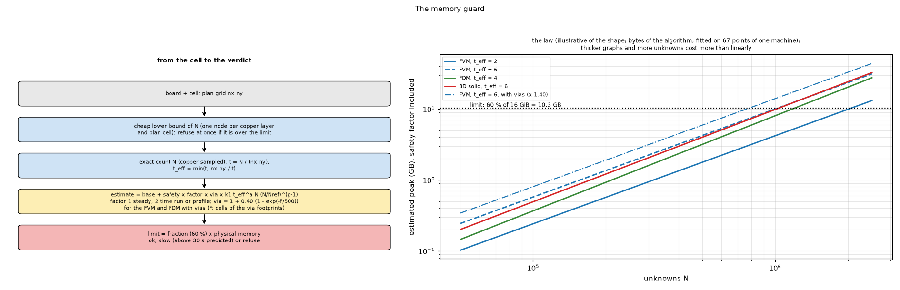

*Figure 46 (`images/fig_46_memory_guard.png`): left, the chain from the cell to the verdict; right, the law of the estimate against the unknowns for the FVM (`t_eff` = 2 and 6), the FDM (4) and the 3D solid (6), with the coefficients of `memory.CONTINUOUS`, the safety factor included and the base left out, against 60 % of 16 GiB. Illustrative of the shape: the bytes were measured on one machine.*

A sparse direct factorisation needs memory that grows faster than the number of unknowns, and the number is set by the cell the user chooses. The guard estimates the peak memory of a solve **before anything is allocated** from the unknown count that the models already provide (`fvm.unknowns`, `fdm.unknowns`, `solid3d.unknowns`) and refuses a run above a limit.

**The law** (one per model, continuous in the thickness of the graph):

    peak = base + safety · factor · k₁ · t_eff^a · N · (N / N_ref)^(p − 1),      t = N / (n_x n_y),   t_eff = max(1, min(t, n_x n_y / t))        (2.8)

with `N` the unknowns, `N_ref = 500 000`, `t` the nodes per plan cell (the thickness of the graph that is factored) and `t_eff` its smaller side, because a board that is very thick in layers is also thin in plan (the smallest separator of the graph is then a horizontal plane, the nested-dissection argument of [George1973] (R in part), supported by two measured points only; [LiptonRoseTarjan1979] (R) gives the bounds for any graph with a `sqrt(n)` separator and for d-dimensional grids: fill `O(n log n)` and work `O(n^(3/2))` in 2D, fill `O(n^(4/3))` and work `O(n^2)` in 3D, between which the fitted exponents lie, the FDM one, 1.34, being at the upper bound 4/3 = 1.333 and slightly above it). The coefficients (`memory.CONTINUOUS`, bytes at `N_ref` and `t_eff` = 1) are, with the exponents of `N` and of `t_eff` and the safety factor: FVM `k₁` = 1469, `p` = 1.24, `a` = 0.79, safety 1.40; FDM 1228, 1.34, 1.03, 1.24; 3D solid 1063, 1.30, 0.98, 1.30. The safety factor is the largest measured/fitted ratio of the ladder rounded up, so the estimate does not fall below the measurement on the points that were measured. `base` is the resident size of the process read once (`memory.baseline_bytes`, see *Verdicts* below; not multiplied: it is measured); `factor` is 1 for a steady solve and 2.0 for a time simulation, an animation or a profile run (`memory.TRANSIENT_FACTOR`, `PROFILE_FACTOR`: the transient keeps one factor of the matrix plus the previous stage while the next is built, measured 1.9 after the program was changed to keep one LU factor instead of ten; the profile factor is not measured). The Lumped and the Analytic models are not estimated here (455 bytes per unknown for the Lumped; the Analytic has its own 4 800-unknown guard, section 6.1).

**The vias.** The mean-potential couplings of the vias (section 2.6, `viawell.py`) join the copper layers across the laminate node layers with dense blocks that the law of a board without vias does not see. For the FVM and FDM the allocated part of (2.8) is multiplied by

    via = 1 + 0.10 · (1 − exp(−F / 500))                                                                                                (2.8b)

with `F` the cells of the via footprints (`memory.via_cells`: the sum over the vias of the mean number of cells of `viawell.footprint` of their drill at the cell, over six positions of the centre, cached by drill and cell; vias with the centre outside the board box are left out). The term is 1 without vias (a board without vias, the 3D solid and the cheap lower bound are unchanged), continuous, and saturates at `1 + VIA_GAIN` = 1.10 (`memory.VIA_GAIN`, `VIA_CELLS_REF`); the 769 holes of CO60 are 2 500 to 5 400 cells and cost 10 %, 25 vias of 0.3 mm at 0.5 mm (80 to 100 cells) 2 %. With the symmetric mode of `fvm.lu_factor` (section 2.3) the peak of a board with vias is 0.82 to 1.09 times that of the same board without them (106 runs on the plates and CO60, one process per run; the first fit, 0.40 on SuperLU's default mode, and why it was replaced are in `versions.md`), and the gain is 0.10: the estimate is below the measurement in 7 of 85 via cases by at most 1.27 times (small CO60 boards that the law without vias already misses by 1.20 to 1.27), against 13 of 85 by 1.33 with no term. Measured with the symmetric mode (`research/memory-guard` README 14.12): CO60 striped 0.5 mm 2.42 GB (estimate 4.60), 0.7 mm 1.18 GB (2.05), full copper 0.5 mm 0.66 GB (0.81). **If the solver ever falls back to the default mode** (a matrix that is not accepted as symmetric, an old SciPy), the law does not cover the peaks of up to 4.75 times that the default mode showed on regular via arrays.

**Imported copper.** A board with imported copper (section 1.7) holds its masks and builds its face conductances beside the unknowns, so the run adds to the measured base of (2.8) `memory.copper_run_bytes`: 1 byte per pixel and layer for the unpacked masks, plus 40 bytes per source pixel of the largest layer and 50 MB for the local problems of the faces (the 50 MB is left out for the mapping `fill`; nothing for a drawn board). Before anything is drawn, `memory.check_import` takes the larger of the draw peak (3 bytes per pixel of the layer being drawn, the tile of the rasteriser of section 1.6, 250 MB for the point-in-polygon strips of an outline, an eighth of a byte per pixel for each packed layer) and the run peak above, refuses when it does not fit and names the pixel that fits (the pixel times the square root of the ratio of the need to the room, since both peaks are about proportional to the pixels). The constants were measured on the implementation (`validation.md` 27.5; one machine).

**Cheap lower bound first.** The exact unknown count of the layered models samples the copper of every plan cell (about 300 bytes per plan cell, tens of GB for a 0.5 m board at 0.05 mm), so the guard first takes a lower bound (one node per copper layer and plan cell; the 3D count is already exact and cheap). The estimate grows with `N` at fixed plan cells, so a bound above the limit refuses the run without the exact count, and the message says "at least". Only a bound that fits is counted exactly.

**Verdicts.** The limit is a fraction of the physical memory (read without a dependency: `sysconf`, `sysctl hw.memsize`, `/proc/meminfo`, `GlobalMemoryStatusEx`; the cgroup limit of a container lowers it; the variable `PCBTHERMAL_MEMORY_BYTES` replaces the reading). The default fraction is 0.60 (10 to 95 % allowed), a **machine preference** (`solver.memory_fraction` in Preferences, command line `--memory-fraction`), not a property of a project: it is not saved in the project file and an old file's value is ignored. The base of the estimate is the resident size of the process read **once** (`memory.baseline_bytes`): the calculation process reads it when it starts, after its imports and before its first job (`jobs.serve`), any other process at its first estimate. Not the live size: the calculation process serves every job of a session and the live size grows with what it solved (0.08 GB fresh, 0.67 GB after one 1 mm run of the CO60 import, 1.21 GB after a Power Calculator run at 0.7 mm, which makes no estimate), which made the same project `ok` or refused by the history alone; those pages are reused by the next solve (1.21, 1.37, 1.37 GB after three 0.7 mm runs), so they are not counted again. A fresh process gets the same verdicts as before. The verdict is *refuse* above the limit, *slow* when the predicted solve time is above 30 s (a time law per class, measured on a shared machine, so a lower bound), otherwise *ok*. The 3D solid is also refused above an absolute ceiling of 2 million unknowns (it binds only from about 26 GB of memory). A refusal names the cell that fits (grown in steps of 10 %, rounded up to 0.1 mm, up to 50 mm). When the estimate is above the memory **available** now (`vm_stat`, `MemAvailable`, `ullAvailPhys`) the result is a warning, not a refusal: the same project would otherwise run or not depending on the moment. `solid3d.size_limit(n)` (offline studies) is a window: a model is accepted up to `n` unknowns whatever the estimate and refused above it.

**Limits.** The coefficients were fitted on 67 points (layer-major numbering) of one 16 GB machine, the via term (2.8b) on 59 more (CO60 and plates with via arrays, FVM and FDM, `research/memory-guard` README 14.12); the extrapolation beyond the largest measured points (240 000 to 400 000 unknowns for the 3D solid) is trusted to about ±20 %; Windows and containers were not measured; the memory compressor of macOS can make a resident peak read 20 % low on a loaded machine. The program logs the estimate and the measured peak after each run, so another machine can check the law. The exact symbolic count of the non-zeros of the factor equals the count of `splu` on nine program matrices (`research/theory-sources` 7.2); what is left, an item of the chapter "Planned" of `versions.md`, is to test the bytes per entry against the measured peaks, which would replace the fitted safety factor.
**Where it is checked**: `validation.md` 26 (the memory ladder and the accuracy of the law); `research/memory-guard` (README 5, 9, 10, 14); `tests/test_memory.py`. **Sources**: [George1973] (R in part: abstract, Theorems 4.1 and 5.2, the remark on the cube; the constants of A.6 are unreadable in the scan), [LiptonRoseTarjan1979] (R, by image; its abstract prints the time and space bounds swapped, cite page 347 or the Remarks of page 356), [LiGolub2013] (R, slides 19 and 20), [SuperLUGuide] (R in part, sections 1.4.4, 2.8 and, by image, 2.5.2 and 2.6), [GilbertNgPeyton1994] (R, abstract and introduction), [Davis2006] (M); [LiSuperLU2005] (R in part: section 3.2.2 and Tables III and IV, compared with the page images) and [SuperLUGuide] (section 2.6, by image) for the symmetric mode of section 2.3. They give the form of the law; the coefficients are fitted on the measurements. With the program's symmetric ordering `splu` takes no row pivot, and `nnz(L)` equals the symbolic count on nine program matrices (`research/theory-sources` 7.2); the bytes per entry against the measured peaks are still to be tested.

## 3. FDM: node-centred finite differences (the comparison)

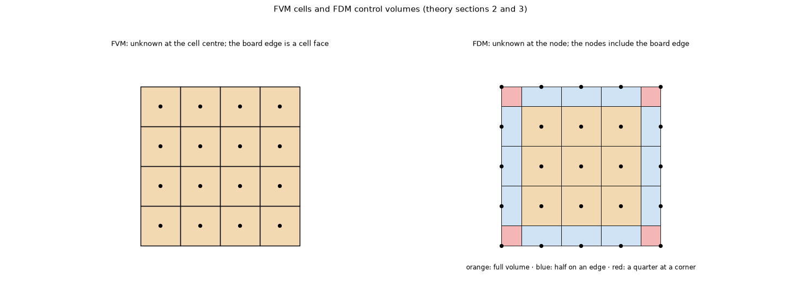

*Figure 3 (`images/fig_03_fdm_nodes.png`): the same board with the two layouts of the unknowns. FVM: the unknown is at the cell centre and the board edge is a cell face. FDM: the unknown is at the node, the nodes include the board edge, and each node owns a control volume that is full inside, half on an edge and a quarter at a corner.*

**Unknown**: the temperature at the **nodes** of a grid that includes the board edges (`(nx+1) × (ny+1)` per layer). Each node owns a **control volume** of `Δx_c × Δy_c`, with `Δx_c = Δx` inside and `Δx/2` at the edge nodes (a quarter at a corner), so a convective edge is treated by the standard half-cell balance (equivalent to a ghost node, second order). Written as the balance of a control volume the scheme is conservative too, and gives the same system `K θ = Q` and the same transient (2.5); what differs from the FVM is **where the data live**:

| | FVM (section 2) | FDM |
| :-- | :-- | :-- |
| unknown | mean of the cell, at its centre | value at the node, on a grid that includes the edges |
| sheet conductance `S` | of the cell, from the cover of the cell | **sampled at the nodes**: the coverage of the control volume around the node (`sampling="area"`, the default: the four surrounding cell coverages weighted by the shared area) or the point test (`"point"`) |
| lateral conductance | harmonic mean of the two `S` | **in a drawn copper layer the face sheet is built from the copper fill of the two cells the face runs through**, `S_face = (A_face + B f_face) c_face`, with `B = (k_cu - k_lam) t_cu`, `A` the physical sheet of the node without copper (laminate and the sub-gaps the node keeps; the arithmetic mean of the two nodes), `f_face` the mean fill of the flanking cells and `c_face` the mean outline cover: the cell between two nodes is uniform along the face, so a copper edge that falls on a node leaves the bare side bare and the copper side whole (the harmonic mean of the nodal sheets read the node on the edge half copper and the first copper link 0.67 of the copper sheet, and smeared the edge over a cell; `validation.md` 47; only where a nodal fill differs from the fill of the face, so uniform copper is bit-identical; imported layers and boards with a metal block keep their own rule; `face_fill=False` gives the earlier mean). Elsewhere and for the laminate nodes: **harmonic mean of the two physical nodal sheets** (default; `(S₁ + S₂)/2` arithmetic on request), times the mean outline cover of the two nodes (1 without an outline: a node cut by the outline keeps the link of the arithmetic mean, because the harmonic mean of cover-scaled values would make the link to a sliver `2c/(1 + c)`), times the face width over `Δ` (the face width is the control-volume side); the laminate nodes of the rule keep the arithmetic mean where both exist |
| vertical | `k_th Δx Δy / d` | `k_th A_c / d`, `A_c` the control area (laminate nodes where copper is absent: section 1.4, on the nodes) |
| via | footprint of cells, mean-potential coupling | the same coupling, on a footprint of **nodes** (weights: area of the disc over the control volumes) |
| ambient and edge | cell areas and edge lengths | control-volume areas and lengths (the outline shifted by half a cell onto the control volumes) |
| source | coverage of the footprint over the cells | coverage shared among the four nodes of each cell (area) or one for each node inside (point), normalised to 1: power exact |

The transient machinery of the FVM is reused unchanged (`fvm.transient_from_network`), because the FDM network exposes the same `K, C, Q`. **Limits**: on coarse cells neither grid model converges monotonically: the answer moves with the way the heaters, the copper edges and the vias fall on the grid (a cell that does not divide the features moves it most), and the FDM, whose copper and source are sampled at the nodes, moves more than the FVM (`validation.md` 2.1). It is a comparison model that checks the FVM, not a second reference.
**Where it is checked**: `validation.md` 2 and 2.1 (the models against each other and against the grid), 18 (the via array); `research/models-comparison`.

## 4. 3D solid: finite volumes in three dimensions

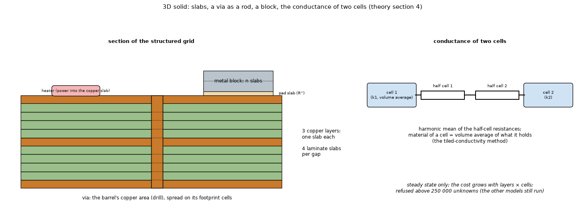

*Figure 4 (`images/fig_04_solid3d_slabs.png`): left, a section of the structured grid: one slab for each copper layer, `ceil(d / 0.2 mm)` slabs (4 to 16, so at most 0.2 mm up to a 3.2 mm gap; the picture draws four) for each laminate gap, a via as a rod of the barrel's copper area, a pad slab and metal slabs for a block; right, the conductance of two neighbouring cells as the harmonic mean of the half-cell resistances.*

`solid3d.py` drops the "one node per copper layer" idea. The plan grid is the FVM's; across the thickness the stack is cut into **real slabs** from the top face down:

* a copper slab of thickness `t_cu,l` for each layer, and `n_gap = clip(ceil(d / 0.2 mm), 4, 16)` equal slabs of `d / n_gap` in each dielectric gap (`solid3d.slab_rule`, `slabs_per_gap`; the 1.53 mm gap of a two-layer board has 8, the 1.065 mm core of the four-layer template 6, the prepregs and the cores of 6 to 10 layers 4; a one-layer board has no gap: its laminate, 1.565 mm, is cut the same way into 8 FR-4 slabs under the copper, so it spreads heat and the bottom face loses heat through it; an integer `n_diel` gives every gap the same count, as the studies need);
* for a block under (or over) the board a **pad slab** (the interface: thickness `R''·1 W/mK` and conductivity 1 W/mK, so its resistance per area is exactly `R''`) followed by `n = round(thickness/1 mm)` metal slabs (1 to 6).

Every cell of every slab has one unknown: `n_slabs × nx × ny`, counted before the model is built (`solid3d.unknowns`) and checked by the memory guard of section 2.7 (a memory estimate against the limit, and an absolute ceiling of 2 million unknowns). The class `Solid` checks its own count in its constructor, so the guard also covers a direct use of the model.

**Cell materials** (volume averages on the structured grid, the tiled-conductivity method of PCB thermal models):

* copper slab with fill `f`: in-plane `k_x = f k_cu + (1 − f) k_ip`; through `k_z = f_eff k_cu + (1 − f_eff) k_th` with `f_eff = min(1, f + a_via)`;
* dielectric slab: `k_x = k_ip`, `k_z = a_via k_cu + (1 − a_via) k_th`;
* `a_via = Σ A_via w / (Δx Δy)`, the **real copper area of the barrel** (1.4) spread in parallel in every slab (the lateral effect of the thin barrel wall is neglected), clipped at 1 per cell (a via whose copper-equivalent area exceeds the cell loses the excess);
* the weights `w` come from `viawell.tuned_footprint`. Having no well, the 3D solid must reach the target radius `r_t` (1.9) exactly: `w` mixes the cell of the centre (share `1 − χ`) with the area weights of the disc of radius `r_t` (share `χ`), `χ` chosen so that the lattice effective radius (2.7) equals `r_t`; the disc is enlarged when even `χ = 1` falls short, and the cell of the centre is used alone when `r_t < r_eq` (2.6); the point fallback (a disc smaller than a cell) is the part of the disc on the board, and a via with no board under its disc is left out (2.6);
* block slabs: `k = k_metal · c`, pad slab `k = 1 · c`; cells with no material get `k = 10⁻⁹ W/mK` and a leak of `10⁻⁹ W/K` to the ambient to keep the matrix regular.

**The face of a part** (`laminate.face_terms`, the same function as the FVM and FDM): the power of a part enters the copper slab, at the middle of its thickness; where the copper is absent the half layer of laminate between that node and the face of the part is not in the slabs, so the result carries `q t_cu / (2 k_z A)` per cell (arrays `face_peak` and `face_mean`) and the temperature read under the part is its face value. It is right only together with the slab rule: with four slabs it made the solid hotter than the reference (+9.2 against +5.5 % under a 2 mm part on 1.6 mm). A board with a metal block keeps the earlier reading, as the layered models do.

**Conductances** (each pair of neighbouring cells, harmonic mean of the half-cell resistances):

    lateral:   G = min(dz₁, dz₂) · Δy · 2 k₁ k₂ / ((k₁ + k₂) Δx)      (x; same for y with Δx ↔ Δy)
    vertical:  G = Δx Δy / (dz₁/(2 k_z1) + dz₂/(2 k_z2))
    face:      G = A / (1/h + dz/(2 k_z))                              (film in series with the half cell)
    edge:      G = 1 / (1/(h_side Δ dz) + (Δ_n/2)/(k_x Δ dz))                      (4.1)

with `Δ` the edge length of the cell face; (4.1) is the edge of a **rectangle** (the node is `Δ_n/2` from the edge). **Cut cells of a board with an outline.** A cell cut by the outline (cover `c_b < 1`) used to be joined with the cover-scaled conductivity `k c_b` and the harmonic mean, which makes the link into a sliver of a cell (`c_b` of 0.01 to 0.1) `2c_b/(1 + c_b)` of a full link, and the edge film sat on the sliver node behind the cover-scaled conduction: the heat of the edge column could not reach the sliver and the sliver cell read far too hot (a jump of 15.8 K, 13 % of the rise, between covers 0.01 and 0.02 at 1 mm and `h_side` = 200 W/m²K; +1.6 K at the default 10; four to five times the same defect of the FVM, `research/cut-cell-links` 10.1, `validation.md` 33). Now, for the copper and laminate slabs of a board with an outline (the schemes of [JohansenColella1998] and [BarrettEtAl2022], the same as the layered FVM of 2.1.1):

    lateral:   G = a_f · min(dz₁, dz₂) · Δy · 2 k₁ k₂ / ((k₁ + k₂) Δx)        (k the conductivity of the material, no cover factor;  a_f the aperture of the shared face)
    edge:      G = h_side L dz / max(1 + h_side d / k_x, 0.25)                     (4.2)

with `a_f` (`geometry.face_apertures`) the fraction of the face with the board on both sides (1 between two uncut cells, 0 for a face on the outline, and the length of every interval for a face crossed twice), `L` the outline length in the cell (`edge_length_on_board`, the whole perimeter is kept), and `d` the signed distance from the centre of the cell to the closest outline point (`geometry.signed_distance_to_outline`: positive inside the board, negative when the centre of a sliver cell is off it). (4.2) is the film of the outline in series with the conduction from the node to the point where the Robin condition holds ([BarrettEtAl2022] eq. 12 to 14, with the 0.25 floor of 2.1.1; for a whole edge cell `d = Δ_n/2` and (4.2) is (4.1), so a rectangle drawn as an outline equals the rectangle). The vertical links, the face losses and the heat capacity keep the cover (`A c_b`), the vias their footprint on the cells of the board; the matrix stays symmetric with no positive off-diagonal entry. Block slabs keep their cover-scaled links.

A block hides the board face under it (factor `1 − c`) and loses heat on its exposed face, `h_exp = h_face·r_fin + h_extra` (section 7), and on the side walls of every block slab, `G = (h_face + h_extra) dz L_edge` (no fin ratio; `L_edge` the block outline inside the cell). The heater power goes to the copper slab of its layer with the weights of section 1.3. The system is solved directly; the result has the layout of the FVM (the copper slab of each layer, plus the block fields).

**What it measures**: the error of the layered idealisation on **your** board.
**Limits**: the slabs by thickness bring a small part on a thick laminate close to the reference but not onto it. **A via exactly on a cell line**: when the drill of a via is smaller than the point sink of the grid (a cell coarser than about 1.5 drill diameters) the 3D solid puts the barrel in the one cell `floor((x - x0)/dx)`, `floor((y - y0)/dy)`; a via exactly on a cell line is therefore placed in the cell above and to the right, and the mirror image of the board reads differently: 0.5 to 1.6 K at a 1 mm cell (0.4 to 1.2 % of the rise) on a two-layer test board, 0.6 K at 0.5 mm. A via off the line by any fraction of a cell is not affected; to compare a board with its mirror image, move such a via by a fraction of a cell (`research/small-model-defects` 3). Which representation is nearer a resolved barrel was not measured. Against an extrapolated reference (an equation of Muzychka, Yovanovich and Culham on bare laminate; `research/laminate-slabs-and-local-rule` 5.1, cell 0.25 mm, 20 mm board, h = 1000 W/m2K) a 2 mm part reads, before (4 slabs, no face term) and now: bare 1.6 mm +5.5 -> +4.1 %, 3.2 mm +20.0 -> +3.9 %; over a pad of its size 1.6 mm +14.7 -> +9.0 %, 3.2 mm +27.3 -> +7.9 % (a 5 mm part on bare 3.2 mm +5.3 -> +0.9 %; on bare 1.6 mm +0.6 -> +1.1 %, where the earlier number was two errors cancelling). The solid equals an independent solver at the same pixel and slabs to 0.00 % (an equality of two codes of the same discretisation, not a proof of convergence); what remains is the plan cell and the slabs (16 slabs on 3.2 mm laminate are 0.2 mm each): the slabs alone follow the ratio `d / n_gap / S` (about +2 to +2.6 % at 0.1, +3 to +3.6 % at 0.13, +5 to +5.7 % at 0.2, bare and over a pad), and the cell the rest, which grows fast at the cells a user runs (the same 2 mm part +7 to +16 % at 0.5 mm, +17 to +30 % at 1 mm; `validation.md` 21.3); the program warns when `d / n_gap` exceeds 0.15 of the side through which the heat enters (the part, or the part grown by its copper; silent under a plane on the layer of the part), which with the rule means parts under about 1.3 mm (the slabs alone about +4 % there), so the 2 mm part above, still 4 to 9 % hot at 0.25 mm mostly from the cell, is not warned by it. The cost: the two-layer board has 10 slabs instead of 6 (1.67 times the unknowns), a 3.2 mm board 18 (3 times), the four-layer template 18 instead of 16 (1.12), the boards of 6 to 10 layers no change. The barrel is a lumped area; copper is one slab thick; a block contact is perfect over the pad; the cost grows quickly with layers and cells (the fill-in grows with the width of the plan times the slab count, and the guard of section 2.7 limits the estimated memory, not the count); steady state only.
**Where it is checked**: `validation.md` 3 and 16 (against a finite-element solid and Yovanovich's table, convergence in slabs and cells, timings and memory); `research/solid3d-verification`. **Sources**: the flux-tube table of [Yovanovich2003] and the flux-tube series of [YovanovichCulhamTeertstra1998] (R), the grid convergence procedure of [Celik2008] (R, pages 4 to 9; Table 1 reproduced), [Roache] (M); the cut cells [JohansenColella1998] (R) and [BarrettEtAl2022] (R). The cut-cell links and the edge film of the outline are checked in `validation.md` 33.

## 5. Lumped: thermal network by rings (LPTN)

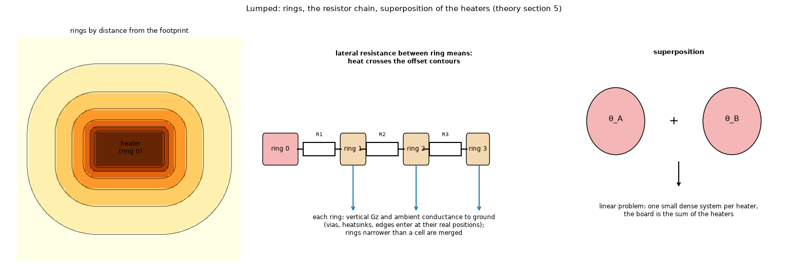

*Figure 5 (`images/fig_05_lumped_rings.png`): left, the rings of a rectangular footprint (the distance of every cell to the footprint, computed with a distance transform, cut at geometric edges; ring 0 is the footprint); middle, the chain of lateral resistances between the ring means with the vertical and ambient conductances of each ring; right, the superposition of the fields of two heaters. Rings narrower than a cell are merged (`RING_MIN_WIDTH`).*

`lumped.py` reduces the FVM network, per heater, to a few unknowns per layer, using the fact that the temperature field of a heater depends mostly on **distance from its footprint**. A board with an outline is solved on the rectangle of the same area (section 1.3.3).

**Unknowns.** One temperature per layer and ring, `N_L (N_ring + 1)` per heater (ring 0 is the footprint, found with a `4 × 4` sampling of the cells, and gets the whole power), plus one per ring for a metal block layer and, on a one-layer board, one per ring for each of its two laminate nodes (section 1.4). A footprint that holds a dense group of vias is two nodes per layer instead of one (section 5.2).

**Rings (geometry).** The distance `δ(x, y)` of every cell to the footprint is computed (Euclidean distance transform; 0 inside). Ring 0 is the footprint; ring `k = 1..N_ring` holds the cells with `δ ∈ (E_{k−1}, E_k]`, with geometric edges

    E_k = E₁ (E_max/E₁)^{(k−1)/(N_ring−1)},    E₁ = min(max(1.5 min(Δx,Δy), 0.04 E_max), max(1.5 min(Δx,Δy), a_eq), 0.5 E_max),    E_max = max δ,    a_eq = √(N₀ Δx Δy/π)        (5.1)

**The first ring is at most one equivalent radius of the footprint wide** (`lumped.ring_edges`, argument `a_eq`: `N₀` the number of cells the footprint touches, `a_eq` the radius of the disc of the same area; never below 1.5 cells). Without the cap the ring next to a small part is `0.04 E_max` wide, which grows with the board and with the distance of the part from the farthest cell. The link (5.2) takes each half ring as a strip of length `area/width`, and for a ring several footprint radii wide the strip has 0.53 (five radii) to 0.43 (ten radii) of the resistance of the annulus that the heat really crosses (0.79 for a ring one radius wide, closed form, pure conduction; the drop measured on the FVM field is 0.50 and 0.43 of the FVM's on 100 x 80 and 200 x 150 mm), so the part read cool: a 1 mm part on a uniform two-layer sheet, centred, 60 x 40 mm -0.9 %, 100 x 80 mm -13.1 %, 200 x 150 mm -25.3 % against the FVM at 0.5 mm (Lumped cell 0.5 mm). A footprint with `a_eq >= 0.04 E_max` (and every board where `0.04 E_max` is under 1.5 cells) keeps the first ring to the last bit, so the boards of the via studies, the example board and the frozen numbers are unchanged. **Limits**: the capped ring is quantised (1.5 cells around a footprint of a few cells), so its link is still short and the node of ring 1 hot; for a small square part the two nearly cancel (1 mm part: +0.4 to +2.5 % from 30 x 20 to 200 x 150 mm), for a part of aspect ratio 3 they add (+9 to +12 % hot: 3 x 1 mm at the 0.5 mm Lumped cell, 6 x 2 mm at the 1 mm cell); the result is not smooth in the cap (half an equivalent radius more or less moves a small part by up to 12 points, because the next edges merge), so the value 1 was chosen for zero effect on the existing boards, not tuned; at the Lumped cell of 1 mm a 1 mm part stays 15 to 17 % cool (the raster); a part smaller than the coverage samples (under about an eighth of a cell) is put in the cell of its centroid while the FVM spreads it over the cells it straddles, so across a cell corner it now reads up to 27 % hot (it read 20 % cool); a source near a board edge or corner reads too cool (on average -9 % at a side and -15 % at a corner at a gap of zero, up to -22 %; the paragraph *A part near a side or a corner* below and `validation.md` 35). Sources: own derivation, no published source for the ring construction; checked against the FVM and an independent 3D layered solver (`research/lumped-ring-uniform-deficit`, `tests/test_lumped_first_ring.py`).

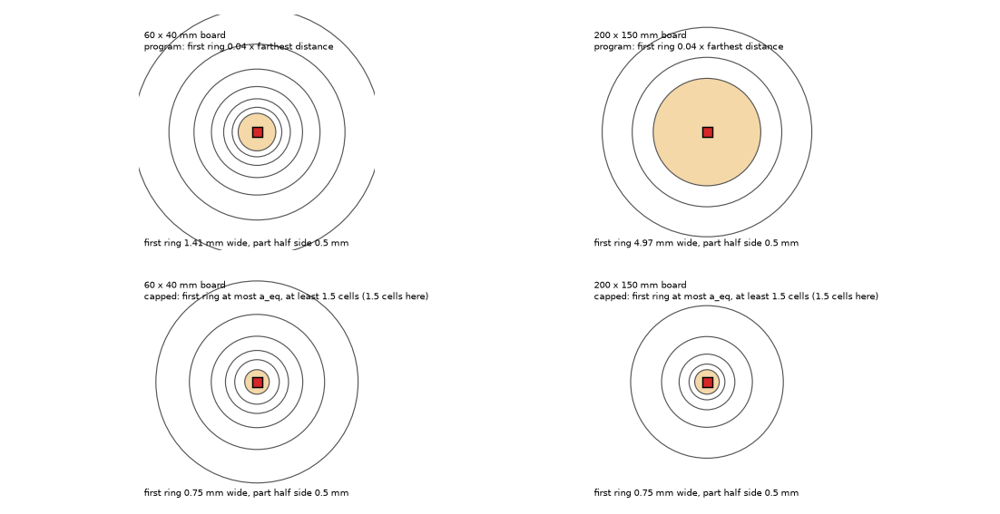

*Figure (`images/lumped_first_ring_board_size.png`): the rings as `ring_edges` builds them around a 1 mm part (0.5 mm cell, ten rings, to scale in the first 12 mm); top, the first ring as it was (1.41 mm on a 60 x 40 mm board, 4.97 mm on 200 x 150 mm); bottom, the first ring of at most one equivalent radius.*

Edges closer than one cell, `max(Δx, Δy)`, are merged (`lumped.ring_edges`: a thinner ring would get a contour length that is too short and a resistance too high); rings with no cell are dropped. Any footprint shape and the real outline are followed. For layer `l` and ring `k` the real cells are aggregated: `S_{l,k}` mean sheet conductance, the sums of `G_amb` by path, of `G_z` (dielectric and vias) and of `C`, the ring **thickness** `Δ_k` (distance span) and its **contour length** `L_k = (N_k Δx Δy)/Δ_k` (`N_k` cells).

**Lateral resistances** between the area-mean temperatures of consecutive rings (the heat crosses the offset contours):

    R_{k,k+1} = Δ_k/(2 S_k L_k) + Δ_{k+1}/(2 S_{k+1} L_{k+1})           (k ≥ 1)                (5.2)

**Inside the footprint** the resistance from its mean temperature to its boundary comes from the logarithmic potential of a uniformly heated region on a sheet: the temperature at a point is `θ = −(Q/(2π S)) φ + const` with `φ_i = mean ln|r_i − r_j|` over the footprint cells `j` (the self term of a square cell is `ln(0.447 √(Δx Δy))`, 0.447 being the geometric mean distance of a square to itself in units of its side). Up to 900 footprint cells the sums run over every cell; above that the source cells are aggregated in `k × k` blocks (weighted centroid, weight sum, self term `ln(0.447 √(area of the block's cells))`, `k` the smallest integer that leaves at most 900 blocks), and the boundary cells and the cells of the nine lowest blocks are read at their own positions against the blocks (distance never below the self term of a block), so that `φ_boundary` and `φ_min` are not taken half a block inside. Against the sum over every cell this is within 0.1 % on `φ_boundary − φ_mean` and 0.15 % on `φ_mean − φ_min` (squares, a disc, an L, a square ring, a footprint cut by the board edge; `tests/test_lumped_footprint.py`). Then

    R_{0,1} = f_R · (φ_boundary − φ_mean)/(2π S₀) + Δ₁/(2 S₁ L₁)                              (5.3)

which is `1/(8π S)` for a disc. When the layer also loses heat vertically under the footprint (loss conductance `g_eff` per area, fin length `λ = √(S/g_eff)` not much larger than the footprint radius `r_f`), the disc solution `θ(r) = q/g_eff + A₀ I₀(r/λ)` (`A₀` a constant) gives the **correction factors** (`x = r_f/λ`; `I₀, I₁` modified Bessel functions)

    f_R = 4 (I₀(x) − 2 I₁(x)/x) / (x I₁(x))          f_P = 4 (2/x² − 1/(x I₁(x)))        (both → 1 as x → 0)          (5.4)

`g_eff` is taken from the solution itself (heat leaving the footprint of the layer towards its neighbours and the ambient, divided by its rise and by the footprint area) and the network is re-solved, three passes. **Vertical and ambient**: `G_z` between layers and the ambient conductances of every ring are added as in the FVM, so vias, heatsinks and edges enter by their real positions.

**Solution.** Each heater gives a small dense system `K_h θ = Q_h` (the unknowns above, `Q` at ring 0 of the heater's layer), solved exactly. Because the problem is linear the board is the **superposition** of the heaters: the field of heater `h` at a cell is its ring profile interpolated at the distance `δ_h` of the cell (constant beyond the ends), and the field is the sum over the heaters, so the mutual heating is the other heater's radial profile read at the distance of the footprint. The **peak** inside a footprint is

    θ_peak = θ_ring0 + Q_lat f_P (φ_mean − φ_min)/(2π S₀)                                   (5.5)

(`Q_lat` the lateral outflow of ring 0, `φ_min` the hottest point), plus the rises of the other heaters at its centroid. **The temperature of a part** (the rows of the Results summary, `Tj`, the margin, the power limit, the Power Calculator and the top-path split, all through `analysis.heater_stats`) is this peak, the same quantity as the board maximum: `solve_steady` stores it per powered part in `arrays["heater_peak"]` and `heater_stats` takes the larger of it and the hottest value of the drawn field under the footprint (the drawn field is flat at ring 0 and carries no peak term; reading it alone made a Lumped-only part about 10 % of its rise too cool, 9 to 15 % on the boards of `docs/validation.md` 48). The time path already read this peak (`lumped._own_point`), so the steady part rows and the profile curves of the Lumped now use one definition. The footprint mean (`t_mean`) is the node and is unchanged. **Transient**: `C dθ/dt + K_h θ = Q` per heater network with the ring capacities, solved with the theta method of section 2.4; the profile and animation tools superpose the heaters. **Metal block**: in steady state the block layer of the FVM network (sheet conductance `k t` per cell, the contact, exposed and wall conductances of section 7) is summed over the rings like the board layers, section 7.3; no time simulation with a block.

### 5.1 The via in the rings (`viaconstriction.py`)

The constriction `R_K` and the sink radius `a` are in section 1.5. In a ring that holds `n` vias the plane `l` reaches the barrel through a **well** `R_w(l)` in series with the barrel; for a via that belongs to a group of `N_g` vias

    R_w(l) = R_K(S_l, R_c, a) + N_g R_K(S_l, R_macro, r_cl)       (second term only if N_g > 1 and R_macro > r_cl)       (5.6)

* `R_c = min( √(A_ring/(π n)), d_nn/√π )`: the radius of the cell of one via (the ring area shared among its vias, or the nearest-neighbour distance `d_nn`, whichever is smaller: a lone via in a wide ring does not get the whole ring);
* `r_cl = √N_g R_c`: the disc that the group covers;
* `R_macro`: the radius of the disc of the rings that the group touches, **capped at `0.75 λ_l`** (the cluster draws heat from within a few fin lengths only);
* the **groups** are found by single linkage: two vias are joined when their distance is at most twice the **smaller** of their two nearest-neighbour distances (each lies in the reach of the other), and a via left alone has `d_nn = ∞` (as for a board with one via). With the larger distance a lone far via, whose reach is wide, joined the array, diluted it (its `d_nn` entered the mean spacing of the group and its count `N_g`) and made the Lumped part read 0.6 to 1.3 K hot with the FVM unchanged (`validation.md` 42). A via one or two pitches outside the array is still joined to it by the rule (the array's reach is twice its pitch).

The network of a ring becomes a star: the sheet node of each plane, its well, the barrel node of the plane, the barrel conductance between adjacent barrel nodes. The barrel nodes are eliminated by Schur complement (Kron reduction [DorflerBullo2013Kron] (R in part), `viawell.kron_barrel`), which leaves **couplings between all the planes** of the ring, adjacent or not; the matrix of each heater keeps its size.

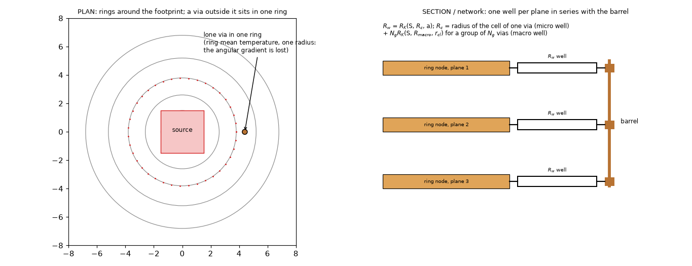

*Figure (`images/via_constriction_lumped_well.png`): left, a lone via outside the footprint sits in one ring, and the ring carries its mean temperature at one radius: the angular gradient of the real field is lost; right, the network: one well `R_w` per plane in series with the barrel.*

**Limits.** The Lumped model is not mirror-symmetric with two parts: the distance to the other heater is read in the floor cell of its centroid, so a board and its mirror image differ by up to 0.09 K (`validation.md` 42.6; the interpolated read is not adopted). The rings have no angular resolution: the effect of a lone via depends on its distance and on the number of rings. For a part over a dense group of vias the footprint is cut into two zones (section 5.2), which removes most of the error of the one-node footprint; what is left, and what the zones do not touch, is: an array that straddles the footprint edge or lies just outside it (the part is read too cool, up to 16 % of its rise with the zones; with the one-node footprint up to 3.2 times the via effect, about 11 K, a quarter of the rise), and an array off the centre or under an elongated footprint (1 to 5 % and 2 to 4 % of the rise with the zones; `checks.lumped_via_cool_warning` warns). A via one pitch outside the array is joined to it by the grouping and still reads hot (+1.2 K against the FVM -0.08 K in the board tried, `validation.md` 42.3). A lone via, a row and scattered vias outside every footprint keep the ring network's error (a lone via from 22 % too small to 65 % too large). A copper edge across the footprint, a board corner and a thin heater are the cases where the ring network fails (the input checks warn); round boards and a two-layer board have the via effect 16 to 21 % too small, so the part reads hotter (the safe side); a one-layer board with partial copper has only the two laminate nodes.
**Where it is checked**: `validation.md` 3 (against the 3D solid), 17 (the metal block), 18.1 (vias), 21 (rings and one-layer boards); `research/lumped-analytic-vias`, `research/lumped-via-groups`, `research/models-comparison`. **Sources**: [CarslawJaeger] (M) (logarithmic potential, `I₀`, `I₁`).

### 5.2 The footprint in two zones (`lumped.py`, `viaconstriction.py`)

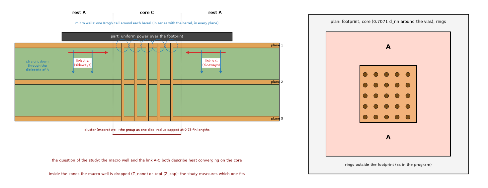

*Figure (`images/lumped_zones_footprint.png`): a part over a group of vias. The cells within `0.7071 d_nn` of the vias form the core C, the rest of the footprint is A; the vias reach the planes through the wells of section 5.1 at node C, and the heat of A reaches the barrels through the lateral link A-C.*

With one node for the whole footprint the heat generated far from the vias is assumed to reach them at the mean temperature of the footprint, and a part much larger than its via array reads too cool (the one-node footprint is up to 109 % off in the via effect on dense arrays under a large footprint). When the footprint holds a **group of two or more vias** (single linkage, section 5.1) the cells within `CORE_R d_nn = 0.7071 d_nn` of the vias of the group (`d_nn` the mean nearest-neighbour distance of those vias; `0.7071 = 1/√2` covers a square lattice) are the **core** C, and the rest of the footprint is **A**. A and C are two nodes per layer (`lumped._zone_network`); the rings outside are the program's. The sums of sheet conductance, films, dielectric conductance and capacity of each node are sums over its cells, the barrels of the vias in C reach the planes through the micro wells of eq. (5.6) at node C (the cluster-well term is kept in every node, with its cap of `0.75 λ_l`), and the source of the layer is divided between the two nodes in proportion to the covered area, `Q_A = (1 − f_C) Q`, `Q_C = f_C Q` (`f_C` the coverage-weighted share of the footprint in the core).

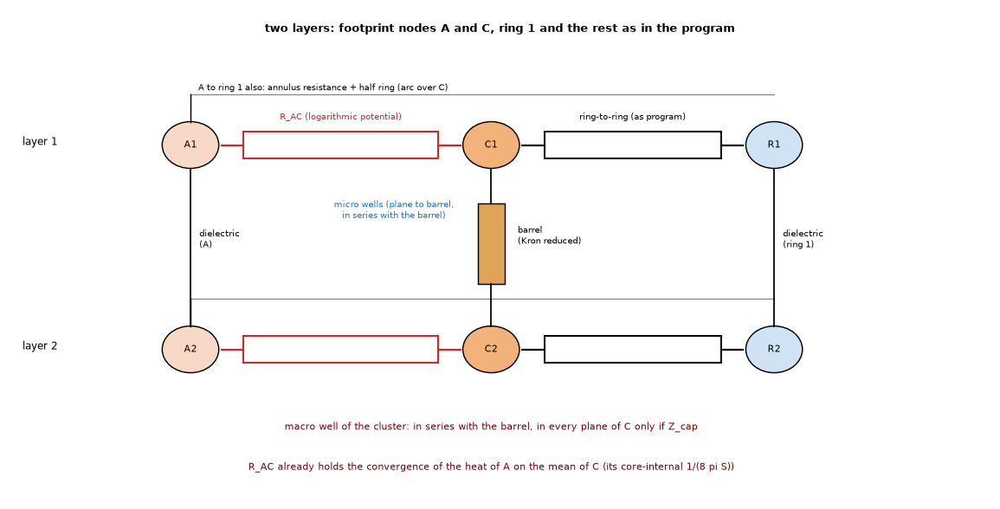

*Figure (`images/lumped_zones_network.png`): the network of two layers with the footprint in two zones: each layer has A, C and the rings; the vertical links (dielectric, barrels with their wells) and the lateral links A-C and A to ring 1.*

**The link between A and C.** For a uniform source over A and a uniform sink over C of equal strength `Q` on a lossless sheet of conductance `S`,

    T_A − T_C = Q (2 φ_AC − φ_AA − φ_CC)/(2 π S),        φ_XY = mean of ln|x − y| over x in X, y in Y        (5.7)

taken on the real shapes of A and C with the potential sums of section 5 (zones of more than 700 cells are aggregated in blocks, `_block_points`, `_mutual_potentials`). For concentric discs this is the Krogh resistance of the annulus plus `1/(8π S)` of the core, so the convergence of the heat on the group is not counted a second time by the cluster well that stays at C (confirmed by the run: leaving the cluster well out of the zone nodes or keeping it differs by 0.2 point of mean error; with several groups under one footprint keeping it is better by 3 to 6 points of the effect, which is why it is kept).

**The link between A and ring 1** is the mean-to-outer-wall resistance of the annulus of inner radius `r_c` and outer radius `a`, with a uniform source and the inner side insulated (`viaconstriction.annulus_out_resistance`), plus the half ring of the program (the Bessel factor of eq. 5.4 is not applied to this link):

    R_{A,1} = [ (I₁ − I₂)/((a² − r_c²)/2) ] / (2 S π (a² − r_c²)),
    I₁ = a² (a² − r_c²)/4 − (a⁴ − r_c⁴)/8,     I₂ = r_c² [ a²/4 − (r_c²/2) ln(a/r_c) − r_c²/4 ]        (5.8)

with `r_c` and `a` the radii of the discs of the same area as the core and as the footprint; it tends to `1/(8π S)` as `r_c → 0`, the one-node value of eq. (5.3) for a disc.

**The peak.** The hottest point of the source layer is the largest of three candidates (`lumped._ZonePeak`): (i) the hottest point of A, the field of a uniform generation `Q_in + Q_out` over A with a sink `Q_in` on C and `Q_out` far away, with the `K₀(d/λ)` kernel of the layer; (ii) the core mean plus the **rim of the Krogh cell** of one via above the cell mean (`viaconstriction.rim_minus_mean`), per watt taken by the via,

    ΔT_rim = [ b² ln b/(b² − 1) − 1/2 ]/(2π S) − R_K(S, R_c, a),      b = R_c/a        (5.9)

(the micro peak: the temperature at the rim of the cell exceeds its area mean); (iii) when the core is hotter than A, the core mean plus the rim plus the **bump** of the core above its mean (the footprint formula of eq. 5.5 applied to C). The bump is essential: without it the largest error of the via effect over the 36 family boards went from 9.1 to 20.1 %. The one-node footprint (the fallback) carries no micro peak, so that it is the program's code unchanged.

**The decision: zones or one node.** The footprint is cut into zones only when it holds a group and the core covers at most **92 %** of it (and not all of it) counted **both** on the Lumped grid and on a 0.1 mm grid (`_fine_core_share`; `will_be_zoned` counts on the fine grid alone, before the grid exists, and its answer is passed to the network); a core above 92 % on either count leaves the footprint one node: a core of 94 to 99 % of the footprint leaves a handful of cells for A, and the zone network then reads the part up to 14 % hot, so the threshold protects; the fine count does not jump with the raster (without it the inverted-T example board stepped 2.9 K between 1.0 and 0.5 mm). A board with an outline is decided on the rectangle of the same area, the board the model solves (section 1.3.3). The nine vias of the example board are a core of 98 to 100 % of the footprint of U1, so U1 stays one node and the board is unchanged.

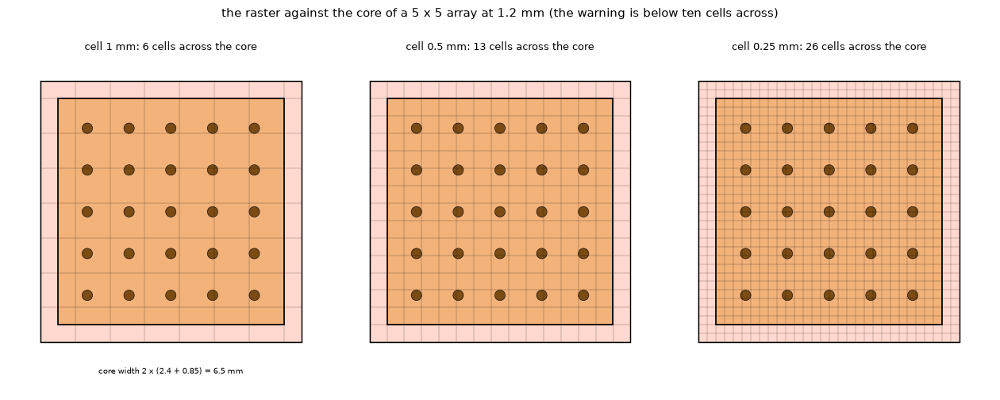

*Figure (`images/lumped_zones_raster_against_core.png`): the core of a via array on the Lumped raster at 1.0 and 0.5 mm: a core a few cells across is badly drawn.*

**The raster.** The core must be a handful of cells across, so a board that has a part that will be zoned runs the Lumped model on a **0.5 mm cell** (`lumped.cell_for`; the other boards keep the 0.5 to 1.0 mm clip of the options). The cell is one per board: the other parts of that board move by the raster too. The Analytic keeps its clip.

**Capacities and time.** The capacity of each zone node is the sum of the capacities of its cells (the sum over the nodes of the footprint equals the footprint capacity of the one-node network), and the transient is `C dθ/dt + K θ = s P` with `s` the source vector (the share of A and C by the covered area); the peak is evaluated at every step with the same operator as in steady state. The cells of the core are painted with the temperature of node C in the temperature map; outside the footprint the radial profile is read from A (`lumped._radial`).

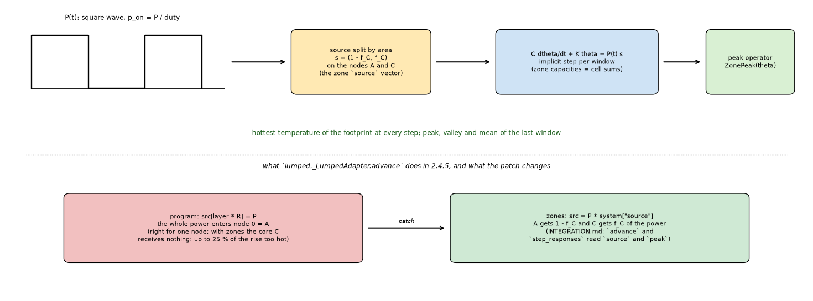

*Figure (`images/lumped_zones_profile_runner.png`): the square-wave run: the wave, the source split between A and C, the zone network and the peak operator; below, what an adapter that puts the whole power on A does, and what the split changes.*

**The profile runner.** The runner of the power profiles (`_LumpedAdapter.advance`) and the step responses used by the decision average-or-resolve (`lumped.step_responses`) apply the power through the same source vector and read the same zone peak; with the whole power put on A the part would read up to 25 % of its rise too hot (measured on 93 boards).

**A part near a side or a corner (`checks.check_lumped_near_edge`).** The rings are the contours of the distance to the footprint cut by the board, so their cell counts, contour lengths and the edge loss are those of the cells that exist: a ring that a side clips is a partial ring with the right area and loss. What the construction cannot hold is the shape of the flux: near an insulated side the field is that of the part plus its mirror image (method of images, [CarslawJaeger] (M)), the equipotentials are not the circles the rings follow, and the link of the footprint to the first ring is that of the part alone. The hottest node of a part reads too cool, -9 to -10 % at a side and -15 to -17 % at a corner on average at a gap of zero (2 to 10 mm parts, 40 x 40 and 100 x 80 mm, against the FVM; the first number with the capped first ring of 2.6.0, the second without), -22 % at worst, falling to the deficit of the rings far from any side (-2 to -5 %, more for a 2 mm part on a large board without the capped first ring) at a gap of about 30 mm. The program does not correct it; it warns when the gap of a source to the nearest side (to the real outline on an outline board) is at most max(its equivalent side, 5 mm), `validation.md` 35.2. 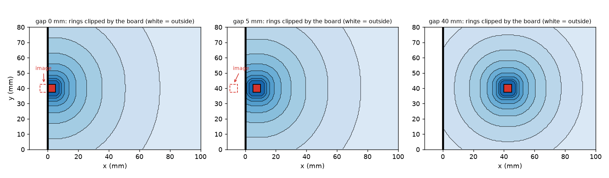

*Figure (`images/lumped_near_edge_rings.png`): the rings of a footprint near a side and a corner, cut by the board.*

**The raster for a part under two cells (`lumped.small_part_cell`).** A source narrower than the raster is spread over the whole cells it touches, so its footprint is a whole number of cells and the hottest node depends on where it sits in the cell (-19 to +6 % at 0.5 mm for sides of 0.1 to 0.5 mm; the FVM at the same cell has the same spread: a grid effect, not a defect of the rings). When the smallest powered source is narrower than two cells, `cell_for` refines the raster to half its side, not below 0.125 mm, if the estimate of 1.7 KB per cell (4 layers, scaled by the layers above four) stays within the smaller of 1 GB and the memory-guard limit; otherwise the raster is kept and the live check says so. One raster per board; a board with a zoned part keeps 0.5 mm (the live check says so too). `validation.md` 35.3. 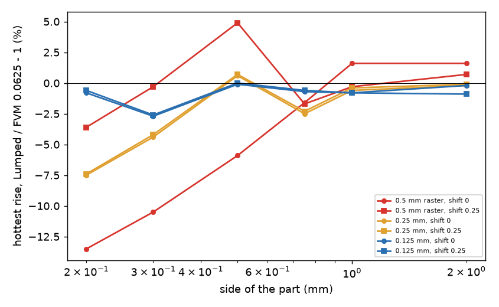

*Figure (`images/lumped_subcell_raster.png`): error of the hottest node against the raster for parts of 0.2 to 2 mm (drawn on the tree with the capped first ring; on `develop` the 0.2 to 0.3 mm parts sit 3.5 to 6.7 % lower, `validation.md` 35.3).*

**Limits.** **Constants fitted against the program's own FVM.** The ring edges, the zone constants (`CORE_R`, the 92 % and the block limits, `MACRO_CAP`) were chosen by comparison with the FVM at fine cells (62 and 93 boards), which is the same layered idealisation: the agreement shows that the ring construction reproduces that model, not that the constants are independent of it; the independent references are the 3D solid and the 3D solver (the via constriction was also checked on 17 boards not used to build it). The core radius `0.7071 d_nn`, the 92 % and the 700-point block aggregation are assumed constants. The model reads the part too cool by up to 16 % of its rise for an array across the edge of the footprint and 1 to 5 % for an off-centre cluster and 2 to 4 % for an elongated footprint (steady state and profile), and up to 6.1 % of the rise too cool when the vias conduct nothing (the cut of the footprint lowers the peak by itself); the one board of the 62 simple boards on which the zones are worse than the one-node footprint by more than 5 points of the via effect reads the part 7 % too hot, on the safe side (the 7 x 7 array at 0.6 mm pitch with a 0.2 mm drill, copper-filled, under 8 mm), and in the square-wave run three of the 93 boards read the peak 6 to 13 % of the rise too hot, partly the same steady offset and partly the overshoot of the peak term at the switching edge. Several groups under one footprint are treated as one core (their union). Irregular groups, a guard ring of vias, a block under the part and an L-shaped footprint were not tested; a footprint whose core covers more than 92 % of it, or that holds no group, is the one-node network. Warnings in `checks.py` (`lumped_via_cool_warning` with the bound of the zoned model, a raster coarser than a tenth of the core, a footprint kept as one node).

**Position on the grid and level against a converged 3D reference** (`research/lumped-zone-placement`, reviewed; `validation.md` 50). Where the part and the via array fall on the Lumped raster moves the zoned reading of a dense group by 1 to 3 points of the rise (a noise of the discretisation, not a trend). Against a converged independent 3D reference the zones read -1.7 to -2.4 % at the peak and -2.1 % on the mean (cool side) when their own grid is converged, while one node reads +2.5 to +3.1 % at the peak; as shipped, with the 0.5 mm zone raster, the zones read -0.8 to +0.8 %. That raster is part of the calibration of the zone constants and must not be refined alone. No change of the model was adopted (a rule R1, a 0.25 mm raster and removing the zones were measured and not adopted); the warning of up to 16 % for an off-centre array stands.
**Where it is checked**: `validation.md` 18.2; `tests/test_lumped_zones.py`; `research/lumped-zones-adoption` (README 4, 8, 9 and 10), `research/lumped-via-groups`. **Sources**: the closed forms (5.7) to (5.9) are own derivations checked numerically against the FVM at 0.25 mm and a fine-grid layered solver; Krogh's cell was not opened as a source (section 12); the published case of Shen and others (2020) was read in equations (2) to (5) and its CFD number was not reproduced (`validation.md` 18.2).

## 6. Analytic: multilayer Fourier series

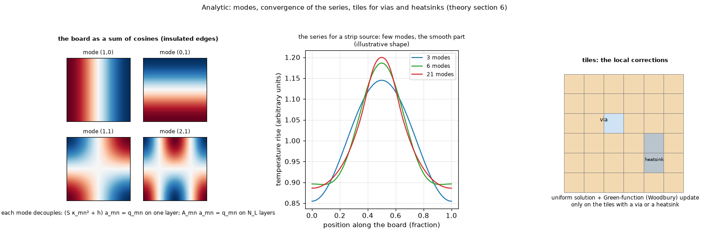

*Figure 6 (`images/fig_06_analytic_modes.png`): left, four of the cosine modes of a board with insulated edges; middle, the partial sums of the series for a strip source (the shape only: the curves are illustrative); right, the tiles on which the Green-function correction acts: only the tiles with a via or a heatsink.*

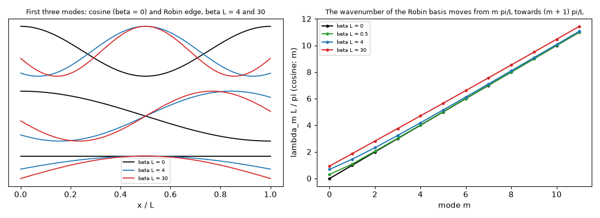

*Figure (`images/analytic_robin_modes.png`, from `research/analytic-edge-spatial` figure 3): the first modes of the cosine basis and of the basis of a convective edge (the edge parameter times the length 4 and 30) and the wavenumbers: with the edge cooled the modes no longer have zero slope at the edge, and their wavenumbers move up towards `(m+1)π/L`.*

**Unknowns.** The amplitudes `a_{l,mn}` of the series of each layer (cosines, or the eigenfunctions of the convective edge below), `N_L` per mode, 300 modes per direction by default; for the corrections, the temperatures of the tiles with a local element.

**Equations.** On a **uniform** board (1) is solved exactly, with the board edge as it is. The edge of layer `l` is a film `h_side s_l`, `S_l ∂θ_l/∂n = −h_side s_l θ_l` (`s_l` the slab thickness of the layer node, the same split by layer as the edge conductance of the FVM); the model writes it with **one parameter for all the layers**,

    ∂θ_l/∂n + β θ_l = 0,        β = h_eff Σ_l s_l / Σ_l S_l   (1/m),   h_eff = h_side P_edge / (2 (W + H_b))       (6.0)

with `P_edge` the perimeter of the board (of the real outline on a board with an outline, which the model solves on the rectangle of the same area, section 1.3, so `h_eff` keeps the edge conductance of the real shape). (6.0) is exact when every layer has the same ratio `s_l / S_l`; with unlike copper the layers are corrected one by one (the per-layer edge, below). Along each direction (length `L`, half length `L_h = L/2`, `u = x − L/2`) the functions that satisfy it are the even `cos(λu)` and the odd `sin(λu)`,

    even:  λ L_h tan(λ L_h) = β L_h,  λ L_h in (kπ, kπ + π/2);        odd:  λ L_h cot(λ L_h) = −β L_h,  λ L_h in (kπ + π/2, (k+1)π)       (6.0a)

ordered by `λ` (mode 0 even, 1 odd, ...), with the norms `∫ cos² = L_h + sin(2λL_h)/(2λ)` and `∫ sin² = L_h − sin(2λL_h)/(2λ)`; they are orthogonal for the weight 1 (the Sturm-Liouville problem [CarslawJaeger] (M); equations 12 to 21 of [Muzychka2003Part2], the centred source of the paper needs only the even ones, the board needs the odd ones too). With `β = 0` they are exactly `cos(mπx/L)`, `λ = mπ/L` (the code is then the cosine one, bit for bit). The roots are found on the forms without poles, `λ sin − β cos` and `λ cos + β sin`, where each changes sign once, with the first-order asymptote at the end of an interval when rounding cannot resolve it (`β L_h` from 1e-30 to 1e14 tested). Expanding each layer, `θ_l(x, y) = Σ_{m,n ≥ 0} a_{l,mn} φ_m(x) φ_n(y)`, the Laplacian becomes `−κ²_mn`, `κ²_mn = λ_m² + λ_n²` (it was `(mπ/W)² + (nπ/H_b)²` for the cosines), and the layers decouple by mode into a tridiagonal `N_L × N_L` system

    A_mn a_mn = q_mn            A_mn = diag(S_l κ²_mn + h_l) + g · Λ                    (6.1)

where `g · Λ` is the weighted graph Laplacian of the layer chain, with the conductance per area `g_j` of each gap on its link (`(g·Λ)_ll = g_{l−1} + g_l` over the gaps that exist, `(g·Λ)_{l,l+1} = −g_l`; one `g` for every gap in the simple stack-up) and `h_l` the surface coefficient of the layer (`h_top` on the first, `h_bottom` on the last, zero otherwise; for a one-layer board `h_bottom` is in series with the laminate, section 1.4). The edge is **not** in `h_l`: it is in `κ²_mn`. The **mode (0,0)** of a board without `h_side` is the uniform-board limit `P/(h W H_b)`; with an edge the first mode is not constant, and the heat out of the faces is the integral of each layer over the plan (`Σ a_{l,mn} ∫φ_m ∫φ_n`) and the heat out of the edge is `β S_l` times the integral of the layer along the four sides (`power_out["sides"]`), so that the heat balance closes. `h_tot = h_top + h_bottom + Σ_l h_side P_edge s_l / (W H_b)` is still formed, for the fin lengths, the tile size and the time constant only.
**Source**: the heater is replaced by the axis-aligned rectangle `[x₁,x₂] × [y₁,y₂]` with the same area and centroid (aspect ratio of the bounding box); its coefficients on the basis are

    q_mn = P · I_x(m) I_y(n) / (N_x(m) N_y(n) · area),   I_x(m) = ∫_{x₁}^{x₂} φ_m dx,   N_x(m) = ∫_0^W φ_m² dx       (6.2)

and `I_y` likewise; for the cosines `N(0) = L`, `N(m>0) = L/2` and `I_x(m) = (sin(κ x₂) − sin(κ x₁))/κ`, `κ = mπ/W` (the factor `ε_m = L/N(m)` of the cosine series). The field is `θ_l = Φ_y · a_l^T · Φ_x^T` with `Φ` the basis at the cell centres, two matrix products.

**Copper is not uniform.** Each layer gets an **effective copper fill** averaged with the *influence* of the heaters, `f_eff,l = Σ w f_l / Σ w` with `w(x,y) = Σ_i P_i K₀(r_i/λ_l)` (`K₀`, the modified Bessel function of the second kind of order zero, is the Green function of the fin equation) and the **layer's own fin length** `λ_l = √(S_l/(h_surface + n_neighbours g))` for a layer that carries a heater (about 5 mm; the 34 mm of the whole stack would let distant copper count too much). A warning is raised when the fill varies strongly (weighted spread above 0.25).

**Vias and heatsinks are local** and are added back by a Green-function (Woodbury) correction, written on the same basis (tile averages `∫φ/Δ`, modal weights `1/(N_x N_y)`), on tiles of size `min(max(λ/4, 2.5 mm), 5 mm)`, `λ = √(Σ_l S_l / h_tot)` the fin length of the whole stack (`h_tot` the sum of the face coefficients and the edge terms). A tile with a via has `G_via` between adjacent layers (1.4); a tile under a heatsink has `g_hs = h_extra Δx Δy c` to the ambient. With `y₀` the tile means of the uniform solution and `G_mod` the modal response of the uniform board between tiles (first 64 modes), the tile temperatures `y` and the heat `φ_loc` that the local elements extract or move satisfy

    (I + G_mod C_loc) y = y₀,        φ_loc = −C_loc y,        a_mn ← a_mn + A_mn⁻¹ (projection of φ_loc)       (6.3)

the exact solution of the board with the local conductances for the tile-lumped model (a dense system of `N_tiles · N_L` unknowns, small), the static condensation of finite-element codes [MFEMStaticCond] (S). `C_loc` is the local conductance matrix of the tiles (via conductances, heatsink conductances and, with a block, the Schur complement of section 7.3).

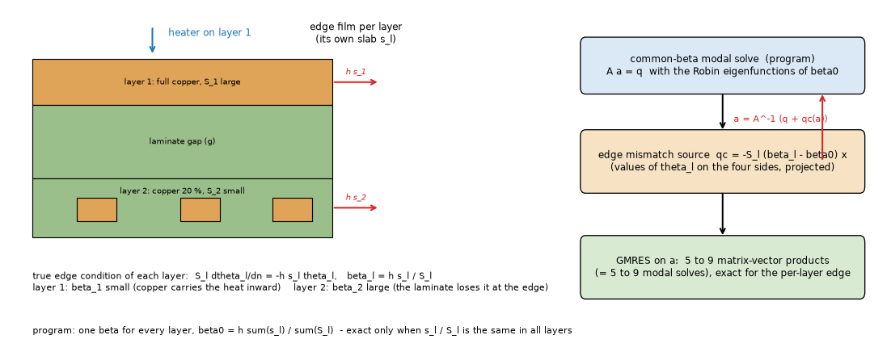

*Figure (`images/analytic_per_layer_edge.png`, from `research/analytic-edge-and-transient` figure 1): a layer with thick copper and one with thin copper have different `β_l = h s_l / S_l`; the basis has the common `β` of (6.0); the difference is added back as a modal source and the loop is solved by GMRES.*

**The edge of unlike layers (per-layer edge).** Layer `l` has its own Robin condition `S_l ∂θ_l/∂n = −h_eff s_l θ_l`, that is its own parameter `β_l = h_eff s_l / S_l`, while the basis has the common `β` of (6.0). By Green's identity twice the weak form of layer `l` in that basis has the extra term `S_l (β_l − β) ∮ θ_l φ_m φ_n` over the four sides. It needs only the rise on the sides, and the orthogonality of the eigenfunctions along each side reduces it to two small matrix products, an **extra modal source**

    qc_{l,mn} = −S_l (β_l − β) [ Σ_e φ_m(x_e)/N_m (Σ_m' φ_m'(x_e) a_{l,m'n}) + Σ_e φ_n(y_e)/N_n (Σ_n' φ_n'(y_e) a_{l,mn'}) ]       (6.4)

(`e` the two ends of a direction, `N` the squared norms of (6.2)). The whole solve `R` (the modal solve of (6.1) and the Green-function step (6.3)) is linear in its modal source, so the coefficients are the fixed point `a = R(q + qc(a))`, solved by GMRES on `(I − R qc) a = R(q)` (`_per_layer_edge`): the LU of `I + G_mod C_loc` is kept (the dense matrix is overwritten by its factors, the same memory as before) and one product is a modal solve, the tile averages, a triangular solve and the response of the injected heat. It takes 4 to 9 products (restart 30, relative residual 1e-6); a loop that does not converge keeps its iterate and warns. Layers with the same `s_l / S_l` (full copper on every layer of a simple stack-up, one layer, no edge coefficient) have `β_l = β` to rounding (mismatch below 1e-9): no loop, and the code of the common `β` runs bit for bit. The edge heat is `β_l S_l` times the integral along the sides, layer by layer (`power_out["sides"]`), and the balance closes to 0.99997 .. 1.00002 at the edge coefficients the interface allows (up to 500 W/m²K); beyond them, on unlike layers, the edge values of the truncated series converge slowly and the reported edge heat leaves the balance at 0.9995 (1000 W/m²K), 0.987 (1e4) and 0.887 (1e5) with 300 modes, while the hottest temperature moves by under 0.03 % from 300 to 600 modes (review; only a project file or the API reaches them). The derivation is ours (Green's identity), checked against an independent 2D finite-difference solver of the same sheets with the true per-layer edge (within 0.1 %, `research/analytic-edge-and-transient` README 2.2); no published case is reproduced for it. What it leaves is the one laminate link per gap of the layered idealisation, which the FVM with its sub-gaps and the 3D solid do not have (limits).

**Transient.** Each mode obeys `C a' + A_mn a = q(t)` with `C = diag(c_l)`. With `C^{-1/2} A_mn C^{-1/2} = V diag(μ_p) Vᵀ` and `ζ = Vᵀ C^{1/2} a` the eigenmodes decouple, `ζ' = −μ ζ + s` with `s = Vᵀ C^{-1/2} q`, and a constant power over a step has the **exact propagator** `ζ⁺ = e^{−μΔt} ζ + (1 − e^{−μΔt}) s/μ` (`ζ` the modal coordinates; `β` stays the edge parameter of (6.0)). The vias and heatsinks stay **local in time** too (`analytic_local.py`): the tile conductance matrix `C_loc` of (6.3) enters the modal equations through the same projection the steady step uses. With `D_mn = √(e_m e_n)` (the weights of (6.2)) and `P` the averages of the eigenfunctions over the tiles, the Galerkin equations are

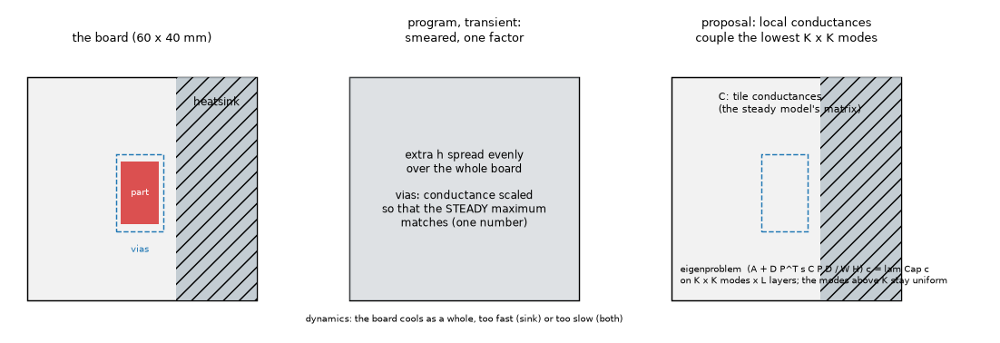

*Figure (`images/analytic_local_transient.png`, from `research/analytic-edge-and-transient` figure 3): left, the board; middle, the transient of 2.5.x (the extra coefficient spread evenly over the board, one factor on the vias); right, the transient now: the local conductances of the tiles couple the lowest `K × K` modes.*

    C a' + ( A_mn + D² Pᵀ C_loc P / (W H_b) ) a = q                  (6.5)

For the modes `m, n < K` (`K` = 16, lowered to keep `K² N_L ≤ 3000`) the matrix couples the modes through the tiles; with `a = D c` it is symmetric, `C^{-1/2} [A + D Pᵀ C_loc P D/(W H_b)] C^{-1/2} = V diag(μ) Vᵀ` on the `K × K × N_L` unknowns, and the eigenmodes decouple as above (a dense eigenproblem of at most 3000 unknowns, 42 MB and about 4 s for four layers; one per heater when there are several). The modes with `m` or `n ≥ K` keep the uniform diagonal system of the board without vias and heatsinks. The block cannot hold the constriction of the barrel (the self-term of the tiles in (6.3), section 6.1), so **one factor `s` on the via couplings** (not on the heatsink conductances, which are exact tile means) is found by Brent's method on `ln s` in [0.05, 20] until the steady rise at the own point of the heater equals that of the steady solve; a target outside the bracket takes its end and warns, and without vias `s = 1`. One factor on the whole of `C_loc` leaves the vias too strong and the heatsink too weak when both are present (time to 63 % +5 to +32 %). The eigenvalues, sources and output rows of the block are stored in the same `(M, N, N_L)` arrays as the uniform modes, so the exact propagator, the profile runs and the animation frames use the same code (the field of the block is `a = D C^{-1/2} V ζ`). **Limit, measured:** against the FVM at 0.5 mm the time to 63 % of the unit step is -8.1 to +0.5 % on 12 test boards (-8.1 to -0.1 % with a heatsink; the worst is a four-layer board with vias and a 300 W/m²K heatsink, -7 % also at `K` 24 and 32, so it is not the truncation), the steady resistance equals the steady solve's, and the peak and swing of a square wave are within 3.6 %; the smeared transient of 2.5.x read -66 % to +175 % (`docs/validation.md` 4.1). A sample (one 60 x 40 mm family, one part, two and four layers). The review added boards outside it (FVM at 0.5 mm): two parts with vias under one and a heatsink in a corner, time to 63 % +0.2 / -0.5 % (2.5.1: -39 / +17 %) and the square-wave peak of a profile run +0.3 % (the minimum of the cycle 1.1 K low); two overlapping parts over 25 vias with a 200 W/m²K heatsink on a four-layer 40 x 30 mm board, +3.0 / +4.2 %, but the peak of a square-wave profile run 5 to 7 % low; a part at the edge over partial copper (fill 0.3) with `h_side` 50 and vias at the edge, +0.8 % on the time to 63 % but the step curve up to 6.9 % of the steady resistance off. An outline was not tested, and the modal matrix keeps the common `β` of (6.0), so the plateau of a board without vias or heatsinks is the common-parameter one, not the per-layer steady solve's. A warning says so in every Analytic time simulation with a heatsink (profile runs in the Results summary, the animation in its status line and on the command line through `TransientResult.warnings`). No time simulation with a block or on an outline.

**Limits.** Copper that is not uniform near a heater (a small pad, an edge across the footprint) is represented by the influence-weighted fill, an average; the edge of each layer is treated by itself (the per-layer edge above), and the hottest temperature was measured -4.1 to +0.1 % of the FVM at 0.5 mm on 48 boards of two or more layers (`h_side` 10, 50 and 200 W/m²K, part at the centre and in a corner; the earlier common parameter -8.6 to +5.8 %), with very different copper (a two-layer board with a bare side, 0.2 fill on two layers of four) and with vias and a heatsink -4.7 to +0.9 %; what is left is on the cool side and is the one laminate link per gap of the layered idealisation, which the per-layer edge solves exactly (against an FVM with one laminate link per gap within -0.03 to +0.25 % on the six worst boards, `research/analytic-edge-and-transient` README 6.1); it is not an artefact of the FVM: the 3D solid reads hotter still, so against the 3D solid the 24 boards of the study at `h_side` 50 and 200 are -0.5 to -5.8 % (the common parameter -10.6 to +5.0 %), and small boards outside the study (30 x 20 mm, a 6 or 10 mm part in a corner, the edge 73 % of the loss, top fill 0 to 0.3) are -5 to -10 % where the common parameter read from 0 to +10 % (two errors that cancelled; review, `docs/validation.md` 4.1); on a one-layer board the laminate edge is given to the copper node (-7.3 % at 200). The program warns when the edge takes more than 30 % of the loss coefficient and the board has one layer, or two layers whose `S_l` differ by more than 1.5 times, or more layers by more than 2.5 times (the measured range of the case is in the text; on the 54 boards of `validation.md` 4.1 it fires on 10 and on every one of the 5 with an error above 3 %, and on none of the 135 uniform boards). The Analytic series has no laminate nodes, so it keeps the edge film of the laminate at the copper temperature and reads cool on a thick board with a cooled edge (−5.2 % at 200 W/m²K on 1.6 mm and −15.2 % on 3.2 mm against a converged 3D solver, where the FVM with the edge band of section 1.4 is within −0.6 % and −2.3 %; `validation.md` 36.3; `checks.check_reduced_edge_laminate` warns from 150 W/m²K·mm). The heater is a rectangle of the same area. The checks warn. With partial copper the Analytic model is the better of the two reduced models.
**Where it is checked**: `validation.md` 3 (the 3D solid), 4 (why the FVM and the Analytic model agree on uniform boards: the same layered model; the Analytic is its exact solution on a uniform sheet), 13 (outline), 7 (time); `research/analytic-partial-copper`. **Sources**: [CarslawJaeger] (M), [IncroperaDeWitt] (M), [MFEMStaticCond] (S). The compound flux-channel series, the construction of the Analytic, is that of [YovanovichMuzychkaCulham1999] (R, pages 3 to 5; Table 2 reproduced to four digits, equations 14, 15, 24, 27); the series with film side faces and its "10 to 30 terms" are in [CulhamFourier2000] (R, pages 233 to 235), and the edge in the basis is the eigenvalue problem `δ tan δ = Bi_e` of [Muzychka2003Part2] (R, eq. 12 to 21 and the rectangular flux channel with edge cooling, read from the text layer of p. 4 and re-derived; its equation 21 reproduces a 3D finite-volume solver to -0.16 to +1.06 % and the thin-sheet series of the program reproduces equation 21 to -0.03 to -1.1 % for `tau = t/L <= 0.1` on `tests/test_analytic_edge.py`; at `tau = 0.3` (k = 50) it is -3.6 to -6.1 %, the one-node-through-the-thickness limit of section 7.5, so the statement holds for thin sheets only), merged into the journal paper [Muzychka2006EdgeCooling] (S). The odd functions are not in the paper (a centred source), only in the Sturm-Liouville theory [CarslawJaeger] (M); they are checked against an independent finite-difference solver (within 0.02 %).

### 6.1 The via in the tiles (`viaconstriction.py`)

The Analytic model carries the mean temperature of a tile of its Green-function mosaic, so the correction (6.3) must read the via at its wall (section 1.5). The tile rules:

* the **tile** is `t = min(1 mm, 0.75 median d_nn)` (the median over the vias that belong to a group; a via left alone has an infinite distance and is not in it), at least 0.25 mm and never above the program tile (2.5 to 5 mm without vias), so that the sink has the scale of the barrel; it is enlarged until the active tiles (those with a via, a heatsink or a block) times the layers are at most 4800 unknowns (the dense system is then of the order of a gigabyte; the same guard coarsens the tile when the estimate of active tiles passes 1200);
* a via that is **alone at the scale of a tile** (`d_nn ≥ 0.7 t`, outside a guard of `0.5 t` around a footprint) is spread bilinearly over the four tiles around it, which keeps its first moment, and not put in the one tile that holds its centre;
* the diagonal of `G_mod` gets a **self-term** that makes the tile read the temperature at the wall: for `n ≤ 1` vias per tile `D_self = [ln(R_blk/a) − 1/4]/(2 π S n)`, `R_blk = R_tile/√n`; for `n > 1`, `D_self = ln(R_tile/r_cl)/(2 π S) + R_K(S, R_c, a)/n`; here `R_tile = t/√π`, `R_c = min(R_tile/√n, d_nn/√π)` and `r_cl = √n R_c` (the rules of eq. 5.6 with the tile for the ring and the vias of the tile for the group), `n` the (weighted) number of vias in the tile.

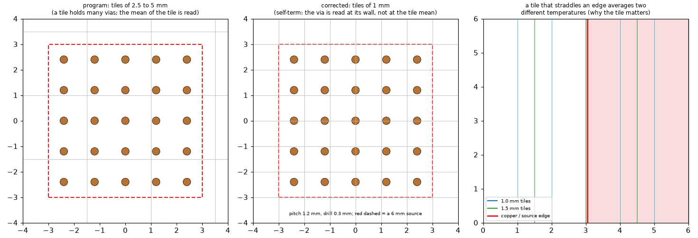

*Figure (`images/via_constriction_analytic_tiles.png`): left, the tiles of the program (2.5 to 5 mm) over a 5 x 5 array of 0.3 mm vias at 1.2 mm pitch under a 6 mm source: one tile holds many vias and the tile mean is read; middle, the tiles of 1 mm with the self-term: the via is read at its wall; right, a tile that straddles a copper or source edge averages two different temperatures, which is why the tile must be small.*

**Limits.** The tile size, the influence weighting, the 64 modes of `G_mod` and the per-heater scale of the transient are fitted against the program's own FVM, so, as for the Lumped constants (section 5.2), they are not independent of the layered idealisation. A lone via is the weak case (its effect depends on the distance to the heater and the tile); the tile is limited by the unknowns guard (the Analytic keeps the clip of the cell to 0.5 to 1 mm, so 2 mm equals 1 mm; the Lumped model uses 0.5 mm when a part will be zoned, section 5.2, and the Analytic has no zones). The numbers are in `validation.md` 18.1; the formulas are derivations checked numerically against the FVM and an axisymmetric solve (`research/lumped-analytic-vias`, `research/lumped-via-groups`, `research/young-omega-tiles`).

## 7. Metal blocks (FVM, FDM, 3D solid; Lumped and Analytic in steady state)

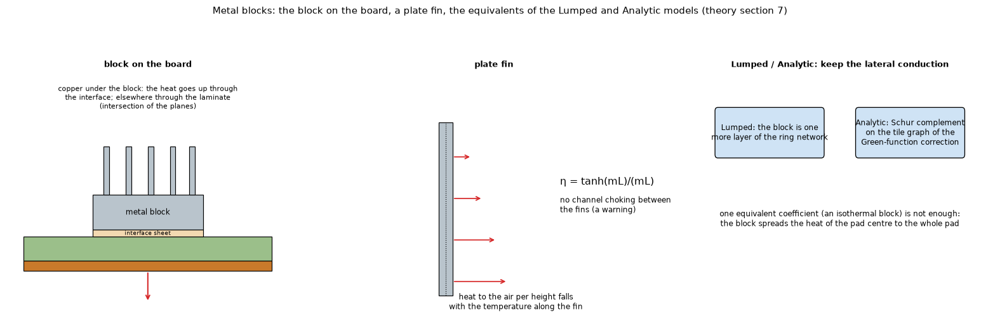

*Figure 11 (`images/fig_11_metal_block.png`): left, a block on the board through an interface sheet (the heat enters the block where it overlaps copper; over bare laminate it must also cross the FR-4); middle, a plate fin whose heat to the air falls along the fin, `η = tanh(mL)/(mL)`; right, the two equivalents of the Lumped and Analytic models, which keep the block's lateral conduction.*

### 7.1 The plate in the layered models

A heatsink with `thickness > 0` is a plate of metal (conductivity `k`, heat capacity `ρc`, thickness `t`) pressed on the top or bottom face through an interface of resistance per area `R''`. In the layered models it adds **one extra layer of nodes** (one per cell) on that face, with the coverage `c` of the cell by the block:

    lateral sheet conductance   S = k t c                                (joined by the harmonic mean, as the board)
    heat capacity               C = ρc t Δx Δy c
    contact to the board layer  G = c Δx Δy [ f/R'' + (1 − f)/(R'' + r_half) ]
    exposed surface             G = h_exp Δx Δy c,           h_exp = h_face · r_fin + h_extra
    sides of the plate          G = h_wall t L_edge,         h_wall = h_face + h_extra                       (7.1)
    board face under the block  its coefficient is multiplied by (1 − c)

`f` is the copper fill of the board layer there and `r_half` half a layer slab over `k_th`: **the heat enters the block mostly where the block overlaps copper** (the intersection of the two planes) through `R''`; over bare laminate it must also cross the FR-4 (a much larger resistance). The block is an isotropic plate without gradient across its thickness (valid while `h t/k` is small). Cells with no block have `10⁻⁹ W/K` to the ambient.

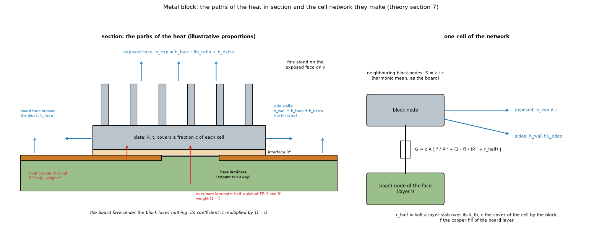

*Figure 41 (`images/fig_41_block_section.png`): left, a metal block on the board in section (illustrative proportions): the heat enters the block through the interface `R''` over copper, and over bare laminate also across half a slab of FR-4; it leaves through the exposed face (fins, `h_exp = h_face r_fin + h_extra`) and the side walls (`h_wall = h_face + h_extra`); the board face under the block loses nothing (factor `1 − c`). Right, the cell network these paths make.*

### 7.2 Plate fins

`r_fin` is the **fin ratio** of the optional plate fins (height `H_f`, thickness `t_f`, pitch `p`, perpendicular to the base, thin fins with an adiabatic tip at the corrected height `H_c = H_f + t_f/2`): per unit of base area

    r_fin = (1 − t_f/p) + 2 H_c η / p,       η = tanh(m H_c)/(m H_c),       m = √(2 h_face/(k t_f))                  (7.2)

(`r_fin = 1` without fins) [IncroperaDeWitt] (M). The fins stand on the exposed face, so only `h_exp` carries `r_fin`; the side walls of the plate keep `h_wall = h_face + h_extra` (7.1), which is not the board edge coefficient `h_side`. Not modelled: the end faces of the fins, their heat capacity (only the plate `ρc t` is in `C`, so a finned block responds too fast in time) and conduction along the fin row.

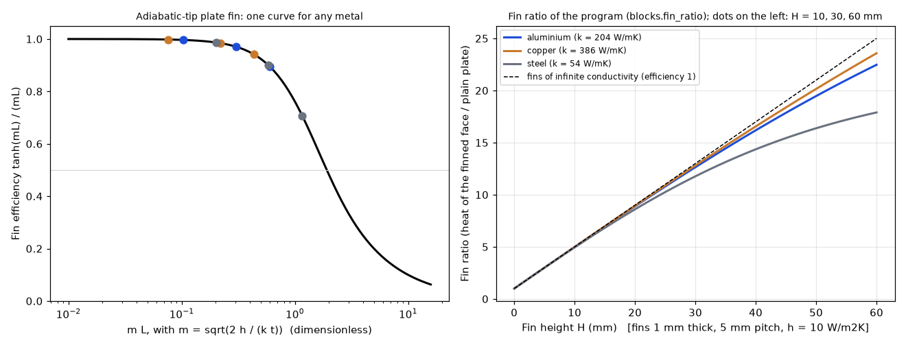

*Figure 31 (`images/fig_31_fin_efficiency_and_ratio.png`): left, the efficiency `tanh(mL)/(mL)` of a plate fin against `mL` (closed form; the dots are the fins of the right panel at `H_f` = 10, 30 and 60 mm, `h` = 10 W/m²K, 1 mm thick, 5 mm pitch); right, the fin ratio of the program (`pcbthermal.blocks.fin_ratio`) against the fin height for aluminium (204 W/mK), copper (386) and carbon steel (54) of the program's metal library, with the line of fins that conduct perfectly. Computed by `scripts/make_figures.py`.*

### 7.3 Lumped and Analytic: the block in steady state

An equivalent coefficient `h_eq = 1/(R'' + 1/(h_face + h_extra))` (isothermal block) cannot work because the block spreads the heat of the pad centre to the whole pad, which a uniform coefficient does not do; what works is to keep the block's lateral conduction:

* **Lumped**: the block layer of the FVM network (7.1) is summed over the rings like the board layers: one more layer of unknowns per ring, lateral links between rings with the same contour formulas (infinite where the block does not reach), vertical link `g_link` summed per ring to the heater's layer. The board face under the block loses nothing.
* **Analytic**: on the tile grid of the local corrections the same block layer is built with `blocks.extra_layers`; the block temperatures `φ_blk` obey `(K_b + D_amb + D_link) φ_blk = D_link y_b` (`K_b` the lateral conductances between tiles, `D_amb` the exposed and wall conductances, `y_b` the board-layer temperatures of the tiles), so the heat they take from the board is `B y_b` with the Schur complement

      B = D_link − D_link (K_b + D_amb + D_link)⁻¹ D_link                                           (7.3)

  a dense matrix that couples the tiles of the block among themselves. `B` is added to the local conductance matrix `C_loc` of the correction (6.3) (static condensation, or Kron reduction of a network), together with the negative conductance `−h_face·A·c` for the face that the block hides. This is exact for the tile model; the error left is the tile size and the sheet averaging of the uniform problem.

Both are steady state only; the time simulations refuse a block, and SOR does not support blocks.

### 7.4 Close fins: a warning (`checks.check_fin_channels`)

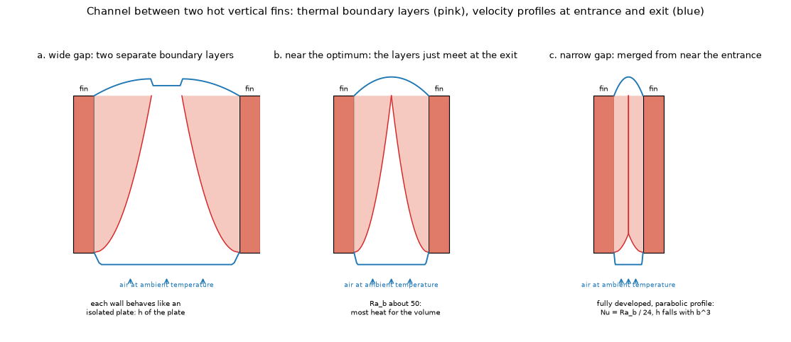

*Figure (`images/fin_channel_boundary_layers.png`, from `research/fin-channel` figure 1): the channel between two hot vertical fins: a wide gap keeps two separate boundary layers (each fin is an isolated plate), near the optimum they just meet at the exit, a narrow gap merges them from near the entrance (fully developed flow, `Nu_b = Ra_b/24`). Schematic, no data.*

The fin formula assumes one coefficient on every face; between fins closer than a few millimetres the air in the channel is slowed. After the solve the program computes the channel Rayleigh number of every finned block in still air,

    Ra_b = g β θ b_f⁴ Pr / (ν² L),      b_f = p − t_f                                                  (7.4)

(`θ` the mean excess of the block over the air, `L` the longer side of the block, air at ambient + θ/2), and warns when `Ra_b < 90`, that is when the channel keeps less than 90 % of the coefficient of an isolated plate. From the composite of two vertical plates of Bar-Cohen and Rohsenow [BarCohenRohsenow1984] (N; read as printed in [TeertstraReview]), `Nu_b = [(24/Ra_b)² + (0.59 Ra_b^{1/4})^{-2}]^{-1/2}`, the kept fraction is, by own algebra (L),

    ϕ_ch = [1 + (14.16 / Ra_b^{3/4})²]^{-1/2}                                                              (7.5)

(0.9 at `Ra_b` = 90, 0.75 at 40.5, 0.5 at 16.5). The result is never changed. The text of the warning, its limits (vertical channels, below `Ra_b = 14` the loss is an upper bound, no radiation, forced air not checked) and the numbers are in `models.md` 15 and `validation.md` 24; evidence `research/fin-channel`, `research/fin-channel-sources`. **Sources**: [ElenbaasBCR] (N), [BarCohenRohsenow1984] (N), [TeertstraReview] (R; equation 21 on page 83 is the composite used here), [MartinRaithbyYovanovich1991] (R, pages 1 to 6: the low-`Ra` branch of a finite channel is the lower bound of the coefficient, so the warning errs on the safe side). The review takes `β = 1/T₀` (the inlet air) where the program takes `1/T_film`: at a 30 K excess the program's `Ra_b` is about 5 % lower, a 4 % shift of the threshold, inside its scatter.

### 7.5 The thickness of a plate: a bound (`checks.check_thick_plates`)

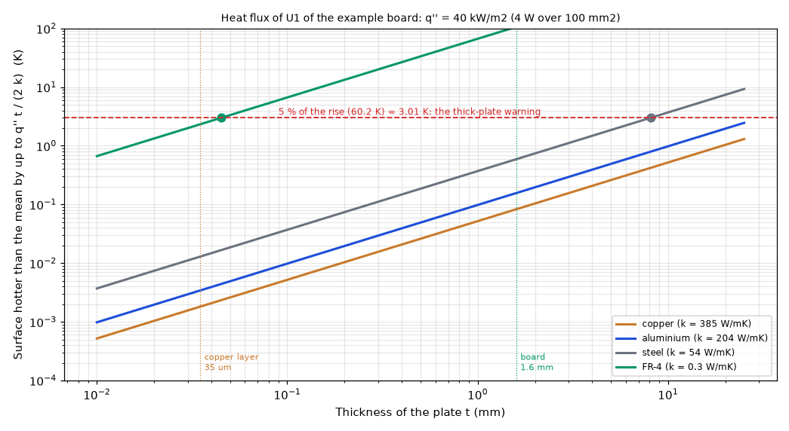

*Figure 33 (`images/fig_33_thick_plate_correction.png`): the through-thickness correction `q'' t / (2 k)` against the thickness of the plate for copper (385 W/mK), aluminium (204), carbon steel (54) and FR-4 (0.3 through the thickness), for the flux of U1 of the example board (4 W over 100 mm², 40 kW/m²), with the 5 % limit of the check (`checks.THICK_PLATE_LIMIT`) of the rise of the hottest point of the board (FVM, 0.5 mm). Computed by `scripts/make_figures.py`.*

A copper layer and a block are one node through their thickness, the mean temperature. Where a flux `q''` enters one face of a plate of thickness `t` and conductivity `k` and leaves by the other, the entering face is hotter than the mean by

    Δθ_t = q'' t / (2 k)                                                                                    (7.6)

(a flux falling linearly to zero with depth gives `q'' t/(3k)`; the closed form of the spreading in a plate behind Lee's check is the Song-Lee form summarised in [EC1998Spreading] (R) and the flux-tube series of [YovanovichCulhamTeertstra1998] (R)). After a run the program compares it with the rise of every heater and warns above 5 %; it is never added to the result. How `q''` is taken (the copper layer, the block, the auxiliary run) and the numbers are in `models.md` 4b and `validation.md` 22. **Published cases**: two published cases were reproduced in `research/effective-conductivity/`, but **by an independent solver, not by the program**. The Seri Lee plate [EC1998Spreading] (+0.6 % centre, -0.8 % edge, -4.6 % corner, `validation.md` 22.1) was computed by a thin-plate solver written inside `study_lee_spreading.py` (a re-implementation of the plate model; `blocks.py` is not called), and the independent 3D solver gives +1.2 / -0.4 / -4.4 % on it. For the cross of five sources of [Muzychka2003] only the independent 3D solver agrees (maximum 80.62 against 80.61 C); the program's own models read **below** it: 2.1 % of the rise low on the cross (FVM, FDM, Analytic) and 9 to 10 % low on the first case of the paper, because one node through the thickness is the mean of the layer and cannot show the gradient under a source (the bound of (7.6); `research/effective-conductivity/README.md` 4.6). Running `blocks.py` itself on the Seri Lee plate has not been done.

## 8. Heat transfer coefficients: convection and radiation

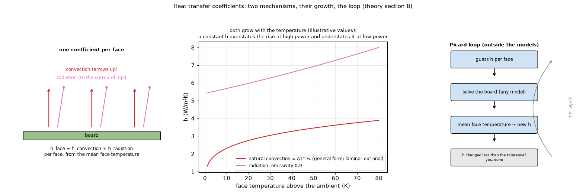

*Figure 8 (`images/fig_08_heat_transfer.png`): left, a board face that loses heat by convection and by radiation, `h = h_c + h_r`; middle, how both grow with the temperature of the face (illustrative values: a constant `h` overestimates the rise at high power and underestimates it at low power); right, the fixed-point loop that finds them, outside the models. The curve is the general form of Churchill and Chu; the laminar form is the default of new projects (`Board.natural_form`).*

In "computed" mode each outer face gets `h = h_c + h_r` (`convection.py`, mean face temperature `T_s`, air at the film temperature `(T_s + T_a)/2`):

* **Air** (dry, 1 atm, Sutherland-type fits, 250 to 450 K): `μ_air = 1.458·10⁻⁶ T^{3/2}/(T + 110.4)`, `k_air = 2.648·10⁻³ T^{3/2}/(T + 245.4·10^{−12/T})`, `ρ = p/(R T)`, `ν = μ_air/ρ`, `α = k_air/(ρ c_p)`, `Pr = μ_air c_p/k_air`, `β = 1/T`.
* **Rayleigh number**: `Ra = g β |ΔT| L³/(ν α)`, with `L = area/perimeter` for a horizontal plate and the height for a vertical one.
* **Natural convection, horizontal plate**: hot face up `Nu = 0.54 Ra^{1/4}` (`Ra ≤ 10⁷`), `0.15 Ra^{1/3}` above; hot face down `Nu = 0.475 Ra^{1/5}` (exponent 1/5; the roles swap for a face colder than the air). **Face up** [IncroperaDeWitt] (M: a textbook correlation of the Lloyd-Moran type, **from memory, not opened**; it is **not** the law printed in [Lienhard2024], which gives for the face up the Raithby-Hollands law `Nu = 0.560 Ra^{1/4} / [1 + (0.492/Pr)^{9/16}]^{4/9}` on `L = A/P` with the thick-layer correction `1.4 / ln(1 + 1.4/Nu)` (equations 8.37a/b), valid for `1 < Ra < 10⁷`, and for the face down the Fujii-Imura law `0.58 Ra^{1/5}` (10⁶ to 10¹¹, plates) and the Kadambi-Drake law `0.82 Ra_D^{1/5} Pr^{0.034}` (discs), pages 435 to 437, PDF 449 to 451, read as images). Against the Raithby-Hollands law at `Pr` 0.71 (coefficients only, computed in the review of `research/theory-sources`) the program's up-face `0.54 Ra^{1/4}`, used from `Ra` 3·10² to 10⁵, is −7 % at 3·10², −1 % at 10³, +9 % at 10⁴ and +15 % at 10⁵ (above the published law at the upper end of the board range). **Face turned down and its limit**: the constant 0.475 is the average of the `Pr` 0.71 results of the theoretical (integral-method) studies of a disk, a square plate and an infinite strip facing down that Goldstein and Lau summarised, area-mean `Nu = C Ra^{1/5}` on `L = A/P`; all their constants, heat and mass transfer, lie in 0.44 to 0.527, the highest at `Sc` 2.5 (read second hand in [YovanovichJafarpur1993], p 8, page image checked in the review, status R; the paper of Goldstein and Lau, [GoldsteinLau1983], N). The exponent 1/5 is that of every form read for the lower side of a hot plate (Fujii-Imura `0.58 Ra_W^{1/5}` on the width W of a two-dimensional plate, 10⁶ to 10⁹, which is `0.44 Ra^{1/5}` on `L = A/P = W/2`, and Kadambi-Drake `0.82 Ra_D^{1/5} Pr^{0.034}` on discs, no range printed, equations 8.38 and 8.39 of [Lienhard2024], R; the experiments reviewed on the same page, 10 to 1.25·10⁸, scatter over exponents 0.089 to 1/5 and constants 0.31 to 1.27). Two further levels agree with it within 10 % at every Ra (same exponent): the numerical strip of Goldstein and Lau, `0.524 Ra^{1/5}` for 40 < Ra < 8000 (same page, R) and VDI `0.6 (Ra f₁)^{1/5} = 0.486 Ra^{1/5}` (S, through the documentation of the library `ht`); an independent two-dimensional solver (strip in a closed box, `research/convection-laws` 5) gives Nu 2.25 at Ra 10³ and 3.38 at 10⁴ against 1.89 and 3.00 of the law (the box adds 3 to 14 %). **The Incropera and DeWitt form `0.52 Ra^{1/5}`, 10⁴ to 10⁹ (later editions), was NOT confirmed** (M: no open source prints it, the book is not in the library) and is not used; it is 9.5 % above the constant used. The program used the McAdams form `0.27 Ra^{1/4}` (S through `ht`; 10⁵ to 10¹⁰) until `fix/face-down-convection`: it was 20 % below the 1/5 level at Ra 10³ and 10 % at 10⁴, equal near 10⁵ and above it from 10⁶ (`research/face-down-convection`). The change moves boards at computed `h` and horizontal by −0.3 to −1.4 % of the hottest rise (mean −0.7 % on the 17 harness boards; example board 60.06 to 59.86 K); vertical boards and typed coefficients are unchanged. Limits: the printed ranges are 40 to 8·10³ (strip) and, for Incropera's form, 10⁴ to 10⁹; the board faces sit at Ra 3·10² to 5·10⁵, so the law is used below the textbook range (a run warns outside Ra 10² to 10⁹ on the bottom face); the laws assume the air can leave freely at the edges (Lienhard p 436: an adiabatic wall below lowers h), so a board in a case or with components under it has a lower coefficient than the law; the constant depends on the shape of the face (Jaffer's 2023 form, eq. 56: a long strip 12 % and 6 % above the constant used at Ra 10³ and 10⁴, a square 20 % and 23 % below) and the published levels scatter by 30 to 40 % at Ra 10³ to 10⁴. No law was compared with a measured copper board. **Limit of the horizontal-face laws**: the up-face law `0.54 Ra^{1/4}` on `L = A/P` (Lloyd and Moran [LloydMoran1974], not obtained) is used outside its published range, `2.2·10⁴ ≤ Ra ≤ 8·10⁶` (quoted by [YovanovichJafarpur1993], p 7; a mass-transfer correlation): boards up to about 100 × 80 mm at a 20 K rise have `Ra` of 3·10² to 2·10⁴, below it. On boards of 60 mm and more its coefficient is above the upper bound of [YovanovichJafarpur1993] (equation 25, p 11, `3.545 + 0.571 Ra^{1/4}` on `√A`, a disk with one active face; the paper prints 0.571 in the equation and 0.570 in the legends of its Figs. 3 to 6): +4 % on 60 × 40 mm, +13 % on 100 × 80 mm, +24 % on 300 × 200 mm. With both faces on that correlation the board maximum moved by −1.1 to +1.0 % and the board mean by −2.0 to +4.0 % on four canonical boards (two copper layers, a 10 × 10 mm part, FVM at 2 mm, computed `h` with radiation), the program being the cooler one on the larger boards (`research/theory-sources` 9.1, script `study_horizontal_face_limits.py`, run with the earlier face-down law; with the 1/5 law the same script gives +0.35 to +1.09 % on the maximum and +0.55 to +4.65 % on the mean, the program now the cooler one on all four). That is about the spread of the published forms (`research/horizontal-plate-h` 7: −2.7 to +1.3 % of the rise). The law is kept; this is a documented limit, not a defect found against a measurement.
* **Natural convection, vertical plate** (Churchill and Chu [ChurchillChu1975], equations 8.13a and 8.13b of [Lienhard2024]). The general form for all `Ra`

      Nu = (0.825 + 0.387 Ra^{1/6}/[1 + (0.492/Pr)^{9/16}]^{8/27})²                                  (8.1)

  and the laminar form for `Ra < 10⁹`

      Nu = 0.68 + 0.670 Ra^{1/4}/[1 + (0.492/Pr)^{9/16}]^{4/9}                                       (8.2)

  `h_n = Nu k_air/L`. The choice is `Board.natural_form` (`"general"`, the value of the class and of old project files, or `"laminar"`, the default of new projects; the laminar form warns above `Ra = 10⁹`, and after the run any vertical computed-`h` face with `Ra < 10³` warns that the coefficient is not checked: `checks.check_low_rayleigh`, once per run). Not covered: no study of the program lies between `Ra` 10³ and 10⁴ (the 2D numerical plate of `research/plate-h-level` starts at 10⁴) and there is no 3D reference of the convection itself (the air drawn in at the sides of a small board is in neither form). Example 8.1 of [Lienhard2024] (page 435, image) is worked with the **laminar** form 8.13a, not with the general one: the program's laminar form gives 4.233 W/m²K against the printed 4.22 (`Ra` 6.72·10⁷ against 6.78·10⁷), the general form 4.86 W/m²K (+15 %), so the example checks the laminar form only. Example 6.5 of the same book (forced convection along a plate) is reproduced by `convection.h_forced`: 21.39 against the printed 21.4 W/m²K; the program's air properties differ from Table A.6 (250 to 400 K) by at most 2.2 % (ν −0.2 to −0.9 %, k −1.4 to +0.5 %, α −1.4 to +1.3 %, Pr +1.1 to −2.2 %). **No convection coefficient of the program has been compared with a measurement of a copper board** (the user guide and the Results summary say so for computed coefficients): the only indirect measurements are the glass and ceramic plates of Zinnes through Lee and Yovanovich (1989) (+10 % and −2 %) and two datasheet values of RthJA (−3.2 % and +3.9 %). The laminar form is checked against the laminar boundary-layer solution of an isothermal vertical plate, `4/3 (Gr/4)^{1/4} g(Pr)` with LeFevre's `g(Pr) = 0.75 Pr^{1/2}/(0.609 + 1.221 Pr^{1/2} + 1.238 Pr)^{1/4}` [LeFevre1956] (M) (`validation.md` 22). Table I(b) of [Ostrach1953] (R, checked on the page image in the source audit) gives `-H'(0) = 0.5046` at `Pr` 0.72, i.e. a mean `Nu = 0.5164 Ra^{1/4}`; the program's laminar coefficient (0.5151) is 0.25 % below it, so the check can rest on a source that was read.
* **Forced convection**, flat plate along the flow: `Nu = 0.664 Re^{1/2} Pr^{1/3}` (`Re < 5·10⁵`), `(0.037 Re^{4/5} − 871) Pr^{1/3}` above, `Re = u L/ν` with `L` the board width (the flow runs along `x`), `h_f = Nu k_air/L`. The mean value `0.664 Re^{1/2} Pr^{1/3}` (Pohlhausen) is read in [Lienhard2024] (page 311, R); [Yovanovich1993Flat] (equation 26, R) is 3 % below it at `Pr` 0.71 and [YovanovichTeertstra2001] (equation 18, R by image, PDF page 3, journal page 207) is 11 to 14 % above it: the boundary-layer term of their composite carries their linearised coefficient 0.742 (equation 17), not the textbook 0.664, which is equation 12 of the same paper. The composite is 1 to 4 % above only if 0.664 is put in place of 0.742; the paper does not say which of the two its CFD matched at `Re` 5 000 (within 0.7 % of "the laminar boundary-layer solution"). Either way the program is on the side that makes the board hotter, and no number of the program changes; their fit covers `Re` below 5 000 and `Pr` > 0.5 (their abstract and summary; their simulations ran `Re` 1 to 5 000).
* **Mixed**: `h_c = C_cal (h_n³ + h_f³)^{1/3}` (Churchill's rule [ChurchillBlend]: the paper N, the rule S), `C_cal` the calibration multiplier of the convection.
* **Radiation** to surroundings at the air temperature, linearised: `h_r = ε σ (T_s² + T_a²)(T_s + T_a)` (absolute temperatures, view factor 1).

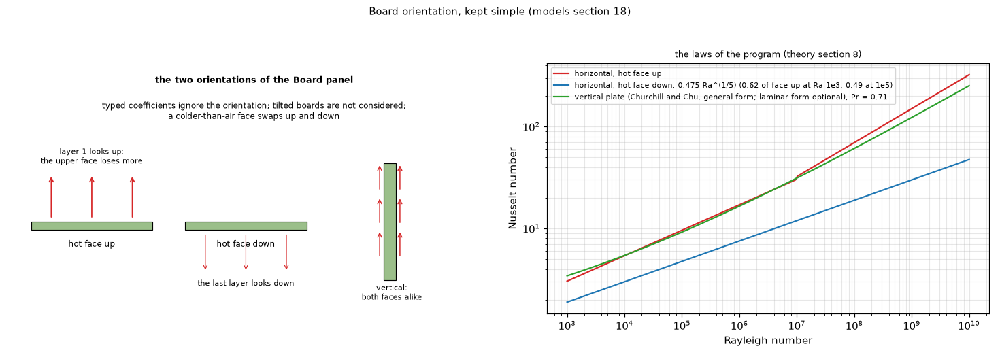

*Figure 23 (`images/fig_23_orientation.png`): the two orientations of the Board panel (horizontal with layer 1 facing up, and vertical) and the three natural-convection laws against the Rayleigh number; at the same Rayleigh number the facing-down coefficient is `0.88 Ra^{-1/20}` times the facing-up one up to `Ra` 10⁷ (0.62 at 10³, 0.49 at 10⁵; above 10⁷ the facing-up law turns to `0.15 Ra^{1/3}` and the ratio falls). Constant air properties (`Pr` 0.71) for the vertical law; the vertical curve is the general form.*

**The loop.** Because `h` depends on the face temperature the program **iterates**: solve with the current `h`, take the mean temperature of each face, recompute `h`; it stops when both change by less than 0.01 W/m²K (a Picard fixed-point loop, outside the models, in `api._solve_computed_h`). The time simulation and the animation use the steady-state coefficients. `calibrate_convection` finds `C_cal` by bisection on `ln C_cal` so that the model reproduces one measured temperature.
**Limits**: correlations of isothermal plates (a board with hot spots departs from them), edge coefficient typed, no enclosure view factors.
**Where it is checked**: `validation.md` 8 (the loop) and 22 (the laminar form, the natural-convection forms); `research/horizontal-plate-h`, `research/plate-h-level`, `research/effective-conductivity`. **Sources**: [IncroperaDeWitt] (M), [ChurchillChu1975] (through [Lienhard2024]), [Lienhard2024] (the air properties agree with Table A.6, page 755: k within ±0.5 % and ν −0.4 to −0.9 % at 300 to 400 K, all four properties within 2.2 % from 250 to 400 K as stated above; copper in Table A.1), [YovanovichJafarpur1993] (R), [Yovanovich1993Flat] (R), [YovanovichTeertstra2001] (R), [LloydMoran1974] (N), [LeFevre1956] (M), [Ostrach1953] (R), [ChurchillBlend] (S).

## 9. Parts: the junction temperature

*Figure 9 (`images/fig_09_part_runaway.png`): left, the worst case: all the power enters the board and the junction sits a series resistance `Θ_part` above the hottest pad point; middle and right, the power that grows with temperature, `P(Tj) = P₀ [1 + α (Tj − 25)]`, against what the board removes, `(Tj − T_amb)/R`: they cross at the fixed point (stable, `α R P₀ < 1`) or never cross (thermal runaway, `α R P₀ ≥ 1`). The numbers of the curves are illustrative.*

A **part** is a heater with a junction-to-pad resistance `Θ_part`. In the worst case all the power enters the board (no heat through the package top): the board is solved with `P` unchanged and the junction is

    Tj = T_max,footprint + P Θ_part                (series resistance between the junction and the pad)          (9.1)

(the hottest board point under the footprint is the pad temperature). Derived quantities, for the same board response `R = (Tj − T_amb)/P` (linear for constant coefficients):

    margin = Tj,max − Tj          power limit P_lim = (Tj,max − T_amb)/R = P (Tj,max − T_amb)/(Tj − T_amb)
    ψJB estimate:  Tj = T_ring + ψJB P,   T_ring = mean board temperature in the ring 0.5 to 1.5 mm outside the outline (bounding box) of the footprint

`T_ring` is a board temperature away from the source: it does not include the face value of a part (section 1.4, `laminate.face_terms`), which (9.1) includes through `T_max` when the copper under the part is absent; `ψJB` is measured by JEDEC on the board beside the package, so the ring estimate is meant without it.

**Power that depends on temperature**: `P(Tj) = P₀ [1 + α (Tj − 25 °C)]`. The program iterates `P_{k+1} = P₀[1 + α(Tj(P_k) − 25)]` around the board solve until the powers change by less than 10⁻⁵ (relative). For a linear board (constant `R`, ambient 25 °C) the fixed point is

    ΔT = P₀ R/(1 − α P₀ R)                                                                                        (9.2)

the iteration converges when `α P₀ R < 1` and **thermal runaway** (no stable point) is reported when the device passes 1500 °C or the power grows 50 times. In general `ΔT = R P₀ [1 + α(T_amb − 25)]/(1 − α R P₀)`. A loop that does not settle warns.

### 9.1 The top path as a root (`analysis.part_split`, `api._top_path_split`)

*Figure 42 (`images/fig_42_top_path_split.png`): left, a part with a top path: the junction joins the ambient through `R_top` and the board through `Θ_part` and `R_b`; middle, the residual `g(P_b) = P_b − P + p_top` of the split, computed with `pcbthermal.analysis.part_split` for a board resistance below (A) and above (B) the top resistance (illustrative values `P` = 2 W, `Θ_part` = 5 K/W, `R_top` = 20 K/W, `R_b` = 8 and 40 K/W): monotone, one root, a kink where the top heat is clipped at `P` (case B); right, the plain fixed point `P_b ← P − p_top(T_max(P_b))` on case B, slope −1.6: it jumps between 0 and 1.6 W and is not used. Computed by `scripts/make_figures.py`.*

With a heatsink on the package (`theta_jc_top`, `interface`, `theta_sa`) the part is a junction node joined to the board by `Θ_part` and to the ambient by `R_top = θJC(top) + R''/A + θSA` (`A` the contact area, or the footprint). With `P_b` the heat into the board and `T_max(P_b)` the hottest board point under the footprint,

    Tj − T_amb = (T_max − T_amb) + P_b Θ_part,     P_b = P − (Tj − T_amb)/R_top
        ⇒   Tj − T_amb = (T_max − T_amb + P Θ_part)/(1 + Θ_part/R_top)                                            (9.3)

(`analysis.part_split`; the top heat is limited to `[0, P]`, a heat that cannot be negative or exceed the part's power: the board never feeds the part through its top, which is conservative and is the reason for the kink of `g` at `P_b = P`). `T_max` depends on `P_b`, so the operating point is the root of the scalar equation of each part

    g(P_b) = P_b − P + p_top(T_max(P_b)) = 0,         g' = 1 + R_b/(R_top + Θ_part) ≥ 1,   g(0) ≤ 0 ≤ g(P)       (9.4)

with `R_b = dT_max/dP_b` the board's resistance under the part (the slope is 1 where the top heat is clipped at `P`; monotone, so the root is bracketed by `[0, P]`). **A fixed-point iteration `P_b ← P − p_top(T_max(P_b))` is not used**: its slope is `−R_b/(R_top + Θ_part)`, it converges only when the board under the part resists less than `R_top + Θ_part` and oscillates with a growing amplitude above that, which is the case on a small pad. The algorithm (`api._top_path_split`):

* **one part**: regula falsi with the Illinois rule on `[0, P]`; with constant face coefficients the board is affine in `P_b`, so the secant between the two ends is exact and three board solves give the root, unless the top heat is already clipped at `P_b = P` (small pads, a kink in `g`); with computed coefficients the Picard loop of section 8 is inside every solve;
* **several parts**, whose splits interact through the board: a Broyden quasi-Newton iteration on the vector `P_b`, started from the finite-difference Jacobian with the wide steps `P_b,j → 0` (exact for an affine board only when no top heat is clipped and the hottest cells under the footprints do not move), projected on `[0, P]` and with step halving;
* it stops when every `|g_i|/P_i ≤ 10⁻⁵` (at most 40 steps); the best iterate is kept, and when its residual is above `10⁻⁴` the result carries the warning "the top-path split did not converge".

The power temperature coefficient is the other loop: it stays a fixed point around the whole solve (its slope `α P₀ R` is the physical runaway condition), and with both the power loop goes around the top-path solve; every pass of it repeats the split.
**Why `Θ_part` must be a junction-to-pad number**: `θJA` contains the manufacturer's board and air, and `θJB` the spreading in the manufacturer's board; the program computes the spreading in your board, so either would count it twice (`models.md` 6).
**Limits**: worst-case convention (the hottest point under the footprint); steady state only for the top path; no Foster chain; the share of the power into the board is not checked against a manufacturer's value.
**Where it is checked**: `validation.md` 9 and 19 (parts, the top of the package; solve counts and the small-pad cases); `research/component-heatsink`; `tests/test_top_path.py`. **Sources**: [JESD15-3] (R through a mirror; the two-resistor model), [JESD51family] (N), the datasheets of `models.md` 6.

## 10. Power profiles in time

*Figure 10 (`images/fig_10_profile_decision.png`): left, a square wave and the response of the hottest point (first-order response, illustrative): the temperature oscillates around the value of the average power; middle, the average-or-resolve decision: heaters sorted by oscillation, averaged while the cumulative oscillation stays under the shared threshold (illustrative oscillations); right, the window is the least common multiple of the periods.*

A heater may carry a repeating profile (`SquareWave`, `TableProfile`) or a one-shot table. With the unit **step response** `Z(t)` of the heater's own hottest point (section 2.4) the response to a piecewise-constant periodic power `P(t)` of period `T` is, by superposition of delayed steps,

    T(u) = Σ_j P_j [ G_p(σ₂,j) − G_p(σ₁,j) ]          G_p(σ) = Σ_{m≥0} [ Z(σ + mT) − Z(mT) ] + (σ/T)(R_th − Z(MT))         (10.1)

(`[σ₁, σ₂]` the part of the period whose impulse falls on stretch `j`; the tail beyond `M` exact terms is the remaining response taken flat; `G_p(T) = R_th`; `G_p` is a name of this section, not a conductance). For a square wave `peak = P_off R_th + ΔP G_p(t_p)`. The **oscillation** peak − valley is in °C.
**Decision**: heaters are sorted by oscillation and *averaged* (smallest first) while their cumulative oscillation stays within the threshold (default 1 °C, a shared error budget); the others are *resolved*; one-shot tables are always resolved.
**Run**: one time-stepping run with all heaters (the problem is linear), step `Δt` a tenth of the shortest stretch, the power of a step is the **exact mean** of the profile over the step `(1/Δt)∫P dt`, the window is the least common multiple of the periods, and windows repeat until peak and valley change by less than 0.1 °C (at most 60 windows; or a fixed number of cycles or a fixed time; at most 200 000 steps); implicit Euler by default (`ProfileOptions.theta` = 1). Start: the steady state of the average power, or a typed uniform temperature. The Analytic model keeps the vias and heatsinks local in time through the coupled block of the lowest modes (section 6; a heatsink is warned) and none of the models runs a time simulation with a block.
**The face of a part over absent copper (FVM and FDM).** A part over bare laminate is read at its face, the copper node plus the drop over the half layer of laminate under it (section 1.4). In the resolved run the curve of a heater adds the quasi-static face term of the power of each step, `Q t_cu/(2 k_z A)` (`laminate.face_terms`), a first-order model of the half copper layer, whose time constant is `τ₁ = 4 (t/2)² /(π² α)` = 0.69, 2.8 and 11 ms for 35, 70 and 140 µm of copper (FR-4 `α` = 1.8·10⁻⁷ m²/s). Below about `10 τ₁` the curve follows the power with no lag and overstates the swing of the face (the peak on the hot side, the minimum on the cool side). The decision adds the swing of the face to the oscillation of the node, `Δ = Δ_node + (P_peak − P_low) R_face,max`, with `R_face,max` the largest face term of the part per watt of its own power (`profiles.face_resistances`), and does **not** attenuate it with a `tanh` of `P/(4τ₁)`: it stays on the safe side, a resolved run costing windows of one period. Without a face term the decision is the node's, bit for bit. Example (6 mm part on bare laminate, 0 to 2 W at 10 ms, threshold 1 K): averaged by the node (0.36 K), resolved with the face (3.6 K); peak 187.60 → 189.58 °C.

**10.5 Fast waves: the closed-form impedance of the stack and the ripple** (`stackimpedance.py`, `profiles.decide`, `profiles.run_windows`).

*Figure (`images/fast_wave_section.png`, from `research/fast-wave-oscillation`): the section under a part and the heat path in a wave whose shortest stretch is shorter than the heat needs to cross the laminate.*

The node structure of the FVM and FDM puts one temperature on a copper layer and half of each adjacent laminate gap (about 0.77 mm of FR-4 on a 1.6 mm two-layer board), so the node carries about twelve times the capacity of its copper. In a wave shorter than the time the heat needs to cross the laminate (the real copper heats alone, the node does not) the step response `Z(t)` is too slow at the start and the swing computed by (10.1) is **2 to 3 times too small at 1 to 3 Hz and 8 to 12 times from 50 Hz to 1 kHz** (5 to 7 on four layers); it is within 7.5 % of the truth when the shortest stretch is 4 s or more (2 s with three or more layers). The same error is in a resolved curve of the time simulation (0.741 K against 6.375 K for a 20 Hz, 30 %, 10 W wave of a 10 mm part). Cause and sweep: `validation.md` 37.

*Figure (`images/fast_wave_swing_against_frequency.png`): the swing of a unit square wave against the frequency for three part sizes (left) and the ratio program / reference for 1, 2 and 4 layers (right).*

*The closed form.* Setup: the part is the disc of the same area (radius `a`) on the copper of its layer `l`, with a uniform flux; the copper of that layer is a sheet of conductance `S = f k_cu t_cu` (W/K, `f` the copper fill under the part); everything else is a stack of slabs of thickness `d`, conductivity `k` (through the thickness) and volumetric capacity `c`, from the heater's plane outwards to each convective face (`h_top`, `h_bottom`). A copper layer other than the heater's is a slab of copper and laminate side by side at its own fill under the part; the gaps are read as the FVM reads them (simple or advanced stack-up). The heater's own copper is also a slab of the column: on an outer layer all of it lies between the part and the laminate, on an inner layer half of it on each side. The admittance per unit area (W/m²K) seen from the heater's plane at the angular frequency `ω` is what lies above and what lies below in parallel,

    Y(ω) = Y_up(ω) + Y_down(ω)                                                                                            (10.2)
    Y = k γ (Y_load + k γ tanh(γ d)) / (k γ + Y_load tanh(γ d)),     γ = sqrt(jω c / k)                                  (10.3)

(10.3) is the transfer matrix (quadrupole) of one slab written with `tanh`, which stays finite when `γd` is large (a thick laminate at kilohertz, where `cosh` and `sinh` overflow); it is applied slab by slab from the convective face (`Y_load = h`) inwards, for `Y_up` (to the top face) and `Y_down` (to the bottom face); a heater on the top layer has `Y_up = h_top`. Both sides always enter (the one-sided form of the research read 1.07 to 1.57 of the reference on an inner layer). An earlier version of this branch lumped the heater's copper as a capacity `jω c_cu t_cu` in parallel: a stretch of 33 µs (3 kHz, duty 10 %) does not heat 35 µm of copper uniformly, and that form read 0.90 of the reference (the review). The copper sheet carries the heat sideways over this admittance, `S ∇²θ − Y θ = −q(r)` (the fin equation of a sheet with a vertical loss), and a uniform flux on the disc gives at its centre

    Z(ω) = (1 − m a K₁(m a)) / (π a² Y),     m² = Y / S                                                                  (10.4)

(K/W, complex arguments of the modified Bessel function `K₁`; `1/(π a² Y)` is the one-dimensional column under the disc, the bracket the share left under it after the sideways spread; at fast waves `|m| a` is large and the bracket tends to 1). A repeating power with the Fourier coefficients `c_k = (1/T) ∫₀ᵀ P(t) e^(−jkω₀t) dt` (W) has the temperature wave

    θ(t) = 2 Re Σ_{k=1}^{N/2−1} σ_k Z(kω₀) c_k e^(jkω₀t)          swing = max θ − min θ                                  (10.5)

For a square wave of swing `ΔP = P_on − P_off` and duty `D`, `c_k = ΔP (1 − e^(−j2πkD)) / (j2πk)`; for a table of constant stretches `P_i` on `[t_i, t_{i+1}]`, `c_k = Σ_i P_i (e^(−jkω₀t_i) − e^(−jkω₀t_{i+1})) / (j2πk)`, exact (`stackimpedance.profile_coefficients`; a table of very many rows uses the FFT of its exact means on `N` bins, times `sinc(k/N) e^(−jπk/N)`). The sum has no `k = 0` term on purpose: the mean is the steady rise of the average power, which the board run holds with the real board (edges, vias, neighbours). `σ_k = sinc(k/N)` is the Lanczos factor: a wave much slower than the board has a flat `Z` over all its harmonics, and a cut Fourier series of a jump overshoots by the Wilbraham-Gibbs 9 % on each side; the factor removes it and changes a fast wave by less than 0.05 %. `N = 16384`, one inverse FFT, about 2 ms per heater. Sources: the transfer-matrix method of layered slabs and the disc source on a sheet with a vertical loss as in [CarslawJaeger] (status M, the book was not opened; the forms are own derivations), the temperature wave in a semi-infinite solid, `e^(−ξ) cos(Ω − ξ)`, [Lienhard2024] eq. 5.62 (status R, PDF page 248, printed 234), reproduced by the tests of the 3D reference; checked against an independent radial finite-volume solution (`tests/test_stackimpedance.py`) and, in `research/fast-wave-oscillation`, against an axisymmetric modal solver and the reviewer's Cartesian 3D frequency-domain solver of the rectangular board (2 % apart; `validation.md` 37.2).

*What the program does with it.*

1. **The floor in the decision** (eq. 10.6). For a repeating profile (square wave or table) of a part with copper under it (fill at least 0.9 on its layer, `stackimpedance.MIN_FILL`, no metal block on the board) the oscillation of the decision is

       Δ = max(Δ_node, swing of (10.5))                                                                                    (10.6)

   at every period and whatever the model of the step response (FVM, FDM, Lumped, Analytic: all share the node structure or are tuned on it, and all read a 10 Hz wave 0.13 to 0.23 of the closed form). The node only understates (`validation.md` 37.1), so the larger of the two is the safe one. Heaters are then sorted and averaged within the budget as before; a heater averaged within the budget keeps no ripple (its oscillation is part of the budget the user accepted).
2. **The regime `average + ripple`.** A heater that stays over the budget and whose **shortest stretch** (`min(D, 1 − D)·T`; for a table its shortest row) is below 4 s (2 s with three or more copper layers; `profiles.FAST_STRETCH_S`, `FAST_STRETCH_MANY_LAYERS_S`) is **not time-stepped**: the steps would have to be a twentieth of the stretch and the node cannot follow the wave anyway. The limits are measured, not derived: on one or two layers the node swing is within 7.5 % of the reference for a stretch of 4 s or more and 0.64 for 1 to 2 s; on four layers 0.95 to 0.97 for 2 to 4 s (research README 8.6, which corrected its earlier rule on the period). The board run holds its average power, like an averaged heater, and the zero-mean wave (10.5) is added at the heater.
3. **How the ripple enters the results.** The ripple is a value *at the heater's footprint*, the hot-spot value, never in the frames or in the peak map of the board (those show the average field). In the window of the run, with `g` the hottest board value, `h_j` the hottest value under heater `j` without ripple and `r_j(t)` its wave:
   * the **curve of the heater** is `h_j + r̄_j`, the wave **averaged over each step** `[t − Δt, t]` (as the power of a step is the mean of the power over it; a step longer than the period shows the mean of the wave, zero, never an alias of one phase);
   * the **board curve** is `g + max_j(h_j + r̄_j) − max_j h_j` (it moves by the change of the largest heater value: exact when the hottest point is under a heater, always so in the steady state of the average powers);
   * the **peak** is `max_t [g + max_j(h_j + r_j⁺) − max_j h_j]` and the **minimum** the same with the lowest value `r_j⁻` of the wave: the envelope, not samples of the wave (a fast wave sampled at the steps of a slow window would alias); the minimum is a lower bound of the true valley;
   * the **plot** of the profile series draws a band from `h_j + r_j⁻` to `h_j + r_j⁺`; the summary, the report, the Markdown export and `ProfileResult.ripple` (period, duty, swing, extremes) list every ripple heater, and the result carries a warning that says so.
   With no time-stepped heater the result is one window of the common period of the waves sampled in 600 points, with one frame (the steady field of the average power); this works with the four models.
4. **The step response of a small part** (`api.response_cell_mm`): the decision's response was computed at a cell of at least 2 mm whatever the part, so a 2 mm part was one cell and read 0.67 of the truth already at 0.1 Hz. It is now computed at a quarter of the narrow side of the smallest part with a profile, between 0.25 mm and the old cell, and coarser if the memory guard asks (a transient of the model). The cost is that of a finer transient (`validation.md` 37.3).

*Limits* (closed form / the reviewer's 3D reference, `validation.md` 37.2; the safe side for a floor and for a ripple is above 1):

| case | closed form / reference | verdict |
| :-- | :-- | :-- |
| full copper, 1, 2, 4, 6 layers, top, inner or bottom heater, 2 to 10 mm, 0.1 Hz to 10 kHz, duty 10 to 90 %, h manual or computed (636 cases) | 0.995 to 1.08 (inner and 6 layers 1.17 to 1.20 at 0.1 Hz) | validated |
| tables (20 Hz three levels, 1 Hz four levels, 100 Hz two pulses, 0.2 Hz) | 0.998 to 1.015 | validated |
| vias under a 10 mm part (4 to 36) | 1.07 to 1.59 at 0.1 to 1 Hz on two layers, 1.14 to 2.04 on four; 1.00 to 1.27 at 10 Hz, within 2 % from 100 Hz | safe side |
| elongated parts (2 x 10, 3 x 8 mm) | 0.97 to 1.37 | safe side, within 3 % below |
| a part within its radius of a board side (or outline), wave slower than 1 Hz | 0.61 at 0.1 Hz, 0.88 at 1 Hz | understated: warned |
| two parts in phase, close (cross term not added) | the neighbour's wave adds 17 % at 0.1 Hz (1 mm gap), 5 % at 1 Hz, under 0.4 % from 10 Hz (closed-form estimate) | understated at slow waves: limit |
| bare laminate or copper over part of the footprint (fill below 0.9) | does not apply; the node plus the face term is 0.46 to 4.1 of the truth (0.73 at 1 Hz) | warned from 1 Hz |
| a metal block on the board | not used (the node swing) | warned for a fast wave |
| one-shot tables | not used (time-stepped by the node) | warned for a short stretch |

No measurement of a physical board and no published fast-wave case of a layered board exist; the outline enters only through the gap to its nearest side (the reference is a rectangle).

**Where it is checked**: `validation.md` 7 (time-dependent results); `tests/test_profiles.py`, `tests/test_stackimpedance.py`; the fast waves, `validation.md` 37. **Sources**: superposition and the theta method as in section 2.4; no external source.

## 11. Verification summary

*Figure 22 (`images/fig_22_verification_ladder.png`): the checks in order of independence, from exact solutions to the comparison between models, with the results of this section (their evidence is in `validation.md`), and the rung that is still missing: a physical board.*

| Piece | How it is checked | Result (evidence in `validation.md`) |
| :-- | :-- | :-- |
| Energy balance of every model | `power_out` against the injected power on every test board | 10⁻¹² to 10⁻⁹ |
| Linear solvers | direct, CG and SOR on five boards | agree to 7·10⁻⁹ K (5) |
| Time stepping | exact RC solution of a uniform board | Euler first order, Crank-Nicolson second order (7) |
| Stack-up | exact series circuit of a uniform board with three different gaps | 10⁻⁶ K on every layer (12) |
| Layered idealisation | the 3D solid and an independent finite-element solid | FVM 0.1 to 0.7 % on the four boards of 3, within 1.2 % for pads of 20 mm and more, +2.9 % on a one-sided pad no larger than the heater (3, 3.1) |
| Layered models | the independent 3D solver of the tests on a Cu / FR-4 / Cu coupon | FVM, 3D solid and Analytic within 0.2 %, FDM within 1.2 % (22) |
| 3D solid | Yovanovich's Table 3 (isoflux source on a flux tube) | +0.7 to +0.8 % at `ε` 0.2 and 0.3, 2 % at `ε` 0.1 where the source has three cells (16; `research/solid3d-verification`) |
| 3D solid | finite-element solid; grid convergence of an aligned source | within 0.2 % on three boards, +1.6 % on a 20 mm pad, +8 % on a heater-sized pad where the two 3D models bracket the converged value (3, 3.1; measured with 4 slabs per gap, not re-run with the slabs by thickness, which are checked in 21.3); grid convergence index 1.14 % (16) |
| Plate (block) model | published spreading resistance (Seri Lee), by a re-implementation of the plate model inside the study, not by `blocks.py`; on the cross of [Muzychka2003] the program reads 2.1 % of the rise low (9 to 10 % on its first case), only the independent 3D solver agrees | +0.6 % centre, −0.8 % edge, −4.6 % corner (22.1) |
| Convection correlations | textbook air properties, closed forms | 1 to 3 % (8) |
| Parts | closed form `ΔT = P₀R/(1 − αP₀R)` | 0.05 K (9) |
| Mesh and model comparison | the 19 scenarios of `validation.md` 2 (and the example board), four models and the 3D solid | the Lumped and Analytic models fail in known cases, which the input checks warn (2) |

The models have **not** been compared with measurements of a physical board in this project; `calibrate_convection` is the tool to fit one measurement.

## 12. References

The reading status: **R** read in full or in the pages that matter; **S** seen as a summary, abstract or a search result; **M** known from memory; **N** not obtained; **L** own derivation checked in the repository. The full records (what was opened, pages, what was reproduced) are in `research/theory/BIBLIOGRAPHY.md` (section 20 is the table of this document). A statement that rests on a source with status N, M or S is marked where it is made.

| Key | Citation | Status | Where used |
| :-- | :-- | :-- | :-- |
| [JohansenColella1998] | H. Johansen, P. Colella, *A Cartesian grid embedded boundary method for Poisson's equation on irregular domains*, J. Comput. Phys. 147 (1998) 60-85 (read as the LBNL report LBNL-39908) | R (report pp. 1-18) | 2.1.1, 4 (apertures) |
| [SchwartzEtAl2006] | P. Schwartz, M. Barad, P. Colella, T. Ligocki, J. Comput. Phys. 211 (2006) 531-550 (read as the LBNL report) | R (printed pp. 1-16) | 2.5 (order at a cut cell) |
| [BarrettEtAl2022] | A. Barrett, A. L. Fogelson, B. E. Griffith, J. Comput. Phys. 449 (2022) 110805 (arXiv 2102.07966) | R (sections 1 to 3.1 and 3.3) | 2.1.1, 4 (aperture links, Robin film at the closest point) |
| [BochkovGibou2019] | D. Bochkov, F. Gibou, *Solving Poisson-type equations with Robin boundary conditions on piecewise smooth interfaces*, J. Comput. Phys. 376 (2019) 1156-1198, read as chapter 1 of D. Bochkov's thesis (eScholarship item 3qj3t08h) | R (the pages of eqs. 1.7, 1.10-1.14, 1.17-1.21; the rest of the chapter S) | 2.1.1 (film in series, condition 1.21; `research/bochkov-robin-check`) |
| [PapacEtAl2010] | J. Papac, F. Gibou, C. Ratsch, J. Comput. Phys. 229 (2010) 875-889 | N (cited through the thesis) | 2.1.1 (origin of the symmetric Robin scheme) |
| [Patankar1980] | S. V. Patankar, *Numerical Heat Transfer and Fluid Flow*, Hemisphere (McGraw-Hill), 1980 | M content, S citation | 2.1, 2.4 (finite volumes, harmonic mean, theta method; derived in the text) |
| [Peaceman1978] | D. W. Peaceman, *Interpretation of well-block pressures in numerical reservoir simulation*, SPE J. 18 (3) (1978) 183-194 | S (abstract only); the radial value `e^(−π/2)` is read second hand in [Ibraguimov2022], [Lie2019Reservoir] and [Durlofsky2005] | 2.6 (well radius of a point sink; the constant 0.1985 is computed) |
| [Saad2003] | Y. Saad, *Iterative Methods for Sparse Linear Systems*, 2nd ed., SIAM, 2003 (open copy) | R (sections 3.3, 4.1, 4.2, 10.2) | 2.3 (Theorem 4.16, equation 4.47, printed pages 126 and 127, PDF pages 146 and 147; multicolouring; block relaxation) |
| [Young1950] | D. M. Young, PhD thesis, Harvard, 1950 (Trans. AMS 76 (1954) 92-111, from memory) | N | 2.3 (consistent orderings, the optimum `ω`; quoted through [Saad2003]) |
| [Young1971] | D. M. Young, *Iterative Solution of Large Linear Systems*, Academic Press, 1971 | N | 2.3 (same) |
| [Krogh1919] | A. Krogh, J. Physiology 52 (1919) 409-415 (from memory) | M; the formula (1.8) is L | 1.5 (the Krogh cell) |
| [Dietz1965] | D. N. Dietz, J. Petroleum Technology (1965), SPE-1156-PA | S equation, M shape factors | 1.5 (the same mathematics in well testing) |
| [IncroperaDeWitt] | F. P. Incropera, D. P. DeWitt, *Fundamentals of Heat and Mass Transfer*, Wiley (edition not recorded) | M content, S citations | 1.2, 6, 7.2, 8 (fin and sheet equations, correlations, radiation) |
| [CarslawJaeger] | H. S. Carslaw, J. C. Jaeger, *Conduction of Heat in Solids*, 2nd ed., Oxford, 1959 | M content, S citation | 5, 6 (Fourier series, `K₀` Green function, disc sources, `I₀`, `I₁`) |
| [CulhamYovanovich1998] | J. R. Culham, M. M. Yovanovich, *Factors affecting the calculation of effective conductivity in printed circuit boards*, ITherm'98, pp. 460-467 (1998) | R (pages 460 to 466, scan; page 462, equations 7 to 10) | 1.2 (no homogenised conductivity) |
| [Lemczyk1992] | T. F. Lemczyk, B. L. Mack, J. R. Culham, M. M. Yovanovich, *PCB trace thermal analysis and effective conductivity*, J. Electronic Packaging 114 (4) (1992) 413-419 | R (pages 414 to 418 as images: equations 1 to 38, Tables 1 to 4; Tables 1 to 3 reproduced with an independent 2D solver) | 1.2 (context; coupon cases reproduced in `validation.md` 22.1) |
| [EC1998Spreading] | Seri Lee, *Calculating spreading resistance in heat sinks*, Electronics Cooling, January 1998 | R (equations 1 and 2 as images, the worked example reproduced) | 7.5 (the plate check). The paper of Lee, Song, Au and Moran (1995) [Lee1995] cited by earlier documents was not located (N) and is not cited |
| [Muzychka2003] | Y. S. Muzychka, J. R. Culham, M. M. Yovanovich, *Thermal spreading resistance of eccentric heat sources on rectangular flux channels*, J. Electronic Packaging 125 (2) (2003) 178-185 | R (worked cases; pages 179, 180 and 183, equations 11 to 31 and Table 2, by image) | 7.5 (cross of five sources reproduced by the independent 3D solver; the program's models read 2.1 % of the rise low) |
| [Yovanovich2003] | M. M. Yovanovich, *Thermal resistances of circular source on finite circular cylinder with side and end cooling*, J. Electronic Packaging 125 (2003) 169-177 | R (Table 3; pages 170 to 173, equations 1 to 28 and Tables 1 and 2 by image; equation 26 prints 3902918, a misprint of 3902418) | 4 (flux-tube check of the 3D solid) |
| [ChurchillChu1975] | S. W. Churchill, H. H. S. Chu, Int. J. Heat Mass Transfer 18 (1975) | N for the paper; equations R through [Lienhard2024] | 8 (equations 8.1, 8.2) |
| [ChurchillBlend] | S. W. Churchill (1977), mixed convection rule | N for the paper; the rule S | 8 |
| [Ostrach1953] | S. Ostrach, *An Analysis of Laminar Free-Convection Flow and Heat Transfer About a Flat Plate Parallel to the Direction of the Generating Body Force*, NACA Report 1111 (1953) | R (Table I(b), report p. 77, checked on the page image: `-H'(0) = 0.5046` at `Pr` 0.72) | 8 (check of the laminar form) |
| [LeFevre1956] | E. J. LeFevre, Ninth Int. Congress of Applied Mechanics, Brussels, 1956, vol. 4, p. 168 (from memory) | M | 8 (check of the laminar form only; own computation) |
| [Lienhard2024] | J. H. Lienhard IV, J. H. Lienhard V, *A Heat Transfer Textbook*, 6th ed. (open) | R (pages 310, 311, 419 to 421 (equations 8.11 to 8.13b by image), 431, 433 to 437, 755 (Table A.6, air) and Table A.1 (copper)) | 8 (equations 8.13a, 8.13b, Example 8.1) |
| [BarCohenRohsenow1984] | A. Bar-Cohen, W. M. Rohsenow, J. Heat Transfer 106 (1) (1984) 116-123 | N for the paper; the composite R as printed in [TeertstraReview] and in Bar-Cohen, Iyengar, Kraus (2003) | 7.4 (`ϕ_ch` is own algebra, L) |
| [ElenbaasBCR] | W. Elenbaas, Physica 9 (1942) 1-28 (pages from memory) | N | 7.4 |
| [TeertstraReview] | P. Teertstra, J. R. Culham, M. M. Yovanovich, *Comprehensive review of natural and mixed convection heat transfer models for circuit board arrays*, J. Electronics Manufacturing 7 (2) (1997) 79-92 | R (pages 79 to 88, all ten as images; equation 8 is on page 81) | 7.4 (equations 8, 20, 21, 22) |
| [JESD15-3] | JEDEC JESD15-3, *Two-resistor compact thermal model guideline* (2008) | R (through a mirror) | 9 |
| [JESD51family] | JEDEC JESD51 family (θJA, θJB, θJC, ψ definitions) | N | 9 |
| [UcamcoGerber] | Ucamco, *The Gerber Layer Format Specification* (revision 2024.05; 2026.05, 219 pages, read at sections 2.11 and 4.10.4.8) | R in part (macro rotation, single-quadrant arcs, aperture holes, exposure, regions, the attribute syntax of `.N`; revision 2026.05 pages 25, 26, 112 and 113), S for the rest | 1.6 (the reader: what is drawn and how; the full record is `research/theory/BIBLIOGRAPHY.md`) |
| [LiptonRoseTarjan1979] | R. J. Lipton, D. J. Rose, R. E. Tarjan, *Generalized nested dissection*, SIAM J. Numer. Anal. 16 (2) (1979) 346-358 | R (local scan, pages 1 to 12 of 13, by image; the abstract prints the two bounds swapped: cite p 347 or the Remarks, p 356) | 2.7 (fill and work bounds for graphs with a `sqrt(n)` separator and for d-dimensional grids) |
| [George1973] | A. George, *Nested dissection of a regular finite element mesh*, SIAM J. Numer. Anal. 10 (1973) 345-363 | R in part (abstract, Theorems 4.1 and 5.2, the remark on the cube; the constants of A.6 unreadable in the scan) | 2.7 (the exponent and the thin-in-plan board; a hypothesis the measurements test) |
| [Davis2006] | T. A. Davis, *Direct Methods for Sparse Linear Systems*, SIAM, 2006 | M | 2.7 (fill of sparse factors) |
| [LiSuperLU2005] | X. S. Li, *An overview of SuperLU*, ACM Trans. Math. Softw. 31 (2005) 302-325 | R in part (section 3.2.2, symmetric mode, and Table III, PDF page 13; Table IV, PDF page 18; transcriptions compared with the page images, the text layer of the copy being a font cipher) | 2.3 (symmetric mode), 2.7 |
| [Celik2008] | I. B. Celik, U. Ghia, P. J. Roache, C. J. Freitas, J. Fluids Engineering 130 (7) (2008) 078001 | R (pages 4 to 9; Table 1 reproduced; PDF pages 6, 7, 9, 10 confirmed by image) | 4 (grid convergence index) |
| [Roache] | P. J. Roache, verification and validation in computational science and engineering | M (summaries S) | 4 (cite [Celik2008] for the procedure) |
| [Fish2017] | M. C. Fish, PhD dissertation, University of Maryland (2017) | R chapter 6 (reproduced) and the formulation of chapter 7 (equations 58 to 83, 177 to 182); its series S; chapter 5 not read | 1.5 (microspreading of via cells) |
| [Kron2022] | S. Chevalier, M. R. Almassalkhi, *Towards optimal Kron-based reduction of networks (Opti-KRON) for the electric power grid*, arXiv 2204.05554 | S | not cited in the text; [DorflerBullo2013Kron] is |
| [YovanovichMuzychkaCulham1999] | M. M. Yovanovich, Y. S. Muzychka, J. R. Culham, *Spreading resistance of isoflux rectangles and strips on compound flux channels*, J. Thermophysics Heat Transfer 13 (4) (1999) 495-500 | R (pages 3 to 5; Table 2 reproduced to four digits) | 6 (the compound flux-channel series is the construction of the Analytic) |
| [CulhamFourier2000] | J. R. Culham, M. M. Yovanovich, T. F. Lemczyk, *Thermal characterization of electronic packages using a three-dimensional Fourier series solution*, J. Electronic Packaging 122 (3) (2000) 233-239 | R (pages 233 to 236; equations 1 to 46 by image) | 6 limits (series with film sides; "10 to 30 terms") |
| [Muzychka2003Part2] | Y. S. Muzychka, J. R. Culham, M. M. Yovanovich, *Thermal spreading resistances in rectangular flux channels, Part II: edge cooling*, 36th AIAA Thermophysics Conference, AIAA 2003-4188 (2003) | R (p. 4, eq. 12 to 21, from the text layer and re-derived; p. 5, eq. 27 to 31, read as an image; equations 1 to 5 and 32 to 35 by image) | 6 (the eigenvalue problem of the convective edge, eq. 12 to 21: `δ tan δ = Bi_e`; the transfer of the edge loss to the faces of eq. 27 to 31 is not used) |
| [Muzychka2006EdgeCooling] | Y. S. Muzychka, M. M. Yovanovich, J. R. Culham, *Influence of geometry and edge cooling on thermal spreading resistance*, J. Thermophysics Heat Transfer 20 (2) (2006) 247-255 | R in part (pages 248 and 249, equations 1 to 20, by image); S for the rest | 6 (edge cooling of a flux channel; the transfer to the faces at a small edge Biot number is not used) |
| [YovanovichCulhamTeertstra1998] | M. M. Yovanovich, J. R. Culham, P. Teertstra, *Analytical modeling of spreading resistance in flux tubes, half spaces, and compound disks*, IEEE Trans. CPMT Part A 21 (1) (1998) 168-176 | R (pages 168 to 175, equations 1 to 60 by image, including the Song-Lee forms 27 to 30) | 4 (flux tube), 7.5 (the Song-Lee closed form behind Lee's plate check) |
| [Muzychka2004Orthotropic] | Y. S. Muzychka, M. M. Yovanovich, J. R. Culham, *Thermal spreading resistance in compound and orthotropic systems*, J. Thermophysics Heat Transfer 18 (1) (2004) 45-51 (first page 45; last page not checked) | R (pages 45 to 51; equations 1 to 36 and 57 by image) | 1.2 (series and parallel sums of the layered board, equations 39, 40) |
| [YovanovichJafarpur1993] | M. M. Yovanovich, K. Jafarpur, *Bounds on laminar natural convection from isothermal disks and finite plates of arbitrary shape for all orientations and Prandtl numbers*, Univ. of Waterloo MHTL report (1993) | R (pages 1 to 15; equations 25, 26 on page 11) | 8 (bounds and range of the horizontal-face laws) |
| [YovanovichTeertstra2001] | M. M. Yovanovich, P. Teertstra, *Laminar forced convection modeling of isothermal rectangular plates*, J. Thermophysics Heat Transfer 15 (2) (2001) | R (pages 1 to 7; PDF pages 1 to 6, journal 205 to 210, equations 1 to 28 and Tables 1 and 2 compared with the page images; equation 18 prints 0.742) | 8 (forced convection) |
| [Yovanovich1993Flat] | M. M. Yovanovich, *General expression for laminar forced and natural convection heat transfer from isothermal flat plates for all Prandtl numbers*, AIAA-93-2750 (1993) | R (all 7 pages; equations 1 to 26 compared with the page images) | 8 (forced convection) |
| [Yovanovich1995ImageMethod] | M. M. Yovanovich, *Constriction resistance of planar isoflux heat sources within semi-infinite conductors: image method*, ASME/JSME Thermal Engineering Conference, vol. 1 (1995) | R (pages 25 to 27 of the copy: equations 1 to 11; the circular-source values of its Table 1 were not reproduced, and it treats no lattice and no convective edge) | 2.6 (the sign and the limits of the image of a source at a plane: adiabatic, a source image; isothermal, a sink image) |
| [GoldsteinLau1983] | R. J. Goldstein, K. S. Lau, *Laminar natural convection from a horizontal plate and the influence of plate-edge extensions*, J. Fluid Mech. (1983) | N for the paper; through [YovanovichJafarpur1993], p 8 (R, page image): the downward constants of the theoretical studies they summarise, 0.44 to 0.527 (the highest at Sc 2.5), the average 0.475 of the Pr 0.71 results, and their numerical strip `0.524 Ra^{1/5}` (40 < Ra < 8000) | 8 (face turned down) |
| [LloydMoran1974] | J. R. Lloyd, W. R. Moran, *Natural convection adjacent to horizontal surface of various planforms*, J. Heat Transfer 96 (4) (1974) 443-447 | N (the range 2.2·10⁴ to 8·10⁶ on `A/P` is quoted in [YovanovichJafarpur1993], p 7; a mass-transfer correlation at Sc about 2300) | 8 (named, not obtained) |
| [MartinRaithbyYovanovich1991] | L. Martin, G. D. Raithby, M. M. Yovanovich, *On the low Rayleigh number asymptote for natural convection through an isothermal, parallel-plate channel*, J. Heat Transfer 113 (4) (1991) 899-905 | R (pages 1 to 6; PDF pages 1 to 5, journal 899 to 903, equations 1 to 27, Table 1 and Figs 1 to 6 compared with the images; the Summary, page 904, not in that pass) | 7.4 |
| [TI-AN2020] | Texas Instruments, *AN-2020 Thermal design by insight, not hindsight*, SNVA419C (2013) | R (pages 4, 5; by image also PDF pages 1, 2, 6, 7, 9 to 12: equations 1 to 29, Tables 1 and 2) | 1.2, equation (1.4) |
| [ShenWang2019Vias] | Y. Shen, H. Wang, F. Blaabjerg, H. Zhao, T. Long, *Thermal modeling and design optimization of PCB vias and pads*, IEEE Trans. Power Electronics 35 (1) (2020) 882-900 (accepted manuscript 2019) | R (pages 1 to 17 by the text layer; equations 5, 7, 10 to 13, 37 to 39 and Table I compared with the page images; the published case, PDF page 14, and Table II not image-checked) | 1.5 (the via unit; the published case of `validation.md` 18) |
| [Ibraguimov2022] | A. Ibraguimov, E. Zakirov, I. Indrupskiy, D. Anikeev, *Fundamentals in Peaceman model for well-block radius for non-linear flows near well*, arXiv 2203.10140 (2022) | R in part (sections 1 and 5.1; Theorem 1) | 2.6 |
| [Lie2019Reservoir] | K.-A. Lie, *An Introduction to Reservoir Simulation Using MATLAB/GNU Octave*, Cambridge University Press (2019) | R (section 4.3.2, book pages 126 to 128; equation 4.34) | 2.6 |
| [Koch2019Well] | T. Koch, R. Helmig, M. Schneider, *A new and consistent well model for one-phase flow in anisotropic porous media using a distributed source model*, arXiv 1907.12653 (2019) | R in part (section 5.4, appendix E; equation 5.6) | 2.6 |
| [Durlofsky2005] | L. J. Durlofsky, *Upscaling and gridding of fine scale geological models for flow simulation* (2005) | R by image (pages 20 and 21: equation 34 on p 20, equation 35 on p 21) | 2.6 |
| [DorflerBullo2013Kron] | F. Dörfler, F. Bullo, *Kron reduction of graphs with applications to electrical networks*, IEEE Trans. Circuits Syst. I 60 (2013) 150-163, arXiv 1102.2950 | R in part (Lemma 2.1, Theorems 3.4, 3.7, 3.9 as stated; no proofs) | 2.6, 5.1 |
| [SuperLUGuide] | X. S. Li, J. W. Demmel, J. R. Gilbert, L. Grigori, P. Sao, M. Shao, I. Yamazaki, *SuperLU Users' Guide* (1999, updated 2018) | R in part (sections 1.4.4, 2.8; sections 2.5.2 and 2.6, PDF page 28, by image) | 2.7 |
| [GilbertNgPeyton1994] | J. R. Gilbert, E. G. Ng, B. W. Peyton, *An efficient algorithm to compute row and column counts for sparse Cholesky factorization*, SIAM J. Matrix Anal. Appl. 15 (1994) 1075-1091 | R (abstract and introduction) | 2.7 |
| [LiGolub2013] | X. S. Li, *Sparse direct methods: combinatorics*, lecture 3, 4th Gene Golub SIAM Summer School (2013) | R (slides 19, 20) | 2.7 |
| [MFEMStaticCond] | MFEM documentation, static condensation | S | 6, 7.3 |

