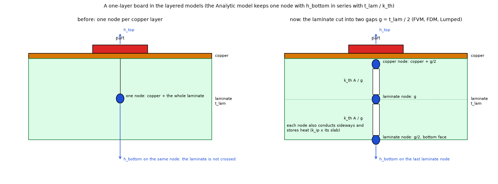

# Theory: the mathematics and physics of every model

This document states **every equation the program solves**, how each model discretises it, which approximations are made and where the code does it.
[`models.md`](models.md) is the guide to choosing a model; [`validation.md`](validation.md) has the numbers that test the statements below.
Notation: SI units everywhere inside the package (m, s, W, K, W/mK, W/m²K, J/m³K); temperatures in the interface are °C and `θ = T − T_amb` is the rise above the ambient.
Millimetres and K·cm²/W appear only at the user boundary (project files, the application).

**Where each part lives in the code**

| Section | Module | Section | Module |
| :-- | :-- | :-- | :-- |
| 1 description, geometry | `model.py`, `geometry.py` | 7 metal blocks | `blocks.py` (used by `fvm.py`, `fdm.py`, `solid3d.py`) |
| 2 FVM | `fvm.py` | 8 heat transfer coefficients | `convection.py`, `api.py` (fixed-point loop) |
| 3 FDM | `fdm.py` | 9 parts | `analysis.py` (`heater_stats`), `api.py` (power coefficient) |
| 4 3D solid | `solid3d.py` | 10 power profiles | `profiles.py`, `profile_io.py` |
| 5 Lumped | `lumped.py` | 11 verification | `tests/`, `examples/` |
| 6 Analytic | `analytic.py` | | |

## 0. Symbols

| Symbol | Meaning | Unit |
| :-- | :-- | :-- |
| `W, H, t_pcb, L` | board width, height, total thickness, number of copper layers (layer 1 = top) | m, m, m, – |
| `t_cu,l` | copper thickness of layer `l` | m |
| `slab` | thickness represented by one layer node, `t_pcb / L` | m |
| `d` | thickness of one dielectric gap, `(t_pcb − Σ t_cu)/(L − 1)` | m |
| `f` | copper fill (area fraction of a cell covered by copper, times the zone's own fill) | – |
| `k_cu, k_ip, k_th` | conductivity of copper, of FR-4 in the plane and through the thickness (385, 0.9, 0.3 W/mK by default) | W/mK |
| `ρc` | volumetric heat capacity (`ρ c_p`) | J/m³K |
| `S` | sheet (in-plane) conductance of a layer: the conductance of a square | W/K |
| `g` | conductance per area between two adjacent layers | W/m²K |
| `h` | heat transfer coefficient of a face (convection plus radiation) | W/m²K |
| `A_via` | copper cross-section of a via barrel | m² |
| `P, Q, q` | power of a heater, source vector (W per node), power density | W, W, W/m² |
| `K, C` | conductance matrix (W/K) and heat capacity vector (J/K) of a network | – |
| `R''` | interface resistance per area (`t/k` of a paste or pad) | m²K/W |
| `θ_part, Tj` | junction-to-pad resistance of a part (K/W) and junction temperature (°C) | – |

## 1. The physical description

### 1.1 The continuum problem

Heat conduction in the board (and in any metal block) is
`ρc ∂T/∂t = ∇·(k ∇T) + q`, with `k` a tensor (diagonal: `k_ip, k_ip, k_th` for FR-4, `k_cu` for copper, `k` for a metal block).
Every outer face exchanges heat with the air: `−k ∂T/∂n = h (T − T_amb)`, with `h = h_conv + h_rad`; the board edges use `h_side` (or are insulated).
The sources are the heaters: a power `P` spread **uniformly over a footprint** (a polygon on one layer). In steady state `∂T/∂t = 0`.

### 1.2 The layered idealisation (FVM, FDM, Lumped, Analytic)

A PCB is a stack of very thin, highly conducting copper layers separated by poorly conducting dielectric. Across the 35 µm of copper the Biot number is `h t_cu / k_cu ≈ 10⁻⁷` and the conduction resistance
`t_cu/k_cu ≈ 10⁻⁷ m²K/W` is four orders of magnitude below that of a dielectric gap (`d/k_th ≈ 5·10⁻⁴ m²K/W`), so each copper layer is **isothermal across its thickness**. The model therefore keeps **one temperature per layer and plan position**, `θ_l(x, y)`:

* **In-plane (lateral) conduction** of layer `l` is carried by copper and by the FR-4 in the same slab, in parallel:

      S_l(x,y) = f · k_cu · t_cu,l + k_ip · (slab − f · t_cu,l)                       [W/K]

  (`f` is the copper fill; `slab − f t_cu` is the FR-4 left in the layer's slab). The heat flux per unit length is `−S ∇θ`.
* **Vertical conduction** between layers `l` and `l+1` acts through the dielectric gap, a one-dimensional resistance:

      g = k_th / d                                                                      [W/m²K]

  and, where a via crosses the gap, through the barrel in parallel (a via connects **all** layers):

      G_via = k_cu · A_via / d                  A_via = π[(D/2)² − (D/2 − t_plating)²] + (k_fill / k_cu) π (D/2 − t_plating)²  (open barrel: k_fill = 0; epoxy resin 0.3; conductive paste 8) or π(D/2)² (electroplated copper fill)     [W/K]

* **Ambient exchange**: the top layer loses `h_top` and the bottom layer `h_bottom` per unit area (a one-layer board: `h_bottom` on its last laminate node, section 1.4); a plain heatsink adds `h_extra` over its polygon;
  an edge cell of a layer loses `h_side · (edge length) · slab` through the board edge.
* **Heat capacity per area** of a layer: `c_l = f ρc_cu t_cu + (slab − f t_cu) ρc_fr4`.

The layer equation (steady) is the **multilayer fin equation**

    ∇·(S_l ∇θ_l) − h_l θ_l − Σ_{n = l±1} g (θ_l − θ_n) = −q_l                       (1)

with `h_l` nonzero only on the outer layers and `q_l` the heater power density on its layer. Transient: add `c_l ∂θ_l/∂t` on the left.
**Advanced stack-up** (`Board.dielectrics` set, one per gap): gap `j` between layers `j` and `j+1` has its own thickness `d_j`, through-plane conductivity `k_th,j`, in-plane conductivity `k_ip,j` and `ρc_j`; the vertical conductance per area is `g_j = k_th,j / d_j`. The node of layer `l` represents `slab_l = t_cu,l + d_{l−1}/2 + d_l/2` (half of each adjacent gap; the outer layers have one), so the slabs add up to the total thickness; the laminate of the node has the thickness-weighted mean `k_ip` and `ρc` of its two half gaps. A gap of several sheets (`combine_sheets`) is one gap with `k_th = Σt_i / Σ(t_i/k_th,i)` (in series) and `k_ip = Σ t_i k_ip,i / Σ t_i` (side by side). The simple mode (`dielectrics = None`) keeps `slab = t_pcb/L` and equal gaps `d = (t_pcb − Σ t_cu)/(L − 1)`; the two agree within 0.1 K when the gaps are equal (`validation.md` section 12). The typical stack-ups come in two inner copper weights (0.5 oz, 15.2 µm; 1 oz, 35 µm on every inner layer with every `d_j` of the template unchanged, so the total grows by `Σ (t_cu,l' − t_cu,l)`): a thicker inner layer raises `S_l` and, with a plane on each inner layer, lowers the maximum temperature by 6.9 to 7.5 K (`validation.md` section 14.1).

**Energy balance**: integrating (1) over the board (all internal exchanges cancel) gives `Σ h_l ∫θ_l dA + ∫ edge losses = Σ P`: the heat leaving by every path equals the power injected. Every result reports this balance.
**Limits of the idealisation**: no gradient across a copper layer or across the thin dielectric laterally (the gap is a 1D resistance: no spreading inside the gap; the 0.4 to 2 % against the 3D solid, section 4, is attributed to this and to one node per copper layer, an attribution that was not measured separately); the top and bottom coefficients act directly on the outer layer node
(the half slab of FR-4 or copper in series is neglected, 10⁻⁴ of the film resistance); one temperature per layer under a footprint.
The stack is **not** homogenised: no averaged conductivity (series, parallel, geometric or harmonic mean) is used, because Culham and Yovanovich (1998) show that any such mean of a laminate can be 70 % to 300 % off, through the spreading resistance and the order of the layers (the geometric mean of their five-layer coupon, 2.7 W/mK, is 70 % off; the paper was read as scanned images, `research/effective-conductivity/`). The one temperature of a layer is its mean through the thickness: under a source the surface is hotter by at most `q'' t / (2 k)` (negligible for copper; the thick-plate warning of `models.md` 4b covers thick, poorly conducting plates).

### 1.3 Sources and geometry

A footprint polygon is rasterised on the grid by **sub-sampling**: every cell is sampled on an `s × s` lattice (`s = 8` for heaters, 4 for zones, heatsinks and blocks), and the fraction of samples inside the polygon (even-odd ray test) is the **coverage** `c ∈ [0,1]` of the cell.
A heater's source vector is `Q_i = P c_i / Σ c`: the power is **exact** whatever the grid (the weights sum to 1); if the footprint is smaller than a sample, all the power goes to the cell (or node) of the centroid. The copper fill of a cell is `f = max over the zones of the layer of (c_zone · fill)`.

### 1.4 A one-layer board: the laminate nodes

A board with two or more layers has copper on both outer faces, so the films act on copper nodes. A one-layer board has copper on the top face only and a laminate of thickness `t_lam = slab − t_cu` under it. With one node, both films acted on that node and the heat reached the bottom face without crossing the laminate (against an independent 3D solver the FVM was 0.9 to 4.4 % low with full copper and 10 % low with a 20 mm pad, `validation.md` section 21). The FVM, FDM and Lumped models now cut the laminate into `n = 2` gaps `g = t_lam/n` (`laminate.py`):

    copper node:     slab t_cu + g/2,   S = f k_cu t_cu + k_ip (t_cu + g/2 − f t_cu),   h_top
    laminate node j: slab g (the last one g/2),   S = k_ip · slab,   c = ρc_fr4 · slab,   h_bottom on the last
    between nodes:   G = k_th A / g

the construction of a board whose lower layers carry no copper. The results keep one layer (the copper); the bottom face temperature used for the computed coefficients is that of the last laminate node. Uniform board heated all over: `θ = P / (A (h_top + 1/(1/h_bottom + t_lam/k_th)))`, exactly (`tests/test_laminate.py`). The Analytic model keeps one node and uses that series coefficient as its `h_bottom`. Number of nodes: 1, 2, 3, 4 give −4.1, −2.5, −1.8, −1.5 % on a bare 20 mm pad (FVM against the independent solver) and under 0.3 % with full copper from two on.

## 2. FVM: cell-centred finite volumes (the reference)

**Unknown**: the mean temperature rise `θ_{l,i,j}` of the copper layer `l` in the cell `(i, j)` of size `Δx × Δy` (plan grid `nx × ny`, `Δx = W/nx`). The program integrates (1) over each cell and balances the heat through its faces, so the discrete energy balance is **exact in every cell**.

**Face conductances** (all in W/K):

* *Lateral*: between two neighbouring cells the heat crosses the two half cells in series, `R = Δx/(2 S₁ Δy) + Δx/(2 S₂ Δy)`, so with `S` of each cell
  `G_x = (2 S₁ S₂ /(S₁ + S₂)) · Δy/Δx`   and   `G_y = (2 S₁ S₂ /(S₁ + S₂)) · Δx/Δy`   (the **harmonic mean** of the two sheet conductances: a copper/FR-4 edge is a series, not an average). It is zero when both are zero.
* *Vertical*, between layers `l` and `l+1` in a cell: `G_z = k_th Δx Δy / d + Σ_{vias in the cell} k_cu A_via / d`. A via is assigned to the cell that contains its centre (it is a point feature; this costs about 0.5 % against the 3D rods on the example board at 0.5 mm cells). On cells finer than about 0.5 mm the point via over-constricts, because a source in one cell of a five-point stencil acts like a hole of radius `0.198 Δx` (Peaceman): the copper-fill gain of a via array falls from −4.4 K at 0.5 mm to −3.3 K at 0.0625 mm against −4.45 K for resolved barrels (`research/via-fill/README.md` 4.6; chapter Planned of versions.md).
* *Ambient*: `G_amb = (h_top or h_bottom) Δx Δy` on the outer layers, plus `h_extra Δx Δy c_hs` under a plain heatsink (`c_hs` its coverage), plus `h_side Δ_edge · slab` on edge cells. When a metal block covers the face, the board coefficient is multiplied by `1 − c` (section 7). On a board with an outline, `Δ_edge` is the length of the outline inside the cell (`geometry.edge_length_on_board`): the outline is sampled at a tenth of a cell, every sample is moved a thousandth of a cell towards the inside of the board (so a side lying on a grid line belongs to the cell on the board), and the length that falls in a cell taken as off the board (a sliver that no cover sample reached) goes to the nearest cell on the board, so `Σ Δ_edge` is the perimeter of the polygon whatever its position on the grid. The FDM and the 3D solid use the same rule (the FDM on the outline shifted by half a cell, onto its node control volumes).

**System**: `K θ = Q`, `K = D − A` with `A` the symmetric matrix of non-negative face conductances and `D` its row sums plus the ambient conductances. `K` is symmetric, weakly diagonally dominant (strictly where there is an ambient path) and irreducible, so it is a symmetric positive definite **M-matrix**:
the solution exists, is unique and obeys the maximum principle (`θ ≥ 0`, no temperature below the ambient). The sum of the rows of `K` is the ambient conductance, hence `Σ G_amb θ = Σ Q` (energy balance).

**Solvers** (`fvm.Network.solve_steady`, `solve_sor`):
* *direct*: sparse LU (SuperLU) with the symmetric minimum-degree ordering (`MMD_AT_PLUS_A`: half the fill and about 40 % less time than the default ordering); the relative residual `‖Kθ − Q‖/‖Q‖` is reported (about 10⁻¹³);
* *conjugate gradients* with a Jacobi (diagonal) preconditioner, tolerance 10⁻¹²;
* *red-black SOR*, `θ_new = (Σ G_m θ_m + Q)/D`, `θ ← θ + ω(θ_new − θ)` with `ω = 2/(1 + sin(π/n_max))`, stopped on the **residual** (10⁻⁹). The stop rule on the largest change of a sweep (the removed program's rule) can stop 3 to 16 K from the solution (`validation.md` section 5).

**Transient**: `C dθ/dt + K θ = Q(t)`, `C_i = c_l Δx Δy` (J/K). The **theta method**

    (C/Δt + ϑK) θ^{n+1} = (C/Δt − (1 − ϑ)K) θ^n + Q^{n+1/2}

with `ϑ = 1` (implicit Euler, first order, robust) or `ϑ = 1/2` (Crank-Nicolson, second order); both are unconditionally stable for the diffusion equation (each eigenmode of rate `λ` is multiplied by `(1 − (1−ϑ)λΔt)/(1 + ϑλΔt)`, of modulus below 1 for `ϑ ≥ 1/2`).
One LU factorisation is needed per distinct `Δt`, so the steps are built in a few stages: the animation uses ten stages with `Δt_j = Δt₀ 2^j` (`Δt₀ = t_end/(m(2¹⁰ − 1))`, `m` steps per stage); the **step responses** use `Δt_j = Δt₀ r^j` with `r = 3`, four steps per stage, 18 stages,
`Δt₀ = t_end(r − 1)/(4(r^{18} − 1))`, `t_end = 10 τ` and `τ = ΣC/ΣG_amb` (the uniform-board time constant; the hottest point reaches 63 % much sooner). `ΣG_amb` leaves out the 1 W/K that pins the cells off a board with an outline: it keeps the matrix regular but is not a path to the air. The board mean of a transient weights every cell by its board area, as the steady mean does.
The **step response** `Z_i(t)` is the rise of the hottest point of heater `i` per watt; `R_th,i = Z_i(∞)`.

**Accuracy**: second order in the cell size for smooth fields, first order at features (a via, a copper edge, a thin heater). The example board moves monotonically with the cell (within 0.25 % of the 0.25 mm value from 1 mm), but with vias it has no limit (see the vertical conductance above). The layered idealisation of section 1.2 is the model error (0.4 to 2.2 % against the 3D solid).

## 3. FDM: node-centred finite differences (the comparison)

**Unknown**: the temperature at the **nodes** of a grid that includes the board edges (`(nx+1) × (ny+1)` per layer). Each node owns a **control volume** of `Δx_c × Δy_c`, with `Δx_c = Δx` inside and `Δx/2` at the edge nodes (a quarter at a corner), so a convective edge is treated by the standard
half-cell balance (equivalent to a ghost node, second order). Written as the balance of a control volume, the scheme is conservative too; what differs from the FVM is **where the data live**:

* the sheet conductance `S` is **sampled at the nodes**: either as the coverage of the control volume around the node (`sampling="area"`, the default: the four surrounding cell coverages weighted by the shared area) or as the classic point test (`"point"`: left and bottom edge in, right and top edge out);
* the conductance between two nodes uses the **mean of the two nodal values**, arithmetic `(S₁ + S₂)/2` (default) or harmonic, times `width_of_face/Δ` where the face width is the control-volume side;
* vertical: `G_z = k_th A_c/d` with `A_c` the control area, plus the via at the **nearest node** (spreading it over neighbours was tried and removed the constriction: temperatures 2 % too low; like the FVM, the point via does not converge on cells finer than about 0.5 mm, see section 2);
* ambient and edge terms as in the FVM with the control-volume areas and lengths;
* sources: the unit weights of a heater are the coverage of the footprint shared among the four nodes of each cell (area) or one for each node inside (point), normalised to 1: power exact.

The transient machinery of the FVM is reused unchanged (`fvm.transient_from_network`), because the FDM network exposes the same `K, C, Q`. On boards without vias the FDM and FVM agree to about 0.1 %; with a via array the FDM is 2 to 3 % low at 1 mm (a point feature on the nearest node), closing with the grid.

## 4. 3D solid: finite volumes in three dimensions

`solid3d.py` drops the "one node per copper layer" idea. The plan grid is the FVM's (`nx × ny`, same cells); across the thickness the stack is cut into **real slabs** from the top face down:
a copper slab of thickness `t_cu,l` for each layer, `n_diel = 4` equal slabs of `d/4` in each dielectric gap (a one-layer board has no gap: its laminate, the slab of the layered models minus the copper, is cut into `n_diel` FR-4 slabs under the copper, so it spreads heat and the bottom face loses heat through it), and for a block under (or over) the board a **pad slab** (the interface, thickness `R''·1 W/mK`, conductivity 1 W/mK so that its resistance per area is exactly `R''`)
followed by `n` metal slabs (`n = round(thickness/1 mm)`, 1 to 6). Every cell of every slab has one unknown; there are `n_slabs × nx × ny` unknowns (refused above 250 000, counted before the model is built: `solid3d.unknowns`; it was 2·10⁶, which let a run go on for hours).

**Cell materials** (volume averages on the structured grid, the tiled-conductivity method of PCB thermal models):

* copper slab with fill `f`: in-plane `k_x = f k_cu + (1 − f) k_ip`; through `k_z = f_eff k_cu + (1 − f_eff) k_th` with `f_eff = min(1, f + a_via)`;
* dielectric slab: `k_x = k_ip`, `k_z = a_via k_cu + (1 − a_via) k_th`;
* `a_via = Σ A_via / (Δx Δy)` over the vias whose centre is in the cell: the **real copper area of the barrel** (`D` in `A_via` is the **drill** diameter, the plating is inside it), in parallel in every slab (the lateral effect of the thin barrel wall is neglected); `a_via` is clipped at 1 per cell, so a via whose copper-equivalent area exceeds the cell (a 0.3 mm copper fill below 0.27 mm cells, a 0.5 mm copper fill below 0.44 mm) loses the excess copper (roadmap, section 1);
* block slabs: `k = k_metal · c` (`c` = block coverage of the cell), pad slab `k = 1 · c`; cells with no material get `k = 10⁻⁹ W/mK` and a leak of `10⁻⁹ W/K` to the ambient to keep the matrix regular.

**Conductances** (each pair of neighbouring cells, harmonic mean of the half-cell resistances):

    lateral:   G = min(dz₁, dz₂) · Δy · 2 k₁ k₂ / ((k₁ + k₂) Δx)      (x; same for y with Δx ↔ Δy)
    vertical:  G = Δx Δy / (dz₁/(2 k_z1) + dz₂/(2 k_z2))
    face:      G = A / (1/h + dz/(2 k_z))                              (film in series with the half cell)
    edge:      G = 1 / (1/(h_side Δ dz) + (Δ_n/2)/(k_x Δ dz))

with `Δ` the edge length of the cell face. A block hides the board face under it (factor `1 − c`), loses heat on its exposed face (`h_exp = h_face·r_fin + h_extra`, fins as in section 7) and on the side walls of every block slab, `G = (h_face + h_extra) dz L_edge` (no fin ratio; this is not the edge coefficient `h_side` of the board), with `L_edge` the length of the block outline inside the cell (from the coverage differences with the four neighbours).
The heater power goes to the copper slab of its layer with the weights of section 1.3. The system is solved directly as in the FVM; the result keeps the layout of the FVM (the temperature of the copper slab of each layer, plus the block fields), so every plot and table works.

**What it measures**: the error of the layered idealisation on **your** board. Convergence: 4 slabs per gap is within 1 % of 8 even on a heater-sized pad (the hardest case, where the FV and the finite-element solids bracket the limit about ±4 %, `validation.md` section 3).
**Limits**: the barrel is a lumped area, copper is one slab thick, a block contact is perfect over the pad, the cost grows quickly with layers and cells (the direct solve of 158 000 unknowns takes 2.0 s and 0.75 GB on a plain two-layer board and 7.2 s and 2.15 GB on the example board of 16 slabs; 247 000 unknowns take 15.3 s and 3.5 GB and 512 000 take 57.7 s and 9.9 GB resident on the example board; measured by `research/solid3d-verification/scripts/study_solve_cost.py` on a quiet 16 GB machine, and they depend on the machine, the board and the computed-h loop, which repeats the solve 3 to 6 times); the fill-in grows with the width of the plan times the slab count); steady state only.

## 5. Lumped: thermal network by rings (LPTN)

`lumped.py` reduces the FVM network, per heater, to a few unknowns per layer, using the fact that the temperature field of a heater depends mostly on **distance from its footprint**.

**Rings.** The distance `δ(x, y)` of every cell to the footprint is computed (Euclidean distance transform; 0 inside). Ring 0 is the footprint; rings `k = 1..R` hold the cells with `δ ∈ (E_{k−1}, E_k]`, with geometric edges
`E_k = ρ₁ (ρ_max/ρ₁)^{(k−1)/(R−1)}`, `ρ₁ = min(max(1.5 min(Δx,Δy), 0.04 ρ_max), 0.5 ρ_max)`, `ρ_max = max δ`; edges closer than one cell, `max(Δx, Δy)`, are merged (`lumped.ring_edges`): a ring thinner than the raster holds a count of cells that does not match its width, so its contour length came out short and its resistance high, and the result grew with the ring count (+3 to +13 % with 40 rings; `validation.md` section 21); rings with no cell are dropped. Any footprint shape and the real board outline are followed; no circular approximation.
For layer `l` and ring `k` the real cells are aggregated: `S_{l,k}` mean sheet conductance, the sums of `G_amb` by path, of `G_z` (dielectric and vias) and of `C`, and the ring **thickness** `Δ_k` (distance span) and its **contour length** `L_k = (N_k Δx Δy)/Δ_k` (`N_k` cells).

**Lateral resistances** between the area-mean temperatures of consecutive rings (heat crosses the offset contours):

    R_{k,k+1} = Δ_k/(2 S_k L_k) + Δ_{k+1}/(2 S_{k+1} L_{k+1})                              (k ≥ 1)

**Inside the footprint** the resistance from its mean temperature to its boundary comes from the logarithmic potential of a uniformly heated region on a sheet: the temperature at a point is `θ = −(Q/(2π S)) φ + const` with
`φ_i = mean ln|r_i − r_j|` over the footprint cells `j` (the self term of a square cell is `ln(0.447 √(Δx Δy))`; at most 900 cells are used, evenly decimated). Then

    R_{0,1} = f_R · (φ_boundary − φ_mean)/(2π S₀) + Δ₁/(2 S₁ L₁)

which is `1/(8π S)` for a disc. When the layer also loses heat vertically under the footprint (loss conductance `g_eff` per area, fin length `λ = √(S/g_eff)` not much larger than the footprint radius `a`), the disc solution
`θ(r) = q/g_eff + A I₀(r/λ)` gives the **correction factors** (`x = a/λ`, `I₀, I₁` modified Bessel functions)

    f_R = 4 (I₀ − 2 I₁/x) / (x I₁)          f_P = 4 (2/x² − 1/(x I₁))                  (both → 1 as x → 0)

`g_eff` is taken from the solution itself (heat leaving the footprint of the layer towards its neighbours and the ambient, divided by its rise and by the footprint area) and the network is re-solved, three passes.
**Vertical and ambient**: `G_z` between layers and the ambient conductances of every ring are added exactly as in the FVM, so vias, heatsinks and edges enter by their real positions.

**Solution**: each heater gives a small dense system `K_h θ = Q_h` (`L R` unknowns, `Q` at ring 0 of the heater's layer), solved exactly. Because the problem is linear the board is the **superposition** of the heaters: the field of heater `h` at a cell is its ring profile
interpolated at the distance `δ_h` of the cell (constant beyond the ends); the field is the sum over the heaters, so the mutual heating is the other heater's radial profile read at the distance of the footprint.
**Peak** inside a footprint: `θ_peak = θ_ring0 + Q_lat f_P (φ_mean − φ_min)/(2π S₀)` (`Q_lat` the lateral outflow of ring 0, `φ_min` the hottest point), plus the rises of the other heaters at its centroid.
**Transient**: `C dθ/dt + K_h θ = Q` per heater network with the ring capacities, solved with the same theta method; the profile and animation tools superpose the heaters.
**Where it fails**: when a copper edge crosses the footprint (the network assumes the ring-mean `S` describes the heat flow; 27 % low), at board corners (−8.7 %) and for thin heaters (+9.5 %); the input checks warn.

## 6. Analytic: multilayer Fourier series

(For a board with an outline the Lumped and Analytic models are solved on the rectangle of the same area, `Problem.equivalent_rectangle`: width `sW`, height `sH`, `s = sqrt(A_outline/(W H))`, every position `x → s x`, parts keeping their size, then the field is stretched back by `1/s`. It keeps the area, hence the total convective conductance `h A`, and the aspect ratio of the box. The bounding box (`s = 1`) has too much area and a box larger than it is worse; both are in the table of `docs/validation.md` section 13. The mapping cannot represent a part close to a cut corner or in a narrow arm, where the real board has less area to spread the heat: the result is then too cool.)

On a **uniform** board with insulated edges equation (1) is solved exactly. Expanding each layer in cosines, `θ_l(x, y) = Σ_{m,n ≥ 0} a_{l,mn} cos(mπx/W) cos(nπy/H)`, the Laplacian becomes `−k²_mn`, `k²_mn = (mπ/W)² + (nπ/H)²`,
and the layers decouple by mode into a tridiagonal `L × L` system

    A_mn a_mn = q_mn            A_mn = diag(S_l k²_mn + h_l) + g · Λ                    (2)

where `Λ` is the graph Laplacian of the layer chain (`Λ_ll = number of neighbours`, `Λ_{l,l±1} = −1`) and `h_l` the surface coefficient of the layer (zero for inner layers; for a one-layer board `h_bottom` is in series with the laminate, `1/(1/h_bottom + t_lam/k_th)`, section 1.4). The **mode (0,0)** is the uniform-board limit `P/(h_tot W H)`: it integrates each layer exactly, so the heat out of the faces is read from it.
**Source**: the heater is replaced by the axis-aligned rectangle `[x₁,x₂] × [y₁,y₂]` with the same area and centroid (aspect ratio of the bounding box); its cosine coefficients are

    q_mn = P · ε_m ε_n · I_x(m) I_y(n) / (W H · area),   ε₀ = 1, ε_{m>0} = 2,   I_x(0) = x₂ − x₁,   I_x(m) = (sin(k x₂) − sin(k x₁))/k,  k = mπ/W

(300 modes per direction by default). The field is `θ_l = cos_y · a_l^T · cos_x^T` evaluated at the cell centres by two matrix products.

**Copper is not uniform.** Each layer gets an **effective copper fill** averaged with the *influence* of the heaters, `f_eff,l = Σ w f_l / Σ w` with `w(x,y) = Σ_i P_i K₀(r_i/λ_l)` (`K₀` modified Bessel function of the second kind: the Green function of the fin equation) and the **layer's own fin length**
`λ_l = √(S_l/(h_surface + n_neighbours g))` for a layer that carries a heater (about 5 mm; the 34 mm of the whole stack would let distant copper count too much). A warning is raised when the fill varies strongly (weighted spread > 0.25).

**Vias and heatsinks are local** and are added back by a Green-function (Woodbury) correction. The board is cut into tiles of size `min(max(λ/4, 2.5 mm), 5 mm)`; a tile with a via has the conductance `c_via = k_cu A_via/d` between adjacent layers and a tile under a heatsink has `g_hs = h_extra Δx Δy c` to the ambient. With `y₀` the tile-averaged temperatures of the uniform solution
and `G` the modal response of the uniform board between tiles (first 64 modes), the tile temperatures `y` and the heat `f = −C y` that the local elements extract or move satisfy

    (I + G C) y = y₀,        f = −C y,        a_mn ← a_mn + A_mn⁻¹ (projection of f)

the exact solution of the board with the local conductances for the tile-lumped model (a dense system of `N_tiles · L` unknowns, small).
**Transient**: each mode obeys `C a' + A_mn a = q(t)` with `C = diag(c_l)`; with `C^{-1/2} A_mn C^{-1/2} = V Λ Vᵀ` and `b = Vᵀ C^{1/2} a` the modes decouple, `b' = −Λ b + g`, and a constant power over a step has the **exact propagator**
`b⁺ = e^{−λΔt} b + (1 − e^{−λΔt}) g/λ`. The transient cannot use the local corrections, so the vias (or the heatsink) are smeared over the board and their conductance is **scaled per heater** by bisection until the steady maximum equals that of the locally corrected model (a single global factor cooled the distant heater by 18 %).
**Where it fails**: copper that is not uniform near a heater (24 % low with a 20 mm pad, 25 % when an edge crosses the footprint), strong edge convection (insulated edges assumed: even the default edge coefficient of 10 W/m²K makes it 0.3 to 1 % warm on a uniform board, which is the whole of its difference from the FVM there, `validation.md` section 4); the checks warn.

## 7. Metal blocks (FVM, FDM, 3D solid; Lumped and Analytic in steady state)

A heatsink with `thickness > 0` is a plate of metal (conductivity `k`, heat capacity `ρc`, thickness `t`) pressed on the top or bottom face through an interface of resistance per area `R''`. In the layered models it adds **one extra layer of nodes** (one per cell) on that face, with the coverage `c` of the cell by the block:

    lateral sheet conductance   S = k t c                                (joined by the harmonic mean, as the board)
    heat capacity               C = ρc t Δx Δy c
    contact to the board layer  G = c Δx Δy [ f/R'' + (1 − f)/(R'' + d_h/k_th) ]
    exposed surface             G = h_exp Δx Δy c,           h_exp = h_face · r_fin + h_extra
    sides of the plate          G = h_wall t L_edge,         h_wall = h_face + h_extra
    board face under the block  its coefficient is multiplied by (1 − c)

`r_fin` is the **fin ratio** of the optional plate fins (height `H`, thickness `t_f`, pitch `p`, perpendicular to the base, thin fins with an adiabatic tip at the corrected height `H_c = H + t_f/2`): per unit of base area `r_fin = (1 − t_f/p) + 2 H_c η/p`, with the fin efficiency `η = tanh(m H_c)/(m H_c)` and `m = √(2 h_face/(k t_f))`; `r_fin = 1` without fins. **The fins stand on the exposed face of the plate, not on its sides**: only the term `G = h_exp Δx Δy c` carries `r_fin`; the side walls of the base plate (`L_edge` is the length of the block outline inside the cell, `t` the plate thickness) lose heat with the plain coefficient `h_wall = h_face + h_extra` (the side-wall coefficient of the block, not the edge coefficient `h_side` of the board). (Before this correction the sides had `h_exp` too and the rise of a finned block was 5.5 to 6.4 % too low, see `docs/validation.md` section 12 D.) Not modelled: the end faces of the fins (`H t_f` per fin at the two ends of the array; on the block of `validation.md` 12 D they would add 40 to 55 % to the side-wall area, depending on the direction of the fins, and lower the rise by about 0.7 to 0.9 %, estimated by scaling the side-wall conductance of the FVM), the heat capacity of the fins (only the base plate `ρc t` is in `C`, so a time simulation of a finned block responds too fast) and the lateral conduction along the fins.

**Close fins (channel effect): a warning, not a model** (`checks.check_fin_channels`). The fin formula above assumes one coefficient on every face. Between fins closer than a few millimetres the air in the channel is slowed: two vertical isothermal plates at a gap `b` and length `L` have, in the composite of Bar-Cohen and Rohsenow (1984), `Nu_b = h b / k = [(24/Ra_b)^2 + (0.59 Ra_b^(1/4))^(-2)]^(-1/2)` with `Ra_b = g β θ b^4 Pr / (ν^2 L)`; the first term is the fully developed limit (`Nu_b = Ra_b/24`: the gap is full of warm air and the coefficient falls with the cube of the gap), the second the isolated plate. The fraction of the isolated-plate limit that the channel keeps is `φ = [1 + (14.16 / Ra_b^(3/4))^2]^(-1/2)` (0.9 at `Ra_b` = 90, 0.75 at 40.5, 0.5 at 16.5). After the solve the program computes `Ra_b` for every finned block in still air with `θ` the mean excess of the block over the ambient air from the result (weighted by the covered fraction of the block), `b = p − t_f`, `L` the longer side of the bounding box of the block (the program has no fin direction; the longer side is the conservative choice), the air at ambient + θ/2 and `β = 1/T_film`, and warns when `Ra_b < 90` (`φ < 0.9`). The text gives `Ra_b`, `φ` and the loss `1 − φ`, and says that it holds for a vertical board. It is never added to the result; the model keeps one coefficient on all faces. Limits: vertical channels with a closed front (arrays open in front carry more heat than the closed channel at gaps near 3 mm); horizontal boards are not covered; radiation between the fins is not included. Evidence: `research/fin-channel/README.md` (Waterloo review of the correlations; on the 1080-case grid `Ra_b < 90` misses 1 of the 667 cases that lose 10 % or more, the old rule of a gap under 4 mm misses 367).

`f` is the copper fill of the board layer there and `d_h` half a layer slab: **the heat enters the block mostly where the block overlaps copper** (the intersection of the two planes) through `R''`; over bare laminate it must also cross the FR-4 (a much larger resistance). The block is an isotropic plate without gradient across its thickness (valid while
`h t/k` is small: aluminium or copper from 1 to 10 mm are within 0.6 % of the 3D solid); cells with no block have `10⁻⁹ W/K` to the ambient. The plate model reproduces the published spreading resistance of a small source on a plate (Seri Lee, Electronics Cooling 1998: aluminium 100 × 100 × 1.3 mm, source 25 × 25 mm, `R₀` 1.0 K/W) within +0.6 %, −0.8 % and −4.6 % at the centre, the edge midpoint and the corner (0.66, 1.29 and 2.38 K/W in the article, which claims about 5 %), on any cell from 0.4 to 1.7 mm. The +4.5 % quoted before was a 24 mm source: the check placed the source with `round()`, which rounds halves to even.
**Lumped and Analytic have the block in steady state**. An equivalent coefficient `h_eq = 1/(R'' + 1/(h_face + h_extra))` (isothermal block, even with the contact area and an annular fin for the part outside it) was 8 to 31 % off because the block spreads the heat of the pad centre to the whole pad, which a uniform coefficient cannot do; what works is to keep the block's lateral conduction:
* **Lumped**: the block layer of the FVM network (sheet conductance `k t` per cell, contact conductance to the board layer over the copper `c A (f/R'' + (1−f)/(R'' + r_half))`, exposed surface `h_exp A c` and edge `h_wall t L_edge` to the ambient, `h_exp = h_face·fin_ratio + h_extra`, `h_wall = h_face + h_extra`) is summed over the rings like the board layers: one more layer of unknowns per ring, lateral links between rings with the same contour formulas (infinite where the block does not reach), vertical link `g_link` summed per ring to the heater's layer. The board face under the block loses nothing.
* **Analytic**: on the tile grid of the local corrections the same block layer is built with `blocks.extra_layers`; the block temperatures `φ` obey `(K_b + D_amb + D_link) φ = D_link y_b` (`K_b` the lateral conductances between tiles, `y_b` the board-layer temperatures of the tiles), so the heat they take from the board is `f = D_link (y_b − φ) = B y_b` with the Schur complement `B = D_link − D_link (K_b + D_amb + D_link)^-1 D_link`, a dense matrix that couples the tiles of the block among themselves. `B` is added to the local conductance matrix `C` of the correction `(I + G C) y = y_0` (the static condensation of finite-element codes, or Kron reduction of a network), together with the negative conductance `−h_face·A·cov` for the face that the block hides. This is exact for the tile model; the error left is the tile size and the sheet averaging of the uniform problem.
Both are steady state only; the time simulations still refuse a block. SOR does not support blocks.

**The thickness of a plate: a bound, not a model** (`checks.check_thick_plates`). A copper layer and a block are one node through their thickness, so the node is the mean temperature through it. Where a flux `q''` enters one face of a plate of thickness `t` and conductivity `k` and leaves by the other (a linear profile), the entering face is hotter than the mean by `q'' t/(2k)`; with part of the heat leaving sideways the flux falls with depth and the difference is smaller (a flux falling linearly to zero gives `q'' t/(3k)`). After a run the program compares `q'' t/(2k)` with the rise of every heater and warns above 5 %: for the heater's copper layer `q'' = P_board/A_footprint`; for a block whose polygon holds the centre of the footprint, `q''` is the largest flux `G (θ_board − θ_block)/(c A)` that enters the block under the footprint in the FVM or FDM result (a block under the board is fed through the laminate and its copper, so the footprint flux would overstate it many times), with a quiet auxiliary FVM run (cell of at least 2 mm, `api._block_flux_result`) giving that flux when only the Lumped, the Analytic or the 3D solid was run; the footprint flux is only the stated fallback of the function when no such result is passed. A dielectric gap is not checked: it is a series resistance between two nodes, its drop is in the model. The bound is never added to the result.

## 8. Heat transfer coefficients: convection and radiation

In "computed" mode each outer face gets `h = h_c + h_r` (`convection.py`, mean face temperature `T_s`, air at the film temperature `(T_s + T_a)/2`):

* **Air** (dry, 1 atm, Sutherland-type fits, 250 to 450 K): `μ = 1.458·10⁻⁶ T^{3/2}/(T + 110.4)`, `k = 2.648·10⁻³ T^{3/2}/(T + 245.4·10^{−12/T})`, `ρ = p/(R T)`, `ν = μ/ρ`, `α = k/(ρ c_p)`, `Pr = μ c_p/k`, `β = 1/T`.
* **Rayleigh number**: `Ra = g β |ΔT| L³/(ν α)`, with `L = area/perimeter` for a horizontal plate and the height for a vertical one.
* **Natural convection, horizontal plate**: hot face up `Nu = 0.54 Ra^{1/4}` (`Ra ≤ 10⁷`), `0.15 Ra^{1/3}` above; hot face down `Nu = 0.27 Ra^{1/4}` (the roles swap for a face colder than the air). **Vertical plate** (Churchill and Chu, the general form for all Ra): `Nu = (0.825 + 0.387 Ra^{1/6}/[1 + (0.492/Pr)^{9/16}]^{8/27})²`. `h_n = Nu k/L`. The same authors give a laminar form for `Ra < 10⁹`, `Nu = 0.68 + 0.670 Ra^{1/4}/[1 + (0.492/Pr)^{9/16}]^{4/9}`, which differs by +7 % to −25 % between `Ra` 10⁴ and 10⁹ but moves the maximum temperature of a vertical board by only −0.7 to +0.2 % of the rise (`research/effective-conductivity/`). The choice is `Board.natural_form` (`"general"`, the default, or `"laminar"`); Churchill and Chu (1975) itself has not been opened; the general form equals the library `ht` (1.2.0) to machine precision, and the laminar form, which `ht` does not have, is the laminar boundary-layer solution of an isothermal vertical plate, `4/3 (Gr/4)^{1/4} g(Pr)` with LeFevre's `g(Pr) = 0.75 Pr^{1/2}/(0.609 + 1.221 Pr^{1/2} + 1.238 Pr)^{1/4}`, within 0.21 %, plus the leading-edge constant 0.68 (`validation.md` section 22). The laminar form warns above `Ra = 10⁹`.
* **Forced convection**, flat plate along the flow: `Nu = 0.664 Re^{1/2} Pr^{1/3}` (`Re < 5·10⁵`), `(0.037 Re^{4/5} − 871) Pr^{1/3}` above, `Re = u L/ν`, `h_f = Nu k/L`.
* **Mixed**: `h_c = C_cal (h_n³ + h_f³)^{1/3}` (Churchill's rule), `C_cal` the calibration multiplier of the convection.
* **Radiation** to surroundings at the air temperature, linearised: `h_r = ε σ (T_s² + T_a²)(T_s + T_a)` (absolute temperatures, view factor 1).

Because `h` depends on the face temperature the program **iterates**: solve with the current `h`, take the mean temperature of each face, recompute `h`; it stops when both change by less than 0.01 W/m²K (3 or 4 solves, a fixed-point loop). `calibrate_convection` finds `C_cal` by bisection on `ln C_cal` so that the model reproduces one measured temperature. Limits: correlations of isothermal plates (20 to 30 % on a board with hot spots), edge coefficient typed, no enclosure view factors.

## 9. Parts: the junction temperature

A **part** is a heater with a junction-to-pad resistance `θ_part`. In the worst case all the power enters the board (no heat through the package top): the board is solved with `P` unchanged and the junction is

    Tj = T_max,footprint + P θ_part                (series resistance between the junction and the pad)

(the hottest board point under the footprint is the pad temperature; a junction node joined by a uniform conductance would be 1.3 to 3.4 K lower on the chips of the component study, 0.2 K on a 0603 resistor). Derived quantities, for the same board response `R = (Tj − T_amb)/P` (linear for constant coefficients):

    margin = Tj,max − Tj          power limit P_lim = (Tj,max − T_amb)/R = P (Tj,max − T_amb)/(Tj − T_amb)
    ψJB estimate:  Tj = T_ring + ψJB P,   T_ring = mean board temperature in the ring 0.5 to 1.5 mm outside the outline (bounding box) of the footprint

**Power that depends on temperature**: `P(Tj) = P₀ [1 + α (Tj − 25 °C)]`. The program iterates `P_{k+1} = P₀[1 + α(Tj(P_k) − 25)]` around the board solve until the powers change by less than 10⁻⁵ (relative). For a linear board (constant `R`, ambient 25 °C) the fixed point is
`ΔT = P₀ R/(1 − α P₀ R)`; the iteration converges when `α P₀ R < 1` and **thermal runaway** (no stable point) is reported when the device passes 1500 °C or the power grows 50 times. In general the closed form is `ΔT = R P₀ [1 + α(T_amb − 25)]/(1 − α R P₀)`.
**Top path** (a heatsink on the package; `theta_jc_top`, `interface`, `theta_sa`): the part is a junction node joined to the board by `θ` and to the ambient by `R_top = θJC(top) + R''/A + θSA` (`A` the contact area, or the footprint). With `P_b` the heat into the board and `T_max(P_b)` the hottest board point under the footprint,

    Tj − T_amb = (T_max − T_amb) + P_b θ,     P_b = P − (Tj − T_amb)/R_top   ⇒   Tj − T_amb = (T_max − T_amb + P θ)/(1 + θ/R_top)

(`analysis.part_split`; the top heat is limited to `[0, P]`, a heat that cannot be negative or exceed the part's power). `T_max` depends on `P_b`, so the operating point is the root of the scalar equation of each part

    g(P_b) = P_b − P + p_top(T_max(P_b)) = 0,         g' = 1 + R_b/(R_top + θ) ≥ 1,   g(0) ≤ 0 ≤ g(P)

with `R_b = dT_max/dP_b` the board's resistance under the part (the slope is 1 where the top heat is clipped at `P`; monotone, so the root is bracketed by `[0, P]`). **A fixed-point iteration `P_b ← P − p_top(T_max(P_b))` is not used**: its slope is `−R_b/(R_top + θ)`, it converges only when the board under the part resists less than `R_top + θ` and oscillates with a growing amplitude above that, which is the case on a small pad (an 8 mm pad under a 3.3 mm MOSFET: ratio 2; the loop stopped after 80 iterations at 33 °C where the operating point is 90.9 °C). `api._top_path_split` solves the equations instead: for one part, regula falsi with the Illinois rule on `[0, P]` (with constant face coefficients the board is affine in `P_b`, so the secant between the two ends is exact and three board solves give the root, unless the top heat is already clipped at `P_b = P`, which happens when `R_b > R_top`, the small pads (a kink in `g`: 6 solves on the 8 mm MOSFET); with computed coefficients, whose Picard loop is inside every solve, 6 to 7 solves, up to about 20 when the root is close to the clip); for several parts, whose splits interact through the board, a Broyden quasi-Newton iteration on the vector `P_b`, started from the finite-difference Jacobian with the wide steps `P_b,j → 0` (exact for an affine board only when no top heat is clipped and the hottest cells under the footprints do not move), projected on `[0, P]` and with step halving (random boards of 2 to 4 parts: median 8 to 9 board solves, 90 % within 25, at most 57). With the power coefficient every pass of its loop repeats the split, so the solves multiply (the 8 mm MOSFET with 0.5 %/K: 10 passes, 70 solves). It stops when every `|g_i|/P_i < 10⁻⁵`; if it does not, the result carries the warning "the top-path split did not converge". The power temperature coefficient is the other loop: it stays a fixed point around the whole solve (its slope `α P₀ R` is the physical runaway condition), and with both the power loop goes around the top-path solve.

**Convention of the clip at `P`**: the top heat of a part is limited to its own power `P` (`P_b >= 0`), so the board never feeds the part through its top even when the junction node would be colder than the neighbouring board; this is conservative (the part is never cooled by its surroundings) and is the reason for the kink of `g` at `P_b = P`.

**Why θ must be a junction-to-pad number**: `θJA` includes the manufacturer's board and air, and `θJB` the spreading in the manufacturer's board; the program computes the spreading in your board, so those would be counted twice. See `models.md` section 6 for the datasheet table and the fallbacks.

## 10. Power profiles in time

A heater may carry a repeating profile (`SquareWave`, `TableProfile`) or a one-shot table. With the unit **step response** `Z(t)` of the heater's own hottest point (section 2) the response to a piecewise-constant periodic power `P(t)` of period `T` is, by superposition of delayed steps,

    T(u) = Σ_j P_j [ G(σ₂,j) − G(σ₁,j) ]          G(σ) = Σ_{m≥0} [ Z(σ + mT) − Z(mT) ] + (σ/T)(R_th − Z(MT))

(`[σ₁, σ₂]` the part of the period whose impulse falls on stretch `j`; the tail beyond `M` exact terms is the remaining response taken flat; `G(T) = R_th`). For a square wave `peak = P_off R_th + ΔP G(t_p)`. The **oscillation** peak − valley is in °C.
**Decision**: heaters are sorted by oscillation and *averaged* (smallest first) while their cumulative oscillation stays within the threshold (default 1 °C, a shared error budget), the others are *resolved*; one-shot tables are always resolved.
**Run**: one time-stepping run with all heaters (the problem is linear), step `Δt` = a tenth of the shortest stretch, the power of a step is the **exact mean** of the profile over the step `(1/Δt)∫P dt`, the window is the least common multiple of the periods, and windows repeat until peak and valley change by less than 0.1 °C. Start: the steady state of the average power.

## 11. Verification summary

| Piece | How it is checked | Result |
| :-- | :-- | :-- |
| Energy balance of every model | `power_out` against the injected power on every test board | 10⁻¹² to 10⁻⁹ |
| Linear solvers | direct, CG and SOR on five boards | agree to 2·10⁻⁸ K (`validation.md` 5) |
| Time stepping | exact RC solution of a uniform board | Euler first order, Crank-Nicolson second order (`validation.md` 7) |
| Layered idealisation | the 3D solid and an independent finite-element solid | 0.4 to 2.2 % (FVM), `validation.md` 3 |
| 3D solid | finite-element solid, convergence in slabs and cells | 0.2 % on three boards, ±4 % on a heater-sized pad |
| Plate (block) model | published spreading resistance (Seri Lee, 1998) | +0.6 % centre, −0.8 % edge, −4.6 % corner |
| Convection correlations | textbook air properties, closed forms | 1 to 3 % |
| Parts | closed form `ΔT = P₀R/(1 − αP₀R)` | 0.05 K |
| Mesh and model comparison | 19 scenarios, four models and the 3D solid | `validation.md` 2 |

The models have **not** been compared with measurements of a physical board in this project; `calibrate_convection` is the tool to fit one measurement.

## 12. References (textbooks and sources used)

* Patankar, *Numerical Heat Transfer and Fluid Flow* (1980): finite-volume discretisation, harmonic means at interfaces, the theta method.
* Incropera and DeWitt, *Fundamentals of Heat and Mass Transfer*: fin and sheet equations, natural and forced convection correlations, radiation.
* Churchill and Chu (1975), vertical plate natural convection; Churchill's blending rule for mixed convection.
* Carslaw and Jaeger, *Conduction of Heat in Solids*: Fourier-series solutions, Green functions of the fin equation (`K₀`), disc sources (`I₀, I₁`).
* Seri Lee, "Calculating spreading resistance in heat sinks", Electronics Cooling (January 1998), the numerical example of the plate check. A paper of Lee, Song, Au and Moran (1995) that the earlier documents cited for it has not been located.
* JEDEC JESD15-3 (two-resistor model), JESD51 family (θJA, θJB, θJC, ψ definitions); datasheets of the parts in `models.md` section 6.
* Electronics Cooling (2010) on tiled conductivity maps of PCBs; (2014) on ASTM D5470 thermal interface measurements.
