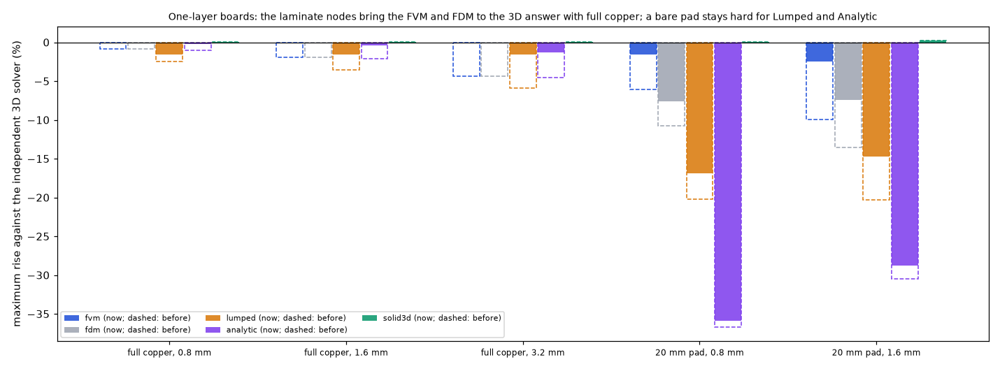
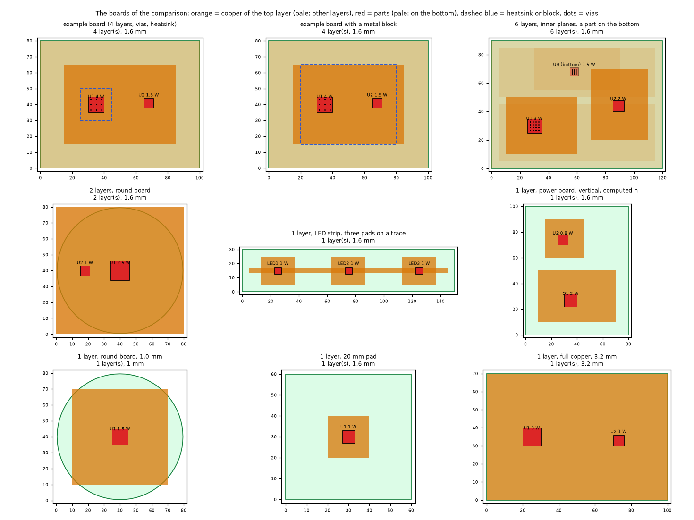
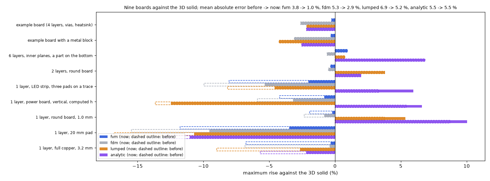

# Validation: history

The sections of `docs/validation.md` that describe the program of an earlier version and are no longer kept
current. They were moved here byte for byte (the heading and the whole body of each section; the move and its
check are `releases/2.8.0/simplify/DOC_MOVES.md` and `releases/2.8.0/simplify/scripts/check_doc_moves.py`). The
numbering is that of `docs/validation.md`, where each heading stays with a pointer to this file, so a reference
such as 'validation 20' still finds its place. The current numbers are in `docs/validation.md`.

| Section | Why it is history |
| :-- | :-- |
| 6 | the removed wxPython program against the program of 2.4.5 (the reason the legacy solvers were replaced) |
| 20 | the corrections of the first model review, with the tables of the program before 2.4.5 |
| 21 (body before 21.1) | the second round of that review (2.4.x); the current laminate rule is 21.2, the 3D slabs 21.3 |
| 21.1 | the error of the 2-layer boards before the laminate rule of 21.2 (marked superseded by the 2.8.0 audit) |

## 6. The removed wxPython program against the current one

*History (a record of why the legacy solvers were replaced): the rows of the new program are those of 2.4.5 and are not kept current; the current example-board numbers are in sections 1 and 2.*

Same example board (reference 85.81 °C with the point via, 85.23 °C with the mean-potential via, in the rows below; the rows of the new program are those of 2.4.5, `api.simulate` at 1 mm). Old numbers were obtained by running the original code (git tag `legacy-wxpython-1.0.0`, commit `641da87` with the comparison script).

| Program | Model | Tmax [°C] | Error on the rise | Power used [W] | Note |
| :-- | :-- | --: | --: | --: | :-- |
| old | Analytic, basic | 603.95 | +851 % | 5.50 | dimensionally wrong conduction term |
| old | Lumped, basic | 32.24 | −88 % | 5.50 | not a valid network |
| old | Analytic, advanced | 34081 | +55 845 % | 5.50 | |
| old | Lumped, advanced | 449.00 | +597 % | 5.50 | |
| old | FDM, 10 mm (defaults) | 124.93 | +64 % | **8.17** | injected 8.17 W for 5.50 W |
| old | FDM, 2 mm (defaults) | 76.94 | −15 % | 5.50 | "converged" |
| old | FDM, 1 mm (defaults) | 66.56 | **−32 %** | 5.50 | error grows when the mesh is refined (step-size stopping rule) |
| old | FDM, 1 mm (tight tolerance, ω = 1.9) | 82.50 | −5.5 % | 5.50 | the rest is modelling |
| new | FVM, 1 mm | 85.23 | 0 | 5.50 | energy balance −1.4e-12 (point via: 85.81) |
| new | FDM (area sampling), 1 mm | 85.13 | −0.2 % | 5.50 | same physics, vias as a footprint of nodes (point via: 84.38, −2.4 %) |
| new | Lumped | 86.63 | +2.3 % | 5.50 | (84.66, −0.9 %, before the via constriction of section 18.1) |
| new | Analytic | 84.58 | −1.1 % | 5.50 | with the edge in the series (section 4.1; 85.10 with the edge left out, 84.65 before the via constriction of section 18.1) |

What went wrong in the old FDM was not the finite-difference idea: a stopping rule on the step size (false convergence), a heater power that depended on the grid, no lateral conduction in FR-4, solid vias, heatsinks on inner layers ignored,
boundary nodes with a full cell. All were fixed (conservative cell balance, exact power, anisotropic FR-4, hollow vias). A correct FDM (section 2) lands within 0.2 % of the FVM on this board at 1 mm and 0.1 % at 0.5 mm since the mean-potential via (2.4 % and 1.1 % with the via at the nearest node; within 0.1 % where there are no vias).

## 20. Corrections found in a review of the models

*History: the corrections of the first model review (before 2.4.5); the tables are of the program of that time, as the notes say. The current construction of a one-layer board and of the laminate is section 21.2 (FVM, FDM) and 55 (the face film); the current numbers of the example boards are sections 1 to 3.*

A review of the models (the code read against `theory.md`) found two defects and two smaller ones; all four are corrected, each with a regression test.

**The time constant and the step responses of a board with an outline** (`fvm.board_time_constant`, used by the FVM, FDM and Lumped). The cells off the board are pinned to ambient with 1 W/K; that pin was counted as a path to the air in `τ = ΣC/ΣG`, so the step responses of the power profiles (ten time constants long) and the animation length offered by the application were cut short. `research/outline/scripts/study_outline_time_constant.py`, 60 mm boards, 2 W, 2 mm cells:

| board | τ, pin counted (before) | τ (now) |
| :-- | --: | --: |
| square 60 × 60 mm | 106.99 s | 107.0 s |
| round, 59.8 mm across | 0.02 s | 107.0 s |

On the round board the step response now ends at 1070 s on the steady resistance (30.452 K/W in the FVM, 30.472 in the FDM, each to four digits); with the old length (0.2 s) it ended at 3.670 K/W, 12 % of it, so the average-or-resolve decision of a power profile on such a board saw almost no thermal mass. Tests: `tests/test_outline.py` (`test_time_constant_and_step_responses_leave_out_the_cells_off_the_board`).

**The transient mean of a board with an outline** counted the cells off the board at the ambient: on the round board at 600 s it read 46.82 °C against 51.68 °C for the board itself; it is now weighted by the board area of every cell (node), like the steady mean (`test_transient_mean_counts_only_the_board`).

**The 3D solid on a one-layer board** built its slabs from the dielectric gaps only, and a one-layer board has none: the board was its 35 µm of copper. It now has the laminate of the layered models (the slab minus the copper, FR-4 of the materials) as four slabs under the copper. `research/solid3d-verification/scripts/study_one_layer_board.py`, 60 × 60 × 1.6 mm, 1 W on 6 × 6 mm, 1 mm cells, maximum temperature in °C:

| copper | FVM | FDM | 3D solid | Lumped | Analytic | 3D solid before |
| :-- | --: | --: | --: | --: | --: | --: |
| full copper | 56.43 | 56.43 | 57.38 | 56.84 | 56.53 | 58.72 |
| 20 mm pad | 75.22 | 73.12 | 81.92 | 72.36 | 74.53 | 119.97 |

*(The layered models of this table are before the laminate nodes of section 21; with them: full copper FVM 57.35, FDM 57.35, Lumped 57.77, Analytic 57.09; 20 mm pad FVM 79.94, FDM 76.49, Lumped 75.82, Analytic 75.64; the FDM numbers are those of the arithmetic face mean, which 2.7.0 replaced by the harmonic mean, section 41, and were not re-run.)*

Before the laminate nodes of section 21 the 3D solid was 3 % above the layered models with full copper and 13 % with a 20 mm pad (after them the FVM is −0.1 % with full copper and −3.5 % with the 20 mm pad of the 3D solid's rise; FDM −0.1 / −9.5 %, Lumped +1.2 / −10.7 %, Analytic −0.9 / −11.0 %: `study_one_layer_board.py`, part 1, 1 mm cells): in the 3D solid the bottom face loses heat through 1.6 mm of FR-4, in the layered models it acts on the copper node directly, and a pad hardly larger than the part is where that matters. An independent 3D finite-volume solver with patterned copper (`research/effective-conductivity/` section 4.11; FR-4 isotropic at 0.3 W/mK so that both represent the same board, copper 385 W/mK, no edge loss, 0.5 mm cells) confirms it: with a 20 mm pad the 3D solid is +0.2 % of the rise from it (before the correction +40 %); with full copper both the corrected and the old 3D solid agree with it within 0.2 %, so full copper does not test the correction. The FVM is 0.9 to 4.4 % low with full copper (0.8 to 3.2 mm) and 10 % low with the pad, because its bottom film acts on the copper node and the laminate under it is missing (corrected since with two laminate nodes under the copper: 0.0 % with full copper and -2.5 % with the pad; `docs/validation.md` section 21). *An earlier version of this section quoted 33.71 K against 33.43 K (-0.8 %) from a check with mismatched copper and edge loss; it is replaced by these numbers.* Test: `tests/test_solid3d.py` (`test_a_one_layer_board_keeps_its_laminate`).

**A power loop that does not settle** (power temperature coefficient or top path, `api._solve_with_tc`) used to return its 80th iterate silently; close to runaway that underestimates the temperatures. It now warns (`tests/test_component.py`, a loop gain of 0.9). The top path is no longer a fixed-point loop (small pads diverged, section 9); only the power coefficient is.

**Corrected in section 21** (it was recorded here first): on a 50 mm Cu / FR-4 / Cu coupon (2.5 W, sources of 30 to 41 mm) the Lumped result moves with the source size by up to 1 % from one millimetre to the next (+1.2 % at 35 mm, +0.2 % at 36 mm against the FVM; +0.2 to +1.8 % over the range) and does not converge with the ring count (33 to 37 mm: 20 rings +0.9 to +2.0 %, 40 rings +3.0 to +5.2 %, against +0.2 to +1.6 % with the default 10); it is within its documented accuracy (2 % mean, 5 % maximum) but the ring geometry is tuned to 10 rings (`docs/versions.md` (chapter 'Planned'), Solvers and validation).

**Documents corrected in the same review**: the plate check of the metal block is +0.6 %, −0.8 % and −4.6 % from Seri Lee's article (centre, edge midpoint, corner; computed then by a thin-plate solver written inside the study, not by `blocks.py`; the program's `blocks.py` itself, run in the audit of 2.8.0, gives +0.6 / −0.8 / −4.7 % in the FVM, FDM and 3D solid at 0.5 mm, `theory.md` 7.5), not +4.5 % (`theory.md` section 7, `research/component-heatsink/scripts/block_contact_study.py`, which placed the source with `round()`), and its source is the Electronics Cooling article of Seri Lee (1998).

## 21. One-layer boards and the rings of the Lumped model (second round of the review)

*History: the second round of the same review (2.4.x); the FVM and FDM laminate is now the rule of 21.2, the Lumped first ring and first link changed in sections 31 and 53, so the tables of 21 before 21.2 describe the program of that time.*

Two corrections that section 20 left as candidates are now in the program, each with regression tests (`tests/test_laminate.py`, `tests/test_models_agree.py`).

**The laminate of a one-layer board in the layered models** (`pcbthermal/laminate.py`). *This is the construction of the first correction (two laminate nodes in every cell). The FVM and FDM now use the rule of section 21.2 (sub-gaps of at most 0.4 mm only where copper is absent next to the gap); the Lumped keeps the two nodes, the Analytic the series film. The tables of this section (the first correction, the independent solver at 0.5 mm, the nine boards) are the values of that construction and were not repeated for the FVM and FDM, except where section 21.2 says so.* A one-layer board has copper on its top face only; its single node carried the whole laminate and the bottom film acted on it, so the heat reached the bottom face without crossing the laminate. The laminate is now cut into two gaps with a node at each boundary (the copper node keeps the copper and half a gap; two laminate nodes below, the last one carries the bottom film; vertical links `k_th A / g`; every node conducts sideways and stores heat) in the FVM, FDM and, through the FVM network, the Lumped model; the results keep one layer, the copper. The Analytic model keeps one node and puts the laminate in series with the bottom film, `1 / (1/h + t_lam/k_th)`: with laminate nodes its uniform-sheet estimate of a bare pad was worse (−51 % instead of −30 % against the independent solver). The computed coefficients of a one-layer board take the bottom face temperature from the last laminate node. Two nodes were chosen from a sweep of the FVM on the 20 mm pad: one node −4.1 %, two −2.5 %, three −1.8 %, four −1.5 %; full copper 3.2 mm: −0.27, −0.08, −0.04, −0.02 %.

Against the independent 3D solver with patterned copper (`research/solid3d-verification/lib/layered3d.py`, the copy of the research branch's solver; isotropic FR-4 of 0.3 W/mK, films 10 and 15 W/m²K, no edge loss, 0.5 mm cells; `research/solid3d-verification/scripts/study_one_layer_board.py`, part 2; before = laminate nodes and series film off, rings unmerged):

| copper | thickness (mm) | independent (K) | fvm | fdm | solid3d | lumped | analytic |
| :-- | --: | --: | --: | --: | --: | --: | --: |
| full | 0.8 | 33.71 | -0.9 -> -0.0 % | -0.9 -> -0.0 % | +0.0 -> +0.0 % | -2.5 -> -1.6 % | -1.0 -> -0.2 % |
| full | 1.6 | 33.71 | -1.9 -> -0.0 % | -1.9 -> -0.0 % | +0.0 -> +0.0 % | -3.5 -> -1.6 % | -2.1 -> -0.4 % |
| full | 3.2 | 33.84 | -4.4 -> -0.1 % | -4.4 -> -0.1 % | +0.0 -> +0.0 % | -5.9 -> -1.6 % | -4.5 -> -1.3 % |
| 20 mm pad | 0.8 | 78.56 | -6.1 -> -1.6 % | -10.7 -> -7.6 % | +0.1 -> +0.1 % | -20.3 -> -16.9 % | -36.7 -> -35.9 % |
| 20 mm pad | 1.6 | 72.12 | -10.0 -> -2.5 % | -13.5 -> -7.4 % | +0.2 -> +0.2 % | -20.3 -> -14.7 % | -30.5 -> -28.8 % |

**The rings of the Lumped model** (`lumped.ring_edges`, `RING_MIN_WIDTH = 1`). Rings thinner than a cell held a count of cells that did not match their width, so their contour length was underestimated and their resistance overestimated: the result grew with the ring count and jumped with the source size. Ring edges closer than one cell are now merged; asking for more rings than the raster can show changes nothing. `research/models-comparison/scripts/study_lumped_rings.py`, the 50 mm Cu / FR-4 / Cu coupon (sources of 26 to 44 mm, against the FVM):

| rings | before: range over the sources | largest step between 1 mm sizes | now: range | largest step |
| --: | --: | --: | --: | --: |
| 10 | +0.2 to +2.3 % | 1.0 % | +0.2 to +0.4 % | 0.2 % |
| 20 | +0.4 to +4.3 % | 1.9 % | +0.2 to +0.4 % | 0.2 % |
| 40 | +0.5 to +7.0 % | 2.6 % | +0.2 to +0.4 % | 0.2 % |

The example board (rise against the FVM):

| rings | before | now |
| --: | --: | --: |
| 10 | -1.9 % | -1.9 % |
| 20 | +0.5 % | -2.6 % |
| 40 | +4.8 % | -2.5 % |

The default of 10 rings changes the 19 scenarios of section 2 besides the example board (the table has 20 rows) by at most 0.07 K.

**Nine boards closer to real ones, before and after** (`research/models-comparison/scripts/study_complex_boards.py`, run on the program before these corrections and after them; the 3D solid is the reference, 1 mm cells, error of the board maximum rise):

| board | 3D solid rise (K) | fvm before → after | fdm before → after | lumped before → after | analytic before → after |
| :-- | --: | --: | --: | --: | --: |
| example board (4 layers, vias, heatsink) | 60.98 | -0.3 → -1.2 % | -2.6 → -1.4 % | -2.2 → +1.1 % | -2.2 → -1.4 % |
| example board with a metal block | 52.63 | -0.3 → -1.3 % | -3.1 → -1.5 % | -4.2 → -0.0 % | -2.5 → -1.5 % |
| 6 layers, inner planes, a part on the bottom | 46.06 | +0.9 → -0.1 % | -0.6 → +0.1 % | +0.8 → +2.5 % | +6.9 → +6.8 % |
| 2 layers, round board | 58.55 | -0.3 → -0.3 % | -0.5 → -0.5 % | +3.8 → +3.8 % | +2.0 → +2.0 % |
| 1 layer, LED strip, three pads on a trace | 55.25 | -8.1 → -2.0 % | -10.0 → -5.4 % | -8.2 → -4.6 % | +3.3 → +6.0 % |
| 1 layer, power board, vertical, computed h | 44.17 | -4.2 → -0.8 % | -5.9 → -3.2 % | -13.7 → -12.5 % | +5.4 → +6.6 % |
| 1 layer, round board, 1.0 mm | 39.10 | -1.9 → -0.2 % | -2.3 → -0.8 % | +3.8 → +5.3 % | +8.7 → +10.0 % |
| 1 layer, 20 mm pad | 56.92 | -11.8 → -3.5 % | -15.5 → -9.5 % | -16.8 → -10.7 % | -13.0 → -11.0 % |
| 1 layer, full copper, 3.2 mm | 76.89 | -6.8 → -0.3 % | -6.8 → -0.4 % | -9.0 → -2.7 % | -5.7 → -2.2 % |

The reference is the 3D solid at 1 mm. At 1 mm the 3D solid is within 1.4 % of the independent solver on three of these boards made isotropic (0.2 % at 0.5 mm), and halving its cell moves the 20 mm pad by 0.8 % (`research/models-comparison/scripts/study_complex_boards_independent.py`). Mean absolute error against the 3D solid, before → after: fvm 3.8 → 1.1 %; fdm 5.3 → 2.5 %; lumped 6.9 → 4.8 %; analytic 5.5 → 5.3 %. Mean absolute error on the one-layer boards only, before → after: fvm 6.5 → 1.4 %; fdm 8.1 → 3.9 %; lumped 10.3 → 7.2 %; analytic 7.2 → 7.2 %. The table was re-run for 2.4.5 with `study_complex_boards.py` (62 s): the "after" columns of the three boards with vias and the two one-layer cells that moved by 0.1 point are the new values; they carry two later changes, the mean-potential via of the FVM and FDM (section 2.1) and the constriction of the heat on a via in the Lumped and Analytic models (section 18.1); the "before" columns are those of the original comparison and were not repeated.

* The boards with two or more layers do not change (the corrections only act on one-layer boards and on rings thinner than a cell).
* On one-layer boards the FVM goes from 6.5 to 1.4 % mean error, the FDM from 8.1 to 3.9 % and the Lumped from 10.3 to 7.2 %.
* The Analytic model is unchanged on average: better with full copper (−5.7 → −2.2 %), a little hotter on the partial-copper boards where it was already too hot (LED strip +3.3 → +5.9 %, round board +8.7 → +10.0 %). The series film raises every one-layer result, which helps where the model was cool and hurts where it was hot; why it is hot on those boards was not isolated. The remaining error is its uniform-sheet idealisation, which the input checks already report.
* What stays: a bare pad on a one-layer board is still hard for the Lumped (−11 to −17 %) and the Analytic (−11 to −36 %); the FDM samples the pad edge on its nodes (−7 to −10 %). The FVM is within 3.5 % on every board.

**The heat balance of the Analytic model with a metal block** (found while testing a block on a one-layer board): the solution already removed the face under the block, but the reported heat out of that face (`h · W H · a_00`) still counted it, so the balance was 8.8 % off on a one-layer board with a block and 9.8 % on a two-layer one (the same on the program before these corrections: it is older). The face heat of the tiles under the block is now taken off; the balance closes to 1e-13 and no temperature changes.

### 21.1 The error of the 2-layer boards (documented here; corrected for the FVM by the laminate nodes of section 21.2)

**Superseded (2.8.0 audit, `releases/2.8.0/audit/REVIEW_A2.md`): the numbers of this paragraph are the FVM before the laminate rule of section 21.2 (2.4.4).** The empty-bottom row is reproduced by `research/power-calculator/scripts/study_independent_datasheet_board.py`, which on the tree prints the FVM at -0.7 % of the independent solver both as two layers and as one layer, and the 3D solid at +0.0 % (cell 0.3 mm, isotropic FR-4, films 16.04 / 12.03 W/m2K at 1 W); the 20 mm and 10 mm pad rows, the same pad on both faces and the Analytic variant (-32 to -13 %) have no script in the repository and are not quoted as current. A 2-layer board has two copper nodes with one gap between them, and the gap is one vertical resistance. Against the independent 3D solver (program of 2.4.4, FVM; measured with a script that was run from a scratch directory and is **not in the repository**: the numbers are in `research/ROADMAP.md`, section 1, item 9 (A1), and the script has still to be written into `research/power-calculator/scripts/` before they are quoted as reproducible): the CSD17308Q3 board with an empty bottom is −2.3 % of the rise (treated as one layer: −1.3 %), the same board with a 20 mm pad −3.8 % (one layer: −2.3 %), with a 10 mm pad −7.7 % (one layer: −4.8 %); with full copper on top there is no difference. A 2-layer board with the same pad on both faces gives −3.9 %, so the error belongs to every 2-layer board (two nodes through the gap), not to the bare bottom; the 3D solid is within 0.4 %. Treating only the bare bottom as one layer would make identical 2-layer boards inconsistent, so it is not done, and no variant for the Analytic model alone is offered (−32 % to −13 % with a 20 mm pad, still poor with smaller pads). The subdivision of the gap of every multilayer board that this paragraph left open was done in 2.4.5, only where copper is absent (section 21.2, `research/laminate-nodes`); the numbers of this paragraph are those of the program before it and were not repeated.

Sources: the multilayer analytical models of PCBs that keep every layer apart (Monier-Vinard, Laraqi and others, HAL archive of Paris-Nanterre, records hal-01473763 and hal-01473744; the pages were blocked by the archive's bot protection and only the titles and search abstracts were read) and the series resistance of a wall and a film (any heat transfer textbook) are the basis of the construction; no source was found that prescribes the number of nodes through a laminate, so it was chosen by the sweep above.

