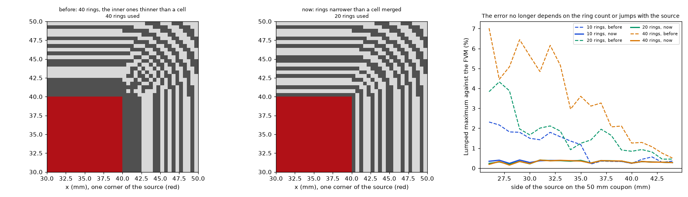
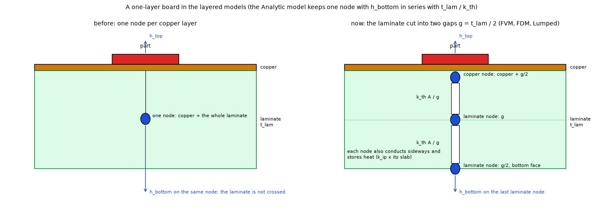
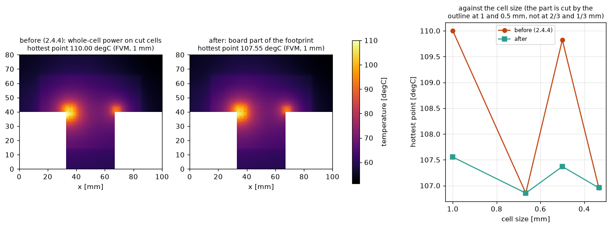
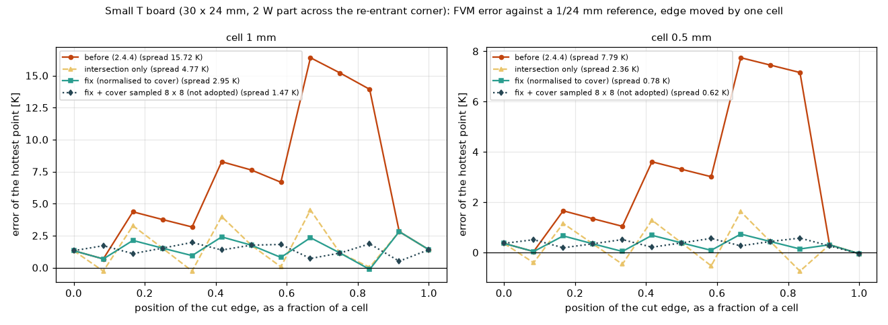

# Validation: history

The sections of `docs/validation.md` that describe the program of an earlier version and are no longer kept
current. They were moved here byte for byte (the heading and the whole body of each section, or, for two of them, one paragraph or the old values of a list: see the table below; the move and its
check are `releases/2.8.0/simplify/DOC_MOVES.md` and `releases/2.8.0/simplify/scripts/check_doc_moves.py`). The
numbering is that of `docs/validation.md`, where each heading stays with a pointer to this file, so a reference
such as 'validation 20' still finds its place. The current numbers are in `docs/validation.md`.

| Section | Why it is history |
| :-- | :-- |
| 6 | the removed wxPython program against the program of 2.4.5 (the reason the legacy solvers were replaced) |
| 20 | the corrections of the first model review, with the tables of the program before 2.4.5 |
| 21 (body before 21.1) | the second round of that review (2.4.x); the current laminate rule is 21.2, the 3D slabs 21.3 |
| 21.1 | the error of the 2-layer boards before the laminate rule of 21.2 (marked superseded by the 2.8.0 audit) |
| 23 (body before 23.1) | the part across an outline with the sampled cover (2.4.5 to 2.5.1); 23.1 is current |
| 25 | numbers carried over from the old `theory.md`, never re-run here; each topic is measured in the section its row names |
| 28 (one paragraph) | the -17 / -23 / -26 % of the via at h_side 1000 against a copper-link reference (cause corrected in the next paragraph; sections 46 and 49 hold the numbers to quote) |
| 32.1, 32.2, 32.3 | the cut-cell studies of the program of 2.6.0 (stale; the audit note at the head of 32, sections 36 and 40) |
| 7 (old values) | the values of the time bullets on earlier trees, with their first notes; validation 7 keeps the current ones |

## 6. The removed wxPython program against the current one

*History (a record of why the legacy solvers were replaced): the rows of the new program are those of 2.4.5 and are not kept current; the current example-board numbers are in sections 1 and 2.*

Same example board (reference 85.81 °C with the point via, 85.23 °C with the mean-potential via, in the rows below; the rows of the new program are those of 2.4.5, `api.simulate` at 1 mm). Old numbers were obtained by running the original code (git tag `legacy-wxpython-1.0.0`, commit `641da87` with the comparison script).

| Program | Model | Tmax [°C] | Error on the rise | Power used [W] | Note |
| :-- | :-- | --: | --: | --: | :-- |
| old | Analytic, basic | 603.95 | +851 % | 5.50 | dimensionally wrong conduction term |
| old | Lumped, basic | 32.24 | −88 % | 5.50 | not a valid network |
| old | Analytic, advanced | 34081 | +55 845 % | 5.50 | |
| old | Lumped, advanced | 449.00 | +597 % | 5.50 | |
| old | FDM, 10 mm (defaults) | 124.93 | +64 % | **8.17** | injected 8.17 W for 5.50 W |
| old | FDM, 2 mm (defaults) | 76.94 | −15 % | 5.50 | "converged" |
| old | FDM, 1 mm (defaults) | 66.56 | **−32 %** | 5.50 | error grows when the mesh is refined (step-size stopping rule) |
| old | FDM, 1 mm (tight tolerance, ω = 1.9) | 82.50 | −5.5 % | 5.50 | the rest is modelling |
| new | FVM, 1 mm | 85.23 | 0 | 5.50 | energy balance −1.4e-12 (point via: 85.81) |
| new | FDM (area sampling), 1 mm | 85.13 | −0.2 % | 5.50 | same physics, vias as a footprint of nodes (point via: 84.38, −2.4 %) |
| new | Lumped | 86.63 | +2.3 % | 5.50 | (84.66, −0.9 %, before the via constriction of section 18.1) |
| new | Analytic | 84.58 | −1.1 % | 5.50 | with the edge in the series (section 4.1; 85.10 with the edge left out, 84.65 before the via constriction of section 18.1) |

What went wrong in the old FDM was not the finite-difference idea: a stopping rule on the step size (false convergence), a heater power that depended on the grid, no lateral conduction in FR-4, solid vias, heatsinks on inner layers ignored,
boundary nodes with a full cell. All were fixed (conservative cell balance, exact power, anisotropic FR-4, hollow vias). A correct FDM (section 2) lands within 0.2 % of the FVM on this board at 1 mm and 0.1 % at 0.5 mm since the mean-potential via (2.4 % and 1.1 % with the via at the nearest node; within 0.1 % where there are no vias).

## 20. Corrections found in a review of the models

*History: the corrections of the first model review (before 2.4.5); the tables are of the program of that time, as the notes say. The current construction of a one-layer board and of the laminate is section 21.2 (FVM, FDM) and 55 (the face film); the current numbers of the example boards are sections 1 to 3.*

A review of the models (the code read against `theory.md`) found two defects and two smaller ones; all four are corrected, each with a regression test.

**The time constant and the step responses of a board with an outline** (`fvm.board_time_constant`, used by the FVM, FDM and Lumped). The cells off the board are pinned to ambient with 1 W/K; that pin was counted as a path to the air in `τ = ΣC/ΣG`, so the step responses of the power profiles (ten time constants long) and the animation length offered by the application were cut short. `research/outline/scripts/study_outline_time_constant.py`, 60 mm boards, 2 W, 2 mm cells:

| board | τ, pin counted (before) | τ (now) |
| :-- | --: | --: |
| square 60 × 60 mm | 106.99 s | 107.0 s |
| round, 59.8 mm across | 0.02 s | 107.0 s |

On the round board the step response now ends at 1070 s on the steady resistance (30.452 K/W in the FVM, 30.472 in the FDM, each to four digits); with the old length (0.2 s) it ended at 3.670 K/W, 12 % of it, so the average-or-resolve decision of a power profile on such a board saw almost no thermal mass. Tests: `tests/test_outline.py` (`test_time_constant_and_step_responses_leave_out_the_cells_off_the_board`).

**The transient mean of a board with an outline** counted the cells off the board at the ambient: on the round board at 600 s it read 46.82 °C against 51.68 °C for the board itself; it is now weighted by the board area of every cell (node), like the steady mean (`test_transient_mean_counts_only_the_board`).

**The 3D solid on a one-layer board** built its slabs from the dielectric gaps only, and a one-layer board has none: the board was its 35 µm of copper. It now has the laminate of the layered models (the slab minus the copper, FR-4 of the materials) as four slabs under the copper. `research/solid3d-verification/scripts/study_one_layer_board.py`, 60 × 60 × 1.6 mm, 1 W on 6 × 6 mm, 1 mm cells, maximum temperature in °C:

| copper | FVM | FDM | 3D solid | Lumped | Analytic | 3D solid before |
| :-- | --: | --: | --: | --: | --: | --: |
| full copper | 56.43 | 56.43 | 57.38 | 56.84 | 56.53 | 58.72 |
| 20 mm pad | 75.22 | 73.12 | 81.92 | 72.36 | 74.53 | 119.97 |

*(The layered models of this table are before the laminate nodes of section 21; with them: full copper FVM 57.35, FDM 57.35, Lumped 57.77, Analytic 57.09; 20 mm pad FVM 79.94, FDM 76.49, Lumped 75.82, Analytic 75.64; the FDM numbers are those of the arithmetic face mean, which 2.7.0 replaced by the harmonic mean, section 41, and were not re-run.)*

Before the laminate nodes of section 21 the 3D solid was 3 % above the layered models with full copper and 13 % with a 20 mm pad (after them the FVM is −0.1 % with full copper and −3.5 % with the 20 mm pad of the 3D solid's rise; FDM −0.1 / −9.5 %, Lumped +1.2 / −10.7 %, Analytic −0.9 / −11.0 %: `study_one_layer_board.py`, part 1, 1 mm cells): in the 3D solid the bottom face loses heat through 1.6 mm of FR-4, in the layered models it acts on the copper node directly, and a pad hardly larger than the part is where that matters. An independent 3D finite-volume solver with patterned copper (`research/effective-conductivity/` section 4.11; FR-4 isotropic at 0.3 W/mK so that both represent the same board, copper 385 W/mK, no edge loss, 0.5 mm cells) confirms it: with a 20 mm pad the 3D solid is +0.2 % of the rise from it (before the correction +40 %); with full copper both the corrected and the old 3D solid agree with it within 0.2 %, so full copper does not test the correction. The FVM is 0.9 to 4.4 % low with full copper (0.8 to 3.2 mm) and 10 % low with the pad, because its bottom film acts on the copper node and the laminate under it is missing (corrected since with two laminate nodes under the copper: 0.0 % with full copper and -2.5 % with the pad; `docs/validation.md` section 21). *An earlier version of this section quoted 33.71 K against 33.43 K (-0.8 %) from a check with mismatched copper and edge loss; it is replaced by these numbers.* Test: `tests/test_solid3d.py` (`test_a_one_layer_board_keeps_its_laminate`).

**A power loop that does not settle** (power temperature coefficient or top path, `api._solve_with_tc`) used to return its 80th iterate silently; close to runaway that underestimates the temperatures. It now warns (`tests/test_component.py`, a loop gain of 0.9). The top path is no longer a fixed-point loop (small pads diverged, section 9); only the power coefficient is.

**Corrected in section 21** (it was recorded here first): on a 50 mm Cu / FR-4 / Cu coupon (2.5 W, sources of 30 to 41 mm) the Lumped result moves with the source size by up to 1 % from one millimetre to the next (+1.2 % at 35 mm, +0.2 % at 36 mm against the FVM; +0.2 to +1.8 % over the range) and does not converge with the ring count (33 to 37 mm: 20 rings +0.9 to +2.0 %, 40 rings +3.0 to +5.2 %, against +0.2 to +1.6 % with the default 10); it is within its documented accuracy (2 % mean, 5 % maximum) but the ring geometry is tuned to 10 rings (`docs/versions.md` (chapter 'Planned'), Solvers and validation).

**Documents corrected in the same review**: the plate check of the metal block is +0.6 %, −0.8 % and −4.6 % from Seri Lee's article (centre, edge midpoint, corner; computed then by a thin-plate solver written inside the study, not by `blocks.py`; the program's `blocks.py` itself, run in the audit of 2.8.0, gives +0.6 / −0.8 / −4.7 % in the FVM, FDM and 3D solid at 0.5 mm, `theory.md` 7.5), not +4.5 % (`theory.md` section 7, `research/component-heatsink/scripts/block_contact_study.py`, which placed the source with `round()`), and its source is the Electronics Cooling article of Seri Lee (1998).

## 21. One-layer boards and the rings of the Lumped model (second round of the review)

*History: the second round of the same review (2.4.x); the FVM and FDM laminate is now the rule of 21.2, the Lumped first ring and first link changed in sections 31 and 53, so the tables of 21 before 21.2 describe the program of that time.*

Two corrections that section 20 left as candidates are now in the program, each with regression tests (`tests/test_laminate.py`, `tests/test_models_agree.py`).

**The laminate of a one-layer board in the layered models** (`pcbthermal/laminate.py`). *This is the construction of the first correction (two laminate nodes in every cell). The FVM and FDM now use the rule of section 21.2 (sub-gaps of at most 0.4 mm only where copper is absent next to the gap); the Lumped keeps the two nodes, the Analytic the series film. The tables of this section (the first correction, the independent solver at 0.5 mm, the nine boards) are the values of that construction and were not repeated for the FVM and FDM, except where section 21.2 says so.* A one-layer board has copper on its top face only; its single node carried the whole laminate and the bottom film acted on it, so the heat reached the bottom face without crossing the laminate. The laminate is now cut into two gaps with a node at each boundary (the copper node keeps the copper and half a gap; two laminate nodes below, the last one carries the bottom film; vertical links `k_th A / g`; every node conducts sideways and stores heat) in the FVM, FDM and, through the FVM network, the Lumped model; the results keep one layer, the copper. The Analytic model keeps one node and puts the laminate in series with the bottom film, `1 / (1/h + t_lam/k_th)`: with laminate nodes its uniform-sheet estimate of a bare pad was worse (−51 % instead of −30 % against the independent solver). The computed coefficients of a one-layer board take the bottom face temperature from the last laminate node. Two nodes were chosen from a sweep of the FVM on the 20 mm pad: one node −4.1 %, two −2.5 %, three −1.8 %, four −1.5 %; full copper 3.2 mm: −0.27, −0.08, −0.04, −0.02 %.

Against the independent 3D solver with patterned copper (`research/solid3d-verification/lib/layered3d.py`, the copy of the research branch's solver; isotropic FR-4 of 0.3 W/mK, films 10 and 15 W/m²K, no edge loss, 0.5 mm cells; `research/solid3d-verification/scripts/study_one_layer_board.py`, part 2; before = laminate nodes and series film off, rings unmerged):

| copper | thickness (mm) | independent (K) | fvm | fdm | solid3d | lumped | analytic |
| :-- | --: | --: | --: | --: | --: | --: | --: |
| full | 0.8 | 33.71 | -0.9 -> -0.0 % | -0.9 -> -0.0 % | +0.0 -> +0.0 % | -2.5 -> -1.6 % | -1.0 -> -0.2 % |
| full | 1.6 | 33.71 | -1.9 -> -0.0 % | -1.9 -> -0.0 % | +0.0 -> +0.0 % | -3.5 -> -1.6 % | -2.1 -> -0.4 % |
| full | 3.2 | 33.84 | -4.4 -> -0.1 % | -4.4 -> -0.1 % | +0.0 -> +0.0 % | -5.9 -> -1.6 % | -4.5 -> -1.3 % |
| 20 mm pad | 0.8 | 78.56 | -6.1 -> -1.6 % | -10.7 -> -7.6 % | +0.1 -> +0.1 % | -20.3 -> -16.9 % | -36.7 -> -35.9 % |
| 20 mm pad | 1.6 | 72.12 | -10.0 -> -2.5 % | -13.5 -> -7.4 % | +0.2 -> +0.2 % | -20.3 -> -14.7 % | -30.5 -> -28.8 % |

**The rings of the Lumped model** (`lumped.ring_edges`, `RING_MIN_WIDTH = 1`). Rings thinner than a cell held a count of cells that did not match their width, so their contour length was underestimated and their resistance overestimated: the result grew with the ring count and jumped with the source size. Ring edges closer than one cell are now merged; asking for more rings than the raster can show changes nothing. `research/models-comparison/scripts/study_lumped_rings.py`, the 50 mm Cu / FR-4 / Cu coupon (sources of 26 to 44 mm, against the FVM):

| rings | before: range over the sources | largest step between 1 mm sizes | now: range | largest step |
| --: | --: | --: | --: | --: |
| 10 | +0.2 to +2.3 % | 1.0 % | +0.2 to +0.4 % | 0.2 % |
| 20 | +0.4 to +4.3 % | 1.9 % | +0.2 to +0.4 % | 0.2 % |
| 40 | +0.5 to +7.0 % | 2.6 % | +0.2 to +0.4 % | 0.2 % |

The example board (rise against the FVM):

| rings | before | now |
| --: | --: | --: |
| 10 | -1.9 % | -1.9 % |
| 20 | +0.5 % | -2.6 % |
| 40 | +4.8 % | -2.5 % |

The default of 10 rings changes the 19 scenarios of section 2 besides the example board (the table has 20 rows) by at most 0.07 K.

**Nine boards closer to real ones, before and after** (`research/models-comparison/scripts/study_complex_boards.py`, run on the program before these corrections and after them; the 3D solid is the reference, 1 mm cells, error of the board maximum rise):

| board | 3D solid rise (K) | fvm before → after | fdm before → after | lumped before → after | analytic before → after |
| :-- | --: | --: | --: | --: | --: |
| example board (4 layers, vias, heatsink) | 60.98 | -0.3 → -1.2 % | -2.6 → -1.4 % | -2.2 → +1.1 % | -2.2 → -1.4 % |
| example board with a metal block | 52.63 | -0.3 → -1.3 % | -3.1 → -1.5 % | -4.2 → -0.0 % | -2.5 → -1.5 % |
| 6 layers, inner planes, a part on the bottom | 46.06 | +0.9 → -0.1 % | -0.6 → +0.1 % | +0.8 → +2.5 % | +6.9 → +6.8 % |
| 2 layers, round board | 58.55 | -0.3 → -0.3 % | -0.5 → -0.5 % | +3.8 → +3.8 % | +2.0 → +2.0 % |
| 1 layer, LED strip, three pads on a trace | 55.25 | -8.1 → -2.0 % | -10.0 → -5.4 % | -8.2 → -4.6 % | +3.3 → +6.0 % |
| 1 layer, power board, vertical, computed h | 44.17 | -4.2 → -0.8 % | -5.9 → -3.2 % | -13.7 → -12.5 % | +5.4 → +6.6 % |
| 1 layer, round board, 1.0 mm | 39.10 | -1.9 → -0.2 % | -2.3 → -0.8 % | +3.8 → +5.3 % | +8.7 → +10.0 % |
| 1 layer, 20 mm pad | 56.92 | -11.8 → -3.5 % | -15.5 → -9.5 % | -16.8 → -10.7 % | -13.0 → -11.0 % |
| 1 layer, full copper, 3.2 mm | 76.89 | -6.8 → -0.3 % | -6.8 → -0.4 % | -9.0 → -2.7 % | -5.7 → -2.2 % |

The reference is the 3D solid at 1 mm. At 1 mm the 3D solid is within 1.4 % of the independent solver on three of these boards made isotropic (0.2 % at 0.5 mm), and halving its cell moves the 20 mm pad by 0.8 % (`research/models-comparison/scripts/study_complex_boards_independent.py`). Mean absolute error against the 3D solid, before → after: fvm 3.8 → 1.1 %; fdm 5.3 → 2.5 %; lumped 6.9 → 4.8 %; analytic 5.5 → 5.3 %. Mean absolute error on the one-layer boards only, before → after: fvm 6.5 → 1.4 %; fdm 8.1 → 3.9 %; lumped 10.3 → 7.2 %; analytic 7.2 → 7.2 %. The table was re-run for 2.4.5 with `study_complex_boards.py` (62 s): the "after" columns of the three boards with vias and the two one-layer cells that moved by 0.1 point are the new values; they carry two later changes, the mean-potential via of the FVM and FDM (section 2.1) and the constriction of the heat on a via in the Lumped and Analytic models (section 18.1); the "before" columns are those of the original comparison and were not repeated.

* The boards with two or more layers do not change (the corrections only act on one-layer boards and on rings thinner than a cell).
* On one-layer boards the FVM goes from 6.5 to 1.4 % mean error, the FDM from 8.1 to 3.9 % and the Lumped from 10.3 to 7.2 %.
* The Analytic model is unchanged on average: better with full copper (−5.7 → −2.2 %), a little hotter on the partial-copper boards where it was already too hot (LED strip +3.3 → +5.9 %, round board +8.7 → +10.0 %). The series film raises every one-layer result, which helps where the model was cool and hurts where it was hot; why it is hot on those boards was not isolated. The remaining error is its uniform-sheet idealisation, which the input checks already report.
* What stays: a bare pad on a one-layer board is still hard for the Lumped (−11 to −17 %) and the Analytic (−11 to −36 %); the FDM samples the pad edge on its nodes (−7 to −10 %). The FVM is within 3.5 % on every board.

**The heat balance of the Analytic model with a metal block** (found while testing a block on a one-layer board): the solution already removed the face under the block, but the reported heat out of that face (`h · W H · a_00`) still counted it, so the balance was 8.8 % off on a one-layer board with a block and 9.8 % on a two-layer one (the same on the program before these corrections: it is older). The face heat of the tiles under the block is now taken off; the balance closes to 1e-13 and no temperature changes.

### 21.1 The error of the 2-layer boards (documented here; corrected for the FVM by the laminate nodes of section 21.2)

**Superseded (2.8.0 audit, `releases/2.8.0/audit/REVIEW_A2.md`): the numbers of this paragraph are the FVM before the laminate rule of section 21.2 (2.4.4).** The empty-bottom row is reproduced by `research/power-calculator/scripts/study_independent_datasheet_board.py`, which on the tree prints the FVM at -0.7 % of the independent solver both as two layers and as one layer, and the 3D solid at +0.0 % (cell 0.3 mm, isotropic FR-4, films 16.04 / 12.03 W/m2K at 1 W); the 20 mm and 10 mm pad rows, the same pad on both faces and the Analytic variant (-32 to -13 %) have no script in the repository and are not quoted as current. A 2-layer board has two copper nodes with one gap between them, and the gap is one vertical resistance. Against the independent 3D solver (program of 2.4.4, FVM; measured with a script that was run from a scratch directory and is **not in the repository**: the numbers are in `research/ROADMAP.md`, section 1, item 9 (A1), and the script has still to be written into `research/power-calculator/scripts/` before they are quoted as reproducible): the CSD17308Q3 board with an empty bottom is −2.3 % of the rise (treated as one layer: −1.3 %), the same board with a 20 mm pad −3.8 % (one layer: −2.3 %), with a 10 mm pad −7.7 % (one layer: −4.8 %); with full copper on top there is no difference. A 2-layer board with the same pad on both faces gives −3.9 %, so the error belongs to every 2-layer board (two nodes through the gap), not to the bare bottom; the 3D solid is within 0.4 %. Treating only the bare bottom as one layer would make identical 2-layer boards inconsistent, so it is not done, and no variant for the Analytic model alone is offered (−32 % to −13 % with a 20 mm pad, still poor with smaller pads). The subdivision of the gap of every multilayer board that this paragraph left open was done in 2.4.5, only where copper is absent (section 21.2, `research/laminate-nodes`); the numbers of this paragraph are those of the program before it and were not repeated.

Sources: the multilayer analytical models of PCBs that keep every layer apart (Monier-Vinard, Laraqi and others, HAL archive of Paris-Nanterre, records hal-01473763 and hal-01473744; the pages were blocked by the archive's bot protection and only the titles and search abstracts were read) and the series resistance of a wall and a film (any heat transfer textbook) are the basis of the construction; no source was found that prescribes the number of nodes through a laminate, so it was chosen by the sweep above.

## 23. A part across the board outline

**Note (2.6.0, `fix/exact-board-cover`):** the board cover and the part weights are now exact areas, not the 8 x 8 samples; the tables of this section up to 23.1 are those of 2.4.5 to 2.5.1 (sampled cover) and are kept as the history, the new numbers are in 23.1.

Since 2.4.5 (and, with the board cover sampled 8 x 8, `fix/board-cover-8x8`) a part that crosses the board outline heats only the part of each cell that is on the board (`geometry.part_weights`, `docs/theory.md` 1.3, `tests/test_part_across_outline.py`). Before, the FVM, the FDM and the 3D solid gave a cut cell the power density of the whole cell, on a board area smaller than the cell. The numbers below come from the program as it is now and, for the "before" columns, from the same program with the old rule put back by hand (the weight `coverage_fraction` of the part alone); the figures are 34 to 37 of `docs/theory.md` 1.3 (`python research/theory/scripts/make_fig_part_outline.py`).

**The example board cut to a T** (100 × 80 mm, `h_side` 10 W/m²K, outline of `research/outline/scripts/outline_rectangle_study.py`), hottest point in degC at cells 1 / 2/3 / 0.5 / 1/3 mm. At 2/3 and 1/3 mm the edges of the T lie on grid lines and no cell is cut:

| Model | before the fix | after the fix | now (2.4.5: also the vias with no board under them ignored) |
| :-- | --: | --: | --: |
| FVM | 109.06 / 106.86 / 110.80 / 106.96 | 107.56 / 106.86 / 107.37 / 106.96 | 106.81 / 106.56 / 106.50 / 106.53 |
| FDM | not repeated | 105.25 / 105.61 / 106.51 / 106.71 | 105.94 / 106.26 / 106.37 / 106.47 |
| 3D solid (1, 2/3, 0.5 mm) | not repeated | 107.79 / 107.08 / 107.18 | 107.79 / 107.08 / not repeated |

The column *now* was re-run for the final review of 2.4.5 (`fvm.solve_steady`, `fdm.solve_steady`, `solid3d.solve_steady` on the outline of `outline_rectangle_study.py`, `h_side` 10 W/m²K); it differs from the column *after the fix* because two of the nine vias of the example lie at the outline of the T and are now ignored instead of being moved to the nearest board cell (paragraph *Vias at the outline* below), which moves the FVM and the FDM also where no cell is cut (2/3 and 1/3 mm); the 3D solid keeps the part of the disc on the board and does not move. Figure 36 draws the column *after the fix*.

*Figure 36 (`images/fig_36_part_example_t.png`): the example board (100 × 80 mm) cut to a T, FVM at 1 mm, before and after the fix, and the hottest point against the cell size (at 2/3 and 1/3 mm the edge lies on grid lines and no cell is cut, so the two rules agree).*

**Edge-shift sweep.** A small T (30 × 24 mm, 2 W part across the re-entrant corner, `h_side` 10 W/m²K) with the neck edge moved over one cell in 8 to 12 steps; the error of the hottest point against the same model with 1/24 mm cells (FVM, FDM) or 1/8 mm (3D solid), and the scatter (max minus min of the error, K):

| Model, cell | before | intersection only | fix, cover 4 x 4 | fix/board-cover-8x8 |
| :-- | --: | --: | --: | --: |
| FVM, 1 mm | 15.72 | 4.77 | 2.95 | 1.47 |
| FVM, 0.5 mm | 7.79 | 2.36 | 0.78 | 0.62 |
| 3D solid, 1 mm | not reproduced | not reproduced | 3.23 | 1.56 |
| FDM, 1 mm | not reproduced | not reproduced | 2.02 | 2.02 (unchanged) |

The FVM rows are printed by `python research/theory/scripts/make_fig_part_outline.py` (reference: the same model with 1/24 mm cells). The 3D solid value is against 1/8 mm cells and was reproduced by the review of the branch. Earlier versions of this table gave other 3D solid and FDM scatters (1.69 and 0.60 for the 3D solid, 1.39 and 0.47 for the FDM) and "before" values for them; no script reproduces those, so they are withdrawn, and so are the 0.5 mm rows of the 3D solid and the FDM and the maxima of the error that were derived from them. The FVM error before the fix reached about 16.5 K at 1 mm. Against the 1/3 mm references the small T at 1 mm reads, with the 8 x 8 cover, FVM 231.87 (230.84 with the 4 x 4 cover) and 3D solid 233.02 (231.96); the aligned references were not repeated after the change.

*Figure 37 (`images/fig_37_part_edge_shift.png`): error of the hottest point of the small T board (30 × 24 mm, 2 W part across the re-entrant corner) against the position of the cut edge within one cell, for four rules, FVM at 1 and 0.5 mm against a 1/24 mm reference (the numbers are in the table above).*

**The 8 x 8 cover is smoother, not more accurate.** The scatter halves only for the FVM and the 3D solid at 1 mm; the mean bias of +1.4 K at 1 mm remains, and at some edge positions the error is up to 1 K worse than with the 4 x 4 cover. The gain is that the answer varies less when an edge moves across the grid.

**What the rule is for the FVM and the 3D solid.** The share of the board samples that lie in the part times the cover of the model equals the plain intersection `n_pb / 64` exactly, because the cover is sampled on the same 8 x 8 lattice (`geometry.BOARD_SAMPLES`). With the earlier 4 x 4 cover the two disagreed in a cut cell (1.5 K at 0.5 mm on the small T) and the weight was normalised to the cover. The FDM always sampled both 8 x 8.

**Vias at the outline.** A via with no board under its drill disc is ignored by every model (`geometry.discs_board_share`), where it used to be moved to the nearest board cell. On the T preset at 1 mm (nine vias, two of them at the outline) the hottest point is 106.809 / 105.938 / 107.788 degC in the FVM / FDM / 3D solid (it was 104.884 / 104.908 / 107.788); one via with its centre on the re-entrant edge and half its disc on the board moves the result by 0.75 K in the FVM and 0.85 K in the 3D solid. On the T preset at 1 mm the FVM is 0.98 K below the 3D solid with the nine vias and 1.07 K without the two vias at the outline: the gap does not come from the vias but from the treatment of a cut cell by its cover (option P1 in Planned, the residual of fix/part-across-outline). The example board does not change (85.2335 / 85.1260 / 86.6277 / 85.1021 / 85.9751 degC in FVM / FDM / Lumped / Analytic / 3D solid).

**Read-outs.** The mean, minimum and ring temperatures under a part or a zone no longer include the cells or nodes off the board, which read the ambient: on the T board a zone showed a minimum of 25 degC; the mean under a small T part at 0.5 mm, FVM, went from 191.3 to 222.8 degC (223.4 with the 4 x 4 cover), the ring of `psi_jb` from 163.1 to 203.2 degC (203.7); the zone mean (128.8 before the fix) was not repeated with the 8 x 8 cover (the maximum and the junction temperature do not move; `tests/test_part_across_outline.py::test_statistics_leave_out_the_cells_off_the_board`). The Power Calculator uses the same read-outs for its mean and ring points.

**Unchanged.** `python research/models-comparison/scripts/validation_study.py` prints the same table as before the fix (identical text), `research/gap-subdivision/scripts/rerun_baseline.py` moves no peak by more than 0.0001 % of the rise. In the Lumped and Analytic models the temperature field, the hottest point and the junction temperatures are unchanged (bit-identical); on a board with an outline the mean under a part is now read on the board only (8 x 8 cover) and moves by up to 2 K in the Analytic (1 % of the rise; -1.9 K for a part across the edge at 0.5 mm). Boards without an outline are unchanged in every model.

**The FDM hot spot of the part-across-outline board.** In the FDM the part of a footprint that was off the board used to be spread over the edge nodes; it is now weighted by the part on the board. On the part-across-outline board the FDM hot spot moves -16.2 / -21.8 / -5.7 K at 2 / 1 / 0.5 mm (252.03 -> 230.23 degC at 1 mm), the FVM -1.7 / -13.7 / -3.7 K and the 3D solid -1.7 / -14.1 / -3.8 K; before the three models spread 231.7 to 252.0 degC, now they agree within 1.4 K, and against the independent layered reference (0.2 mm cells, isotropic) all are within 0.6 % of the 214.64 K rise (before: FDM +8.5 / +10.9 / +2.6 %, FVM up to +7 %).

**Limit** (program of 2.4.5; superseded in part, 2.8.0 audit: since 2.6.0 the board cover is exact (23.1), the FVM joins cut cells by the open fraction of their faces with the edge film in series (32), the 3D solid has the same treatment (33) and a cut gap gets the laminate band (36), so the numbers of this paragraph and of 'Vias at the outline' above, measured with the program's 3D solid at 1 mm before its sliver fix, are not current; the T preset and the turned 40 mm board were not re-run by the audit). A cut cell still conducts with its cover, so a part over a cut edge reads 0.5 to 0.7 K (about 1 % of the rise) hotter at 1 to 0.5 mm than with the edge on the grid lines (the scatter of the "now" rows is this residual). Treating the cut cell by its real shape (option P1 of `research/rotated-square-3d`) is in the chapter "Planned" of `versions.md`. Board of 40 mm turned 20 degrees (board and part) at 1 mm: +1.25 K with h = 100 and +3.52 K with h = 1000 above the continuum of the independent solver (it was +1.09 and +3.41 K before the 8 x 8 cover; the other turns, 45 degrees included, were not rerun: before the cover they read +1.1 to +1.8 and +3.4 to +3.6 K); the 8 x 8 cover moved it by +0.1 to +0.3 K in the FVM and, at h = 2000 on a 20 mm board, by +1.5 K in the 3D solid.

## 25. Numbers that `theory.md` used to quote

When `docs/theory.md` was rewritten to describe the models as implemented (statements, equations and pictures only), the numbers and the history that it carried were moved here, so that nothing is lost. They were **carried over from the earlier text of `theory.md`; they were not re-run in the commit that moved them**, and each names the investigation or section that produced it. A number that a script prints today is in the section named; one that is only here is marked "carried over".

| Topic (theory section) | Statement | Source |
| :-- | :-- | :-- |
| Layered idealisation (1.2) | the layered models are within 0.4 to 2 % of the 3D solid (the FVM 0.1 to 0.7 % since the laminate nodes of 2.4.5, section 3); the attribution of that difference to the idealisation and to one node per copper layer was **not measured separately** | section 3; carried over |
| Culham and Yovanovich (1.2) | any homogenised conductivity of a laminate can be 70 % to 300 % off; the geometric mean of their five-layer coupon, 2.7 W/mK, is 70 % off | [CulhamYovanovich1998], read; reproduction in 22.1 |
| Advanced stack-up (1.2.1) | agrees within 0.1 K with the simple one when the gaps are equal; 1 oz inner copper lowers the maximum by 6.9 to 7.5 K with a plane on each inner layer | sections 12 and 14.1 |
| Weight of a part across the outline (1.3.2) | before 2.4.5 the weight was the coverage of the part alone (a cut cell received the density of the whole cell on a smaller board area: 2.2 K too hot at 1 mm and 3.8 K at 0.5 mm on the example board cut to a T); with the cover sampled 4 x 4 a cover of 1/4 against an intersection of 3/8 gave 1.5 times the density (+1.3 K on a small T at 0.5 mm); with the 8 x 8 cover the weight equals the plain intersection; the mean bias of +1.4 K at 1 mm remains; the cut cell conducts with its cover, 0.5 to 0.7 K (about 1 % of the rise) at 1 to 0.5 mm | section 23 |
| One-layer board (1.4) | with one node the FVM was 0.9 to 4.4 % low with full copper and 10 % low with a 20 mm pad; one, two, three and four laminate nodes under the copper gave -4.1, -2.5, -1.8 and -1.5 % on a bare 20 mm pad, under 0.3 % with full copper from two on | sections 21 and 21.2 |
| Solvers (2.3) | the symmetric minimum-degree ordering halves the fill and cuts about 40 % of the time against the default ordering; the residual of the direct solver is about 1e-13 | section 5; carried over |
| SOR with vias (2.3) | the block SOR needs 0.79 to 1.00 times the sweeps of the board without vias and agrees with the direct solver within 1e-8 K | section 5; `research/sor-with-via-couplings` |
| Relaxation factor (2.3) | the factor of a plate with fixed edges, `2/(1 + sin(pi/n_max))`, needed 2.8 to 19 times more sweeps than the estimate of Young's optimum; the example board needed 676 sweeps at 1 mm at 2.4.5 (726 on the 2.7.0 tree; 2197 with the old factor) and 364 at 2 mm (1054); a board of 1 x 1 cell, where the old factor diverged, converges; without the mask of the linked nodes the quotient collapsed to `ω` 1.009 on a round board; the estimate is 1.1 to 2 times the sweeps of the true optimum on boards with uneven losses or partial copper; the step criterion of the removed program can stop 3 to 16 K from the solution | section 5; `research/young-omega-tiles`; carried over |
| Via on the grid (2.6) | the worst error of the via effect against a fine-grid layered reference is 0.7 % at 1 mm, 0.5 % at 0.5 mm and 0.4 % from 0.25 mm (12 unit-cell cases), where the point via was 7, 10 and 20 % off; the copper-fill gain of the 3 x 3 via board is -4.50, -4.47 and -4.49 K (FVM) and -4.42, -4.51 and -4.49 K (FDM) at 1, 0.5 and 0.25 mm against -4.51 K resolved (-4.78 to -3.34 K from 1 to 0.0625 mm with the point via); a via within one cell of the edge is 12 to 15 % too large at a 1 mm cell without the edge image and within 1 to 2 % with it (section 28); the target radius 0.78 r_v gives the via effect within 1 % on a four-plane 1.6 mm board and -2.1 to +3.9 % over 2 to 6 planes and drills of 0.2 to 1 mm | 2.1 and 18; `research/point-via-convergence` 3.2 and 3.3 |
| FDM (3) | the FDM and the FVM agree to about 0.1 % without vias; with the via array they differ by less than 1 % from 1 mm down | sections 2 and 2.1 |
| 3D solid (4) | the limit was 2e6 unknowns (a run could go on for hours), then 250 000, and is now the memory guard of section 26 (an estimated-memory limit with an absolute ceiling of 2 million unknowns); 158 000 unknowns take 2.0 s and 0.75 GB on a plain two-layer board and 7.2 s and 2.15 GB on the example board of 16 slabs, 247 000 take 15.3 s and 3.5 GB and 512 000 take 57.7 s and 9.9 GB resident (a quiet 16 GB machine, they depend on the machine, the board and the computed-h loop); 4 slabs per gap are NOT within 1 % of 8 for a small part on a thick laminate (corrected: a 2 mm source differs 5 % at 1.6 mm and 14 % at 3.2 mm, section 21.2); the slabs are now by thickness (4 to 16 per gap) with the face term, section 21.3; on the heater-sized pad of section 16 (a large heater) the finite-volume and finite-element solids bracket the limit about +-4 %; a 0.3 mm copper fill below 0.27 mm cells loses copper by the clip of `a_via` at 1 (an item of "Planned" in `versions.md`) | section 16; `research/solid3d-verification` |
| Lumped rings (5) | before rings narrower than a cell were merged the result grew with the ring count, +3 to +13 % with 40 rings; the Lumped model is 27 % low when a copper edge crosses the footprint, -8.7 % at board corners and +9.5 % for thin heaters | sections 21 and 3 |
| Outline (6) | the bounding box of the outline (`s = 1`) is 6 to 10 % cool on a circle and a box larger than it is 10 to 20 % cool; the box of the same area is within 0.2 to 3 % away from the edge and 10 to 18 % cool near the edge or in a T arm | section 13 |
| Analytic (6) | 24 % low with a 20 mm pad and 25 % when an edge crosses the footprint; 0.3 to 1 % warm on a uniform board from the default edge coefficient; a single global factor for the vias in the transient cooled the distant heater by 18 % (design history, `versions.md` 2.1.0) | sections 3, 4 and 7; carried over |
| Via constriction (1.5, 5.1, 6.1) | before it, the copper-fill gain of the example board was 6.3 to 6.8 K against 4.2 K of the FVM; the effect of a lone via is from 22 % too small to 65 % too large in the Lumped model and 16 % too small in the Analytic; an array across the footprint edge, off the centre or under an elongated footprint is up to 3.2 times the effect in the Lumped model (the part about 11 K, a quarter of its rise, too cool; its own warning); round boards and a two-layer 80 x 60 mm board have the via effect 16 to 21 % too small in the Lumped model (the part reads hotter: the safe side), dense arrays under a large footprint up to 33 % too large (the part reads cooler: unsafe); the Analytic with vias plus a large heatsink or block takes 2 to 3 s and about 0.9 GB | 18 and 18.1 |
| Fins of a block (7.2) | with the fin ratio on the side walls too the rise of a finned block was 5.5 to 6.4 % too low; the end faces of the fins would add 40 to 55 % to the side-wall area and lower the rise by about 0.7 to 0.9 % (estimated by scaling the side-wall conductance of the FVM) | section 12 D |
| Plate (7.1, 7.5) | aluminium or copper from 1 to 10 mm are within 0.6 % of the 3D solid; Seri Lee's plate +0.6, -0.8 and -4.6 % at the centre, edge midpoint and corner (0.66, 1.29 and 2.38 K/W in the article; a thin-plate solver inside the study, not `blocks.py`; `blocks.py` itself, audit of 2.8.0: +0.6 / -0.8 / -4.7 %, the corner gap being the article's own 5 % correlation), the +4.5 % quoted earlier was a 24 mm source made by `round()`; the equivalent coefficient of a block was 8 to 31 % off | sections 15 to 17 and 22.1 |
| Close fins (7.4) | of the 667 cases of the 1080-case grid that lose 10 % or more of the finned-face conductance (the loss computed with the Bar-Cohen-Rohsenow composite itself, so `Ra_b < 90`, which is `phi` = 0.9 of that composite, misses almost none by construction; against six measured arrays of Da Silva and others it fires for the 5.55 mm gap and not for array 2, 14.35 mm, where the program is 8 to 27 % above the measured coefficient, `research/fin-channel-sources`) `Ra_b < 90` misses 1 and the old rule of a gap under 4 mm misses 367; below `Ra_b` 14 the loss is an upper bound | `research/fin-channel` (no section of this document; section 24 is about other warnings) |
| Natural convection (8) | the laminar form differs from the general form by +7 % to -25 % between `Ra` 1e4 and 1e9 and moves the maximum of a vertical board by -0.7 to +0.2 % of the rise; it matches the laminar boundary-layer solution within 0.21 % | section 22 |
| Parts (9) | a junction node joined by a uniform conductance would be 1.3 to 3.4 K lower on the chips of the component study and 0.2 K on a 0603 resistor; a fixed-point loop for the top path stopped at 33 degC on an 8 mm pad under a 3.3 mm MOSFET where the operating point is 90.9 degC; the split takes 3 board solves (6 on a clipped small pad, 6 to 7 with computed coefficients, up to about 20 near the clip), and for random boards of 2 to 4 parts a median of 8 to 9 solves, 90 % within 25, at most 57; with the power coefficient the 8 mm MOSFET with 0.5 %/K takes 10 passes and 70 solves | sections 9 and 19 |

### 32.1 The sliver defect

A 30 mm board whose left edge column has the cover `c`, a 2 W part 2 mm from the edge, two copper layers, 1 mm cell (`study sliver`). **Before** (the program of `fix/exact-board-cover`) and **after**:

| h_side (W/m²K) | c | peak before (°C) | error before | peak after (°C) | error after | reference (°C) |
| --: | --: | --: | --: | --: | --: | --: |
| 10 | 0.01 | 265.187 | -0.746 | 265.193 | -0.740 | 265.934 |
| 10 | 0.02 | 265.031 | -0.770 | 264.939 | -0.863 | 265.801 |
| 10 | 0.1 | 263.939 | -0.814 | 263.909 | -0.844 | 264.753 |
| 10 | 1 | 253.337 | -0.658 | 253.342 | -0.652 | 253.995 |
| 200 | 0.01 | 136.601 | -0.929 | 136.844 | -0.686 | 137.530 |
| 200 | 0.02 | 140.207 | **+2.727** | 136.757 | -0.722 | 137.479 |
| 200 | 0.05 | 138.108 | +0.779 | 136.613 | -0.717 | 137.330 |
| 200 | 0.1 | 137.100 | +0.009 | 136.389 | -0.703 | 137.092 |
| 200 | 1 | 132.519 | -0.803 | 132.748 | -0.574 | 133.321 |
| 2000 | 0.01 | 80.133 | -1.181 | 80.809 | -0.505 | 81.314 |
| 2000 | 0.02 | 89.976 | **+8.667** | 80.788 | -0.522 | 81.309 |
| 2000 | 0.1 | 84.050 | +2.805 | 80.749 | -0.495 | 81.244 |
| 2000 | 1 | 79.739 | -1.072 | 80.319 | -0.492 | 80.811 |

The jump from `c` = 0.01 (the sliver is dropped) to 0.02 is **+3.61 K at 200 W/m²K and +9.84 K at 2000** before, **-0.09 and -0.02 K** after. *Review:* the largest jump is at the threshold itself (`Board.cover` drops a cell below 0.01): between `c` = 0.0099 (dropped) and 0.0101 (kept) the peak jumped **+6.11 K at 200 and +12.30 K at 2000** before, and moves **-0.04 and -0.01 K** after; the thesis read in `research/bochkov-robin-check` keeps such a sliver as a node, the program drops it, and the measured cost of dropping it is these hundredths of a kelvin. With three vias in the sliver column (0.3 mm or 1 mm from the edge) the peak is smooth in `c` from 0.0101 to 1 after (before it fell by 9.3 K at 200 and 11.3 K at 2000 W/m²K over that range, most of it in the first steps above the threshold; after by 3.4 and 0.8 K, the board growing by one column) (at the default 10: -0.16 before, -0.26 after, both the same size as the bias of the 1 mm read-out). The mechanism is theory 2.1.1 (figure `cut_cell_sliver_heat_path.png`). The 3D solid has the same defect, larger (+15.9 K at 200), and is not changed here.

### 32.2 The spread over the position of the outline

Square of 20 mm (part 3 mm, 3.5 mm off the centre, 1 mm cell) and strip of 24 x 8 mm (part at the centre, 0.5 mm cell), two copper layers; the outline turned 0 to 45 degrees (step 5) and shifted diagonally by 1/8 to 7/8 of a cell (17 positions), the part and the cell centres fixed so that only the cut of the edge changes (`study frame`). Spread = range of the error over the positions; bias and worst |error| in K:

| case | h_side | before: bias / spread / worst | after: bias / spread / worst |
| :-- | --: | --: | --: |
| square off 3.5 | 10 | +0.04 / 0.25 / 0.17 | -0.03 / 0.13 / 0.11 |
| square off 3.5 | 50 | +0.11 / 0.37 / 0.25 | -0.08 / 0.11 / 0.15 |
| square off 3.5 | 200 | +0.29 / **1.18** / 0.81 | -0.16 / **0.09** / 0.22 |
| square off 3.5 | 2000 | +0.34 / **2.98** / 2.02 | -0.43 / **0.07** / 0.47 |
| strip | 10 | +0.06 / 0.40 / 0.30 | -0.09 / 0.11 / 0.17 |
| strip | 200 | +0.36 / 0.86 / 0.58 | -0.10 / 0.09 / 0.17 |
| strip | 2000 | +0.60 / 1.87 / 1.33 | -0.10 / 0.10 / 0.16 |

The reviewer's numbers for the prototype (1.18 and 2.98 K before; 0.09 and 0.08 K after at 200 and 2000) are reproduced. The spread after is at the resolution of the references (two references of the same problem differ by up to 0.07 K), and the remaining bias is the read-out of a 3 mm part on a 1 mm grid, common to the aligned board. The test `tests/test_cut_cell_links.py` keeps the spread of the square at most 0.15 K for `h_side` 10, 200 and 2000 on six positions, and at least three times smaller than the earlier treatment's at 200 and 2000.

### 32.3 The floor of the film factor

The factor `1 + H d / S` is floored at 0.25 (a rule of the program, not of the sources). On full copper it is not reached up to `h_side` 1e4; at 1e5 (the limit of `Board.validate`) the diagonal stays positive and no `g_side` exceeds four times the film alone (test). **Where the copper stops short of the outline** the edge cells are bare-laminate nodes with a small sheet and the floor binds from about 1000 W/m²K at 1 mm. Turned square of 20 mm (20 degrees), top copper 1.2 mm inside the outline, 1 mm cell (`study recess`): nodes at the floor and the peak (°C) for four floor values:

*(Measured on the program of 2.6.0; superseded, see the audit note at the head of section 32: since 2.7.0 every floor value gives the same peak.)*

| h_side | nodes at the floor | floor 0.25 (used) | 0.5 | 0.1 | 0.05 |
| --: | --: | --: | --: | --: | --: |
| 200 | 0 | 139.148 | 139.148 | 139.148 | 139.148 |
| 1000 | 0 | 102.675 | 102.704 | 102.675 | 102.675 |
| 2000 | 80 | 96.089 | 96.240 | 96.038 | 96.028 |
| 5000 | 144 | 91.298 | 91.413 | 91.244 | 91.225 |

At 2000 W/m²K the peak moves 0.06 K (0.25 to 0.05) and 0.15 K (0.25 to 0.5) of a 71 K rise (0.1 and 0.2 %): the value of the floor is not what sets the answer, and the answer there carries the other open problem (the copper edge itself cut by the grid, 2 to 3 K spread at 200 W/m²K for every scheme, `research/cut-cell-links` README 5.2: **not fixed**).

## 28. The via near a board edge: the mirror image in the well (FVM), paragraph superseded by the audit of 2.8.0

*(Superseded, audit of 2.8.0: the −17 / −23 / −26 % of this paragraph are against a copper-link via that reads 6 % low and a cell-centred reference that is itself hot against the finite elements; the cause given here was wrong, as the next paragraph says. Do not quote these numbers.)* The reference was then checked against an independent 3D conduction solver that has the cooled side wall (`ref3d.py`, imports nothing of the program: half board by symmetry, 1/16 mm plan cells, copper slabs one cell thick, FR-4 gaps in 4 or 8 sub-slabs, film h_side dz on every slab of the walls, via as copper links between the copper cells of the drill disc with the program's barrel conductance). E of the 3D solver: 2.921 K (h_side 10), 1.542 K (200), 0.675 and 0.664 K (1000, 4 and 8 sub-slabs). The layered reference, which has one laminate link per gap and no film on the laminate, is the one that lacks the physics: 0.412 K against 0.664 K. Against the 3D solver the 2.6.0 program is +0.6 % at h_side 200 (1 mm) and -4.2 % (0.25 mm), and at h_side 1000 -17 % at 1 mm, -23 % at 0.5 mm and -26 % at 0.25 mm (0.553, 0.511, 0.489 K). The 2.5.x agreement (+1.5 %) was a reference and a model that shared the same omission, not a better via. A deficit of 17 to 26 % of the via effect at 1000 W/m2K remains and does not converge away with the cell; the image is not its cause. The 3D via is a linked disc of cells 0.01 mm from the wall and its sensitivity to that model was not studied. Above 200 W/m2K read the via effect near an edge with the existing edge warning.

## 7. Time-dependent results, the values before 2.7.1 (the bullets as they were, old values and the first 'Now' notes)

The bullets of section 7 of `docs/validation.md` as they stood before the old values were moved here; `docs/validation.md` keeps the current value of each bullet (2.7.1 and da16d80f).

* **Step response, exact check** (`tests/test_fvm.py`): one layer, a heater over the whole board, insulated edges (`C dθ/dt = P − Gθ`, time constant 109.1 s, steady rise 40 K); maximum error in K over three time constants:
  implicit Euler 3.06 / 1.67 / 0.87 / 0.45 for Δt, Δt/2, Δt/4, Δt/8 (first order); Crank-Nicolson 0.315 / 0.077 / 0.019 / 0.005 (second order); stored plus lost heat equals the injected heat within 0.2 % (−0.01 % with a trapezoidal integral of the loss).
  The animation, profile and CSV numbers below are printed by `research/models-comparison/scripts/study_time_and_coefficients.py` (run from the repository root).
  *Audit of 2.8.0 (`releases/2.8.0/audit/REVIEW_A4.md`, claim VA-053): the script re-run on 2.7.1 (73 s, 0.7 GB) prints other numbers than the bullets below, which are of earlier trees; the 2.7.1 numbers are given in each bullet as 'now'. The comparisons of this section are model against model (the FVM is not a reference for the time response); the independent check of the transient is `research/transient-reference-boards` (finite elements, five boards; `REVIEW_A4.md` 5): plateau and time to 63 % of the FVM, FDM, Lumped and Analytic within -0.7 to +3.9 % at 0.5 mm, the first seconds too cool (-58 / -30 / -9 % at 0.3 / 1 / 3 s on a two-layer board, every model), the peak and swing of a slow square wave 2 to 5 % low.*
* **Step animation, FVM against FDM** (example board, 2 mm; hottest point [°C] at t = 0, 0.12, 0.82, 3.6, 15, 60, 120 s): FVM 25.0, 30.6, 44.0, 53.6, 61.5, 70.9, 77.0; FDM 25.0, 30.5, 43.6, 53.0, 60.8, 70.2, 76.3: within 0.7 °C (0.69 °C) at every output time (steady maxima 85.3 and 84.7 °C). *Now (2.7.1): FVM 25.0, 32.1, 45.4, 53.8, 61.5, 70.9, 76.9; FDM 25.0, 31.9, 44.8, 53.1, 60.8, 70.1, 76.1; within 0.78 K; steady 85.29 and 84.52 °C. On da16d80f (final review of 2.8.0, the script re-run, 68 s, 0.68 GB): the FVM the same, the FDM 25.0, 31.9, 44.8, 53.1, 60.8, 70.2, 76.2, within 0.70 K, steady 84.62 °C (section 51 at 2 mm).* Power-profile time simulation of the profile example: peak 134.2 °C (FVM) against 129.6 °C (FDM) at 2 mm, where the 6 mm heater is only three cells wide. *Now 135.4 against 130.8 °C (131.0 °C on da16d80f).*
* **Step animation, FVM against Analytic** (example board, 4 W + 1.5 W, 1 mm; hottest point [°C] at t = 0, 0.12, 0.35, 0.82, 1.8, 3.6, 7.4, 15, 30, 60, 120 s): FVM 25.0, 30.7, 37.8, 44.4, 49.7, 54.0, 58.0, 61.9, 66.3, 71.4, 77.4; Analytic 25.0, 30.6, 37.4, 43.4, 48.0, 52.0, 55.8, 59.8, 64.1, 69.4, 76.0:
  within 2.2 °C at every time, after calibrating the vias per heater (without it the Analytic was up to 10 °C off). The hottest point reaches 63 % of its final rise in about 19.2 s; the whole board needs minutes. *Now (the local transient of 2.6.0 replaced the per-heater calibration of the vias, theory 6): FVM 25.0, 32.2, 39.7, 45.5, 50.0, 53.9, 57.7, 61.7, 66.0, 71.1, 77.1; Analytic 25.0, 32.3, 39.8, 45.5, 50.0, 53.9, 57.7, 61.5, 65.5, 70.6, 76.7: within 0.51 K at the quoted times; the FVM reaches 63 % in 19.5 s. The 2.2 °C and the 'calibrating the vias per heater' are of 2.5.x. The Analytic transient of a part over vias still reads its point on the board without the vias (`research/transient-reference-boards` 4.3, fixed on `fix/analytic-transient-hot-point`, merged into `development` after the tree of this audit).*
* **Power profiles** (`tests/test_profiles.py`): the exact mean power per step reproduces the energy exactly for any step; against the exact periodic solution of a uniform board (an RC circuit) the decision's peak is within 0.3 % and Crank-Nicolson time stepping within 0.4 %;
  averaging a fast heater changes the peak by less than the oscillation that was neglected, with 40 times fewer steps; a table equals the equivalent square wave to round-off.
  Example (`example_profile_board`, program 2.6.0, `python -m pcbthermal run examples/profile_board.pcbt.json --cell-mm 1`: U1 100 Hz, 30 % duty, 13.3 W on → swing 2.01 °C from the closed form of the stack, `average + ripple` (2.5.x read 0.39 °C from the board model and averaged it, section 37); U2 20 s period, 25 % duty, 6 W on → oscillation 97.8 °C, resolved (84.9 °C in 2.5.x: the step response of a part smaller than eight cells is now computed on a finer cell, section 37)): peak of the hottest point FVM 135.3 °C (1 mm cells; 134.2 °C at 2 mm, the value used in the FVM-FDM sentence above), Analytic 134.7, Lumped 131.8;
  steady with the average power 85.4 / 86.8 / 84.7 °C (FVM / Lumped / Analytic); bound with the on-state powers 230.3 °C (FVM). *Now: peak FVM 136.5 °C (135.4 at 2 mm), Analytic 135.8, Lumped 133.0; steady 85.5 / 86.9 / 84.8 °C; bound 230.6 °C (230.1 at 2 mm); the decisions are unchanged (U1 average + ripple 2.0 °C, U2 resolved 97.8 °C). On da16d80f the same except the **Lumped peak, 140.8 °C** (+7.8 K; the images of the sides in the first link, section 53, which shorten the time to 63 % of the small interior part U2 from 2.43 to 1.94 s and raise its own peak, 53.4): the Lumped profile peak is now 3.9 % of the rise above the FVM at 1 mm, where it was 3.1 % below.*
* **CSV example** (`examples/csv_profiles`): U1 a repeating 30 s cycle (12 W, 5 W, 0.5 W), U2 a one-shot start-up: peak FVM 119.5 °C, Lumped 116.1, Analytic 115.1 (within 4 % of the temperature; on the rise above ambient the Analytic is 4.7 % and the Lumped 3.6 % below the FVM); steady with the average powers 66.5 °C; bound 201.6 °C. *Now: peak FVM 120.3 °C, Lumped 124.0, Analytic 119.8 (on the rise the Lumped is 3.9 % above the FVM and the Analytic 0.5 % below: the earlier sentence is superseded; the move was not decomposed by item); steady 66.6 °C; bound 200.4 °C. On da16d80f the Lumped peak reads 124.2 °C, the rest the same.*

## Theory passages moved by the second simplification

Paragraphs and sentences of `theory.md` that held measured numbers which the validation does not hold in the same form. They were moved here byte for byte, under the number of the section they left; the theory keeps the law and one representative number and points here. The list and its check are `releases/2.9.0/simplify/theory2_moves.json` and `releases/2.9.0/simplify/scripts/theory2_moves.py`.

### Theory 1.4

**Small part over a thick laminate: the cost of the finer rules**

> `(0.2 mm, 8)` takes 1.4 to 4.6 times the time and 1.2 to 3 times the memory on the boards measured and still leaves -6 / -9 % in the worst case (2 mm part on 3.2 mm); `(0.1 mm, 16)` takes up to 40 times the time and 14 times the memory.

**Small part over a pad: the review's measured errors of the pad limit**

> measured by the review on the rise of the part in air (20 mm two-layer board, h 10 / 15 W/m²K, FVM at 0.25 mm against the FVM extrapolated in its sub-gaps), bare -3.4 % at `s/w_p` 0.14 and -4.1 to -4.3 % at 0.16, over a pad of the part's size -4.3 to -4.8 % at 0.08 to 0.09, -5.4 % at 0.10 and -6.3 to -7.4 % at 0.12 to 0.14 (that reference converges at an order near 1 under a pad, so these pad numbers carry about 1.5 points of uncertainty; against the 16 sub-gap run they are 1.3 to 2.3 points smaller)

### Theory 1.8

**Heat-source shape: the per-part errors of the hull and the datasheet readings**

> reads the hottest point 11 to 44 % too cool (1 W, FVM at 0.5 mm; RP2040 QFN-56 +37.4 %, its SOT-223 +44.3 %, ISASTM SOT-223 +18.8 %, the QFN-24 and QFN-28 +12.7 and +13.1 %); on a JEDEC 2s2p board with the TPS7A47 the heater on the exposed pad gives 31.9 K/W against 32.5 on the datasheet, on the 5 mm body 40.0 and on the body with the leads 45.1 (audit 2.8.0 A5: that agreement holds for the JEDEC board drawn without backside copper on the program before 2.7.0; on the board as ROHM 64AN113E prints it the pad reads 28.4 K/W, and the readings span 27.6 to 36.4 K/W, so it is an indication, not a check: `validation.md` 29.2)

### Theory 2.2

**Maximum principle: the counts of positive entries**

> ; audit of 2.8.0; re-run by the final review of 2.8.0 on `development` da16d80f, after the film term, with the same counts and ratios to the printed digit): 16 positive entries for the FVM and 64 for the FDM on the example board at 1 mm (largest 0.0178 of the diagonal of its row, both models), 432 / 432 at 0.5 mm and 1872 / 2448 at 0.25 mm under a dense 10 × 10 array of 0.3 mm vias (largest 0.018 / 0.015 of the diagonal at 0.5 mm and 0.023 / 0.022 at 0.25 mm, FVM / FDM; at most 0.022 of the sum of the negative entries of the row);
