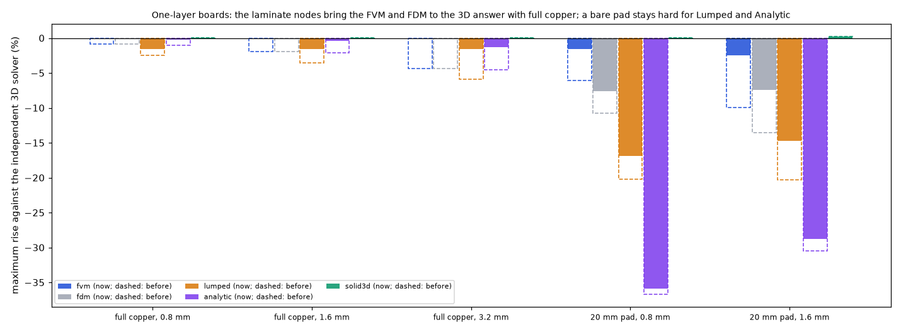
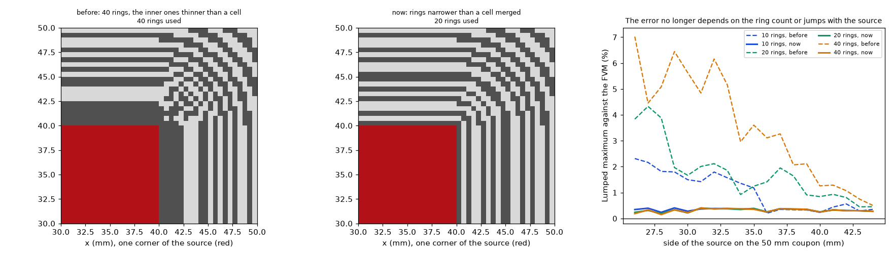
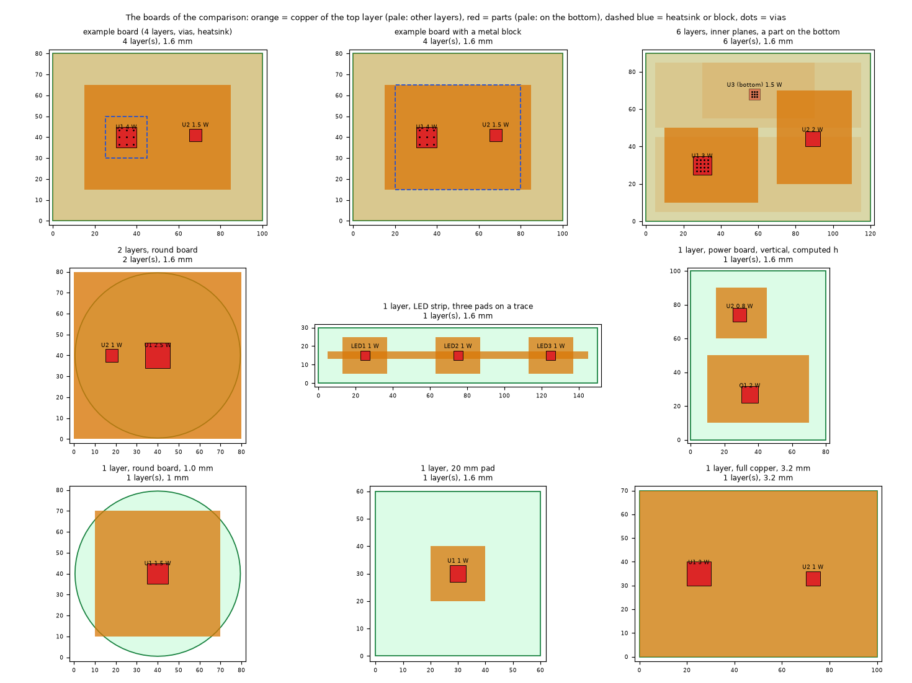
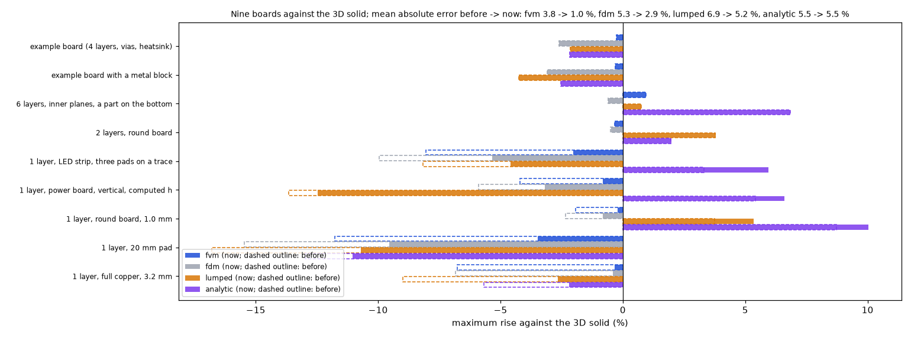

# Validation: the same scenarios in every model

Every table here is produced by a script in `research/<topic>/` (one folder per investigation, index in `research/INDEX.md`; each folder repeats its tables with figures in its README) and can be regenerated. Models: **FVM** (finite volumes, reference), **FDM** (node-centred finite differences, comparison),
**Lumped** (thermal network), **Analytic** (Fourier series); described in [`models.md`](models.md). Errors are on the **temperature rise** above ambient. Default board:
100 × 80 mm, 4 layers, 25 °C ambient, `h_top` = 10, `h_bottom` = 15, `h_side` = 10 W/m²K, FR-4 0.3/0.9 W/mK (through/in plane), copper 35 µm, 1 mm cells.

**What is and is not validated.** The models are compared with each other, with an independent 3D solid solved by finite elements (section 3), with exact solutions where they exist and with the literature (section 8).
**No model has been compared with a measurement of a physical board**: a good compact model typically lands within about 4 to 5 % of a real board (section 8), and that is the next step to build confidence in absolute values.

## 1. One scenario, every model: the example board

`example_board()`: 100 × 80 mm, 4 layers, top copper only over 15 to 85 × 15 to 65 mm, planes on layers 2 to 4, heaters U1 (4 W, 10 × 10 mm) and U2 (1.5 W, 6 × 6 mm), a 3 × 3 array of 0.3 mm vias under U1,
a 30 W/m²K heatsink on the bottom. Maximum temperature [°C]:

| Model | Tmax | Error on the rise | Time |
| :-- | --: | --: | --: |
| FVM (0.5 mm) | 85.87 | reference | 0.9 s |
| FDM (0.5 mm) | 85.22 | −1.1 % | 0.8 s |
| Analytic | 84.69 | −1.9 % | 0.05 s |
| Lumped | 84.66 (1 mm) | −1.9 % | 0.01 s |
| 3D solid (finite elements, 0.5 mm, vias as copper rods) | 85.59 | −0.5 % (FVM +0.5 %) | |

Every model closes the energy balance below 1e-11 (heat out equals power in).

## 2. Many scenarios, every model (1 mm cells; error against the FVM)

`python research/models-comparison/scripts/validation_study.py`

| Scenario | FVM [°C] | FDM | 3D solid | Lumped | Analytic | Input check |
| :-- | --: | --: | --: | --: | --: | :-: |
| reference board (centred 20 mm heater) | 90.13 | 90.13 (+0.0 %) | 90.27 (+0.2 %) | 89.69 (−0.7 %) | 90.35 (+0.3 %) | - |
| example board (full) | 85.81 | 84.38 (−2.4 %) | 85.98 (+0.3 %) | 84.66 (−1.9 %) | 84.65 (−1.9 %) | - |
| example, no heatsink | 88.91 | 87.47 (−2.3 %) | 89.08 (+0.3 %) | 87.60 (−2.1 %) | 87.78 (−1.8 %) | - |
| example, no vias | 94.67 | 94.58 (−0.1 %) | 94.91 (+0.3 %) | 96.51 (+2.6 %) | 94.56 (−0.2 %) | - |
| example, top copper over the full board | 85.29 | 83.94 (−2.2 %) | 85.42 (+0.2 %) | 84.14 (−1.9 %) | 84.62 (−1.1 %) | - |
| example, uniform (no heatsink, no vias, full copper) | 96.68 | 96.66 (−0.0 %) | 96.88 (+0.3 %) | 98.34 (+2.3 %) | 97.15 (+0.7 %) | - |
| example, only heater U1 | 79.97 | 78.54 (−2.6 %) | 80.12 (+0.3 %) | 77.82 (−3.9 %) | 78.71 (−2.3 %) | - |
| example, only U1, uniform | 90.30 | 90.27 (−0.1 %) | 90.51 (+0.3 %) | 91.10 (+1.2 %) | 90.62 (+0.5 %) | - |
| reference board, heater in the corner | 109.40 | 109.39 (−0.0 %) | 109.54 (+0.2 %) | 102.09 (−8.7 %) | 110.42 (+1.2 %) | - |
| reference board, small 5 mm heater | 103.06 | 103.06 (+0.0 %) | 103.73 (+0.9 %) | 102.87 (−0.2 %) | 103.44 (+0.5 %) | - |
| reference board, 8 layers | 65.70 | 65.70 (+0.0 %) | 65.72 (+0.1 %) | 66.16 (+1.1 %) | 66.11 (+1.0 %) | - |
| heater 5 mm inside the top-copper edge | 94.45 | 94.04 (−0.6 %) | 94.78 (+0.5 %) | 91.45 (−4.3 %) | 93.83 (−0.9 %) | - |
| heater straddling the top-copper edge | 143.89 | 139.77 (−3.5 %) | 149.27 (+4.5 %) | 111.52 (−27.2 %) | 114.54 (−24.7 %) | warns |
| no copper on the heater layer | 150.16 | 150.14 (−0.0 %) | 153.19 (+2.4 %) | 150.12 (−0.0 %) | 150.44 (+0.2 %) | warns |
| 30 x 30 mm copper island around the heater | 92.38 | 91.96 (−0.6 %) | 92.78 (+0.6 %) | 91.71 (−1.0 %) | 89.49 (−4.3 %) | - |
| hatched copper (fill 0.5) on the top layer | 105.78 | 105.78 (+0.0 %) | 106.23 (+0.6 %) | 105.79 (+0.0 %) | 106.00 (+0.3 %) | warns |
| heater on the bottom layer | 88.37 | 88.37 (+0.0 %) | 88.58 (+0.3 %) | 88.02 (−0.6 %) | 88.65 (+0.4 %) | - |
| long thin heater, 40 x 4 mm | 67.84 | 67.84 (+0.0 %) | 67.92 (+0.2 %) | 71.91 (+9.5 %) | 68.12 (+0.7 %) | - |
| heater in the corner (10 mm from two edges) | 105.34 | 104.92 (−0.5 %) | 105.54 (+0.3 %) | 98.51 (−8.5 %) | 106.06 (+0.9 %) | - |
| two heaters 60 mm apart (4 W + 2 W) | 100.41 | 100.33 (−0.1 %) | 100.62 (+0.3 %) | 99.10 (−1.7 %) | 101.07 (+0.9 %) | - |

Reading:

* **FDM and FVM agree to about 0.1 % wherever there are no vias** (and exactly where the geometry lies on the grid). With the via array the FDM is 2 to 3 % low at 1 mm, because it puts a point feature on the nearest grid point; the gap closes with the grid (section 2.1).
  It is 3.5 % low when a copper edge crosses the heater.
* **Analytic** is exact on uniform boards and within 2.3 % with partial copper, vias, heatsinks, corners, thin heaters and several heaters; it fails (−25 %) when a copper edge crosses the heater, and the input check warns.
* **Lumped** stays within about 4 % in most cases, 9 % at worst (corners, thin heaters), and also fails when a copper edge crosses the heater.

### 2.1 Against the grid (example board)

| Spacing [mm] | FVM | FDM (area sampling) | FDM (point sampling, classic) | 3D solid |
| --: | --: | --: | --: | --: |
| 4 | 83.00 | 82.29 | 85.36 | 83.10 |
| 2 | 85.34 | 84.66 | 86.18 | 85.48 |
| 1 | 85.81 | 84.38 | 85.15 | 85.98 |
| 0.5 | 85.87 | 85.22 | 85.58 | 85.56 |
| 0.25 | 85.95 | 85.67 | 85.80 | - |

The FVM rises monotonically to its limit (within 0.2 % from 1 mm; the via array is a point feature that keeps adding a little constriction as the mesh is refined). The classic point-sampled FDM jumps around it
(±0.5 °C) because it samples the copper edge, the heater footprint and the vias at points; area sampling removes the jumps on geometry that is not aligned with the grid. A board whose heater is not on the grid
(reference board, 4 W, 10.4 × 10.7 mm heater at 30.3 mm; 1 mm cells; reference 103.63 °C at 0.2 mm): FVM 103.59, FDM area 103.18, FDM point 105.69.

## 3. Against an independent 3D solid

`python research/models-comparison/scripts/validation_study.py --fem` (scikit-fem, offline, not in `requirements.txt`).

**The 3D model** (`research/solid3d-verification/scripts/fem3d_validation.py`): a tensor mesh of trilinear hexahedral elements; copper slabs with their true thickness (one element across), FR-4 gaps with four elements across,
copper where a zone exists and FR-4 where it does not; anisotropic FR-4 (0.3 through, 0.9 in plane); convection on the top, bottom and edge facets; the heater as a heat flux on its footprint on the top face;
a heatsink as an extra coefficient on the bottom facets inside its polygon; **a via as a copper rod with the copper area of the plated barrel** (0.147 mm square for a 0.3 mm via with a 25 µm wall, since the wall itself is far below
the mesh), through the whole thickness, with mesh lines refined around every rod. It does not use the "one node per copper layer" idea of the four models, so it measures the error of that idea. Element size 1 mm in the board plane
(halving it moved the 4-layer full-copper case by 0.06 °C; 2 elements instead of 4 across the gaps by 0.02 °C).

Maximum temperature of the top face [°C] and error of every model on the rise (FVM and FDM at 0.5 mm; Lumped and Analytic with their default settings):

| Board | 3D FEM [°C] | FVM | FDM | 3D solid (FV) | Lumped | Analytic |
| :-- | --: | --: | --: | --: | --: | --: |
| 4 layers, full copper | 90.6 | 90.3 (−0.4 %) | 90.3 (−0.5 %) | 90.5 (−0.1 %) | 91.1 (+0.7 %) | 90.6 (−0.0 %) |
| 2 layers, 40 mm top pad | 112.2 | 111.5 (−0.8 %) | 111.2 (−1.2 %) | 112.4 (+0.2 %) | 112.1 (−0.1 %) | 106.8 (−6.2 %) |
| 2 layers, 20 mm top pad | 136.2 | 133.7 (−2.2 %) | 131.7 (−4.0 %) | 138.0 (+1.6 %) | 131.1 (−4.5 %) | 109.6 (−23.9 %) |
| example board (partial copper, 9 vias, bottom heatsink) | 85.6 | 85.9 (+0.5 %) | 85.2 (−0.6 %) | 85.6 (−0.0 %) | 84.7 (−1.5 %) | 84.7 (−1.5 %) |

**Metal block** (a heatsink with a thickness; `research/solid3d-verification/scripts/fem3d_validation.py` models it as a gap-pad slab of conductivity 1 W/mK and thickness `R''` plus the block slab below the board, with its side faces losing heat too; 100 × 80 mm, 2 layers, 5 W, 30 × 30 mm copper pad on the bottom, block 60 × 60 mm unless stated; FVM and FDM at 1 mm; error on the rise):

| Case | 3D FEM [°C] | FVM | FDM |
| :-- | --: | --: | --: |
| no block (bottom pad only) | 134.2 | 133.2 (−0.9 %) | 132.6 (−1.5 %) |
| Al 3 mm, gap pad 5 K cm²/W | 115.5 | 115.0 (−0.5 %) | 114.9 (−0.6 %) |
| same, finned (extra h 60 W/m²K) | 99.7 | 99.0 (−1.0 %) | 99.0 (−1.0 %) |
| same, worse interface (20 K cm²/W) | 118.8 | 118.4 (−0.4 %) | 118.3 (−0.5 %) |
| Al 1 mm | 117.3 | 116.8 (−0.5 %) | 116.7 (−0.6 %) |
| Cu 3 mm | 115.3 | 114.8 (−0.5 %) | 114.8 (−0.6 %) |
| Al 3 mm 40 × 40 over a 50 × 50 mm pad | 120.4 | 119.4 (−1.0 %) | 119.0 (−1.4 %) |
| Al 3 mm 30 × 30 exactly over the pad | 129.3 | 128.1 (−1.1 %) | 127.4 (−1.8 %) |

The block is always within 1.8 % of the solid. (An earlier version of this script left unused nodes in the matrix of the solid and gave wrong numbers for blocks; fixed by pinning exactly the nodes that belong to no element.)

### 3.1 Does the outer copper dissipate and spread heat (against a heatsink)?

`python research/solid3d-verification/scripts/copper_dissipation.py [--fem]`. Board 100 × 80 mm, 2 layers, 5 W on a 10 × 10 mm heater on top, copper only on the top layer (a square pad centred on the heater), no vias, `h_top` 10 and `h_bottom` 15 W/m²K.
Maximum temperature [°C] against the 3D finite-element solid (error on the rise; the 3D FV column is the program's own `solid3d`):

| Top copper pad | 3D FEM | FVM | FDM | 3D solid (FV) | Lumped | Analytic |
| :-- | --: | --: | --: | --: | --: | --: |
| heater pad only (10 mm) | 495.3 | 472.4 (−4.9 %) | 420.9 (−15.8 %) | 533.1 (+8.0 %) | 652.7 (+33.5 %) | 201.1 (−62.6 %) |
| 20 mm square | 273.0 | 266.7 (−2.5 %) | 252.1 (−8.4 %) | 282.0 (+3.6 %) | 517.4 (+98.5 %) | 150.3 (−49.5 %) |
| 30 mm square | 202.6 | 199.7 (−1.6 %) | 193.8 (−5.0 %) | 205.9 (+1.9 %) | 392.9 (+107.2 %) | 145.9 (−31.9 %) |
| 40 mm square | 172.5 | 171.0 (−1.0 %) | 168.2 (−2.9 %) | 174.0 (+1.0 %) | 302.7 (+88.3 %) | 144.9 (−18.7 %) |
| 60 mm square | 150.3 | 149.6 (−0.6 %) | 148.8 (−1.2 %) | 150.6 (+0.2 %) | 200.1 (+39.7 %) | 144.2 (−4.9 %) |
| 80 mm square | 144.6 | 144.1 (−0.4 %) | 144.0 (−0.5 %) | 144.5 (−0.1 %) | 151.1 (+5.4 %) | 143.6 (−0.8 %) |

Copper against heatsink on the same board (40 mm area), FVM heat leaving the top face inside / outside the pad polygon:

| Case | 3D FEM | FVM | FDM | 3D solid (FV) | Heat over the area [W] | Elsewhere on the top face [W] |
| :-- | --: | --: | --: | --: | --: | --: |
| 40 mm copper pad | 172.5 | 171.0 (−1.0 %) | 168.2 (−2.9 %) | 174.0 (+1.0 %) | 1.30 | 0.78 |
| pad + heatsink, extra h 30 W/m²K | 131.5 | 130.9 (−0.6 %) | 130.1 (−1.3 %) | 131.8 (+0.3 %) | 2.99 | 0.40 |
| pad + heatsink, extra h 100 W/m²K | 100.7 | 100.4 (−0.4 %) | 100.3 (−0.5 %) | 100.6 (−0.1 %) | 4.10 | 0.16 |
| heater pad only + heatsink 30 W/m²K on bare laminate | 340.7 | 324.6 (−5.1 %) | 285.6 (−17.5 %) | 369.6 (+9.2 %) | 1.16 | 2.48 |

What it shows:
* **The outer copper dissipates and spreads by itself**: the temperature falls monotonically as the pad grows (495 → 145 °C) and saturates (80 mm gains 6 °C over 60 mm), and the whole top face loses heat, pad and bare laminate alike (the heat found outside the 40 mm pad, 0.78 W, is heat that the copper carried to the laminate).
  The FVM follows the 3D FEM within 1 to 2.5 % for pads of 20 mm and more; the 3D FV solid is within 2 % there, and both 3D models bracket the converged value on the heater-sized pad (section 3).
* **A heatsink works through the copper under it**: the same 30 W/m²K heatsink gives 131 °C on the pad and 325 °C on bare laminate, because on the laminate there is no sheet to spread the heat in. The heatsink adds convection area; the copper provides the path to it.
* **Where the models fail**: with a pad hardly larger than the heater (an edge of copper across the footprint) the FDM loses 8 to 16 % (the grid sees the pad as a few nodes), and the **Lumped and Analytic models are unreliable** for a one-sided pad without vias or bottom copper (Lumped up to +107 %, Analytic up to −63 %); they assume copper around the heater on both faces or a uniform sheet. The input checks already warn about a copper edge crossing a heater; use the FVM for such boards.

The 3D value of the example board is converged: 85.55 °C with 1 mm elements and 85.59 °C with 0.5 mm (2 elements across each gap).

The new **3D solid (FV)** column is the program's own 3D model (`solid3d.py`, section 2.7 of `models.md`; slabs of real thickness, 4 per gap, 1 mm cells here, 0.5 mm in the FEM script's column header): it lands within 0.2 % of the FEM on three boards and 1.6 % high on the 20 mm pad. Its numbers are also the closest to the FVM in section 2 (within 0.3 % on the ordinary scenarios, +4.5 % with a copper edge across the heater, +2.4 % with no copper under it).
**Convergence on a small pad**, where the two 3D models differ most (maximum temperature of the heater-sized copper pad, `copper_dissipation.py`; both rise or fall towards the same limit): 3D FV at 1 mm and 0.5 mm with 4 slabs per gap 533 and 523 °C, with 8 slabs 530 and 519 °C; FEM at 1 mm 495, at 0.5 mm 500 (4 elements per gap) and 502 (8): the limit is about 510 °C, so at 1 mm the FV is 4 % high and the FEM 3 % low on this extreme case (20 mm pad: FV 282, 280, 281, 279; FEM 273, 274, 275; limit about 277 °C).
Reading: on a uniform board the four layered models land on the 3D answer within 0.7 % (FVM, FDM and Analytic within 0.5 %). **With vias and a heatsink (the example board) all four are within 1.5 %**, and the FVM, with each via in one cell, is within 0.5 % of the 3D rods.
With a small copper pad the FVM follows the 3D solid within 2.2 %, the FDM and the Lumped within 4.5 %, and the Analytic loses accuracy exactly where its uniform-sheet assumption breaks (6 % with a 40 mm pad, 24 % with a 20 mm pad). The remaining 0.4 to 2 % of the FVM comes from
representing each copper layer by one node and the dielectric between two layers as a one-dimensional vertical resistance (no lateral spreading inside the gap).

## 4. Why the FVM and the Analytic model give about the same numbers

1. **They solve the same model.** Both treat every layer as a thin conducting sheet, the dielectric as a vertical resistance, one constant `h` per face, the same material properties. The Analytic is the **exact** solution of that model on a
   uniform sheet; the FVM is its **numerical** solution; two correct solutions of one model agree, within the FVM's mesh error (0.2 to 1 %).
2. **The real board is not that model, and that error is shared** (section 3: 0.4 to 3 % from the 3D solid). Neither can be better than the layered model; "FVM = more precise" does not hold in general. What the FVM has is **freedom of geometry**.
3. **Part of the agreement was engineered**: the Lumped and Analytic models were tuned against the FVM (copper weighted with the heater influence, fin lengths, Bessel factors), so tables 1 and 2 measure agreement with the FVM; the 3D solid does not depend on that tuning.
4. **They diverge where the geometry is not uniform near the heater** (section 2: pads, copper edges, corners).

## 5. Linear solvers: direct, conjugate gradients, SOR

`python research/models-comparison/scripts/solver_equivalence.py`. Same boards, same physics, different ways of solving `K θ = Q`:

| Board | Solver | Tmax [°C] | max diff to direct [K] | Residual | Sweeps | Time [s] |
| :-- | :-- | --: | --: | --: | --: | --: |
| reference, 2 layers | direct (sparse LU) | 90.0657 | 0 | 3e-14 | - | 0.01 |
| reference, 2 layers | CG (Jacobi) | 90.0657 | 1.8e-12 | 9e-13 | - | 0.01 |
| reference, 2 layers | SOR, residual 1e-9, automatic ω | 90.0657 | 7.6e-09 | 1e-09 | 656 | 0.05 |
| reference, 2 layers | SOR, step 0.01 K, ω = 1.5 (original rule) | 87.3447 | 2.7 | 6e-02 | 369 | 0.03 |
| reference, 8 layers | direct (sparse LU) | 65.6612 | 0 | 1e-13 | - | 0.23 |
| reference, 8 layers | SOR, residual 1e-9, automatic ω | 65.6612 | 1.7e-08 | 1e-09 | 3247 | 0.69 |
| reference, 8 layers | SOR, step 0.01 K, ω = 1.5 (original rule) | 53.1158 | 13 | 1e-01 | 384 | 0.08 |
| example board | direct (sparse LU) | 85.8143 | 0 | 1e-13 | - | 0.23 |
| example board | SOR, residual 1e-9, automatic ω | 85.8143 | 1.1e-08 | 1e-09 | 2247 | 0.76 |
| example board | SOR, step 0.01 K, ω = 1.5 (original rule) | 69.6449 | 16 | 1e-01 | 562 | 0.18 |
| weak cooling (h = 2 W/m²K, 200 mm) | direct / SOR (residual) | 44.2990 | 2.6e-09 | 1e-09 | 2237 | 0.07 / 0.48 |
| weak cooling (h = 2 W/m²K, 200 mm) | SOR, step 0.01 K, ω = 1.5 (original rule) | 37.5624 | 6.7 | 3e-01 | 162 | 0.04 |

Direct, CG and SOR with the residual criterion agree to **1e-8 K** or better on all five boards; the original program's stopping rule stops 2.7 to 16 K from the solution with a violated heat balance. The direct solver is the default
(3 to 30 times faster than a correct SOR); SOR stays available as an independent check. (After this table was made the direct solver got a symmetric ordering that makes it about 40 % faster.)

## 6. The removed wxPython program against the current one

Same example board (reference 85.81 °C). Old numbers were obtained by running the original code (git tag `legacy-wxpython-1.0.0`, commit `641da87` with the comparison script).

| Program | Model | Tmax [°C] | Error on the rise | Power used [W] | Note |
| :-- | :-- | --: | --: | --: | :-- |
| old | Analytic, basic | 603.95 | +851 % | 5.50 | dimensionally wrong conduction term |
| old | Lumped, basic | 32.24 | −88 % | 5.50 | not a valid network |
| old | Analytic, advanced | 34081 | +55 845 % | 5.50 | |
| old | Lumped, advanced | 449.00 | +597 % | 5.50 | |
| old | FDM, 10 mm (defaults) | 124.93 | +64 % | **8.17** | injected 8.17 W for 5.50 W |
| old | FDM, 2 mm (defaults) | 76.94 | −15 % | 5.50 | "converged" |
| old | FDM, 1 mm (defaults) | 66.56 | **−32 %** | 5.50 | error grows when the mesh is refined (step-size stopping rule) |
| old | FDM, 1 mm (tight tolerance, ω = 1.9) | 82.50 | −5.5 % | 5.50 | the rest is modelling |
| new | FVM, 1 mm | 85.81 | 0 | 5.50 | energy balance −7e-13 |
| new | FDM (area sampling), 1 mm | 84.38 | −2.4 % | 5.50 | same physics, point features at nodes |
| new | Lumped | 84.66 | −1.9 % | 5.50 | |
| new | Analytic | 84.65 | −1.9 % | 5.50 | |

What went wrong in the old FDM was not the finite-difference idea: a stopping rule on the step size (false convergence), a heater power that depended on the grid, no lateral conduction in FR-4, solid vias, heatsinks on inner layers ignored,
boundary nodes with a full cell. All were fixed (conservative cell balance, exact power, anisotropic FR-4, hollow vias). A correct FDM (section 2) lands within about 1 % of the FVM.

## 7. Time-dependent results

* **Step response, exact check** (`tests/test_fvm.py`): one layer, a heater over the whole board, insulated edges (`C dθ/dt = P − Gθ`, time constant 109.1 s, steady rise 40 K); maximum error in K over three time constants:
  implicit Euler 3.06 / 1.67 / 0.87 / 0.45 for Δt, Δt/2, Δt/4, Δt/8 (first order); Crank-Nicolson 0.315 / 0.077 / 0.019 / 0.005 (second order); stored plus lost heat equals the injected heat within 0.2 %.
* **Step animation, FVM against FDM** (example board, 2 mm; hottest point [°C] at t = 0, 0.12, 0.82, 3.6, 15, 60, 120 s): FVM 25.0, 30.4, 43.6, 53.3, 61.3, 70.7, 76.6; FDM 25.0, 30.3, 43.1, 52.7, 60.6, 70.0, 75.9: within 0.7 °C at every output time (steady maxima 85.3 and 84.7 °C). Power-profile time simulation of the profile example: peak 134.2 °C (FVM) against 129.6 °C (FDM) at 2 mm, where the 6 mm heater is only three cells wide.
* **Step animation, FVM against Analytic** (example board, 4 W + 1.5 W, 1 mm; hottest point [°C] at t = 0, 0.12, 0.35, 0.82, 1.8, 3.6, 7.4, 15, 30, 60, 120 s): FVM 25.0, 30.5, 37.4, 44.0, 49.3, 53.7, 57.7, 61.7, 66.1, 71.2, 77.1; Analytic 25.0, 30.6, 37.4, 43.4, 48.0, 52.0, 55.8, 59.8, 64.1, 69.4, 76.0:
  within 2 °C at every time, after calibrating the vias per heater (without it the Analytic was up to 10 °C off). The hottest point reaches 63 % of its final rise in about 19 s; the whole board needs minutes.
* **Power profiles** (`tests/test_profiles.py`): the exact mean power per step reproduces the energy exactly for any step; against the exact periodic solution of a uniform board (an RC circuit) the decision's peak is within 0.3 % and Crank-Nicolson time stepping within 0.4 %;
  averaging a fast heater changes the peak by less than the oscillation that was neglected, with 40 times fewer steps; a table equals the equivalent square wave to round-off.
  Example (`example_profile_board`: U1 100 Hz, 30 % duty, 13.3 W on → oscillation 0.4 °C, averaged; U2 20 s period, 25 % duty, 6 W on → oscillation 84.8 °C, resolved): peak of the hottest point FVM 135.3 °C, Analytic 134.7, Lumped 131.8;
  steady with the average power 85.8 / 84.8 / 84.7 °C; bound with the on-state powers 231.6 °C (FVM).
* **CSV example** (`examples/csv_profiles`): U1 a repeating 30 s cycle (12 W, 5 W, 0.5 W), U2 a one-shot start-up: peak FVM 119.5 °C, Lumped 116.1, Analytic 115.1 (within 4 %); steady with the average powers 66.5 °C; bound 201.6 °C.

## 8. Computed heat transfer coefficients

Example board, FVM, Tmax [°C], typed `h` (10 top / 15 bottom) against computed (horizontal board, emissivity 0.9):

| Power [W] | Typed | Computed | Difference | Computed h top / bottom [W/m²K] | Vertical | 2 m/s air | Convection ×0.8 |
| --: | --: | --: | --: | :-: | --: | --: | --: |
| 0.55 | 31.1 | 31.9 | +0.8 | 10.4 / 7.9 | 32.0 | 29.9 | 32.1 |
| 1.4 | 40.2 | 41.4 | +1.2 | 11.6 / 8.6 | 41.7 | 37.2 | 42.0 |
| 5.5 | 85.8 | 85.8 | 0.0 | 14.2 / 10.1 | 86.7 | 73.5 | 88.1 |
| 11 | 146.6 | 141.2 | −5.4 | 16.1 / 11.3 | 142.7 | 121.5 | 145.3 |
| 22 | 268.3 | 245.3 | −23.0 | 18.6 / 13.1 | 247.8 | 215.6 | 252.0 |

A constant `h` is right near one operating point and over-estimates the rise by 10 % at 22 W (the typed pair happens to be right near 5.5 W). Radiation is 43 % of the computed top coefficient and 60 % of the bottom one; the bottom face (facing down) cools worse than the top.
Air properties agree with textbook values within 1 to 3 %; the three models agree on the coefficients within 0.1 W/m²K.

## 9. Parts: the junction temperature

`python research/component-heatsink/scripts/component_study.py`, `research/component-heatsink/scripts/block_contact_study.py` (power coefficient) and `tests/test_component.py`. Five parts of the datasheets read on 2026-10-17 (`docs/models.md` section 6) on a 60 × 60 mm, 2-layer board with a copper pad under the part on both faces (vias under footprints of 3 mm and more), computed natural convection, FVM at 0.5 mm. Level 0 is the plain source (the hottest board point under the part); level 1 adds θ.

| Part | P [W] | θ [K/W] | Pad | Board under part | Tj | P·θ | Share of the rise |
| :-- | --: | --: | --: | --: | --: | --: | --: |
| MOSFET CSD17308Q3 | 2 | 4.5 | 8 mm | 227.4 °C | 236.4 °C | 9.0 K | 4 % |
| MOSFET CSD17308Q3 | 2 | 4.5 | 25 mm | 98.6 °C | 107.6 °C | 9.0 K | 11 % |
| LDO TPS7A47 | 1.5 | 1.7 | 8 mm | 176.7 °C | 179.2 °C | 2.5 K | 2 % |
| LDO TPS7A47 | 1.5 | 1.7 | 25 mm | 84.8 °C | 87.3 °C | 2.5 K | 4 % |
| Buck LMR36510 | 0.8 | 4.3 | 8 mm | 109.9 °C | 113.3 °C | 3.4 K | 4 % |
| Buck LMR36510 | 0.8 | 4.3 | 25 mm | 59.3 °C | 62.8 °C | 3.4 K | 9 % |
| Schottky SS12 (SMA) | 0.5 | 20 | 8 mm | 85.6 °C | 95.6 °C | 10.0 K | 14 % |
| Schottky SS12 (SMA) | 0.5 | 20 | 25 mm | 50.9 °C | 60.9 °C | 10.0 K | 28 % |
| Resistor 0603 | 0.1 | 1000 (derived) | 8 mm | 38.9 °C | 138.9 °C | 100 K | 88 % |
| Resistor 0603 | 0.1 | 1000 (derived) | 25 mm | 31.6 °C | 131.6 °C | 100 K | 94 % |

* **Sensitivity** (pad 25 mm): θ ±30 % moves `Tj` by ±0.8 K (LDO), ±1.0 K (buck), ±2.7 K (MOSFET), ±3.0 K (diode) and ±30 K (resistor, where the derived number is the whole answer).
* **The number chosen matters more than its accuracy**: `θJB` instead of `θJC(bot)` gives 102.6 against 87.3 °C (LDO) and 70.2 against 62.8 °C (buck).
* **`ψJB` route** (`Tj = T_ring + ψJB·P`, ring 0.5 to 1.5 mm outside the body, pad 25 mm): LDO 93.7 °C and buck 65.1 °C against 87.4 and 62.8 °C with `θJC(bot)`; with `θJB` as θ 102.7 and 70.2 °C.
* **Datasheet check** (CSD17308Q3, 1 W on its own board of 1 in² of 2 oz copper, computed natural convection): `RθJA` 46.7 K/W against the datasheet's typical 46 and maximum 58; on a minimum pad of 5 mm (assumed size) 164 against the maximum 165 K/W.
* **Power temperature coefficient** against the closed form `ΔT = P0 R/(1 − tc P0 R)` on a linear board (the FVM, Lumped and Analytic models, `tests/test_component.py`): agreement to 0.05 K; for the MOSFET 2 W at 25 °C (107.6 °C without feedback) the junction reaches 138.6, 165.8 and 210 °C for 0.33, 0.5 and 0.67 %/K, with the power rising to 2.75, 3.41 and 4.48 W; a coefficient of 3 %/K has no stable point and the program says so.
* **Top path** (`python research/component-heatsink/scripts/top_path_study.py`, `tests/test_component.py`; θJC(top) of the part, 0.5 K·cm²/W paste, 12 K/W clip-on heatsink, pad 25 mm): the heatsink takes 41 to 51 % of the heat and lowers `Tj` of the chips by 15 to 38 K. Against the junction-node prototype of `research/component-heatsink/scripts/package_prototype.py` (uniform conductance under the footprint) the program is 0.4 to 0.8 K higher and the top share differs by one point.

| Part | Tj without top path | Tj program | Top share | Tj node prototype | Top share |
| :-- | --: | --: | --: | --: | --: |
| MOSFET CSD17308Q3 | 107.6 | 69.8 | 48 % | 69.0 | 47 % |
| LDO TPS7A47 | 87.4 | 56.6 | 51 % | 55.8 | 50 % |
| Buck LMR36510 | 62.8 | 47.8 | 41 % | 47.1 | 40 % |
| Schottky SS12 (SMA) | 60.9 | 43.7 | 49 % | 43.3 | 48 % |

  The series-parallel closure is exact (`Tj − T_amb = R_top·P_top`, `P_top + P_board = P`, test to 1e-4) and the FVM, FDM, Lumped and Analytic models agree on `Tj` within 10 % of its rise.
* **Limits of the approach**: worst case without `theta_sa` (no heat through the top of the package); `θ` is a single number for the whole junction; the junction is the hottest board point under the footprint plus `P·θ` (about 3 K above a junction node with a uniform conductance, which is the conservative side).

## 10. Literature

* Finite volume methods are built from a balance on every cell, so the discrete solution conserves the energy locally and globally; finite differences work on point values (Eymard, Gallouët, Herbin, *Finite Volume Methods*, https://raphaeleh.github.io/PUBLI/bookevol.pdf;
  *Finite Volume Method in Heat Conduction*, https://link.springer.com/rwe/10.1007/978-94-007-2739-7_896; Khouider, https://www.pims.math.ca/files/Khouider_1.pdf). Electronics-cooling tools (Ansys Icepak, Siemens Flotherm, Cadence Celsius) use the finite volume method.
* *A modeling method for thermal steady-state simulation of the four-layer printed circuit board* (https://pmc.ncbi.nlm.nih.gov/articles/PMC11410250/, text read): Fourier-series solutions for the insulating layers combined with a lateral-only finite volume discretisation of the metal layers
  (the architecture of our FVM and Analytic pair); about 1.8 to 2.5 % against COMSOL at the hot region and 4 to 5 % against measurements on a real board; solver under 9 minutes against about 50 for COMSOL.
* Fourier-series multilayer analytical models against finite elements: 1 to 4 % in the studies found by a search (https://researchonline.jcu.edu.au/86884/ and others); figures taken from search summaries, not from the full texts.
* A comparison of finite differences and finite volumes on 1D steady conduction (https://link.springer.com/chapter/10.1007/978-981-97-0037-0_9) is behind a login and was not read.

* Fabricator stack-up tables (section 14, read 2026-10-22): OSH Park four-layer stack-up, https://docs.oshpark.com/services/four-layer; Bittele Electronics standard multi-layer stack-ups (2 to 10 layers, 0.062 in), https://www.7pcb.com/Upload_file/Multi-layer-stack-up.pdf; PCBGOGO standard stack-up for multilayer PCBs (4, 6, 8 layers), https://www.pcbgogo.com/pcbgogo-standard-stackup-for-multilayer-pcbs.pdf; AdvancedPCB stack-up resources, https://www.advancedpcb.com/en-us/resources/stackups/; NextPCB standard stack-ups, https://www.nextpcb.com/tech-center/pcb-layer-stack-up (prepreg thicknesses only); JLCPCB controlled-impedance stack-ups, https://jlcpcb.com/impedance (4 layers 7628/3313/1080/2116, 6 layers JLC06161H-3313); PCBWay multilayer laminated structure, https://www.pcbway.com/multi-layer-laminated-structure.html (76 four-layer tables) and its older blog table for 6 and 8 layers, https://www.pcbway.com/blog/Engineering_Technical/stackup___pcbway.html; Eurocircuits, https://www.eurocircuits.com/standard-multilayer-builds/ (the builds are in the configurator: only the catalogue of cores and prepregs and the pool thicknesses were readable, via https://www.eurocircuits.com/blog/review-standard-and-predefined-build-ups-2/); Sierra Circuits (Proto Express), https://www.protoexpress.com/kb/no-touch-pcbs-specs/ and https://www.protoexpress.com/products/rigid-pcb/ (nominal 1.57 mm, minimum core and dielectric 4 mil; no layer tables).
* Lumped and Analytic on the rectangle of the same area (section 13): no published method was found; it is a modelling choice tested in this project against the FVM on the real shape (`research/outline/scripts/outline_rectangle_study.py`).

* M. M. Yovanovich, *Thermal Resistances of Circular Source on Finite Circular Cylinder With Side and End Cooling*, J. Electronic Packaging 125 (2003) 169-177, https://www.mhtlab.uwaterloo.ca/pdf_papers/mhtl03-20.pdf (read: Table 3, the dimensionless spreading resistance of a circular source on a flux tube, section 16).
* Grid convergence and Richardson extrapolation: P. J. Roache's grid convergence index (safety factor 1.25 for three grids) as summarised in *In search of grid converged solutions*, NASA, https://ntrs.nasa.gov/api/citations/20100027422/downloads/20100027422.pdf and *Application of grid convergence index in FE computation*, https://bibliotekanauki.pl/articles/201974.pdf (summaries read; ASME V&V 20 itself was not read).
* Fin efficiency of a straight fin with a convecting tip (corrected length `Hc = H + t/2`): Incropera and DeWitt, *Fundamentals of Heat and Mass Transfer*; the general statement in https://www.sciencedirect.com/topics/engineering/fin-efficiency (section 15).
* Natural convection between vertical plates (the channel effect that the fins of the program ignore): W. Elenbaas (1942), optimum plate spacing; A. Bar-Cohen and W. M. Rohsenow, *Thermally Optimum Spacing of Vertical, Natural Convection Cooled, Parallel Plates*, J. Heat Transfer 106 (1984) 116-123, as described in https://abcm.org.br/anais/cobem/2003/html/pdf/COB03-1466.pdf (the constants of the composite correlation could not be read there and are not used).

## 11. Reproduce

```sh
.venv/bin/python -m pytest -q tests                          # all tests (GUI offscreen, documentation gate)
.venv/bin/python research/models-comparison/scripts/validation_study.py [--fem]        # sections 2 and 3
.venv/bin/python research/models-comparison/scripts/solver_equivalence.py              # section 5
.venv/bin/python research/solid3d-verification/scripts/fem3d_validation.py                # the 3D solid on its own cases
.venv/bin/python research/solid3d-verification/scripts/copper_dissipation.py [--fem]      # section 3.1, outer copper against heatsink
.venv/bin/python research/component-heatsink/scripts/component_study.py                 # section 9, parts and junction temperature
.venv/bin/python examples/csv_profiles/run_example.py        # section 7, CSV example
git archive 641da87 | tar -x -C <empty folder>               # the removed program, section 6
```

## 12. Stack-up, outline, power calculator and process (2026-10-21)

`python research/stackup/scripts/stackup_outline_study.py` prints the two tables; `tests/test_stackup.py`, `tests/test_outline.py`, `tests/test_inverse.py` and `tests/test_compute.py` hold the checks.
Board of the study: 60 × 40 mm, 4 layers with full copper, nine vias under a 6 × 6 mm heater of 3 W, typed 12 W/m²K on both faces, FVM at 1 mm.

**Exact checks.**
* A uniform board (heater and copper over the whole board, insulated edges) is one-dimensional: a chain of layer nodes joined by `k/d` of every gap. The FVM and the FDM reproduce the exact series circuit of a stack with three different gaps (0.12 mm at 0.4 W/mK, 0.9 mm at 2 W/mK, 0.25 mm at 0.3 W/mK) to 1e-6 K on every layer.
* The advanced stack-up with equal gaps against the simple one: 0.1 K apart (80.8 against 80.7 K rise); the small difference is how the laminate of the layer nodes is shared (copper plus half of each gap against thickness/N).
* An outline that is the whole rectangle gives the same result as no outline (1e-9 K), and an outline that cuts the board to a smaller rectangle gives the same result as the smaller board (0.05 K) in the FVM, the FDM and the 3D solid.
* The energy balance closes to 1e-9 on every outline in all three models, and a part drawn off the board still delivers its whole power.

**A. Advanced stack-up.** Rise of the hottest point in K (FVM) and the other models as a difference from it:

| Stack | FVM | FDM | 3D solid | Lumped | Analytic |
| :-- | --: | --: | --: | --: | --: |
| simple, equal FR-4 gaps | 80.7 | -4.1 % | -1.5 % | -2.1 % | +7.7 % |
| advanced, the same gaps | 80.8 | -4.1 % | -1.7 % | -2.2 % | +7.7 % |
| thin prepreg 0.1 mm top and bottom, 0.7 mm core | 76.9 | -3.6 % | -1.5 % | -2.4 % | +4.8 % |
| prepreg 0.1 mm, metal-core dielectric 1 mm (2 W/mK) | 75.1 | -3.4 % | -1.5 % | -2.5 % | +4.5 % |
| polyimide flex 0.1 mm gaps (0.15 W/mK) | 77.4 | -5.3 % | -2.1 % | -5.6 % | +2.5 % |
| alumina core 0.6 mm (24 W/mK) | 71.2 | -3.6 % | -2.1 % | -4.3 % | +3.6 % |
| copper 70 / 35 / 35 / 70 µm | 69.8 | -2.2 % | -0.6 % | -0.0 % | +6.4 % |
| copper 17.5 µm on every layer | 102.5 | -6.0 % | -2.6 % | -4.4 % | +7.8 % |

* The stack-up matters: the same board goes from 102.5 K (half-ounce copper) to 69.8 K (heavy outer copper) and from 80.7 to 71.2 K with a ceramic core; the models follow it in the same direction (every row of `test_stackup.py` checks the trend in all five models).
* The spread between models is the same as on the plain board (FDM about 4 % low because a via is sampled at the nearest node, the 3D solid within 2.6 %, the Lumped within 6 %, the Analytic 2.5 to 8 % high): the advanced stack-up does not add a model error.

**B. Board outline.** Rise of the hottest point in K (FVM) and the FDM and the 3D solid as a difference from it:

| Shape | Board area | FVM | FDM | 3D solid |
| :-- | --: | --: | --: | --: |
| rectangle (no outline) | 2400 mm² | 80.7 | -4.1 % | -1.5 % |
| L shape | 1800 mm² | 109.0 | -5.6 % | -1.3 % |
| T shape | 1600 mm² | 105.8 | -3.7 % | -1.1 % |
| ellipse | 1880 mm² | 93.1 | -3.6 % | -1.3 % |
| chamfered corners (6 mm) | 2328 mm² | 82.2 | -4.0 % | -1.5 % |

* Less board makes the heater hotter (the L shape has 25 % less board and the rise grows 35 %), the FVM and the independent 3D solid agree within 1.5 % on every shape, as they do on the rectangle.
* Limits: cell-cover treatment of the boundary (a cell on the edge conducts with its covered fraction), so a neck narrower than two or three cells is poorly resolved; the lumped and analytic models need a rectangle and run on the rectangle of the same area (section 13).

**C. Sensitivity to the stack-up numbers** (`python research/stackup/scripts/stackup_outline_study.py`; the typical 4-layer stack-up of `stackups.json`, base rise 84.5 K):

| Change | Rise [K] | Change in the rise |
| :-- | --: | --: |
| dielectric k through -30 % (0.21 W/mK) | 85.4 | +1.0 % |
| dielectric k through +30 % (0.39 W/mK) | 83.8 | -0.8 % |
| all dielectric thicknesses -10 % (fabricator tolerance) | 84.2 | -0.4 % |
| all dielectric thicknesses +10 % | 84.8 | +0.4 % |
| prepreg 0.25 and core 0.35 W/mK | 84.6 | +0.1 % |
| finished copper 15 % thinner (etch and plating spread) | 89.3 | +5.7 % |
| finished copper 15 % thicker | 80.8 | -4.4 % |

Without the vias under the part (base rise 93.4 K) the same ±30 % in the dielectric conductivity gives +3.3 / -2.3 %. The prepreg and the core matter little; the copper and the vias matter more.

**D. Finned metal block** (60 × 40 mm two-layer board, 3 W part, aluminium block 40 × 30 mm on the bottom face, 5e-5 m²K/W interface, typed 10 W/m²K; rise of the hottest point in K):

| Block | Fin ratio at 10 W/m²K | FVM | FDM | 3D solid | Lumped | Analytic |
| :-- | --: | --: | --: | --: | --: | --: |
| plain plate 3 mm | 1.0 | 88.3 | 88.2 | 88.9 | 100.3 | 99.8 |
| fins 15 × 1.5 mm, pitch 8 mm | 4.7 | 61.2 | 61.2 | 61.7 | 72.1 | 69.4 |
| fins 15 × 1.5 mm, pitch 12 mm | 3.5 | 66.4 | 66.3 | 66.8 | 77.8 | 75.5 |
| fins 30 × 1.5 mm, pitch 8 mm | 8.4 | 53.2 | 53.2 | 53.6 | 62.4 | 59.3 |

The FVM, the FDM and the 3D solid agree within 1 % on a finned block (the same fin ratio in all three); the lumped and analytic models were 10 to 13 % high on a board with a block (they replaced it by an equivalent coefficient) and since 2026-10-22 they have the block as a ring layer and as a tile graph, 1 to 2 % off on average (section 17; section 15 for the fins).

**E. The interface sheet.** The interface between a heatsink and the board or the package is one dielectric sheet (thickness / conductivity): a sheet equal to the typed resistance gives the same temperatures to 1e-9 K (FVM), and a 1.5 mm sheet instead of 0.5 mm of the same material raises the hottest point by more than 0.3 K in the FVM, FDM and 3D solid (`tests/test_heatsink_part.py`); in the lumped and analytic models a plain block is replaced by an equivalent coefficient that cannot beat the bare face, so the sheet only shows there with fins or an extra h.

**Power from a measured temperature.** The forward model reproduces the measurement: the power recovered from the model's own board temperature at the mean-under-part and the 1 mm ring points is exact to 1e-3 (affine, two model runs plus a check), the hottest point and the junction need a few more because the hottest point can move with the power, and with computed convection (not linear) the iteration converges to 2e-3 (`tests/test_inverse.py`). The accuracy against a real measurement is the accuracy of the drawn board and of the probe: no measurement of a real board has been made in this project yet.

**Calculation process.** A cancelled run stops at once (the process is terminated, the next job starts a fresh one), jobs run one at a time, and closing the program leaves no process (`tests/test_compute.py`, `test_gui_stress.py`). Results travel by pickle (22 MB for a four-model run with a profile, 0.04 s).

## 13. Lumped and Analytic on a board with an outline (2026-10-22)

`python research/outline/scripts/outline_rectangle_study.py` prints the table; `tests/test_outline.py` checks that the rectangle of the same area keeps the area, the part sizes and the original problem, and that it beats the bounding box on an ellipse.
Board of the study: the example board, 100 × 80 mm, two parts (5 W and 1.5 W) moved to the positions of the *Parts* column, FVM at 1 mm on the real outline as the reference, lumped and analytic at 1 mm. Error = difference of the maximum temperature divided by the FVM rise above ambient, in percent (negative = too cool), shown as lumped / analytic.

| Outline | Parts | Area ratio | FVM Tmax | bounding box | same area (used) | 1.1 × box |
| :-- | :-- | --: | --: | --: | --: | --: |
| ellipse | example | 0.783 | 90.8 | -9.3 / -9.3 | -1.9 / +0.4 | -16.3 / -15.1 |
| ellipse | centre | 0.783 | 114.3 | -7.4 / -5.8 | +0.9 / +2.9 | -9.9 / -11.5 |
| ellipse | off-centre | 0.783 | 104.4 | -10.4 / -8.8 | -2.0 / -0.6 | -15.8 / -13.9 |
| ellipse | near the edge | 0.783 | 119.7 | -16.5 / -14.0 | -10.2 / -5.8 | -21.2 / -19.3 |
| L | near the edge | 0.750 | 115.8 | -12.9 / -10.3 | -6.2 / +0.1 | -17.8 / -15.8 |
| T | example | 0.667 | 109.1 | -29.0 / -29.0 | -17.8 / -16.0 | -34.5 / -33.5 |
| T | centre | 0.667 | 123.4 | -16.0 / -14.5 | +0.0 / -0.4 | -18.2 / -19.7 |
| chamfer | example | 0.964 | 86.4 | -2.9 / -2.9 | -2.8 / -1.8 | -10.3 / -9.1 |
| chamfer | centre | 0.964 | 110.1 | -2.9 / -1.2 | -3.5 / +0.4 | -5.5 / -7.2 |
| chamfer | off-centre | 0.964 | 99.1 | -3.9 / -2.1 | -4.8 / -0.8 | -9.6 / -7.6 |
| chamfer | near the edge | 0.964 | 112.6 | -9.6 / -7.0 | -9.7 / -5.7 | -14.8 / -12.7 |
| rounded | example | 0.984 | 86.1 | -2.3 / -2.3 | -3.0 / -2.0 | -9.8 / -8.5 |
| rounded | centre | 0.984 | 109.8 | -2.5 / -0.8 | -5.5 / -0.3 | -5.2 / -6.8 |
| rounded | off-centre | 0.984 | 98.6 | -3.3 / -1.6 | -5.0 / -0.9 | -9.1 / -7.1 |
| rounded | near the edge | 0.984 | 112.0 | -9.1 / -6.4 | -10.3 / -5.8 | -14.2 / -12.1 |

* Enlarging the box (the idea of growing outwards) is the worst choice in every row: more area means more convection, so the board runs 10 to 20 % too cool. Shrinking to the same area is the best on average, and the error is always on the cool side.
* For a strongly cut shape (ellipse, L, T; area ratio below 0.8) the bounding box ignores 20 to 33 % of the board and is 6 to 29 % cool; the same-area rectangle brings parts away from the edge to within 0.2 to 3 %.
* Where it fails: a part near the edge of the real board or in the arm of a T has less board to spread into than the scaled rectangle gives it (10 to 18 % cool). For nearly rectangular outlines (chamfer, rounded: area ratio above 0.95) the three boxes differ by a few percent either way and the same-area box is not better than the bounding box (lumped 3 to 5 % cool). Scaling about the area centroid of the outline instead of the box centre gave no consistent gain (tried, not kept).
* Not covered: parts in the cut region (they are off the board), holes, outlines with more than one lobe, and the time simulation (not available for these two models on an outline).

## 14. The typical stack-ups against fabricators' tables (2026-10-22)

`python research/stackup/scripts/stackup_vendor_check.py` solves the example board (FVM, 2 mm) with the program's template of each layer count and with the published tables of seven fabricators entered layer by layer.

**What was found online.** Complete layer tables: JLCPCB (4 layers with 7628, 3313, 1080 and 2116 prepreg; 6 layers JLC06161H-3313), PCBWay (76 four-layer tables, 1 oz or 1.5 oz inner copper; an older blog table for 6 and 8 layers), OSH Park (4 layers, FR408HR), Bittele 7pcb (2 to 10 layers, 0.062 in, 1 oz), PCBGOGO (4, 6, 8 layers, 0.4 to 2.4 mm), AdvancedPCB (one 4-layer sample; the 6, 8 and 10-layer drawings are images). NextPCB gives only the prepreg thicknesses in text (2116 0.125 mm, 1080 0.077 mm, 7628 0.2 mm, central prepreg of the 6-layer 0.103 mm; the cores are in drawings). Eurocircuits does not publish tables as text: its builds are chosen in the configurator (about 940 predefined builds); the catalogue is cores of 100, 200, 360 and 710 µm with 12, 18, 35 or 70 µm foil and prepregs PR1080 70 µm, PR2116 120 µm, PR7628 180 µm; pooled boards are 1.55 mm (6 layers and more) and 1.00 mm (4 layers). Sierra Circuits (Proto Express) gives a nominal 1.57 mm, minimum core and dielectric 4 mil, and makes the final stack-up per order. For Eurocircuits, Sierra and NextPCB no complete layer table could be read, so they are checked only against the catalogue values (every prepreg and core of the templates is inside the catalogues: 76 to 210 µm prepreg, 330 to 1065 µm core).

Board: the example board reshaped to each layer count (top copper on layer 1, its bottom plane on the last layer, its heaters, vias and bottom heatsink). Two columns: only the outer copper (the inner planes of the example dropped, so that only the dielectric split and the outer copper differ) and a full plane on every inner layer (so that the inner copper of each table counts). In the first version of this section the 6 and 8-layer boards had **no bottom copper** (the study kept only zones on layers 1 and n, and the bottom plane of the example is layer 4): their rows were about 21 K hotter (122.2 °C for the 6-layer template). Corrected on 2026-10-24; the 4-layer rows did not change. The numbers below were re-run on this program (FVM, 2 mm) with the corrected `stackup_vendor_check.py` and the new `study_inner_copper_1oz.py` and agree to the last digit with `research/stackup/README.md` sections 4.3 and 4.5. Those two scripts and sections are on the branch `research/gerbers` (commits 01e5032 and 99770e6) and not yet in `develop`: the `research/stackup` folder of `develop` still has the script without the bottom plane.

| Stack-up | Total (mm) | Tmax, outer copper only (°C) | Tmax, a plane on every inner layer (°C) |
| :-- | --: | --: | --: |
| 4 layers, program template (= JLC04161H-7628: 35 / 15.2 / 15.2 / 35 µm, prepreg 210.4, core 1065) | 1.586 | 101.00 | 90.40 |
| 4 layers, AdvancedPCB sample (1 oz, 2 × 2116 per side, core 39 mil) | 1.613 | 101.62 | 84.12 |
| 4 layers, Bittele (1 oz, 2 × 2116 of 0.0091 in, core 0.037 in) | 1.544 | 99.97 | 82.98 |
| 4 layers, PCBGOGO (18 → 35 µm outer, prepreg 0.11, core 1.2) | 1.560 | 100.60 | 82.04 |
| 4 layers, PCBWay (1 oz inner, prepreg 190, core 1030) | 1.550 | 100.59 | 82.98 |
| 4 layers, OSH Park (43.2 µm outer, 17.5 µm inner, prepreg 199.9, core 990.6) | 1.512 | 93.64 | 84.83 |
| 6 layers, program template | 1.600 | 100.95 | 84.80 |
| 6 layers, JLC06161H-3313 as published (99.4 / 550 / 108.8 / 550 / 99.4 µm) | 1.538 | 100.66 | 84.43 |
| 6 layers, Bittele (0.0081 / 0.013 / 0.0091 / 0.013 / 0.0081 in) | 1.517 | 99.44 | 77.41 |
| 6 layers, PCBGOGO (prepreg 0.11, cores 0.6) | 1.740 | 101.12 | 77.52 |
| 6 layers, PCBWay blog table (110 / 530 / 110 / 530 / 110 µm) | 1.600 | 100.46 | 76.97 |
| 8 layers, program template | 1.600 | 99.24 | 79.72 |
| 8 layers, Bittele (1080 × 2, 0.009, 7628, 0.0051, 7628, 0.009, 1080 × 2) | 1.542 | 99.12 | 73.89 |
| 8 layers, PCBGOGO (prepreg 0.18, cores 0.2) | 1.600 | 100.03 | 74.70 |
| 8 layers, PCBWay blog table (175 / 130 alternating) | 1.370 | 98.82 | 73.55 |

* With the outer copper only, the other fabricators' dielectric splits (prepreg 190 to 250 µm, core 940 to 1200 µm; 6 layers cores 330 to 600 µm; 8 layers cores 130 to 229 µm) move the maximum temperature by 0.1 to 1.5 °C (0.2 to 2.0 % of the rise): a 4-layer board stays within 1.0 °C of the template, 6 layers within 1.5 °C, 8 layers within 0.8 °C. The exact prepreg and core split hardly matters on a board whose heat goes down the vias and spreads in the outer copper.
* **With inner planes the inner copper matters.** The 0.5 oz template (15.2 µm) is 5.0 to 8.4 K hotter than the 1 oz (34 to 36 µm) tables, up to 13 % of the rise; the JLCPCB 6-layer table, which has the same 15.2 µm inner copper, is within 0.4 K of the template. The 0.5 oz template is the conservative end.
* **The finished outer copper matters too.** OSH Park's 1 oz outer copper is 43.2 µm (clad + plated), against the 35 µm of the templates: with its own dielectrics but 35 µm outer copper the board is at 100.55 °C, with 43.2 µm at 93.64 °C (−6.9 K, 9 % of the rise), and the JLCPCB dielectrics with 43.2 µm give 94.08 °C. A fabricator's "1 oz" finished outer copper is 35 to 43 µm (PCBGOGO, PCBWay and JLCPCB quote 35 µm, OSH Park 43.2 µm), so the 35 µm default is the conservative end; type the real value in the Stack-up tab when it is known.
* The old PCBWay blog table for 8 layers sums to 1.37 mm, not the 1.6 mm it is titled with, so it is not consistent (PCBWay calls it the old version); the PCBGOGO 6-layer table sums to 1.74 mm against its 1.6 mm title, probably because the cores listed include copper. Both are shown as published.
* The middle prepreg of the 6-layer template (200 µm) is thicker than the 109 to 110 µm of JLCPCB and PCBWay (the template keeps 1.6 mm by thickening it) and than the 231 µm of Bittele's two-sheet 2116; the whole JLCPCB 6-layer table is 0.3 to 0.4 K cooler than the template, so the templates were left unchanged.
* **Published versus constructed.** Only the 4-layer entry is copied from a fabricator's table; the 2-layer entry and the 6, 8, 10 and 12-layer entries are constructed so that the layers add up to the nominal thickness (`stackups.json` says so). Of the JLCPCB data, what was confirmed again on 2026-10-24: the 1.065 mm core and the 15.2 µm inner copper (a search snippet of the JLCPCB help page, which in that version gave 0.0175 mm inner copper and 0.2 mm of 7628 prepreg, and an independent collection of JLCPCB impedance templates, `gsuberland/jlcpcb_autogenerated_stackups`, with 0.0152 mm for 4 to 8 layers). **Not confirmed**: the 210.4 µm prepreg of the 4-layer table (read on 2026-10-22, not seen again). The 6-layer JLC06161H-3313 figures are those read on 2026-10-22. The other fabricators' figures are from their public pages as recorded in the research folder; some are search snippets, and the PCBWay 6 and 8-layer tables are an old blog post.

* Not covered: constructions with blind or buried vias, sequential lamination, heavy copper, metal-core and ceramic boards (they are in the dielectric presets, with no fabricator table checked).

### 14.1 Inner copper: 0.5 oz (JLCPCB standard) and 1 oz (option, 2026-10-24)

The Stack-up tab and `Board.template_inner_oz` offer two inner copper weights for the typical advanced stack-ups of 3 or more layers (the generic 3, 5, 7, 9 and 11-layer templates included). **0.5 oz (15.2 µm) is the default**: it is the JLCPCB standard construction (4 to 8 layers) and reproduces the JLCPCB 4-layer table as read on 2026-10-22. **1 oz (35 µm) is derived**: every inner copper layer becomes 35 µm and **every dielectric keeps the thickness of the template**, so the board is thicker than the nominal by (35 − 15.2) µm per inner layer: 1.586 → 1.626 mm (4 layers, +2.5 %), 1.600 → 1.679 (6, +4.9 %), 1.600 → 1.719 (8, +7.4 %), 2.000 → 2.158 (10, +7.9 %), 2.400 → 2.598 mm (12, +8.2 %), inside the ±10 % thickness tolerance fabricators quote. **The 1 oz variant is not a JLCPCB product table and not a published fabricator table.**

**Why the dielectrics are not scaled** (maintainer's decision of 2026-10-24, from `research/stackup/README.md` section 4.6 and `scripts/study_real_1oz_stackups.py`, on the branch `research/gerbers`, commit 42572d2; re-run on this program in the review, every number reproduced): fabricators do not thin the dielectrics of a build in proportion when the copper changes; for a nominal thickness they pick another build (over 19 JLCPCB pairs of the same nominal thickness the dielectric total of the 1 oz build is 0.85 to 1.08 of the 0.5 oz one; at 1.6 mm the board changes by −4 % to +4 %). The only physical thinning, the resin that fills etched copper (Isola's rule), is zero against a full plane and moves the maximum temperature by 0.2 to 0.4 K at 50 % residual copper. Against 15 published 1 oz builds with 35 µm inner copper (Bittele, PCBWay, PCBGOGO, AdvancedPCB), the unscaled rule has a mean deviation of +0.10 K (mean absolute 0.85 K), the rule that scales every dielectric to keep the nominal thickness +0.47 K (1.00 K); against JLCPCB's own 1 oz builds the unscaled rule at 30 µm is 0.69 K away on average, the scaled one 1.00 K. Scaled against unscaled differ by 0.2 to 0.7 K on the board of this section.
**JLCPCB's 1 oz inner copper is 30 µm, not 35 µm** (outer 35 µm), in the layer data of the third-party repository `gsuberland/jlcpcb_autogenerated_stackups` (generated automatically from JLCPCB's impedance-template data and not checked by hand, according to the repository; its 0.5 oz 4-layer 1.6 mm entry reproduces the program's template); the program's 1 oz variant uses the 35 µm of the other fabricators, and 30 µm would be 1.2 to 1.4 K hotter. The JLCPCB help page on copper weight lists 0.5 oz (default), 1 oz and 2 oz inner copper for FR-4, availability depending on the layer count and thickness (a WebFetch extraction, a model summary of the page; a search snippet of another JLCPCB page says 1 oz inner copper is for 4 layers only), so whether a given build is offered is decided on the order page. Status of the other sources of section 4.6: the Bittele, PCBGOGO and Isola PDFs were read in full (text extracted); the PCBWay (4-layer IDs 1 to 76 of 112, the old 6 and 8-layer blog table) and AdvancedPCB numbers are WebFetch extractions, not checked by eye; Sierra Circuits only from search snippets; OSH Park from the earlier reading of section 14 (17.5 µm inner copper: not a 1 oz build).

Example board (FVM, 2 mm, a full plane on every inner layer), against the published tables (the difference columns are to the 0.5 oz template):

4 layers:

| Stack-up | Total (mm) | Inner copper | Tmax with planes (°C) | Difference to the 0.5 oz template (K) | (% of its rise) |
| :-- | --: | :-- | --: | --: | --: |
| JLCPCB JLC04161H-7628 as read on 2026-10-22 (35 / 15.2 / 15.2 / 35 µm, prepreg 210.4, core 1065) | 1.586 | 15.2 µm | 90.40 | +0.00 | +0.0 |
| **Program template, 0.5 oz (default)**: the same numbers, it reproduces the table | 1.586 | 15.2 µm | 90.40 | +0.00 | +0.0 |
| **Program template, 1 oz** (35 µm; dielectrics of the template) | 1.626 | 35 µm | 83.46 | -6.94 | -10.6 |
| PCBWay (prepreg 190, core 1030) | 1.550 | 1 oz | 82.98 | -7.42 | -11.3 |
| Bittele 7pcb (2 × 2116 of 0.0091 in, core 0.037 in) | 1.544 | 1 oz | 82.98 | -7.42 | -11.3 |
| PCBGOGO (prepreg 0.11, core 1.2) | 1.560 | 1 oz | 82.04 | -8.35 | -12.8 |
| AdvancedPCB sample (2 × 2116 per side, core 39 mil) | 1.613 | 1 oz | 84.12 | -6.27 | -9.6 |
| OSH Park (43.2 µm outer copper, prepreg 199.9, core 990.6) | 1.512 | 17.5 µm | 84.83 | -5.57 | -8.5 |

6 layers:

| Stack-up | Total (mm) | Inner copper | Tmax with planes (°C) | Difference to the 0.5 oz template (K) | (% of its rise) |
| :-- | --: | :-- | --: | --: | --: |
| JLCPCB JLC06161H-3313 as read on 2026-10-22 (99.4 / 550 / 108.8 / 550 / 99.4 µm) | 1.538 | 15.2 µm | 84.43 | -0.37 | -0.6 |
| **Program template, 0.5 oz (default)** (115.2 / 519.4 / 200 / 519.4 / 115.2 µm: constructed to add up to 1.6 mm) | 1.600 | 15.2 µm | 84.80 | +0.00 | +0.0 |
| **Program template, 1 oz** (35 µm; dielectrics of the template) | 1.679 | 35 µm | 77.30 | -7.50 | -12.5 |
| PCBWay blog table (110 / 530 / 110 / 530 / 110 µm) | 1.600 | 1 oz | 76.97 | -7.83 | -13.1 |
| PCBGOGO (prepreg 0.11, cores 0.6) | 1.740 | 1 oz | 77.52 | -7.28 | -12.2 |
| Bittele 7pcb (0.0081 / 0.013 / 0.0091 / 0.013 / 0.0081 in) | 1.517 | 1 oz | 77.41 | -7.39 | -12.4 |

8 layers:

| Stack-up | Total (mm) | Inner copper | Tmax with planes (°C) | Difference to the 0.5 oz template (K) | (% of its rise) |
| :-- | --: | :-- | --: | --: | --: |
| **Program template, 0.5 oz (default)** (constructed, no JLCPCB table for 8 layers was used here) | 1.600 | 15.2 µm | 79.72 | +0.00 | +0.0 |
| **Program template, 1 oz** (35 µm; dielectrics of the template) | 1.719 | 35 µm | 72.44 | -7.28 | -13.3 |
| PCBWay blog table (175 / 130 alternating, sums to 1.37 mm) | 1.370 | 1 oz | 73.55 | -6.17 | -11.3 |
| PCBGOGO (prepreg 0.18, cores 0.2) | 1.600 | 1 oz | 74.70 | -5.01 | -9.2 |
| Bittele 7pcb (1080 × 2, 0.009, 7628, 0.0051, 7628, 0.009, 1080 × 2 in) | 1.542 | 1 oz | 73.89 | -5.82 | -10.6 |

Reading: the 1 oz template is 0.5 K above PCBWay and Bittele, 1.4 K above PCBGOGO and 0.7 K below AdvancedPCB (4 layers; OSH Park, with 17.5 µm inner and 43.2 µm outer copper, is 1.4 K above it), within 0.1 to 0.3 K of PCBWay, Bittele and PCBGOGO (6 layers), and 1.1 to 2.3 K below the three 8-layer tables (their dielectric split differs from the constructed template; not separated further); the published 1 oz tables are much nearer to the 1 oz variant than to the 0.5 oz template, which is the one that reproduces JLCPCB's standard build. Scaling the dielectrics to keep the nominal thickness (the first version of this option) would give 83.27, 76.89 and 71.88 °C for 4, 6 and 8 layers, 0.2 to 0.6 K cooler. Without inner planes (copper only on the outer layers) the choice moves the result by 0.03 to 0.28 K (3 to 12 layers; the thicker board only).

All layer counts (FVM, 2 mm; the 3D solid, run for 4 and 6 layers, agrees within 0.06 K and gives the same differences to 0.01 K); the program's 1 oz variant (dielectrics unchanged) and, for comparison, the scaled rule and a true 0.5 oz base foil of 17.5 µm:

| Layers | 0.5 oz, 15.2 µm (°C) | 1 oz, dielectrics unchanged: the program (°C) | Difference (K) | (% of the rise) | Board (mm) | 1 oz scaled to the nominal thickness (K) | 17.5 µm (K) |
| --: | --: | --: | --: | --: | :-- | --: | --: |
| 3 | 95.65 | 91.25 | −4.40 | −6.2 | 1.600 → 1.620 | | |
| 4 | 90.40 | 83.46 | −6.94 | −10.6 | 1.586 → 1.626 | −7.13 | −1.06 |
| 5 | 88.34 | 81.85 | −6.49 | −10.2 | 1.586 → 1.646 | | |
| 6 | 84.80 | 77.30 | −7.50 | −12.5 | 1.600 → 1.679 | −7.90 | −1.26 |
| 8 | 79.72 | 72.44 | −7.28 | −13.3 | 1.600 → 1.719 | −7.83 | −1.28 |
| 10 | 78.76 | 71.78 | −6.98 | −13.0 | 2.000 → 2.158 | −7.61 | −1.25 |
| 12 | 78.22 | 71.46 | −6.76 | −12.7 | 2.400 → 2.598 | −7.45 | −1.22 |

The 3 and 5-layer rows were run in this review with the program's option; the others agree to the digit with `research/stackup/README.md` section 4.5. The 2-layer template has no inner copper and does not change. The `tests/test_inner_copper.py` check at 4 mm cells gives a difference between 5 and 10 K for 4 and 6 layers. Not covered: heavy inner copper (2 oz), JLCPCB's 30 µm, partial planes (an inner layer is usually a signal layer with 30 to 70 % copper, so the true effect is between the two variants, and its prepreg is thinner by the resin fill), other boards.

## 15. Fins of the metal block against a 2D solution of one fin (2026-10-22)

`python research/block-and-fins/scripts/fin_validation.py` (and `tests/test_fin_model.py`). The program replaces the fins by an area gain and an efficiency (`blocks.fin_ratio`): per unit of base area `(1 − t/p) + 2 Hc η/p`, `Hc = H + t/2`, `η = tanh(m Hc)/(m Hc)`, `m = √(2h/(k t))` (straight fin, convecting tip taken as an adiabatic tip at the corrected length; Incropera and DeWitt). Here the same fin is solved as a two-dimensional conduction problem (width `t`, height `H`, root at 1 K, convection `h` on both faces and on the tip, 12 × 240 finite volumes), which keeps the transverse temperature drop and the real tip.

| Metal | k (W/mK) | h (W/m²K) | fin | efficiency | 2D (W/m/K) | formula (W/m/K) | difference |
| :-- | --: | --: | :-- | --: | --: | --: | --: |
| aluminium | 204 | 10 | 1.5 × 15 mm | 0.995 | 0.3133 | 0.3133 | +0.00 % |
| aluminium | 204 | 100 | 1 × 30 mm | 0.777 | 4.7395 | 4.7397 | +0.00 % |
| copper | 386 | 30 | 1 × 30 mm | 0.954 | 1.7466 | 1.7466 | +0.00 % |
| carbon steel | 50 | 100 | 1 × 30 mm | 0.497 | 3.0311 | 3.0315 | +0.01 % |
| stainless | 14 | 100 | 1.5 × 15 mm | 0.593 | 1.8668 | 1.8683 | +0.08 % |
| stainless | 14 | 100 | 1 × 30 mm | 0.274 | 1.6702 | 1.6710 | +0.05 % |

All 24 cases of the script (four metals, h = 10, 30, 100 W/m²K, two fin sizes, efficiencies from 0.27 to 0.997) are within 0.08 %. So **the fin formula is right for a fin with a uniform coefficient**; what is not validated is the coefficient itself.

**What is not validated** (the honest limits): (1) the coefficient on a real fin array is not the flat-plate `h` of the board face: between close fins the air in a channel is slower and the fins preheat each other, which Elenbaas (1942) and Bar-Cohen and Rohsenow (1984) describe with an optimum spacing and a channel Rayleigh number; the program ignores this and only warns below 4 mm of air gap in still air, so a closely spaced array is optimistic; (2) the 3D solid uses the same fin ratio, so it does not test the fins independently; (3) no comparison with a measured heatsink or a manufacturer's θSA curve was made (the searches found fin-efficiency equations and worked examples but no datasheet with the dimensions needed). To do: a channel correlation (roadmap) and a comparison with θSA of catalogue extrusions.

## 16. Verification of the 3D solid (2026-10-22)

`python research/solid3d-verification/scripts/solid3d_verification.py` (and `tests/test_solid3d_verification.py`). Two checks that do not use another solver of this project.

**Analytical benchmark.** The spreading resistance of an isoflux circular source of radius `a` on a long cylinder of radius `b` (insulated sides, cooled at the far end) is tabulated by Yovanovich (2003, Table 3) as `ψ = 4 a k Rs` against `ε = a/b` (the mean source temperature minus the one-dimensional resistances). The 3D solid solves a square block of the same area (`b = W/√π`, 50 mm, `k = 1` W/mK, thickness `1.5 b`, 40 slabs, cell 1 mm, 96-sided circle):

| ε = a/b | Table 3 (isoflux) | 3D solid | difference |
| --: | --: | --: | --: |
| 0.2 | 0.8009 | 0.8076 | +0.8 % |
| 0.3 | 0.6649 | 0.6698 | +0.7 % |

The square tube instead of the circle, the staircase representation of the circle and the one-dimensional resistances subtracted from a large total account for the 0.7 to 0.8 %. For `ε = 0.1` the source is 2.8 mm across (three cells) and the difference grows to 2 %.

**Grid convergence.** A square source aligned with every mesh (8 mm on a 48 mm block, 40 mm thick, 16 slabs) with the cell size halved twice (4, 2, 1 mm): the mean source temperature per watt is 75.47, 71.02 and 69.62 K/W; the convergence is monotone, the observed order is 1.68, the Richardson extrapolation is 68.99 K/W and the grid convergence index of the fine mesh (Roache, safety factor 1.25) is **1.14 %**. A circular source on the Cartesian grid does not converge monotonically (the staircase boundary changes with the mesh), which is why the aligned square is used for the GCI.

**What this does and does not show.** The conduction, the cell-cover treatment, the vertical resolution of the slabs and the boundary conditions of the 3D solid reproduce a published exact solution and converge at about second order. It does not test the vias (rods of copper area), the metal blocks and the fins, the outline cover, or the convection coefficients; those are tested against the layered models and the independent finite-element script (section 3). A method of manufactured solutions was considered and not done: the solid has no source terms to fix.

## 17. The metal block in the Lumped and Analytic models (2026-10-22)

`python research/block-and-fins/scripts/block_equivalent_study.py` compares the Lumped and Analytic models with the FVM, which has the block, on 74 cases: four block and pad geometries (a 30 × 30 pad in a 60 × 60 block, 50 × 40 in 90 × 70, pad equal to the 40 × 40 block, 20 × 20 in 80 × 60), blocks of 1, 3 and 6 mm of aluminium, 3 mm of copper, 1 and 3 mm of steel, interface 1, 5 and 20 K·cm²/W, and two finned blocks (15/1.5/8 mm). Error: difference of the maximum temperature divided by the FVM rise, in percent (negative = too cool).

| Approach | Lumped mean / max | Analytic mean / max |
| :-- | --: | --: |
| earlier equivalent coefficient (isothermal block over the whole polygon) | 15.5 / 31.3 | 17.3 / 31.5 |
| equivalent coefficient on the copper contact area plus an annular fin for the block outside it | 8.8 / 18.7 | 11.0 / 19.7 |
| **implemented**: Lumped: block layer in the ring network; Analytic: tile graph (Schur complement) in the Green-function correction | **2.0 / 4.8** | **1.1 / 4.3** |

* Why the coefficient approaches fail: they are too hot, and more so with a thicker or better-conducting block (+13 % for 1 mm, +19 % for 6 mm of aluminium on the 30 × 30 pad): the block spreads the heat of the centre of the pad to the whole pad, which a uniform coefficient cannot do. The implemented versions keep the lateral conduction `k t` of the block.
* The finned blocks are at −1.5 % (Lumped) and 0.0 % (Analytic). Typical cases: 30 × 30 pad in a 60 × 60 block, 3 mm of aluminium, 5 K·cm²/W: FVM rise 90.0 K, Lumped −2.2 %, Analytic −1.0 %.
* Limits: steady state only (the capacity of the block is in the ring sums but no transient with a block was tested, and the time simulation refuses it); a rectangular block and rectangular copper pads were tested, a block over scattered copper not; the Analytic keeps its own weak spots (copper that is far from uniform around the heater).
* Sources: static condensation / Schur complement as used by finite-element codes (MFEM documentation, https://docs.mfem.org/4.6/staticcond_8hpp_source.html) and Kron reduction of a network (https://arxiv.org/pdf/2204.05554); the annular-fin efficiency tested in the coefficient approach (Incropera and DeWitt; https://scipython.com/books/book2/chapter-8-scipy/problems/heat-dissipation-of-an-annular-fin-heatsink/); spreading resistance of a heat sink base plate, Seri Lee, Electronics Cooling (1998), https://www.electronics-cooling.com/1998/01/calculating-spreading-resistance-in-heat-sinks/ (its formulas are images and were not used; its numbers were read and reproduced, `research/effective-conductivity/`); hybrid analytical models of the PCB, Zhang and Chen, PLOS ONE (2024), https://journals.plos.org/plosone/article?id=10.1371%2Fjournal.pone.0310237.

## 18. What fills a via barrel (2026-10-22)

`python research/via-fill/scripts/study_via_fill.py` (and `tests/test_via_fill.py`); the whole investigation, with figures, is in `research/via-fill/`. A fabricator's "filled via" is normally an **epoxy resin plug** (IPC-4761 types V to VII: V filled, VI filled and covered with solder mask, VII filled and capped with plated copper so it can be soldered over); the resin keeps the hole closed and the surface flat but conducts as little as FR-4. A conductive paste (copper or silver epoxy) is better, and only an electroplated copper fill is a real heat path. Conductivities from fabricator pages: non-conductive epoxy about 0.3 W/mK, conductive copper-epoxy 8 W/mK (another source quotes up to 16, silver-filled epoxy 3 to 15), electroplated copper about 385 to 400.

| Fill | k of the fill (W/mK) | A equivalent (mm²) | R of one 0.3 mm via, 1.6 mm long (K/W) | vs open |
| :-- | --: | --: | --: | --: |
| Open (hollow barrel, 25 µm plating) | - | 0.0216 | 192.4 | 0 % |
| Epoxy resin, non-conductive | 0.3 | 0.0216 | 192.1 | −0 % |
| Conductive paste | 8 | 0.0226 | 183.7 | −5 % |
| Copper, electroplated fill | 385 | 0.0707 | 58.8 | −69 % |

* The 192 K/W of the open via is the textbook figure for this barrel (an independent article gives 192 °C/W per via, 12 K/W for 16).
* On the example board (3 × 3 vias of 0.3 mm under U1, FVM at 0.5 mm): open 85.87 °C, resin 85.87 (−0.01 K), conductive paste 85.70 (−0.18 K), copper fill 81.98 (−3.89 K). All five models order the fills the same way (`test_via_fill.py`).
* So a "filled" via is **not** a thermal improvement unless it is copper-filled (or the fabricator says plated-shut copper); the program now has the four choices in the via's *Fill* list. Not modelled: the plated copper cap over the ends of a capped via, which adds a little copper at the pad, and the 0.5 to 1 mm via-in-pad resistance of the solder.
* Sources (fabricator pages, not the IPC standard, which was not read): JLCPCB, https://jlcpcb.com/blog/via-filling-guide (table of fill materials and IPC-4761 types V to VII); ALLPCB, https://www.allpcb.com/allelectrohub/how-to-choose-the-optimal-via-fill-material-for-pcb-design; the thermal via array article https://www.atlaspcb.com/blog/thermal-via-pcb-heat-dissipation-array-design (192 °C/W per via; its 185 K/W for an epoxy-filled via is not a model of the fill).

## 19. Power from the temperature of the top of the package (2026-10-22)

`python research/power-calculator/scripts/power_from_top_study.py` (and `tests/test_inverse.py`). The part (U1 of the example board) dissipates 2 W, θ = 6 K/W, ψJT = 2 K/W; the top of the package reads `T_top = T_board,max + (θ − ψJT)·P`. The power is recovered with `power_from_temperature(point="top")` on boards that differ from the real one:

| What differs between the drawn board and the real one | recovered power (W) | error |
| :-- | --: | --: |
| nothing | 2.000 | 0.0 % |
| top copper half filled (hatched) | 1.735 | −13.2 % |
| copper 17.5 µm instead of 35 µm on every layer | 1.519 | −24.1 % |
| no inner planes (only the top copper) | 1.312 | −34.4 % |
| no top copper pad (inner planes only) | 1.100 | −45.0 % |
| no vias under the part | 1.780 | −11.0 % |
| heat transfer coefficients +30 % / −30 % | 2.126 / 1.818 | +6.3 % / −9.1 % |
| θ +20 % / −20 % | 1.873 / 2.145 | −6.3 % / +7.3 % |
| ψJT 1 / 3 K/W instead of 2 | 1.893 / 2.119 | −5.3 % / +6.0 % |
| measured top temperature 3 K low / high | 1.831 / 2.169 | −8.5 % / +8.5 % |
| datasheet shortcut `P = (T_top − T_amb)/(θJA − ψJT)` with θJA 30 % below / above the board's (19.7 K/W) | 3.002 / 1.499 | +50.1 % / −25.0 % |

* **The copper dominates**: a board with less copper than the model has is worse per watt, so fewer watts explain the same top temperature (−11 to −45 %). Heat transfer, θ, ψJT and a 3 K measurement error each move the result 5 to 9 %.
* The datasheet shortcut follows from the definitions (`Tj − Ta = θJA P`, `Tj − Tt = ψJT P`, so `Tt − Ta = (θJA − ψJT) P`) but its denominator is a difference of two similar numbers on a board that is not yours: it was not stated in any datasheet read, and is the worst of the routes. ψJT and θJA are measured on the JEDEC board in the same environment (Renesas, Richtek, ROHM, TI notes); ψJT is meant to give Tj from a measured case temperature when the power is known, not the power.
* The full description of the calculator, its validation against datasheets (CSD17308Q3 46.8 against 46 K/W, a JEDEC 2s2p board 31.6 against 32.5 K/W) and the sources are in `docs/calculators.md`.
* What would improve it (not implemented): a second measurement (the board ring and the top, or two known powers) to calibrate the copper; the power calculator already works with the board you draw.
* Sources read: Renesas, *Thermal Characterization of Packaged Semiconductor Devices*; Richtek AN061; ROHM, *θJA and ψJT* application note (65AN114E), https://fscdn.rohm.com/en/products/databook/applinote/common/theta_ja_and_psi_jt_an-e.pdf; TI SLRR012 one-page thermal reference, http://www.ti.com/lit/pdf/SLRR012; Microchip, https://support.microchip.com/s/article/Thermal-parameters-of-an-IC.

## 20. Corrections found in a review of the models

A review of the models (the code read against `theory.md`) found two defects and two smaller ones; all four are corrected, each with a regression test.

**The time constant and the step responses of a board with an outline** (`fvm.board_time_constant`, used by the FVM, FDM and Lumped). The cells off the board are pinned to ambient with 1 W/K; that pin was counted as a path to the air in `τ = ΣC/ΣG`, so the step responses of the power profiles (ten time constants long) and the animation length offered by the application were cut short. `research/outline/scripts/study_outline_time_constant.py`, 60 mm boards, 2 W, 2 mm cells:

| board | τ, pin counted (before) | τ (now) |
| :-- | --: | --: |
| square 60 × 60 mm | 106.99 s | 107.0 s |
| round, 59.8 mm across | 0.02 s | 107.1 s |

On the round board the step response now ends at 1071 s on the steady resistance (30.464 K/W, FVM and FDM to four digits); with the old length (0.2 s) it ended at 3.670 K/W, 12 % of it, so the average-or-resolve decision of a power profile on such a board saw almost no thermal mass. Tests: `tests/test_outline.py` (`test_time_constant_and_step_responses_leave_out_the_cells_off_the_board`).

**The transient mean of a board with an outline** counted the cells off the board at the ambient: on the round board at 600 s it read 46.84 °C against 51.71 °C for the board itself; it is now weighted by the board area of every cell (node), like the steady mean (`test_transient_mean_counts_only_the_board`).

**The 3D solid on a one-layer board** built its slabs from the dielectric gaps only, and a one-layer board has none: the board was its 35 µm of copper. It now has the laminate of the layered models (the slab minus the copper, FR-4 of the materials) as four slabs under the copper. `research/solid3d-verification/scripts/study_one_layer_board.py`, 60 × 60 × 1.6 mm, 1 W on 6 × 6 mm, 1 mm cells, maximum temperature in °C:

| copper | FVM | FDM | 3D solid | Lumped | Analytic | 3D solid before |
| :-- | --: | --: | --: | --: | --: | --: |
| full copper | 56.43 | 56.43 | 57.38 | 56.84 | 56.53 | 58.72 |
| 20 mm pad | 75.22 | 73.12 | 81.92 | 72.36 | 74.53 | 119.97 |

*(The layered models of this table are before the laminate nodes of section 21; with them: full copper FVM 57.35, FDM 57.35, Lumped 57.77, Analytic 57.09; 20 mm pad FVM 79.94, FDM 76.49, Lumped 75.82, Analytic 75.64.)*

The 3D solid is now 3 % above the layered models with full copper and 13 % with a 20 mm pad: in the 3D solid the bottom face loses heat through 1.6 mm of FR-4, in the layered models it acts on the copper node directly, and a pad hardly larger than the part is where that matters. An independent 3D finite-volume solver with patterned copper (`research/effective-conductivity/` section 4.11 on the branch `research/gerbers`; FR-4 isotropic at 0.3 W/mK so that both represent the same board, copper 385 W/mK, no edge loss, 0.5 mm cells) confirms it: with a 20 mm pad the 3D solid is +0.2 % of the rise from it (before the correction +40 %); with full copper both the corrected and the old 3D solid agree with it within 0.2 %, so full copper does not test the correction. The FVM is 0.9 to 4.4 % low with full copper (0.8 to 3.2 mm) and 10 % low with the pad, because its bottom film acts on the copper node and the laminate under it is missing (corrected since with two laminate nodes under the copper: 0.0 % with full copper and -2.5 % with the pad; `docs/validation.md` section 21). *An earlier version of this section quoted 33.71 K against 33.43 K (-0.8 %) from a check with mismatched copper and edge loss; it is replaced by these numbers.* Test: `tests/test_solid3d.py` (`test_a_one_layer_board_keeps_its_laminate`).

**A power loop that does not settle** (power temperature coefficient or top path, `api._solve_with_tc`) used to return its 80th iterate silently; close to runaway that underestimates the temperatures. It now warns (`tests/test_component.py`, a loop gain of 0.9).

**Corrected in section 21** (it was recorded here first): on a 50 mm Cu / FR-4 / Cu coupon (2.5 W, sources of 30 to 41 mm) the Lumped result moves with the source size by up to 1 % from one millimetre to the next (+1.2 % at 35 mm, +0.2 % at 36 mm against the FVM; +0.2 to +1.8 % over the range) and does not converge with the ring count (33 to 37 mm: 20 rings +0.9 to +2.0 %, 40 rings +3.0 to +5.2 %, against +0.2 to +1.6 % with the default 10); it is within its documented accuracy (2 % mean, 5 % maximum) but the ring geometry is tuned to 10 rings (`docs/roadmap.md`, Solvers and validation).

**Documents corrected in the same review**: the plate check of the metal block is +0.6 %, −0.8 % and −4.6 % from Seri Lee's article (centre, edge midpoint, corner), not +4.5 % (`theory.md` section 7, `research/component-heatsink/scripts/block_contact_study.py`, which placed the source with `round()`), and its source is the Electronics Cooling article of Seri Lee (1998).

## 21. One-layer boards and the rings of the Lumped model (second round of the review)

Two corrections that section 20 left as candidates are now in the program, each with regression tests (`tests/test_laminate.py`, `tests/test_models_agree.py`).

**The laminate of a one-layer board in the layered models** (`pcbthermal/laminate.py`). A one-layer board has copper on its top face only; its single node carried the whole laminate and the bottom film acted on it, so the heat reached the bottom face without crossing the laminate. The laminate is now cut into two gaps with a node at each boundary (the copper node keeps the copper and half a gap; two laminate nodes below, the last one carries the bottom film; vertical links `k_th A / g`; every node conducts sideways and stores heat) in the FVM, FDM and, through the FVM network, the Lumped model; the results keep one layer, the copper. The Analytic model keeps one node and puts the laminate in series with the bottom film, `1 / (1/h + t_lam/k_th)`: with laminate nodes its uniform-sheet estimate of a bare pad was worse (−51 % instead of −30 % against the independent solver). The computed coefficients of a one-layer board take the bottom face temperature from the last laminate node. Two nodes were chosen from a sweep of the FVM on the 20 mm pad: one node −4.1 %, two −2.5 %, three −1.8 %, four −1.5 %; full copper 3.2 mm: −0.27, −0.08, −0.04, −0.02 %.

Against the independent 3D solver with patterned copper (`research/solid3d-verification/lib/layered3d.py`, the copy of the research branch's solver; isotropic FR-4 of 0.3 W/mK, films 10 and 15 W/m²K, no edge loss, 0.5 mm cells; `research/solid3d-verification/scripts/study_one_layer_board.py`, part 2; before = laminate nodes and series film off, rings unmerged):

| copper | thickness (mm) | independent (K) | fvm | fdm | solid3d | lumped | analytic |
| :-- | --: | --: | --: | --: | --: | --: | --: |
| full | 0.8 | 33.71 | -0.9 -> -0.0 % | -0.9 -> -0.0 % | +0.0 -> +0.0 % | -2.5 -> -1.6 % | -1.0 -> -0.2 % |
| full | 1.6 | 33.71 | -1.9 -> -0.0 % | -1.9 -> -0.0 % | +0.0 -> +0.0 % | -3.5 -> -1.6 % | -2.1 -> -0.4 % |
| full | 3.2 | 33.84 | -4.4 -> -0.1 % | -4.4 -> -0.1 % | +0.0 -> +0.0 % | -5.9 -> -1.6 % | -4.5 -> -1.3 % |
| 20 mm pad | 0.8 | 78.56 | -6.1 -> -1.6 % | -10.7 -> -7.6 % | +0.1 -> +0.1 % | -20.3 -> -16.9 % | -36.7 -> -35.9 % |
| 20 mm pad | 1.6 | 72.12 | -10.0 -> -2.5 % | -13.5 -> -7.4 % | +0.2 -> +0.2 % | -20.3 -> -14.7 % | -30.5 -> -28.8 % |



**The rings of the Lumped model** (`lumped.ring_edges`, `RING_MIN_WIDTH = 1`). Rings thinner than a cell held a count of cells that did not match their width, so their contour length was underestimated and their resistance overestimated: the result grew with the ring count and jumped with the source size. Ring edges closer than one cell are now merged; asking for more rings than the raster can show changes nothing. `research/models-comparison/scripts/study_lumped_rings.py`, the 50 mm Cu / FR-4 / Cu coupon (sources of 26 to 44 mm, against the FVM):

| rings | before: range over the sources | largest step between 1 mm sizes | now: range | largest step |
| --: | --: | --: | --: | --: |
| 10 | +0.2 to +2.3 % | 1.0 % | +0.2 to +0.4 % | 0.2 % |
| 20 | +0.4 to +4.3 % | 1.9 % | +0.2 to +0.4 % | 0.2 % |
| 40 | +0.5 to +7.0 % | 2.6 % | +0.2 to +0.4 % | 0.2 % |

The example board (rise against the FVM):

| rings | before | now |
| --: | --: | --: |
| 10 | -1.9 % | -1.9 % |
| 20 | +0.5 % | -2.6 % |
| 40 | +4.8 % | -2.5 % |

The default of 10 rings changes the 19 scenarios of section 1 by at most 0.07 K.



**Nine boards closer to real ones, before and after** (`research/models-comparison/scripts/study_complex_boards.py`, run on the program before these corrections and after them; the 3D solid is the reference, 1 mm cells, error of the board maximum rise):

| board | 3D solid rise (K) | fvm before → after | fdm before → after | lumped before → after | analytic before → after |
| :-- | --: | --: | --: | --: | --: |
| example board (4 layers, vias, heatsink) | 60.98 | -0.3 → -0.3 % | -2.6 → -2.6 % | -2.2 → -2.2 % | -2.2 → -2.2 % |
| example board with a metal block | 52.63 | -0.3 → -0.3 % | -3.1 → -3.1 % | -4.2 → -4.2 % | -2.5 → -2.5 % |
| 6 layers, inner planes, a part on the bottom | 46.06 | +0.9 → +0.9 % | -0.6 → -0.6 % | +0.8 → +0.8 % | +6.9 → +6.9 % |
| 2 layers, round board | 58.55 | -0.3 → -0.3 % | -0.5 → -0.5 % | +3.8 → +3.8 % | +2.0 → +2.0 % |
| 1 layer, LED strip, three pads on a trace | 55.25 | -8.1 → -2.0 % | -10.0 → -5.3 % | -8.2 → -4.6 % | +3.3 → +5.9 % |
| 1 layer, power board, vertical, computed h | 44.17 | -4.2 → -0.8 % | -5.9 → -3.2 % | -13.7 → -12.5 % | +5.4 → +6.6 % |
| 1 layer, round board, 1.0 mm | 39.10 | -1.9 → -0.2 % | -2.3 → -0.8 % | +3.8 → +5.3 % | +8.7 → +10.0 % |
| 1 layer, 20 mm pad | 56.92 | -11.8 → -3.5 % | -15.5 → -9.5 % | -16.8 → -10.7 % | -13.0 → -11.0 % |
| 1 layer, full copper, 3.2 mm | 76.89 | -6.8 → -0.3 % | -6.8 → -0.4 % | -9.0 → -2.7 % | -5.7 → -2.2 % |

Mean absolute error against the 3D solid, before → after: fvm 3.8 → 1.0 %; fdm 5.3 → 2.9 %; lumped 6.9 → 5.2 %; analytic 5.5 → 5.5 %. Mean absolute error on the one-layer boards only, before → after: fvm 6.5 → 1.4 %; fdm 8.1 → 3.9 %; lumped 10.3 → 7.2 %; analytic 7.2 → 7.2 %.

* The boards with two or more layers do not change (the corrections only act on one-layer boards and on rings thinner than a cell).
* On one-layer boards the FVM goes from 6.5 to 1.4 % mean error, the FDM from 8.1 to 3.9 % and the Lumped from 10.3 to 7.2 %.
* The Analytic model is unchanged on average: better with full copper (−5.7 → −2.2 %), a little hotter where it was already too hot (partial copper, where its uniform sheet spreads the heat too far: LED strip +3.3 → +5.9 %, round board +8.7 → +10.0 %). The series film is the right physics; the remaining error is its uniform-sheet idealisation, which the input checks already report.
* What stays: a bare pad on a one-layer board is still hard for the Lumped (−11 to −17 %) and the Analytic (−11 to −36 %); the FDM samples the pad edge on its nodes (−7 to −10 %). The FVM is within 3.5 % on every board.

**The heat balance of the Analytic model with a metal block** (found while testing a block on a one-layer board): the solution already removed the face under the block, but the reported heat out of that face (`h · W H · a_00`) still counted it, so the balance was 8.8 % off on a one-layer board with a block and 9.8 % on a two-layer one (the same on the program before these corrections: it is older). The face heat of the tiles under the block is now taken off; the balance closes to 1e-13 and no temperature changes.






Sources: the multilayer analytical models of PCBs that keep every layer apart (Monier-Vinard, Laraqi and others, HAL archive of Paris-Nanterre, records hal-01473763 and hal-01473744; the pages were blocked by the archive's bot protection and only the titles and search abstracts were read) and the series resistance of a wall and a film (any heat transfer textbook) are the basis of the construction; no source was found that prescribes the number of nodes through a laminate, so it was chosen by the sweep above.

