# Validation: the same scenarios in every model

Every table here is produced by a script in `research/<topic>/` (one folder per investigation, index in `research/README.md`; each folder repeats its tables with figures in its README) and can be regenerated. Models: **FVM** (finite volumes, reference), **FDM** (node-centred finite differences, comparison),
**Lumped** (thermal network), **Analytic** (Fourier series); described in [`models.md`](models.md). Errors are on the **temperature rise** above ambient. Default board:
100 × 80 mm, 4 layers, 25 °C ambient, `h_top` = 10, `h_bottom` = 15, `h_side` = 10 W/m²K, FR-4 0.3/0.9 W/mK (through/in plane), copper 35 µm, 1 mm cells.

**What is and is not validated.** The models are compared with each other, with an independent 3D solid solved by finite elements (section 3), with exact solutions where they exist and with the literature (section 8).
**No model has been compared with a measurement of a physical board**: a good compact model typically lands within about 4 to 5 % of a real board (section 8), and that is the next step to build confidence in absolute values.

## 1. One scenario, every model: the example board

`example_board()`: 100 × 80 mm, 4 layers, top copper only over 15 to 85 × 15 to 65 mm, planes on layers 2 to 4, heaters U1 (4 W, 10 × 10 mm) and U2 (1.5 W, 6 × 6 mm), a 3 × 3 array of 0.3 mm vias under U1,
a 30 W/m²K heatsink on the bottom. Maximum temperature [°C]:

| Model | Tmax | Error on the rise | Time |
| :-- | --: | --: | --: |
| FVM (0.5 mm) | 85.18 | reference | 0.9 s |
| FDM (0.5 mm) | 85.12 | −0.1 % | 0.8 s |
| Analytic (1 mm) | 84.58 | −1.0 % | 0.3 s |
| Lumped (1 mm) | 86.63 | +2.4 % | 0.01 s |
| 3D solid (finite elements, 0.5 mm, vias as copper rods) | 85.59 | +0.7 % (FVM −0.7 %) | |

The FVM, FDM, Lumped and Analytic values are from `validation_study.py` after the constriction of the heat converging on a via in the Lumped and Analytic models (section 18.1; they read 84.66 and 84.69 °C before it; the Analytic is the 1 mm value of the study, re-run with the edge in the series (section 4.1) by the review of `feature/analytic-robin-edge`: 84.58 °C, it read 85.10 °C with the edge left out and 84.41 °C with the edge loss moved to the faces, so the −1.0 % is the copper weighting of the example board that the missing edge loss used to hide; the API uses 0.5 to 1 mm cells for the two models, so a 2 mm cell gives the 1 mm result; the finite-element value was not re-run; the FVM, FDM and Lumped times are those measured before and were not repeated; the Analytic takes about 0.3 s since the constriction, whose via correction is a dense system: 0.34 s measured with `api.simulate` at 1 mm for this document, 0.05 s before). With the point via the FVM read 85.87 °C and the FDM 85.22 °C at 0.5 mm.

Every model closes the energy balance below 2e-12 (heat out equals power in: FVM and FDM −1.4e-12, 3D solid −1.1e-13, Lumped and Analytic about 1e-15).

## 2. Many scenarios, every model (1 mm cells; error against the FVM)

`python research/models-comparison/scripts/validation_study.py`

| Scenario | FVM [°C] | FDM | 3D solid | Lumped | Analytic | Input check |
| :-- | --: | --: | --: | --: | --: | :-: |
| reference board (centred 20 mm heater) | 90.13 | 90.13 (+0.0 %) | 90.27 (+0.2 %) | 89.69 (-0.7 %) | 90.09 (-0.1 %) | - |
| example board (full) | 85.23 | 85.13 (-0.2 %) | 85.98 (+1.2 %) | 86.63 (+2.3 %) | 84.58 (-1.1 %) | - |
| example, no heatsink | 88.30 | 88.19 (-0.2 %) | 89.08 (+1.2 %) | 89.52 (+1.9 %) | 87.57 (-1.2 %) | - |
| example, no vias | 94.68 | 94.59 (-0.1 %) | 94.91 (+0.3 %) | 96.51 (+2.6 %) | 94.02 (-0.9 %) | - |
| example, top copper over the full board | 84.72 | 84.67 (-0.1 %) | 85.42 (+1.2 %) | 86.10 (+2.3 %) | 84.54 (-0.3 %) | - |
| example, uniform (no heatsink, no vias, full copper) | 96.68 | 96.66 (-0.0 %) | 96.88 (+0.3 %) | 98.34 (+2.3 %) | 96.53 (-0.2 %) | - |
| example, only heater U1 | 79.39 | 79.27 (-0.2 %) | 80.12 (+1.3 %) | 79.79 (+0.7 %) | 78.74 (-1.2 %) | - |
| example, only U1, uniform | 90.30 | 90.27 (-0.1 %) | 90.51 (+0.3 %) | 91.10 (+1.2 %) | 90.16 (-0.2 %) | - |
| reference board, heater in the corner | 109.40 | 109.39 (-0.0 %) | 109.54 (+0.2 %) | 102.09 (-8.7 %) | 109.36 (-0.0 %) | - |
| reference board, small 5 mm heater | 103.06 | 103.06 (+0.0 %) | 103.73 (+0.9 %) | 102.87 (-0.2 %) | 103.29 (+0.3 %) | - |
| reference board, 8 layers | 65.70 | 65.70 (+0.0 %) | 65.72 (+0.1 %) | 66.16 (+1.1 %) | 65.69 (-0.0 %) | - |
| heater 5 mm inside the top-copper edge | 94.48 | 94.05 (-0.6 %) | 94.78 (+0.4 %) | 91.45 (-4.4 %) | 93.30 (-1.7 %) | warns |
| heater straddling the top-copper edge | 146.64 | 142.45 (-3.4 %) | 149.27 (+2.2 %) | 111.52 (-28.9 %) | 113.88 (-26.9 %) | warns |
| no copper on the heater layer | 152.36 | 152.35 (-0.0 %) | 153.19 (+0.7 %) | 150.12 (-1.8 %) | 150.06 (-1.8 %) | warns |
| 30 x 30 mm copper island around the heater | 92.44 | 91.98 (-0.7 %) | 92.78 (+0.5 %) | 91.71 (-1.1 %) | 89.07 (-5.0 %) | warns |
| hatched copper (fill 0.5) on the top layer | 106.17 | 106.17 (+0.0 %) | 106.23 (+0.1 %) | 105.79 (-0.5 %) | 105.60 (-0.7 %) | warns |
| heater on the bottom layer | 88.37 | 88.37 (+0.0 %) | 88.58 (+0.3 %) | 88.02 (-0.6 %) | 88.23 (-0.2 %) | - |
| long thin heater, 40 x 4 mm | 67.84 | 67.84 (+0.0 %) | 67.92 (+0.2 %) | 71.91 (+9.5 %) | 67.69 (-0.3 %) | - |
| heater in the corner (10 mm from two edges) | 105.34 | 104.92 (-0.5 %) | 105.54 (+0.3 %) | 98.51 (-8.5 %) | 105.19 (-0.2 %) | - |
| two heaters 60 mm apart (4 W + 2 W) | 100.41 | 100.33 (-0.1 %) | 100.62 (+0.3 %) | 99.10 (-1.7 %) | 100.27 (-0.2 %) | - |

**The reading of the part in this table** (laminate nodes, section 21.2). The FVM column is the maximum of the board field. A part on an outer layer injects its heat at the copper node, at mid-thickness of the copper, so where its cell has no copper the face of the part is hotter than the node by the half layer of laminate, `Q t_cu/(2 k_z A)`; the program reports this face value as the temperature of the part, and the 3D solid reports the centre of its top slab. The three readings, all at 1 mm and in °C:

| Scenario | FVM board field | FVM reading at the part face | 3D solid, slab-centre maximum | Field against the 3D solid |
| :-- | --: | --: | --: | --: |
| heater straddling the top-copper edge | 146.64 | 148.98 | 149.27 | -1.8 % |
| no copper on the heater layer | 152.36 | 154.70 | 153.19 | -0.5 % |
| hatched copper (fill 0.5) on the top layer | 106.17 | 108.51 | 106.23 | -0.05 % |

The face reading is above the 3D solid by 2.1 % on the hatched board: that overshoot is the face term of 2.33 K, not an error of the field (the field is 0.05 % from the 3D solid). The table above (and the comparison with the 3D solid in the rows) uses the board field. The whole table was re-run for the laminate nodes with `validation_study.py` (about 5 minutes); the Lumped, Analytic and 3D solid values are unchanged except through the new FVM reference, the FDM moves with the same cut of the laminate (straddling the copper edge 139.77 to 142.45 °C).

Reading:

* **FDM and FVM agree to about 0.1 % wherever there are no vias** (and exactly where the geometry lies on the grid). With the via array the FDM is now 0.2 % low at 1 mm and 0.1 % at 0.5 mm (it was 2 to 3 % low when it put the via on the nearest grid point), and 0.9 % low at 2 mm (section 2.1).
  It is 3.4 % low when a copper edge crosses the heater.
* **Analytic** (re-run with the edge in the series, section 4.1) is within 0.3 % of the FVM on the uniform boards (−0.2 to +0.3 %; this bullet said 0.3 to 1.0 % warm, the edge loss that the Analytic used to leave out) and within 1.7 % with partial copper, vias (−0.3 to −1.2 % on the example board and its variants), heatsinks, corners, thin heaters and several heaters, except a copper island around the heater (−5.0 %, the input check warns); it fails (−27 %) when a copper edge crosses the heater, and the input check warns.
* **Lumped** stays within about 4 % in most cases, 9 % at worst (corners, thin heaters), and also fails when a copper edge crosses the heater. With the vias of the example board it reads 1.9 to 2.3 % high after the constriction of section 18.1 (it read 0.9 to 1.1 % low before: the constriction made the via effect smaller, which raised the part's temperature), and still 2.6 % high without vias.

### 2.1 Against the grid (example board)

| Spacing [mm] | FVM | FDM (area sampling) | FDM (point sampling, classic) | 3D solid |
| --: | --: | --: | --: | --: |
| 4 | 83.53 | 83.80 | 86.69 | 83.10 |
| 2 | 85.07 | 84.27 | 85.78 | 85.48 |
| 1 | 85.23 | 85.13 | 85.91 | 85.98 |
| 0.5 | 85.18 | 85.12 | 85.48 | 85.40 |
| 0.25 | 85.16 | 85.13 | 85.27 | - |

With the mean-potential via (`viawell.py`) the FVM and FDM converge with the cell: from 1 mm the FVM reads 85.23, 85.18 and 85.16 °C (0.05 K and then 0.02 K) and the FDM 85.13, 85.12 and 85.13 °C, 0.1 K below the FVM or less from 1 mm down (the area-sampled FDM was 0.3 to 1.4 °C below it, and moved by 0.8 K between 2 and 1 mm). The coarse cells are the limit: at 2 mm the FVM is 85.07 °C and the FDM 84.26 °C, at 4 mm 83.52 and 83.79 °C, because a via is a fraction of a cell and the position of its centre in the cell matters (the program warns from 2 mm; `checks.check_via_limits`). Without the vias the board settles (94.67, 94.71, 94.72 °C at 1, 0.5, 0.25 mm). Before the change the via was a point in one cell of a five-point stencil, which acts like a hole of radius 0.1985 Δx, and the constriction grew as the cell shrank: on a 3 × 3 via board (the example's array, `research/point-via-convergence/scripts/study_array_board.py`) the copper-fill gain was −4.78 K at 1 mm and −3.34 K at 0.0625 mm against about −4.51 K resolved (the barrels drawn at their real size, 3D). The gain now:

| Cell [mm] | 1 | 0.5 | 0.25 | Reference |
| :-- | --: | --: | --: | --: |
| FVM copper-fill gain [K] | −4.500 | −4.466 | −4.492 | −4.51 |
| FDM copper-fill gain [K] | −4.415 | −4.511 | −4.489 | −4.51 |

(the gains of the 3 × 3 board are from the closing run of the branch with the program's `Network` (three decimals), consistent with the two-decimal table of `research/point-via-convergence/README.md` 4.2; they were not re-run in the documents pass; the test `tests/test_point_via.py` fails if the gain is more than 0.3 K from the reference). The classic point-sampled FDM goes from above the FVM (+3.2 °C at 4 mm) to above it by 0.1 °C at 0.25 mm and is not monotonic (85.77, 85.90, 85.47, 85.26 °C from 2 to 0.25 mm): point sampling of the copper and of the heater, not the via, is its dependence on the grid.
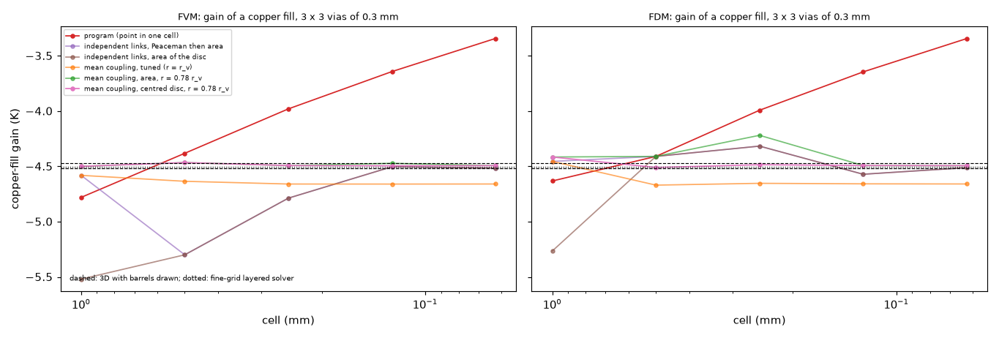

*Figure (`images/via_array_board_gain.png`): the copper-fill gain of the 3 × 3 via board against the cell size, the program with the point via and with the mean-potential via, and the resolved reference.*

**Cells that do not divide the features** (re-run by the review of the theory with the program of 2.4.5, `api.simulate`, models `fvm` and `fdm`, example board): FVM / FDM maximum 83.53 / 83.80 °C at 4 mm, 84.20 / 86.53 at 3 mm, 85.08 / 84.27 at 2 mm, 84.15 / 86.16 at 1.5 mm, 85.23 / 85.13 at 1 mm, 85.68 / 84.86 at 0.75 mm. Neither model is monotonic in the cell on this board: the answer moves with where the heaters, copper edges and vias fall on the grid, over 83.5 to 85.7 °C for the FVM and 83.8 to 86.5 °C for the FDM between 4 and 0.75 mm (at 1.5 and 0.75 mm the FVM and the FDM move in opposite directions); the cells of the table above (4, 2, 1, 0.5, 0.25 mm) are the aligned ones. An earlier text of `theory.md` said that the FVM converges monotonically on this board; that was not right.

The 3D solid column is not monotonic either (85.98 °C at 1 mm, 85.40 °C at 0.5 mm; it now uses the footprint rule of the FVM for every via, which removed the rule that made an open and a filled via different models), which the text above does not read.

**A heater that does not fall on the grid** (`research/models-comparison/scripts/study_offgrid_heater.py`, README 4.2.1 of that folder): reference board, 4 W, heater polygon (30.3, 30.3) to (40.7, 41.0) mm; the reference is the FVM at 0.1 mm, 102.25 °C. Maximum temperature [°C]:

| Spacing [mm] | FVM | FDM (area sampling) | FDM (point sampling) |
| --: | --: | --: | --: |
| 2 | 101.77 | 100.72 | 104.98 |
| 1 | 102.01 | 101.59 | 104.36 |
| 0.5 | 102.29 | 102.25 | 102.50 |
| 0.2 | 102.25 | 102.24 | 102.45 |

(The case quoted here earlier, FVM 103.59, FDM area 103.18, FDM point 105.69 and reference 103.63 °C for a "10.4 × 10.7 mm heater at 30.3 mm", could not be reproduced by any reading of its description and is replaced by this one.)

## 3. Against an independent 3D solid

`python research/models-comparison/scripts/validation_study.py --fem` (scikit-fem, offline, not in `requirements.txt`).

**The 3D model** (`research/solid3d-verification/scripts/fem3d_validation.py`): a tensor mesh of trilinear hexahedral elements; copper slabs with their true thickness (one element across), FR-4 gaps with four elements across,
copper where a zone exists and FR-4 where it does not; anisotropic FR-4 (0.3 through, 0.9 in plane); convection on the top, bottom and edge facets; the heater as a heat flux on its footprint on the top face;
a heatsink as an extra coefficient on the bottom facets inside its polygon; **a via as a copper rod with the copper area of the plated barrel** (0.147 mm square for a 0.3 mm via with a 25 µm wall, since the wall itself is far below
the mesh), through the whole thickness, with mesh lines refined around every rod. It does not use the "one node per copper layer" idea of the four models, so it measures the error of that idea. Element size 1 mm in the board plane
(halving it moved the 4-layer full-copper case by 0.06 °C; 2 elements instead of 4 across the gaps by 0.02 °C).

Maximum temperature of the top face [°C] and error of every model on the rise (FVM and FDM at 0.5 mm; Lumped and Analytic with their default settings). The finite-element column was not re-run (it does not depend on the program; the Analytic column was re-run with the edge in the series (section 4.1) by the review of `feature/analytic-robin-edge` on the printed 3D FEM temperatures, so its errors carry the rounding of those one-decimal references; against the edge loss moved to the faces it moved by +0.2 to +0.3 point, and against the edge left out it is 0.1 to 0.7 K cooler); the FVM, FDM, Lumped and Analytic columns are those of the program of 2.4.5 (laminate nodes, mean-potential via, via constriction), re-run for the final review of 2.4.5 against these finite-element values, and the 3D solid (FV) column is the earlier 0.5 mm run except the example board, whose 0.5 mm value is that of section 2.1 (the footprint rule of the vias):

| Board | 3D FEM [°C] | FVM | FDM | 3D solid (FV) | Lumped | Analytic |
| :-- | --: | --: | --: | --: | --: | --: |
| 4 layers, full copper | 90.6 | 90.3 (−0.4 %) | 90.3 (−0.5 %) | 90.5 (−0.1 %) | 91.1 (+0.7 %) | 90.2 (−0.7 %) |
| 2 layers, 40 mm top pad | 112.2 | 111.8 (−0.4 %) | 111.4 (−0.9 %) | 112.4 (+0.2 %) | 112.1 (−0.1 %) | 106.4 (−6.7 %) |
| 2 layers, 20 mm top pad | 136.2 | 136.4 (+0.1 %) | 133.5 (−2.4 %) | 138.0 (+1.6 %) | 131.1 (−4.6 %) | 109.2 (−24.3 %) |
| example board (partial copper, 9 vias, bottom heatsink) | 85.6 | 85.2 (−0.7 %) | 85.1 (−0.8 %) | 85.4 (−0.3 %) | 86.6 (+1.7 %) | 84.6 (−1.7 %) |

**Metal block** (a heatsink with a thickness; `research/solid3d-verification/scripts/fem3d_validation.py` models it as a gap-pad slab of conductivity 1 W/mK and thickness `R''` plus the block slab below the board, with its side faces losing heat too; the table is printed by `research/solid3d-verification/scripts/study_block_against_fem.py`, no script printed it before this folder. Board: 100 × 80 mm, 2 layers, 5 W, full top copper, 10 × 10 mm heater at the centre, 30 × 30 mm copper pad on the bottom, block 60 × 60 mm unless stated, aluminium 204 W/mK; FVM, FDM and the 3D solid (FV) at 1 mm; error on the rise):

| Case | 3D FEM [°C] | FVM | FDM | 3D solid (FV) |
| :-- | --: | --: | --: | --: |
| no block (bottom pad only) | 134.2 | 133.2 (−0.9 %) | 132.6 (−1.5 %) | 134.3 (+0.1 %) |
| Al 3 mm, gap pad 5 K cm²/W | 115.5 | 115.0 (−0.5 %) | 114.9 (−0.6 %) | 115.4 (−0.0 %) |
| same, finned (extra h 60 W/m²K) | 99.7 | 99.0 (−1.0 %) | 99.0 (−1.0 %) | 99.6 (−0.2 %) |
| same, worse interface (20 K cm²/W) | 118.8 | 118.4 (−0.4 %) | 118.3 (−0.5 %) | 118.8 (−0.0 %) |
| Al 1 mm | 117.3 | 116.8 (−0.5 %) | 116.8 (−0.6 %) | 117.2 (−0.0 %) |
| Cu 3 mm | 115.3 | 114.8 (−0.5 %) | 114.8 (−0.6 %) | 115.3 (−0.0 %) |
| Al 3 mm 40 × 40 over a 50 × 50 mm pad | 120.4 | 119.4 (−1.0 %) | 119.0 (−1.4 %) | 120.4 (−0.0 %) |
| Al 3 mm 30 × 30 exactly over the pad | 129.3 | 128.1 (−1.1 %) | 127.4 (−1.8 %) | 129.5 (+0.2 %) |

The block is always within 1.8 % of the finite-element solid (the 3D solid of the program within 0.2 %). (An earlier version of this script left unused nodes in the matrix of the solid and gave wrong numbers for blocks; fixed by pinning exactly the nodes that belong to no element.)

### 3.1 Does the outer copper dissipate and spread heat (against a heatsink)?

`python research/solid3d-verification/scripts/copper_dissipation.py [--fem]`. Board 100 × 80 mm, 2 layers, 5 W on a 10 × 10 mm heater on top, copper only on the top layer (a square pad centred on the heater), no vias, `h_top` 10 and `h_bottom` 15 W/m²K.
Maximum temperature [°C] against the 3D finite-element solid (error on the rise; the 3D FV column is the program's own `solid3d`). The FVM and FDM columns and the heat columns are those printed by the script on the program of 2.4.5 (they moved with the laminate nodes of section 21.2: a one-sided pad leaves bare laminate around the heater); the 3D FV, Lumped and Analytic columns printed the same numbers; the finite-element column was not re-run:

| Top copper pad | 3D FEM | FVM | FDM | 3D solid (FV) | Lumped | Analytic |
| :-- | --: | --: | --: | --: | --: | --: |
| heater pad only (10 mm) | 495.3 | 508.9 (+2.9 %) | 434.6 (−12.9 %) | 533.1 (+8.0 %) | 652.7 (+33.5 %) | 201.1 (−62.6 %) |
| 20 mm square | 273.0 | 276.0 (+1.2 %) | 256.1 (−6.8 %) | 282.0 (+3.6 %) | 517.4 (+98.5 %) | 150.3 (−49.5 %) |
| 30 mm square | 202.6 | 203.5 (+0.5 %) | 195.6 (−3.9 %) | 205.9 (+1.9 %) | 392.9 (+107.2 %) | 145.9 (−31.9 %) |
| 40 mm square | 172.5 | 172.9 (+0.3 %) | 169.1 (−2.3 %) | 174.0 (+1.0 %) | 302.7 (+88.3 %) | 144.9 (−18.7 %) |
| 60 mm square | 150.3 | 150.2 (−0.1 %) | 149.2 (−0.9 %) | 150.6 (+0.2 %) | 200.1 (+39.7 %) | 144.2 (−4.9 %) |
| 80 mm square | 144.6 | 144.4 (−0.2 %) | 144.2 (−0.3 %) | 144.5 (−0.1 %) | 151.1 (+5.4 %) | 143.6 (−0.8 %) |

Copper against heatsink on the same board (40 mm area), FVM heat leaving the top face inside / outside the first copper zone (the 40 mm pad; in the last row the heater's own 10 mm pad, not the 40 mm heatsink area):

| Case | 3D FEM | FVM | FDM | 3D solid (FV) | Heat over the area [W] | Elsewhere on the top face [W] |
| :-- | --: | --: | --: | --: | --: | --: |
| 40 mm copper pad | 172.5 | 172.9 (+0.3 %) | 169.1 (−2.3 %) | 174.0 (+1.0 %) | 1.33 | 0.75 |
| pad + heatsink, extra h 30 W/m²K | 131.5 | 131.5 (+0.0 %) | 130.5 (−0.9 %) | 131.8 (+0.3 %) | 3.02 | 0.38 |
| pad + heatsink, extra h 100 W/m²K | 100.7 | 100.6 (−0.1 %) | 100.4 (−0.4 %) | 100.6 (−0.1 %) | 4.12 | 0.15 |
| heater pad only + heatsink 30 W/m²K on bare laminate | 340.7 | 351.5 (+3.4 %) | 294.6 (−14.6 %) | 369.6 (+9.2 %) | 1.28 | 2.37 |

What it shows:
* **The outer copper dissipates and spreads by itself**: the temperature falls monotonically as the pad grows (495 → 145 °C) and saturates (80 mm gains 6 °C over 60 mm), and the whole top face loses heat, pad and bare laminate alike (the heat found outside the 40 mm pad, 0.75 W, is heat that the copper carried to the laminate).
  The FVM follows the 3D FEM within 1.2 % for pads of 20 mm and more (it was 1 to 2.5 % low before the laminate nodes) and is 2.9 % high on the heater-sized pad; the 3D FV solid is within 2 % from 30 mm (+3.6 % at 20 mm), and both 3D models bracket the converged value on the heater-sized pad (the convergence paragraph below).
* **A heatsink works through the copper under it**: the same 30 W/m²K heatsink gives 131 °C on the pad and 352 °C on bare laminate, because on the laminate there is no sheet to spread the heat in. The heatsink adds convection area; the copper provides the path to it.
* **Where the models fail**: with a pad hardly larger than the heater (an edge of copper across the footprint) the FDM loses 7 to 13 % (the grid sees the pad as a few nodes), and the **Lumped and Analytic models are unreliable** for a one-sided pad without vias or bottom copper (Lumped up to +107 %, Analytic up to −63 %); they assume copper around the heater on both faces or a uniform sheet. The input checks already warn about a copper edge crossing a heater; use the FVM for such boards.

The 3D value of the example board is converged: 85.57 °C with 1 mm elements and 85.59 °C with 0.5 mm (2 elements across each gap; 85.567 and 85.587 °C printed by `research/solid3d-verification/scripts/study_fem_hand_checks.py`).

The new **3D solid (FV)** column is the program's own 3D model (`solid3d.py`, section 2.7 of `models.md`; slabs of real thickness, 4 per gap; 0.5 mm cells in the four-board table of section 3, `validation_study.py --fem`, and 1 mm cells in the tables of 3.1, `copper_dissipation.py`): it lands within 0.2 % of the FEM on three boards and 1.6 % high on the 20 mm pad. Its numbers are also the closest to the FVM in section 2 (within 0.3 % on the ordinary scenarios, +2.2 % with a copper edge across the heater, +0.7 % with no copper under it; +4.5 % and +2.4 % before the laminate nodes).
**Convergence on a small pad**, where the two 3D models differ most (maximum temperature [°C], `research/solid3d-verification/scripts/study_small_pad_convergence.py`; the board of `copper_dissipation.py`):

| pad | model | 1 mm, 4 per gap | 0.5 mm, 4 per gap | 1 mm, 8 per gap | 0.5 mm, 8 per gap |
| :-- | :-- | --: | --: | --: | --: |
| 10 mm | 3D solid (FV) | 533.1 | 522.9 | 530.2 | 519.1 |
| 10 mm | 3D FEM | 495.3 | 499.7 | 496.9 | 502.1 |
| 20 mm | 3D solid (FV) | 282.0 | 279.6 | 281.4 | 278.7 |
| 20 mm | 3D FEM | 273.0 | 274.0 | 273.4 | 274.6 |

The finite volumes fall and the finite elements rise with the mesh. Extrapolated from 1 to 0.5 mm (8 per gap) with order one assumed, both give the same limit: 508.0 and 507.3 °C on the heater-sized pad, 276.0 and 275.8 °C on the 20 mm pad; at 1 mm and 4 per gap the FV is then 5 % high and the FEM 3 % low (on the rise) on the extreme case, +2.4 % and −1.2 % on the 20 mm pad. Against the extrapolated limit the FVM is +0.1 % on the 20 mm one-sided pad (+1.2 % against the FEM; −3.7 % before the laminate nodes) and +0.3 % on the heater-sized pad, and the 3D solid +2.4 %.
**The same pads in the independent solver** (isotropic FR-4 of 0.3 W/mK and no edge loss, 8 slabs per gap; `research/solid3d-verification/lib/layered3d.py`, written separately from the program, on the same branch; maximum temperature [°C]):

| pad | model | 1 mm | 0.5 mm |
| :-- | :-- | --: | --: |
| 10 mm | independent solver | 829.2 | 806.3 |
| 10 mm | 3D solid (FV) | 829.2 | 806.3 |
| 10 mm | 3D FEM | 762.0 | 773.5 |
| 20 mm | independent solver | 362.7 | 357.8 |
| 20 mm | 3D solid (FV) | 362.7 | 357.8 |
| 20 mm | 3D FEM | 348.5 | 350.9 |

The program's 3D solid and the independent finite-volume solver agree to 0.1 °C on both meshes, which confirms the assembly of the 3D solid; they share the kind of discretisation (cell-centred, harmonic means), so this does not test the discretisation error, which only the mesh sweep and the FEM bracket show.
Reading: on a uniform board the four layered models land on the 3D answer within 0.7 % (FVM, FDM and Analytic within 0.5 %). **With vias and a heatsink (the example board) all four are within 1.7 %** (Lumped +1.7 %, Analytic −0.8 % after section 18.1; they were −1.5 % each; the Lumped and Analytic values are from a new run of `validation_study.py` against the 85.6 °C of the earlier finite-element run, which was not repeated: it needs scikit-fem), and the FVM, with the mean-potential via, is 0.7 % below the 3D rods (+0.5 % when each via was a point in one cell).
With a small copper pad the FVM follows the 3D solid within 0.4 % (it was 0.8 and 2.2 % low before the laminate nodes of section 21.2), the FDM within 2.4 % and the Lumped within 4.6 %, and the Analytic loses accuracy exactly where its uniform-sheet assumption breaks (6 % with a 40 mm pad, 24 % with a 20 mm pad). The remaining 0.1 to 0.7 % of the FVM on these four boards (0.4 to 2 % before the laminate nodes) is attributed to
representing each copper layer by one node and the dielectric between two layers as a one-dimensional vertical resistance (the in-plane conduction of the laminate is carried at the temperature of the copper nodes, and the vertical gradient inside the gap is not resolved); this explanation was not measured separately.

## 4. Why the FVM and the Analytic model give about the same numbers

1. **They solve the same model.** Both treat every layer as a thin conducting sheet, the dielectric as a vertical resistance, one constant `h` per face, the same material properties. The Analytic is the **exact** solution of that model on a
   uniform sheet; the FVM is its **numerical** solution; two correct solutions of one model agree. On a uniform board they differ only by the edge: with the edges of both insulated they agree to −0.04 to −0.29 %, and the mesh error of the FVM is under 0.1 point from 1 mm (`research/theory/scripts/study_fvm_analytic_edges.py`). Until 2.5.0 the cosine series left the edge loss out (+0.3 to +1.0 % on a 100 x 80 mm board with the default `h_side` of 10 W/m²K, but +3 to +22 % on 30 x 20 and 60 x 40 mm boards and up to 2.5 times the rise at 200 W/m²K); it now has the edge in the eigenfunctions of the series, see 4.1.
2. **The real board is not that model, and that error is shared** (section 3: 0.1 to 0.7 % for the FVM on four boards, up to 3 % on a one-sided pad, from the 3D solid). Neither can be better than the layered model; "FVM = more precise" does not hold in general. What the FVM has is **freedom of geometry**.
3. **Part of the agreement was engineered**: the Lumped and Analytic models were tuned against the FVM (copper weighted with the heater influence, fin lengths, Bessel factors), so tables 1 and 2 measure agreement with the FVM; the 3D solid does not depend on that tuning.
4. **They diverge where the geometry is not uniform near the heater** (section 2: pads, copper edges, corners).

### 4.1 The convective board edge in the series of the Analytic model

The Analytic series is made of the eigenfunctions of the convective edge when `h_side` is set (`docs/theory.md` 6; Muzychka, Culham and Yovanovich 2003, Part II, eqs. 12 to 21), with one edge parameter for all the layers and the perimeter of the real outline on a board with an outline. The measurements below were made on the program (`api.simulate`, the Analytic at 1 mm) on the boards of `research/analytic-edge-spatial` (the study measured a copy of the solve; the program reproduces its numbers: 0.117 % mean and 0.324 % maximum on the 135 boards against 0.12 % and 0.32 %), and repeated by the review of `feature/analytic-robin-edge` with its own script, which reproduced every number of this section to the printed digit. The study scripts of that folder still call the copy: they are to be pointed at the program when the research branch is merged (until then no committed script prints these tables). An earlier version of this branch moved the edge loss to the faces of the layers (eq. 29 of the same paper); it was never released and its tables are replaced by these (it was 3.36 % on average and 37 % at most on the 135 boards, `research/analytic-edge-spatial` README 3). History: before 2.5.0 the edge was left out.

**Uniform boards.** 135 boards (30 x 20, 60 x 40 and 100 x 80 mm; 2 layers of 0.8, 1.6 and 3.2 mm, 4 and 6 layers of 1.6 mm, full 35 um copper on every layer; faces 10 W/m²K; 2 W on a 10 mm square at the centre, at the middle of the bottom edge or in a corner; `h_side` 10, 50 and 200 W/m²K), error of the hottest rise against the FVM at 0.5 mm (the FVM at 1 mm is within 0.3 % of it) and, on the 90 boards up to 60 x 40 mm, against an independent 3D solver with convective side faces (`research/analytic-edge-spatial/lib/layered3d_side.py`, 1 mm, four sub-slabs per gap), at the 1 mm cell of the Analytic:

| `h_side` (W/m²K) | part | edge left out, vs FVM | now, vs FVM | now, vs 3D | FVM vs 3D |
| --: | :-- | --: | --: | --: | --: |
| 10 | centre | +0.1 to +21.8 % | −0.3 to −0.0 % | −1.3 to −0.1 % | −1.0 to −0.0 % |
| 10 | edge | +0.5 to +21.3 % | −0.2 to −0.0 % | −1.4 to −0.1 % | −1.2 to −0.1 % |
| 10 | corner | +1.1 to +20.0 % | −0.1 to +0.0 % | −1.4 to −0.1 % | −1.4 to −0.1 % |
| 50 | centre | +1.3 to +94.2 % | −0.3 to −0.1 % | −4.0 to −0.5 % | −3.9 to −0.3 % |
| 50 | edge | +3.3 to +91.1 % | −0.2 to −0.0 % | −4.5 to −0.5 % | −4.5 to −0.3 % |
| 50 | corner | +6.0 to +83.9 % | −0.1 to +0.0 % | −5.3 to −0.4 % | −5.4 to −0.4 % |
| 200 | centre | +5.0 to +252.1 % | −0.3 to −0.0 % | −13.0 to −2.2 % | −13.0 to −1.9 % |
| 200 | edge | +12.6 to +243.5 % | −0.2 to +0.0 % | −14.3 to −2.3 % | −14.4 to −2.2 % |
| 200 | corner | +22.4 to +229.5 % | −0.1 to +0.2 % | −17.2 to −2.8 % | −17.4 to −2.8 % |

(The "left out" column includes the 100 x 80 mm boards; the 3D columns do not.) Mean absolute error against the FVM 0.117 %, maximum 0.324 %; heat balance (faces + edge) / P between 0.9999998 and 1.0000000; a steady solve takes 0.04 s on average (the matrices are the cosine ones; 600 roots take a few milliseconds). The column "now, vs 3D" equals "FVM vs 3D" to within 0.3 point: **the Analytic reproduces the layered model of the FVM, not the 3D solid**, and what is left against the 3D solid is the FVM's own (it attaches the edge film of the laminate to the copper node; see the last paragraph).

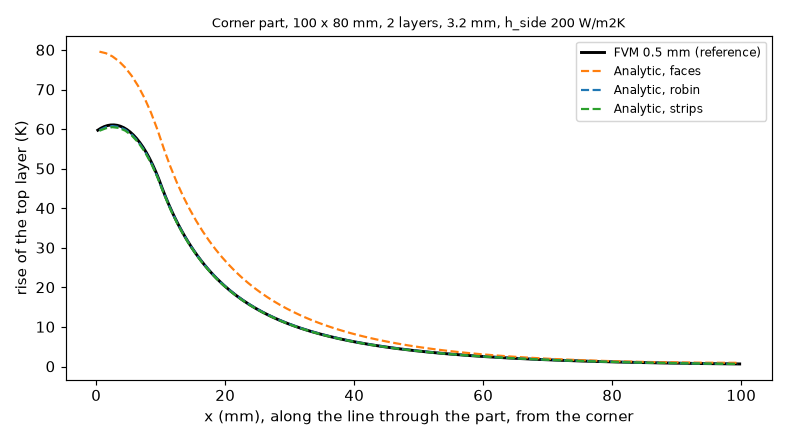

*Figure (`images/analytic_robin_corner_profile.png`, from `research/analytic-edge-spatial` figure 4): top layer through a corner part, 100 x 80 mm, 3.2 mm, `h_side` 200 W/m²K. The "faces" curve is the superseded transfer of the edge loss to the faces (never released): it reads 80 K at the part against 61 K; the Robin series follows the FVM.*

**Vias, heatsinks, the example board** (60 x 40 mm, 2 layers of 1.6 mm, a 3 x 3 array of 0.3 mm vias at 3.5 mm pitch and/or a 20 x 20 mm heatsink of 30 W/m²K under the part, the part at the centre or in a corner, `h_side` 50 and 200; FVM at 0.5 mm): the hottest rise is within **0.25 %** on the 12 boards and the via and heatsink effect (rise without minus with) within **4.6 %** (−4.6 % for the vias at the centre; the other boards within 2.0 %). The example board (100 x 80 mm, 4 layers, partial top copper, nine vias, heatsink) at `h_side` 10 / 50 / 200: FVM 60.18 / 58.47 / 54.49 °C, Analytic **−1.00 / −1.20 / −1.92 %** of the rise (the part of this error that is not the edge is the copper weighting, present without an edge), heat balance 1.00000. Metal blocks (measured by the review, FVM at 0.5 mm, `h_side` none / 50 / 200 W/m²K): the 60 x 40 mm two-layer board of `test_heat_balance_with_a_metal_block` (3 W part, 26 x 26 mm block of 3 mm under it) −0.36 / −0.25 / −0.12 %, an 80 x 60 mm four-layer board with a centred 30 x 30 mm block of 2 mm −0.25 / −0.26 / −0.26 %, a 40 x 30 mm board with a 15 x 15 mm block of 4 mm in the corner, at the edge, +0.03 / +0.06 / −0.04 %; the edge heat within 0.8 % of the FVM and the block heat within 1.6 %, the balance closed to 1e-6. The edge does not make the block worse, so no warning is added for it.

**Boards outside the uniform set** (54 boards: 60 x 40 mm, `h_side` 10, 50 and 200, part at the centre and in a corner; advanced stack-ups of 4, 6 and 8 layers with full copper, 4 layers with fills 0.4/1/1/0.4 and 0.2/0.2/1/1, 2 layers with a bare side, 1 layer; and 24 more with unequal copper on four simple layers), error against the FVM at 0.5 mm:

| boards | `S` max/min | largest error |
| :-- | --: | --: |
| advanced 4, 6, 8 layers, full copper | 2.1 to 2.2 | −2.2 % |
| advanced 4 layers, fills 0.4 / 1 / 1 / 0.4 | 1.2 | −1.7 % |
| advanced 4 layers, fills 0.2 / 0.2 / 1 / 1 | 7.7 | +5.8 % |
| 2 layers, top full, bottom 0.2 | 4.2 | −8.6 % |
| 2 layers, top full, bottom 0.5 | 1.9 | −6.9 % |
| 2 layers, top 0.2, bottom full | 4.2 | +5.5 % |
| 1 layer | 1.0 | −7.3 % |
| 4 simple layers, fills 0.3/1/1/1, 0.2/0.2/1/1 | 3.1, 4.5 | +3.2 %, +5.4 % |

All errors above 2.5 % are at `h_side` 200 W/m²K (the edge takes 57 % of the loss coefficient) except −2.6 / −2.5 / +2.5 % at 50 W/m²K, with the part in a corner; at the default 10 W/m²K every one is within 2.0 %. The heat balance closes to 1.00000 on all of them. **The warning** fires on 10 of the 54 and 4 of the 24 boards, on every board with an error above 3 % (7 of 7 and 2 of 2) and on none of the 135 uniform boards; it stays silent on the 2 to 2.6 % boards at 50 W/m²K. The common edge parameter is the cause (the layers with little copper lose their edge heat as if they had the copper of the others); the one-layer board gives the laminate edge to the copper node. A per-layer basis is planned (`docs/versions.md`).

**Boards that moved** (frozen numbers, the Analytic records with an edge coefficient, against the faces transfer): +0.1 to +0.7 % of the rise (the example board 84.52 → 84.69 °C at 0.5 mm, the T 136.25 → 136.82 °C, the round board 175.23 → 175.90 °C, the part across the outline −0.03 %); boards without `h_side` are bit-identical. On the outline boards the heat through the edge uses the perimeter of the real outline (the T: 0.264 W against 0.282 W of the FVM, 6.6 % short because the equivalent rectangle puts the part in another place; with the perimeter of the rectangle, 198 mm instead of 280 mm, it would be 30 % short).
**Time** (2 mm cell; 12 uniform boards, parts at the centre and in a corner, `h_side` 50 and 200): the modal transient shares the basis; the time to 63 % of the unit step is **−3.3 to +5.9 %** of the FVM (the worst: a 30 x 20 mm board with a corner part at 200 W/m²K, 14.5 s against 15.4 s) and the steady resistance within 1.6 %. With vias or a heatsink (measured by the review on the 60 x 40 mm boards above, `h_side` none / 50 / 200): vias at the centre −1.1 / −1.2 / −1.5 % on the time to 63 %, a heatsink in the corner −3.6 / −1.7 / +1.1 %, the steady resistance within 1.6 %; **with vias and a heatsink together the time to 63 % is +49 / +44 / +28 % of the FVM** (22.2 s against 33.0 s without an edge coefficient), with the steady resistance within 3 %. That is a limit of the modal transient that the edge did not create (the insulated board, bit-identical to the code before, is the worst): the transient smears vias and heatsinks and calibrates one factor, on the vias when the board has vias, so the heatsink keeps its smeared coefficient and the board responds too slowly (`analytic._calibrated_dynamics`; planned in `docs/versions.md`).

**Analytic transient with a heatsink, wider sample** (`research/analytic-2-6` README 3.1; measured on 10 boards of the 60 x 40 mm family, step response of one part only, FVM at 1 mm as the reference, not the profile or the animation): the time to 63 % of the program is plain 2 L +0.6 %, 1 via +0.1 %, 4 x 4 vias +0.5 %, plain 4 L +0.5 %; heatsink under the part -36.7 %, heatsink beside -54.3 %, vias + heatsink under +45.6 %, vias + heatsink beside -66.9 %, 4 L vias + heatsink under (300 W/m²K) +112.7 % (+84 % against the FVM at 0.5 mm, whose own time to 63 % moves 9.89 to 11.40 s), 2 L `h_side` 50 vias + heatsink +62.6 %. Reproduced by the review (`study_transient_both.py`, every number to the digit). The +28 to +49 % of the paragraph above is another board (a 3 x 3 array and a 20 x 20 mm heatsink under a corner part) and lies inside this range; a heatsink alone in a corner was -3.6 %, so the range is a sample, not a bound. **Review against the converged FVM (0.5 mm):** the range is -66 % to +84 % (the +112.7 % board is +84.4 %), and a further 2-layer board with vias and a 300 W/m²K heatsink under the part reaches +175.2 %; the warning quotes these numbers. The three causes are a one-sided calibration, a failed calibration when both are present (the via factor reaches the 1e4 ceiling) and wrong dynamics of a heatsink smeared over the whole board even when the steady maximum matches. The Lumped model on the same boards: -1.1 to -11.8 % with the heatsink under the part, up to -41.8 % beside it, so the warning points to the FVM and FDM, not to the Lumped model. Since 2.5.0 the Analytic time simulation of a board with a heatsink carries a warning with the range, in the profile runs and in the animation.
**Published case** (`tests/test_analytic_edge.py`): equation 21 of Muzychka, Culham and Yovanovich (rectangular flux channel with edge cooling, a 10 x 10 mm source on 50 x 50 mm, `h` = 100 W/m²K) against the thin-sheet series of the program's basis: −0.03 to −1.1 % on the five cases of the test (k 385 and 50 W/mK, t 0.2 and 1 mm, `h_e` 50 to 1000); equation 21 itself agrees with the independent 3D solver within −0.16 to +1.06 % on the 24 cases of the study (`research/analytic-edge-spatial` README 2). The series is also within 0.014 % of an independent finite-difference solver of the same sheet (one layer, 0.25 mm cell, an 8 mm source at the centre and in a corner; the odd functions), `test_series_against_an_independent_finite_difference_solver`.
**A limit of the layered models found on the way** (not changed here): the FVM (and FDM) make laminate sub-gap nodes only where the copper is not full, so on full copper the edge film of a whole layer slab hangs on the copper node and the laminate loses heat through its edge as if it were at the copper temperature; against the 3D solver this makes the FVM read low by up to 1.4 % at `h_side` 10 on a 3.2 mm board and 13 to 17 % at 200 W/m²K, and with an edge coefficient its hottest rise jumps by +0.3 to +12.6 % between a fill of 1 and 0.9999 (`research/analytic-edge-spatial` README 8.4). At the default coefficient on 1.6 mm boards it is under 0.4 %. To investigate (`research/ROADMAP.md` A16).

## 5. Linear solvers: direct, conjugate gradients, SOR

`python research/models-comparison/scripts/solver_equivalence.py`. Same boards, same physics, different ways of solving `K θ = Q`:

| Board | Solver | Tmax [°C] | max diff to direct [K] | Residual | Sweeps | Time [s] |
| :-- | :-- | --: | --: | --: | --: | --: |
| reference, 2 layers | direct (sparse LU) | 90.0657 | 0 | 3e-14 | - | 0.01 |
| reference, 2 layers | CG (Jacobi) | 90.0657 | 3.3e-12 | 9e-13 | - | 0.01 |
| reference, 2 layers | SOR, residual 1e-9, automatic ω | 90.0657 | 3.2e-09 | 1e-09 | 306 | 0.05 |
| reference, 2 layers | SOR, step 0.01 K, ω = 1.5 (original rule) | 87.3447 | 2.7 | 6e-02 | 369 | 0.05 |
| reference, 8 layers | direct (sparse LU) | 65.6612 | 0 | 8e-14 | - | 0.39 |
| reference, 8 layers | CG (Jacobi) | 65.6612 | 4.6e-12 | 1e-12 | - | 0.05 |
| reference, 8 layers | SOR, residual 1e-9, automatic ω | 65.6612 | 3.0e-09 | 1e-09 | 673 | 0.36 |
| reference, 8 layers | SOR, step 0.01 K, ω = 1.5 (original rule) | 53.1158 | 13 | 1e-01 | 384 | 0.19 |
| example board (vias, heatsink, 2 heaters) | direct (sparse LU) | 85.2335 | 0 | 1e-13 | - | 0.46 |
| example board (vias, heatsink, 2 heaters) | CG (Jacobi) | 85.2335 | 2.1e-11 | 1e-12 | - | 0.18 |
| example board (vias, heatsink, 2 heaters) | SOR, residual 1e-9, automatic ω | 85.2335 | 6.3e-09 | 1e-09 | 676 | 1.05 |
| example board (vias, heatsink, 2 heaters) | SOR, step 0.01 K, ω = 1.5 (original rule) | 69.3756 | 16 | 1e-01 | 570 | 1.18 |
| weak cooling (h = 2 W/m²K, 200 mm) | direct (sparse LU) | 44.2990 | 0 | 1e-13 | - | 0.15 |
| weak cooling (h = 2 W/m²K, 200 mm) | CG (Jacobi) | 44.2990 | 6.6e-12 | 1e-12 | - | 0.09 |
| weak cooling (h = 2 W/m²K, 200 mm) | SOR, residual 1e-9, automatic ω | 44.2990 | 7.8e-10 | 1e-09 | 779 | 0.70 |
| weak cooling (h = 2 W/m²K, 200 mm) | SOR, step 0.01 K, ω = 1.5 (original rule) | 37.5624 | 6.7 | 3e-01 | 162 | 0.15 |
| reference, insulated edges | direct (sparse LU) | 90.3925 | 0 | 2e-13 | - | 0.14 |
| reference, insulated edges | CG (Jacobi) | 90.3925 | 5.6e-12 | 1e-12 | - | 0.09 |
| reference, insulated edges | SOR, residual 1e-9, automatic ω | 90.3925 | 1.6e-09 | 1e-09 | 636 | 0.50 |
| reference, insulated edges | SOR, step 0.01 K, ω = 1.5 (original rule) | 80.3174 | 10 | 2e-01 | 550 | 0.36 |

Direct, CG and SOR with the residual criterion agree to **7e-9 K** or better on all five boards (the SOR with the largest difference, 6.3e-9 K, is the example board); the original program's stopping rule stops 2.7 to 16 K from the solution with a violated heat balance. The direct solver is the default
(1 to 5 times faster than a correct SOR on these boards); SOR stays available as an independent check. With vias the SOR is a block SOR: after the two colours it solves the dense blocks of the via footprints exactly (relaxed by ω), so the example board with its nine vias still agrees with the direct solver to 6.3e-9 K in 676 sweeps (2197 with the earlier relaxation factor, see below); without the blocks the red-black update iterated another matrix and stopped 19 to 22 K from the direct solution on the 3 × 3 via board (`research/sor-with-via-couplings`). The relaxation factor of the automatic SOR is the Rayleigh-quotient estimate of Young's optimum (`fvm.Network.sor_omega`, `docs/theory.md` 'Solvers'); the earlier `2 / (1 + sin(pi / n))` needed 656, 3247, 2197, 2237 and 1391 sweeps on these five boards, now 306, 673, 676, 779 and 636 (2.1, 4.8, 3.3, 2.9 and 2.2 times fewer; sweeps and times from `python -m pcbthermal solvers` and `research/models-comparison/scripts/solver_equivalence.py`, the temperatures are the same). On the example board at 2 mm the sweeps fall from 1054 (earlier formula) to 364 (reproduced with `.venv/bin/python research/models-comparison/scripts/solver_equivalence.py` (five boards, 1 mm) and `python -m pcbthermal solvers examples/example_board.pcbt.json [--cell-mm 2]`; the earlier factor is the same run with `fvm.Network.sor_omega` replaced by `2/(1 + sin(pi/max(nx, ny)))`). A via block above 5 000 unknowns is not inverted: the direct solver is used and the summary says *SOR not used* (`tests/test_point_via.py`).

## 6. The removed wxPython program against the current one

Same example board (reference 85.81 °C with the point via, 85.23 °C with the mean-potential via, in the rows below; the rows of the new program are those of 2.4.5, `api.simulate` at 1 mm). Old numbers were obtained by running the original code (git tag `legacy-wxpython-1.0.0`, commit `641da87` with the comparison script).

| Program | Model | Tmax [°C] | Error on the rise | Power used [W] | Note |
| :-- | :-- | --: | --: | --: | :-- |
| old | Analytic, basic | 603.95 | +851 % | 5.50 | dimensionally wrong conduction term |
| old | Lumped, basic | 32.24 | −88 % | 5.50 | not a valid network |
| old | Analytic, advanced | 34081 | +55 845 % | 5.50 | |
| old | Lumped, advanced | 449.00 | +597 % | 5.50 | |
| old | FDM, 10 mm (defaults) | 124.93 | +64 % | **8.17** | injected 8.17 W for 5.50 W |
| old | FDM, 2 mm (defaults) | 76.94 | −15 % | 5.50 | "converged" |
| old | FDM, 1 mm (defaults) | 66.56 | **−32 %** | 5.50 | error grows when the mesh is refined (step-size stopping rule) |
| old | FDM, 1 mm (tight tolerance, ω = 1.9) | 82.50 | −5.5 % | 5.50 | the rest is modelling |
| new | FVM, 1 mm | 85.23 | 0 | 5.50 | energy balance −1.4e-12 (point via: 85.81) |
| new | FDM (area sampling), 1 mm | 85.13 | −0.2 % | 5.50 | same physics, vias as a footprint of nodes (point via: 84.38, −2.4 %) |
| new | Lumped | 86.63 | +2.3 % | 5.50 | (84.66, −0.9 %, before the via constriction of section 18.1) |
| new | Analytic | 84.58 | −1.1 % | 5.50 | with the edge in the series (section 4.1; 85.10 with the edge left out, 84.65 before the via constriction of section 18.1) |

What went wrong in the old FDM was not the finite-difference idea: a stopping rule on the step size (false convergence), a heater power that depended on the grid, no lateral conduction in FR-4, solid vias, heatsinks on inner layers ignored,
boundary nodes with a full cell. All were fixed (conservative cell balance, exact power, anisotropic FR-4, hollow vias). A correct FDM (section 2) lands within 0.2 % of the FVM on this board at 1 mm and 0.1 % at 0.5 mm since the mean-potential via (2.4 % and 1.1 % with the via at the nearest node; within 0.1 % where there are no vias).

## 7. Time-dependent results

* **Step response, exact check** (`tests/test_fvm.py`): one layer, a heater over the whole board, insulated edges (`C dθ/dt = P − Gθ`, time constant 109.1 s, steady rise 40 K); maximum error in K over three time constants:
  implicit Euler 3.06 / 1.67 / 0.87 / 0.45 for Δt, Δt/2, Δt/4, Δt/8 (first order); Crank-Nicolson 0.315 / 0.077 / 0.019 / 0.005 (second order); stored plus lost heat equals the injected heat within 0.2 % (−0.01 % with a trapezoidal integral of the loss).
  The animation, profile and CSV numbers below are printed by `research/models-comparison/scripts/study_time_and_coefficients.py` (run from the repository root).
* **Step animation, FVM against FDM** (example board, 2 mm; hottest point [°C] at t = 0, 0.12, 0.82, 3.6, 15, 60, 120 s): FVM 25.0, 30.6, 44.0, 53.6, 61.5, 70.9, 77.0; FDM 25.0, 30.5, 43.6, 53.0, 60.8, 70.2, 76.3: within 0.7 °C (0.69 °C) at every output time (steady maxima 85.3 and 84.7 °C). Power-profile time simulation of the profile example: peak 134.2 °C (FVM) against 129.6 °C (FDM) at 2 mm, where the 6 mm heater is only three cells wide.
* **Step animation, FVM against Analytic** (example board, 4 W + 1.5 W, 1 mm; hottest point [°C] at t = 0, 0.12, 0.35, 0.82, 1.8, 3.6, 7.4, 15, 30, 60, 120 s): FVM 25.0, 30.7, 37.8, 44.4, 49.7, 54.0, 58.0, 61.9, 66.3, 71.4, 77.4; Analytic 25.0, 30.6, 37.4, 43.4, 48.0, 52.0, 55.8, 59.8, 64.1, 69.4, 76.0:
  within 2.2 °C at every time, after calibrating the vias per heater (without it the Analytic was up to 10 °C off). The hottest point reaches 63 % of its final rise in about 19.2 s; the whole board needs minutes.
* **Power profiles** (`tests/test_profiles.py`): the exact mean power per step reproduces the energy exactly for any step; against the exact periodic solution of a uniform board (an RC circuit) the decision's peak is within 0.3 % and Crank-Nicolson time stepping within 0.4 %;
  averaging a fast heater changes the peak by less than the oscillation that was neglected, with 40 times fewer steps; a table equals the equivalent square wave to round-off.
  Example (`example_profile_board`: U1 100 Hz, 30 % duty, 13.3 W on → oscillation 0.4 °C, averaged; U2 20 s period, 25 % duty, 6 W on → oscillation 84.9 °C, resolved): peak of the hottest point FVM 135.3 °C (1 mm cells; 134.2 °C at 2 mm, the value used in the FVM-FDM sentence above), Analytic 134.7, Lumped 131.8;
  steady with the average power 85.8 / 84.8 / 84.7 °C; bound with the on-state powers 231.6 °C (FVM).
* **CSV example** (`examples/csv_profiles`): U1 a repeating 30 s cycle (12 W, 5 W, 0.5 W), U2 a one-shot start-up: peak FVM 119.5 °C, Lumped 116.1, Analytic 115.1 (within 4 % of the temperature; on the rise above ambient the Analytic is 4.7 % and the Lumped 3.6 % below the FVM); steady with the average powers 66.5 °C; bound 201.6 °C.

## 8. Computed heat transfer coefficients

Example board, FVM at 1 mm, Tmax [°C], typed `h` (10 top / 15 bottom) against computed (horizontal board, emissivity 0.9; `research/models-comparison/scripts/study_time_and_coefficients.py`; the power of the second row is 1.375 W):

| Power [W] | Typed | Computed | Difference | Computed h top / bottom [W/m²K] | Vertical | 2 m/s air | Convection ×0.8 |
| --: | --: | --: | --: | :-: | --: | --: | --: |
| 0.55 | 31.1 | 31.9 | +0.8 | 10.4 / 7.9 | 32.0 | 29.9 | 32.1 |
| 1.4 | 40.2 | 41.4 | +1.2 | 11.6 / 8.6 | 41.7 | 37.2 | 42.0 |
| 5.5 | 85.8 | 85.8 | 0.0 | 14.2 / 10.1 | 86.7 | 73.5 | 88.1 |
| 11 | 146.6 | 141.2 | −5.4 | 16.1 / 11.3 | 142.7 | 121.4 | 145.2 |
| 22 | 268.3 | 245.3 | −23.0 | 18.6 / 13.1 | 247.8 | 215.6 | 252.0 |

A constant `h` is right near one operating point and over-estimates the rise by 10 % at 22 W (the typed pair happens to be right near 5.5 W). Radiation is 43 % of the computed top coefficient and 60 % of the bottom one; the bottom face (facing down) cools worse than the top.
Air properties agree with textbook values within 1 to 3 %; the three models agree on the coefficients within 0.1 W/m²K.

## 9. Parts: the junction temperature

`python research/component-heatsink/scripts/component_study.py`, `research/component-heatsink/scripts/block_contact_study.py` (power coefficient) and `tests/test_component.py`. Five parts of the datasheets read (`docs/models.md` section 6) on a 60 × 60 mm, 2-layer board with a copper pad under the part on both faces (vias under footprints of 3 mm and more), computed natural convection, FVM at 0.5 mm. Level 0 is the plain source (the hottest board point under the part); level 1 adds θ. The table and the next three bullets are printed by `component_study.py` on the program of 2.4.5 (levels 0 and 1 read from `simulate`, the same route as the `ψJB` bullet). An earlier version of this section quoted levels 0 and 1 of `package_prototype.py`, which is frozen on the network before 2.4.5 (no laminate nodes): those numbers were 0.1 to 1.8 K low on the 25 mm pads and 1.0 to 14.0 K low on the 8 mm pads, and that was the 1.4 and 0.8 K gap to the `ψJB` table that the section called unexplained. The laminate nodes moved the program towards the 3D solid on these boards (board under the part, 3D solid against the FVM of 2.4.5 and before it: MOSFET 8 mm 249.7 against 241.2 and 227.2 °C, LDO 25 mm 87.1 against 86.1 and 84.7 °C).

| Part | P [W] | θ [K/W] | Pad | Board under part | Tj | P·θ | Share of the rise |
| :-- | --: | --: | --: | --: | --: | --: | --: |
| MOSFET CSD17308Q3 | 2 | 4.5 | 8 mm | 241.2 °C | 250.2 °C | 9.0 K | 4 % |
| MOSFET CSD17308Q3 | 2 | 4.5 | 25 mm | 100.3 °C | 109.3 °C | 9.0 K | 11 % |
| LDO TPS7A47 | 1.5 | 1.7 | 8 mm | 187.2 °C | 189.7 °C | 2.5 K | 2 % |
| LDO TPS7A47 | 1.5 | 1.7 | 25 mm | 86.1 °C | 88.6 °C | 2.5 K | 4 % |
| Buck LMR36510 | 0.8 | 4.3 | 8 mm | 115.5 °C | 118.9 °C | 3.4 K | 4 % |
| Buck LMR36510 | 0.8 | 4.3 | 25 mm | 60.0 °C | 63.4 °C | 3.4 K | 9 % |
| Schottky SS12 (SMA) | 0.5 | 20 | 8 mm | 90.3 °C | 100.3 °C | 10.0 K | 13 % |
| Schottky SS12 (SMA) | 0.5 | 20 | 25 mm | 51.4 °C | 61.4 °C | 10.0 K | 27 % |
| Resistor 0603 | 0.1 | 1000 (derived) | 8 mm | 39.8 °C | 139.8 °C | 100 K | 87 % |
| Resistor 0603 | 0.1 | 1000 (derived) | 25 mm | 31.7 °C | 131.7 °C | 100 K | 94 % |

* **Sensitivity** (pad 25 mm): θ ±30 % moves `Tj` by ±0.8 K (LDO), ±1.0 K (buck), ±2.7 K (MOSFET), ±3.0 K (diode) and ±30 K (resistor, where the derived number is the whole answer).
* **The number chosen matters more than its accuracy**: `θJB` instead of `θJC(bot)` gives 103.9 against 88.6 °C (LDO) and 70.8 against 63.4 °C (buck).
* **`ψJB` route** (`Tj = T_ring + ψJB·P`, ring 0.5 to 1.5 mm outside the body, pad 25 mm): LDO 95.1 °C and buck 65.8 °C against 88.6 and 63.4 °C with `θJC(bot)`; with `θJB` as θ 103.9 and 70.8 °C (table E of the study, the same as the level 1 values above). The `ψJB` route reads the board in a ring outside the body, where there is no source, so it never carries the face value of a part on bare laminate (`theory.md` section 9); on these boards the copper pad covers the footprint and the face value is zero in both routes.
* **Datasheet check** (CSD17308Q3, 1 W on its own board of 1 in² of 2 oz copper, computed natural convection): `RθJA` 46.7 K/W (47.5 on the program of 2.4.5, `calculator_validation.py`, `docs/calculators.md` 2.1) against the datasheet's typical 46 and maximum 58; on a minimum pad of 5 mm (assumed size) 164 against the maximum 165 K/W.
* **Power temperature coefficient** against the closed form `ΔT = P0 R/(1 − tc P0 R)` on a linear board (the FVM, Lumped and Analytic models, `tests/test_component.py`): agreement to 0.05 K; for the MOSFET 2 W at 25 °C (107.6 °C without feedback; these numbers are of the program before 2.4.5 and were not repeated) the junction reaches 138.6, 165.8 and 210 °C for 0.33, 0.5 and 0.67 %/K, with the power rising to 2.75, 3.41 and 4.48 W; a coefficient of 3 %/K has no stable point and the program says so.
* **Top path** (`python research/component-heatsink/scripts/top_path_study.py`, `tests/test_component.py`; θJC(top) of the part, 0.5 K·cm²/W paste, 12 K/W clip-on heatsink, pad 25 mm): the heatsink takes 41 to 51 % of the heat and lowers `Tj` of the chips by 15 to 38 K. Against the junction-node prototype of `research/component-heatsink/scripts/package_prototype.py` (uniform conductance under the footprint) the program was 0.4 to 0.8 K higher and the top share differed by one point. The `Tj without top path` and `Tj program` columns of the two tables below are those of 2.4.5 (`research/reproduction-245` section 4: the laminate nodes raised them by 0.2 to 0.5 K on the 25 mm pad and 0.6 to 1.2 K on the 8 mm pad, and the program still equals the exact root); the top shares, the solve counts, the old-loop column and the node prototype are those of the program before 2.4.5 (the prototype is built without the laminate nodes and was not repeated), so the gap to the prototype is now 0.6 to 1.4 K.

| Part | Tj without top path | Tj program | Top share | Tj node prototype | Top share |
| :-- | --: | --: | --: | --: | --: |
| MOSFET CSD17308Q3 | 109.3 | 70.3 | 48 % | 69.0 | 47 % |
| LDO TPS7A47 | 88.6 | 57.0 | 51 % | 55.8 | 50 % |
| Buck LMR36510 | 63.4 | 48.0 | 41 % | 47.1 | 40 % |
| Schottky SS12 (SMA) | 61.4 | 43.9 | 49 % | 43.3 | 48 % |

  Small pads (8 mm, board 60 mm, computed `h`, FVM at 0.5 mm; `research/component-heatsink/scripts/study_top_path_convergence.py`, `tests/test_top_path.py`): the board under the part resists more than the top path (ratio `R_b/(R_top + θ)` 1.3 to 2.4), where the former fixed-point loop failed (it stopped after 80 iterations 17 to 58 K below the operating point, with a "thermal runaway" warning). The split is now the root of its scalar equation (`theory.md` section 9); the exact root is the one found by Brent's method with the program's own board solve, and the node prototype is independent:

| Part | Tj old loop | Tj program | Top share | Board solves | Tj exact root | Tj node prototype |
| :-- | --: | --: | --: | --: | --: | --: |
| MOSFET CSD17308Q3, 8 mm | 33.2 | 92.1 | 71 % | 7 | 92.1 | 90.7 |
| LDO TPS7A47, 8 mm | 27.4 | 70.6 | 73 % | 7 | 70.6 | 69.5 |
| Buck LMR36510, 8 mm | 28.2 | 60.2 | 63 % | 6 | 60.2 | 59.2 |
| Schottky SS12, 8 mm | 32.9 | 50.7 | 66 % | 6 | 50.7 | 49.9 |

  The four 25 mm rows above were unchanged within 0.1 K by the root (the old loop took 20 to 36 iterations or did not settle on the LDO, the root takes 6 solves). The series-parallel closure is exact (`Tj − T_amb = R_top·P_top`, `P_top + P_board = P`, test to 1e-4) and the FVM, FDM, Lumped and Analytic models agree on `Tj` within 1.4 % of its rise (the review of `research/component-heatsink` with `top_path_study.py`; the test asks for 10 %; the 3D solid is in the comparison too).
* **Limits of the approach**: worst case without `theta_sa` (no heat through the top of the package); `θ` is a single number for the whole junction; the junction is the hottest board point under the footprint plus `P·θ` (1.3 to 3.4 K above a junction node with a uniform conductance on the chips, 0.2 K on the resistor, which is the conservative side).

## 10. Literature

* Finite volume methods are built from a balance on every cell, so the discrete solution conserves the energy locally and globally; finite differences work on point values (Eymard, Gallouët, Herbin, *Finite Volume Methods*, https://raphaeleh.github.io/PUBLI/bookevol.pdf;
  *Finite Volume Method in Heat Conduction*, https://link.springer.com/rwe/10.1007/978-94-007-2739-7_896; Khouider, https://www.pims.math.ca/files/Khouider_1.pdf). Electronics-cooling tools (Ansys Icepak, Siemens Flotherm, Cadence Celsius) use the finite volume method.
* *A modeling method for thermal steady-state simulation of the four-layer printed circuit board* (https://pmc.ncbi.nlm.nih.gov/articles/PMC11410250/, text read): Fourier-series solutions for the insulating layers combined with a lateral-only finite volume discretisation of the metal layers
  (the architecture of our FVM and Analytic pair); about 1.8 to 2.5 % against COMSOL at the hot region and 4 to 5 % against measurements on a real board; solver under 9 minutes against about 50 for COMSOL.
* Fourier-series multilayer analytical models against finite elements: 1 to 4 % in the studies found by a search (https://researchonline.jcu.edu.au/86884/ and others); figures taken from search summaries, not from the full texts.
* A comparison of finite differences and finite volumes on 1D steady conduction (https://link.springer.com/chapter/10.1007/978-981-97-0037-0_9) is behind a login and was not read.

* Fabricator stack-up tables (section 14): OSH Park four-layer stack-up, https://docs.oshpark.com/services/four-layer; Bittele Electronics standard multi-layer stack-ups (2 to 10 layers, 0.062 in), https://www.7pcb.com/Upload_file/Multi-layer-stack-up.pdf; PCBGOGO standard stack-up for multilayer PCBs (4, 6, 8 layers), https://www.pcbgogo.com/pcbgogo-standard-stackup-for-multilayer-pcbs.pdf; AdvancedPCB stack-up resources, https://www.advancedpcb.com/en-us/resources/stackups/; NextPCB standard stack-ups, https://www.nextpcb.com/tech-center/pcb-layer-stack-up (prepreg thicknesses only); JLCPCB controlled-impedance stack-ups, https://jlcpcb.com/impedance (4 layers 7628/3313/1080/2116, 6 layers JLC06161H-3313); PCBWay multilayer laminated structure, https://www.pcbway.com/multi-layer-laminated-structure.html (76 four-layer tables) and its older blog table for 6 and 8 layers, https://www.pcbway.com/blog/Engineering_Technical/stackup___pcbway.html; Eurocircuits, https://www.eurocircuits.com/standard-multilayer-builds/ (the builds are in the configurator: only the catalogue of cores and prepregs and the pool thicknesses were readable, via https://www.eurocircuits.com/blog/review-standard-and-predefined-build-ups-2/); Sierra Circuits (Proto Express), https://www.protoexpress.com/kb/no-touch-pcbs-specs/ and https://www.protoexpress.com/products/rigid-pcb/ (nominal 1.57 mm, minimum core and dielectric 4 mil; no layer tables).
* Lumped and Analytic on the rectangle of the same area (section 13): no published method was found; it is a modelling choice tested in this project against the FVM on the real shape (`research/outline/scripts/outline_rectangle_study.py`).

* M. M. Yovanovich, *Thermal Resistances of Circular Source on Finite Circular Cylinder With Side and End Cooling*, J. Electronic Packaging 125 (2003) 169-177, https://www.mhtlab.uwaterloo.ca/pdf_papers/mhtl03-20.pdf (read: Table 3, the dimensionless spreading resistance of a circular source on a flux tube, section 16).
* Grid convergence and Richardson extrapolation: P. J. Roache's grid convergence index (safety factor 1.25 for three grids) as summarised in *In search of grid converged solutions*, NASA, https://ntrs.nasa.gov/api/citations/20100027422/downloads/20100027422.pdf and *Application of grid convergence index in FE computation*, https://bibliotekanauki.pl/articles/201974.pdf (summaries read; ASME V&V 20 itself was not read).
* Fin efficiency of a straight fin with a convecting tip (corrected length `Hc = H + t/2`): Incropera and DeWitt, *Fundamentals of Heat and Mass Transfer*; the general statement in https://www.sciencedirect.com/topics/engineering/fin-efficiency (section 15).
* Natural convection between vertical plates (the channel effect that the fins of the program ignore): W. Elenbaas (1942), optimum plate spacing; A. Bar-Cohen and W. M. Rohsenow, *Thermally Optimum Spacing of Vertical, Natural Convection Cooled, Parallel Plates*, J. Heat Transfer 106 (1984) 116-123, as described in https://abcm.org.br/anais/cobem/2003/html/pdf/COB03-1466.pdf (the constants of the composite were not readable there; the composite `[(24/Ra_b)² + (0.59 Ra_b^{1/4})^{-2}]^{-1/2}` is read in P. Teertstra, J. R. Culham, M. M. Yovanovich, J. Electronics Manufacturing 7 (2) (1997) 79-92, equation 21, and is the one the close-fin warning uses, section 24).

## 11. Reproduce

```sh
.venv/bin/python -m pytest -q tests                          # all tests (GUI offscreen, documentation gate)
.venv/bin/python research/models-comparison/scripts/validation_study.py [--fem]        # sections 2 and 3
.venv/bin/python research/models-comparison/scripts/solver_equivalence.py              # section 5
.venv/bin/python research/solid3d-verification/scripts/fem3d_validation.py                # the 3D solid on its own cases
.venv/bin/python research/solid3d-verification/scripts/copper_dissipation.py [--fem]      # section 3.1, outer copper against heatsink
.venv/bin/python research/component-heatsink/scripts/component_study.py                 # section 9, parts and junction temperature
.venv/bin/python examples/csv_profiles/run_example.py        # section 7, CSV example
git archive 641da87 | tar -x -C <empty folder>               # the removed program, section 6
```

## 12. Stack-up, outline, power calculator and process

`python research/stackup/scripts/stackup_outline_study.py` prints the two tables; `tests/test_stackup.py`, `tests/test_outline.py`, `tests/test_inverse.py` and `tests/test_compute.py` hold the checks.
Board of the study: 60 × 40 mm, 4 layers with full copper, nine vias under a 6 × 6 mm heater of 3 W, typed 12 W/m²K on both faces, FVM at 1 mm.

**Exact checks.**
* A uniform board (heater and copper over the whole board, insulated edges) is one-dimensional: a chain of layer nodes joined by `k/d` of every gap. The FVM and the FDM reproduce the exact series circuit of a stack with three different gaps (0.12 mm at 0.4 W/mK, 0.9 mm at 2 W/mK, 0.25 mm at 0.3 W/mK) to 1e-6 K on every layer.
* The advanced stack-up with equal gaps against the simple one: 0.1 K apart (80.8 against 80.7 K rise); the small difference is how the laminate of the layer nodes is shared (copper plus half of each gap against thickness/N).
* An outline that is the whole rectangle gives the same result as no outline (1e-9 K), and an outline that cuts the board to a smaller rectangle gives the same result as the smaller board (0.05 K) in the FVM, the FDM and the 3D solid.
* The energy balance closes to 1e-9 on every outline in all three models, and a part drawn off the board still delivers its whole power.

**A. Advanced stack-up.** Rise of the hottest point in K (FVM) and the other models as a difference from it:

| Stack | FVM | FDM | 3D solid | Lumped | Analytic |
| :-- | --: | --: | --: | --: | --: |
| simple, equal FR-4 gaps | 80.7 | -4.1 % | -1.5 % | -3.2 % | +7.7 % |
| advanced, the same gaps | 80.8 | -4.1 % | -1.7 % | -3.3 % | +7.7 % |
| thin prepreg 0.1 mm top and bottom, 0.7 mm core | 76.9 | -3.6 % | -1.5 % | -3.5 % | +4.8 % |
| prepreg 0.1 mm, metal-core dielectric 1 mm (2 W/mK) | 75.1 | -3.4 % | -1.5 % | -3.6 % | +4.5 % |
| polyimide flex 0.1 mm gaps (0.15 W/mK) | 77.4 | -5.3 % | -2.1 % | -6.6 % | +2.5 % |
| alumina core 0.6 mm (24 W/mK) | 71.2 | -3.6 % | -2.1 % | -5.2 % | +3.6 % |
| copper 70 / 35 / 35 / 70 µm | 69.8 | -2.2 % | -0.6 % | -0.9 % | +6.4 % |
| copper 17.5 µm on every layer | 102.5 | -6.0 % | -2.6 % | -5.9 % | +7.8 % |

* The stack-up matters: the same board goes from 102.5 K (half-ounce copper) to 69.8 K (heavy outer copper) and from 80.7 to 71.2 K with a ceramic core; the models follow it in the same direction (every row of `test_stackup.py` checks the trend in all five models).
* The spread between models is the same as on the plain board (FDM about 4 % low in that study, which was run with the via at the nearest node and was not repeated, the 3D solid within 2.6 %, the Lumped 0.9 to 6.6 % low, the Analytic 2.5 to 8 % high): the advanced stack-up does not add a model error.

**B. Board outline.** Rise of the hottest point in K (FVM) and the FDM and the 3D solid as a difference from it:

| Shape | Board area | FVM | FDM | 3D solid |
| :-- | --: | --: | --: | --: |
| rectangle (no outline) | 2400 mm² | 80.7 | -4.1 % | -1.5 % |
| L shape | 1800 mm² | 108.2 | -6.5 % | -1.3 % |
| T shape | 1600 mm² | 105.1 | -3.1 % | -1.1 % |
| ellipse | 1880 mm² | 93.1 | -3.5 % | -1.3 % |
| chamfered corners (6 mm) | 2328 mm² | 82.2 | -4.0 % | -1.5 % |

* Less board makes the heater hotter (the L shape has 25 % less board and the rise grows 34 %), the FVM and the independent 3D solid agree within 1.5 % on every shape, as they do on the rectangle. The FDM is 3 to 4 % low on every shape except the L, where it is 6.5 % low at 1 mm. The old table read -4.9 % there, close to the FVM by accident: the old FDM also put part of the power on the nodes outside the board's edge. The FDM now spreads the part over the board nodes only and on the L it converges monotonically with the cell, -6.5 / -4.4 / -3.3 % at 1 / 0.5 / 0.25 mm; the cause of the larger gap on the L at 1 mm was not investigated further (`python research/stackup/scripts/stackup_outline_study.py` at 1 mm; the other two cells from the same board).
* Limits: cell-cover treatment of the boundary (a cell on the edge conducts with its covered fraction), so a neck narrower than two or three cells is poorly resolved; the lumped and analytic models need a rectangle and run on the rectangle of the same area (section 13).

**C. Sensitivity to the stack-up numbers** (`python research/stackup/scripts/stackup_outline_study.py`; the typical 4-layer stack-up of `stackups.json`, base rise 84.5 K):

| Change | Rise [K] | Change in the rise |
| :-- | --: | --: |
| dielectric k through -30 % (0.21 W/mK) | 85.4 | +1.0 % |
| dielectric k through +30 % (0.39 W/mK) | 83.8 | -0.8 % |
| all dielectric thicknesses -10 % (fabricator tolerance) | 84.2 | -0.4 % |
| all dielectric thicknesses +10 % | 84.8 | +0.4 % |
| prepreg 0.25 and core 0.35 W/mK | 84.6 | +0.1 % |
| finished copper 15 % thinner (etch and plating spread) | 89.3 | +5.7 % |
| finished copper 15 % thicker | 80.8 | -4.4 % |

Without the vias under the part (base rise 93.4 K) the same ±30 % in the dielectric conductivity gives +3.3 / -2.3 %. The prepreg and the core matter little; the copper and the vias matter more.

This holds on boards with copper on both faces. On a one-layer board with a 20 mm pad the heat crosses the laminate and ±30 % of dielectric conductivity moves the rise by +8.7 / -6.1 % (the laminate thickness ±10 % by 1.4 to 1.6 %); the program and an independent 3D solver agree on every such sensitivity within 0.2 points (`research/stackup/README.md` section 4.4, script `study_dielectric_sensitivity.py`).

**D. Finned metal block** (60 × 40 mm two-layer board, 3 W part, aluminium block 40 × 30 mm on the bottom face, 5e-5 m²K/W interface, typed 10 W/m²K; rise of the hottest point in K):

| Block | Fin ratio at 10 W/m²K | FVM | FDM | 3D solid | Lumped | Analytic |
| :-- | --: | --: | --: | --: | --: | --: |
| plain plate 3 mm | 1.0 | 88.3 | 88.2 | 88.9 | 89.8 | 91.5 |
| fins 15 × 1.5 mm, pitch 8 mm | 4.7 | 65.0 | 65.0 | 65.5 | 66.5 | 66.1 |
| fins 15 × 1.5 mm, pitch 12 mm | 3.5 | 70.0 | 69.9 | 70.4 | 71.4 | 71.4 |
| fins 30 × 1.5 mm, pitch 8 mm | 8.3 | 56.6 | 56.5 | 57.0 | 58.0 | 57.2 |

Correction (`fix/finned-block-sides`): the fins stand on the base face, so the side walls of the base plate see `h_face + h_extra`, not `h_face·fin_ratio + h_extra`. Until then the program applied the fin ratio to the sides too (all five models share the code), which made the finned blocks 6.2, 5.5 and 6.4 % too cool in the FVM (61.2, 66.4 and 53.2 K before; the plain plate is unchanged because its fin ratio is 1). The table is printed by `research/block-and-fins/scripts/study_finned_block_all_models.py` run against this program (1 mm cells); its second table, which measured the correction on a patched copy, now shows no difference. The Lumped and Analytic columns are those of the block layer and tile graph of section 17: the 100.3 / 99.8 and 72.1 / 69.4 printed before were of the earlier equivalent-coefficient version and had not been re-run (as was the fin ratio 8.4 of the 30 mm fins, 8.35).

The FVM, the FDM and the 3D solid agree within 1 % on a finned block (the same fin ratio in all three); the lumped and analytic models were 10 to 13 % high on a board with a block (they replaced it by an equivalent coefficient) and they now have the block as a ring layer and as a tile graph, 1 to 2 % off on average (section 17; section 15 for the fins); in the table above, at 1 mm cells, the Lumped is +1.7 to +2.5 % and the Analytic +1.1 to +3.6 % against the FVM.

**E. The interface sheet.** The interface between a heatsink and the board or the package is one dielectric sheet (thickness / conductivity): a sheet equal to the typed resistance gives the same temperatures to 1e-9 K (FVM), and a 1.5 mm sheet instead of 0.5 mm of the same material raises the hottest point by more than 0.3 K in the FVM, FDM and 3D solid (`tests/test_heatsink_part.py`); in the lumped and analytic models a plain block is replaced by an equivalent coefficient that cannot beat the bare face, so the sheet only shows there with fins or an extra h.

**Power from a measured temperature.** The forward model reproduces the measurement: the power recovered from the model's own board temperature at the mean-under-part and the 1 mm ring points is exact to 1e-3 (affine, two model runs plus a check), the hottest point and the junction need a few more because the hottest point can move with the power, and with computed convection (not linear) the iteration converges to 2e-3 (`tests/test_inverse.py`). The accuracy against a real measurement is the accuracy of the drawn board and of the probe: no measurement of a real board has been made in this project yet.

**Calculation process.** A cancelled run stops at once (the process is terminated, the next job starts a fresh one), jobs run one at a time, and closing the program leaves no process (`tests/test_compute.py`, `test_gui_stress.py`). Results travel by pickle (22 MB for a four-model run with a profile, 0.04 s).

## 13. Lumped and Analytic on a board with an outline

`python research/outline/scripts/outline_rectangle_study.py` prints the table; `tests/test_outline.py` checks that the rectangle of the same area keeps the area, the part sizes and the original problem, and that it beats the bounding box on an ellipse.
Board of the study: the example board, 100 × 80 mm, two parts (5 W and 1.5 W) moved to the positions of the *Parts* column, FVM at 1 mm on the real outline as the reference, lumped and analytic at 1 mm. Error = difference of the maximum temperature divided by the FVM rise above ambient, in percent (negative = too cool), shown as lumped / analytic.

| Outline | Parts | Area ratio | FVM Tmax | bounding box | same area (used) | 1.1 × box |
| :-- | :-- | --: | --: | --: | --: | --: |
| ellipse | example | 0.783 | 90.1 | -5.4 / -8.5 | +1.8 / -0.4 | -12.6 / -12.2 |
| ellipse | centre | 0.783 | 114.3 | -7.3 / -6.3 | +0.9 / +2.1 | -9.9 / -11.9 |
| ellipse | off-centre | 0.783 | 104.5 | -10.4 / -9.6 | -1.9 / -1.4 | -15.8 / -14.5 |
| ellipse | near the edge | 0.783 | 120.0 | -16.7 / -15.1 | -10.4 / -7.0 | -21.5 / -20.1 |
| L | near the edge | 0.750 | 116.0 | -13.0 / -11.3 | -6.3 / -1.4 | -18.0 / -16.6 |
| T | example | 0.667 | 106.8 | -24.7 / -27.2 | -10.7 / -14.9 | -30.4 / -30.1 |
| T | centre | 0.667 | 123.5 | -16.0 / -15.1 | -1.8 / -1.8 | -18.4 / -20.2 |
| chamfer | example | 0.964 | 85.9 | +1.3 / -2.1 | +1.2 / -1.0 | -6.5 / -6.0 |
| chamfer | centre | 0.964 | 110.1 | -2.8 / -1.8 | -3.4 / -0.3 | -5.5 / -7.6 |
| chamfer | off-centre | 0.964 | 99.1 | -3.9 / -3.0 | -4.8 / -1.7 | -9.7 / -8.3 |
| chamfer | near the edge | 0.964 | 112.9 | -10.0 / -8.2 | -10.0 / -6.9 | -15.1 / -13.7 |
| rounded | example | 0.984 | 85.5 | +1.9 / -1.5 | +1.0 / -0.9 | -5.9 / -5.5 |
| rounded | centre | 0.984 | 109.8 | -2.5 / -1.4 | -5.4 / -0.8 | -5.2 / -7.3 |
| rounded | off-centre | 0.984 | 98.7 | -3.4 / -2.5 | -5.0 / -1.8 | -9.1 / -7.8 |
| rounded | near the edge | 0.984 | 112.4 | -9.4 / -7.6 | -10.7 / -7.0 | -14.6 / -13.1 |

* Enlarging the box (the idea of growing outwards) is the worst choice in 29 of the 30 model-and-layout cells (5 to 30 % too cool: more area means more convection); the exception is the Lumped model on the rounded board with the parts at the centre. Shrinking to the same area is the best on average (mean absolute error over the 15 rows, Lumped / Analytic: bounding box 7.9 / 7.7 %, same area 4.1 / 2.5 %, 1.1 × box 12.7 / 12.6 %; the means written here before, 8.6 / 8.3, 5.0 / 3.5 and 13.2 / 13.2 %, were not reproduced by the table, not even in its unchanged Lumped column). Its error is mostly on the cool side, not always: up to +2.1 % (ellipse, parts at the centre). The Analytic column was re-run with the edge in the series (section 4.1) by the review of `feature/analytic-robin-edge`: against the transfer of the edge loss to the faces it moved by +0.0 to +0.4 point (the T example row -15.2 to -14.9 %); the reference column holds the FVM as it is now.
* For a strongly cut shape (ellipse, L, T; area ratio below 0.8) the bounding box ignores 22 to 33 % of the board and is 6 to 28 % cool; the same-area rectangle brings parts away from the edge to within 0.4 to 2.1 %.
* Edge of the outline: the FVM reference used to drop part of the edge loss in two ways, a side lying exactly on a grid line (a T of 60 mm counted 170 of 240 mm of perimeter) and the slivers of board that a slanted or curved side leaves in cells taken as off the board (2 to 6 % of the perimeter of a disc, an ellipse or a turned square, at every cell size in the program's own sweep; the outline folder's `study_edge_on_grid_lines.py` measures 0.7 to 3.3 % on four shapes, so the upper end of the range comes from a wider sweep that was not repeated there). With both corrected (`geometry.edge_length_per_cell`, `geometry.edge_length_on_board`) the L row moves (reference 115.8 to 115.6 °C, errors -6.2 / +0.1 to -6.0 / +0.3) and the ellipse rows move by at most 0.1 point; the T, chamfer and rounded rows do not change. The T centre and chamfer centre entries were also refreshed to what the study prints now (they were left over from before the Lumped ring correction, not from this change). Checks against independent references (`tests/test_outline.py`): the edge length counted by the FVM and the FDM equals the perimeter of the polygon within 0.1 % for a rectangle, an L, a T and its mirror image, squares turned by 3 to 45 degrees, a disc and an ellipse; the round board of 80 mm with an edge film of 100 W/m²K (the radial solution of `research/outline/scripts/study_disc_reference.py`, 2000 rings) had an FVM time constant of 85.23 s against 84.51 s in closed form and a board mean rise 0.64 % high, now 84.52 s and 0.02 % (the FDM, never affected, 0.03 %); a 40 mm square turned by 3 degrees (edge film 100 W/m²K, 1 mm cells) read 0.98 K hotter than the same square on the grid (rise about 62 K), now 0.09 K.
* Where it fails: a part near the edge of the real board or in the arm of a T has less board to spread into than the scaled rectangle gives it: Lumped 6 to 11 % cool, Analytic 1.4 to 15 % cool. For nearly rectangular outlines (chamfer, rounded: area ratio above 0.95) the three boxes differ by a few percent either way and the same-area box is not better than the bounding box (Lumped 3 to 5.5 % cool away from the edge). Scaling about the area centroid of the outline instead of the box centre gave no consistent gain (tried, not kept).
* Independent check (`research/outline/scripts/study_disc_reference.py`): on a round board 80 mm across with a centred round part, a radial solution of the same layered model puts the FVM 0.52 % low on the maximum rise at 1 mm (0.16 % at 0.5 mm) and the 3D solid within 0.11 %, and the Lumped and Analytic models on the same-area square at +2.2 % and +0.5 %.
* A part that crosses the outline heats only the board part of each cell. Before 2.4.5 a cut cell got the power density of the whole cell: the reference of the T | example row was 109.1 °C at 1 mm against 106.9 at 2/3 mm, where no cell is cut, and an edge-shift sweep on a small T was up to +16 K off (section 23).
* Not covered: parts in the cut region (they are off the board), holes, outlines with more than one lobe, and the time simulation (not available for these two models on an outline).

## 14. The typical stack-ups against fabricators' tables

`python research/stackup/scripts/stackup_vendor_check.py` solves the example board (FVM, 2 mm) with the program's template of each layer count and with the published tables of seven fabricators entered layer by layer.

**What was found online.** Complete layer tables: JLCPCB (4 layers with 7628, 3313, 1080 and 2116 prepreg; 6 layers JLC06161H-3313), PCBWay (76 four-layer tables, 1 oz or 1.5 oz inner copper; an older blog table for 6 and 8 layers), OSH Park (4 layers, FR408HR), Bittele 7pcb (2 to 10 layers, 0.062 in, 1 oz), PCBGOGO (4, 6, 8 layers, 0.4 to 2.4 mm), AdvancedPCB (one 4-layer sample; the 6, 8 and 10-layer drawings are images). NextPCB gives only the prepreg thicknesses in text (2116 0.125 mm, 1080 0.077 mm, 7628 0.2 mm, central prepreg of the 6-layer 0.103 mm; the cores are in drawings). Eurocircuits does not publish tables as text: its builds are chosen in the configurator (about 940 predefined builds); the catalogue is cores of 100, 200, 360 and 710 µm with 12, 18, 35 or 70 µm foil and prepregs PR1080 70 µm, PR2116 120 µm, PR7628 180 µm; pooled boards are 1.55 mm (6 layers and more) and 1.00 mm (4 layers). Sierra Circuits (Proto Express) gives a nominal 1.57 mm, minimum core and dielectric 4 mil, and makes the final stack-up per order. For Eurocircuits, Sierra and NextPCB no complete layer table could be read, so they are checked only against the catalogue values (every prepreg and core of the templates is inside the catalogues: 76 to 210 µm prepreg, 330 to 1065 µm core).

Board: the example board reshaped to each layer count (top copper on layer 1, its bottom plane on the last layer, its heaters, vias and bottom heatsink). Two columns: only the outer copper (the inner planes of the example dropped, so that only the dielectric split and the outer copper differ) and a full plane on every inner layer (so that the inner copper of each table counts). In the first version of this section the 6 and 8-layer boards had **no bottom copper** (the study kept only zones on layers 1 and n, and the bottom plane of the example is layer 4): their rows were about 21 K hotter (122.2 °C for the 6-layer template). Corrected; the 4-layer rows did not change. The numbers below were re-run on this program (FVM, 2 mm) with the corrected `stackup_vendor_check.py` and the new `study_inner_copper_1oz.py` and agree to the last digit with `research/stackup/README.md` sections 4.3 and 4.5. Those two scripts and sections are in `research/stackup` (commits 01e5032 and 99770e6).

| Stack-up | Total (mm) | Tmax, outer copper only (°C) | Tmax, a plane on every inner layer (°C) |
| :-- | --: | --: | --: |
| 4 layers, program template (= JLC04161H-7628: 35 / 15.2 / 15.2 / 35 µm, prepreg 210.4, core 1065) | 1.586 | 101.00 | 90.40 |
| 4 layers, AdvancedPCB sample (1 oz, 2 × 2116 per side, core 39 mil) | 1.613 | 101.62 | 84.12 |
| 4 layers, Bittele (1 oz, 2 × 2116 of 0.0091 in, core 0.037 in) | 1.544 | 99.97 | 82.98 |
| 4 layers, PCBGOGO (18 → 35 µm outer, prepreg 0.11, core 1.2) | 1.560 | 100.60 | 82.04 |
| 4 layers, PCBWay (1 oz inner, prepreg 190, core 1030) | 1.550 | 100.59 | 82.98 |
| 4 layers, OSH Park (43.2 µm outer, 17.5 µm inner, prepreg 199.9, core 990.6) | 1.512 | 93.64 | 84.83 |
| 6 layers, program template | 1.600 | 100.95 | 84.80 |
| 6 layers, JLC06161H-3313 as published (99.4 / 550 / 108.8 / 550 / 99.4 µm) | 1.538 | 100.66 | 84.43 |
| 6 layers, Bittele (0.0081 / 0.013 / 0.0091 / 0.013 / 0.0081 in) | 1.517 | 99.44 | 77.41 |
| 6 layers, PCBGOGO (prepreg 0.11, cores 0.6) | 1.740 | 101.12 | 77.52 |
| 6 layers, PCBWay blog table (110 / 530 / 110 / 530 / 110 µm) | 1.600 | 100.46 | 76.97 |
| 8 layers, program template | 1.600 | 99.24 | 79.72 |
| 8 layers, Bittele (1080 × 2, 0.009, 7628, 0.0051, 7628, 0.009, 1080 × 2) | 1.542 | 99.12 | 73.89 |
| 8 layers, PCBGOGO (prepreg 0.18, cores 0.2) | 1.600 | 100.03 | 74.70 |
| 8 layers, PCBWay blog table (175 / 130 alternating) | 1.370 | 98.82 | 73.55 |

* With the outer copper only, the other fabricators' dielectric splits (prepreg 190 to 250 µm, core 940 to 1200 µm; 6 layers cores 330 to 600 µm; 8 layers cores 130 to 229 µm) move the maximum temperature by 0.1 to 1.5 °C (0.2 to 2.0 % of the rise): a 4-layer board stays within 1.0 °C of the template, 6 layers within 1.5 °C, 8 layers within 0.8 °C. The exact prepreg and core split hardly matters on a board whose heat goes down the vias and spreads in the outer copper.
* **With inner planes the inner copper matters.** The 0.5 oz template (15.2 µm) is 5.0 to 8.4 K hotter than the 1 oz (34 to 36 µm) tables, up to 13 % of the rise; the JLCPCB 6-layer table, which has the same 15.2 µm inner copper, is within 0.4 K of the template. The 0.5 oz template is the conservative end.
* **The finished outer copper matters too.** OSH Park's 1 oz outer copper is 43.2 µm (clad + plated), against the 35 µm of the templates: with its own dielectrics but 35 µm outer copper the board is at 100.55 °C, with 43.2 µm at 93.64 °C (−6.9 K, 9 % of the rise), and the JLCPCB dielectrics with 43.2 µm give 94.08 °C. A fabricator's "1 oz" finished outer copper is 35 to 43 µm (PCBGOGO, PCBWay and JLCPCB quote 35 µm, OSH Park 43.2 µm), so the 35 µm default is the conservative end; type the real value in the Stack-up tab when it is known.
* The old PCBWay blog table for 8 layers sums to 1.37 mm, not the 1.6 mm it is titled with, so it is not consistent (PCBWay calls it the old version); the PCBGOGO 6-layer table sums to 1.74 mm against its 1.6 mm title, probably because the cores listed include copper. Both are shown as published.
* The middle prepreg of the 6-layer template (200 µm) is thicker than the 109 to 110 µm of JLCPCB and PCBWay (the template keeps 1.6 mm by thickening it) and than the 231 µm of Bittele's two-sheet 2116; the whole JLCPCB 6-layer table is 0.3 to 0.4 K cooler than the template, so the templates were left unchanged.
* **Published versus constructed.** Only the 4-layer entry is copied from a fabricator's table; the 2-layer entry and the 6, 8, 10 and 12-layer entries are constructed so that the layers add up to the nominal thickness (`stackups.json` says so). Of the JLCPCB data, what was confirmed again: the 1.065 mm core and the 15.2 µm inner copper (a search snippet of the JLCPCB help page, which in that version gave 0.0175 mm inner copper and 0.2 mm of 7628 prepreg, and an independent collection of JLCPCB impedance templates, `gsuberland/jlcpcb_autogenerated_stackups`, with 0.0152 mm for 4 to 8 layers). **Not confirmed**: the 210.4 µm prepreg of the 4-layer table. The 6-layer JLC06161H-3313 figures are those read. The other fabricators' figures are from their public pages as recorded in the research folder; some are search snippets, and the PCBWay 6 and 8-layer tables are an old blog post.

* Not covered: constructions with blind or buried vias, sequential lamination, heavy copper, metal-core and ceramic boards (they are in the dielectric presets, with no fabricator table checked).

### 14.1 Inner copper: 0.5 oz (default) and 1 oz (option)

The Stack-up tab and `Board.template_inner_oz` offer two inner copper weights for the typical advanced stack-ups of 3 or more layers (the generic 3, 5, 7, 9 and 11-layer templates included). **0.5 oz (15.2 µm) is the default**: it reproduces the JLCPCB 4-layer table as read. **1 oz (35 µm) is derived**: every inner copper layer becomes 35 µm and **every dielectric keeps the thickness of the template**, so the board is thicker than the nominal by (35 − 15.2) µm per inner layer: 1.586 → 1.626 mm (4 layers, +2.5 %), 1.600 → 1.679 (6, +4.9 %), 1.600 → 1.719 (8, +7.4 %), 2.000 → 2.158 (10, +7.9 %), 2.400 → 2.598 mm (12, +8.2 %), inside the ±10 % thickness tolerance fabricators quote. **The 1 oz variant is not a JLCPCB product table and not a published fabricator table.**

**Why the dielectrics are not scaled** (maintainer's decision, from `research/stackup/README.md` section 4.6 and `scripts/study_real_1oz_stackups.py`, commit 42572d2; re-run on this program in the review, every number reproduced): fabricators do not thin the dielectrics of a build in proportion when the copper changes; for a nominal thickness they pick another build (over 19 JLCPCB pairs of the same nominal thickness the dielectric total of the 1 oz build is 0.85 to 1.08 of the 0.5 oz one; at 1.6 mm the board changes by −4 % to +4 %). The only physical thinning, the resin that fills etched copper (Isola's rule), is zero against a full plane and moves the maximum temperature by 0.2 to 0.4 K at 50 % residual copper. Against 15 published 1 oz builds with 35 µm inner copper (Bittele, PCBWay, PCBGOGO, AdvancedPCB), the unscaled rule has a mean deviation of +0.10 K (mean absolute 0.85 K), the rule that scales every dielectric to keep the nominal thickness +0.47 K (1.00 K); against JLCPCB's own 1 oz builds the unscaled rule at 30 µm is 0.69 K away on average, the scaled one 1.00 K. Scaled against unscaled differ by 0.2 to 0.7 K on the board of this section.
**JLCPCB's 1 oz inner copper is 30 µm, not 35 µm** (outer 35 µm), in the layer data of the third-party repository `gsuberland/jlcpcb_autogenerated_stackups` (generated automatically from JLCPCB's impedance-template data and not checked by hand, according to the repository; its 0.5 oz 4-layer 1.6 mm entry reproduces the program's template); the program's 1 oz variant uses the 35 µm of the other fabricators, and 30 µm would be 1.2 to 1.4 K hotter. The JLCPCB help page on copper weight lists 0.5 oz (default), 1 oz and 2 oz inner copper for FR-4, availability depending on the layer count and thickness (a WebFetch extraction, a model summary of the page; a search snippet of another JLCPCB page says 1 oz inner copper is for 4 layers only), so whether a given build is offered is decided on the order page. Status of the other sources of section 4.6: the Bittele, PCBGOGO and Isola PDFs were read in full (text extracted); the PCBWay (4-layer IDs 1 to 76 of 112, the old 6 and 8-layer blog table) and AdvancedPCB numbers are WebFetch extractions, not checked by eye; Sierra Circuits only from search snippets; OSH Park from the earlier reading of section 14 (17.5 µm inner copper: not a 1 oz build).

Example board (FVM, 2 mm, a full plane on every inner layer), against the published tables (the difference columns are to the 0.5 oz template):

4 layers:

| Stack-up | Total (mm) | Inner copper | Tmax with planes (°C) | Difference to the 0.5 oz template (K) | (% of its rise) |
| :-- | --: | :-- | --: | --: | --: |
| JLCPCB JLC04161H-7628 as read (35 / 15.2 / 15.2 / 35 µm, prepreg 210.4, core 1065) | 1.586 | 15.2 µm | 90.40 | +0.00 | +0.0 |
| **Program template, 0.5 oz (default)**: the same numbers, it reproduces the table | 1.586 | 15.2 µm | 90.40 | +0.00 | +0.0 |
| **Program template, 1 oz** (35 µm; dielectrics of the template) | 1.626 | 35 µm | 83.46 | -6.94 | -10.6 |
| PCBWay (prepreg 190, core 1030) | 1.550 | 1 oz | 82.98 | -7.42 | -11.3 |
| Bittele 7pcb (2 × 2116 of 0.0091 in, core 0.037 in) | 1.544 | 1 oz | 82.98 | -7.42 | -11.3 |
| PCBGOGO (prepreg 0.11, core 1.2) | 1.560 | 1 oz | 82.04 | -8.35 | -12.8 |
| AdvancedPCB sample (2 × 2116 per side, core 39 mil) | 1.613 | 1 oz | 84.12 | -6.27 | -9.6 |
| OSH Park (43.2 µm outer copper, prepreg 199.9, core 990.6) | 1.512 | 17.5 µm | 84.83 | -5.57 | -8.5 |

6 layers:

| Stack-up | Total (mm) | Inner copper | Tmax with planes (°C) | Difference to the 0.5 oz template (K) | (% of its rise) |
| :-- | --: | :-- | --: | --: | --: |
| JLCPCB JLC06161H-3313 as read (99.4 / 550 / 108.8 / 550 / 99.4 µm) | 1.538 | 15.2 µm | 84.43 | -0.37 | -0.6 |
| **Program template, 0.5 oz (default)** (115.2 / 519.4 / 200 / 519.4 / 115.2 µm: constructed to add up to 1.6 mm) | 1.600 | 15.2 µm | 84.80 | +0.00 | +0.0 |
| **Program template, 1 oz** (35 µm; dielectrics of the template) | 1.679 | 35 µm | 77.30 | -7.50 | -12.5 |
| PCBWay blog table (110 / 530 / 110 / 530 / 110 µm) | 1.600 | 1 oz | 76.97 | -7.83 | -13.1 |
| PCBGOGO (prepreg 0.11, cores 0.6) | 1.740 | 1 oz | 77.52 | -7.28 | -12.2 |
| Bittele 7pcb (0.0081 / 0.013 / 0.0091 / 0.013 / 0.0081 in) | 1.517 | 1 oz | 77.41 | -7.39 | -12.4 |

8 layers:

| Stack-up | Total (mm) | Inner copper | Tmax with planes (°C) | Difference to the 0.5 oz template (K) | (% of its rise) |
| :-- | --: | :-- | --: | --: | --: |
| **Program template, 0.5 oz (default)** (constructed, no JLCPCB table for 8 layers was used here) | 1.600 | 15.2 µm | 79.72 | +0.00 | +0.0 |
| **Program template, 1 oz** (35 µm; dielectrics of the template) | 1.719 | 35 µm | 72.44 | -7.28 | -13.3 |
| PCBWay blog table (175 / 130 alternating, sums to 1.37 mm) | 1.370 | 1 oz | 73.55 | -6.17 | -11.3 |
| PCBGOGO (prepreg 0.18, cores 0.2) | 1.600 | 1 oz | 74.70 | -5.01 | -9.2 |
| Bittele 7pcb (1080 × 2, 0.009, 7628, 0.0051, 7628, 0.009, 1080 × 2 in) | 1.542 | 1 oz | 73.89 | -5.82 | -10.6 |

Reading: the 1 oz template is 0.5 K above PCBWay and Bittele, 1.4 K above PCBGOGO and 0.7 K below AdvancedPCB (4 layers; OSH Park, with 17.5 µm inner and 43.2 µm outer copper, is 1.4 K above it), within 0.1 to 0.3 K of PCBWay, Bittele and PCBGOGO (6 layers), and 1.1 to 2.3 K below the three 8-layer tables (their dielectric split differs from the constructed template; not separated further); the published 1 oz tables are much nearer to the 1 oz variant than to the 0.5 oz template, which is the one that reproduces JLCPCB's standard build. Scaling the dielectrics to keep the nominal thickness (the first version of this option) would give 83.27, 76.89 and 71.88 °C for 4, 6 and 8 layers, 0.2 to 0.6 K cooler. Without inner planes (copper only on the outer layers) the choice moves the result by 0.03 to 0.28 K (3 to 12 layers; the thicker board only).

All layer counts (FVM, 2 mm; the 3D solid, run for 4 and 6 layers, agrees within 0.06 K and gives the same differences to 0.01 K); the program's 1 oz variant (dielectrics unchanged) and, for comparison, the scaled rule and a true 0.5 oz base foil of 17.5 µm:

| Layers | 0.5 oz, 15.2 µm (°C) | 1 oz, dielectrics unchanged: the program (°C) | Difference (K) | (% of the rise) | Board (mm) | 1 oz scaled to the nominal thickness (K) | 17.5 µm (K) |
| --: | --: | --: | --: | --: | :-- | --: | --: |
| 3 | 95.65 | 91.25 | −4.40 | −6.2 | 1.600 → 1.620 | | |
| 4 | 90.40 | 83.46 | −6.94 | −10.6 | 1.586 → 1.626 | −7.13 | −1.06 |
| 5 | 88.34 | 81.85 | −6.49 | −10.2 | 1.586 → 1.646 | | |
| 6 | 84.80 | 77.30 | −7.50 | −12.5 | 1.600 → 1.679 | −7.90 | −1.26 |
| 8 | 79.72 | 72.44 | −7.28 | −13.3 | 1.600 → 1.719 | −7.83 | −1.28 |
| 10 | 78.76 | 71.78 | −6.98 | −13.0 | 2.000 → 2.158 | −7.61 | −1.25 |
| 12 | 78.22 | 71.46 | −6.76 | −12.7 | 2.400 → 2.598 | −7.45 | −1.22 |

The 3 and 5-layer rows were run in this review with the program's option; the others agree to the digit with `research/stackup/README.md` section 4.5. The 2-layer template has no inner copper and does not change. The `tests/test_inner_copper.py` check at 4 mm cells gives a difference between 5 and 10 K for 4 and 6 layers. Not covered: heavy inner copper (2 oz), JLCPCB's 30 µm, partial planes (an inner layer is usually a signal layer with 30 to 70 % copper, so the true effect is between the two variants, and its prepreg is thinner by the resin fill), other boards.

## 15. Fins of the metal block against a 2D solution of one fin

`python research/block-and-fins/scripts/fin_validation.py` (and `tests/test_fin_model.py`). The program replaces the fins by an area gain and an efficiency (`blocks.fin_ratio`): per unit of base area `(1 − t/p) + 2 Hc η/p`, `Hc = H + t/2`, `η = tanh(m Hc)/(m Hc)`, `m = √(2h/(k t))` (straight fin, convecting tip taken as an adiabatic tip at the corrected length; Incropera and DeWitt). Here the same fin is solved as a two-dimensional conduction problem (width `t`, height `H`, root at 1 K, convection `h` on both faces and on the tip, 12 × 240 finite volumes), which keeps the transverse temperature drop and the real tip.

| Metal | k (W/mK) | h (W/m²K) | fin | efficiency | 2D (W/m/K) | formula (W/m/K) | difference |
| :-- | --: | --: | :-- | --: | --: | --: | --: |
| aluminium | 204 | 10 | 1.5 × 15 mm | 0.995 | 0.3133 | 0.3133 | +0.00 % |
| aluminium | 204 | 100 | 1 × 30 mm | 0.777 | 4.7395 | 4.7397 | +0.00 % |
| copper | 386 | 30 | 1 × 30 mm | 0.954 | 1.7466 | 1.7466 | +0.00 % |
| carbon steel | 50 | 100 | 1 × 30 mm | 0.497 | 3.0311 | 3.0315 | +0.02 % |
| stainless | 14 | 100 | 1.5 × 15 mm | 0.593 | 1.8668 | 1.8683 | +0.08 % |
| stainless | 14 | 100 | 1 × 30 mm | 0.274 | 1.6702 | 1.6710 | +0.05 % |

All 24 cases of the script (four metals, h = 10, 30, 100 W/m²K, two fin sizes, efficiencies from 0.27 to 0.997) are within 0.08 % on the 12 × 240 grid of the script (on 24 × 480 the largest is 0.09 % and the difference tends to about 0.1 %, stainless, 100 W/m²K, 1.5 × 15 mm). So **the fin formula is right for a fin with a uniform coefficient**; what is not validated is the coefficient itself.

**What is not validated** (the honest limits): (1) the coefficient on a real fin array is not the flat-plate `h` of the board face: between close fins the air in a channel is slower and the fins preheat each other, which Elenbaas (1942) and Bar-Cohen and Rohsenow (1984) describe with an optimum spacing and a channel Rayleigh number; the program ignores this in the result and warns after the run when the channel Rayleigh number is below 90 (before 2.4.4: an air gap under 4 mm in still air), so a closely spaced array is optimistic. `research/fin-channel` (README 5, table A, 40 mm channels, convection-only plate coefficient, FVM 1 mm) measured the channel effect alone on the block of this section (15 x 1.5 mm fins, 3 W): +1.9 % on the rise at a 6.5 mm gap (`Ra_b` 122, no warning), +4.7 % at 5.5 mm, +11.8 % at 4.5 mm, +27 % at 3.5 mm; with 100 mm channels the 6.5 mm gap gives +5.5 %. The earlier statement from a remembered correlation (`research/block-and-fins/README.md` 4.1, "10 to 30 %" at 6.5 mm) is the loss of the finned-face conductance for 60 to 100 mm channels at 20 to 40 K and 40 mm channels at 20 K, 3 to 6 % for 30 to 40 mm channels at 40 to 60 K (README 6); (2) the 3D solid uses the same fin ratio, so it does not test the fins independently; (3) no comparison with a measured heatsink or a manufacturer's θSA curve was made (the searches found fin-efficiency equations and worked examples but no datasheet with the dimensions needed). To do: a channel correlation (roadmap) and a comparison with θSA of catalogue extrusions.

## 16. Verification of the 3D solid

`python research/solid3d-verification/scripts/solid3d_verification.py` (and `tests/test_solid3d_verification.py`). Two checks that do not use another solver of this project.

**Analytical benchmark.** The spreading resistance of an isoflux circular source of radius `a` on a long cylinder of radius `b` (insulated sides, cooled at the far end) is tabulated by Yovanovich (2003, Table 3) as `ψ = 4 a k Rs` against `ε = a/b` (the mean source temperature minus the one-dimensional resistances). The 3D solid solves a square block of the same area (`b = W/√π`, 50 mm, `k = 1` W/mK, thickness `1.5 b`, 40 slabs, cell 1 mm, 96-sided circle):

| ε = a/b | Table 3 (isoflux) | exact series, circular tube | exact series, square tube | 3D solid | against the table | against the square tube |
| --: | --: | --: | --: | --: | --: | --: |
| 0.2 | 0.8009 | 0.8010 | 0.8027 | 0.8062 | +0.7 % | +0.4 % |
| 0.3 | 0.6649 | 0.6649 | 0.6676 | 0.6700 | +0.8 % | +0.4 % |

The two series columns are closed forms (`research/solid3d-verification/scripts/solid3d_verification.py`, which prints the table, the 3D solid and the two series). The Bessel series `ψ = (16/(π ε)) Σ J1(δn ε)² / (δn³ J0(δn)²)` over the roots `δn` of `J1` reproduces Table 3 to its four digits (0.9401, 0.8010, 0.6649, 0.5337 for ε = 0.1 to 0.4), and the double cosine series of the same source on the **square** tube of the same area (the problem the 3D solid actually solves) gives 0.8027 and 0.6676. The square tube accounts for 0.3 to 0.4 points of the 0.7 to 0.8 %, the mesh (the staircase circle and cells of 1 mm) for the rest; the one-dimensional resistances that are subtracted are exact and play no part. For `ε = 0.1` the source is 2.8 mm across (three cells) and the difference grows to 2 %.

**Grid convergence.** A square source aligned with every mesh (8 mm on a 48 mm block, 40 mm thick, 16 slabs) with the cell size halved twice (4, 2, 1 mm): the mean source temperature per watt is 75.47, 71.02 and 69.62 K/W; the convergence is monotone, the observed order is 1.68, the Richardson extrapolation is 68.99 K/W and the grid convergence index of the fine mesh (Roache, safety factor 1.25) is **1.14 %**. A circular source on the Cartesian grid does not converge monotonically (the staircase boundary changes with the mesh), which is why the aligned square is used for the GCI.

**What this does and does not show.** The conduction, the cell-cover treatment, the vertical resolution of the slabs and the boundary conditions of the 3D solid reproduce a published exact solution and converge at about second order. It does not test the vias (rods of copper area), the metal blocks and the fins, the outline cover, or the convection coefficients; those are tested against the layered models and the independent finite-element script (section 3). A method of manufactured solutions was considered and not done: the solid has no source terms to fix.

## 17. The metal block in the Lumped and Analytic models

`python research/block-and-fins/scripts/block_equivalent_study.py` compares the Lumped and Analytic models with the FVM, which has the block, on 74 cases: four block and pad geometries (a 30 × 30 pad in a 60 × 60 block, 50 × 40 in 90 × 70, pad equal to the 40 × 40 block, 20 × 20 in 80 × 60), blocks of 1, 3 and 6 mm of aluminium, 3 mm of copper, 1 and 3 mm of steel, interface 1, 5 and 20 K·cm²/W, and two finned blocks (15/1.5/8 mm). Error: difference of the maximum temperature divided by the FVM rise, in percent (negative = too cool). Numbers re-run on the current program (they moved by up to 0.1 point since the first run: the Lumped columns moved by about 0.1 point, for example 2.0 / 4.8 before and 1.9 / 4.7 now, because of the thin Lumped rings, `lumped.RING_MIN_WIDTH = 1`; with the constant at 0 the study reprints the old numbers).

| Approach | Lumped mean / max | Analytic mean / max |
| :-- | --: | --: |
| earlier equivalent coefficient (isothermal block over the whole polygon) | 15.5 / 31.4 | 17.3 / 31.5 |
| equivalent coefficient on the copper contact area plus an annular fin for the block outside it | 8.8 / 18.8 | 10.9 / 19.7 |
| **implemented**: Lumped: block layer in the ring network; Analytic: tile graph (Schur complement) in the Green-function correction | **1.9 / 4.7** | **1.1 / 4.3** |

* Why the coefficient approaches fail: they are too hot, and more so with a thicker or better-conducting block (30 × 30 pad, 5 K·cm²/W, Lumped / Analytic with the earlier coefficient: +15.9 / +17.4 % for 1 mm of aluminium, +20.6 / +22.2 % for 6 mm): the block spreads the heat of the centre of the pad to the whole pad, which a uniform coefficient cannot do. The implemented versions keep the lateral conduction `k t` of the block. The FVM itself with the block's lateral conduction removed is as hot as the equivalent (within 0.1 to 1.8 points, `research/block-and-fins/scripts/study_why_coefficients_fail.py`), so the error is the equivalent's, not the reduced models'.
* The finned blocks are at −1.5 % (Lumped) and −0.1 % (Analytic) (after the side-wall correction of section 12 D the FVM rise of the two finned cases is 75.6 and 71.9 K instead of 74.5 and 71.2; the 72 other cases are unchanged to the printed digit, and the means of the table move from 15.6 to 15.5 for the earlier Lumped equivalent and from 11.0 to 10.9 for the Analytic coefficient approach; the implemented versions do not move). The largest errors (−4.7 % and −4.3 %) are on the block equal to its 40 × 40 pad with 1 K·cm²/W, and from 1 to 0.5 mm cells the errors move by at most 0.3 points (`research/block-and-fins` review). Typical cases: 30 × 30 pad in a 60 × 60 block, 3 mm of aluminium, 5 K·cm²/W: FVM rise 90.0 K, Lumped −2.2 %, Analytic −1.1 %.
* Limits: steady state only (the capacity of the block is in the ring sums but no transient with a block was tested, and the time simulation refuses it); a rectangular block and rectangular copper pads were tested, a block over scattered copper not; the Analytic keeps its own weak spots (copper that is far from uniform around the heater).
* Sources: static condensation / Schur complement as used by finite-element codes (MFEM documentation, https://docs.mfem.org/4.6/staticcond_8hpp_source.html) and Kron reduction (F. Dörfler and F. Bullo, IEEE Trans. Circuits Syst. I 60 (2013) 150-163, arXiv 1102.2950, read in part; and Chevalier and Almassalkhi, arXiv 2204.05554, seen as a summary); the annular-fin efficiency tested in the coefficient approach (Incropera and DeWitt; https://scipython.com/books/book2/chapter-8-scipy/problems/heat-dissipation-of-an-annular-fin-heatsink/); spreading resistance of a heat sink base plate, Seri Lee, Electronics Cooling (1998), https://www.electronics-cooling.com/1998/01/calculating-spreading-resistance-in-heat-sinks/ (its formulas are images and were not used; its numbers were read and reproduced, `research/effective-conductivity/`); hybrid analytical models of the PCB, Zhang and Chen, PLOS ONE (2024), https://journals.plos.org/plosone/article?id=10.1371%2Fjournal.pone.0310237.

## 18. What fills a via barrel

`python research/via-fill/scripts/study_via_fill.py` (and `tests/test_via_fill.py`); the whole investigation, with figures, is in `research/via-fill/`. A fabricator's "filled via" is normally an **epoxy resin plug** (IPC-4761 types V to VII: V filled, VI filled and covered with solder mask, VII filled and capped with plated copper so it can be soldered over); the resin keeps the hole closed and the surface flat but conducts as little as FR-4. A conductive paste (copper or silver epoxy) is better, and only an electroplated copper fill is a real heat path. Conductivities from fabricator pages: non-conductive epoxy about 0.3 W/mK, conductive copper-epoxy 8 W/mK, electroplated copper about 385 to 400 (JLCPCB: "approaching 400"; ALLPCB quotes 1 to 3 W/mK for "epoxy" without saying which kind). An earlier version of this text quoted "up to 16" and "silver-filled epoxy 3 to 15" from another source: they are in none of the three pages cited below, so they were removed.

| Fill | k of the fill (W/mK) | A equivalent (mm²) | R of one 0.3 mm via, 1.6 mm long (K/W) | vs open |
| :-- | --: | --: | --: | --: |
| Open (hollow barrel, 25 µm plating) | - | 0.0216 | 192.4 | 0 % |
| Epoxy resin, non-conductive | 0.3 | 0.0216 | 192.1 | −0 % |
| Conductive paste | 8 | 0.0226 | 183.7 | −5 % |
| Copper, electroplated fill | 385 | 0.0707 | 58.8 | −69 % |

* The 192 K/W of the open via is the closed form for this barrel, `R = L/(k A)` (0.3 mm drill, 25 µm plating, 1.6 mm, 385 W/mK), as stated by the thermal-via article (192 °C/W per via, 12 K/W for 16). Inside the program the barrel crosses only the dielectric gaps (1.46 mm on the example board, 175.6 K/W): the copper layers are plane copper.
* On the example board (3 × 3 vias of 0.3 mm under U1, FVM at 0.5 mm): open 85.87 °C, resin 85.87 (−0.01 K), conductive paste 85.70 (−0.18 K), copper fill 81.98 (−3.89 K). All five models order the fills the same way (`test_via_fill.py`) but not with the same size: the copper-fill gain is −4.0 to −4.5 K in every model (measured now, section 18.1; before the constriction of the Lumped and Analytic models it was −6.3 to −7.0 K in those two, 35 to 60 % too large). On a via-array board solved independently with the barrels drawn at their real size (`research/via-fill/README.md` 4.6) the gain is −4.45 K: the FVM, FDM and 3D solid are within 0.1 to 0.3 K at 0.5 to 1 mm cells (the Lumped and Analytic models were 35 to 52 % too large there before section 18.1; this board was not re-run). Below 0.5 mm the FVM gain used to shrink by 0.3 to 0.4 K at every halving of the cell, because the via was a point in one cell; with the mean-potential via it stays within 0.05 K of −4.5 K on the 3 × 3 board (section 2.1). The absolute temperatures of the example board quoted for the FVM in this paragraph (85.87, 85.70, 81.98 °C) are from the point via and were not repeated; the table of 18.1 is current. The drill diameter is the one used (the plating is inside it).
* So a "filled" via is **not** a thermal improvement unless it is copper-filled (or the fabricator says plated-shut copper); the program now has the four choices in the via's *Fill* list. Not modelled: the plated copper cap over the ends of a capped via, which adds a little copper at the pad, and the solder of a via-in-pad (and solder wicking into an open via).
* Sources (fabricator pages, not the IPC standard, which was not read): JLCPCB, https://jlcpcb.com/blog/via-filling-guide (table of fill materials and IPC-4761 types V to VII); ALLPCB, https://www.allpcb.com/allelectrohub/how-to-choose-the-optimal-via-fill-material-for-pcb-design; the thermal via array article https://www.atlaspcb.com/blog/thermal-via-pcb-heat-dissipation-array-design (192 °C/W per via; its 185 K/W for an epoxy-filled via is not a model of the fill).

### 18.1 The via in the Lumped and Analytic models: the constriction of the heat converging on a barrel

The Lumped model carries the mean temperature of a ring and the Analytic model the mean of a tile, and the barrel sees the temperature at its wall; both used to join the planes through the barrel conductance alone (the theory is `theory.md` 1.5, 5.1 and 6.1, the module `viaconstriction.py`, tests `tests/test_via_constriction.py`). Copper-fill gain of the example board (the drop of the hottest temperature when the nine 0.3 mm vias are copper-filled, 385 W/mK, against open barrels; measured for this document with `SolverOptions(models=(m,), cell_mm=...)`; the 3D solid cannot run below 0.8 mm because of its size limit):

| Model | gain at 0.5 mm [K] | gain at 1 mm [K] | gain at 0.8 mm [K] | before (Lumped, Analytic) |
| :-- | --: | --: | --: | --: |
| FVM | −4.19 | −4.14 | −4.02 | |
| FDM | −4.20 | −4.15 | −4.04 | |
| 3D solid | (above its limit) | −4.49 | −4.17 | |
| Lumped | −4.48 | −4.65 | −4.29 | −6.3 to −6.8 |
| Analytic | −4.27 | −4.18 | −4.23 | −6.3 to −6.8 |

The conductive paste (8 W/mK) gains 0.18 to 0.21 K in every model and the resin none, as before. The API clamps the cell of these two models to 0.5 to 1 mm, so a 2 mm cell equals 1 mm (the Lumped model uses 0.5 mm on a board that has a part that will be zoned, 18.2; the nine vias of the example board are a core of 98 to 100 % of the footprint of U1, so U1 stays one node and the table above is unchanged by the zones).

**Error of the via effect against the FVM at 0.25 mm** (the drop of the hottest temperature that the vias cause; numbers of the branch `fix/via-constriction` and of the review, measured on this program with the studies of `research/lumped-analytic-vias` and `research/lumped-via-groups` and the review's scripts, not re-run for this table; cells 0.5 and 1 mm):

| Boards | Analytic, mean (min to max) | Lumped, mean (min to max) | Before the change |
| :-- | --: | --: | --: |
| 29 study boards (examples with 9, 25 and 49 vias, arrays of 4 to 576 vias at 1.0 to 3.5 mm, rows, lone vias, pads) | 20 → 1.8 % (max 66 → 16 %) | 33 → 8 % (max 104 → 22 %) | Analytic 20 %, Lumped 33 % |
| 17 boards not used to build the model (6 and 2 layers, 30 to 80 mm boards, an array across or just outside the edge of a footprint, mixed drills, outlines, a heatsink, metal blocks, 500 and 2000 scattered vias) | 2.9 % (−14 to +8 %) | 20 % (−21 to +80 %) | Analytic 23 %, Lumped 31 % (the program before) |

Limits, measured: a lone via −22 to +65 % in the Lumped model and −16 % in the Analytic; an array that straddles the edge of a footprint, stands off its centre or lies under an elongated footprint +22 to +221 % of the effect (the part 3 to 11 K, 8 to 26 % of its rise, too cool; `research/lumped-zones-adoption` 8.4, reproduced at a 1/8 mm reference: the warning fires on these boards and on no centred square array; the rings have no angular resolution); round boards and a two-layer 80 × 60 mm board have the via effect 16 to 21 % too small in the Lumped model, so the part reads hotter (the safe side); the opposite sign (effect too large, part too cool, the unsafe side) happens for centred square arrays up to 14 % of the rise too cool (general warning) (dense arrays under a large footprint up to +33 % of the effect on the 36 boards of `research/lumped-via-groups`). The Analytic with vias and a large heatsink or block costs 2 to 3 s and about 0.9 GB at the guard of 4800 unknowns (0.9 GB and 3 s measured by the review); the coarsened tile of that guard costs 14 % too small to 3 % too large (500 and 2000 scattered vias, a heatsink or a block over most of the board). The formulas are own derivations checked against the FVM and an axisymmetric solve; Krogh's cell and Peaceman's well radius were not opened as sources. Boards without vias are bit-identical to the program before the change (checked by the executor and the review).

### 18.2 The Lumped model with zones under a part over a dense group of vias

The footprint of such a part is two nodes (theory 5.2, `lumped.py`, tests `tests/test_lumped_zones.py`). Every number of this section is quoted from `research/lumped-zones-adoption` (README 4, 8, 9 and 10 and INTEGRATION.md 11.7/11.8) and the review of the branch `feature/lumped-zones`; none was re-run for this table. The references are the layered solver on a fine grid (1/8 mm; the program's FVM at 0.25 mm for the example board) for the via effect and the hottest temperature, an independent 3D solver for the 3D check; they share the layered idealisation with the models, except in the 3D check. No board of this repository has been compared with a measurement.

**Two metrics.** The *via effect* `E = T(no vias) - T(vias)` and the *hottest temperature* with vias, the quantity the user reads. Error against the reference in percent (via effect: of the effect; hottest temperature: of the reference rise), mean / maximum, and the boards within 10 % (via effect) or more than 2 % too cool (hottest temperature). The zone rows are the variant that is implemented (the cluster well kept in the zone nodes, `cap`); the variant without it differs by 0.2 point (README 4.1, 9.0), and the table of 9.0 is the re-baseline on the tree with the two Lumped fixes.

| Set | One-node footprint (program before) | Zones | Metric |
| :-- | --: | --: | :-- |
| 36 family boards (arrays under a larger part, 0.5 mm) | 10.8 / 31.8 (20 within 10 %) | 3.8 / 9.1 (36 within 10 %) | via effect |
| 26 held-out boards | 18.2 / 108.9 (12 within 10 %) | 4.6 / 20.6 (23 within 10 %) | via effect |
| 36 family boards | 5.1 / 14.2 (9 more than 2 % too cool) | 2.6 / 7.2 (0) | hottest temperature |
| 26 held-out boards | 5.2 / 17.4 (8) | 1.6 / 7.6 (1) | hottest temperature |
| array across the edge of the footprint | 101.7 / 220.1 | 66.4 / 134.4 | via effect (zones do not fix it: 6.6 K, up to 16 % of the rise too cool) |
| cluster off the centre; elongated footprint | 72.7 / 106.6; 29.7 / 57.8 | 14.0 / 27.2; 6.6 / 12.5 | via effect |
| array just outside the footprint | 49.3 / 76.9 | the same (the zones do not act) | via effect |
| vias that conduct nothing, 62 boards | the program's no-via run reads +1.8 % (family) above the no-via reference | the cut of the footprint alone lowers the peak by -1.6 K on average (-2.9 to +0.2 K, -6.1 to +0.5 % of the rise) | the guard test is at 6.5 % of the rise |

Both metrics must be quoted: the via effect of the zones is on its own about 13 % too small (the part too hot) and the cut of the footprint makes the part 1.6 K cooler whether the vias conduct or not, so the agreement of the via effect is partly two errors cancelling; the hottest temperature is clearly better than the program's and almost never on the unsafe side. **The zones are not always hotter than the one-node footprint, and not always nearer**: the one board of the 62 on which the zones are worse than the program by more than 5 points of the via effect is the 7 x 7 array at 0.6 mm pitch with a 0.2 mm drill, copper-filled, under 8 mm (program +0.9 %, zones -7.1 %, the part read 7 % too hot: the safe side); and in the 3D check below the program is nearer the 3D hottest rise than the zones, by 0.3 and 0.2 point of the rise, on two boards that it already reads within 0.6 %.

**The example board.** The original nine vias at 3.5 mm are a core of 98 to 100 % of U1: one node, the program's numbers (copper-fill gain of 18.1 unchanged). The arrays drawn on the board, error of the via effect against the FVM at 0.25 mm (this reference is not independent of the layered idealisation): 5 x 5 at 1.2 mm open from -12.6 % to -0.3 % (copper-filled -2.7 % and -2.9 % for the two networks), 7 x 7 at 1.0 mm open from -8.3 % to -3.1 % (copper-filled -1.5 and -1.7 %), 20 x 20 at 1.0 mm open -1.1 and +0.2 %; hottest temperature of the 5 x 5 array open, program / zones / FVM 0.25 mm: 78.76 / 76.50 / 76.49 degC; 7 x 7 open 75.14 / 74.03 / 73.41; 5 x 5 copper-filled 74.74 / 74.79 / 74.22. The review, five boards (3 x 3 to 5 x 5 arrays, one 2.5 mm off the centre): the zones are +1.65, +1.97, +0.48, -1.90 and +0.79 % of the rise against the FVM at 0.25 mm, the one node -1.94, -10.40, -19.95, -4.60 and -7.84 %; the program's maximum equals the research prototype's to the last bit.

**The raster.** Error of the via effect of the zones, mean / maximum, at 0.5, 0.75 and 1.0 mm (family, then held-out): 3.9 / 9.1, 5.2 / 17.2 and 8.0 / 20.8; 4.5 / 20.2, 6.3 / 14.7 and 5.7 / 16.7 (variant without the cluster well, README 4.3). The 0.5 mm cell is therefore fixed for a zoned board, and a core across fewer than ten cells warns.

**A 3D check with the barrels drawn** (three 16 mm boards, copper-filled and open; the independent 3D solver on a 0.125 mm grid; the program's 3D solid at 0.16 mm gives the same effect within 0.3 to 1.2 %). Via effect against the 3D solver (positive: part too cool) / hottest-rise error, program then zones: dense 5 x 5 at 1.2 mm under 8 mm, copper +6.9 % and -0.6 % / -3.3 and +1.6 %, open +3.2 and +0.3 % / -0.6 and +0.9 %; sparse 3 x 3 at 3.0 mm under 10 mm, copper +1.8 and +1.3 % / 0.0 and +0.2 %, open -1.6 and -1.5 % / +1.2 and +1.1 %; 5 x 5 at 1.2 mm 1.5 mm off the centre of a 10 x 6 mm part, copper +32.9 and +2.8 % / -14.0 and +0.3 %, open +30.5 and +7.8 % / -10.3 and -1.5 %. The zones are within 7.8 % in the effect and 1.6 % in the hottest rise on all six, the program up to 33 % and 14 %; the layered reference is within 0.1 to 0.6 % of the 3D solver. **Limit:** a 0.3 mm barrel is about two cells across, so the constriction on a plated barrel is not resolved by this check (earlier folders: 4 to 27 % against a resolved barrel).

**The square-wave profile.** Peak of the last window, error against the FVM in percent of its average steady rise: three boards at 0.1, 1 and 10 s, mean over the nine runs 2.0 % (at most 5.4 %) with zones against 9.6 % (21.4 %) for the program; 93 boards at 1 s 3.8 % mean / 14.3 % at most (85 within 10 %) against 9.6 / 28.9 (58). Three boards are worse than the program by more than 3 points of the rise, all on the safe side (too hot, +6.1 to +12.7 %), about half the steady offset of the zones and half the overshoot of the quasi-steady peak term at the switching edge. A one-shot table (5 x 5 under 14 mm: peak +6.7 % / valley +1.2 % of the FVM's average rise against -37.0 / -17.0 % for one node) and a periodic table (+3.8 / +0.6 % against -7.9 / -12.1 %) were run once by the review; with two parts of which one is zoned the square waves of 1 and 2 s gave -6.7 / -10.7 % with zones and -8.1 / -12.0 % with one node, the hottest part being the one-node one. Control: the zones with the program's unmodified adapter (the whole power on A) read the part up to 25 % too hot, so the source split is part of the model. The start from the steady state of the average power is the cycle mean, not the valley, so the first window runs 0.4 to 2.4 K above the last in every model including the FVM; the criterion "start within 0.5 K" was ill-posed and was dropped.

**A published case.** Shen and others (2020), a 5.6 mm board with 12 x 12 vias, 1 W: the independent unit-cell solver gives 1.461 K/W, the program's FVM 1.472 K/W (+0.7 %), the other models -3 to +5 %; the paper's CFD number (1.86 K/W) is **not reproduced** (the solver is 21 % below it, equation (4) of the paper 15 % below, and a second solver agrees with the first), so no statement is made about the absolute error against that CFD. Only the vertical path was compared.

**Frozen numbers and the other records.** Of the 17 boards of `tests/regression` only the Lumped records of `plate_vias` (a 4 x 4 array under a pad) move: 140.3555 degC at the 2 and 1 mm records and 140.1495 degC at the 0.5 mm record become 136.4534 degC at the three settings (-3.90 K and -3.70 K; all three run at 0.5 mm), and the time to 63 % of its part 27.83 s becomes 31.00 s (+11.4 %); the field maximum of the part 131.79 -> 131.95 degC and its mean 131.79 -> 129.97 degC (the core painted with node C). The records are held by `tests/regression/data/pending/lumped-zones.json` until the refreeze of the 2.5.0 release.

**Cost.** One steady solve through `api.simulate`, 70 mm board with a 5 x 5 core, program / zones: 0.052 / 0.055 s under 10 mm, 0.066 / 0.061 under 30 mm, 0.072 / 0.096 s for 20 x 20 vias under 30 mm (ratio 0.8 to 1.3; peak 0.18 GB). On a Gerber-like board of 100 x 80 mm (four layers, 25 parts, 662 vias, 12 parts zoned): 0.45 s against 0.12 s with one node at 1.0 mm, 0.21 GB, almost all of it the 0.5 mm raster that one zoned part gives the whole board; a 200 x 200 mm board with 30 parts: 1.3 s against 0.3 s and 0.75 GB.

**Not verified.** A board with irregular groups, a guard ring of vias, a block under the part or an L-shaped footprint; more than four groups under one footprint (two to four are within 19 % of the effect and 2.5 % of the rise); the margin of the 92 % constant on a board whose fine share lies between 0.85 and 0.97 (none of the 93 does); a part that `will_be_zoned` marks as zoned and that the 0.5 mm raster keeps as one node (four boards found, within +0.07 to +0.93 % of the rise of the FVM; the post-run note says so); a barrel resolved in 3D on these boards; any measurement.

## 19. Power from the temperature of the top of the package

`python research/power-calculator/scripts/power_from_top_study.py` (and `tests/test_inverse.py`). The part (U1 of the example board) dissipates 2 W, θ = 6 K/W, ψJT = 2 K/W; the top of the package reads `T_top = T_board,max + (θ − ψJT)·P`. The power is recovered with `power_from_temperature(point="top")` on boards that differ from the real one:

| What differs between the drawn board and the real one | recovered power (W) | error |
| :-- | --: | --: |
| nothing | 2.000 | 0.0 % |
| top copper half filled (hatched) | 1.735 | −13.2 % |
| copper 17.5 µm instead of 35 µm on every layer | 1.519 | −24.1 % |
| no inner planes (only the top copper) | 1.312 | −34.4 % |
| no top copper pad (inner planes only) | 1.100 | −45.0 % |
| no vias under the part | 1.780 | −11.0 % |
| heat transfer coefficients +30 % / −30 % | 2.126 / 1.818 | +6.3 % / −9.1 % |
| θ +20 % / −20 % | 1.873 / 2.145 | −6.3 % / +7.3 % |
| ψJT 1 / 3 K/W instead of 2 | 1.893 / 2.119 | −5.3 % / +6.0 % |
| measured top temperature 3 K low / high | 1.831 / 2.169 | −8.5 % / +8.5 % |
| datasheet shortcut `P = (T_top − T_amb)/(θJA − ψJT)` with θJA 30 % below / above the board's (19.7 K/W) | 3.002 / 1.499 | +50.1 % / −25.0 % |

* **The copper dominates**: a board with less copper than the model has is worse per watt, so fewer watts explain the same top temperature (−11 to −45 %). Heat transfer, θ, ψJT and a 3 K measurement error each move the result 5 to 9 %.
* The datasheet shortcut follows from the definitions (`Tj − Ta = θJA P`, `Tj − Tt = ψJT P`, so `Tt − Ta = (θJA − ψJT) P`) but its denominator is a difference of two similar numbers on a board that is not yours: it was not stated in any datasheet read, and is the worst of the routes. ψJT and θJA are measured on the JEDEC board in the same environment (Renesas, Richtek, ROHM, TI notes); ψJT is meant to give Tj from a measured case temperature when the power is known, not the power.
* The full description of the calculator, its validation against datasheets (CSD17308Q3 47.5 against 46 K/W, a JEDEC 2s2p board 31.3 against 32.5 K/W at 0.5 mm, 32.1 at 0.25 mm) and the sources are in `docs/calculators.md`.
* What would improve it (not implemented): a reading at a known power to calibrate the board (within ±5 % with ±1 K readings); a second board point is badly conditioned (±17 %); see `docs/calculators.md` 2.4. The power calculator already works with the board you draw.
* Sources read: Renesas, *Thermal Characterization of Packaged Semiconductor Devices*; Richtek AN061; ROHM, *θJA and ψJT* application note (65AN114E), https://fscdn.rohm.com/en/products/databook/applinote/common/theta_ja_and_psi_jt_an-e.pdf; TI SLRR012 one-page thermal reference, http://www.ti.com/lit/pdf/SLRR012; Microchip, https://support.microchip.com/s/article/Thermal-parameters-of-an-IC.

## 20. Corrections found in a review of the models

A review of the models (the code read against `theory.md`) found two defects and two smaller ones; all four are corrected, each with a regression test.

**The time constant and the step responses of a board with an outline** (`fvm.board_time_constant`, used by the FVM, FDM and Lumped). The cells off the board are pinned to ambient with 1 W/K; that pin was counted as a path to the air in `τ = ΣC/ΣG`, so the step responses of the power profiles (ten time constants long) and the animation length offered by the application were cut short. `research/outline/scripts/study_outline_time_constant.py`, 60 mm boards, 2 W, 2 mm cells:

| board | τ, pin counted (before) | τ (now) |
| :-- | --: | --: |
| square 60 × 60 mm | 106.99 s | 107.0 s |
| round, 59.8 mm across | 0.02 s | 107.0 s |

On the round board the step response now ends at 1070 s on the steady resistance (30.452 K/W in the FVM, 30.472 in the FDM, each to four digits); with the old length (0.2 s) it ended at 3.670 K/W, 12 % of it, so the average-or-resolve decision of a power profile on such a board saw almost no thermal mass. Tests: `tests/test_outline.py` (`test_time_constant_and_step_responses_leave_out_the_cells_off_the_board`).

**The transient mean of a board with an outline** counted the cells off the board at the ambient: on the round board at 600 s it read 46.82 °C against 51.68 °C for the board itself; it is now weighted by the board area of every cell (node), like the steady mean (`test_transient_mean_counts_only_the_board`).

**The 3D solid on a one-layer board** built its slabs from the dielectric gaps only, and a one-layer board has none: the board was its 35 µm of copper. It now has the laminate of the layered models (the slab minus the copper, FR-4 of the materials) as four slabs under the copper. `research/solid3d-verification/scripts/study_one_layer_board.py`, 60 × 60 × 1.6 mm, 1 W on 6 × 6 mm, 1 mm cells, maximum temperature in °C:

| copper | FVM | FDM | 3D solid | Lumped | Analytic | 3D solid before |
| :-- | --: | --: | --: | --: | --: | --: |
| full copper | 56.43 | 56.43 | 57.38 | 56.84 | 56.53 | 58.72 |
| 20 mm pad | 75.22 | 73.12 | 81.92 | 72.36 | 74.53 | 119.97 |

*(The layered models of this table are before the laminate nodes of section 21; with them: full copper FVM 57.35, FDM 57.35, Lumped 57.77, Analytic 57.09; 20 mm pad FVM 79.94, FDM 76.49, Lumped 75.82, Analytic 75.64.)*

Before the laminate nodes of section 21 the 3D solid was 3 % above the layered models with full copper and 13 % with a 20 mm pad (after them the FVM is −0.1 % with full copper and −3.5 % with the 20 mm pad of the 3D solid's rise; FDM −0.1 / −9.5 %, Lumped +1.2 / −10.7 %, Analytic −0.9 / −11.0 %: `study_one_layer_board.py`, part 1, 1 mm cells): in the 3D solid the bottom face loses heat through 1.6 mm of FR-4, in the layered models it acts on the copper node directly, and a pad hardly larger than the part is where that matters. An independent 3D finite-volume solver with patterned copper (`research/effective-conductivity/` section 4.11; FR-4 isotropic at 0.3 W/mK so that both represent the same board, copper 385 W/mK, no edge loss, 0.5 mm cells) confirms it: with a 20 mm pad the 3D solid is +0.2 % of the rise from it (before the correction +40 %); with full copper both the corrected and the old 3D solid agree with it within 0.2 %, so full copper does not test the correction. The FVM is 0.9 to 4.4 % low with full copper (0.8 to 3.2 mm) and 10 % low with the pad, because its bottom film acts on the copper node and the laminate under it is missing (corrected since with two laminate nodes under the copper: 0.0 % with full copper and -2.5 % with the pad; `docs/validation.md` section 21). *An earlier version of this section quoted 33.71 K against 33.43 K (-0.8 %) from a check with mismatched copper and edge loss; it is replaced by these numbers.* Test: `tests/test_solid3d.py` (`test_a_one_layer_board_keeps_its_laminate`).

**A power loop that does not settle** (power temperature coefficient or top path, `api._solve_with_tc`) used to return its 80th iterate silently; close to runaway that underestimates the temperatures. It now warns (`tests/test_component.py`, a loop gain of 0.9). The top path is no longer a fixed-point loop (small pads diverged, section 9); only the power coefficient is.

**Corrected in section 21** (it was recorded here first): on a 50 mm Cu / FR-4 / Cu coupon (2.5 W, sources of 30 to 41 mm) the Lumped result moves with the source size by up to 1 % from one millimetre to the next (+1.2 % at 35 mm, +0.2 % at 36 mm against the FVM; +0.2 to +1.8 % over the range) and does not converge with the ring count (33 to 37 mm: 20 rings +0.9 to +2.0 %, 40 rings +3.0 to +5.2 %, against +0.2 to +1.6 % with the default 10); it is within its documented accuracy (2 % mean, 5 % maximum) but the ring geometry is tuned to 10 rings (`docs/versions.md` (chapter 'Planned'), Solvers and validation).

**Documents corrected in the same review**: the plate check of the metal block is +0.6 %, −0.8 % and −4.6 % from Seri Lee's article (centre, edge midpoint, corner), not +4.5 % (`theory.md` section 7, `research/component-heatsink/scripts/block_contact_study.py`, which placed the source with `round()`), and its source is the Electronics Cooling article of Seri Lee (1998).

## 21. One-layer boards and the rings of the Lumped model (second round of the review)

Two corrections that section 20 left as candidates are now in the program, each with regression tests (`tests/test_laminate.py`, `tests/test_models_agree.py`).

**The laminate of a one-layer board in the layered models** (`pcbthermal/laminate.py`). *This is the construction of the first correction (two laminate nodes in every cell). The FVM and FDM now use the rule of section 21.2 (sub-gaps of at most 0.4 mm only where copper is absent next to the gap); the Lumped keeps the two nodes, the Analytic the series film. The tables of this section (the first correction, the independent solver at 0.5 mm, the nine boards) are the values of that construction and were not repeated for the FVM and FDM, except where section 21.2 says so.* A one-layer board has copper on its top face only; its single node carried the whole laminate and the bottom film acted on it, so the heat reached the bottom face without crossing the laminate. The laminate is now cut into two gaps with a node at each boundary (the copper node keeps the copper and half a gap; two laminate nodes below, the last one carries the bottom film; vertical links `k_th A / g`; every node conducts sideways and stores heat) in the FVM, FDM and, through the FVM network, the Lumped model; the results keep one layer, the copper. The Analytic model keeps one node and puts the laminate in series with the bottom film, `1 / (1/h + t_lam/k_th)`: with laminate nodes its uniform-sheet estimate of a bare pad was worse (−51 % instead of −30 % against the independent solver). The computed coefficients of a one-layer board take the bottom face temperature from the last laminate node. Two nodes were chosen from a sweep of the FVM on the 20 mm pad: one node −4.1 %, two −2.5 %, three −1.8 %, four −1.5 %; full copper 3.2 mm: −0.27, −0.08, −0.04, −0.02 %.

Against the independent 3D solver with patterned copper (`research/solid3d-verification/lib/layered3d.py`, the copy of the research branch's solver; isotropic FR-4 of 0.3 W/mK, films 10 and 15 W/m²K, no edge loss, 0.5 mm cells; `research/solid3d-verification/scripts/study_one_layer_board.py`, part 2; before = laminate nodes and series film off, rings unmerged):

| copper | thickness (mm) | independent (K) | fvm | fdm | solid3d | lumped | analytic |
| :-- | --: | --: | --: | --: | --: | --: | --: |
| full | 0.8 | 33.71 | -0.9 -> -0.0 % | -0.9 -> -0.0 % | +0.0 -> +0.0 % | -2.5 -> -1.6 % | -1.0 -> -0.2 % |
| full | 1.6 | 33.71 | -1.9 -> -0.0 % | -1.9 -> -0.0 % | +0.0 -> +0.0 % | -3.5 -> -1.6 % | -2.1 -> -0.4 % |
| full | 3.2 | 33.84 | -4.4 -> -0.1 % | -4.4 -> -0.1 % | +0.0 -> +0.0 % | -5.9 -> -1.6 % | -4.5 -> -1.3 % |
| 20 mm pad | 0.8 | 78.56 | -6.1 -> -1.6 % | -10.7 -> -7.6 % | +0.1 -> +0.1 % | -20.3 -> -16.9 % | -36.7 -> -35.9 % |
| 20 mm pad | 1.6 | 72.12 | -10.0 -> -2.5 % | -13.5 -> -7.4 % | +0.2 -> +0.2 % | -20.3 -> -14.7 % | -30.5 -> -28.8 % |

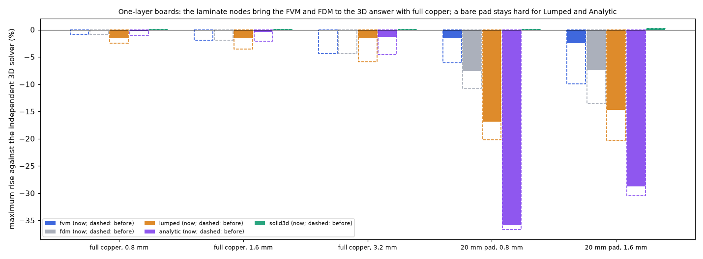

**The rings of the Lumped model** (`lumped.ring_edges`, `RING_MIN_WIDTH = 1`). Rings thinner than a cell held a count of cells that did not match their width, so their contour length was underestimated and their resistance overestimated: the result grew with the ring count and jumped with the source size. Ring edges closer than one cell are now merged; asking for more rings than the raster can show changes nothing. `research/models-comparison/scripts/study_lumped_rings.py`, the 50 mm Cu / FR-4 / Cu coupon (sources of 26 to 44 mm, against the FVM):

| rings | before: range over the sources | largest step between 1 mm sizes | now: range | largest step |
| --: | --: | --: | --: | --: |
| 10 | +0.2 to +2.3 % | 1.0 % | +0.2 to +0.4 % | 0.2 % |
| 20 | +0.4 to +4.3 % | 1.9 % | +0.2 to +0.4 % | 0.2 % |
| 40 | +0.5 to +7.0 % | 2.6 % | +0.2 to +0.4 % | 0.2 % |

The example board (rise against the FVM):

| rings | before | now |
| --: | --: | --: |
| 10 | -1.9 % | -1.9 % |
| 20 | +0.5 % | -2.6 % |
| 40 | +4.8 % | -2.5 % |

The default of 10 rings changes the 19 scenarios of section 2 besides the example board (the table has 20 rows) by at most 0.07 K.

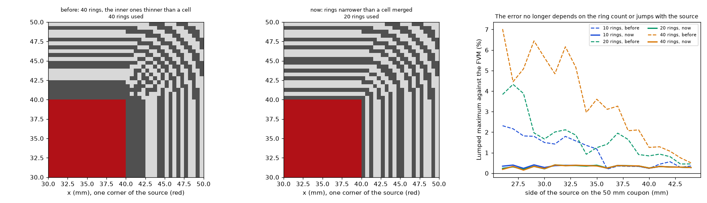

**Nine boards closer to real ones, before and after** (`research/models-comparison/scripts/study_complex_boards.py`, run on the program before these corrections and after them; the 3D solid is the reference, 1 mm cells, error of the board maximum rise):

| board | 3D solid rise (K) | fvm before → after | fdm before → after | lumped before → after | analytic before → after |
| :-- | --: | --: | --: | --: | --: |
| example board (4 layers, vias, heatsink) | 60.98 | -0.3 → -1.2 % | -2.6 → -1.4 % | -2.2 → +1.1 % | -2.2 → -1.4 % |
| example board with a metal block | 52.63 | -0.3 → -1.3 % | -3.1 → -1.5 % | -4.2 → -0.0 % | -2.5 → -1.5 % |
| 6 layers, inner planes, a part on the bottom | 46.06 | +0.9 → -0.1 % | -0.6 → +0.1 % | +0.8 → +2.5 % | +6.9 → +6.8 % |
| 2 layers, round board | 58.55 | -0.3 → -0.3 % | -0.5 → -0.5 % | +3.8 → +3.8 % | +2.0 → +2.0 % |
| 1 layer, LED strip, three pads on a trace | 55.25 | -8.1 → -2.0 % | -10.0 → -5.4 % | -8.2 → -4.6 % | +3.3 → +6.0 % |
| 1 layer, power board, vertical, computed h | 44.17 | -4.2 → -0.8 % | -5.9 → -3.2 % | -13.7 → -12.5 % | +5.4 → +6.6 % |
| 1 layer, round board, 1.0 mm | 39.10 | -1.9 → -0.2 % | -2.3 → -0.8 % | +3.8 → +5.3 % | +8.7 → +10.0 % |
| 1 layer, 20 mm pad | 56.92 | -11.8 → -3.5 % | -15.5 → -9.5 % | -16.8 → -10.7 % | -13.0 → -11.0 % |
| 1 layer, full copper, 3.2 mm | 76.89 | -6.8 → -0.3 % | -6.8 → -0.4 % | -9.0 → -2.7 % | -5.7 → -2.2 % |

The reference is the 3D solid at 1 mm. At 1 mm the 3D solid is within 1.4 % of the independent solver on three of these boards made isotropic (0.2 % at 0.5 mm), and halving its cell moves the 20 mm pad by 0.8 % (`research/models-comparison/scripts/study_complex_boards_independent.py`). Mean absolute error against the 3D solid, before → after: fvm 3.8 → 1.1 %; fdm 5.3 → 2.5 %; lumped 6.9 → 4.8 %; analytic 5.5 → 5.3 %. Mean absolute error on the one-layer boards only, before → after: fvm 6.5 → 1.4 %; fdm 8.1 → 3.9 %; lumped 10.3 → 7.2 %; analytic 7.2 → 7.2 %. The table was re-run for 2.4.5 with `study_complex_boards.py` (62 s): the "after" columns of the three boards with vias and the two one-layer cells that moved by 0.1 point are the new values; they carry two later changes, the mean-potential via of the FVM and FDM (section 2.1) and the constriction of the heat on a via in the Lumped and Analytic models (section 18.1); the "before" columns are those of the original comparison and were not repeated.

* The boards with two or more layers do not change (the corrections only act on one-layer boards and on rings thinner than a cell).
* On one-layer boards the FVM goes from 6.5 to 1.4 % mean error, the FDM from 8.1 to 3.9 % and the Lumped from 10.3 to 7.2 %.
* The Analytic model is unchanged on average: better with full copper (−5.7 → −2.2 %), a little hotter on the partial-copper boards where it was already too hot (LED strip +3.3 → +5.9 %, round board +8.7 → +10.0 %). The series film raises every one-layer result, which helps where the model was cool and hurts where it was hot; why it is hot on those boards was not isolated. The remaining error is its uniform-sheet idealisation, which the input checks already report.
* What stays: a bare pad on a one-layer board is still hard for the Lumped (−11 to −17 %) and the Analytic (−11 to −36 %); the FDM samples the pad edge on its nodes (−7 to −10 %). The FVM is within 3.5 % on every board.

**The heat balance of the Analytic model with a metal block** (found while testing a block on a one-layer board): the solution already removed the face under the block, but the reported heat out of that face (`h · W H · a_00`) still counted it, so the balance was 8.8 % off on a one-layer board with a block and 9.8 % on a two-layer one (the same on the program before these corrections: it is older). The face heat of the tiles under the block is now taken off; the balance closes to 1e-13 and no temperature changes.

### 21.1 The error of the 2-layer boards (documented here; corrected for the FVM by the laminate nodes of section 21.2)

A 2-layer board has two copper nodes with one gap between them, and the gap is one vertical resistance. Against the independent 3D solver (current program, FVM; measured with a script that was run from a scratch directory and is **not in the repository**: the numbers are in `research/ROADMAP.md`, section 1, item 9 (A1), and the script has still to be written into `research/power-calculator/scripts/` before they are quoted as reproducible): the CSD17308Q3 board with an empty bottom is −2.3 % of the rise (treated as one layer: −1.3 %), the same board with a 20 mm pad −3.8 % (one layer: −2.3 %), with a 10 mm pad −7.7 % (one layer: −4.8 %); with full copper on top there is no difference. A 2-layer board with the same pad on both faces gives −3.9 %, so the error belongs to every 2-layer board (two nodes through the gap), not to the bare bottom; the 3D solid is within 0.4 %. Treating only the bare bottom as one layer would make identical 2-layer boards inconsistent, so it is not done, and no variant for the Analytic model alone is offered (−32 % to −13 % with a 20 mm pad, still poor with smaller pads). The subdivision of the gap of every multilayer board that this paragraph left open was done in 2.4.5, only where copper is absent (section 21.2, `research/laminate-nodes`); the numbers of this paragraph are those of the program before it and were not repeated.

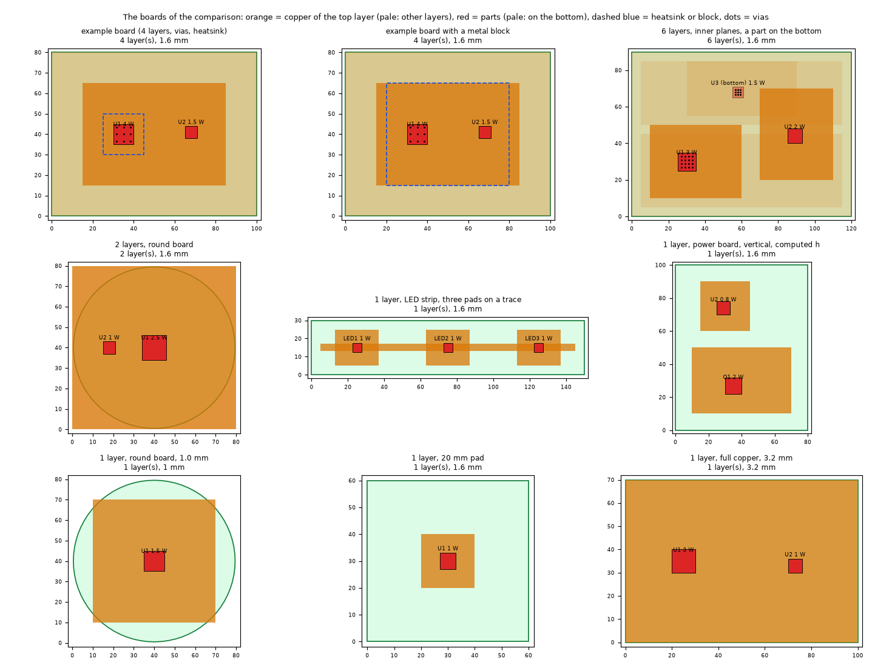

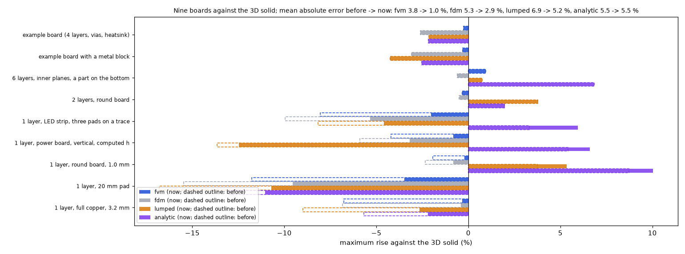

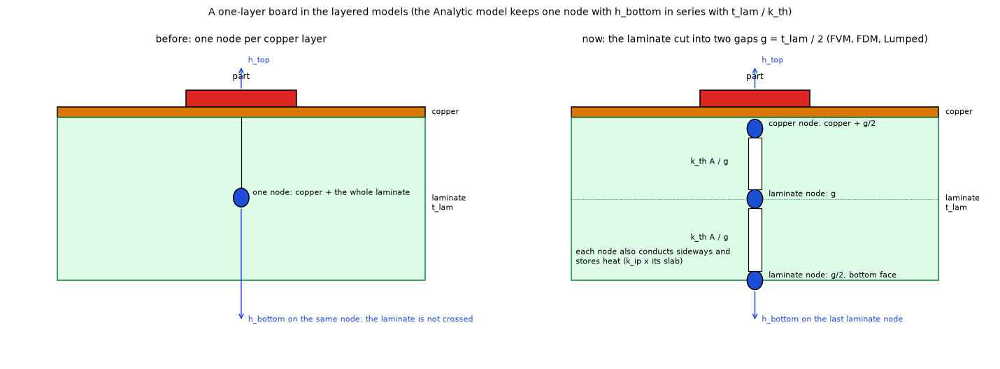

Sources: the multilayer analytical models of PCBs that keep every layer apart (Monier-Vinard, Laraqi and others, HAL archive of Paris-Nanterre, records hal-01473763 and hal-01473744; the pages were blocked by the archive's bot protection and only the titles and search abstracts were read) and the series resistance of a wall and a film (any heat transfer textbook) are the basis of the construction; no source was found that prescribes the number of nodes through a laminate, so it was chosen by the sweep above.


### 21.2 Laminate nodes for patterned copper (FVM and FDM)

The rule (`pcbthermal/laminate.py`, `docs/theory.md` 1.4): a gap of thickness `d` is cut into `n = min(4, ceil(d/0.4 mm))` equal sub-gaps in the cells where the copper fill of either adjacent layer is below 1 plus a margin of `ceil(d/dx) + 1` cells; the path through the gap is lengthened by the laminate that replaces absent copper; the face value of a part adds `Q t_cu/(2 k_z A)` over bare laminate. A board with copper in every cell is the earlier model bit for bit, except the one-layer board. Tests: `tests/test_laminate.py`, `tests/test_laminate_rule.py`, `tests/test_layered_vs_3d.py`.

**Against the resolved 3D reference of the study** (error of the FVM on the rise, one node per gap before, the rule now; the figures are those of the executor's and the reviewer's runs, 1 mm cells unless said):

| board | before | now |
| :-- | --: | --: |
| 2 layers, 1.6 mm, window of 6 mm | -18.44 % | -3.07 % |
| 2 layers, 3.2 mm, window of 6 mm | -34.19 % | -9.13 % (footnote 1) |
| 1 layer, pad of 10 mm | -4.08 % | -1.80 % |

Footnote 1 (`research/paper-case-studies` 16.5): the reference of the 3.2 mm row (0.25 mm, 8 equal sub-slabs) is 1.6 % high; 4, 8, 16 and 32 sub-slabs give 168.563, 163.706, 162.030 and 161.458 K at the face (observed order 1.55, slab limit about 161.16 K), so against a converged reference the row reads about -33 % before and -7.7 % now (derived, not re-run: `(1 - 0.0913) x 163.706 / 161.16 - 1`; the cell adds about 0.5 % more; the sentence that the error against a resolved solver falls as 1/n stays true).

**A small part over a thick laminate** (`research/paper-case-studies` 11.3 and 16.3; FVM at 0.25 mm, error of the thermal resistance against the closed form on bare laminate and the extrapolated 3D solver under a copper pad, 33 combinations of S = 2, 5, 10 mm and t = 0.8, 1.6, 3.2 mm): sources of 5 mm and above on boards up to 1.6 mm are within -0.3 to -3.7 % (bare) and -2.0 to -6.0 % (pad); a 2 mm source on 3.2 mm reads -16.6 % (bare) and -19.8 % (pad) with (0.4 mm, 4), -6.3 / -9.0 % with (0.2 mm, 8) and -1.5 / -2.5 % with (0.1 mm, 16). The error follows the sub-gap to side ratio (table in `theory.md` 1.4); the warning fires at 0.15 on bare laminate and at 0.10 over copper, with the copper around the part counted in the side (the review's checks in air are in `theory.md` 1.4). Cost of the options on the boards measured: example board at 0.5 mm 1.2 s to 1.7 s to 3.0 s for (0.4, 4), (0.2, 8), (0.1, 16); `two_layer_partial` at 0.5 mm 0.7 s / 0.43 GB, 3.2 s / 1.30 GB, 28.3 s / 5.83 GB; the 2 mm part on 3.2 mm at 0.25 mm 0.42 s / 0.18 GB, 0.84 s / 0.33 GB, 4.4 s / 1.50 GB. The 3D solid with four slabs per gap reads the same sources up to +20 % (bare) and +27 % (pad) hot on 3.2 mm (8 slabs +5.4 / +13.3 %, 16 slabs +0.4 / +7.9 %).

**A source on a vertical plate and a via array** (`research/paper-case-studies` 12 and 13): Lee and Yovanovich's glass plate with two strip sources, one computed coefficient per face, mean strip excess +10.3 % above the conjugate solution (ceramic plate -2.0 %); the unit cell of a via array of Soleymani Koohbanani within 0.4 to 2.2 % in the FVM, FDM and 3D solid (Analytic 8 to 13 % and Lumped 4 to 10 % too resistive, the resistance of a board-wide array, not the via effect of a board). These are rows of the investigation; the program was not changed by them.

**Against the independent solver `tests/helpers/layered3d.py`** (error of the rise; the FDM improves but stays 3 to 15 points below the solver; a 1 mm checker of copper reads -55 % in the FDM):

| case | FVM before | FVM now |
| :-- | --: | --: |
| part beside copper | -5.7 to -6.0 % | -0.3 to -0.6 % |
| part straddling a copper edge, 1.6 mm | -11.3 % | -0.4 to -1.2 % |
| window of 6 mm, 3.2 mm laminate | -25.9 % | -4.7 % |
| window of 6 mm, 1.6 mm laminate | -9.5 % | -1.1 % |
| checker of 1 mm | -12 to -16 % | -0.3 to -2.4 % |
| pad on a bare bottom | -6.3 to -7.7 % | +1.0 to -1.7 % |

**What it costs** (direct solver, one 16 GB machine; the unknowns grow because the cut cells get extra nodes):

| board | unknowns before to now | time before to now | memory before to now |
| :-- | --: | --: | --: |
| 2 layers, 0.5 mm | 64 000 to 160 000 | 0.1 to 1.5 s | 0.22 to 0.68 GB |
| 2 layers, 0.25 mm | 256 000 to 637 000 | 0.9 to 21.4 s | 0.69 to 4.5 GB |
| 4 layers, 0.25 mm | 512 000 to 681 000 | 6.8 to 66 s | 2.3 to 7.6 GB |

About 7 GB per million unknowns. An ordering by cell (all the nodes of a cell together) would give 12.7 s and 3.0 GB for the 2-layer board at 0.25 mm; it stays Planned (`docs/versions.md`, chapter 'Planned'); the memory guard of 2.5.0 (section 26) does not change the numbering.

**The part peak and the profile curves.** The steady peak of a part on bare laminate includes the face term; the curves of a power profile carry the same quasi-static term for the power of each step (FVM and FDM; `feature/laminate-options`), while the board Tmax and the animation maps are node values. The difference is 1.6 K for a 1 W 6 mm part and 14.6 K for a 1 W 2 x 2 mm part on bare laminate.

**Sub-gaps against the resolved reference** (`feature/laminate-options`; `research/gerber-real-boards` 10, error of the FVM on the rise): the island board with 4, 8 and 16 sub-gaps reads -3.90 / -2.25 / -1.41 %, the stripes board -1.47 / -0.93 % with 4 and 8. The sub-gaps need the longest sub-gap to follow: 8 of a 1.6 mm gap need `S_MAX` of 0.19 mm or less, 16 need 0.09 mm or less.

**Memory margins of the options** (the review of `feature/laminate-options`; the estimate of the memory guard against the peak measured):

| case | estimated | measured |
| :-- | --: | --: |
| 16 sub-gaps, 0.5 mm | 0.82 GB | 0.65 GB |
| 16 sub-gaps, 0.4 mm | 1.35 GB | 1.28 GB |
| 32 sub-gaps | 2.68 GB | 2.37 GB |

The estimate stays above the measurement (the 32 sub-gap row is outside the range of the option, 1 to 16, and only shows the margin).

**The decision with the face** (6 mm part on bare laminate, 0 to 2 W at 10 ms, threshold 1 K): the node alone oscillates 0.36 K and is averaged; with the face term the swing is 3.6 K and the run is resolved, peak 187.60 to 189.58 degC (`tests/test_profile_face.py`).

**Limits.** The Lumped and Analytic models keep one node per gap and are not helped (their partial-copper limits stay as documented: `checks.check_model_limits`); a board with a metal block keeps the earlier treatment; the 3D solid reports the centre of its top slab, 1 to 2 % below the face over bare laminate. Red-black point SOR has no valid two-colouring where cut and uncut columns meet with `n` even, so the SOR relaxes each plan column as a block.

## 22. The effective-conductivity investigation: thick-plate warning, natural convection form, independent solver in the tests

Adopted from `research/effective-conductivity/` (`INTEGRATION.md` 1, 2 and 4). The investigation compared the five models with an independent 3D conduction solver on laminate coupons (`README.md` 4.5 and 4.11); the solver is now a test helper.

**The five models against the independent solver** (`tests/test_layered_vs_3d.py`, `tests/helpers/layered3d.py`). Cu / FR-4 / Cu coupon of 50 x 50 mm (Culham and Yovanovich case 2: copper 400 W/mK, 35.6 um, a gap of 1.5789 mm of FR-4 at 0.4 W/mK, 5 W/m²K on both faces, 2.5 W), mean rise of the top copper under a 16 mm centred source, **1 mm cells** (run in seconds; the study uses 0.5 mm):

| fvm | fdm | solid3d | lumped | analytic |
| --: | --: | --: | --: | --: |
| -0.02 % | -0.59 % | +0.00 % | +0.27 % | -0.06 % |

(0.5 mm cells, all sizes of the research table: FVM, 3D solid and Analytic within 0.2 %, FDM within 1.2 %, Lumped within 0.3 %.) One-layer board (60 x 60 mm, 1 W part of 6 mm, FR-4 0.3 W/mK, 1.6 mm), hottest copper cell, **1 mm cells**:

| copper | fvm | fdm | solid3d | lumped | analytic |
| :-- | --: | --: | --: | --: | --: |
| full | -0.01 % | -0.01 % | +0.00 % | +1.20 % | -0.83 % |
| 20 mm pad | -3.0 % | -12.6 % | +0.1 % | -17.0 % | -30.2 % |

With 0.5 mm cells the pad row is -2.5, -7.4, +0.2, -14.7 and -28.8 % (section 21): the pad edge is sampled more coarsely on 1 mm cells, which the FDM feels most. The pad row is tested as ranges (the documented limits of the roadmap), the other rows as tight tolerances.

**Thick-plate warning** (`checks.check_thick_plates`). The criterion is `q'' t / (2 k)` over the rise of the heater. The first version took `q''` as the power of the part over its footprint for every plate; the review measured the flux that really enters a block in the FVM solution and found it is 8 to 22 % of the footprint flux on the 74 metal-block cases of `research/block-and-fins` and only 1 to 3 % under a 2 or 3 mm part, because a block under the board is fed through the laminate and the copper, which spread the heat. The footprint flux therefore fired on ordinary designs (a 3 x 3 mm, 2 W part over a 3 mm steel block under a 60 x 60 mm board: 9.5 % of the rise), so the check now takes, for a block, the largest flux into the block under the footprint from the FVM or FDM result, and keeps the footprint flux for the copper layer of the part; with only the Lumped, Analytic or 3D solid a quiet auxiliary FVM run (cell of at least 2 mm) supplies the flux into the block. The research's own figure (flux over the copper pad, rise 90 K) is not conservative: the peak flux into the block is 1.6 times the pad mean at the median.

| criterion over the 74 block cases (2 mm cells, actual FVM rise) | median | maximum | above 5 % |
| :-- | --: | --: | --: |
| flux into the block (the program; FVM 1 mm and FDM 2 mm give 0.07 / 0.34 % too) | 0.07 % | 0.34 % | 0 |
| power over the footprint (first version) | 0.50 % | 1.78 % | 0 |
| power over the copper pad, rise of 90 K (research `README.md` 4.8 C) | 0.04 % | 0.42 % | 0 |

The bound against the 3D solid, which cuts a block into slabs of 1 mm (up to 6): the real effect of the block thickness on the hottest point of the part is (3D solid − FVM) minus the same difference with the block's conductivity set to 1e5 W/mK, which cancels the other differences between the two models (spreading in the laminate under a small part). 60 x 60 mm two-layer board, 30 mm block on a 30 mm pad, R'' = 1 K cm²/W, 1 mm cells:

| part | block | face | rise (K) | real effect (3D) | bound, flux into the block | bound, footprint flux |
| :-- | :-- | :-- | --: | --: | --: | --: |
| 3 mm, 2 W | 3 mm, k 50 | under the board | 69.9 | −0.01 K (0.0 %) | 0.18 K (0.26 %) | 6.67 K (9.5 %) |
| 2 mm, 2 W | 3 mm, k 50 | under the board | 80.2 | −0.01 K (0.0 %) | 0.20 K (0.26 %) | 15.0 K (18.7 %) |
| 3 mm, 2 W | 3 mm, k 204 | under the board | 69.8 | 0.00 K | 0.05 K (0.07 %) | 1.63 K (2.3 %) |
| 10 mm, 5 W | 10 mm, k 10 | under the board | 109.4 | 0.53 K (0.48 %) | 4.42 K (4.0 %) | 25.0 K (22.8 %) |
| 10 mm, 5 W | 10 mm, k 2 | under the board | 110.9 | 1.64 K (1.5 %) | 15.0 K (13.6 %) | 125 K (113 %) |
| 10 mm, 5 W | 6 mm, k 10 | the part's face | 77.3 | 5.00 K (6.5 %) | 11.2 K (14.5 %) | 15.0 K (19.4 %) |
| 3 mm, 2 W | 3 mm, k 50 | the part's face | 39.4 | 1.04 K (2.6 %) | 3.09 K (7.8 %) | 6.67 K (16.9 %) |

The bound with the flux into the block is above the real effect in every case (by 2 to 10 times: it is the gap between the block's surface and its mean, and the part feels only part of it), and only the last three cases warn. The tests (`tests/test_thick_plate.py`) check the three warning cases on 2 mm cells against the 3D solid (bounds 14.7, 10.9 and 2.2 K against real effects 1.67, 4.85 and 0.90 K), that the 3 x 3 mm part over steel does not warn in the FVM and the FDM, that the Lumped and the Analytic (auxiliary FVM flux) warn exactly when the FVM does and the footprint fallback of the function says so, that a 10 mm layer of 5 W/mK typed as copper warns, and that the example boards and a sample of the block cases do not. The research measured the gradient of a plate heated from above at 0.6 to 0.8 of the bound (independent 3D solver, `README.md` 4.6).

**Natural convection form** (`Board.natural_form`). The `general` form (the class and old project files; the default of new projects is `laminar` since `fix/natural-convection-low-ra`) reproduces the earlier results bit for bit (test against the formula written out by hand). The laminar form against the research table (+6.5 % for 50 mm and 10 K, +2.6 % for 100 mm and 10 K, -0.1 % for 100 mm and 30 K, -7.5 % for 200 mm and 30 K, -9.5 % for 200 mm and 60 K) agrees to 0.4 points; on the example board turned vertical (computed h, FVM, 1 mm cells) the maximum is 86.14 C with the general form and 85.92 C with the laminar one (-0.22 K, -0.36 % of the rise; the same difference in every model; the earlier absolute values 86.72 / 86.50 C were of an older tree), inside the -0.7 to +0.2 % of the research (`README.md` 4.8 B; the option reproduces every row of that table to 0.01 K on 1 and 2 mm cells). Independent checks of the review: the general form equals `ht.conv_free_immersed.Nu_vertical_plate_Churchill` (ht 1.2.0, installed outside the project) to machine precision over heights of 30 to 400 mm and rises of 1 to 80 K; ht 1.2.0 has no laminar form, so the laminar one was checked against the laminar boundary-layer solution of an isothermal vertical plate, `Nu = 4/3 (Gr/4)^{1/4} g(Pr)` with LeFevre's fit `g = 0.75 Pr^{1/2}/(0.609 + 1.221 Pr^{1/2} + 1.238 Pr)^{1/4}` (as given in heat transfer textbooks, quoted from memory): its `Ra^{1/4}` term equals that solution within 0.21 % at every size and rise, and the constant 0.68 is the leading-edge correction (+5 to +7 % of Nu on a 50 mm board, about +1 % on 400 mm). Above Ra 1e9 (a board of about 0.5 m or more) the laminar form warns. **Which form is closer, against the 2D numerical plate of `research/plate-h-level` (review of `fix/natural-convection-low-ra`; ratio of the form to the plate).** Ra 1e3: laminar 0.984, general 1.026; Ra 1e4: laminar 0.979, general 1.049. Low plates of 40 mm: laminar +2 %, general -5 %. Tall plates of 150 to 200 mm: laminar +0.6 to +1 %, general +6 to +11 %. The laminar form is worse than the general one only at Ra 1e4 to 1e5 (about 2 % of h, on the non-conservative side) and above Ra 1e9 (the existing warning). This is why the laminar form is the default of new projects. Below Ra 1e3 the face warns after the run (`checks.check_low_rayleigh`); between 1e3 and 1e4 and for a 3D convection reference there is no study. **Not verified**: Churchill and Chu (1975) itself has not been opened.

### 22.1 Published cases reproduced with an independent 3D solver

From `research/effective-conductivity/` (README and seventeen figures counting the diagrams; the studies of the folder reproduce these numbers; the solver is `tests/helpers/layered3d.py` here). An independent finite-volume solver of a laminated block (`lib/layered3d.py` of that folder) reproduces: the centre, edge-midpoint and corner constriction resistance of Seri Lee's plate (0.668, 1.284 and 2.275 K/W against the article's 0.66, 1.29 and 2.38); the cross of five sources of Muzychka, Culham and Yovanovich (maximum 80.62 °C against 80.61, area-weighted mean source temperature 78.90 against 78.87) and their first case within 1 % of the rise (the centroid temperatures lie between the paper's two solutions); and the effective conductivity of the five layer orders of Culham and Yovanovich within 2 to 6 %. The five models of the program agree with it on the Cu / FR4 / Cu version of that coupon for source areas of 1 % to 100 % of the board (FVM, 3D solid and Analytic within 0.2 %, FDM within 1.2 % for a 5 mm source on 50 mm, Lumped within 0.3 %).

One temperature node through the thickness is the mean of the layer: the surface under a source is hotter by at most `q'' t / (2 k)`, less when the heat spreads sideways (measured 1.6 % of the rise for a 10 mm plate of `k` 50 and 8 to 9 % for `k` 10, against bounds of 2.25 % and 14 to 16 %), negligible for copper layers. The Biot plateau of 4.8 W/mK in Figure 5 of Culham and Yovanovich cannot be reached by the stated stack: its top FR4 layer alone has 2.1 K/W under the source, the plateau needs 0.62 K/W. Culham and Yovanovich (1998) was re-opened and page 462 (equations 7 to 10) read; Culham, Yovanovich and Lemczyk (2000) print 10 to 30 terms for that series, and 8.28 W/mK lies between the truncations of 7 and 5 modes (8.14 and 8.50 against 7.82 converged); with the 1.62 mm of the text 10 and 11 modes bracket it: consistent, not proved (`research/theory-sources` 3.6, 8.2). Not verified: the definition of the mean wall temperature of the paper as a cause of the 2 to 6 %.

## 23. A part across the board outline

Since 2.4.5 (and, with the board cover sampled 8 x 8, `fix/board-cover-8x8`) a part that crosses the board outline heats only the part of each cell that is on the board (`geometry.part_weights`, `docs/theory.md` 1.3, `tests/test_part_across_outline.py`). Before, the FVM, the FDM and the 3D solid gave a cut cell the power density of the whole cell, on a board area smaller than the cell. The numbers below come from the program as it is now and, for the "before" columns, from the same program with the old rule put back by hand (the weight `coverage_fraction` of the part alone); the figures are 34 to 37 of `docs/theory.md` 1.3 (`python research/theory/scripts/make_fig_part_outline.py`).

**The example board cut to a T** (100 × 80 mm, `h_side` 10 W/m²K, outline of `research/outline/scripts/outline_rectangle_study.py`), hottest point in degC at cells 1 / 2/3 / 0.5 / 1/3 mm. At 2/3 and 1/3 mm the edges of the T lie on grid lines and no cell is cut:

| Model | before the fix | after the fix | now (2.4.5: also the vias with no board under them ignored) |
| :-- | --: | --: | --: |
| FVM | 109.06 / 106.86 / 110.80 / 106.96 | 107.56 / 106.86 / 107.37 / 106.96 | 106.81 / 106.56 / 106.50 / 106.53 |
| FDM | not repeated | 105.25 / 105.61 / 106.51 / 106.71 | 105.94 / 106.26 / 106.37 / 106.47 |
| 3D solid (1, 2/3, 0.5 mm) | not repeated | 107.79 / 107.08 / 107.18 | 107.79 / 107.08 / not repeated |

The column *now* was re-run for the final review of 2.4.5 (`fvm.solve_steady`, `fdm.solve_steady`, `solid3d.solve_steady` on the outline of `outline_rectangle_study.py`, `h_side` 10 W/m²K); it differs from the column *after the fix* because two of the nine vias of the example lie at the outline of the T and are now ignored instead of being moved to the nearest board cell (paragraph *Vias at the outline* below), which moves the FVM and the FDM also where no cell is cut (2/3 and 1/3 mm); the 3D solid keeps the part of the disc on the board and does not move. Figure 36 draws the column *after the fix*.

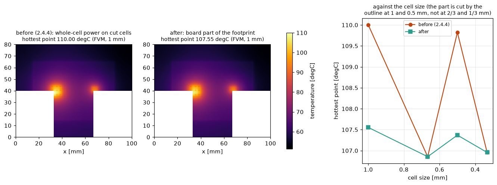

*Figure 36 (`images/fig_36_part_example_t.png`): the example board (100 × 80 mm) cut to a T, FVM at 1 mm, before and after the fix, and the hottest point against the cell size (at 2/3 and 1/3 mm the edge lies on grid lines and no cell is cut, so the two rules agree).*

**Edge-shift sweep.** A small T (30 × 24 mm, 2 W part across the re-entrant corner, `h_side` 10 W/m²K) with the neck edge moved over one cell in 8 to 12 steps; the error of the hottest point against the same model with 1/24 mm cells (FVM, FDM) or 1/8 mm (3D solid), and the scatter (max minus min of the error, K):

| Model, cell | before | intersection only | fix, cover 4 x 4 | fix/board-cover-8x8 |
| :-- | --: | --: | --: | --: |
| FVM, 1 mm | 15.72 | 4.77 | 2.95 | 1.47 |
| FVM, 0.5 mm | 7.79 | 2.36 | 0.78 | 0.62 |
| 3D solid, 1 mm | not reproduced | not reproduced | 3.23 | 1.56 |
| FDM, 1 mm | not reproduced | not reproduced | 2.02 | 2.02 (unchanged) |

The FVM rows are printed by `python research/theory/scripts/make_fig_part_outline.py` (reference: the same model with 1/24 mm cells). The 3D solid value is against 1/8 mm cells and was reproduced by the review of the branch. Earlier versions of this table gave other 3D solid and FDM scatters (1.69 and 0.60 for the 3D solid, 1.39 and 0.47 for the FDM) and "before" values for them; no script reproduces those, so they are withdrawn, and so are the 0.5 mm rows of the 3D solid and the FDM and the maxima of the error that were derived from them. The FVM error before the fix reached about 16.5 K at 1 mm. Against the 1/3 mm references the small T at 1 mm reads, with the 8 x 8 cover, FVM 231.87 (230.84 with the 4 x 4 cover) and 3D solid 233.02 (231.96); the aligned references were not repeated after the change.

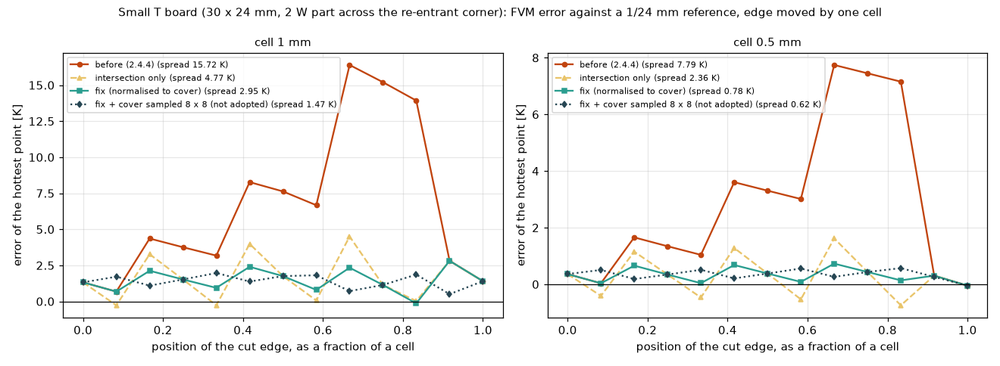

*Figure 37 (`images/fig_37_part_edge_shift.png`): error of the hottest point of the small T board (30 × 24 mm, 2 W part across the re-entrant corner) against the position of the cut edge within one cell, for four rules, FVM at 1 and 0.5 mm against a 1/24 mm reference (the numbers are in the table above).*

**The 8 x 8 cover is smoother, not more accurate.** The scatter halves only for the FVM and the 3D solid at 1 mm; the mean bias of +1.4 K at 1 mm remains, and at some edge positions the error is up to 1 K worse than with the 4 x 4 cover. The gain is that the answer varies less when an edge moves across the grid.

**What the rule is for the FVM and the 3D solid.** The share of the board samples that lie in the part times the cover of the model equals the plain intersection `n_pb / 64` exactly, because the cover is sampled on the same 8 x 8 lattice (`geometry.BOARD_SAMPLES`). With the earlier 4 x 4 cover the two disagreed in a cut cell (1.5 K at 0.5 mm on the small T) and the weight was normalised to the cover. The FDM always sampled both 8 x 8.

**Vias at the outline.** A via with no board under its drill disc is ignored by every model (`geometry.discs_board_share`), where it used to be moved to the nearest board cell. On the T preset at 1 mm (nine vias, two of them at the outline) the hottest point is 106.809 / 105.938 / 107.788 degC in the FVM / FDM / 3D solid (it was 104.884 / 104.908 / 107.788); one via with its centre on the re-entrant edge and half its disc on the board moves the result by 0.75 K in the FVM and 0.85 K in the 3D solid. On the T preset at 1 mm the FVM is 0.98 K below the 3D solid with the nine vias and 1.07 K without the two vias at the outline: the gap does not come from the vias but from the treatment of a cut cell by its cover (option P1 in Planned, the residual of fix/part-across-outline). The example board does not change (85.2335 / 85.1260 / 86.6277 / 85.1021 / 85.9751 degC in FVM / FDM / Lumped / Analytic / 3D solid).

**Read-outs.** The mean, minimum and ring temperatures under a part or a zone no longer include the cells or nodes off the board, which read the ambient: on the T board a zone showed a minimum of 25 degC; the mean under a small T part at 0.5 mm, FVM, went from 191.3 to 222.8 degC (223.4 with the 4 x 4 cover), the ring of `psi_jb` from 163.1 to 203.2 degC (203.7); the zone mean (128.8 before the fix) was not repeated with the 8 x 8 cover (the maximum and the junction temperature do not move; `tests/test_part_across_outline.py::test_statistics_leave_out_the_cells_off_the_board`). The Power Calculator uses the same read-outs for its mean and ring points.

**Unchanged.** `python research/models-comparison/scripts/validation_study.py` prints the same table as before the fix (identical text), `research/gap-subdivision/scripts/rerun_baseline.py` moves no peak by more than 0.0001 % of the rise. In the Lumped and Analytic models the temperature field, the hottest point and the junction temperatures are unchanged (bit-identical); on a board with an outline the mean under a part is now read on the board only (8 x 8 cover) and moves by up to 2 K in the Analytic (1 % of the rise; -1.9 K for a part across the edge at 0.5 mm). Boards without an outline are unchanged in every model.

**The FDM hot spot of the part-across-outline board.** In the FDM the part of a footprint that was off the board used to be spread over the edge nodes; it is now weighted by the part on the board. On the part-across-outline board the FDM hot spot moves -16.2 / -21.8 / -5.7 K at 2 / 1 / 0.5 mm (252.03 -> 230.23 degC at 1 mm), the FVM -1.7 / -13.7 / -3.7 K and the 3D solid -1.7 / -14.1 / -3.8 K; before the three models spread 231.7 to 252.0 degC, now they agree within 1.4 K, and against the independent layered reference (0.2 mm cells, isotropic) all are within 0.6 % of the 214.64 K rise (before: FDM +8.5 / +10.9 / +2.6 %, FVM up to +7 %).

**Limit.** A cut cell still conducts with its cover, so a part over a cut edge reads 0.5 to 0.7 K (about 1 % of the rise) hotter at 1 to 0.5 mm than with the edge on the grid lines (the scatter of the "now" rows is this residual). Treating the cut cell by its real shape (option P1 of `research/rotated-square-3d`) is in the chapter "Planned" of `versions.md`. Board of 40 mm turned 20 degrees (board and part) at 1 mm: +1.25 K with h = 100 and +3.52 K with h = 1000 above the continuum of the independent solver (it was +1.09 and +3.41 K before the 8 x 8 cover; the other turns, 45 degrees included, were not rerun: before the cover they read +1.1 to +1.8 and +3.4 to +3.6 K); the 8 x 8 cover moved it by +0.1 to +0.3 K in the FVM and, at h = 2000 on a 20 mm board, by +1.5 K in the 3D solid.

## 24. Warnings of the limits of the models

`checks.check_model_limits` and the Analytic spread test (`tests/test_model_limit_warnings.py`) warn; no temperature is changed. The numbers are those printed by the studies that proposed them, not re-measured here.

| Warning | Trigger | Evidence |
| :-- | :-- | :-- |
| Analytic copper spread | the larger of the spread at `lambda_l` and the spread with the full-copper fin length above 0.25 | 119 boards: warned 70, silent 49, silent beyond 5 % error 0 (the program's earlier flag alone: 60 / 59 / 5; `gap0.1-empty` -66.7 % and `gap0.2-empty` -62.0 % were silent). `research/analytic-partial-copper` 9.4 |
| Part on bare laminate | smallest copper fill in the central half of the footprint below 0.5 (layered models) | fires in 26 of 26 study cases at 0.5 / 1 / 2 mm, silent on full copper; the FVM reads 3 to 11 % low (4 and 6 layers), 4 to 23 % (two layers of 0.8 and 1.6 mm). `research/bare-spot-under-source` P3 |
| Lumped, vias under a part | one or more vias in the footprint | via effect from 21 % too small (the part too hot) to 33 % too large (the part too cool: dense arrays that cover a quarter or less of a large footprint, sparse arrays and rows), up to 14 % of the rise too cool, 8 to 20 % on average over 46 boards, 11 % over 36 more (section 18.1) |
| Lumped, via array across the edge, off the centre or under an elongated footprint | a group with vias in the footprint that continues past its edge (within twice the array pitch), centroid offset above 0.1 of the smaller side, or side ratio above 1.5 | part up to about 11 K, a quarter of its rise, too cool for a footprint kept as one node (up to 16 % of the rise with the zones of 18.2); fires on 21 of 28 boards that are more than 10 % of the rise too cool among 93 (the 7 silent ones are centred squares, at most 14 % of the rise in the hottest temperature), 4 false alarms (1.4 to 8.5 %) (section 18.1) |
| Lumped, vias outside every part | one aggregated message | a lone via 22 % too small to 65 % too large, a row 6 to 21 % too large, scattered vias 19 to 56 % too large, an array just outside the edge up to 2.3 times (4 K, 9 % of the rise) (section 18.1) |
| Analytic, via correction | the tile was coarsened; a median pitch under 0.45 mm; more than 2400 unknowns; one or two vias | coarsened tile 14 % too small to 3 % too large; one or two vias up to 16 % too small; 0.9 GB and 3 s at 4800 unknowns (section 18.1) |

The via warnings of the FVM and FDM came with `fix/point-via` (`checks.check_via_limits`, text only): a via within one cell of the board edge (its effect 12 to 15 % too large at a 1 mm cell, section 25 'Via on the grid') and a cell of 2 mm or more next to vias (the drop they cause uncertain by 3 to 4 % at 2 mm and 5 to 50 % at 3 to 4 mm). The input check (`checks.check_problem`) also says when a via has no board under its drill disc (ignored by every model) and when more than half of it is off the board (section 23). An earlier text here said that the coarse-cell warning was left out; it was added with the mean-potential via.

## 25. Numbers that `theory.md` used to quote

When `docs/theory.md` was rewritten to describe the models as implemented (statements, equations and pictures only), the numbers and the history that it carried were moved here, so that nothing is lost. They were **carried over from the earlier text of `theory.md`; they were not re-run in the commit that moved them**, and each names the investigation or section that produced it. A number that a script prints today is in the section named; one that is only here is marked "carried over".

| Topic (theory section) | Statement | Source |
| :-- | :-- | :-- |
| Layered idealisation (1.2) | the layered models are within 0.4 to 2 % of the 3D solid (the FVM 0.1 to 0.7 % since the laminate nodes of 2.4.5, section 3); the attribution of that difference to the idealisation and to one node per copper layer was **not measured separately** | section 3; carried over |
| Culham and Yovanovich (1.2) | any homogenised conductivity of a laminate can be 70 % to 300 % off; the geometric mean of their five-layer coupon, 2.7 W/mK, is 70 % off | [CulhamYovanovich1998], read; reproduction in 22.1 |
| Advanced stack-up (1.2.1) | agrees within 0.1 K with the simple one when the gaps are equal; 1 oz inner copper lowers the maximum by 6.9 to 7.5 K with a plane on each inner layer | sections 12 and 14.1 |
| Weight of a part across the outline (1.3.2) | before 2.4.5 the weight was the coverage of the part alone (a cut cell received the density of the whole cell on a smaller board area: 2.2 K too hot at 1 mm and 3.8 K at 0.5 mm on the example board cut to a T); with the cover sampled 4 x 4 a cover of 1/4 against an intersection of 3/8 gave 1.5 times the density (+1.3 K on a small T at 0.5 mm); with the 8 x 8 cover the weight equals the plain intersection; the mean bias of +1.4 K at 1 mm remains; the cut cell conducts with its cover, 0.5 to 0.7 K (about 1 % of the rise) at 1 to 0.5 mm | section 23 |
| One-layer board (1.4) | with one node the FVM was 0.9 to 4.4 % low with full copper and 10 % low with a 20 mm pad; one, two, three and four laminate nodes under the copper gave -4.1, -2.5, -1.8 and -1.5 % on a bare 20 mm pad, under 0.3 % with full copper from two on | sections 21 and 21.2 |
| Solvers (2.3) | the symmetric minimum-degree ordering halves the fill and cuts about 40 % of the time against the default ordering; the residual of the direct solver is about 1e-13 | section 5; carried over |
| SOR with vias (2.3) | the block SOR needs 0.79 to 1.00 times the sweeps of the board without vias and agrees with the direct solver within 1e-8 K | section 5; `research/sor-with-via-couplings` |
| Relaxation factor (2.3) | the factor of a plate with fixed edges, `2/(1 + sin(pi/n_max))`, needed 2.8 to 19 times more sweeps than the estimate of Young's optimum; the example board needs 676 sweeps at 1 mm (2197 with the old factor) and 364 at 2 mm (1054); a board of 1 x 1 cell, where the old factor diverged, converges; without the mask of the linked nodes the quotient collapsed to `ω` 1.009 on a round board; the estimate is 1.1 to 2 times the sweeps of the true optimum on boards with uneven losses or partial copper; the step criterion of the removed program can stop 3 to 16 K from the solution | section 5; `research/young-omega-tiles`; carried over |
| Via on the grid (2.6) | the worst error of the via effect against a fine-grid layered reference is 0.7 % at 1 mm, 0.5 % at 0.5 mm and 0.4 % from 0.25 mm (12 unit-cell cases), where the point via was 7, 10 and 20 % off; the copper-fill gain of the 3 x 3 via board is -4.50, -4.47 and -4.49 K (FVM) and -4.42, -4.51 and -4.49 K (FDM) at 1, 0.5 and 0.25 mm against -4.51 K resolved (-4.78 to -3.34 K from 1 to 0.0625 mm with the point via); a via within one cell of the edge is 12 to 15 % too large at a 1 mm cell without the edge image and within 1 to 2 % with it (section 28); the target radius 0.78 r_v gives the via effect within 1 % on a four-plane 1.6 mm board and -2.1 to +3.9 % over 2 to 6 planes and drills of 0.2 to 1 mm | 2.1 and 18; `research/point-via-convergence` 3.2 and 3.3 |
| FDM (3) | the FDM and the FVM agree to about 0.1 % without vias; with the via array they differ by less than 1 % from 1 mm down | sections 2 and 2.1 |
| 3D solid (4) | the limit was 2e6 unknowns (a run could go on for hours), then 250 000, and is now the memory guard of section 26 (an estimated-memory limit with an absolute ceiling of 2 million unknowns); 158 000 unknowns take 2.0 s and 0.75 GB on a plain two-layer board and 7.2 s and 2.15 GB on the example board of 16 slabs, 247 000 take 15.3 s and 3.5 GB and 512 000 take 57.7 s and 9.9 GB resident (a quiet 16 GB machine, they depend on the machine, the board and the computed-h loop); 4 slabs per gap are NOT within 1 % of 8 for a small part on a thick laminate (corrected: a 2 mm source differs 5 % at 1.6 mm and 14 % at 3.2 mm, section 21.2); on the heater-sized pad of section 16 (a large heater) the finite-volume and finite-element solids bracket the limit about +-4 %; a 0.3 mm copper fill below 0.27 mm cells loses copper by the clip of `a_via` at 1 (an item of "Planned" in `versions.md`) | section 16; `research/solid3d-verification` |
| Lumped rings (5) | before rings narrower than a cell were merged the result grew with the ring count, +3 to +13 % with 40 rings; the Lumped model is 27 % low when a copper edge crosses the footprint, -8.7 % at board corners and +9.5 % for thin heaters | sections 21 and 3 |
| Outline (6) | the bounding box of the outline (`s = 1`) is 6 to 10 % cool on a circle and a box larger than it is 10 to 20 % cool; the box of the same area is within 0.2 to 3 % away from the edge and 10 to 18 % cool near the edge or in a T arm | section 13 |
| Analytic (6) | 24 % low with a 20 mm pad and 25 % when an edge crosses the footprint; 0.3 to 1 % warm on a uniform board from the default edge coefficient; a single global factor for the vias in the transient cooled the distant heater by 18 % (design history, `versions.md` 2.1.0) | sections 3, 4 and 7; carried over |
| Via constriction (1.5, 5.1, 6.1) | before it, the copper-fill gain of the example board was 6.3 to 6.8 K against 4.2 K of the FVM; the effect of a lone via is from 22 % too small to 65 % too large in the Lumped model and 16 % too small in the Analytic; an array across the footprint edge, off the centre or under an elongated footprint is up to 3.2 times the effect in the Lumped model (the part about 11 K, a quarter of its rise, too cool; its own warning); round boards and a two-layer 80 x 60 mm board have the via effect 16 to 21 % too small in the Lumped model (the part reads hotter: the safe side), dense arrays under a large footprint up to 33 % too large (the part reads cooler: unsafe); the Analytic with vias plus a large heatsink or block takes 2 to 3 s and about 0.9 GB | 18 and 18.1 |
| Fins of a block (7.2) | with the fin ratio on the side walls too the rise of a finned block was 5.5 to 6.4 % too low; the end faces of the fins would add 40 to 55 % to the side-wall area and lower the rise by about 0.7 to 0.9 % (estimated by scaling the side-wall conductance of the FVM) | section 12 D |
| Plate (7.1, 7.5) | aluminium or copper from 1 to 10 mm are within 0.6 % of the 3D solid; Seri Lee's plate +0.6, -0.8 and -4.6 % at the centre, edge midpoint and corner (0.66, 1.29 and 2.38 K/W in the article), the +4.5 % quoted earlier was a 24 mm source made by `round()`; the equivalent coefficient of a block was 8 to 31 % off | sections 15 to 17 and 22.1 |
| Close fins (7.4) | of the 667 cases of the 1080-case grid that lose 10 % or more of the finned-face conductance `Ra_b < 90` misses 1 and the old rule of a gap under 4 mm misses 367; below `Ra_b` 14 the loss is an upper bound | `research/fin-channel` (no section of this document; section 24 is about other warnings) |
| Natural convection (8) | the laminar form differs from the general form by +7 % to -25 % between `Ra` 1e4 and 1e9 and moves the maximum of a vertical board by -0.7 to +0.2 % of the rise; it matches the laminar boundary-layer solution within 0.21 % | section 22 |
| Parts (9) | a junction node joined by a uniform conductance would be 1.3 to 3.4 K lower on the chips of the component study and 0.2 K on a 0603 resistor; a fixed-point loop for the top path stopped at 33 degC on an 8 mm pad under a 3.3 mm MOSFET where the operating point is 90.9 degC; the split takes 3 board solves (6 on a clipped small pad, 6 to 7 with computed coefficients, up to about 20 near the clip), and for random boards of 2 to 4 parts a median of 8 to 9 solves, 90 % within 25, at most 57; with the power coefficient the 8 mm MOSFET with 0.5 %/K takes 10 passes and 70 solves | sections 9 and 19 |

## 26. The memory guard: the law and how well it predicts

`pcbthermal/memory.py` (theory 2.7). Every number of this section is quoted from `research/memory-guard/README.md` (the ladder, run with the program 2.4.5 on one 16 GB Mac, 17.2 GB of 10^9 bytes; each point in its own subprocess, peak resident size from the kernel) and its review (14); they were not re-run for this document. The folder's scripts (`scripts/study_memory_ladder.py`, `study_class_fit.py`, `study_review.py`, `study_sor_block.py`) repeat them.

**The law** (theory (2.8)), fitted on the layer-major points of the ladder with N of at least 50 000 (README 14.2):

| Model | Points | `k1` (bytes at N = 500 000, `t_eff` = 1) | `p` | `a` | Measured / law on the ladder | Safety factor |
| :-- | --: | --: | --: | --: | --: | --: |
| FVM | 45 | 1469 | 1.24 | 0.79 | 0.73 to 1.27 | 1.40 |
| FDM | 7 | 1228 | 1.34 | 1.03 | 0.87 to 1.12 | 1.24 |
| 3D solid | 15 | 1063 | 1.30 | 0.98 | 0.84 to 1.18 | 1.30 |

The first proposal of the study, eight classes by `t` with their own law, was replaced after the review found it flat in `t` beyond its last edge: against six points measured at 8 and 12 copper layers (outside both fits) it was below the measurement with its safety factor in four of six (measured / estimate up to 1.41), where the continuous law predicts the six within 0.91 to 1.15 (README 14.2):

| Board | Unknowns | Measured | Class table x safety | Measured / estimate | Continuous law | Measured / law |
| :-- | --: | --: | --: | --: | --: | --: |
| FVM, 12 layers, 1.0 mm | 120 000 | 1.12 GB | 0.79 GB | 1.41 | 0.97 GB | 1.15 |
| FVM, 8 layers, 0.7 mm | 163 592 | 1.17 GB | 1.15 GB | 1.02 | 1.03 GB | 1.14 |
| FVM, 12 layers, 0.7 mm | 245 388 | 2.28 GB | 1.90 GB | 1.20 | 2.25 GB | 1.01 |
| 3D solid, 12 layers, 3.0 mm | 60 984 | 0.70 GB | 1.09 GB | 0.64 | 0.71 GB | 0.99 |
| 3D solid, 8 layers, 2.0 mm | 90 000 | 1.92 GB | 1.70 GB | 1.14 | 1.98 GB | 0.97 |
| 3D solid, 12 layers, 2.5 mm | 89 600 | 1.45 GB | 1.69 GB | 0.86 | 1.59 GB | 0.91 |

(The "law" columns are without the safety factor.) The ladder's peak per unknown grows with the thickness of the graph: a plain 2-layer board takes 2.9 KB per unknown at 320 000 unknowns, a 4-layer board 4.1 KB, a 6-layer board 7.0 KB at 490 000 and 8.8 KB at 960 000 (README 5.1).

**The memory ladder: what fits** (README 14.3, 14.4; largest unknown count whose estimate with the safety factor stays within the limit, continuous law):

| Board | 11.2 GB (0.7 x 16e9) | 12.0 GB (0.7 x 17.2e9) | Largest point measured |
| :-- | --: | --: | --: |
| 3D solid, 6 slabs | 1 105 000 | 1 167 000 | 240 000 (ladder), 500 000 (documents) |
| 3D solid, 10 slabs | 752 000 | 795 000 | 400 000 |
| 3D solid, 16 slabs | 528 000 | 558 000 | 327 184 |
| 3D solid, 26 slabs | 366 000 | 387 000 | 260 000 |
| FVM, t = 2 | 2 178 000 | 2 308 000 | 1 975 000 (documents) |
| FVM, t = 6 | 1 082 000 | 1 147 000 | 960 000 |
| FVM, t = 12 | 696 000 | 738 000 | 245 388 (review) |

The program's default limit is 60 % (10.3 GB of the 17.2 GB), lower than the 12.0 GB of this table. The 3D ceilings are extrapolations of 1.5 to 2.3 times the largest measured points, trusted to about 20 % (README 14.4).

**Time** (README 5.4; laws `t = a N^q` on points with N of at least 100 000, on a machine shared with other work, so lower bounds): FVM 1.5 s at 500 000 unknowns, `q` 1.32 (t up to 3.5), 5.4 s and 1.31 (3.5 to 4.5), 9.2 s and 1.50 (above 4.5); FDM 11.5 s and 1.47; 3D solid 11.2 s and 1.70 (t up to 6.5 in the program, 6 in the study), 14.8 s and 1.52, 44.1 s and 1.50. Only the "slow" mark (above 30 s) uses them.

**The block SOR** (README 9, 14.1, 14.6): the dense inverse of one block costs 66 to 75 n^2 bytes (two points re-run by the review: 74.1 and 74.7 n^2); 5 000 unknowns take about 1.9 GB, not the 200 MB (8 n^2) of the old comment. The guard uses 75 n^2 summed over all the blocks, at most 25 % of the limit.

**Transient and animation** (README 14.5): on the 4-layer plain board at 0.5 mm the steady solve peaked at 0.643 GB and the transient at 2.245 GB (3.5 times) while ten LU factors were kept; with one factor it is 1.230 GB (1.9 times, the same 11 frames bit for bit). The program now keeps one factor and the transient factor is 2.0. The case quoted in the changelog for the shipped change (a 111 556-unknown board, 2.60 to 0.65 GB) was reported by the review of the integration and is not in a printed output of the research folder.

**What was not verified.** The reviewer's table of ten cases of the corrected law in the program (the ratio peak / estimate of 0.28 to 0.94) is not recorded in a file that this document could be checked against, so no number of it is quoted; the first runs of the program log the estimate and the measured peak for the check. Also not measured: other machines (Windows, containers), the Analytic's tile memory, the power-profile and FDM transients, and the Gerber importer's memory. A resident peak read on a loaded Mac can be low by 20 % or more with no swap (the memory compressor, a hypothesis).

## 27. Imported copper: the mappings as implemented, against the program's pixel network and an independent 3D solver

Produced by `research/gerber-real-boards/scripts/study_program_cells.py` (`--part mapping --side 12`, `--part mapping --side 24 --boards rp2040,co60,vstcm`, `--part ref3d`), run on the tree of `feature/imported-copper` for this document; the printed tables are copied below. All errors are in **percent of the heater mean rise** (sign: the model minus the reference; a negative number is too cool). Method: for each board the top copper is drawn at 0.4 mm and the window whose central block is nearest to 55 % copper is taken; a 4 mm heater (4.8 mm for the 3D part) at the centre of the top layer (its edges on the grid lines of the 0.5, 1 and 2 mm cells); h = 10 W/m2K on both faces, adiabatic sides, simple stack-up 1.6 mm, copper 35 micrometres, binary pixel-centre masks (pixel 0.1 mm for 12 mm windows, 0.125 mm for 24 mm); plated holes left out of both sides. Variants: `faces` (the default, on the reduced sheet), `lambda` (0.5), `fill` (the arithmetic fill, the old path) and `naive` (faces from the unreduced sheet, `CopperSource.reduce_sheet = False`, the order of construction that the design forbids). Four-layer boards: isastm, cmm2, oswlight; two-layer boards: rp2040, co60, vstcm (stickhub has no 24 mm window of this kind). The boards are the downloaded open boards of `research/gerber-real-boards` 3 (licences there, nothing of them is in this repository).

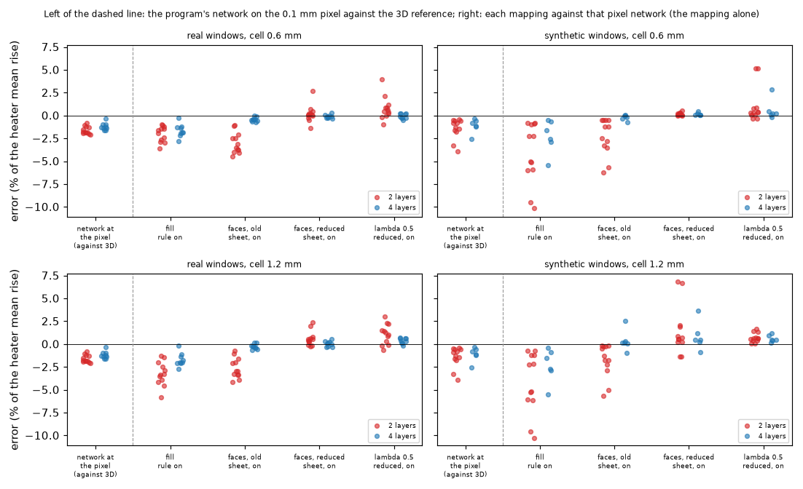

*Figure (`images/imported_copper_mapping.png`, the study of `research/gerber-real-boards` 10 at the cells 0.6 and 1.2 mm, 12 mm windows): the error of each variant on the real and synthetic windows against the 3D reference; to the left of the dashed line the program's network at the pixel against the 3D reference. It is the earlier study's picture, made with its own prototype of the faces; the tables below are the program's own.*

### 27.1 The mapping alone: against the program's own network on the pixels (12 mm windows)

Mean absolute / largest absolute error, per layer count and cell:

| layers, cell | n | faces | lambda | fill | naive |
| :-- | --: | --: | --: | --: | --: |
| 2, 0.5 mm | 4 | 0.15 / 0.27 | 0.58 / 1.73 | 4.77 / 7.83 | 4.72 / 6.01 |
| 2, 1.0 mm | 4 | 0.85 / 1.56 | 0.97 / 1.57 | 5.64 / 8.41 | 4.55 / 5.91 |
| 2, 2.0 mm | 4 | 2.54 / 3.86 | 1.97 / 3.83 | 6.70 / 9.38 | 3.09 / 4.05 |
| 4, 0.5 mm | 3 | 0.38 / 0.51 | 0.23 / 0.26 | 4.19 / 5.16 | 0.52 / 0.95 |
| 4, 1.0 mm | 3 | 0.50 / 0.78 | 0.36 / 0.59 | 4.26 / 5.43 | 0.37 / 0.48 |
| 4, 2.0 mm | 3 | 1.59 / 2.06 | 1.59 / 1.76 | 3.75 / 4.94 | 0.69 / 1.13 |

The faces are closer than the fill in every window (4 of 4 and 3 of 3 at every cell). The fill reads 4 to 9 % too cool. **The naive order is not the worst on four layers**: there the laminate rule moves little (the copper is nearly everywhere), so counting the laminate twice costs 0.4 to 1.1 points; **on two layers it is as bad as the fill (4.5 to 4.7 % at the cells of 0.5 and 1 mm)**, which is why the order of construction is held by a test (`tests/test_imported_copper.py`, `reduce_sheet = False`). At the 2 mm cell the order matters less on this metric (naive 3.09 / 0.69 against faces 2.54 / 1.59 on two / four layers); see 27.3 for the 2 mm cell.

### 27.2 Against the independent 3D solver (12 mm windows, heater 4.8 mm, cells 0.6 and 1.2 mm)

`lib/ref3d.py` imports nothing of `pcbthermal`. Mean absolute / largest absolute error:

| layers, cell | n | faces | lambda | fill | naive |
| :-- | --: | --: | --: | --: | --: |
| 2, 0.6 mm | 4 | 1.36 / 1.55 | 1.01 / 1.22 | 3.79 / 4.16 | 4.31 / 4.87 |
| 2, 1.2 mm | 4 | 1.21 / 1.67 | 0.95 / 1.80 | 4.99 / 6.45 | 4.07 / 4.74 |
| 4, 0.6 mm | 3 | 1.54 / 1.92 | 1.41 / 1.62 | 3.29 / 4.53 | 2.31 / 3.13 |
| 4, 1.2 mm | 3 | 1.19 / 1.33 | 0.84 / 1.22 | 3.23 / 4.50 | 1.98 / 2.62 |

The faces are closer than the fill in every window. They read 1.2 to 1.5 % cool on average against the 3D solver (mean absolute error of the fill: 3.2 to 5.0 %); the mapping against the program's own network (27.1) is 0.2 to 1.6 % at the same cells, so most of the 1.2 to 1.5 % is the difference between the program's layered network and the 3D solid, not the mapping (not separated here by a run).

### 27.3 Larger windows and the 2 mm cell (24 mm windows, heater 4 mm; error of the faces against the pixel network)

| board (layers) | cell 0.5 mm | cell 1.0 mm | cell 2.0 mm |
| :-- | --: | --: | --: |
| rp2040 (2) | +1.70 | +4.30 | +7.73 |
| co60 (2) | +0.35 | +1.87 | +7.20 |
| vstcm (2) | -0.05 | +1.72 | +9.56 |

Mean absolute (largest) of the three: faces 0.70 (1.70), 2.63 (4.30), 8.16 (9.56); lambda 4.02 (5.67), 5.05 (6.34), 10.97 (15.01); fill 9.50 (10.75), 14.81 (16.65), 14.90 (16.31); naive 10.48 (12.16), 9.28 (10.97), 4.86 (6.55). **The faces read 7.2 to 9.6 % too hot at a 2 mm cell** (and up to 4.3 % at 1 mm) on 24 mm windows of two-layer boards. **The grid error with drawn copper, measured** (`research/gerber-real-boards/scripts/study_grid_error_drawn_copper.py`: the same 24 mm board, heater 4 mm, h = 10 W/m2K, copper DRAWN as a zone over the whole of every layer, the program's FVM at each cell against 0.25 mm; heater mean of the top layer, in percent of the rise):

| copper (layers) | cell 0.5 mm | cell 1.0 mm | cell 2.0 mm |
| :-- | --: | --: | --: |
| full (2) | +0.11 | +0.54 | +2.17 |
| half fill (2) | +0.19 | +0.92 | +3.66 |
| none, bare laminate (2) | +0.85 | +3.66 | +11.77 |
| full (4) | +0.11 | +0.52 | +2.04 |
| half fill (4) | +0.18 | +0.86 | +3.35 |
| none, bare laminate (4) | +0.79 | +3.48 | +11.74 |

The reference is converged (0.125 mm differs from 0.25 mm by -0.03 % with full copper, -0.23 % on bare laminate). **Correction of an earlier claim**: the first text of the reopened branch quoted +0.85 / +3.66 / +11.77 % as the grid error with drawn FULL copper and concluded that the grid error alone explained the whole imported overshoot; those numbers are the board with NO copper (the zones were not drawn), and with full copper the grid error is five times smaller. The grid error grows as the copper spreads less (full copper the smallest, bare laminate the largest), and the imported overshoot (+1.7 to +4.3 % at 1 mm, +7.2 to +9.6 % at 2 mm) lies between the full-copper and the bare-laminate rows, as a patterned board between the two would; how much of it is the grid and how much the copper inside a 2 mm cell (16 pixels per cell at 0.125 mm) that two numbers per face cannot resolve was not separated by a run (the earlier "about half" was an estimate and stays withdrawn). The naive order reads 2.9 to 6.6 % cool at this cell (and 10 % cool at 0.5 mm), which would be because its double-counted laminate lowers the conductance and hides part of the overshoot (the reading is not tested), not because it is more accurate. The program warns above a 1 mm cell (`copper.COARSE_CELL_WARNING`, with the numbers above), calls the result a screening estimate above 1.5 mm (`SCREENING_WARNING`), and Auto stays at 1 mm for imported copper unless the memory limit needs more (`copper.auto_cell_cap`, `api.suggest_cell_mm`). The grid error with drawn copper (section 23 is the part across the outline, not this) has no section of its own: the table above is its record.

### 27.4 A cell that is not a whole number of pixels

Cells of 0.5, 1 and 2 mm are whole numbers of the pixels above, so the tables do not exercise `sample_coverage`. The review measured (not re-run for this document; the values are those written in the docstring of `copper.sample_coverage` and in `tests/test_imported_copper.py::test_faces_at_a_cell_that_is_not_a_whole_number_of_pixels`): averaging the raster onto the grid of the face problems read the faces 1.4 to 3.9 % of the rise cool on twelve real windows at cells of 0.92 and 1.09 mm, against 0 to 1.2 % at whole numbers of pixels, and 11 to 22 % on a checker and on islands 0.3 mm apart; sampling removes the bridges between copper areas. The test keeps the unaligned and the aligned cases within a stated tolerance of each other.

### 27.5 Time and memory (CO60, 285 x 95 mm, two layers; the reviewer's measurement, not re-run for this document)

Import 10 s and 0.64 GB, network build 7.7 s, solve 32 s, peak 5.5 GB. The import and run terms of `memory.py` (`copper_run_bytes`: the unpacked masks, 1 byte per pixel and layer; the face construction, 40 bytes per source pixel of the largest layer plus 50 MB) are the ones fitted to such runs. When this was measured the memory law of the FVM ignored the vias; it now carries the via term of `theory.md` (2.8b), fitted on the symmetric-mode peaks of `research/memory-guard` README 14.12 (this CO60 run was not repeated with it).

### 27.6 What was not verified

Nothing was compared with a measurement of a physical board. Plated holes are left out of the tables (the primary run isolates the mapping); heaters other than a 4 to 4.8 mm square on the top layer; copper other than 35 micrometres; the transient of an imported board at the program's cells (the earlier study 4.3 ran it at a fine cell only); the 3D solid and the Lumped and Analytic models on imported copper only through the warnings and the tests of `tests/test_imported_copper.py` (the 1 to 16 % of the warning is the earlier study of 24 windows, README 4.5, not re-run here). The 24 mm windows of the four-layer boards need 8.4 GB for the pixel network (the script's header) and were not run.

## 28. The via near a board edge: the mirror image in the well (FVM)

The image of `viawell.edge_term` (theory 2.6) against a resolved reference: the layered model of the program written again on a 1/16 mm grid by an independent solver (`research/via-real-board/lib/edge_reference.py`, which imports nothing of the program), board of study S1 (10 x 10 mm, four copper planes of 35 um, FR-4 0.3 W/mK, 0.5 W in 3 x 2 mm on the top layer, one 0.3 mm copper-filled via at distance d from the right edge). Quantity E = T_max(no via) - T_max(via); error in per cent of the reference E, `tests/test_via_edge_image.py` (the reference E is tabulated in the test). The numbers below are the program with the image; "without" is the same program with the reach of the image set to zero (the earlier version).

| edge | d (mm) | E reference (K) | 1 mm without / with | 0.5 mm without / with | 0.25 mm without / with |
| :-- | --: | --: | :-- | :-- | :-- |
| insulated | 0.16 | 3.162 | +14.5 / +0.7 % | +6.2 / +0.1 % | +0.6 / -0.2 % |
| insulated | 0.3 | 3.358 | +7.9 / +0.7 % | +0.0 / +0.2 % | -0.0 / -0.1 % |
| insulated | 0.5 | 3.542 | +2.3 / +0.6 % | +0.2 / +0.2 % | -0.1 / -0.1 % |
| insulated | 1 | 3.839 | +0.4 / +0.5 % | +0.2 / +0.2 % | -0.1 / -0.1 % |
| insulated | 2 | 4.274 | +0.1 / +0.2 % | +0.2 / +0.3 % | -0.1 / -0.1 % |
| h_side 10 W/m2K | 0.16 | 2.993 | +14.8 / +0.7 % | +6.2 / +0.1 % | +0.6 / -0.2 % |
| h_side 10 W/m2K | 0.5 | 3.353 | +2.5 / +0.7 % | +0.2 / +0.2 % | -0.1 / -0.1 % |
| h_side 10 W/m2K | 2 | 4.055 | +0.4 / +0.4 % | +0.3 / +0.3 % | -0.1 / -0.1 % |
| h_side 1000 W/m2K | 0.16 | 0.412 | +17.3 / +1.5 % | +6.0 / -0.7 % | -0.7 / -1.6 % |
| corner (two edges), insulated | 0.16 | 2.115 | +26.0 / -1.0 % | +9.4 / -0.7 % | |
| corner, insulated | 0.3 | 2.393 | +11.4 / -0.5 % | -3.2 / -0.3 % | |
| outline side on a grid line (x = 7 mm) | 0.16 | 7.628 | +14.1 / +1.1 % | +5.9 / +0.1 % | |
| outline side inside a cell (x = 7.0625 mm) | 0.16 | 7.471 | +16.5 / +2.5 % | +7.3 / +0.3 % | |

The 1 and 0.5 mm columns, with and without the image, and the h_side 1000 row were re-run by the review on the program of this branch against the same reference (the without-image values by switching the image off; they agree with `research/via-edge-image/out/` to 0.1 point); the 0.25 mm column is that of the research, not re-run. The tests hold the 1 mm cases to the budget of 2 to 3 %. Far from the edge (d of 1 to 2 mm and more) the image changes the result by at most 0.2 points. At a 2 mm cell (the coarse-cell warning applies) the image takes a via 0.16 mm from the edge from +24.4 to +3.3 % and the corner from +53.1 to +0.5 %; at d of 1 to 3 mm it is 0.2 to 1.1 points worse (+2.5 to +4.4 %).

**Checks of the construction** (`tests/test_via_edge_image.py`): a via more than six cells from every edge, and the example board, are bit-identical with and without the image; the FDM is bit-identical; a via at distance d from the left edge gives the field of the mirrored via at the right edge (to 1e-9 K), also at a corner; the matrix stays symmetric to rounding (the review measured `max |K - K^T|` at 5e-17 to 9e-17 of the largest entry for rows of 50 and 100 vias at the edge, the same as for the rows away from every edge: the order in which duplicate entries of the assembly are summed, not the image; the test bound is 1e-12, that of the symmetric LU guard), positive definite (smallest eigenvalue above zero on the 10 x 10 mm board, a 60 x 20 mm board with 50 vias 0.2 mm from the edge and a 4 mm wide board with a via on the edge line, 0.01 mm inside and 0.05 mm outside the line), the row sums equal those of the board without the via (below 1e-12 W/K), the symmetric LU is accepted without falling back, and the heat balance closes (below 1e-9); the edge term costs well below 1 ms per via (0.05 ms measured in the research).

**Frozen numbers.** The only record that moves is the FVM of `example_cut_to_T` (`tests/regression/data/pending/via-edge-image.json`): of its nine vias, 3 at 2 mm and 1 at 1 mm lie within six cells of the straight side of the arm (x = 27 mm, 4.5 to 11.5 mm away), none at 0.5 mm; the maximum moves -0.0103 K at 2 mm (94.4545 to 94.4442 degC), -0.0001 K at 1 mm and 0 at 0.5 mm; the other four boards with vias are bit-identical. Against the same board at 0.25 mm (via effect 9.673 K) the via effect at 2 mm goes from 9.4485 K (-2.31 %) to 9.4588 K (-2.21 %): a small step towards the converged value, the rest is the coarse cell. An earlier estimate of this shift (-0.196 K at 2 mm) came from a prototype that also gave a wall to vias that project beyond the end of an outline side (beside a reflex corner, where there is no wall); the program does not.

### 28.1 Reflex corners and narrow boards (review)

The review built the same reference with an arbitrary set of cells removed (pinned to the ambient, like the cells off an outline) and placed the via near the reflex corner of an inverted T (bar 0..10 x 0..4 mm, stem 3..7 mm; source 4..6 x 0.5..2 mm) and of an L (the square 6..10 x 6..10 mm removed; source 1..4 x 1..3 mm), 23 positions, insulated edges. Error of the via effect in per cent; "first" is the image as first written on this branch (every wall within six cells), "now" is `image_walls` (no image within 0.6 cells of a reflex vertex or a short or slanted side, and no wall behind such a feature):

| board, via (mm) | distance to the reflex corner | 1 mm: no image / first / now | 0.5 mm: no image / first / now |
| :-- | --: | :-- | :-- |
| T, (6.84, 4.2) | 0.26 mm | -2.9 / -13.5 / -2.9 % | -0.4 / -4.6 / -0.4 % |
| T, (6.84, 4.4) | 0.43 mm | +2.5 / -8.0 / +2.5 % | +3.7 / -1.0 / -1.0 % |
| T, (6.84, 4.6) | 0.62 mm | +7.1 / -3.1 / -3.5 % | +0.5 / -3.9 / -3.9 % |
| T, (6.84, 5.3) | 1.31 mm | +4.2 / -6.3 / -5.7 % | +3.0 / -1.1 / -1.1 % |
| T, (6.84, 6.0) | 2.01 mm | +9.6 / -2.6 / -2.6 % | +4.3 / -1.2 / -1.2 % |
| T, (7.2, 3.84) | 0.26 mm | -0.7 / +0.2 / -0.7 % | +0.2 / -3.8 / +0.2 % |
| L, (6.16, 5.84) | 0.23 mm | -0.1 / +2.3 / -0.1 % | -0.3 / -4.7 / -0.3 % |
| L, (6.2, 5.84) | 0.26 mm | +1.1 / +3.4 / +1.1 % | +1.0 / -3.5 / +1.0 % |
| L, (6.5, 5.84) | 0.54 mm | +7.1 / +8.3 / +7.1 % | +4.4 / -1.8 / -1.8 % |
| L, (8.0, 5.84) | 2.01 mm | +10.3 / +11.7 / +10.3 % | +4.5 / -1.1 / -1.1 % |

Over the 23 positions the largest error at 1 mm is -5.7 to +11.9 % now (the first version -13.5 to +12.2 %, no image -2.9 to +11.9 %), at 0.5 mm -3.9 to +1.1 % (first -4.7 to +1.1 %, no image -0.4 to +4.7 %). The positive values at 1 mm are vias whose near side is shorter than six cells, so no wall is imaged and the result is that of the version without the image; every one of these vias keeps the warning. The guard of 0.6 cells was chosen on these positions (the image is worse in magnitude below about half a cell and comparable or better beyond); it is a measured rule, not a derived one. `tests/test_via_edge_image.py` holds six of these cases.

Narrow boards (an outline cut at x = W of the same 10 mm board, the via at y = 6 mm, both side walls within six cells at 1 mm, only the nearest imaged): W = 3, 4, 5, 6 and 8 mm with the via in the middle and 0.3 and 0.5 mm off it: -1.4 to +0.5 % at 1 mm (no image -0.6 to +0.5 %) and -0.8 to -0.3 % at 0.5 mm; the second wall is worth at most about 1 point at these widths.

**Not verified.** No physical board; one board and one via (a published case of a via near an edge does not exist in the papers held); several vias near the edge are tested for finiteness, symmetry and the balance, not against a resolved reference; a narrow board with a wall on each side has only the nearest wall per axis (28.1: within 1.5 %); the FDM and the 3D solid are not changed.

## 29. The heat-source shape of an imported part

Which polygon carries the power of a part imported from the paste layer (theory 1.8, models 19.2). Program FVM at 0.5 mm on the imported copper (faces mapping), typical stack-up, h = 10 W/m2K on both faces and the edge, 1 W on the top layer; the RP2040 minimal design run whole (52 x 51 mm, two layers), ISASTM and CMM2 (four layers) as 40 mm windows around the part. The read-out is the hottest face point under the heater, as the program reports it (Tj = T_max + θP); at 1 W it is the part-to-board resistance in K/W. Shapes: (a) the convex hull of the openings, (b) their box, (c) the pad envelope from the footprint name (the matching rule's rectangle, margin 0), (d) the largest opening, (d') the hull of the openings of at least half the area of the largest (the exposed pad or tab; the program's `exposed` on the five exposed-pad parts), (d'') the exposed pad as a square of the size in the footprint name, (e) every opening a heater with the power by paste area. Evidence: `research/gerber-real-boards/docs/heater-shape-opinion.md` (`study_heater_shape.py`) and `docs/heater-modes-for-the-user.md` (`study_heater_margin.py`).

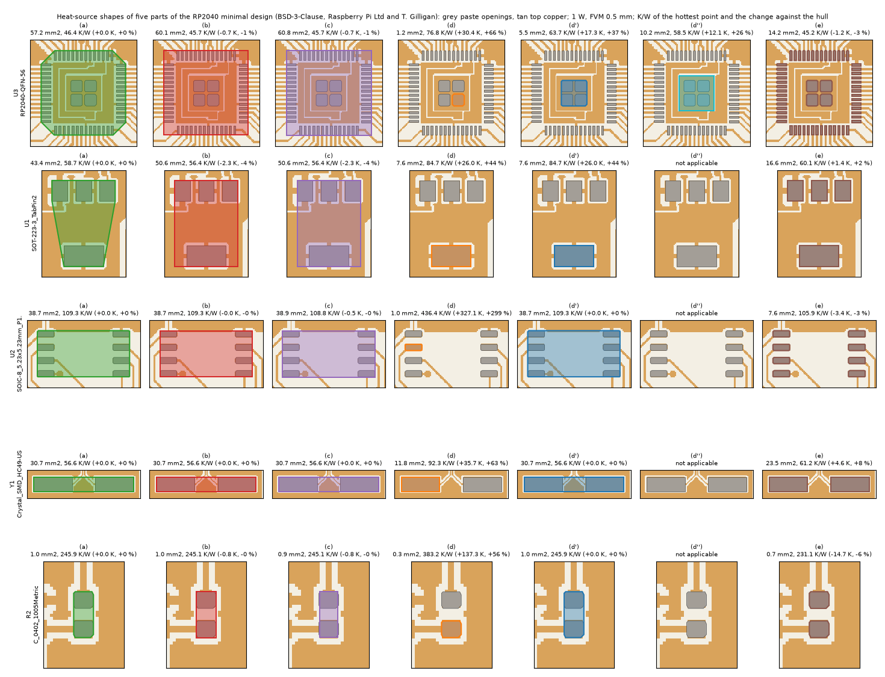

*Figure (`images/heater_shapes_rp2040.png`): five RP2040 parts with the shapes, filled, over the top copper (tan) and the paste openings (grey); the hottest point in K/W and the change against the hull (RP2040 minimal design, BSD-3-Clause, Raspberry Pi Ltd and Tommy Gilligan).*

### 29.1 Eleven parts of three boards (change of the hottest point against the hull)

| Part | Package | Hull (K/W) | Box | Envelope | Largest | Exposed pad (d') | Pad from the name (d'') | Openings by area | Program default |
| :-- | :-- | --: | --: | --: | --: | --: | --: | --: | --: | :-- |
| RP2040 U3 | QFN-56, pad in 4 windows | 46.4 | -1.4 % | -1.4 % | +65.5 % | +37.4 % | +26.2 % | -2.5 % | exposed |
| RP2040 U1 | SOT-223 (NCP1117) | 58.7 | -3.9 % | -3.9 % | +44.3 % | +44.3 % | - | +2.4 % | exposed (tab) |
| ISASTM U5 | SOT-223 (AMS1117) | 43.9 | -3.1 % | -3.7 % | +18.8 % | +18.8 % | - | +4.9 % | exposed (tab) |
| ISASTM U15 | QFN-24, EP 2.6 mm in 4 windows | 55.0 | +9.0 % | +3.0 % | +48.1 % | +12.7 % | +12.0 % | -1.9 % | exposed |
| CMM2 U4 | QFN-28, EP 3.35 mm in 9 windows | 47.2 | -2.0 % | -6.1 % | +36.6 % | +13.1 % | +11.3 % | +2.9 % | exposed |
| RP2040 U2 | SOIC-8 | 109.3 | 0.0 % | -0.5 % | +299.3 % | (no pad) | - | -3.1 % | hull |
| RP2040 Y1 | HC49 crystal | 56.6 | 0.0 % | 0.0 % | +63.2 % | (no pad) | - | +8.1 % | hull |
| RP2040 R2 | 0402 | 245.9 | -0.3 % | -0.3 % | +55.9 % | (no pad) | - | -6.0 % | hull |
| RP2040 C1 | 0805 | 98.7 | -0.3 % | -0.3 % | +22.3 % | (no pad) | - | +9.3 % | hull |
| RP2040 J3 | USB micro-B | 94.0 | -2.0 % | -2.4 % | +82.7 % | (no pad) | - | -1.1 % | hull |
| ISASTM U14 | SOT-23-6 | 81.3 | 0.0 % | -5.0 % | +227.6 % | (no pad) | - | +7.1 % | hull |

For parts without an exposed pad the hull, the box, the envelope and the openings by area agree within -6.1 to +9.3 %, about the rest of the model error at 0.5 mm (section 27), so the hull is the default. For the exposed-pad and tab parts the heat on the pad reads +12.7 to +44.3 % hotter than the hull (+6 to +26 K per watt), beyond the model error and on the safe side; the paste windows are inset in the copper pad, so the exposed pad from the paste reads 0.6 to 8.2 % hotter than the pad of the footprint name (conservative). The largest opening alone is wrong whenever the part has several similar pads (+22 to +299 %) and equals the exposed pad for a single tab. The +9.0 % of the box on U15 is the face term of its corners on bare laminate. The percentages include the board mean rise (18 K on the RP2040, 29 K in the windows).

### 29.2 A published case: the JEDEC 2s2p board

The JESD51-7 2s2p board of `docs/calculators.md` 2.1 (TPS7A47, RθJA 32.5 K/W, θJC(bot) 1.7 K/W, 3 x 3 vias assumed), cell 1 mm, computed h, 1 W: the heater on the 3.15 mm exposed pad gives **31.9 K/W** (-1.8 %), on the 5 mm body 40.0 K/W (+23 %; 37.7 without the face term), on the body with the leads (5.8 mm) 45.1 K/W (+39 %; 42.0). The lead traces of the JEDEC board are not drawn, so the body rows overstate what a real board does under the leads; with the heater on the pad the program reproduces the datasheet.

### 29.3 The rule on eight boards

The exposed-pad rule (`parts.dominant_group`; constants `EXPOSED_MIN_AREA` 0.5, `EXPOSED_MIN_PASTE` 0.25, `EXPOSED_MAX_HULL` 0.75, `EXPOSED_MIN_FILL` 0.5, `EXPOSED_MAX_GAP` 0.5) was checked on every part with a polygon of eight open boards (RP2040, ISASTM, CMM2, oswlight, co60, StickHub X3, Ucamco X3 coldfire and li-ion; 875 parts): 14 parts are taken, all exposed pads or tabs (QFN, SOT-223, DPAK, D2PAK, exposed-pad TSSOP: group fill 0.70 to 1.00, gap at most 0.25 of the side of the largest opening, group hull at most 0.62 of the part), and no other part is; the nearest miss is a micro-USB with three mounting pads (fill 0.59, gap 0.66). The first rule (hull limit 0.5, no fill or gap test) missed the four DPAK (0.60) and the D2PAK (0.62), on the unsafe side, and took seven JST SH connectors and four tactile switches (fill 0.34 / 0.39, gap 1.9 to 3.0 sides). The thinnest margin is the RP2040 QFN-56, paste share 0.32 against 0.25. Not among the parts: SOT-89, power SO-8, LGA with a thermal pad. Held by `tests/test_exposed_pad.py`.

### 29.4 A margin around the shape

The hull and the exposed pad of the five exposed-pad parts grown by 0.2, 0.3, 0.5 and 1.0 mm (Minkowski sum with a disc), same runs as 29.1:

| Part | Hull + 0.2 / 0.3 / 0.5 / 1.0 mm (vs hull) | Envelope (vs hull) | Exposed pad + 0.2 / 0.3 / 0.5 / 1.0 mm (vs the exposed pad) | Pad from the name (vs the exposed pad) |
| :-- | :-- | --: | :-- | --: |
| RP2040 U1, SOT-223 | -1.8 / -3.1 / -5.0 / -9.8 % | -3.9 % | -5.1 / -8.3 / -12.9 / -21.8 % | - |
| ISASTM U5, SOT-223 | -1.4 / -2.1 / -3.2 / -5.3 % | -3.7 % | -2.7 / -4.1 / -6.8 / -11.6 % | - |
| RP2040 U3, QFN-56 | -2.2 / -2.9 / -4.5 / -6.1 % | -1.4 % | -2.1 / -2.8 / -9.1 / -13.4 % | -8.2 % |
| ISASTM U15, QFN-24 | +5.3 / +5.3 / +4.7 / -1.6 % | +3.0 % | 0.0 / +0.7 / -4.3 / -10.2 % | -0.6 % |
| CMM2 U4, QFN-28 | -0.6 / -1.3 / -3.3 / -7.9 % | -6.1 % | -2.2 / -3.3 / -5.5 / -11.9 % | -1.6 % |

A margin makes the part read cooler (the exception, U15's hull, reaches a hotter cell and was not investigated further); the hull + 0.3 mm is within 0.8 to 1.6 points of the envelope on the SOT-223, and the exposed pad + 0.1 to 0.5 mm reaches the pad of the footprint name. A margin is not a safety margin: on the exposed pad it reads 0 to -8 % up to 0.3 mm, up to -13 % at 0.5 mm and -10 to -22 % at 1 mm; on the hull (envelope + margin) -1 to -10 %, except the QFN-24 of the ISASTM (+5 %, cause not investigated). On the SOT-223 the hull and the envelope read 16 to 34 % below the tab, and the tab is the surface to which the datasheet theta_JC is defined. The default margin of the program is 0 and there is no margin feature in this release; the modes and the margin are planned (`versions.md`, Planned, 'Heater modes for the user'). The "largest opening" shape is left as it is for now (it is right only for a single tab).

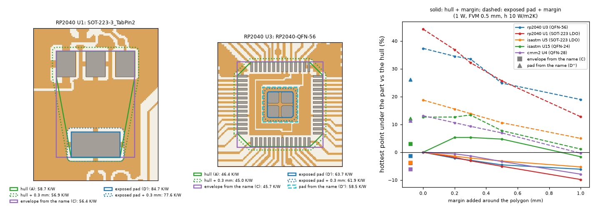

*Figure (`images/heater_shape_margin.png`, from `research/gerber-real-boards/figures/fig_24_heater_margin.png`): the RP2040 SOT-223 and QFN-56 with the hull, the hull + 0.3 mm, the envelope, the exposed pad, the exposed pad + 0.3 mm and the pad from the name; right, the hottest point against the margin for the five parts (RP2040 minimal design, BSD-3-Clause, Raspberry Pi Ltd and Tommy Gilligan; the other boards as numbers only).*

### 29.5 What was not verified

No physical board; the comparison is between shapes in the program's own FVM plus one datasheet case. The heat that leaves through the leads of an exposed-pad package is not modelled (all of it on the pad: the worst case). The exposed-pad size of the RP2040 (3.2 mm) is from memory; eleven parts of three KiCad boards for the shape table, eight boards (KiCad and the Ucamco X3 samples) for the rule.

## 30. A via on a plane with copper over part of its footprint

The via of the FVM and FDM draws heat from each cell of its footprint in proportion to a fixed weight (theory 2.6). Where a copper layer has copper over only part of the footprint, the bare cells cannot supply it. The investigation is `research/via-partial-copper` (numbers quoted from its README, sections 2, 3, 6; the warning rule below is `checks.partial_copper_vias`, run here on the imported windows by the branch `fix/via-partial-copper-warning`).

### 30.1 What the investigation measured

| FVM, board of theory 2.2 (30 x 30 mm, h = 10 W/m2K) | 1 mm | 0.5 mm | 0.25 mm | 0.125 mm |
| :-- | --: | --: | --: | --: |
| cold spot, K | 0.00 | -7.94 | -14.43 | -14.33 |
| via effect on the maximum, K | 6.41 | 7.31 | 7.67 | 8.28 |
| FDM via effect, K (no cold spot) | 8.93 | 10.69 | 11.06 | 11.36 |
| 3D solid via effect, K (not converged) | 0.70 | 2.86 | 7.20 | 10.74 |

* The 3D solid of the old comparison (2.86 K at 0.5 mm) had not converged; against the 3D solid at 1/16 and 1/20 mm (agreeing to 0.2 % on a copper edge) the FVM at cells of 0.125 to 1 mm reads the via effect 31 to 47 % low for a copper edge through the via, 45 to 68 % low for a track ending on it and 3 to 4 times high for a via just outside a copper edge at a cell of 0.5 mm or coarser. The effect has mixed sign.
* The extent 'below the ambient' (-2.5 % to -38 % of the largest rise) was not reproduced (minimum rise above zero in all the cases run, cells 1 to 0.125 mm; the cells of 0.05 and 0.025 mm were not run). Antipads are not a cause.
* The rule fires on every copper-edge, track and bare case and on the documented board at every cell; silent on antipads, on the array with antipads and on all five frozen boards with vias at 2, 1 and 0.5 mm (0 false alarms; of 44 cases with a via effect above 1 K: 19 fired and the program wrong, 4 fired and right, 4 silent and wrong, 17 silent and right).

### 30.2 Fire rate on imported boards (the imported copper at the cell of the run, vias as the import makes them)

| Board | Layers | Vias | Fire at 1 mm | Fire at 0.5 mm | With the reduced sheet, 1 / 0.5 mm |
| :-- | --: | --: | --: | --: | --: |
| RP2040 | 2 | 43 | 3 (7.0 %) | 7 (16.3 %) | 5 (11.6 %) / 7 (16.3 %) |
| ISASTM | 4 | 1008 | 42 (4.2 %) | 51 (5.1 %) | 42 / 51 |
| CMM2 | 4 | 1000 | 18 (1.8 %) | 49 (4.9 %) | 22 (2.2 %) / 50 (5.0 %) |
| OSW light | 4 | 126 | 5 (4.0 %) | 10 (7.9 %) | 5 / 10 |
| CO60 | 2 | 359 | 35 (9.7 %) | 133 (37.0 %) | 41 (11.4 %) / 139 (38.7 %) |
| StickHub (review) | 2 | 87 | 4 (4.6 %) | 6 (6.9 %) | 4 / 8 (9.2 %) |
| VSTCM (review) | 2 | 21 | 2 (9.5 %) | 9 (42.9 %) | 3 (14.3 %) / 10 (47.6 %) |

The rule is that of the program (`partial_copper_vias`), whose sheet is the layer node **before** the laminate rule. The last column (review) applies the same rule to the sheet of the FVM network after the rule (`fvm.Network(...).S`, the sheet the field actually has): it flags every via the program flags and 0 to 6 more per board (at most 4.7 points of the share, VSTCM at 1 mm), because moving the laminate out of a bare cell lowers its sheet further against the copper beside it. The program's rule therefore errs on the silent side by those few vias; it keeps the cheap sheet so that the live check needs no network. The rule fires on a minority of the vias of real boards (at most 43 % at 0.5 mm, on the 21 vias of VSTCM; 37 % on the stripe-patterned CO60), so it stays in the live list with the share ("N of M vias"); above about one half it would be a property of every via and would be moved to a single note after the run. The prefilter gives the same counts as the test of every via on all seven boards and both sheets (`tests/test_via_partial_copper_warning.py` for random boards). The rule (with either sheet) is silent on the five frozen boards with vias at 2, 1 and 0.5 mm, on the four antipad cases and on the array with antipads at 1 to 0.15 mm, and fires on the copper-edge, track and bare cases at 1 to 0.125 mm (review re-run with the program's function). Nothing was compared with a physical board.

**Cost of the live check** (review; 200 x 150 mm, four layers, 8500 vias): 0.02 / 0.08 s at 1 / 0.5 mm with full copper (0.06 / 0.15 s on an elliptic outline; the whole `check_input` 0.17 to 0.80 s); but with a plane of 1 mm stripes under every via, so that no via passes the prefilter, 0.28 s at 1 mm and **2.3 s at 0.5 mm** (2162 / 2457 vias flagged; `check_input` 2.6 to 2.8 s). The exact footprint costs about 0.3 ms per via; real boards stay below 0.21 s (CO60 at 0.5 mm).
