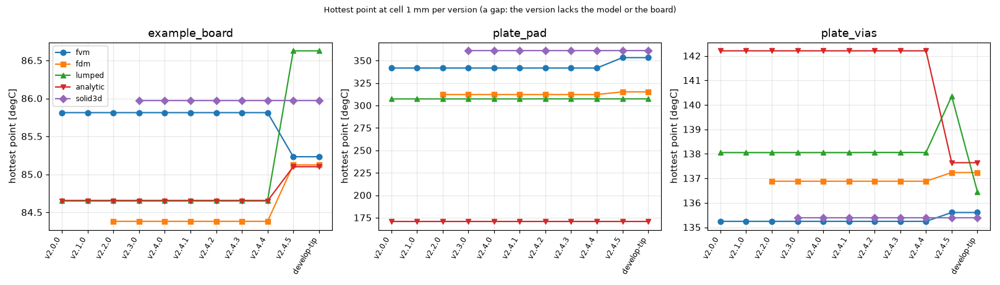
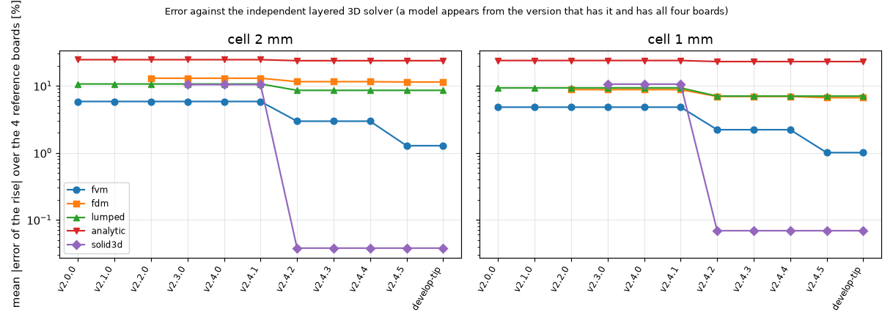
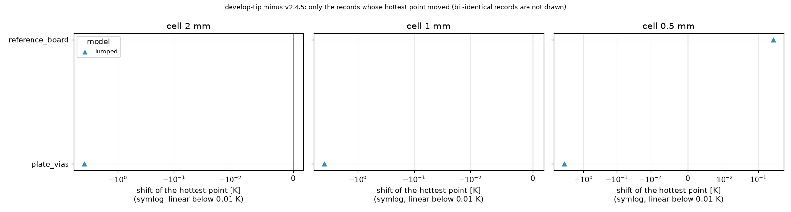
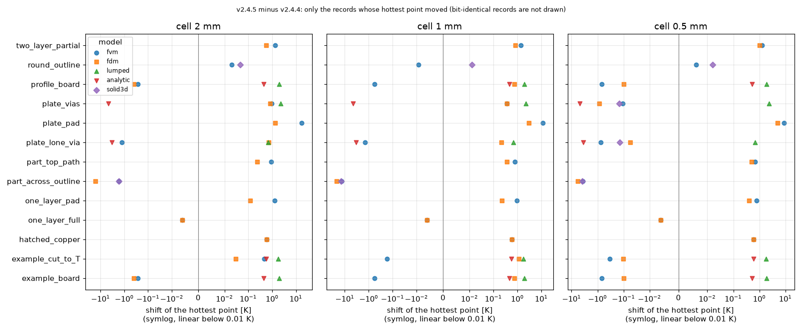
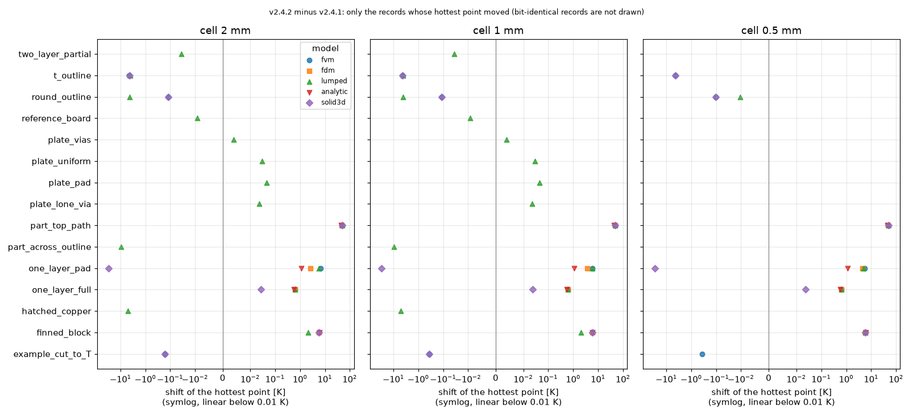
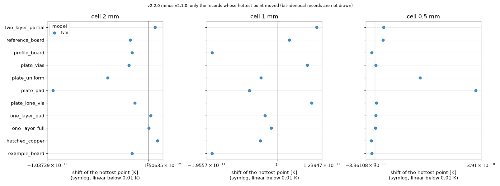
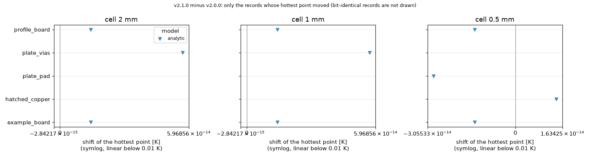

# Results across program versions

Every number comes from result sets of the regression harness (`research/release-regression-245`): the same 17 boards, five models, direct solver, run on each tag extracted with `git archive`; nothing is estimated. A shift is explained only when the table of expected shifts of that release links it to an item, or when the notes of the pair (taken from the CHANGELOG and docs/versions.md of the later version) name one; otherwise it is left unclassified or called unexplained. The example boards are read from the current tree for every version: a release that does not know a field of the file ignores it.

Versions compared (oldest first): v2.0.0, v2.1.0, v2.2.0, v2.3.0, v2.4.0, v2.4.1, v2.4.2, v2.4.3, v2.4.4, v2.4.5, develop-tip.

## Which versions could run which boards and models

| Version | Records | ok | not_available | error | skipped | Boards with a run | Models with a run |
| :-- | --: | --: | --: | --: | --: | --: | :-- |
| v2.0.0 | 255 | 99 | 156 | 0 | 0 | 11 | fvm, lumped, analytic |
| v2.1.0 | 255 | 99 | 156 | 0 | 0 | 11 | fvm, lumped, analytic |
| v2.2.0 | 255 | 132 | 123 | 0 | 0 | 11 | fvm, fdm, lumped, analytic |
| v2.3.0 | 255 | 165 | 90 | 0 | 0 | 11 | fvm, fdm, lumped, analytic, solid3d |
| v2.4.0 | 255 | 255 | 0 | 0 | 0 | 17 | fvm, fdm, lumped, analytic, solid3d |
| v2.4.1 | 255 | 255 | 0 | 0 | 0 | 17 | fvm, fdm, lumped, analytic, solid3d |
| v2.4.2 | 255 | 251 | 0 | 0 | 4 | 17 | fvm, fdm, lumped, analytic, solid3d |
| v2.4.3 | 255 | 251 | 0 | 0 | 4 | 17 | fvm, fdm, lumped, analytic, solid3d |
| v2.4.4 | 255 | 251 | 0 | 0 | 4 | 17 | fvm, fdm, lumped, analytic, solid3d |
| v2.4.5 | 255 | 251 | 0 | 0 | 4 | 17 | fvm, fdm, lumped, analytic, solid3d |
| develop-tip | 255 | 251 | 0 | 0 | 4 | 17 | fvm, fdm, lumped, analytic, solid3d |

What did not run, and why:

* v2.0.0:
  * models without a run: fdm (model 'fdm' does not exist in this release)
  * models without a run: solid3d (model 'solid3d' does not exist in this release)
  * board example_cut_to_T: AttributeError: 'Problem' object has no attribute 'set_outline'
  * board finned_block: AttributeError: 'Problem' object has no attribute 'add_heatsink'
  * board part_across_outline: AttributeError: 'Problem' object has no attribute 'set_outline'
  * board part_top_path: TypeError: Problem.add_heater() got an unexpected keyword argument 'theta'
  * board round_outline: AttributeError: 'Problem' object has no attribute 'set_outline'
  * board t_outline: AttributeError: 'Problem' object has no attribute 'set_outline'
* v2.1.0:
  * models without a run: fdm (model 'fdm' does not exist in this release)
  * models without a run: solid3d (model 'solid3d' does not exist in this release)
  * board example_cut_to_T: AttributeError: 'Problem' object has no attribute 'set_outline'
  * board finned_block: AttributeError: 'Problem' object has no attribute 'add_heatsink'
  * board part_across_outline: AttributeError: 'Problem' object has no attribute 'set_outline'
  * board part_top_path: TypeError: Problem.add_heater() got an unexpected keyword argument 'theta'
  * board round_outline: AttributeError: 'Problem' object has no attribute 'set_outline'
  * board t_outline: AttributeError: 'Problem' object has no attribute 'set_outline'
* v2.2.0:
  * models without a run: solid3d (model 'solid3d' does not exist in this release)
  * board example_cut_to_T: AttributeError: 'Problem' object has no attribute 'set_outline'
  * board finned_block: AttributeError: 'Problem' object has no attribute 'add_heatsink'
  * board part_across_outline: AttributeError: 'Problem' object has no attribute 'set_outline'
  * board part_top_path: TypeError: Problem.add_heater() got an unexpected keyword argument 'theta'
  * board round_outline: AttributeError: 'Problem' object has no attribute 'set_outline'
  * board t_outline: AttributeError: 'Problem' object has no attribute 'set_outline'
* v2.3.0:
  * board example_cut_to_T: AttributeError: 'Problem' object has no attribute 'set_outline'
  * board finned_block: TypeError: Problem.add_heatsink() got an unexpected keyword argument 'fin_height_mm'
  * board part_across_outline: AttributeError: 'Problem' object has no attribute 'set_outline'
  * board part_top_path: TypeError: Problem.add_heater() got an unexpected keyword argument 'theta'
  * board round_outline: AttributeError: 'Problem' object has no attribute 'set_outline'
  * board t_outline: AttributeError: 'Problem' object has no attribute 'set_outline'

The last set (develop-tip) is the tree of develop at commit c76479e, program version still 2.4.5, the unreleased 2.5.0 candidate (CHANGELOG [Unreleased]). The harness boards are read from the current tree for every version; for a release before 2.3.0, which stores heatsinks under the old key sinks, the example files are converted so that the example boards keep their bottom heatsink (without it the example board of v2.2.0 was 3.1 K too cool: an artefact of the input, found while preparing this document).

## Hottest point of canonical boards across versions (cell 1 mm, degC)

| Board | Model | v2.0.0 | v2.1.0 | v2.2.0 | v2.3.0 | v2.4.0 | v2.4.1 | v2.4.2 | v2.4.3 | v2.4.4 | v2.4.5 | develop-tip |
| :-- | :-- | --: | --: | --: | --: | --: | --: | --: | --: | --: | --: | --: |
| example_board | fvm | 85.814 | 85.814 | 85.814 | 85.814 | 85.814 | 85.814 | 85.814 | 85.814 | 85.814 | 85.234 | 85.234 |
| example_board | fdm | not_available | not_available | 84.383 | 84.383 | 84.383 | 84.383 | 84.383 | 84.383 | 84.383 | 85.126 | 85.126 |
| example_board | lumped | 84.659 | 84.659 | 84.659 | 84.659 | 84.659 | 84.659 | 84.659 | 84.659 | 84.659 | 86.628 | 86.628 |
| example_board | analytic | 84.652 | 84.652 | 84.652 | 84.652 | 84.652 | 84.652 | 84.652 | 84.652 | 84.652 | 85.102 | 85.102 |
| example_board | solid3d | not_available | not_available | not_available | 85.975 | 85.975 | 85.975 | 85.975 | 85.975 | 85.975 | 85.975 | 85.975 |
| plate_uniform | fvm | 159.516 | 159.516 | 159.516 | 159.516 | 159.516 | 159.516 | 159.516 | 159.516 | 159.516 | 159.516 | 159.516 |
| plate_uniform | fdm | not_available | not_available | 159.516 | 159.516 | 159.516 | 159.516 | 159.516 | 159.516 | 159.516 | 159.516 | 159.516 |
| plate_uniform | lumped | 160.360 | 160.360 | 160.360 | 160.360 | 160.360 | 160.360 | 160.390 | 160.390 | 160.390 | 160.390 | 160.390 |
| plate_uniform | analytic | 159.082 | 159.082 | 159.082 | 159.082 | 159.082 | 159.082 | 159.082 | 159.082 | 159.082 | 159.082 | 159.082 |
| plate_uniform | solid3d | not_available | not_available | not_available | 159.723 | 159.723 | 159.723 | 159.723 | 159.723 | 159.723 | 159.723 | 159.723 |
| plate_pad | fvm | 341.794 | 341.794 | 341.794 | 341.794 | 341.794 | 341.794 | 341.794 | 341.794 | 341.794 | 353.384 | 353.384 |
| plate_pad | fdm | not_available | not_available | 312.263 | 312.263 | 312.263 | 312.263 | 312.263 | 312.263 | 312.263 | 315.249 | 315.249 |
| plate_pad | lumped | 307.391 | 307.391 | 307.391 | 307.391 | 307.391 | 307.391 | 307.435 | 307.435 | 307.435 | 307.435 | 307.435 |
| plate_pad | analytic | 170.997 | 170.997 | 170.997 | 170.997 | 170.997 | 170.997 | 170.997 | 170.997 | 170.997 | 170.997 | 170.997 |
| plate_pad | solid3d | not_available | not_available | not_available | 360.955 | 360.955 | 360.955 | 360.955 | 360.955 | 360.955 | 360.955 | 360.955 |
| plate_vias | fvm | 135.245 | 135.245 | 135.245 | 135.245 | 135.245 | 135.245 | 135.245 | 135.245 | 135.245 | 135.606 | 135.606 |
| plate_vias | fdm | not_available | not_available | 136.885 | 136.885 | 136.885 | 136.885 | 136.885 | 136.885 | 136.885 | 137.239 | 137.239 |
| plate_vias | lumped | 138.056 | 138.056 | 138.056 | 138.056 | 138.056 | 138.056 | 138.060 | 138.060 | 138.060 | 140.355 | 136.453 |
| plate_vias | analytic | 142.209 | 142.209 | 142.209 | 142.209 | 142.209 | 142.209 | 142.209 | 142.209 | 142.209 | 137.641 | 137.641 |
| plate_vias | solid3d | not_available | not_available | not_available | 135.402 | 135.402 | 135.402 | 135.402 | 135.402 | 135.402 | 135.402 | 135.402 |
| t_outline | fvm | not_available | not_available | not_available | not_available | 191.276 | 191.276 | 186.870 | 186.870 | 186.870 | 186.870 | 186.870 |
| t_outline | fdm | not_available | not_available | not_available | not_available | 186.541 | 186.541 | 186.541 | 186.541 | 186.541 | 186.541 | 186.541 |
| t_outline | lumped | not_available | not_available | not_available | not_available | 138.693 | 138.693 | 134.691 | 134.691 | 134.691 | 134.691 | 134.691 |
| t_outline | analytic | not_available | not_available | not_available | not_available | 141.070 | 141.070 | 141.070 | 141.070 | 141.070 | 141.070 | 141.070 |
| t_outline | solid3d | not_available | not_available | not_available | not_available | 191.539 | 191.539 | 187.177 | 187.177 | 187.177 | 187.177 | 187.177 |

*Figure 05 (`figures/fig_05_version_hottest_canonical_boards.png`): hottest point of three canonical boards per model across versions; one line per model.*

*Figure 06 (`figures/fig_06_version_error_vs_reference.png`): mean error of the rise against the independent layered solver, per model across versions; one line per model.*

## Error against the independent layered 3D solver, per version

The solver is `research/solid3d-verification/lib/layered3d.py` (imports nothing from the program) on the four boards of `regress_boards.REFERENCE_SPECS`; the compared number is the rise of the hottest top-copper cell under the source on the same cell size as the model; error = model rise / reference rise - 1, in percent. The `solid3d` model is itself a 3D solid but not the independent solver.

| Board | Model | Reference rise [K] | v2.0.0 | v2.1.0 | v2.2.0 | v2.3.0 | v2.4.0 | v2.4.1 | v2.4.2 | v2.4.3 | v2.4.4 | v2.4.5 | develop-tip |
| :-- | :-- | --: | --: | --: | --: | --: | --: | --: | --: | --: | --: | --: | --: |
| one_layer_full | fvm | 30.363 | -2.07 | -2.07 | -2.07 | -2.07 | -2.07 | -2.07 | -0.01 | -0.01 | -0.01 | -0.03 | -0.03 |
| one_layer_full | fdm | 30.363 |  |  | -2.07 | -2.07 | -2.07 | -2.07 | -0.01 | -0.01 | -0.01 | -0.03 | -0.03 |
| one_layer_full | lumped | 30.363 | -1.19 | -1.19 | -1.19 | -1.19 | -1.19 | -1.19 | +0.89 | +0.89 | +0.89 | +0.89 | +0.89 |
| one_layer_full | analytic | 30.363 | -2.13 | -2.13 | -2.13 | -2.13 | -2.13 | -2.13 | -0.27 | -0.27 | -0.27 | -0.27 | -0.27 |
| one_layer_full | solid3d | 30.363 |  |  |  | -0.09 | -0.09 | -0.09 | +0.00 | +0.00 | +0.00 | +0.00 | +0.00 |
| one_layer_pad | fvm | 72.012 | -13.17 | -13.17 | -13.17 | -13.17 | -13.17 | -13.17 | -3.75 | -3.75 | -3.75 | -2.01 | -2.01 |
| one_layer_pad | fdm | 72.012 |  |  | -25.84 | -25.84 | -25.84 | -25.84 | -22.13 | -22.13 | -22.13 | -21.97 | -21.97 |
| one_layer_pad | lumped | 72.012 | -21.76 | -21.76 | -21.76 | -21.76 | -21.76 | -21.76 | -13.71 | -13.71 | -13.71 | -13.71 | -13.71 |
| one_layer_pad | analytic | 72.012 | -37.86 | -37.86 | -37.86 | -37.86 | -37.86 | -37.86 | -36.31 | -36.31 | -36.31 | -36.31 | -36.31 |
| one_layer_pad | solid3d | 72.012 |  |  |  | +41.54 | +41.54 | +41.54 | +0.07 | +0.07 | +0.07 | +0.07 | +0.07 |
| plate_pad | fvm | 347.761 | -7.94 | -7.94 | -7.94 | -7.94 | -7.94 | -7.94 | -7.94 | -7.94 | -7.94 | -2.92 | -2.92 |
| plate_pad | fdm | 347.761 |  |  | -23.80 | -23.80 | -23.80 | -23.80 | -23.80 | -23.80 | -23.80 | -23.43 | -23.43 |
| plate_pad | lumped | 347.761 | -18.80 | -18.80 | -18.80 | -18.80 | -18.80 | -18.80 | -18.78 | -18.78 | -18.78 | -18.78 | -18.78 |
| plate_pad | analytic | 347.761 | -58.02 | -58.02 | -58.02 | -58.02 | -58.02 | -58.02 | -58.02 | -58.02 | -58.02 | -58.02 | -58.02 |
| plate_pad | solid3d | 347.761 |  |  |  | +0.07 | +0.07 | +0.07 | +0.07 | +0.07 | +0.07 | +0.07 | +0.07 |
| plate_uniform | fvm | 134.251 | -0.15 | -0.15 | -0.15 | -0.15 | -0.15 | -0.15 | -0.15 | -0.15 | -0.15 | -0.15 | -0.15 |
| plate_uniform | fdm | 134.251 |  |  | -0.15 | -0.15 | -0.15 | -0.15 | -0.15 | -0.15 | -0.15 | -0.15 | -0.15 |
| plate_uniform | lumped | 134.251 | +0.83 | +0.83 | +0.83 | +0.83 | +0.83 | +0.83 | +0.85 | +0.85 | +0.85 | +0.85 | +0.85 |
| plate_uniform | analytic | 134.251 | -0.13 | -0.13 | -0.13 | -0.13 | -0.13 | -0.13 | -0.13 | -0.13 | -0.13 | -0.13 | -0.13 |
| plate_uniform | solid3d | 134.251 |  |  |  | +0.00 | +0.00 | +0.00 | +0.00 | +0.00 | +0.00 | +0.00 | +0.00 |

Mean absolute error of the rise over the four reference boards, cell 2 mm, percent (blank: a version without the model or a board it could not run):

| Model | v2.0.0 | v2.1.0 | v2.2.0 | v2.3.0 | v2.4.0 | v2.4.1 | v2.4.2 | v2.4.3 | v2.4.4 | v2.4.5 | develop-tip |
| :-- | --: | --: | --: | --: | --: | --: | --: | --: | --: | --: | --: |
| fvm | 5.83 | 5.83 | 5.83 | 5.83 | 5.83 | 5.83 | 2.96 | 2.96 | 2.96 | 1.28 | 1.28 |
| fdm |  |  | 12.97 | 12.97 | 12.97 | 12.97 | 11.52 | 11.52 | 11.52 | 11.39 | 11.39 |
| lumped | 10.64 | 10.64 | 10.64 | 10.64 | 10.64 | 10.64 | 8.56 | 8.56 | 8.56 | 8.56 | 8.56 |
| analytic | 24.53 | 24.53 | 24.53 | 24.53 | 24.53 | 24.53 | 23.68 | 23.68 | 23.68 | 23.68 | 23.68 |
| solid3d |  |  |  | 10.43 | 10.43 | 10.43 | 0.04 | 0.04 | 0.04 | 0.04 | 0.04 |

| Board | Model | Reference rise [K] | v2.0.0 | v2.1.0 | v2.2.0 | v2.3.0 | v2.4.0 | v2.4.1 | v2.4.2 | v2.4.3 | v2.4.4 | v2.4.5 | develop-tip |
| :-- | :-- | --: | --: | --: | --: | --: | --: | --: | --: | --: | --: | --: | --: |
| one_layer_full | fvm | 30.450 | -2.06 | -2.06 | -2.06 | -2.06 | -2.06 | -2.06 | -0.01 | -0.01 | -0.01 | -0.03 | -0.03 |
| one_layer_full | fdm | 30.450 |  |  | -2.06 | -2.06 | -2.06 | -2.06 | -0.01 | -0.01 | -0.01 | -0.03 | -0.03 |
| one_layer_full | lumped | 30.450 | -1.47 | -1.47 | -1.47 | -1.47 | -1.47 | -1.47 | +0.60 | +0.60 | +0.60 | +0.60 | +0.60 |
| one_layer_full | analytic | 30.450 | -2.40 | -2.40 | -2.40 | -2.40 | -2.40 | -2.40 | -0.56 | -0.56 | -0.56 | -0.56 | -0.56 |
| one_layer_full | solid3d | 30.450 |  |  |  | -0.08 | -0.08 | -0.08 | +0.00 | +0.00 | +0.00 | +0.00 | +0.00 |
| one_layer_pad | fvm | 69.925 | -11.40 | -11.40 | -11.40 | -11.40 | -11.40 | -11.40 | -3.11 | -3.11 | -3.11 | -1.73 | -1.73 |
| one_layer_pad | fdm | 69.925 |  |  | -18.42 | -18.42 | -18.42 | -18.42 | -13.23 | -13.23 | -13.23 | -12.90 | -12.90 |
| one_layer_pad | lumped | 69.925 | -19.43 | -19.43 | -19.43 | -19.43 | -19.43 | -19.43 | -11.13 | -11.13 | -11.13 | -11.13 | -11.13 |
| one_layer_pad | analytic | 69.925 | -36.00 | -36.00 | -36.00 | -36.00 | -36.00 | -36.00 | -34.41 | -34.41 | -34.41 | -34.41 | -34.41 |
| one_layer_pad | solid3d | 69.925 |  |  |  | +42.13 | +42.13 | +42.13 | +0.13 | +0.13 | +0.13 | +0.13 | +0.13 |
| plate_pad | fvm | 335.493 | -5.57 | -5.57 | -5.57 | -5.57 | -5.57 | -5.57 | -5.57 | -5.57 | -5.57 | -2.12 | -2.12 |
| plate_pad | fdm | 335.493 |  |  | -14.38 | -14.38 | -14.38 | -14.38 | -14.38 | -14.38 | -14.38 | -13.49 | -13.49 |
| plate_pad | lumped | 335.493 | -15.83 | -15.83 | -15.83 | -15.83 | -15.83 | -15.83 | -15.81 | -15.81 | -15.81 | -15.81 | -15.81 |
| plate_pad | analytic | 335.493 | -56.48 | -56.48 | -56.48 | -56.48 | -56.48 | -56.48 | -56.48 | -56.48 | -56.48 | -56.48 | -56.48 |
| plate_pad | solid3d | 335.493 |  |  |  | +0.14 | +0.14 | +0.14 | +0.14 | +0.14 | +0.14 | +0.14 | +0.14 |
| plate_uniform | fvm | 134.718 | -0.15 | -0.15 | -0.15 | -0.15 | -0.15 | -0.15 | -0.15 | -0.15 | -0.15 | -0.15 | -0.15 |
| plate_uniform | fdm | 134.718 |  |  | -0.15 | -0.15 | -0.15 | -0.15 | -0.15 | -0.15 | -0.15 | -0.15 | -0.15 |
| plate_uniform | lumped | 134.718 | +0.48 | +0.48 | +0.48 | +0.48 | +0.48 | +0.48 | +0.50 | +0.50 | +0.50 | +0.50 | +0.50 |
| plate_uniform | analytic | 134.718 | -0.47 | -0.47 | -0.47 | -0.47 | -0.47 | -0.47 | -0.47 | -0.47 | -0.47 | -0.47 | -0.47 |
| plate_uniform | solid3d | 134.718 |  |  |  | +0.00 | +0.00 | +0.00 | +0.00 | +0.00 | +0.00 | +0.00 | +0.00 |

Mean absolute error of the rise over the four reference boards, cell 1 mm, percent (blank: a version without the model or a board it could not run):

| Model | v2.0.0 | v2.1.0 | v2.2.0 | v2.3.0 | v2.4.0 | v2.4.1 | v2.4.2 | v2.4.3 | v2.4.4 | v2.4.5 | develop-tip |
| :-- | --: | --: | --: | --: | --: | --: | --: | --: | --: | --: | --: |
| fvm | 4.80 | 4.80 | 4.80 | 4.80 | 4.80 | 4.80 | 2.21 | 2.21 | 2.21 | 1.01 | 1.01 |
| fdm |  |  | 8.75 | 8.75 | 8.75 | 8.75 | 6.94 | 6.94 | 6.94 | 6.64 | 6.64 |
| lumped | 9.30 | 9.30 | 9.30 | 9.30 | 9.30 | 9.30 | 7.01 | 7.01 | 7.01 | 7.01 | 7.01 |
| analytic | 23.84 | 23.84 | 23.84 | 23.84 | 23.84 | 23.84 | 22.98 | 22.98 | 22.98 | 22.98 | 22.98 |
| solid3d |  |  |  | 10.59 | 10.59 | 10.59 | 0.07 | 0.07 | 0.07 | 0.07 | 0.07 |

## Results of develop-tip against v2.4.5

Environment of the new set: {'python': '3.13.5', 'numpy': '2.5.4', 'scipy': '1.18.1', 'platform': 'macOS-27.0-arm64-arm-64bit-Mach-O', 'machine': 'arm64'}. Cells in the sets: [2.0, 1.0, 0.5] mm.

Records compared: 251 (skipped or failed in both: 4). Bit-identical in every number (status ok in both): 247, of which 225 also have the same warning texts. Hottest point moved: 4. Alarms: not applicable, the pair has no table.

No table of expected shifts exists for this pair, so the shifts are not classified automatically; the notes below name the items that explain them, or say unexplained.

CHANGELOG section of the later version (verbatim)

> ## [Unreleased]
> 
> ### Added
> - **Low face Rayleigh number warning** (`fix/natural-convection-low-ra`; `checks.check_low_rayleigh`, `research/plate-h-level`): after the run, once per run (from the reference model, not once per model), a vertical board in computed mode whose face Rayleigh number is below 1e3 (a face about 10 mm high at a 10 K excess) is told that the natural-convection coefficient is not checked there; a face where forced air is at least the natural convection is not counted. The channel part is covered by the fin warning (`Ra_b < 90`).
> - **Gerber reader** (`feature/gerber-reader`; `pcbthermal.gerber`, `docs/theory.md` 1.6, `docs/models.md` 19): our own reader of Gerber RS-274X with X2 attributes, Excellon, XNC and X2 drill files, the board outline, layer-function detection and ZIP sets, and the rasteriser to a one-byte coverage per pixel. **No interface yet**: nothing in the application or the project files uses it, and there is no new dependency. Features that would change the geometry are refused naming file and feature; hostile or damaged input always ends in a `GerberError` (0 raw errors in 1100 mutated files and 300 damaged ZIPs). The copper areas of 109 files are within -0.026 to +0.18 % of the exact vector areas. The pixel is proposed from the thinnest feature and a warning is given below two sample spacings. G37 resets the interpolation mode to G01, a documented deviation from the 2026 specification.
> - **Project file format 2 for projects with imported boards** (`feature/project-format-2`; `docs/models.md` 8.1): the problem is nested under a `project` key beside the list of imports, written only when the project has imports; other projects stay format 1, byte-identical to the earlier versions. A file of a newer format is refused with the version that wrote it, and keys this version does not know are kept when it saves. **A project with imported boards needs 2.5.0 or later**: 2.4.x answers "Cannot open file" and does not overwrite it.
> - **Laminate options** (`feature/laminate-options`; `docs/theory.md` 1.4, `docs/models.md` 2, `docs/validation.md` 21.2): the longest sub-gap (0.05 to 5 mm, default 0.4) and the most sub-gaps (integer 1 to 16, default 4) of the laminate rule are options of the run, `SolverOptions.laminate_s_max_mm` and `laminate_n_max`, saved in the project only when not the default; two spin boxes in the solver panel (greyed with a metal block) and the CLI flags `run --laminate-s-max-mm` and `--laminate-n-max`. A larger count alone changes nothing when the longest sub-gap already gives that count. The power calculator and `calibrate` use them. Limit: the `transient` command uses the default laminate options.
> - **Lumped warnings for the zone model** (`checks.check_lumped_zones`, after the run): a bound of up to 16 % of the rise for an array across the footprint edge, softer texts for an off-centre cluster and an elongated footprint, a raster coarser than a tenth of the core, and a note when a footprint with a group of vias was kept as one node (the core covers more than 92 % of it).
> - **Memory guard** (`feature/memory-guard`; `docs/theory.md` 2.7, `docs/validation.md` 26, `research/memory-guard`): the program reads the physical memory, estimates the peak memory of the FVM, the FDM and the 3D solid from their unknown count and the thickness of the graph, and refuses a run above the limit **before** allocating anything, naming the cell that fits (a cheap lower bound first, so a huge board is refused at once). New Preferences field **Memory limit** (fraction of the physical memory, default 0.60, 0.10 to 0.95; a machine preference, not saved in the project; an old project file's value is ignored). The solver panel shows the unknowns and the verdict (ok, slow, refused) of each model, **Run is disabled** with the reason when a model is refused, and **Auto** picks a cell that fits. A run above the memory available now only warns. Time simulations, animations and profile runs count twice the steady estimate. The command line exits with **code 3** on a refusal (2 stays argparse's usage error) and takes `--memory-fraction F`; the variable `PCBTHERMAL_MEMORY_BYTES` states the memory when the machine's limit is not visible. The estimate and the measured peak of each run are logged so that other machines can check the law. The Lumped and the Analytic models are not checked.
> 
> ### Changed
> - **Natural convection form: `laminar` is the default of NEW projects** (`fix/natural-convection-low-ra`; `Board.natural_form`, `defaults.json`, Preferences, Environment panel): the class `Board` and project files written before keep `general`, so old files give the same numbers. Only vertical boards with computed h change: -0.1 to -2 % of the rise on small boards and up to +0.3 % on large ones; the example board turned vertical is 0.22 K cooler (-0.36 % of the rise) in every model. A user who chose `general` explicitly before has nothing stored (`user_defaults.json` keeps only the differences from the shipped defaults) and now gets `laminar`; set `general` again in Preferences to keep it. Proposal A of `research/plate-h-level`.
> - **Power Calculator is faster, with the same results** (`fix/inverse-factor-reuse`): at manual h its runs share one factorisation of the board matrix (about 3.8 times faster, bit-identical in 84 of 84 cases, peak memory equal or lower; with computed h nothing is reused). **Note:** the discrete maximum principle is not guaranteed with via couplings (`docs/theory.md` 2.2); on a plane whose copper covers only part of a via footprint the FVM can show a cold spot (limit documented, correction waits in `docs/versions.md`, chapter 'Planned').
> - **Saving a project is atomic and keeps a backup** (`project.py`): the file is written to a temporary file, synchronised to the disk and renamed over the old one (permissions and symbolic link kept, a read-only file refused), and the old file is copied to `.bak`, `.bak2`, ... when the save changes its format or the old file is not JSON. A damaged or non-project JSON file gives a readable message instead of a traceback.
> - **Documentation of sources and the limit of the horizontal faces** (`docs/bibliography-update`; documents and docstrings only, no number moves): `docs/theory.md` 12 lists the sources read and used but not cited, with their reading status; citations corrected (the Teertstra review is J. Electronics Manufacturing 7 (2) (1997) 79-92, the Kron reduction is cited to Dorfler and Bullo, George (1973) is read in part, the forced-convection mean value is read in Lienhard p 311); the limit of the horizontal-face laws is stated in `theory.md` 8 and `models.md` (the 0.54 law is used below its published range on boards up to about 100 x 80 mm and above the Yovanovich-Jafarpur upper bound from 60 mm: +4 to +24 %; effect on the board maximum -1.1 to +1.0 %); `validation.md` and four docstrings follow.
> - **No hard-coded colours in `pcbthermal/gui`** (`fix/theme-controls`; `tests/test_theme_coherence.py`, `tests/test_theme_contrast.py`): every colour comes from the theme tokens (new: ok, warn, bad, error, selection, on_element, run, diel_*, doc_*, link, link_visited). The dark guide and calculator help page is a softer grey, `#353b43`. The light theme is pixel-identical to the previous release (the maintainer likes the current look), except for the outline of the radio and check indicators and dimmed disabled labels. Contrast targets lowered by design where the dark accent cannot meet more: white on the dark accent 3.0, muted text 4.0, disabled button text 3.9, status tones 3.5.
> - **The model-limit and via warnings are shown while editing** (`fix/live-input-warnings`; `checks.check_input`): the list under Run is the live check of the design plus the limits of the models you selected and the via warnings, checked again when you change the models or the cell. Each warning is **one line** with the full measured text on hover and in the Results summary. Links in the dark theme are readable (palette Link and LinkVisited).
> - **Profile curves of parts over bare laminate include the face** (`feature/laminate-options`; `docs/theory.md` 10): the FVM and FDM curves add the quasi-static face term of the power of each step, and the average-or-resolve decision adds the swing of that term, so a fast square wave that the node alone would average can be resolved (6 mm part, 0 to 2 W at 10 ms: peak 187.60 to 189.58 degC). The legend and the summary say hottest at the face of a part; the face is first order and overstates the swing below about ten times the time constant of the half copper layer (0.69, 2.8, 11 ms for 35, 70, 140 um).
> - **Lumped model: a part over a dense group of vias has two nodes for its footprint** (`feature/lumped-zones`; `docs/theory.md` 5.2, `docs/validation.md` 18.2, `research/lumped-zones-adoption`): the cells near the vias of a group in the footprint (the core) and the rest of the footprint are two nodes per layer joined by a lateral link, so the heat of the rest of the footprint has its own way down and a way sideways to the core. **The Lumped result of a part over a dense via group changes**: the via effect of such a part, up to 32 % too large (the part too cool) on 36 simple boards and up to 109 % on 26 others with the one node, is within 9.1 % and 20.6 % with the zones, and the hottest temperature is within 7.2 % and 7.6 % of a fine-grid solution (the one node: up to 14.2 % and 17.4 % too cool). The zones are not hotter or cooler than the one node by rule: on three boards of the square-wave run and on one of the 62 steady boards they read the part hotter than the one node did, on the safe side. Boards without vias, parts whose vias form no group in the footprint and parts whose core covers more than 92 % of the footprint (the nine vias of the example board) give the same result as before. The 3D check with the barrels drawn (three 16 mm boards) puts the zones within 7.8 % of the effect and 1.6 % of the rise, with the limit that a 0.3 mm barrel is not resolved there. Not fixed: an array across or just outside the footprint edge (up to 16 % of the rise too cool, warned).
> - **Lumped raster: one 0.5 mm cell per board when a part will be zoned**: the core must be a handful of cells across, so a board with such a part runs the Lumped model on a 0.5 mm cell instead of the 0.5 to 1 mm clip; the cell is one per board, so the other parts of that board move by the raster too (on a Gerber-like test board two small parts on bare laminate moved by 9 to 18 K between 1.0 and 0.5 mm, nearer the FVM at 0.5 mm). The Analytic keeps its clip.
> - **Lumped capacities, step response and power profiles follow the zones**: the capacity of each node is the sum of its cells' and the profile runner applies the power through the same source split (square-wave peak within 5.4 % of the FVM's average rise on three boards and 3.8 % on average over 93, 14.3 % at most; the one node 21.4 % and 9.6 % / 28.9 %).
> - **Frozen numbers**: the Lumped records of `plate_vias` (a 4 x 4 array under a pad) move from 140.3555 to 136.4534 degC (-3.90 K) and its time to 63 % from 27.83 to 31.00 s; they are held by the pending shift `tests/regression/data/pending/lumped-zones.json` until the release refreezes the file.
> - The fixed limit of 250 000 unknowns of the 3D solid is replaced by the memory estimate, with an absolute ceiling of 2 million unknowns (`solid3d.size_limit` keeps its meaning as a window for the studies); `solid3d.Solid` checks its own count in its constructor.
> - **SOR guard by bytes** (`fvm.MAX_SOR_BLOCK` removed): the dense inverse of a block costs about 75 n^2 bytes (5 000 unknowns take about 1.9 GB, not the 200 MB the old comment said); the SOR block solve is allowed when the sum over its blocks is at most 25 % of the memory limit, otherwise the direct solver is used and the result says so.
> - **One LU factor in the animation and the transient** (bit-identical frames): the logarithmic time grid kept the factor of every one of its ten steps; it now keeps one, so the peak of an animation is 1.9 times a steady solve instead of 3.5 (on a 111 556-unknown case 2.60 GB became 0.65 GB, a figure reported by the review of the integration).
> 
> ### Fixed
> - **Dark theme legibility** (`fix/theme-controls`): the unchecked radio and check indicators were invisible (contrast 1.12, now 4.4), disabled text was not dimmed, links were unreadable, the user guide and the calculator help were white, empty figures and messages were white or black on dark, the warning-list links, the canvas rubber band and the stack-up labels now follow the tokens. The keyboard focus ring is kept.
> - **False "outside the board" and "overlap" warnings of small parts, zones and blocks** (`fix/live-input-warnings`; `geometry.clip_polygon`, `polygon_overlap_area`, `polygon_area_signed`, `part_board_share`): the checks judged a part by its cell coverage, so small parts and thin zones were reported outside the board or overlapping when they were not. They are now judged by exact geometry (the overlap is exact when one of the two polygons is convex; self-crossing polygons are measured on a 96 x 96 lattice with the even-odd rule). Old false warnings on the study sets: 13 of 126 (parts outside), 48 of 90 (overlaps), 5 of 40 and 1 of 40 (zones and blocks), now 0. Limit: the 96 x 96 lattice used for boards with an outline is within 1 % of the exact area; the live check costs 0.2 s on a 200 x 150 mm board with 8500 vias. A part wholly outside the board says so in words (100 % outside). Part statistics (mean, minimum, ring) of very small parts no longer come out NaN in the FVM (cells) and the FDM (nodes).
> - **Lumped: footprint potentials of large footprints** (`fix/lumped-footprint-potentials`; `docs/theory.md` 5): the link of the heater footprint to the first ring was 4 to 22 % short on footprints above 900 cells (squares of 20 to 40 mm at a 0.5 mm cell: -4.0, -10.8, -21.6 %) by aliasing of the stride decimation; large footprints are now summed in k x k blocks (within 0.03 % of the all-cell sum on squares, a disc, a rectangle, an L and a ring; the peak term within 0.15 %). Results for footprints of 900 cells or fewer, including the three example boards, are unchanged to the bit. The board maximum at a 0.5 mm cell moves by +1 to +5 K on a 20 W source of 20 to 60 mm on a single copper sheet, and by 0 to +1.1 K at 1 mm. Tests: `tests/test_lumped_footprint.py`. The frozen record `reference_board|lumped|0.5` of `tests/regression/data/v2.4.5.json` moves with it (`t_max` 89.093 to 89.363 degC, `Tj` 79.71 to 79.97 degC) and is refrozen at the 2.5.0 release; the default 2 mm set is unchanged.
> - **Lumped via warnings: the unsafe side** (`fix/lumped-via-warning-limits`; text only, no temperature changes): the 2.4.5 text quoted up to 80 % for an array across the edge of a footprint where up to 221 % of the via effect (the part up to about 11 K, a quarter of its rise, too cool) was measured (`research/lumped-zones-adoption` 8.4). A new warning (`checks.lumped_via_cool_warning`) fires for a part whose via group continues past the footprint edge, stands off its centre (more than 0.1 of the smaller side) or lies under a footprint of side ratio above 1.5; vias farther than twice the array pitch do not count, so scattered vias on a board do not trigger it. The general text now gives up to 14 % of the rise too cool, and the text of the vias outside every part up to 2.3 times the effect (4 K, 9 % of the rise) for an array beside a part.

### Notes: what was implemented and why the numbers moved

What the CHANGELOG and docs/versions.md of this version say was implemented:

* CHANGELOG [Unreleased] (develop, c76479e, still reporting version 2.4.5): the memory guard; the Gerber reader (no interface yet); project format 2 for imported boards; laminate options (`SolverOptions.laminate_s_max_mm`, `laminate_n_max`, defaults unchanged); Lumped zones (a part over a dense group of vias has two nodes for its footprint, with a 0.5 mm raster); Lumped footprint potentials in blocks (large footprints summed in k x k blocks instead of a stride); Lumped via warnings (text only); natural convection form `laminar` as the default of NEW projects only; live input warnings; the one-LU animation; faster Power Calculator (bit-identical); theme and documentation items.

Reading of the numbers (each line cites the item that explains it; where no item does, it says unexplained):

* Only 4 of 251 steady records move, all Lumped: plate_vias -3.90 K at 2 mm and 1 mm and -3.70 K at 0.5 mm (140.3555 to 136.4534 degC at 1 mm and 2 mm; CHANGELOG item 'Lumped model: a part over a dense group of vias has two nodes', `tests/regression/data/pending/lumped-zones.json`), and reference_board +0.27 K at 0.5 mm (89.0933 to 89.3632 degC; item 'Lumped: footprint potentials of large footprints', `pending/lumped-footprint-potentials.json`). The four values of this run equal the pending files to the last digit (difference 0.0), and no other record moves.
* Time to 63 %: Lumped plate_vias +11 % (27.83 to 31.00 s, as the CHANGELOG says); one value of 68.
* Items that do not move any harness number, as expected: the memory guard, the Gerber reader, the project format, the laminate options at their defaults, the warnings, the animation, the default of the natural convection form (new projects only).

### Hottest point moved, per model

| Model | Records moved | Largest shift [K] (board, cell) | Largest shift [% of old rise] |
| :-- | --: | :-- | --: |
| lumped | 4 | -3.902 (plate_vias, 1 mm) | 3.38 |

### Hottest point, every record that moved

The shift in percent is relative to the rise of the old hottest point over the ambient of the record. The item is the one the table of expected shifts links to the shift.

| Board | Model | Cell [mm] | Tmax old [degC] | Tmax new [degC] | Shift [K] | Shift [% of old rise] | Class | Item of the release |
| :-- | :-- | --: | --: | --: | --: | --: | :-- | :-- |
| plate_vias | lumped | 2 | 140.3555 | 136.4534 | -3.9021 | -3.38 | not classified | no table of expected shifts for this pair; see the CHANGELOG section below |
| plate_vias | lumped | 1 | 140.3555 | 136.4534 | -3.9021 | -3.38 | not classified | no table of expected shifts for this pair; see the CHANGELOG section below |
| plate_vias | lumped | 0.5 | 140.1495 | 136.4534 | -3.6961 | -3.21 | not classified | no table of expected shifts for this pair; see the CHANGELOG section below |
| reference_board | lumped | 0.5 | 89.0933 | 89.3632 | +0.2699 | +0.42 | not classified | no table of expected shifts for this pair; see the CHANGELOG section below |

Records where the hottest point is the same but another number moved (layer mean, a part, the unknowns, the heat split): 0.

### Bit-identical records (steady state, status ok in both)

* example_board: analytic (0.5, 1, 2 mm); fdm (0.5, 1, 2 mm); fvm (0.5, 1, 2 mm); lumped (0.5, 1, 2 mm); solid3d (1, 2 mm)
* example_cut_to_T: analytic (0.5, 1, 2 mm); fdm (0.5, 1, 2 mm); fvm (0.5, 1, 2 mm); lumped (0.5, 1, 2 mm); solid3d (1, 2 mm)
* finned_block: analytic (0.5, 1, 2 mm); fdm (0.5, 1, 2 mm); fvm (0.5, 1, 2 mm); lumped (0.5, 1, 2 mm); solid3d (0.5, 1, 2 mm)
* hatched_copper: analytic (0.5, 1, 2 mm); fdm (0.5, 1, 2 mm); fvm (0.5, 1, 2 mm); lumped (0.5, 1, 2 mm); solid3d (0.5, 1, 2 mm)
* one_layer_full: analytic (0.5, 1, 2 mm); fdm (0.5, 1, 2 mm); fvm (0.5, 1, 2 mm); lumped (0.5, 1, 2 mm); solid3d (0.5, 1, 2 mm)
* one_layer_pad: analytic (0.5, 1, 2 mm); fdm (0.5, 1, 2 mm); fvm (0.5, 1, 2 mm); lumped (0.5, 1, 2 mm); solid3d (0.5, 1, 2 mm)
* part_across_outline: analytic (0.5, 1, 2 mm); fdm (0.5, 1, 2 mm); fvm (0.5, 1, 2 mm); lumped (0.5, 1, 2 mm); solid3d (0.5, 1, 2 mm)
* part_top_path: analytic (0.5, 1, 2 mm); fdm (0.5, 1, 2 mm); fvm (0.5, 1, 2 mm); lumped (0.5, 1, 2 mm); solid3d (0.5, 1, 2 mm)
* plate_lone_via: analytic (0.5, 1, 2 mm); fdm (0.5, 1, 2 mm); fvm (0.5, 1, 2 mm); lumped (0.5, 1, 2 mm); solid3d (0.5, 1, 2 mm)
* plate_pad: analytic (0.5, 1, 2 mm); fdm (0.5, 1, 2 mm); fvm (0.5, 1, 2 mm); lumped (0.5, 1, 2 mm); solid3d (0.5, 1, 2 mm)
* plate_uniform: analytic (0.5, 1, 2 mm); fdm (0.5, 1, 2 mm); fvm (0.5, 1, 2 mm); lumped (0.5, 1, 2 mm); solid3d (0.5, 1, 2 mm)
* plate_vias: analytic (0.5, 1, 2 mm); fdm (0.5, 1, 2 mm); fvm (0.5, 1, 2 mm); solid3d (0.5, 1, 2 mm)
* profile_board: analytic (0.5, 1, 2 mm); fdm (0.5, 1, 2 mm); fvm (0.5, 1, 2 mm); lumped (0.5, 1, 2 mm); solid3d (1, 2 mm)
* reference_board: analytic (0.5, 1, 2 mm); fdm (0.5, 1, 2 mm); fvm (0.5, 1, 2 mm); lumped (1, 2 mm); solid3d (1, 2 mm)
* round_outline: analytic (0.5, 1, 2 mm); fdm (0.5, 1, 2 mm); fvm (0.5, 1, 2 mm); lumped (0.5, 1, 2 mm); solid3d (0.5, 1, 2 mm)
* t_outline: analytic (0.5, 1, 2 mm); fdm (0.5, 1, 2 mm); fvm (0.5, 1, 2 mm); lumped (0.5, 1, 2 mm); solid3d (0.5, 1, 2 mm)
* two_layer_partial: analytic (0.5, 1, 2 mm); fdm (0.5, 1, 2 mm); fvm (0.5, 1, 2 mm); lumped (0.5, 1, 2 mm); solid3d (0.5, 1, 2 mm)

### Time to 63 % of the steady resistance that moved

| Board | Model | Part | Old [s] | New [s] | Change [%] | Class | Rules |
| :-- | :-- | :-- | --: | --: | --: | :-- | :-- |
| plate_vias | lumped | U | 27.8278 | 31.0003 | +11.40 | unexplained |  |

1 of 68 times changed; 67 are identical.

### Warning texts that changed

* example_board / lumped / 0.5 mm: added: U1: 9 vias under the footprint; the Lumped model joins the planes through a well and the barrel of each ring, so its via effect was measured from 21 % too small (the part too hot) to 33 % too large (the part too cool by up to 14 % of its rise: dense arrays that cover a quarter or less of a large footprint, sparse arrays and rows; 8 to 20 % on average over 46 boards, 11 % over 36 more); use the FVM for via design. | removed: U1: 9 vias under the footprint; the Lumped model joins the planes through a well and the barrel of each ring, so its via effect was measured from 21 % too small (the part too hot) to 33 % too large (the part too cool: dense arrays that cover a quarter or less of a large footprint, sparse arrays and rows), and up to 80 % too large for an array across the edge of the footprint (8 to 20 % on average over 46 boards, 11 % over 36 more); use the FVM for via design.
* example_board / lumped / 1 mm: added: U1: 9 vias under the footprint; the Lumped model joins the planes through a well and the barrel of each ring, so its via effect was measured from 21 % too small (the part too hot) to 33 % too large (the part too cool by up to 14 % of its rise: dense arrays that cover a quarter or less of a large footprint, sparse arrays and rows; 8 to 20 % on average over 46 boards, 11 % over 36 more); use the FVM for via design. | removed: U1: 9 vias under the footprint; the Lumped model joins the planes through a well and the barrel of each ring, so its via effect was measured from 21 % too small (the part too hot) to 33 % too large (the part too cool: dense arrays that cover a quarter or less of a large footprint, sparse arrays and rows), and up to 80 % too large for an array across the edge of the footprint (8 to 20 % on average over 46 boards, 11 % over 36 more); use the FVM for via design.
* example_board / lumped / 2 mm: added: U1: 9 vias under the footprint; the Lumped model joins the planes through a well and the barrel of each ring, so its via effect was measured from 21 % too small (the part too hot) to 33 % too large (the part too cool by up to 14 % of its rise: dense arrays that cover a quarter or less of a large footprint, sparse arrays and rows; 8 to 20 % on average over 46 boards, 11 % over 36 more); use the FVM for via design. | removed: U1: 9 vias under the footprint; the Lumped model joins the planes through a well and the barrel of each ring, so its via effect was measured from 21 % too small (the part too hot) to 33 % too large (the part too cool: dense arrays that cover a quarter or less of a large footprint, sparse arrays and rows), and up to 80 % too large for an array across the edge of the footprint (8 to 20 % on average over 46 boards, 11 % over 36 more); use the FVM for via design.
* example_cut_to_T / lumped / 0.5 mm: added: U1: 9 vias under the footprint; the Lumped model joins the planes through a well and the barrel of each ring, so its via effect was measured from 21 % too small (the part too hot) to 33 % too large (the part too cool by up to 14 % of its rise: dense arrays that cover a quarter or less of a large footprint, sparse arrays and rows; 8 to 20 % on average over 46 boards, 11 % over 36 more); use the FVM for via design. | removed: U1: 9 vias under the footprint; the Lumped model joins the planes through a well and the barrel of each ring, so its via effect was measured from 21 % too small (the part too hot) to 33 % too large (the part too cool: dense arrays that cover a quarter or less of a large footprint, sparse arrays and rows), and up to 80 % too large for an array across the edge of the footprint (8 to 20 % on average over 46 boards, 11 % over 36 more); use the FVM for via design.
* example_cut_to_T / lumped / 1 mm: added: U1: 9 vias under the footprint; the Lumped model joins the planes through a well and the barrel of each ring, so its via effect was measured from 21 % too small (the part too hot) to 33 % too large (the part too cool by up to 14 % of its rise: dense arrays that cover a quarter or less of a large footprint, sparse arrays and rows; 8 to 20 % on average over 46 boards, 11 % over 36 more); use the FVM for via design. | removed: U1: 9 vias under the footprint; the Lumped model joins the planes through a well and the barrel of each ring, so its via effect was measured from 21 % too small (the part too hot) to 33 % too large (the part too cool: dense arrays that cover a quarter or less of a large footprint, sparse arrays and rows), and up to 80 % too large for an array across the edge of the footprint (8 to 20 % on average over 46 boards, 11 % over 36 more); use the FVM for via design.
* example_cut_to_T / lumped / 2 mm: added: U1: 9 vias under the footprint; the Lumped model joins the planes through a well and the barrel of each ring, so its via effect was measured from 21 % too small (the part too hot) to 33 % too large (the part too cool by up to 14 % of its rise: dense arrays that cover a quarter or less of a large footprint, sparse arrays and rows; 8 to 20 % on average over 46 boards, 11 % over 36 more); use the FVM for via design. | removed: U1: 9 vias under the footprint; the Lumped model joins the planes through a well and the barrel of each ring, so its via effect was measured from 21 % too small (the part too hot) to 33 % too large (the part too cool: dense arrays that cover a quarter or less of a large footprint, sparse arrays and rows), and up to 80 % too large for an array across the edge of the footprint (8 to 20 % on average over 46 boards, 11 % over 36 more); use the FVM for via design.
* part_across_outline / analytic / 1 mm: added: U: 21 % of the footprint is outside the board; its full power is applied to the part that is inside. | removed: U: 22 % of the footprint is outside the board; its full power is applied to the part that is inside.
* part_across_outline / fdm / 1 mm: added: U: 21 % of the footprint is outside the board; its full power is applied to the part that is inside. | removed: U: 22 % of the footprint is outside the board; its full power is applied to the part that is inside.
* part_across_outline / fvm / 1 mm: added: U: 21 % of the footprint is outside the board; its full power is applied to the part that is inside. | removed: U: 22 % of the footprint is outside the board; its full power is applied to the part that is inside.
* part_across_outline / lumped / 1 mm: added: U: 21 % of the footprint is outside the board; its full power is applied to the part that is inside. | removed: U: 22 % of the footprint is outside the board; its full power is applied to the part that is inside.
* part_across_outline / solid3d / 1 mm: added: U: 21 % of the footprint is outside the board; its full power is applied to the part that is inside. | removed: U: 22 % of the footprint is outside the board; its full power is applied to the part that is inside.
* part_across_outline / analytic / 2 mm: added: U: 21 % of the footprint is outside the board; its full power is applied to the part that is inside. | removed: U: 22 % of the footprint is outside the board; its full power is applied to the part that is inside.
* part_across_outline / fdm / 2 mm: added: U: 21 % of the footprint is outside the board; its full power is applied to the part that is inside. | removed: U: 22 % of the footprint is outside the board; its full power is applied to the part that is inside.
* part_across_outline / fvm / 2 mm: added: U: 21 % of the footprint is outside the board; its full power is applied to the part that is inside. | removed: U: 22 % of the footprint is outside the board; its full power is applied to the part that is inside.
* part_across_outline / lumped / 2 mm: added: U: 21 % of the footprint is outside the board; its full power is applied to the part that is inside. | removed: U: 22 % of the footprint is outside the board; its full power is applied to the part that is inside.
* part_across_outline / solid3d / 2 mm: added: U: 21 % of the footprint is outside the board; its full power is applied to the part that is inside. | removed: U: 22 % of the footprint is outside the board; its full power is applied to the part that is inside.
* plate_lone_via / lumped / 0.5 mm: added: U: 1 via under the footprint; the Lumped model joins the planes through a well and the barrel of each ring, so its via effect was measured from 21 % too small (the part too hot) to 33 % too large (the part too cool by up to 14 % of its rise: dense arrays that cover a quarter or less of a large footprint, sparse arrays and rows; 8 to 20 % on average over 46 boards, 11 % over 36 more); use the FVM for via design. | removed: U: 1 via under the footprint; the Lumped model joins the planes through a well and the barrel of each ring, so its via effect was measured from 21 % too small (the part too hot) to 33 % too large (the part too cool: dense arrays that cover a quarter or less of a large footprint, sparse arrays and rows), and up to 80 % too large for an array across the edge of the footprint (8 to 20 % on average over 46 boards, 11 % over 36 more); use the FVM for via design.
* plate_lone_via / lumped / 1 mm: added: U: 1 via under the footprint; the Lumped model joins the planes through a well and the barrel of each ring, so its via effect was measured from 21 % too small (the part too hot) to 33 % too large (the part too cool by up to 14 % of its rise: dense arrays that cover a quarter or less of a large footprint, sparse arrays and rows; 8 to 20 % on average over 46 boards, 11 % over 36 more); use the FVM for via design. | removed: U: 1 via under the footprint; the Lumped model joins the planes through a well and the barrel of each ring, so its via effect was measured from 21 % too small (the part too hot) to 33 % too large (the part too cool: dense arrays that cover a quarter or less of a large footprint, sparse arrays and rows), and up to 80 % too large for an array across the edge of the footprint (8 to 20 % on average over 46 boards, 11 % over 36 more); use the FVM for via design.
* plate_lone_via / lumped / 2 mm: added: U: 1 via under the footprint; the Lumped model joins the planes through a well and the barrel of each ring, so its via effect was measured from 21 % too small (the part too hot) to 33 % too large (the part too cool by up to 14 % of its rise: dense arrays that cover a quarter or less of a large footprint, sparse arrays and rows; 8 to 20 % on average over 46 boards, 11 % over 36 more); use the FVM for via design. | removed: U: 1 via under the footprint; the Lumped model joins the planes through a well and the barrel of each ring, so its via effect was measured from 21 % too small (the part too hot) to 33 % too large (the part too cool: dense arrays that cover a quarter or less of a large footprint, sparse arrays and rows), and up to 80 % too large for an array across the edge of the footprint (8 to 20 % on average over 46 boards, 11 % over 36 more); use the FVM for via design.
* plate_vias / lumped / 0.5 mm: added: U: 16 vias under the footprint; the Lumped model splits this footprint into the core of the vias and the rest of the footprint (zone model, 0.5 mm raster): its via effect was measured 4.0 to 4.6 % off on average (up to 21 %) and the hottest temperature 1.6 to 2.6 % of the rise off on average (up to 7.6 %) over 62 boards; use the FVM for via design. | removed: U: 16 vias under the footprint; the Lumped model joins the planes through a well and the barrel of each ring, so its via effect was measured from 21 % too small (the part too hot) to 33 % too large (the part too cool: dense arrays that cover a quarter or less of a large footprint, sparse arrays and rows), and up to 80 % too large for an array across the edge of the footprint (8 to 20 % on average over 46 boards, 11 % over 36 more); use the FVM for via design.
* plate_vias / lumped / 1 mm: added: U: 16 vias under the footprint; the Lumped model splits this footprint into the core of the vias and the rest of the footprint (zone model, 0.5 mm raster): its via effect was measured 4.0 to 4.6 % off on average (up to 21 %) and the hottest temperature 1.6 to 2.6 % of the rise off on average (up to 7.6 %) over 62 boards; use the FVM for via design. | removed: U: 16 vias under the footprint; the Lumped model joins the planes through a well and the barrel of each ring, so its via effect was measured from 21 % too small (the part too hot) to 33 % too large (the part too cool: dense arrays that cover a quarter or less of a large footprint, sparse arrays and rows), and up to 80 % too large for an array across the edge of the footprint (8 to 20 % on average over 46 boards, 11 % over 36 more); use the FVM for via design.
* plate_vias / lumped / 2 mm: added: U: 16 vias under the footprint; the Lumped model splits this footprint into the core of the vias and the rest of the footprint (zone model, 0.5 mm raster): its via effect was measured 4.0 to 4.6 % off on average (up to 21 %) and the hottest temperature 1.6 to 2.6 % of the rise off on average (up to 7.6 %) over 62 boards; use the FVM for via design. | removed: U: 16 vias under the footprint; the Lumped model joins the planes through a well and the barrel of each ring, so its via effect was measured from 21 % too small (the part too hot) to 33 % too large (the part too cool: dense arrays that cover a quarter or less of a large footprint, sparse arrays and rows), and up to 80 % too large for an array across the edge of the footprint (8 to 20 % on average over 46 boards, 11 % over 36 more); use the FVM for via design.
* profile_board / lumped / 0.5 mm: added: U1: 9 vias under the footprint; the Lumped model joins the planes through a well and the barrel of each ring, so its via effect was measured from 21 % too small (the part too hot) to 33 % too large (the part too cool by up to 14 % of its rise: dense arrays that cover a quarter or less of a large footprint, sparse arrays and rows; 8 to 20 % on average over 46 boards, 11 % over 36 more); use the FVM for via design. | removed: U1: 9 vias under the footprint; the Lumped model joins the planes through a well and the barrel of each ring, so its via effect was measured from 21 % too small (the part too hot) to 33 % too large (the part too cool: dense arrays that cover a quarter or less of a large footprint, sparse arrays and rows), and up to 80 % too large for an array across the edge of the footprint (8 to 20 % on average over 46 boards, 11 % over 36 more); use the FVM for via design.
* profile_board / lumped / 1 mm: added: U1: 9 vias under the footprint; the Lumped model joins the planes through a well and the barrel of each ring, so its via effect was measured from 21 % too small (the part too hot) to 33 % too large (the part too cool by up to 14 % of its rise: dense arrays that cover a quarter or less of a large footprint, sparse arrays and rows; 8 to 20 % on average over 46 boards, 11 % over 36 more); use the FVM for via design. | removed: U1: 9 vias under the footprint; the Lumped model joins the planes through a well and the barrel of each ring, so its via effect was measured from 21 % too small (the part too hot) to 33 % too large (the part too cool: dense arrays that cover a quarter or less of a large footprint, sparse arrays and rows), and up to 80 % too large for an array across the edge of the footprint (8 to 20 % on average over 46 boards, 11 % over 36 more); use the FVM for via design.
* profile_board / lumped / 2 mm: added: U1: 9 vias under the footprint; the Lumped model joins the planes through a well and the barrel of each ring, so its via effect was measured from 21 % too small (the part too hot) to 33 % too large (the part too cool by up to 14 % of its rise: dense arrays that cover a quarter or less of a large footprint, sparse arrays and rows; 8 to 20 % on average over 46 boards, 11 % over 36 more); use the FVM for via design. | removed: U1: 9 vias under the footprint; the Lumped model joins the planes through a well and the barrel of each ring, so its via effect was measured from 21 % too small (the part too hot) to 33 % too large (the part too cool: dense arrays that cover a quarter or less of a large footprint, sparse arrays and rows), and up to 80 % too large for an array across the edge of the footprint (8 to 20 % on average over 46 boards, 11 % over 36 more); use the FVM for via design.

### Figure

*Figure 07 (`figures/fig_07_version_shift_v2.4.5_vs_develop_tip.png`): the shift of the hottest point of every record that moved, per board and model, one panel per cell size; symmetric-log axis, linear below 0.01 K.*

## Results of v2.4.5 against v2.4.4

Environment of the new set: {'python': '3.13.5', 'numpy': '2.5.4', 'scipy': '1.18.1', 'platform': 'macOS-27.0-arm64-arm-64bit-Mach-O', 'machine': 'arm64'}. Cells in the sets: [2.0, 1.0, 0.5] mm.

Records compared: 251 (skipped or failed in both: 4). Bit-identical in every number (status ok in both): 127, of which 113 also have the same warning texts. Hottest point moved: 113. Alarms (unexplained, must-not-move, out of range): 0.

| Class of the shifted numbers (all metrics) | Count |
| :-- | --: |
| expected | 1422 |
| expected_out_of_range | 0 |
| to_be_explained | 0 |
| unexplained | 0 |
| must_not_move | 0 |
| warnings_only | 14 |

### Items of the release

| Item | What |
| :-- | :-- |
| I1 | Part across the board outline |
| I2 | Board cover sampled 8 x 8 |
| I3 | Laminate nodes for patterned copper |
| I4 | Vias converge with the cell (point via) and block SOR |
| I5 | Constriction of the heat on a via in the Lumped and Analytic models |
| I6 | SOR relaxation factor (Young omega) |
| I7 | Warnings only |
| I8 | Documents, docstrings, theory |
| I9 | Power Calculator row of the CSD17308Q3 |

### Notes: what was implemented and why the numbers moved

What the CHANGELOG and docs/versions.md of this version say was implemented:

* CHANGELOG [2.4.5] and the table `reference/expected_shifts_2.4.5.json` (items I1 to I9; every shifted number of the 113 records is covered by a rule of the table, 0 alarms): I1 part across the board outline (each cut cell gets the share that is both in the part and on the board), I2 board cover sampled 8 x 8, I3 laminate nodes for patterned copper, I4 vias converge with the cell (point via) and block SOR, I5 constriction of the heat on a via in the Lumped and Analytic models, I6 SOR relaxation factor (speed only), I7 warnings only, I8 documents, I9 the Power Calculator row.

Reading of the numbers (each line cites the item that explains it; where no item does, it says unexplained):

* I3 laminate nodes: plate_pad FVM +17.5 K at 2 mm, +11.6 K at 1 mm, +8.9 K at 0.5 mm (rise +5.5, +3.7, +2.8 %); its error against the independent layered solver goes from -7.94 % to -2.92 % (2 mm) and from -5.57 % to -2.12 % (1 mm); one_layer_pad FVM from -3.75 % to -2.01 % (2 mm); mean absolute error of the FVM over the four reference boards 2.96 % to 1.28 % at 2 mm and 2.21 % to 1.01 % at 1 mm. The FDM improves less (plate_pad -23.80 % to -23.43 % at 2 mm; mean 11.52 % to 11.39 % at 2 mm and 6.94 % to 6.64 % at 1 mm).
* I1 and I2 part across the outline: part_across_outline FVM -13.7 K, FDM -21.8 K, 3D solid -14.1 K at 1 mm (-6.3, -9.6, -6.4 % of the rise); the sizes shrink with the cell (FVM -3.7 K at 0.5 mm).
* I5 via constriction in the Lumped and Analytic: Lumped plate_vias +2.3 K and example board +1.97 K at 2 mm (+3.3 % of the rise); Analytic plate_vias -4.57 K at 1 and 2 mm (-3.9 %), plate_lone_via -3.53 K at 0.5 mm, example board +0.45 K at 2 mm. The CHANGELOG says the via effect of both models was overstated by 35 to 60 % before; the sign of the shift of the hottest point depends on the board and the table accepts both signs per board, so this study gives the sizes but not a reason for each sign (unexplained per board). There is no independent reference board with vias among the four, so the improvement of this item is not measured here.
* I4 point via: example board FVM -0.27 K and FDM -0.40 K at 2 mm; at 1 mm FVM 85.81 to 85.23 degC and FDM 84.38 to 85.13 degC (+0.74 K); plate_vias FVM +0.36 K at 1 mm.
* Times to 63 %: 41 values move (FVM 16, FDM 15, Lumped 6, Analytic 4); every one is on a board that an item above reaches (the table checks it).
* Boards no item reaches are bit-identical (reference_board, plate_uniform, finned_block in all five models), as the table requires.

### Hottest point moved, per model

| Model | Records moved | Largest shift [K] (board, cell) | Largest shift [% of old rise] |
| :-- | --: | :-- | --: |
| fvm | 39 | +17.476 (plate_pad, 2 mm) | 6.26 |
| fdm | 36 | -21.796 (part_across_outline, 1 mm) | 9.60 |
| lumped | 15 | +2.318 (plate_vias, 0.5 mm) | 3.30 |
| analytic | 15 | -4.765 (plate_vias, 0.5 mm) | 4.05 |
| solid3d | 8 | -14.061 (part_across_outline, 1 mm) | 6.39 |

### Hottest point, every record that moved

The shift in percent is relative to the rise of the old hottest point over the ambient of the record. The item is the one the table of expected shifts links to the shift.

| Board | Model | Cell [mm] | Tmax old [degC] | Tmax new [degC] | Shift [K] | Shift [% of old rise] | Class | Item of the release |
| :-- | :-- | --: | --: | --: | --: | --: | :-- | :-- |
| example_board | analytic | 2 | 84.6522 | 85.1021 | +0.4498 | +0.75 | expected | I5 Constriction of the heat on a via in the Lumped and Analytic models |
| example_board | fdm | 2 | 84.6643 | 84.2657 | -0.3986 | -0.67 | expected | I4 Vias converge with the cell (point via) and block SOR |
| example_board | fvm | 2 | 85.3423 | 85.0746 | -0.2676 | -0.44 | expected | I4 Vias converge with the cell (point via) and block SOR |
| example_board | lumped | 2 | 84.6586 | 86.6277 | +1.9691 | +3.30 | expected | I5 Constriction of the heat on a via in the Lumped and Analytic models |
| example_cut_to_T | analytic | 2 | 91.3379 | 91.9041 | +0.5662 | +0.85 | expected | I5 Constriction of the heat on a via in the Lumped and Analytic models |
| example_cut_to_T | fdm | 2 | 93.6862 | 93.7156 | +0.0294 | +0.04 | expected | I3 Laminate nodes for patterned copper; I4 Vias converge with the cell (point via) and block SOR |
| example_cut_to_T | fvm | 2 | 93.9936 | 94.4545 | +0.4609 | +0.67 | expected | I3 Laminate nodes for patterned copper; I2 Board cover sampled 8 x 8; I4 Vias converge with the cell (point via) and block SOR |
| example_cut_to_T | lumped | 2 | 91.3742 | 93.1443 | +1.7701 | +2.67 | expected | I5 Constriction of the heat on a via in the Lumped and Analytic models |
| hatched_copper | fdm | 2 | 111.4265 | 112.0085 | +0.5820 | +0.67 | expected | I3 Laminate nodes for patterned copper |
| hatched_copper | fvm | 2 | 111.4244 | 112.0050 | +0.5806 | +0.67 | expected | I3 Laminate nodes for patterned copper |
| one_layer_full | fdm | 2 | 55.3611 | 55.3551 | -0.0060 | -0.02 | expected | I3 Laminate nodes for patterned copper |
| one_layer_full | fvm | 2 | 55.3611 | 55.3551 | -0.0060 | -0.02 | expected | I3 Laminate nodes for patterned copper |
| one_layer_pad | fdm | 2 | 81.0749 | 81.1920 | +0.1171 | +0.21 | expected | I3 Laminate nodes for patterned copper |
| one_layer_pad | fvm | 2 | 94.3139 | 95.5649 | +1.2510 | +1.80 | expected | I3 Laminate nodes for patterned copper |
| part_across_outline | fdm | 2 | 246.7576 | 230.5204 | -16.2372 | -7.32 | expected | I1 Part across the board outline |
| part_across_outline | fvm | 2 | 231.6459 | 229.9490 | -1.6969 | -0.82 | expected | I1 Part across the board outline; I2 Board cover sampled 8 x 8 |
| part_across_outline | solid3d | 2 | 232.6448 | 230.9185 | -1.7263 | -0.83 | expected | I1 Part across the board outline; I2 Board cover sampled 8 x 8 |
| part_top_path | fdm | 2 | 71.3533 | 71.5911 | +0.2379 | +0.51 | expected | I3 Laminate nodes for patterned copper |
| part_top_path | fvm | 2 | 73.8188 | 74.7096 | +0.8908 | +1.82 | expected | I3 Laminate nodes for patterned copper |
| plate_lone_via | analytic | 2 | 155.4761 | 152.1101 | -3.3661 | -2.58 | expected | I5 Constriction of the heat on a via in the Lumped and Analytic models |
| plate_lone_via | fdm | 2 | 147.9627 | 148.6873 | +0.7246 | +0.59 | expected | I4 Vias converge with the cell (point via) and block SOR |
| plate_lone_via | fvm | 2 | 152.7777 | 151.5199 | -1.2578 | -0.98 | expected | I4 Vias converge with the cell (point via) and block SOR |
| plate_lone_via | lumped | 2 | 153.8039 | 154.4795 | +0.6756 | +0.52 | expected | I5 Constriction of the heat on a via in the Lumped and Analytic models |
| plate_pad | fdm | 2 | 289.9771 | 291.2924 | +1.3153 | +0.50 | expected | I3 Laminate nodes for patterned copper |
| plate_pad | fvm | 2 | 345.1313 | 362.6071 | +17.4758 | +5.46 | expected | I3 Laminate nodes for patterned copper |
| plate_vias | analytic | 2 | 142.2092 | 137.6411 | -4.5681 | -3.90 | expected | I5 Constriction of the heat on a via in the Lumped and Analytic models |
| plate_vias | fdm | 2 | 132.6113 | 133.4338 | +0.8225 | +0.76 | expected | I4 Vias converge with the cell (point via) and block SOR |
| plate_vias | fvm | 2 | 136.7664 | 137.7239 | +0.9576 | +0.86 | expected | I4 Vias converge with the cell (point via) and block SOR |
| plate_vias | lumped | 2 | 138.0602 | 140.3555 | +2.2953 | +2.03 | expected | I5 Constriction of the heat on a via in the Lumped and Analytic models |
| profile_board | analytic | 2 | 84.6522 | 85.1021 | +0.4498 | +0.75 | expected | I5 Constriction of the heat on a via in the Lumped and Analytic models |
| profile_board | fdm | 2 | 84.6643 | 84.2657 | -0.3986 | -0.67 | expected | I4 Vias converge with the cell (point via) and block SOR |
| profile_board | fvm | 2 | 85.3423 | 85.0746 | -0.2676 | -0.44 | expected | I4 Vias converge with the cell (point via) and block SOR |
| profile_board | lumped | 2 | 84.6586 | 86.6277 | +1.9691 | +3.30 | expected | I5 Constriction of the heat on a via in the Lumped and Analytic models |
| round_outline | fvm | 2 | 174.9731 | 174.9929 | +0.0198 | +0.01 | expected | I2 Board cover sampled 8 x 8 |
| round_outline | solid3d | 2 | 175.7021 | 175.7478 | +0.0457 | +0.03 | expected | I2 Board cover sampled 8 x 8 |
| two_layer_partial | fdm | 2 | 159.0593 | 159.6119 | +0.5526 | +0.41 | expected | I3 Laminate nodes for patterned copper |
| two_layer_partial | fvm | 2 | 161.2585 | 162.6181 | +1.3596 | +1.00 | expected | I3 Laminate nodes for patterned copper |
| example_board | analytic | 1 | 84.6522 | 85.1021 | +0.4498 | +0.75 | expected | I5 Constriction of the heat on a via in the Lumped and Analytic models |
| example_board | fdm | 1 | 84.3829 | 85.1260 | +0.7432 | +1.25 | expected | I3 Laminate nodes for patterned copper; I4 Vias converge with the cell (point via) and block SOR |
| example_board | fvm | 1 | 85.8143 | 85.2335 | -0.5808 | -0.95 | expected | I4 Vias converge with the cell (point via) and block SOR |
| example_board | lumped | 1 | 84.6586 | 86.6277 | +1.9691 | +3.30 | expected | I5 Constriction of the heat on a via in the Lumped and Analytic models |
| example_cut_to_T | analytic | 1 | 91.3379 | 91.9041 | +0.5662 | +0.85 | expected | I5 Constriction of the heat on a via in the Lumped and Analytic models |
| example_cut_to_T | fdm | 1 | 93.1590 | 94.3333 | +1.1743 | +1.72 | expected | I3 Laminate nodes for patterned copper; I4 Vias converge with the cell (point via) and block SOR |
| example_cut_to_T | fvm | 1 | 94.6742 | 94.5009 | -0.1733 | -0.25 | expected | I1 Part across the board outline; I2 Board cover sampled 8 x 8; I4 Vias converge with the cell (point via) and block SOR |
| example_cut_to_T | lumped | 1 | 91.3742 | 93.1443 | +1.7701 | +2.67 | expected | I5 Constriction of the heat on a via in the Lumped and Analytic models |
| hatched_copper | fdm | 1 | 111.6499 | 112.2389 | +0.5890 | +0.68 | expected | I3 Laminate nodes for patterned copper |
| hatched_copper | fvm | 1 | 111.6492 | 112.2367 | +0.5875 | +0.68 | expected | I3 Laminate nodes for patterned copper |
| one_layer_full | fdm | 1 | 55.4475 | 55.4415 | -0.0061 | -0.02 | expected | I3 Laminate nodes for patterned copper |
| one_layer_full | fvm | 1 | 55.4475 | 55.4415 | -0.0061 | -0.02 | expected | I3 Laminate nodes for patterned copper |
| one_layer_pad | fdm | 1 | 85.6770 | 85.9040 | +0.2270 | +0.37 | expected | I3 Laminate nodes for patterned copper |
| one_layer_pad | fvm | 1 | 92.7492 | 93.7159 | +0.9666 | +1.43 | expected | I3 Laminate nodes for patterned copper |
| part_across_outline | fdm | 1 | 252.0294 | 230.2339 | -21.7955 | -9.60 | expected | I1 Part across the board outline |
| part_across_outline | fvm | 1 | 243.7245 | 230.0426 | -13.6819 | -6.26 | expected | I1 Part across the board outline; I2 Board cover sampled 8 x 8 |
| part_across_outline | solid3d | 1 | 245.2111 | 231.1502 | -14.0610 | -6.39 | expected | I1 Part across the board outline; I2 Board cover sampled 8 x 8 |
| part_top_path | fdm | 1 | 72.3425 | 72.7044 | +0.3619 | +0.76 | expected | I3 Laminate nodes for patterned copper |
| part_top_path | fvm | 1 | 73.3252 | 74.0979 | +0.7726 | +1.60 | expected | I3 Laminate nodes for patterned copper |
| plate_lone_via | analytic | 1 | 155.4761 | 152.1101 | -3.3661 | -2.58 | expected | I5 Constriction of the heat on a via in the Lumped and Analytic models |
| plate_lone_via | fdm | 1 | 149.6646 | 149.8734 | +0.2088 | +0.17 | expected | I4 Vias converge with the cell (point via) and block SOR |
| plate_lone_via | fvm | 1 | 151.8262 | 150.3788 | -1.4474 | -1.14 | expected | I4 Vias converge with the cell (point via) and block SOR |
| plate_lone_via | lumped | 1 | 153.8039 | 154.4795 | +0.6756 | +0.52 | expected | I5 Constriction of the heat on a via in the Lumped and Analytic models |
| plate_pad | fdm | 1 | 312.2633 | 315.2488 | +2.9854 | +1.04 | expected | I3 Laminate nodes for patterned copper |
| plate_pad | fvm | 1 | 341.7945 | 353.3838 | +11.5893 | +3.66 | expected | I3 Laminate nodes for patterned copper |
| plate_vias | analytic | 1 | 142.2092 | 137.6411 | -4.5681 | -3.90 | expected | I5 Constriction of the heat on a via in the Lumped and Analytic models |
| plate_vias | fdm | 1 | 136.8845 | 137.2392 | +0.3547 | +0.32 | expected | I4 Vias converge with the cell (point via) and block SOR |
| plate_vias | fvm | 1 | 135.2454 | 135.6061 | +0.3607 | +0.33 | expected | I4 Vias converge with the cell (point via) and block SOR |
| plate_vias | lumped | 1 | 138.0602 | 140.3555 | +2.2953 | +2.03 | expected | I5 Constriction of the heat on a via in the Lumped and Analytic models |
| profile_board | analytic | 1 | 84.6522 | 85.1021 | +0.4498 | +0.75 | expected | I5 Constriction of the heat on a via in the Lumped and Analytic models |
| profile_board | fdm | 1 | 84.3829 | 85.1260 | +0.7432 | +1.25 | expected | I3 Laminate nodes for patterned copper; I4 Vias converge with the cell (point via) and block SOR |
| profile_board | fvm | 1 | 85.8143 | 85.2335 | -0.5808 | -0.95 | expected | I4 Vias converge with the cell (point via) and block SOR |
| profile_board | lumped | 1 | 84.6586 | 86.6277 | +1.9691 | +3.30 | expected | I5 Constriction of the heat on a via in the Lumped and Analytic models |
| round_outline | fvm | 1 | 175.4392 | 175.4300 | -0.0092 | -0.01 | expected | I2 Board cover sampled 8 x 8 |
| round_outline | solid3d | 1 | 176.1642 | 176.1768 | +0.0127 | +0.01 | expected | I2 Board cover sampled 8 x 8 |
| two_layer_partial | fdm | 1 | 160.5649 | 161.3952 | +0.8303 | +0.61 | expected | I3 Laminate nodes for patterned copper |
| two_layer_partial | fvm | 1 | 162.1087 | 163.4703 | +1.3616 | +0.99 | expected | I3 Laminate nodes for patterned copper |
| example_board | analytic | 0.5 | 84.6914 | 85.2167 | +0.5252 | +0.88 | expected | I5 Constriction of the heat on a via in the Lumped and Analytic models |
| example_board | fdm | 0.5 | 85.2200 | 85.1200 | -0.0999 | -0.17 | expected | I4 Vias converge with the cell (point via) and block SOR |
| example_board | fvm | 0.5 | 85.8744 | 85.1808 | -0.6936 | -1.14 | expected | I4 Vias converge with the cell (point via) and block SOR |
| example_board | lumped | 0.5 | 83.5399 | 85.4469 | +1.9070 | +3.26 | expected | I5 Constriction of the heat on a via in the Lumped and Analytic models |
| example_cut_to_T | analytic | 0.5 | 91.3442 | 91.9344 | +0.5902 | +0.89 | expected | I5 Constriction of the heat on a via in the Lumped and Analytic models |
| example_cut_to_T | fdm | 0.5 | 94.4435 | 94.3409 | -0.1025 | -0.15 | expected | I1 Part across the board outline; I4 Vias converge with the cell (point via) and block SOR |
| example_cut_to_T | fvm | 0.5 | 94.7762 | 94.4302 | -0.3459 | -0.50 | expected | I1 Part across the board outline; I2 Board cover sampled 8 x 8; I4 Vias converge with the cell (point via) and block SOR |
| example_cut_to_T | lumped | 0.5 | 91.1313 | 92.9413 | +1.8100 | +2.74 | expected | I5 Constriction of the heat on a via in the Lumped and Analytic models |
| hatched_copper | fdm | 0.5 | 111.7070 | 112.2980 | +0.5910 | +0.68 | expected | I3 Laminate nodes for patterned copper |
| hatched_copper | fvm | 0.5 | 111.7068 | 112.2967 | +0.5899 | +0.68 | expected | I3 Laminate nodes for patterned copper |
| one_layer_full | fdm | 0.5 | 55.4699 | 55.4638 | -0.0061 | -0.02 | expected | I3 Laminate nodes for patterned copper |
| one_layer_full | fvm | 0.5 | 55.4699 | 55.4638 | -0.0061 | -0.02 | expected | I3 Laminate nodes for patterned copper |
| one_layer_pad | fdm | 0.5 | 88.5866 | 88.9805 | +0.3939 | +0.62 | expected | I3 Laminate nodes for patterned copper |
| one_layer_pad | fvm | 0.5 | 92.1564 | 92.9336 | +0.7773 | +1.16 | expected | I3 Laminate nodes for patterned copper |
| part_across_outline | fdm | 0.5 | 234.8561 | 229.1729 | -5.6831 | -2.71 | expected | I1 Part across the board outline |
| part_across_outline | fvm | 0.5 | 232.8846 | 229.1716 | -3.7130 | -1.79 | expected | I1 Part across the board outline; I2 Board cover sampled 8 x 8 |
| part_across_outline | solid3d | 0.5 | 233.9440 | 230.1227 | -3.8213 | -1.83 | expected | I1 Part across the board outline; I2 Board cover sampled 8 x 8 |
| part_top_path | fdm | 0.5 | 72.7528 | 73.2427 | +0.4899 | +1.03 | expected | I3 Laminate nodes for patterned copper |
| part_top_path | fvm | 0.5 | 73.2706 | 73.9654 | +0.6949 | +1.44 | expected | I3 Laminate nodes for patterned copper |
| plate_lone_via | analytic | 0.5 | 155.7533 | 152.2283 | -3.5250 | -2.70 | expected | I5 Constriction of the heat on a via in the Lumped and Analytic models |
| plate_lone_via | fdm | 0.5 | 150.1164 | 150.0614 | -0.0549 | -0.04 | expected | I4 Vias converge with the cell (point via) and block SOR |
| plate_lone_via | fvm | 0.5 | 150.9823 | 150.2451 | -0.7372 | -0.59 | expected | I4 Vias converge with the cell (point via) and block SOR |
| plate_lone_via | lumped | 0.5 | 153.7504 | 154.4345 | +0.6842 | +0.53 | expected | I5 Constriction of the heat on a via in the Lumped and Analytic models |
| plate_lone_via | solid3d | 0.5 | 151.5025 | 151.3630 | -0.1395 | -0.11 | expected | I4 Vias converge with the cell (point via) and block SOR |
| plate_pad | fdm | 0.5 | 325.3730 | 330.3285 | +4.9556 | +1.65 | expected | I3 Laminate nodes for patterned copper |
| plate_pad | fvm | 0.5 | 340.7071 | 349.5995 | +8.8924 | +2.82 | expected | I3 Laminate nodes for patterned copper |
| plate_vias | analytic | 0.5 | 142.5777 | 137.8125 | -4.7652 | -4.05 | expected | I5 Constriction of the heat on a via in the Lumped and Analytic models |
| plate_vias | fdm | 0.5 | 137.2135 | 136.3377 | -0.8758 | -0.78 | expected | I4 Vias converge with the cell (point via) and block SOR |
| plate_vias | fvm | 0.5 | 136.3506 | 136.2417 | -0.1089 | -0.10 | expected | I4 Vias converge with the cell (point via) and block SOR |
| plate_vias | lumped | 0.5 | 137.8315 | 140.1495 | +2.3180 | +2.05 | expected | I5 Constriction of the heat on a via in the Lumped and Analytic models |
| plate_vias | solid3d | 0.5 | 136.5061 | 136.3589 | -0.1472 | -0.13 | expected | I4 Vias converge with the cell (point via) and block SOR |
| profile_board | analytic | 0.5 | 84.6914 | 85.2167 | +0.5252 | +0.88 | expected | I5 Constriction of the heat on a via in the Lumped and Analytic models |
| profile_board | fdm | 0.5 | 85.2200 | 85.1200 | -0.0999 | -0.17 | expected | I4 Vias converge with the cell (point via) and block SOR |
| profile_board | fvm | 0.5 | 85.8744 | 85.1808 | -0.6936 | -1.14 | expected | I4 Vias converge with the cell (point via) and block SOR |
| profile_board | lumped | 0.5 | 83.5399 | 85.4469 | +1.9070 | +3.26 | expected | I5 Constriction of the heat on a via in the Lumped and Analytic models |
| round_outline | fvm | 0.5 | 175.5455 | 175.5516 | +0.0061 | +0.00 | expected | I2 Board cover sampled 8 x 8 |
| round_outline | solid3d | 0.5 | 176.2478 | 176.2634 | +0.0156 | +0.01 | expected | I2 Board cover sampled 8 x 8 |
| two_layer_partial | fdm | 0.5 | 161.2839 | 162.2960 | +1.0121 | +0.74 | expected | I3 Laminate nodes for patterned copper |
| two_layer_partial | fvm | 0.5 | 162.0783 | 163.3350 | +1.2567 | +0.92 | expected | I3 Laminate nodes for patterned copper |

Records where the hottest point is the same but another number moved (layer mean, a part, the unknowns, the heat split): 11.

* part_across_outline / analytic / 0.5 mm: part:U:t_mean
* part_across_outline / analytic / 1 mm: part:U:t_mean
* part_across_outline / analytic / 2 mm: part:U:t_mean
* round_outline / analytic / 0.5 mm: part:U:t_mean
* round_outline / analytic / 1 mm: part:U:t_mean
* round_outline / analytic / 2 mm: part:U:t_mean
* t_outline / analytic / 0.5 mm: part:U:t_mean
* t_outline / analytic / 1 mm: part:U:t_mean
* t_outline / lumped / 1 mm: part:U:t_mean
* t_outline / analytic / 2 mm: part:U:t_mean
* t_outline / lumped / 2 mm: part:U:t_mean

### Bit-identical records (steady state, status ok in both)

* example_board: solid3d (1, 2 mm)
* example_cut_to_T: solid3d (1, 2 mm)
* finned_block: analytic (0.5, 1, 2 mm); fdm (0.5, 1, 2 mm); fvm (0.5, 1, 2 mm); lumped (0.5, 1, 2 mm); solid3d (0.5, 1, 2 mm)
* hatched_copper: analytic (0.5, 1, 2 mm); lumped (0.5, 1, 2 mm); solid3d (0.5, 1, 2 mm)
* one_layer_full: analytic (0.5, 1, 2 mm); lumped (0.5, 1, 2 mm); solid3d (0.5, 1, 2 mm)
* one_layer_pad: analytic (0.5, 1, 2 mm); lumped (0.5, 1, 2 mm); solid3d (0.5, 1, 2 mm)
* part_across_outline: lumped (0.5, 1, 2 mm)
* part_top_path: analytic (0.5, 1, 2 mm); lumped (0.5, 1, 2 mm); solid3d (0.5, 1, 2 mm)
* plate_lone_via: solid3d (1, 2 mm)
* plate_pad: analytic (0.5, 1, 2 mm); lumped (0.5, 1, 2 mm); solid3d (0.5, 1, 2 mm)
* plate_uniform: analytic (0.5, 1, 2 mm); fdm (0.5, 1, 2 mm); fvm (0.5, 1, 2 mm); lumped (0.5, 1, 2 mm); solid3d (0.5, 1, 2 mm)
* plate_vias: solid3d (1, 2 mm)
* profile_board: solid3d (1, 2 mm)
* reference_board: analytic (0.5, 1, 2 mm); fdm (0.5, 1, 2 mm); fvm (0.5, 1, 2 mm); lumped (0.5, 1, 2 mm); solid3d (1, 2 mm)
* round_outline: fdm (0.5, 1, 2 mm); lumped (0.5, 1, 2 mm)
* t_outline: fdm (0.5, 1, 2 mm); fvm (0.5, 1, 2 mm); lumped (0.5 mm); solid3d (0.5, 1, 2 mm)
* two_layer_partial: analytic (0.5, 1, 2 mm); lumped (0.5, 1, 2 mm); solid3d (0.5, 1, 2 mm)

### Time to 63 % of the steady resistance that moved

| Board | Model | Part | Old [s] | New [s] | Change [%] | Class | Rules |
| :-- | :-- | :-- | --: | --: | --: | :-- | :-- |
| example_board | analytic | U1 | 13.8892 | 13.4748 | -2.98 | expected | T4 |
| example_board | fdm | U1 | 10.9038 | 11.2772 | +3.42 | expected | T3, T4 |
| example_board | fdm | U2 | 3.0994 | 3.0990 | -0.01 | expected | T3, T4 |
| example_board | fvm | U1 | 10.3965 | 10.8637 | +4.49 | expected | T3, T4 |
| example_board | fvm | U2 | 2.7592 | 2.7605 | +0.05 | expected | T3, T4 |
| example_board | lumped | U1 | 10.5410 | 9.1555 | -13.14 | expected | T4 |
| example_board | lumped | U2 | 2.8736 | 2.8741 | +0.02 | expected | T4 |
| example_cut_to_T | fdm | U1 | 16.4739 | 16.7030 | +1.39 | expected | T3, T4, T5 |
| example_cut_to_T | fdm | U2 | 4.9389 | 4.9388 | -0.00 | expected | T3, T4, T5 |
| example_cut_to_T | fvm | U1 | 16.1301 | 15.9857 | -0.90 | expected | T3, T4, T5 |
| example_cut_to_T | fvm | U2 | 4.3571 | 4.3589 | +0.04 | expected | T3, T4, T5 |
| hatched_copper | fdm | U | 18.4665 | 17.9890 | -2.59 | expected | T3 |
| hatched_copper | fvm | U | 18.4645 | 17.9857 | -2.59 | expected | T3 |
| one_layer_full | fdm | U | 20.9521 | 20.8406 | -0.53 | expected | T3 |
| one_layer_full | fvm | U | 20.9521 | 20.8406 | -0.53 | expected | T3 |
| one_layer_pad | fdm | U | 56.3478 | 56.1597 | -0.33 | expected | T3 |
| one_layer_pad | fvm | U | 58.6447 | 58.8103 | +0.28 | expected | T3 |
| part_across_outline | fdm | U | 26.4841 | 33.1631 | +25.22 | expected | T5 |
| part_across_outline | fvm | U | 32.3216 | 33.5005 | +3.65 | expected | T5 |
| part_top_path | fdm | Q1 | 20.7524 | 19.3681 | -6.67 | expected | T3 |
| part_top_path | fvm | Q1 | 16.5867 | 14.5268 | -12.42 | expected | T3 |
| plate_lone_via | analytic | U | 20.9335 | 22.8408 | +9.11 | expected | T4 |
| plate_lone_via | fdm | U | 22.4466 | 21.9850 | -2.06 | expected | T4 |
| plate_lone_via | fvm | U | 19.5283 | 20.2503 | +3.70 | expected | T4 |
| plate_lone_via | lumped | U | 19.1475 | 18.7980 | -1.83 | expected | T4 |
| plate_pad | fdm | U | 58.1275 | 57.6310 | -0.85 | expected | T3 |
| plate_pad | fvm | U | 59.4487 | 59.7302 | +0.47 | expected | T3 |
| plate_vias | analytic | U | 29.7959 | 33.6380 | +12.89 | expected | T4 |
| plate_vias | fdm | U | 34.1737 | 33.4684 | -2.06 | expected | T4 |
| plate_vias | fvm | U | 30.4448 | 29.6669 | -2.56 | expected | T4 |
| plate_vias | lumped | U | 29.5932 | 27.8278 | -5.97 | expected | T4 |
| profile_board | analytic | U1 | 13.8892 | 13.4748 | -2.98 | expected | T4 |
| profile_board | fdm | U1 | 10.9038 | 11.2772 | +3.42 | expected | T3, T4 |
| profile_board | fdm | U2 | 3.0994 | 3.0990 | -0.01 | expected | T3, T4 |
| profile_board | fvm | U1 | 10.3965 | 10.8637 | +4.49 | expected | T3, T4 |
| profile_board | fvm | U2 | 2.7592 | 2.7605 | +0.05 | expected | T3, T4 |
| profile_board | lumped | U1 | 10.5410 | 9.1555 | -13.14 | expected | T4 |
| profile_board | lumped | U2 | 2.8736 | 2.8741 | +0.02 | expected | T4 |
| round_outline | fvm | U | 38.8562 | 38.8743 | +0.05 | expected | T5 |
| two_layer_partial | fdm | U | 24.5230 | 24.0260 | -2.03 | expected | T3 |
| two_layer_partial | fvm | U | 24.9649 | 24.5317 | -1.74 | expected | T3 |

41 of 68 times changed; 27 are identical.

### Warning texts that changed

* example_board / lumped / 0.5 mm: added: U1: 9 vias under the footprint; the Lumped model joins the planes through a well and the barrel of each ring, so its via effect was measured from 21 % too small (the part too hot) to 33 % too large (the part too cool: dense arrays that cover a quarter or less of a large footprint, sparse arrays and rows), and up to 80 % too large for an array across the edge of the footprint (8 to 20 % on average over 46 boards, 11 % over 36 more); use the FVM for via design.
* example_board / lumped / 1 mm: added: U1: 9 vias under the footprint; the Lumped model joins the planes through a well and the barrel of each ring, so its via effect was measured from 21 % too small (the part too hot) to 33 % too large (the part too cool: dense arrays that cover a quarter or less of a large footprint, sparse arrays and rows), and up to 80 % too large for an array across the edge of the footprint (8 to 20 % on average over 46 boards, 11 % over 36 more); use the FVM for via design.
* example_board / fdm / 2 mm: added: The cell (2 mm) is coarse for the vias: a via is a fraction of a cell, so the temperature drop they cause is uncertain by about 3 to 4 % at 2 mm and by 5 to 50 % at 3 to 4 mm, depending on where each via falls in its cell (example board: 9 vias, -3 % FVM and -4 % FDM at 2 mm, within 0.5 % at 0.5 mm). Use 1 mm or finer.
* example_board / fvm / 2 mm: added: The cell (2 mm) is coarse for the vias: a via is a fraction of a cell, so the temperature drop they cause is uncertain by about 3 to 4 % at 2 mm and by 5 to 50 % at 3 to 4 mm, depending on where each via falls in its cell (example board: 9 vias, -3 % FVM and -4 % FDM at 2 mm, within 0.5 % at 0.5 mm). Use 1 mm or finer.
* example_board / lumped / 2 mm: added: U1: 9 vias under the footprint; the Lumped model joins the planes through a well and the barrel of each ring, so its via effect was measured from 21 % too small (the part too hot) to 33 % too large (the part too cool: dense arrays that cover a quarter or less of a large footprint, sparse arrays and rows), and up to 80 % too large for an array across the edge of the footprint (8 to 20 % on average over 46 boards, 11 % over 36 more); use the FVM for via design.
* example_cut_to_T / lumped / 0.5 mm: added: U1: 9 vias under the footprint; the Lumped model joins the planes through a well and the barrel of each ring, so its via effect was measured from 21 % too small (the part too hot) to 33 % too large (the part too cool: dense arrays that cover a quarter or less of a large footprint, sparse arrays and rows), and up to 80 % too large for an array across the edge of the footprint (8 to 20 % on average over 46 boards, 11 % over 36 more); use the FVM for via design.
* example_cut_to_T / lumped / 1 mm: added: U1: 9 vias under the footprint; the Lumped model joins the planes through a well and the barrel of each ring, so its via effect was measured from 21 % too small (the part too hot) to 33 % too large (the part too cool: dense arrays that cover a quarter or less of a large footprint, sparse arrays and rows), and up to 80 % too large for an array across the edge of the footprint (8 to 20 % on average over 46 boards, 11 % over 36 more); use the FVM for via design.
* example_cut_to_T / fdm / 2 mm: added: The cell (2 mm) is coarse for the vias: a via is a fraction of a cell, so the temperature drop they cause is uncertain by about 3 to 4 % at 2 mm and by 5 to 50 % at 3 to 4 mm, depending on where each via falls in its cell (example board: 9 vias, -3 % FVM and -4 % FDM at 2 mm, within 0.5 % at 0.5 mm). Use 1 mm or finer.
* example_cut_to_T / fvm / 2 mm: added: The cell (2 mm) is coarse for the vias: a via is a fraction of a cell, so the temperature drop they cause is uncertain by about 3 to 4 % at 2 mm and by 5 to 50 % at 3 to 4 mm, depending on where each via falls in its cell (example board: 9 vias, -3 % FVM and -4 % FDM at 2 mm, within 0.5 % at 0.5 mm). Use 1 mm or finer.
* example_cut_to_T / lumped / 2 mm: added: U1: 9 vias under the footprint; the Lumped model joins the planes through a well and the barrel of each ring, so its via effect was measured from 21 % too small (the part too hot) to 33 % too large (the part too cool: dense arrays that cover a quarter or less of a large footprint, sparse arrays and rows), and up to 80 % too large for an array across the edge of the footprint (8 to 20 % on average over 46 boards, 11 % over 36 more); use the FVM for via design.
* one_layer_pad / analytic / 0.5 mm: added: analytic: copper coverage varies around the heaters (spread 0.50): the Analytic model spreads the copper of each layer into one uniform sheet and has no copper edge; on a part over a copper pad or a window it was measured between 76 % too cool and 9 % too hot against a resolved 3D solution, and the same board entered as one layer or as two (bare second layer) differed by up to 1.8 times. Use the FVM result for this board. | removed: analytic: copper coverage varies strongly around the heaters (spread 0.50); the uniform-sheet assumption is weak, the FVM result is more reliable
* one_layer_pad / analytic / 1 mm: added: analytic: copper coverage varies around the heaters (spread 0.50): the Analytic model spreads the copper of each layer into one uniform sheet and has no copper edge; on a part over a copper pad or a window it was measured between 76 % too cool and 9 % too hot against a resolved 3D solution, and the same board entered as one layer or as two (bare second layer) differed by up to 1.8 times. Use the FVM result for this board. | removed: analytic: copper coverage varies strongly around the heaters (spread 0.50); the uniform-sheet assumption is weak, the FVM result is more reliable
* one_layer_pad / analytic / 2 mm: added: analytic: copper coverage varies around the heaters (spread 0.50): the Analytic model spreads the copper of each layer into one uniform sheet and has no copper edge; on a part over a copper pad or a window it was measured between 76 % too cool and 9 % too hot against a resolved 3D solution, and the same board entered as one layer or as two (bare second layer) differed by up to 1.8 times. Use the FVM result for this board. | removed: analytic: copper coverage varies strongly around the heaters (spread 0.50); the uniform-sheet assumption is weak, the FVM result is more reliable
* part_across_outline / analytic / 0.5 mm: added: U: 21 % of the footprint is outside the board; its full power is applied to the part that is inside. | removed: U: 22 % of the footprint is outside the board; its full power is applied to the part that is inside.
* part_across_outline / fdm / 0.5 mm: added: U: 21 % of the footprint is outside the board; its full power is applied to the part that is inside. | removed: U: 22 % of the footprint is outside the board; its full power is applied to the part that is inside.
* part_across_outline / fvm / 0.5 mm: added: U: 21 % of the footprint is outside the board; its full power is applied to the part that is inside. | removed: U: 22 % of the footprint is outside the board; its full power is applied to the part that is inside.
* part_across_outline / lumped / 0.5 mm: added: U: 21 % of the footprint is outside the board; its full power is applied to the part that is inside. | removed: U: 22 % of the footprint is outside the board; its full power is applied to the part that is inside.
* part_across_outline / solid3d / 0.5 mm: added: U: 21 % of the footprint is outside the board; its full power is applied to the part that is inside. | removed: U: 22 % of the footprint is outside the board; its full power is applied to the part that is inside.
* part_across_outline / analytic / 2 mm: added: U: 22 % of the footprint is outside the board; its full power is applied to the part that is inside. | removed: U: 19 % of the footprint is outside the board; its full power is applied to the part that is inside.
* part_across_outline / fdm / 2 mm: added: U: 22 % of the footprint is outside the board; its full power is applied to the part that is inside. | removed: U: 19 % of the footprint is outside the board; its full power is applied to the part that is inside.
* part_across_outline / fvm / 2 mm: added: U: 22 % of the footprint is outside the board; its full power is applied to the part that is inside. | removed: U: 19 % of the footprint is outside the board; its full power is applied to the part that is inside.
* part_across_outline / lumped / 2 mm: added: U: 22 % of the footprint is outside the board; its full power is applied to the part that is inside. | removed: U: 19 % of the footprint is outside the board; its full power is applied to the part that is inside.
* part_across_outline / solid3d / 2 mm: added: U: 22 % of the footprint is outside the board; its full power is applied to the part that is inside. | removed: U: 19 % of the footprint is outside the board; its full power is applied to the part that is inside.
* part_top_path / analytic / 0.5 mm: added: analytic: copper coverage varies around the heaters (spread 0.49): the Analytic model spreads the copper of each layer into one uniform sheet and has no copper edge; on a part over a copper pad or a window it was measured between 76 % too cool and 9 % too hot against a resolved 3D solution, and the same board entered as one layer or as two (bare second layer) differed by up to 1.8 times. Use the FVM result for this board. | removed: analytic: copper coverage varies strongly around the heaters (spread 0.41); the uniform-sheet assumption is weak, the FVM result is more reliable
* part_top_path / analytic / 1 mm: added: analytic: copper coverage varies around the heaters (spread 0.49): the Analytic model spreads the copper of each layer into one uniform sheet and has no copper edge; on a part over a copper pad or a window it was measured between 76 % too cool and 9 % too hot against a resolved 3D solution, and the same board entered as one layer or as two (bare second layer) differed by up to 1.8 times. Use the FVM result for this board. | removed: analytic: copper coverage varies strongly around the heaters (spread 0.41); the uniform-sheet assumption is weak, the FVM result is more reliable
* part_top_path / analytic / 2 mm: added: analytic: copper coverage varies around the heaters (spread 0.49): the Analytic model spreads the copper of each layer into one uniform sheet and has no copper edge; on a part over a copper pad or a window it was measured between 76 % too cool and 9 % too hot against a resolved 3D solution, and the same board entered as one layer or as two (bare second layer) differed by up to 1.8 times. Use the FVM result for this board. | removed: analytic: copper coverage varies strongly around the heaters (spread 0.41); the uniform-sheet assumption is weak, the FVM result is more reliable
* plate_lone_via / analytic / 0.5 mm: added: Analytic model: one or two vias beside or under a part were measured up to 16 % too small in the via effect (an effect of 1 to 4 K; the tile is 1 mm and the barrel is read at its scale); use the FVM for the value.
* plate_lone_via / lumped / 0.5 mm: added: U: 1 via under the footprint; the Lumped model joins the planes through a well and the barrel of each ring, so its via effect was measured from 21 % too small (the part too hot) to 33 % too large (the part too cool: dense arrays that cover a quarter or less of a large footprint, sparse arrays and rows), and up to 80 % too large for an array across the edge of the footprint (8 to 20 % on average over 46 boards, 11 % over 36 more); use the FVM for via design.
* plate_lone_via / analytic / 1 mm: added: Analytic model: one or two vias beside or under a part were measured up to 16 % too small in the via effect (an effect of 1 to 4 K; the tile is 1 mm and the barrel is read at its scale); use the FVM for the value.
* plate_lone_via / lumped / 1 mm: added: U: 1 via under the footprint; the Lumped model joins the planes through a well and the barrel of each ring, so its via effect was measured from 21 % too small (the part too hot) to 33 % too large (the part too cool: dense arrays that cover a quarter or less of a large footprint, sparse arrays and rows), and up to 80 % too large for an array across the edge of the footprint (8 to 20 % on average over 46 boards, 11 % over 36 more); use the FVM for via design.
* plate_lone_via / analytic / 2 mm: added: Analytic model: one or two vias beside or under a part were measured up to 16 % too small in the via effect (an effect of 1 to 4 K; the tile is 1 mm and the barrel is read at its scale); use the FVM for the value.
* plate_lone_via / fdm / 2 mm: added: The cell (2 mm) is coarse for the vias: a via is a fraction of a cell, so the temperature drop they cause is uncertain by about 3 to 4 % at 2 mm and by 5 to 50 % at 3 to 4 mm, depending on where each via falls in its cell (example board: 9 vias, -3 % FVM and -4 % FDM at 2 mm, within 0.5 % at 0.5 mm). Use 1 mm or finer.
* plate_lone_via / fvm / 2 mm: added: The cell (2 mm) is coarse for the vias: a via is a fraction of a cell, so the temperature drop they cause is uncertain by about 3 to 4 % at 2 mm and by 5 to 50 % at 3 to 4 mm, depending on where each via falls in its cell (example board: 9 vias, -3 % FVM and -4 % FDM at 2 mm, within 0.5 % at 0.5 mm). Use 1 mm or finer.
* plate_lone_via / lumped / 2 mm: added: U: 1 via under the footprint; the Lumped model joins the planes through a well and the barrel of each ring, so its via effect was measured from 21 % too small (the part too hot) to 33 % too large (the part too cool: dense arrays that cover a quarter or less of a large footprint, sparse arrays and rows), and up to 80 % too large for an array across the edge of the footprint (8 to 20 % on average over 46 boards, 11 % over 36 more); use the FVM for via design.
* plate_pad / analytic / 0.5 mm: added: analytic: copper coverage varies around the heaters (spread 0.50): the Analytic model spreads the copper of each layer into one uniform sheet and has no copper edge; on a part over a copper pad or a window it was measured between 76 % too cool and 9 % too hot against a resolved 3D solution, and the same board entered as one layer or as two (bare second layer) differed by up to 1.8 times. Use the FVM result for this board. | removed: analytic: copper coverage varies strongly around the heaters (spread 0.49); the uniform-sheet assumption is weak, the FVM result is more reliable
* plate_pad / analytic / 1 mm: added: analytic: copper coverage varies around the heaters (spread 0.50): the Analytic model spreads the copper of each layer into one uniform sheet and has no copper edge; on a part over a copper pad or a window it was measured between 76 % too cool and 9 % too hot against a resolved 3D solution, and the same board entered as one layer or as two (bare second layer) differed by up to 1.8 times. Use the FVM result for this board. | removed: analytic: copper coverage varies strongly around the heaters (spread 0.49); the uniform-sheet assumption is weak, the FVM result is more reliable
* plate_pad / analytic / 2 mm: added: analytic: copper coverage varies around the heaters (spread 0.50): the Analytic model spreads the copper of each layer into one uniform sheet and has no copper edge; on a part over a copper pad or a window it was measured between 76 % too cool and 9 % too hot against a resolved 3D solution, and the same board entered as one layer or as two (bare second layer) differed by up to 1.8 times. Use the FVM result for this board. | removed: analytic: copper coverage varies strongly around the heaters (spread 0.49); the uniform-sheet assumption is weak, the FVM result is more reliable
* plate_vias / lumped / 0.5 mm: added: U: 16 vias under the footprint; the Lumped model joins the planes through a well and the barrel of each ring, so its via effect was measured from 21 % too small (the part too hot) to 33 % too large (the part too cool: dense arrays that cover a quarter or less of a large footprint, sparse arrays and rows), and up to 80 % too large for an array across the edge of the footprint (8 to 20 % on average over 46 boards, 11 % over 36 more); use the FVM for via design.
* plate_vias / lumped / 1 mm: added: U: 16 vias under the footprint; the Lumped model joins the planes through a well and the barrel of each ring, so its via effect was measured from 21 % too small (the part too hot) to 33 % too large (the part too cool: dense arrays that cover a quarter or less of a large footprint, sparse arrays and rows), and up to 80 % too large for an array across the edge of the footprint (8 to 20 % on average over 46 boards, 11 % over 36 more); use the FVM for via design.
* plate_vias / fdm / 2 mm: added: The cell (2 mm) is coarse for the vias: a via is a fraction of a cell, so the temperature drop they cause is uncertain by about 3 to 4 % at 2 mm and by 5 to 50 % at 3 to 4 mm, depending on where each via falls in its cell (example board: 9 vias, -3 % FVM and -4 % FDM at 2 mm, within 0.5 % at 0.5 mm). Use 1 mm or finer.
* plate_vias / fvm / 2 mm: added: The cell (2 mm) is coarse for the vias: a via is a fraction of a cell, so the temperature drop they cause is uncertain by about 3 to 4 % at 2 mm and by 5 to 50 % at 3 to 4 mm, depending on where each via falls in its cell (example board: 9 vias, -3 % FVM and -4 % FDM at 2 mm, within 0.5 % at 0.5 mm). Use 1 mm or finer.
* plate_vias / lumped / 2 mm: added: U: 16 vias under the footprint; the Lumped model joins the planes through a well and the barrel of each ring, so its via effect was measured from 21 % too small (the part too hot) to 33 % too large (the part too cool: dense arrays that cover a quarter or less of a large footprint, sparse arrays and rows), and up to 80 % too large for an array across the edge of the footprint (8 to 20 % on average over 46 boards, 11 % over 36 more); use the FVM for via design.
* profile_board / lumped / 0.5 mm: added: U1: 9 vias under the footprint; the Lumped model joins the planes through a well and the barrel of each ring, so its via effect was measured from 21 % too small (the part too hot) to 33 % too large (the part too cool: dense arrays that cover a quarter or less of a large footprint, sparse arrays and rows), and up to 80 % too large for an array across the edge of the footprint (8 to 20 % on average over 46 boards, 11 % over 36 more); use the FVM for via design.
* profile_board / lumped / 1 mm: added: U1: 9 vias under the footprint; the Lumped model joins the planes through a well and the barrel of each ring, so its via effect was measured from 21 % too small (the part too hot) to 33 % too large (the part too cool: dense arrays that cover a quarter or less of a large footprint, sparse arrays and rows), and up to 80 % too large for an array across the edge of the footprint (8 to 20 % on average over 46 boards, 11 % over 36 more); use the FVM for via design.
* profile_board / fdm / 2 mm: added: The cell (2 mm) is coarse for the vias: a via is a fraction of a cell, so the temperature drop they cause is uncertain by about 3 to 4 % at 2 mm and by 5 to 50 % at 3 to 4 mm, depending on where each via falls in its cell (example board: 9 vias, -3 % FVM and -4 % FDM at 2 mm, within 0.5 % at 0.5 mm). Use 1 mm or finer.
* profile_board / fvm / 2 mm: added: The cell (2 mm) is coarse for the vias: a via is a fraction of a cell, so the temperature drop they cause is uncertain by about 3 to 4 % at 2 mm and by 5 to 50 % at 3 to 4 mm, depending on where each via falls in its cell (example board: 9 vias, -3 % FVM and -4 % FDM at 2 mm, within 0.5 % at 0.5 mm). Use 1 mm or finer.
* profile_board / lumped / 2 mm: added: U1: 9 vias under the footprint; the Lumped model joins the planes through a well and the barrel of each ring, so its via effect was measured from 21 % too small (the part too hot) to 33 % too large (the part too cool: dense arrays that cover a quarter or less of a large footprint, sparse arrays and rows), and up to 80 % too large for an array across the edge of the footprint (8 to 20 % on average over 46 boards, 11 % over 36 more); use the FVM for via design.
* two_layer_partial / analytic / 0.5 mm: added: analytic: copper coverage varies around the heaters (spread 0.42): the Analytic model spreads the copper of each layer into one uniform sheet and has no copper edge; on a part over a copper pad or a window it was measured between 76 % too cool and 9 % too hot against a resolved 3D solution, and the same board entered as one layer or as two (bare second layer) differed by up to 1.8 times. Use the FVM result for this board.
* two_layer_partial / analytic / 1 mm: added: analytic: copper coverage varies around the heaters (spread 0.42): the Analytic model spreads the copper of each layer into one uniform sheet and has no copper edge; on a part over a copper pad or a window it was measured between 76 % too cool and 9 % too hot against a resolved 3D solution, and the same board entered as one layer or as two (bare second layer) differed by up to 1.8 times. Use the FVM result for this board.
* two_layer_partial / analytic / 2 mm: added: analytic: copper coverage varies around the heaters (spread 0.42): the Analytic model spreads the copper of each layer into one uniform sheet and has no copper edge; on a part over a copper pad or a window it was measured between 76 % too cool and 9 % too hot against a resolved 3D solution, and the same board entered as one layer or as two (bare second layer) differed by up to 1.8 times. Use the FVM result for this board.

### Figure

*Figure 08 (`figures/fig_08_version_shift_v2.4.4_vs_v2.4.5.png`): the shift of the hottest point of every record that moved, per board and model, one panel per cell size; symmetric-log axis, linear below 0.01 K.*

## Results of v2.4.4 against v2.4.3

Environment of the new set: {'python': '3.13.5', 'numpy': '2.5.4', 'scipy': '1.18.1', 'platform': 'macOS-27.0-arm64-arm-64bit-Mach-O', 'machine': 'arm64'}. Cells in the sets: [2.0, 1.0, 0.5] mm.

Records compared: 251 (skipped or failed in both: 4). Bit-identical in every number (status ok in both): 251, of which 236 also have the same warning texts. Hottest point moved: 0. Alarms: not applicable, the pair has no table.

No table of expected shifts exists for this pair, so the shifts are not classified automatically; the notes below name the items that explain them, or say unexplained.

CHANGELOG section of the later version (verbatim)

> ## [2.4.4] - 2026-10-29
> 
> ### Fixed
> - **Close-fin warning on the channel Rayleigh number**: the warning of plate fins whose air gap was under 4 mm in still air (an input check, which missed 367 of the 667 cases of a 1080-case grid that lose 10 % or more of the finned face) is replaced by a check after the run: it warns when `Ra_b = g beta theta b^4 Pr / (nu^2 L)` is below 90, that is when the channel keeps less than 90 % of the coefficient of an isolated plate (`phi` = 0.9), with `theta` the mean excess of the block over the air from the result, `b` the air gap and `L` the longer side of the block. The text gives `Ra_b`, `phi` and the loss, and says that it is for a vertical board. Warning only: no temperature changes (checked bit by bit on 30 runs of the finned block, five models, gaps 1.5 to 14.5 mm). Evidence: `research/fin-channel`. The message depends on the board orientation and the face of the block (a vertical board, fins up or fins down on a horizontal board: the effect is quantified only for the first two, and for fins up from one measured set), and below `Ra_b` 14 it gives the loss as an upper bound, because the closed-channel model is far too pessimistic for arrays open in front (`research/fin-channel-sources`).
> - **Interface leftovers**: the Simulation footer no longer takes a low window (the warning list shrinks to two lines and scrolls instead of raising the minimum height of the window, it takes at most a quarter of the dock, and the settings keep a strip of 120 px); the count of unknowns spans the whole row of the form; a decimal comma pasted from the right-click menu of a number field is read as a point (the menu keeps Undo, Cut, Copy, Select All, Step up and Step down); a click on a warning after an edit and before the check is ignored instead of selecting another element.

### Notes: what was implemented and why the numbers moved

What the CHANGELOG and docs/versions.md of this version say was implemented:

* CHANGELOG [2.4.4]: interface leftovers (footer on a low window, decimal comma pasted from the context menu, stale warning clicks) and the close-fin warning after the run on the channel Rayleigh number (text only, 'no temperature changes').

Reading of the numbers (each line cites the item that explains it; where no item does, it says unexplained):

* No number moves (0 of 251 records, 0 of 68 times). The new close-fin warning text appears on the finned block records (15 of them): text only, as the CHANGELOG says.

### Hottest point moved, per model

No hottest point moved.

### Hottest point, every record that moved

The shift in percent is relative to the rise of the old hottest point over the ambient of the record. The item is the one the table of expected shifts links to the shift.

| Board | Model | Cell [mm] | Tmax old [degC] | Tmax new [degC] | Shift [K] | Shift [% of old rise] | Class | Item of the release |
| :-- | :-- | --: | --: | --: | --: | --: | :-- | :-- |

Records where the hottest point is the same but another number moved (layer mean, a part, the unknowns, the heat split): 0.

### Bit-identical records (steady state, status ok in both)

* example_board: analytic (0.5, 1, 2 mm); fdm (0.5, 1, 2 mm); fvm (0.5, 1, 2 mm); lumped (0.5, 1, 2 mm); solid3d (1, 2 mm)
* example_cut_to_T: analytic (0.5, 1, 2 mm); fdm (0.5, 1, 2 mm); fvm (0.5, 1, 2 mm); lumped (0.5, 1, 2 mm); solid3d (1, 2 mm)
* finned_block: analytic (0.5, 1, 2 mm); fdm (0.5, 1, 2 mm); fvm (0.5, 1, 2 mm); lumped (0.5, 1, 2 mm); solid3d (0.5, 1, 2 mm)
* hatched_copper: analytic (0.5, 1, 2 mm); fdm (0.5, 1, 2 mm); fvm (0.5, 1, 2 mm); lumped (0.5, 1, 2 mm); solid3d (0.5, 1, 2 mm)
* one_layer_full: analytic (0.5, 1, 2 mm); fdm (0.5, 1, 2 mm); fvm (0.5, 1, 2 mm); lumped (0.5, 1, 2 mm); solid3d (0.5, 1, 2 mm)
* one_layer_pad: analytic (0.5, 1, 2 mm); fdm (0.5, 1, 2 mm); fvm (0.5, 1, 2 mm); lumped (0.5, 1, 2 mm); solid3d (0.5, 1, 2 mm)
* part_across_outline: analytic (0.5, 1, 2 mm); fdm (0.5, 1, 2 mm); fvm (0.5, 1, 2 mm); lumped (0.5, 1, 2 mm); solid3d (0.5, 1, 2 mm)
* part_top_path: analytic (0.5, 1, 2 mm); fdm (0.5, 1, 2 mm); fvm (0.5, 1, 2 mm); lumped (0.5, 1, 2 mm); solid3d (0.5, 1, 2 mm)
* plate_lone_via: analytic (0.5, 1, 2 mm); fdm (0.5, 1, 2 mm); fvm (0.5, 1, 2 mm); lumped (0.5, 1, 2 mm); solid3d (0.5, 1, 2 mm)
* plate_pad: analytic (0.5, 1, 2 mm); fdm (0.5, 1, 2 mm); fvm (0.5, 1, 2 mm); lumped (0.5, 1, 2 mm); solid3d (0.5, 1, 2 mm)
* plate_uniform: analytic (0.5, 1, 2 mm); fdm (0.5, 1, 2 mm); fvm (0.5, 1, 2 mm); lumped (0.5, 1, 2 mm); solid3d (0.5, 1, 2 mm)
* plate_vias: analytic (0.5, 1, 2 mm); fdm (0.5, 1, 2 mm); fvm (0.5, 1, 2 mm); lumped (0.5, 1, 2 mm); solid3d (0.5, 1, 2 mm)
* profile_board: analytic (0.5, 1, 2 mm); fdm (0.5, 1, 2 mm); fvm (0.5, 1, 2 mm); lumped (0.5, 1, 2 mm); solid3d (1, 2 mm)
* reference_board: analytic (0.5, 1, 2 mm); fdm (0.5, 1, 2 mm); fvm (0.5, 1, 2 mm); lumped (0.5, 1, 2 mm); solid3d (1, 2 mm)
* round_outline: analytic (0.5, 1, 2 mm); fdm (0.5, 1, 2 mm); fvm (0.5, 1, 2 mm); lumped (0.5, 1, 2 mm); solid3d (0.5, 1, 2 mm)
* t_outline: analytic (0.5, 1, 2 mm); fdm (0.5, 1, 2 mm); fvm (0.5, 1, 2 mm); lumped (0.5, 1, 2 mm); solid3d (0.5, 1, 2 mm)
* two_layer_partial: analytic (0.5, 1, 2 mm); fdm (0.5, 1, 2 mm); fvm (0.5, 1, 2 mm); lumped (0.5, 1, 2 mm); solid3d (0.5, 1, 2 mm)

### Time to 63 % of the steady resistance that moved

None: every time to 63 % is identical.

### Warning texts that changed

* finned_block / analytic / 0.5 mm: added: block: the channel between the fins (4 mm wide, about 44 mm long, block 40 K above the air) has a channel Rayleigh number of 17; the air between the fins cools 50 % less than a plate of the same height (0.50 of its coefficient), and the model does not slow it. Use a larger pitch, shorter channels, or the datasheet theta_SA. Fins down on a horizontal board: the effect is not quantified (no measurement was found).
* finned_block / fdm / 0.5 mm: added: block: the channel between the fins (4 mm wide, about 44 mm long, block 40 K above the air) has a channel Rayleigh number of 17; the air between the fins cools 50 % less than a plate of the same height (0.50 of its coefficient), and the model does not slow it. Use a larger pitch, shorter channels, or the datasheet theta_SA. Fins down on a horizontal board: the effect is not quantified (no measurement was found).
* finned_block / fvm / 0.5 mm: added: block: the channel between the fins (4 mm wide, about 44 mm long, block 40 K above the air) has a channel Rayleigh number of 17; the air between the fins cools 50 % less than a plate of the same height (0.50 of its coefficient), and the model does not slow it. Use a larger pitch, shorter channels, or the datasheet theta_SA. Fins down on a horizontal board: the effect is not quantified (no measurement was found).
* finned_block / lumped / 0.5 mm: added: block: the channel between the fins (4 mm wide, about 44 mm long, block 40 K above the air) has a channel Rayleigh number of 17; the air between the fins cools 50 % less than a plate of the same height (0.50 of its coefficient), and the model does not slow it. Use a larger pitch, shorter channels, or the datasheet theta_SA. Fins down on a horizontal board: the effect is not quantified (no measurement was found).
* finned_block / solid3d / 0.5 mm: added: block: the channel between the fins (4 mm wide, about 44 mm long, block 40 K above the air) has a channel Rayleigh number of 17; the air between the fins cools 50 % less than a plate of the same height (0.50 of its coefficient), and the model does not slow it. Use a larger pitch, shorter channels, or the datasheet theta_SA. Fins down on a horizontal board: the effect is not quantified (no measurement was found).
* finned_block / analytic / 1 mm: added: block: the channel between the fins (4 mm wide, about 44 mm long, block 40 K above the air) has a channel Rayleigh number of 17; the air between the fins cools 50 % less than a plate of the same height (0.50 of its coefficient), and the model does not slow it. Use a larger pitch, shorter channels, or the datasheet theta_SA. Fins down on a horizontal board: the effect is not quantified (no measurement was found).
* finned_block / fdm / 1 mm: added: block: the channel between the fins (4 mm wide, about 44 mm long, block 40 K above the air) has a channel Rayleigh number of 17; the air between the fins cools 50 % less than a plate of the same height (0.50 of its coefficient), and the model does not slow it. Use a larger pitch, shorter channels, or the datasheet theta_SA. Fins down on a horizontal board: the effect is not quantified (no measurement was found).
* finned_block / fvm / 1 mm: added: block: the channel between the fins (4 mm wide, about 44 mm long, block 40 K above the air) has a channel Rayleigh number of 17; the air between the fins cools 50 % less than a plate of the same height (0.50 of its coefficient), and the model does not slow it. Use a larger pitch, shorter channels, or the datasheet theta_SA. Fins down on a horizontal board: the effect is not quantified (no measurement was found).
* finned_block / lumped / 1 mm: added: block: the channel between the fins (4 mm wide, about 44 mm long, block 40 K above the air) has a channel Rayleigh number of 17; the air between the fins cools 50 % less than a plate of the same height (0.50 of its coefficient), and the model does not slow it. Use a larger pitch, shorter channels, or the datasheet theta_SA. Fins down on a horizontal board: the effect is not quantified (no measurement was found).
* finned_block / solid3d / 1 mm: added: block: the channel between the fins (4 mm wide, about 44 mm long, block 40 K above the air) has a channel Rayleigh number of 17; the air between the fins cools 50 % less than a plate of the same height (0.50 of its coefficient), and the model does not slow it. Use a larger pitch, shorter channels, or the datasheet theta_SA. Fins down on a horizontal board: the effect is not quantified (no measurement was found).
* finned_block / analytic / 2 mm: added: block: the channel between the fins (4 mm wide, about 44 mm long, block 40 K above the air) has a channel Rayleigh number of 17; the air between the fins cools 50 % less than a plate of the same height (0.50 of its coefficient), and the model does not slow it. Use a larger pitch, shorter channels, or the datasheet theta_SA. Fins down on a horizontal board: the effect is not quantified (no measurement was found).
* finned_block / fdm / 2 mm: added: block: the channel between the fins (4 mm wide, about 44 mm long, block 40 K above the air) has a channel Rayleigh number of 17; the air between the fins cools 50 % less than a plate of the same height (0.50 of its coefficient), and the model does not slow it. Use a larger pitch, shorter channels, or the datasheet theta_SA. Fins down on a horizontal board: the effect is not quantified (no measurement was found).
* finned_block / fvm / 2 mm: added: block: the channel between the fins (4 mm wide, about 44 mm long, block 40 K above the air) has a channel Rayleigh number of 17; the air between the fins cools 50 % less than a plate of the same height (0.50 of its coefficient), and the model does not slow it. Use a larger pitch, shorter channels, or the datasheet theta_SA. Fins down on a horizontal board: the effect is not quantified (no measurement was found).
* finned_block / lumped / 2 mm: added: block: the channel between the fins (4 mm wide, about 44 mm long, block 40 K above the air) has a channel Rayleigh number of 17; the air between the fins cools 50 % less than a plate of the same height (0.50 of its coefficient), and the model does not slow it. Use a larger pitch, shorter channels, or the datasheet theta_SA. Fins down on a horizontal board: the effect is not quantified (no measurement was found).
* finned_block / solid3d / 2 mm: added: block: the channel between the fins (4 mm wide, about 44 mm long, block 40 K above the air) has a channel Rayleigh number of 17; the air between the fins cools 50 % less than a plate of the same height (0.50 of its coefficient), and the model does not slow it. Use a larger pitch, shorter channels, or the datasheet theta_SA. Fins down on a horizontal board: the effect is not quantified (no measurement was found).

## Results of v2.4.3 against v2.4.2

Environment of the new set: {'python': '3.13.5', 'numpy': '2.5.4', 'scipy': '1.18.1', 'platform': 'macOS-27.0-arm64-arm-64bit-Mach-O', 'machine': 'arm64'}. Cells in the sets: [2.0, 1.0, 0.5] mm.

Records compared: 251 (skipped or failed in both: 4). Bit-identical in every number (status ok in both): 149, of which 149 also have the same warning texts. Hottest point moved: 0. Alarms: not applicable, the pair has no table.

No table of expected shifts exists for this pair, so the shifts are not classified automatically; the notes below name the items that explain them, or say unexplained.

CHANGELOG section of the later version (verbatim)

> ## [2.4.3] - 2026-10-29
> 
> ### Fixed
> - **3D solid keeps the copper of a via larger than its cell**: the copper of a via whose area exceeds a cell is spread over the cells of its disc instead of being clipped to the one that holds its centre (a 0.5 mm copper fill kept 32 % at 0.25 mm cells); smaller vias do not change.
> - **Zones that meet inside a cell** keep the copper of both: the zones of a layer are combined by the union of their points (`geometry.zone_fill`) and not by the larger of their shares of a cell, which lost the copper of the other zone (5 to 15 % too cool on real copper, 0.6 to 0.7 K in the test case). The example boards do not change. The input check also warns of a zone whose outline crosses itself.
> - **Input check for a heat source that carries component fields**: a source (role `source`) with `theta`, `theta_jc_top`, `theta_sa`, `interface`, `contact_area` or a top sheet set, from a file or the API, is warned that they are ignored; `tj_max`, `psi_jb` and `power_tc` keep working on a source (new tests).
> - **Interface cleanups**: the model comparison plot writes the names of the models (`Lumped (LPTN)`) and not the keys; a log axis of more than six decades gets a tick every three decades (the step of the engineering notation) so that its labels no longer crowd; the inner tab bar of the Results keeps whole names and scrolls; Preferences open 980 x 600 so that the Defaults page has no horizontal bar; the vertical ruler leaves out a label that would reach the corner where `mm` is written.
> - **Unknowns shown next to the cell size** are the ones the models have: `fvm.unknowns` and `fdm.unknowns` count the laminate nodes of a one-layer board and the layers of the metal blocks, as the models build them (the panel showed 2400 for 9600 on a one-layer 60 x 40 mm board with a block at 1 mm); the FDM count is shown when the FDM is selected.
> - **Via diameter is the drill**: the field, its tooltip, the docstrings, the user guide and `docs/models.md` say *Drill diameter* (the plating is inside it, finished hole = drill minus twice the plating), which is what the model has always used; before they called it the finished hole, and a user who typed the hole of a fabricator drawing got 18 % less copper than the board has. No number changes.
> - **Top path only on a component**: a heat source (role `source`) that carries `theta` and `theta_sa` from a file or the API ignores them; before, the report showed a top resistance with no heat through it, and with an interface under the source a hidden top path cooled the part by 39 K in the test case.
> - **Metal block beyond the board outline** is cut at the outline in the FVM, FDM and 3D solid; before, it drained into the cells off the board and the part read about 38 K too cold (FVM 66.8 against 104.7 degC on the test board) without any warning. The input check now measures the block against the outline.
> 
> ### Changed
> - **Licence header**: every Python file starts with the copyright and MIT notice of Pedro Silva (PMS Labs); `tests/test_license_header.py` checks it for new files.

### Notes: what was implemented and why the numbers moved

What the CHANGELOG and docs/versions.md of this version say was implemented:

* CHANGELOG [2.4.3], Fixed: the 3D solid keeps the copper of a via larger than its cell; zones that meet inside a cell keep the copper of both (union of the points); input check for a heat source with component fields; unknowns shown next to the cell size are the ones the models have; via diameter label is the drill; the top path only on a component; a metal block beyond the board outline is cut at the outline; licence header; interface cleanups.

Reading of the numbers (each line cites the item that explains it; where no item does, it says unexplained):

* No steady number and no time to 63 % of the 17 boards moves (0 of 251 records, 0 of 68 times). The changed situations are absent from the harness boards (no via larger than a cell, no zones that meet inside a cell, no source with component fields, no block across the outline); the CHANGELOG says the same for the example boards ('The example boards do not change'). This pair says nothing about those fixes: they need their own test boards.

### Hottest point moved, per model

No hottest point moved.

### Hottest point, every record that moved

The shift in percent is relative to the rise of the old hottest point over the ambient of the record. The item is the one the table of expected shifts links to the shift.

| Board | Model | Cell [mm] | Tmax old [degC] | Tmax new [degC] | Shift [K] | Shift [% of old rise] | Class | Item of the release |
| :-- | :-- | --: | --: | --: | --: | --: | :-- | :-- |

Records where the hottest point is the same but another number moved (layer mean, a part, the unknowns, the heat split): 102.

* example_board / fdm / 0.5 mm: unknowns
* example_board / fvm / 0.5 mm: unknowns
* example_board / fdm / 1 mm: unknowns
* example_board / fvm / 1 mm: unknowns
* example_board / fdm / 2 mm: unknowns
* example_board / fvm / 2 mm: unknowns
* example_cut_to_T / fdm / 0.5 mm: unknowns
* example_cut_to_T / fvm / 0.5 mm: unknowns
* example_cut_to_T / fdm / 1 mm: unknowns
* example_cut_to_T / fvm / 1 mm: unknowns
* example_cut_to_T / fdm / 2 mm: unknowns
* example_cut_to_T / fvm / 2 mm: unknowns
* finned_block / fdm / 0.5 mm: unknowns
* finned_block / fvm / 0.5 mm: unknowns
* finned_block / fdm / 1 mm: unknowns
* finned_block / fvm / 1 mm: unknowns
* finned_block / fdm / 2 mm: unknowns
* finned_block / fvm / 2 mm: unknowns
* hatched_copper / fdm / 0.5 mm: unknowns
* hatched_copper / fvm / 0.5 mm: unknowns
* hatched_copper / fdm / 1 mm: unknowns
* hatched_copper / fvm / 1 mm: unknowns
* hatched_copper / fdm / 2 mm: unknowns
* hatched_copper / fvm / 2 mm: unknowns
* one_layer_full / fdm / 0.5 mm: unknowns
* one_layer_full / fvm / 0.5 mm: unknowns
* one_layer_full / fdm / 1 mm: unknowns
* one_layer_full / fvm / 1 mm: unknowns
* one_layer_full / fdm / 2 mm: unknowns
* one_layer_full / fvm / 2 mm: unknowns
* one_layer_pad / fdm / 0.5 mm: unknowns
* one_layer_pad / fvm / 0.5 mm: unknowns
* one_layer_pad / fdm / 1 mm: unknowns
* one_layer_pad / fvm / 1 mm: unknowns
* one_layer_pad / fdm / 2 mm: unknowns
* one_layer_pad / fvm / 2 mm: unknowns
* part_across_outline / fdm / 0.5 mm: unknowns
* part_across_outline / fvm / 0.5 mm: unknowns
* part_across_outline / fdm / 1 mm: unknowns
* part_across_outline / fvm / 1 mm: unknowns
* part_across_outline / fdm / 2 mm: unknowns
* part_across_outline / fvm / 2 mm: unknowns
* part_top_path / fdm / 0.5 mm: unknowns
* part_top_path / fvm / 0.5 mm: unknowns
* part_top_path / fdm / 1 mm: unknowns
* part_top_path / fvm / 1 mm: unknowns
* part_top_path / fdm / 2 mm: unknowns
* part_top_path / fvm / 2 mm: unknowns
* plate_lone_via / fdm / 0.5 mm: unknowns
* plate_lone_via / fvm / 0.5 mm: unknowns
* plate_lone_via / fdm / 1 mm: unknowns
* plate_lone_via / fvm / 1 mm: unknowns
* plate_lone_via / fdm / 2 mm: unknowns
* plate_lone_via / fvm / 2 mm: unknowns
* plate_pad / fdm / 0.5 mm: unknowns
* plate_pad / fvm / 0.5 mm: unknowns
* plate_pad / fdm / 1 mm: unknowns
* plate_pad / fvm / 1 mm: unknowns
* plate_pad / fdm / 2 mm: unknowns
* plate_pad / fvm / 2 mm: unknowns

### Bit-identical records (steady state, status ok in both)

* example_board: analytic (0.5, 1, 2 mm); lumped (0.5, 1, 2 mm); solid3d (1, 2 mm)
* example_cut_to_T: analytic (0.5, 1, 2 mm); lumped (0.5, 1, 2 mm); solid3d (1, 2 mm)
* finned_block: analytic (0.5, 1, 2 mm); lumped (0.5, 1, 2 mm); solid3d (0.5, 1, 2 mm)
* hatched_copper: analytic (0.5, 1, 2 mm); lumped (0.5, 1, 2 mm); solid3d (0.5, 1, 2 mm)
* one_layer_full: analytic (0.5, 1, 2 mm); lumped (0.5, 1, 2 mm); solid3d (0.5, 1, 2 mm)
* one_layer_pad: analytic (0.5, 1, 2 mm); lumped (0.5, 1, 2 mm); solid3d (0.5, 1, 2 mm)
* part_across_outline: analytic (0.5, 1, 2 mm); lumped (0.5, 1, 2 mm); solid3d (0.5, 1, 2 mm)
* part_top_path: analytic (0.5, 1, 2 mm); lumped (0.5, 1, 2 mm); solid3d (0.5, 1, 2 mm)
* plate_lone_via: analytic (0.5, 1, 2 mm); lumped (0.5, 1, 2 mm); solid3d (0.5, 1, 2 mm)
* plate_pad: analytic (0.5, 1, 2 mm); lumped (0.5, 1, 2 mm); solid3d (0.5, 1, 2 mm)
* plate_uniform: analytic (0.5, 1, 2 mm); lumped (0.5, 1, 2 mm); solid3d (0.5, 1, 2 mm)
* plate_vias: analytic (0.5, 1, 2 mm); lumped (0.5, 1, 2 mm); solid3d (0.5, 1, 2 mm)
* profile_board: analytic (0.5, 1, 2 mm); lumped (0.5, 1, 2 mm); solid3d (1, 2 mm)
* reference_board: analytic (0.5, 1, 2 mm); lumped (0.5, 1, 2 mm); solid3d (1, 2 mm)
* round_outline: analytic (0.5, 1, 2 mm); lumped (0.5, 1, 2 mm); solid3d (0.5, 1, 2 mm)
* t_outline: analytic (0.5, 1, 2 mm); lumped (0.5, 1, 2 mm); solid3d (0.5, 1, 2 mm)
* two_layer_partial: analytic (0.5, 1, 2 mm); lumped (0.5, 1, 2 mm); solid3d (0.5, 1, 2 mm)

### Time to 63 % of the steady resistance that moved

None: every time to 63 % is identical.

### Warning texts that changed

None.

## Results of v2.4.2 against v2.4.1

Environment of the new set: {'python': '3.13.5', 'numpy': '2.5.4', 'scipy': '1.18.1', 'platform': 'macOS-27.0-arm64-arm-64bit-Mach-O', 'machine': 'arm64'}. Cells in the sets: [2.0, 1.0, 0.5] mm.

Records compared: 255 (skipped or failed in both: 0). Bit-identical in every number (status ok in both): 126, of which 126 also have the same warning texts. Hottest point moved: 98. Alarms: not applicable, the pair has no table.

No table of expected shifts exists for this pair, so the shifts are not classified automatically; the notes below name the items that explain them, or say unexplained.

CHANGELOG section of the later version (verbatim)

> ## [2.4.2] - 2026-10-29
> 
> ### Added
> - **Power Calculator, design uncertainty**: a *Board description* list (none, CAD, hand, estimated) adds copper coverage, copper weight, inner planes and vias to the best / nominal / worst band (default *hand*: the example of `docs/calculators.md` 1.1b goes from 1.62-2.31 to 1.56-2.34 W; *none* reproduces the old band).
> - **Thick-plate warning** when `q'' t / (2 k)` of a copper layer or a metal block under a heater exceeds 5 % of its rise (a bound, never added to the result).
> - **Natural convection form** of a vertical board, `general` or laminar (Churchill and Chu), with a range warning (`Board.natural_form`, Environment panel, CLI `--natural-form`).
> - **Inner copper 0.5 oz (default) or 1 oz** for the typical stack-ups, all dielectrics kept; 6.9 to 7.5 K cooler on the example with inner planes (`docs/validation.md` 14.1).
> - **Independent 3D solver in the tests** (`tests/helpers/layered3d.py`, `tests/test_layered_vs_3d.py`).
> 
> ### Fixed
> - **Interface**: numbers with the decimal point and engineering notation outside 0.01 to 10000 whatever the system language (a comma typed in a field is read as the point); docks of a usable width with the Run button always in sight; a list of all input warnings that selects the element; keyboard focus kept after an edit; readable Preferences; low-contrast notes; two grid icons told apart; no tooltip on command buttons; models table without a scroll bar; texts for a first-time user; the name Power Calculator.
> - **One-layer boards**: two laminate nodes in FVM, FDM and Lumped and a series film in the Analytic; the 3D solid keeps the laminate (a 20 mm pad read 120 degC against about 74 degC); mean error against the 3D solid 3.8 to 1.0 % on nine boards.
> - **Boards with an outline**: the cells off the board no longer count as a path to the air (a round board had a time constant of 0.02 s instead of about 107 s); the whole edge is counted (a 60 mm T lost 70 of 240 mm; a disc 2 to 6 %).
> - **Side walls of a finned block** no longer carry the fin ratio: the rise of a finned block was 5.5 to 6.4 % too low.
> - **Top path on small pads**: the split is a root, not a fixed-point loop that stopped 17 to 58 K cold with a false runaway warning (MOSFET: 33.2 instead of 90.9 degC).
> - **A 3D-solid run that never ended**: the 3D solid is limited to 250 000 unknowns, checked before building, with the cell that fits; a cancel kills a process that survives SIGTERM.
> - **Lumped**: rings narrower than a cell are merged, so the result no longer grows with the ring count.
> - **Smaller**: the Analytic heat balance with a metal block closes (was 9 % off); the block map on a one-layer board; a power loop that does not settle warns; the stack-up templates note and validation section 14 (6 and 8-layer rows had no bottom copper).
> 
> ### Documentation
> - Times and memory of the solves replaced by the measured table (example board at the 250 000 limit: 15 s and 3.5 GB; layered FVM on a plain board about 3 GB per million unknowns; with the laminate nodes of the rule about 7 GB per million, see the entry on them); stale branch pointers removed; corrections from the reviews of the research folders in `docs/validation.md`, `theory.md`, `models.md`, `calculators.md` and `research.md`.
> - Screenshots regenerated (three new: power calculator, 1 oz stack-up, vertical natural convection).
> - `docs/versions.md` shortened to one entry per version; the program roadmap is now its chapter "Planned" (`docs/roadmap.md` removed); the dates of our own work removed from the technical documents.
> 
> ### Changed
> - Licences: everything of ours is MIT; the README lists the licence of every dependency and what the LGPL of Qt means for a bundled executable.
> - **Investigations in `research/`**: the studies of `examples/` moved to one folder per investigation (README with numbered results, `figures/`, `INTEGRATION.md`, `scripts/`); the index is `research/README.md`. Reproducing the block study corrected its case count to 74.
> - Plate check of the metal block: +0.6 %, -0.8 % and -4.6 % from Seri Lee's article (centre, edge, corner), not +4.5 %.

### Notes: what was implemented and why the numbers moved

What the CHANGELOG and docs/versions.md of this version say was implemented:

* CHANGELOG [2.4.2], Fixed: one-layer boards (two laminate nodes in FVM, FDM and Lumped, a series film in the Analytic, the 3D solid keeps the laminate: 'mean error against the 3D solid 3.8 to 1.0 % on nine boards'); boards with an outline (cells off the board no longer a path to the air, the whole edge counted: 'a 60 mm T lost 70 of 240 mm'); side walls of a finned block no longer carry the fin ratio ('the rise of a finned block was 5.5 to 6.4 % too low'); top path on small pads (a root instead of a fixed-point loop that 'stopped 17 to 58 K cold with a false runaway warning'); 3D solid limited to 250 000 unknowns; Lumped rings narrower than a cell merged ('the result no longer grows with the ring count').
* Added: natural convection form option (default `general`, no change), inner copper 0.5 or 1 oz for typical stack-ups, thick-plate warning, Power Calculator design uncertainty, an independent 3D solver in the tests.

Reading of the numbers (each line cites the item that explains it; where no item does, it says unexplained):

* One-layer boards (item 'One-layer boards'): one_layer_pad FVM +5.4 to +6.8 K, FDM +2.7 to +4.4 K, Lumped +5.0 to +5.8 K, Analytic +1.1 K, 3D solid -29.9 to -28.9 K; one_layer_full +0.63 K in FVM, FDM and Lumped (+0.56 K Analytic). Against the independent layered solver the FVM error of one_layer_pad at 2 mm goes from -13.2 % to -3.8 %, the 3D solid from +41.5 % to +0.07 %, and the mean absolute error of the FVM over the four reference boards from 5.83 % to 2.96 % at 2 mm (4.80 % to 2.21 % at 1 mm).
* Boards with an outline (item 'Boards with an outline'): t_outline FVM -4.4 K and 3D solid -4.35 K at every cell (the lost edge length now counted); round_outline FVM -0.10 to -0.12 K; example_cut_to_T FVM -0.16 to -0.37 K, 3D solid -0.16 to -0.36 K.
* Finned block (item 'Side walls of a finned block'): finned_block +5.78 K in FVM, FDM and 3D solid at every cell, +6.03 K Analytic; the CHANGELOG range of 5.5 to 6.4 % of the rise is the size seen here (about 5.8 %).
* Top path (item 'Top path on small pads'): part_top_path in 2.4.1 reads 25.0 degC, the ambient, in all five models (the board is not heated), and in 2.4.2 it reads 69.6 to 75.1 degC (+44.6 to +44.7 K Analytic, +46.4 to +48.8 K FVM and FDM, +49.2 to +49.4 K Lumped, +49.4 to +50.1 K 3D solid). The CHANGELOG describes the old loop as stopping '17 to 58 K cold with a false runaway warning'; on this board it stopped at the ambient.
* Lumped moves on boards no item gives a number for: part_across_outline -9.39 K, hatched_copper -4.95 K, round_outline -4.17 K at 1 and 2 mm, t_outline -4.0 K, finned_block +2.11 K (+5.81 K at 0.5 mm), and 0.004 to 0.044 K on the plain plates and the reference board. The only Lumped item of this version is 'rings narrower than a cell are merged', which is the likely cause of the small shifts; the large ones on outline and hatched boards are not explained by any item (unexplained).
* Times to 63 %: 18 values move (FVM 3, FDM 3, Lumped 10, Analytic 2). finned_block +51 % in FVM and FDM follows the same side-wall item; the others are on one-layer boards (FVM one_layer_pad -3 %, FDM -3.6 %, Analytic one_layer_full +7.1 %) or Lumped boards; their sizes are listed in the table of this chapter and are not separately explained.
* Status: the 4 runs of the 3D solid at 0.5 mm on the example, cut example, profile and reference boards go from ok to skipped. The harness skips a 3D solid above 150 000 unknowns, which it can only count from the version that has the unknown count (the 'limited to 250 000 unknowns, checked before building' item); 2.4.0 and 2.4.1 simply ran them.

### Hottest point moved, per model

| Model | Records moved | Largest shift [K] (board, cell) | Largest shift [% of old rise] |
| :-- | --: | :-- | --: |
| fvm | 21 | +48.819 (part_top_path, 2 mm) | 10.85 |
| fdm | 12 | +47.753 (part_top_path, 0.5 mm) | 7.38 |
| lumped | 33 | +49.401 (part_top_path, 1 mm) | 10.30 |
| analytic | 12 | +44.685 (part_top_path, 0.5 mm) | 6.05 |
| solid3d | 20 | +50.118 (part_top_path, 2 mm) | 29.55 |

### Records whose status changed (could run in one version and not in the other)

* example_board / solid3d / 0.5 mm: ok to skipped
* example_cut_to_T / solid3d / 0.5 mm: ok to skipped
* profile_board / solid3d / 0.5 mm: ok to skipped
* reference_board / solid3d / 0.5 mm: ok to skipped

### Hottest point, every record that moved

The shift in percent is relative to the rise of the old hottest point over the ambient of the record. The item is the one the table of expected shifts links to the shift.

| Board | Model | Cell [mm] | Tmax old [degC] | Tmax new [degC] | Shift [K] | Shift [% of old rise] | Class | Item of the release |
| :-- | :-- | --: | --: | --: | --: | --: | :-- | :-- |
| example_cut_to_T | fvm | 2 | 94.1561 | 93.9936 | -0.1625 | -0.23 | not classified | no table of expected shifts for this pair; see the CHANGELOG section below |
| example_cut_to_T | solid3d | 2 | 94.3037 | 94.1425 | -0.1612 | -0.23 | not classified | no table of expected shifts for this pair; see the CHANGELOG section below |
| finned_block | analytic | 2 | 124.5990 | 130.6275 | +6.0285 | +6.05 | not classified | no table of expected shifts for this pair; see the CHANGELOG section below |
| finned_block | fdm | 2 | 123.8590 | 129.6428 | +5.7838 | +5.85 | not classified | no table of expected shifts for this pair; see the CHANGELOG section below |
| finned_block | fvm | 2 | 123.8656 | 129.6472 | +5.7816 | +5.85 | not classified | no table of expected shifts for this pair; see the CHANGELOG section below |
| finned_block | lumped | 2 | 130.0127 | 132.1207 | +2.1080 | +2.01 | not classified | no table of expected shifts for this pair; see the CHANGELOG section below |
| finned_block | solid3d | 2 | 124.4786 | 130.2649 | +5.7862 | +5.82 | not classified | no table of expected shifts for this pair; see the CHANGELOG section below |
| hatched_copper | lumped | 2 | 120.0746 | 115.1232 | -4.9515 | -5.21 | not classified | no table of expected shifts for this pair; see the CHANGELOG section below |
| one_layer_full | analytic | 2 | 54.7177 | 55.2803 | +0.5625 | +1.89 | not classified | no table of expected shifts for this pair; see the CHANGELOG section below |
| one_layer_full | fdm | 2 | 54.7351 | 55.3611 | +0.6260 | +2.11 | not classified | no table of expected shifts for this pair; see the CHANGELOG section below |
| one_layer_full | fvm | 2 | 54.7351 | 55.3611 | +0.6260 | +2.11 | not classified | no table of expected shifts for this pair; see the CHANGELOG section below |
| one_layer_full | lumped | 2 | 55.0032 | 55.6332 | +0.6300 | +2.10 | not classified | no table of expected shifts for this pair; see the CHANGELOG section below |
| one_layer_full | solid3d | 2 | 55.3371 | 55.3639 | +0.0268 | +0.09 | not classified | no table of expected shifts for this pair; see the CHANGELOG section below |
| one_layer_pad | analytic | 2 | 69.7511 | 70.8632 | +1.1122 | +2.49 | not classified | no table of expected shifts for this pair; see the CHANGELOG section below |
| one_layer_pad | fdm | 2 | 78.4049 | 81.0749 | +2.6700 | +5.00 | not classified | no table of expected shifts for this pair; see the CHANGELOG section below |
| one_layer_pad | fvm | 2 | 87.5266 | 94.3139 | +6.7872 | +10.85 | not classified | no table of expected shifts for this pair; see the CHANGELOG section below |
| one_layer_pad | lumped | 2 | 81.3406 | 87.1423 | +5.8017 | +10.30 | not classified | no table of expected shifts for this pair; see the CHANGELOG section below |
| one_layer_pad | solid3d | 2 | 126.9235 | 97.0630 | -29.8605 | -29.30 | not classified | no table of expected shifts for this pair; see the CHANGELOG section below |
| part_across_outline | lumped | 2 | 211.9459 | 202.5516 | -9.3943 | -5.03 | not classified | no table of expected shifts for this pair; see the CHANGELOG section below |
| part_top_path | analytic | 2 | 25.0000 | 69.5730 | +44.5730 |  | not classified | no table of expected shifts for this pair; see the CHANGELOG section below |
| part_top_path | fdm | 2 | 25.0000 | 71.3533 | +46.3533 |  | not classified | no table of expected shifts for this pair; see the CHANGELOG section below |
| part_top_path | fvm | 2 | 25.0000 | 73.8188 | +48.8188 |  | not classified | no table of expected shifts for this pair; see the CHANGELOG section below |
| part_top_path | lumped | 2 | 25.0000 | 74.4007 | +49.4007 |  | not classified | no table of expected shifts for this pair; see the CHANGELOG section below |
| part_top_path | solid3d | 2 | 25.0000 | 75.1184 | +50.1184 |  | not classified | no table of expected shifts for this pair; see the CHANGELOG section below |
| plate_lone_via | lumped | 2 | 153.7811 | 153.8039 | +0.0227 | +0.02 | not classified | no table of expected shifts for this pair; see the CHANGELOG section below |
| plate_pad | lumped | 2 | 307.3909 | 307.4351 | +0.0442 | +0.02 | not classified | no table of expected shifts for this pair; see the CHANGELOG section below |
| plate_uniform | lumped | 2 | 160.3602 | 160.3896 | +0.0294 | +0.02 | not classified | no table of expected shifts for this pair; see the CHANGELOG section below |
| plate_vias | lumped | 2 | 138.0562 | 138.0602 | +0.0040 | +0.00 | not classified | no table of expected shifts for this pair; see the CHANGELOG section below |
| reference_board | lumped | 2 | 89.6981 | 89.6889 | -0.0092 | -0.01 | not classified | no table of expected shifts for this pair; see the CHANGELOG section below |
| round_outline | fvm | 2 | 175.0937 | 174.9731 | -0.1206 | -0.08 | not classified | no table of expected shifts for this pair; see the CHANGELOG section below |
| round_outline | lumped | 2 | 183.7797 | 179.6124 | -4.1673 | -2.62 | not classified | no table of expected shifts for this pair; see the CHANGELOG section below |
| round_outline | solid3d | 2 | 175.8187 | 175.7021 | -0.1166 | -0.08 | not classified | no table of expected shifts for this pair; see the CHANGELOG section below |
| t_outline | fvm | 2 | 191.3981 | 186.9946 | -4.4035 | -2.65 | not classified | no table of expected shifts for this pair; see the CHANGELOG section below |
| t_outline | lumped | 2 | 138.6929 | 134.6913 | -4.0016 | -3.52 | not classified | no table of expected shifts for this pair; see the CHANGELOG section below |
| t_outline | solid3d | 2 | 191.6737 | 187.3285 | -4.3452 | -2.61 | not classified | no table of expected shifts for this pair; see the CHANGELOG section below |
| two_layer_partial | lumped | 2 | 162.8957 | 162.8601 | -0.0356 | -0.03 | not classified | no table of expected shifts for this pair; see the CHANGELOG section below |
| example_cut_to_T | fvm | 1 | 95.0381 | 94.6742 | -0.3639 | -0.52 | not classified | no table of expected shifts for this pair; see the CHANGELOG section below |
| example_cut_to_T | solid3d | 1 | 95.2001 | 94.8379 | -0.3622 | -0.52 | not classified | no table of expected shifts for this pair; see the CHANGELOG section below |
| finned_block | analytic | 1 | 124.5990 | 130.6275 | +6.0285 | +6.05 | not classified | no table of expected shifts for this pair; see the CHANGELOG section below |
| finned_block | fdm | 1 | 124.1176 | 129.8997 | +5.7821 | +5.83 | not classified | no table of expected shifts for this pair; see the CHANGELOG section below |
| finned_block | fvm | 1 | 124.1195 | 129.9009 | +5.7814 | +5.83 | not classified | no table of expected shifts for this pair; see the CHANGELOG section below |
| finned_block | lumped | 1 | 130.0127 | 132.1207 | +2.1080 | +2.01 | not classified | no table of expected shifts for this pair; see the CHANGELOG section below |
| finned_block | solid3d | 1 | 124.7326 | 130.5173 | +5.7847 | +5.80 | not classified | no table of expected shifts for this pair; see the CHANGELOG section below |
| hatched_copper | lumped | 1 | 120.0746 | 115.1232 | -4.9515 | -5.21 | not classified | no table of expected shifts for this pair; see the CHANGELOG section below |
| one_layer_full | analytic | 1 | 54.7177 | 55.2803 | +0.5625 | +1.89 | not classified | no table of expected shifts for this pair; see the CHANGELOG section below |
| one_layer_full | fdm | 1 | 54.8211 | 55.4475 | +0.6264 | +2.10 | not classified | no table of expected shifts for this pair; see the CHANGELOG section below |
| one_layer_full | fvm | 1 | 54.8211 | 55.4475 | +0.6264 | +2.10 | not classified | no table of expected shifts for this pair; see the CHANGELOG section below |
| one_layer_full | lumped | 1 | 55.0032 | 55.6332 | +0.6300 | +2.10 | not classified | no table of expected shifts for this pair; see the CHANGELOG section below |
| one_layer_full | solid3d | 1 | 55.4263 | 55.4504 | +0.0241 | +0.08 | not classified | no table of expected shifts for this pair; see the CHANGELOG section below |
| one_layer_pad | analytic | 1 | 69.7511 | 70.8632 | +1.1122 | +2.49 | not classified | no table of expected shifts for this pair; see the CHANGELOG section below |
| one_layer_pad | fdm | 1 | 82.0431 | 85.6770 | +3.6338 | +6.37 | not classified | no table of expected shifts for this pair; see the CHANGELOG section below |
| one_layer_pad | fvm | 1 | 86.9529 | 92.7492 | +5.7963 | +9.36 | not classified | no table of expected shifts for this pair; see the CHANGELOG section below |
| one_layer_pad | lumped | 1 | 81.3406 | 87.1423 | +5.8017 | +10.30 | not classified | no table of expected shifts for this pair; see the CHANGELOG section below |
| one_layer_pad | solid3d | 1 | 124.3865 | 95.0168 | -29.3697 | -29.55 | not classified | no table of expected shifts for this pair; see the CHANGELOG section below |
| part_across_outline | lumped | 1 | 211.9459 | 202.5516 | -9.3943 | -5.03 | not classified | no table of expected shifts for this pair; see the CHANGELOG section below |
| part_top_path | analytic | 1 | 25.0000 | 69.5730 | +44.5730 |  | not classified | no table of expected shifts for this pair; see the CHANGELOG section below |
| part_top_path | fdm | 1 | 25.0000 | 72.3425 | +47.3425 |  | not classified | no table of expected shifts for this pair; see the CHANGELOG section below |
| part_top_path | fvm | 1 | 25.0000 | 73.3252 | +48.3252 |  | not classified | no table of expected shifts for this pair; see the CHANGELOG section below |
| part_top_path | lumped | 1 | 25.0000 | 74.4007 | +49.4007 |  | not classified | no table of expected shifts for this pair; see the CHANGELOG section below |
| part_top_path | solid3d | 1 | 25.0000 | 74.5308 | +49.5308 |  | not classified | no table of expected shifts for this pair; see the CHANGELOG section below |
| plate_lone_via | lumped | 1 | 153.7811 | 153.8039 | +0.0227 | +0.02 | not classified | no table of expected shifts for this pair; see the CHANGELOG section below |
| plate_pad | lumped | 1 | 307.3909 | 307.4351 | +0.0442 | +0.02 | not classified | no table of expected shifts for this pair; see the CHANGELOG section below |
| plate_uniform | lumped | 1 | 160.3602 | 160.3896 | +0.0294 | +0.02 | not classified | no table of expected shifts for this pair; see the CHANGELOG section below |
| plate_vias | lumped | 1 | 138.0562 | 138.0602 | +0.0040 | +0.00 | not classified | no table of expected shifts for this pair; see the CHANGELOG section below |
| reference_board | lumped | 1 | 89.6981 | 89.6889 | -0.0092 | -0.01 | not classified | no table of expected shifts for this pair; see the CHANGELOG section below |
| round_outline | fvm | 1 | 175.5537 | 175.4392 | -0.1145 | -0.08 | not classified | no table of expected shifts for this pair; see the CHANGELOG section below |
| round_outline | lumped | 1 | 183.7797 | 179.6124 | -4.1673 | -2.62 | not classified | no table of expected shifts for this pair; see the CHANGELOG section below |
| round_outline | solid3d | 1 | 176.2759 | 176.1642 | -0.1117 | -0.07 | not classified | no table of expected shifts for this pair; see the CHANGELOG section below |
| t_outline | fvm | 1 | 191.2757 | 186.8702 | -4.4055 | -2.65 | not classified | no table of expected shifts for this pair; see the CHANGELOG section below |
| t_outline | lumped | 1 | 138.6929 | 134.6913 | -4.0016 | -3.52 | not classified | no table of expected shifts for this pair; see the CHANGELOG section below |
| t_outline | solid3d | 1 | 191.5392 | 187.1769 | -4.3624 | -2.62 | not classified | no table of expected shifts for this pair; see the CHANGELOG section below |
| two_layer_partial | lumped | 1 | 162.8957 | 162.8601 | -0.0356 | -0.03 | not classified | no table of expected shifts for this pair; see the CHANGELOG section below |
| example_cut_to_T | fvm | 0.5 | 95.1459 | 94.7762 | -0.3698 | -0.53 | not classified | no table of expected shifts for this pair; see the CHANGELOG section below |
| finned_block | analytic | 0.5 | 124.7902 | 130.8188 | +6.0286 | +6.04 | not classified | no table of expected shifts for this pair; see the CHANGELOG section below |
| finned_block | fdm | 0.5 | 124.1839 | 129.9652 | +5.7814 | +5.83 | not classified | no table of expected shifts for this pair; see the CHANGELOG section below |
| finned_block | fvm | 0.5 | 124.1845 | 129.9655 | +5.7811 | +5.83 | not classified | no table of expected shifts for this pair; see the CHANGELOG section below |
| finned_block | lumped | 0.5 | 123.2308 | 129.0404 | +5.8096 | +5.91 | not classified | no table of expected shifts for this pair; see the CHANGELOG section below |
| finned_block | solid3d | 0.5 | 124.7922 | 130.5742 | +5.7820 | +5.79 | not classified | no table of expected shifts for this pair; see the CHANGELOG section below |
| one_layer_full | analytic | 0.5 | 54.8176 | 55.3803 | +0.5626 | +1.89 | not classified | no table of expected shifts for this pair; see the CHANGELOG section below |
| one_layer_full | fdm | 0.5 | 54.8434 | 55.4699 | +0.6265 | +2.10 | not classified | no table of expected shifts for this pair; see the CHANGELOG section below |
| one_layer_full | fvm | 0.5 | 54.8434 | 55.4699 | +0.6265 | +2.10 | not classified | no table of expected shifts for this pair; see the CHANGELOG section below |
| one_layer_full | lumped | 0.5 | 54.9071 | 55.5318 | +0.6247 | +2.09 | not classified | no table of expected shifts for this pair; see the CHANGELOG section below |
| one_layer_full | solid3d | 0.5 | 55.4494 | 55.4728 | +0.0234 | +0.08 | not classified | no table of expected shifts for this pair; see the CHANGELOG section below |
| one_layer_pad | analytic | 0.5 | 69.9552 | 71.0705 | +1.1154 | +2.48 | not classified | no table of expected shifts for this pair; see the CHANGELOG section below |
| one_layer_pad | fdm | 0.5 | 84.2142 | 88.5866 | +4.3724 | +7.38 | not classified | no table of expected shifts for this pair; see the CHANGELOG section below |
| one_layer_pad | fvm | 0.5 | 86.7738 | 92.1564 | +5.3825 | +8.71 | not classified | no table of expected shifts for this pair; see the CHANGELOG section below |
| one_layer_pad | lumped | 0.5 | 80.8066 | 85.7873 | +4.9807 | +8.92 | not classified | no table of expected shifts for this pair; see the CHANGELOG section below |
| one_layer_pad | solid3d | 0.5 | 122.9561 | 94.1042 | -28.8519 | -29.45 | not classified | no table of expected shifts for this pair; see the CHANGELOG section below |
| part_top_path | analytic | 0.5 | 25.0000 | 69.6851 | +44.6851 |  | not classified | no table of expected shifts for this pair; see the CHANGELOG section below |
| part_top_path | fdm | 0.5 | 25.0000 | 72.7528 | +47.7528 |  | not classified | no table of expected shifts for this pair; see the CHANGELOG section below |
| part_top_path | fvm | 0.5 | 25.0000 | 73.2706 | +48.2706 |  | not classified | no table of expected shifts for this pair; see the CHANGELOG section below |
| part_top_path | lumped | 0.5 | 25.0000 | 74.1595 | +49.1595 |  | not classified | no table of expected shifts for this pair; see the CHANGELOG section below |
| part_top_path | solid3d | 0.5 | 25.0000 | 74.3732 | +49.3732 |  | not classified | no table of expected shifts for this pair; see the CHANGELOG section below |
| round_outline | fvm | 0.5 | 175.6500 | 175.5455 | -0.1045 | -0.07 | not classified | no table of expected shifts for this pair; see the CHANGELOG section below |
| round_outline | lumped | 0.5 | 174.3712 | 174.3606 | -0.0106 | -0.01 | not classified | no table of expected shifts for this pair; see the CHANGELOG section below |
| round_outline | solid3d | 0.5 | 176.3504 | 176.2478 | -0.1026 | -0.07 | not classified | no table of expected shifts for this pair; see the CHANGELOG section below |
| t_outline | fvm | 0.5 | 191.1994 | 186.7904 | -4.4090 | -2.65 | not classified | no table of expected shifts for this pair; see the CHANGELOG section below |
| t_outline | solid3d | 0.5 | 191.4576 | 187.0865 | -4.3710 | -2.63 | not classified | no table of expected shifts for this pair; see the CHANGELOG section below |

Records where the hottest point is the same but another number moved (layer mean, a part, the unknowns, the heat split): 27.

* example_board / solid3d / 1 mm: unknowns
* example_board / solid3d / 2 mm: unknowns
* hatched_copper / solid3d / 0.5 mm: unknowns
* hatched_copper / solid3d / 1 mm: unknowns
* hatched_copper / solid3d / 2 mm: unknowns
* part_across_outline / solid3d / 0.5 mm: unknowns
* part_across_outline / solid3d / 1 mm: unknowns
* part_across_outline / solid3d / 2 mm: unknowns
* plate_lone_via / solid3d / 0.5 mm: unknowns
* plate_lone_via / solid3d / 1 mm: unknowns
* plate_lone_via / solid3d / 2 mm: unknowns
* plate_pad / solid3d / 0.5 mm: unknowns
* plate_pad / solid3d / 1 mm: unknowns
* plate_pad / solid3d / 2 mm: unknowns
* plate_uniform / solid3d / 0.5 mm: unknowns
* plate_uniform / solid3d / 1 mm: unknowns
* plate_uniform / solid3d / 2 mm: unknowns
* plate_vias / solid3d / 0.5 mm: unknowns
* plate_vias / solid3d / 1 mm: unknowns
* plate_vias / solid3d / 2 mm: unknowns
* profile_board / solid3d / 1 mm: unknowns
* profile_board / solid3d / 2 mm: unknowns
* reference_board / solid3d / 1 mm: unknowns
* reference_board / solid3d / 2 mm: unknowns
* two_layer_partial / solid3d / 0.5 mm: unknowns
* two_layer_partial / solid3d / 1 mm: unknowns
* two_layer_partial / solid3d / 2 mm: unknowns

### Bit-identical records (steady state, status ok in both)

* example_board: analytic (0.5, 1, 2 mm); fdm (0.5, 1, 2 mm); fvm (0.5, 1, 2 mm); lumped (0.5, 1, 2 mm)
* example_cut_to_T: analytic (0.5, 1, 2 mm); fdm (0.5, 1, 2 mm); lumped (0.5, 1, 2 mm)
* hatched_copper: analytic (0.5, 1, 2 mm); fdm (0.5, 1, 2 mm); fvm (0.5, 1, 2 mm); lumped (0.5 mm)
* part_across_outline: analytic (0.5, 1, 2 mm); fdm (0.5, 1, 2 mm); fvm (0.5, 1, 2 mm); lumped (0.5 mm)
* plate_lone_via: analytic (0.5, 1, 2 mm); fdm (0.5, 1, 2 mm); fvm (0.5, 1, 2 mm); lumped (0.5 mm)
* plate_pad: analytic (0.5, 1, 2 mm); fdm (0.5, 1, 2 mm); fvm (0.5, 1, 2 mm); lumped (0.5 mm)
* plate_uniform: analytic (0.5, 1, 2 mm); fdm (0.5, 1, 2 mm); fvm (0.5, 1, 2 mm); lumped (0.5 mm)
* plate_vias: analytic (0.5, 1, 2 mm); fdm (0.5, 1, 2 mm); fvm (0.5, 1, 2 mm); lumped (0.5 mm)
* profile_board: analytic (0.5, 1, 2 mm); fdm (0.5, 1, 2 mm); fvm (0.5, 1, 2 mm); lumped (0.5, 1, 2 mm)
* reference_board: analytic (0.5, 1, 2 mm); fdm (0.5, 1, 2 mm); fvm (0.5, 1, 2 mm); lumped (0.5 mm)
* round_outline: analytic (0.5, 1, 2 mm); fdm (0.5, 1, 2 mm)
* t_outline: analytic (0.5, 1, 2 mm); fdm (0.5, 1, 2 mm); lumped (0.5 mm)
* two_layer_partial: analytic (0.5, 1, 2 mm); fdm (0.5, 1, 2 mm); fvm (0.5, 1, 2 mm); lumped (0.5 mm)

### Time to 63 % of the steady resistance that moved

| Board | Model | Part | Old [s] | New [s] | Change [%] | Class | Rules |
| :-- | :-- | :-- | --: | --: | --: | :-- | :-- |
| example_cut_to_T | fdm | U1 |  | 16.4739 |  | unexplained |  |
| example_cut_to_T | fdm | U2 |  | 4.9389 |  | unexplained |  |
| example_cut_to_T | fvm | U1 |  | 16.1301 |  | unexplained |  |
| example_cut_to_T | fvm | U2 |  | 4.3571 |  | unexplained |  |
| finned_block | fdm | U | 10.1596 | 15.3284 | +50.88 | unexplained |  |
| finned_block | fvm | U | 10.1642 | 15.3320 | +50.84 | unexplained |  |
| hatched_copper | lumped | U | 16.8343 | 17.1747 | +2.02 | unexplained |  |
| one_layer_full | analytic | U | 21.1636 | 22.6700 | +7.12 | unexplained |  |
| one_layer_full | fdm | U | 21.0100 | 20.9521 | -0.28 | unexplained |  |
| one_layer_full | fvm | U | 21.0100 | 20.9521 | -0.28 | unexplained |  |
| one_layer_full | lumped | U | 20.6384 | 20.5766 | -0.30 | unexplained |  |
| one_layer_pad | analytic | U | 18.6353 | 19.4436 | +4.34 | unexplained |  |
| one_layer_pad | fdm | U | 58.4819 | 56.3478 | -3.65 | unexplained |  |
| one_layer_pad | fvm | U | 60.4436 | 58.6447 | -2.98 | unexplained |  |
| one_layer_pad | lumped | U | 57.1336 | 57.4293 | +0.52 | unexplained |  |
| part_across_outline | fdm | U |  | 26.4841 |  | unexplained |  |
| part_across_outline | fvm | U |  | 32.3216 |  | unexplained |  |
| part_top_path | lumped | Q1 | 17.2539 | 17.5500 | +1.72 | unexplained |  |
| plate_lone_via | lumped | U | 19.1611 | 19.1475 | -0.07 | unexplained |  |
| plate_pad | lumped | U | 56.2087 | 56.1936 | -0.03 | unexplained |  |
| plate_uniform | lumped | U | 18.4796 | 18.4632 | -0.09 | unexplained |  |
| plate_vias | lumped | U | 29.5971 | 29.5932 | -0.01 | unexplained |  |
| reference_board | lumped | Heater 1 | 17.9835 | 17.9389 | -0.25 | unexplained |  |
| round_outline | fdm | U |  | 38.8765 |  | unexplained |  |
| round_outline | fvm | U |  | 38.8562 |  | unexplained |  |
| t_outline | fdm | U |  | 48.6881 |  | unexplained |  |
| t_outline | fvm | U |  | 48.3950 |  | unexplained |  |
| two_layer_partial | lumped | U | 22.7946 | 22.7737 | -0.09 | unexplained |  |

28 of 68 times changed; 40 are identical.

### Warning texts that changed

* part_top_path / analytic / 0.5 mm: added: analytic: copper coverage varies strongly around the heaters (spread 0.41); the uniform-sheet assumption is weak, the FVM result is more reliable
* part_top_path / analytic / 1 mm: added: analytic: copper coverage varies strongly around the heaters (spread 0.41); the uniform-sheet assumption is weak, the FVM result is more reliable
* part_top_path / analytic / 2 mm: added: analytic: copper coverage varies strongly around the heaters (spread 0.41); the uniform-sheet assumption is weak, the FVM result is more reliable

### Figure

*Figure 09 (`figures/fig_09_version_shift_v2.4.1_vs_v2.4.2.png`): the shift of the hottest point of every record that moved, per board and model, one panel per cell size; symmetric-log axis, linear below 0.01 K.*

## Results of v2.4.1 against v2.4.0

Environment of the new set: {'python': '3.13.5', 'numpy': '2.5.4', 'scipy': '1.18.1', 'platform': 'macOS-27.0-arm64-arm-64bit-Mach-O', 'machine': 'arm64'}. Cells in the sets: [2.0, 1.0, 0.5] mm.

Records compared: 255 (skipped or failed in both: 0). Bit-identical in every number (status ok in both): 255, of which 255 also have the same warning texts. Hottest point moved: 0. Alarms: not applicable, the pair has no table.

No table of expected shifts exists for this pair, so the shifts are not classified automatically; the notes below name the items that explain them, or say unexplained.

CHANGELOG section of the later version (verbatim)

> ## [2.4.1] - 2026-10-22
> 
> ### Changed
> - Licensing: the MIT License is now stated consistently in `LICENSE`, the README, the About box and `CLAUDE.md` (they previously said "All rights reserved"). Added a note that the results are a design aid, not validated against a physical board.

### Notes: what was implemented and why the numbers moved

What the CHANGELOG and docs/versions.md of this version say was implemented:

* CHANGELOG [2.4.1]: licensing text only (the MIT licence stated consistently) and a note that the results are a design aid.

Reading of the numbers (each line cites the item that explains it; where no item does, it says unexplained):

* 255 of 255 steady records, 68 of 68 times to 63 % and all warning texts are bit-identical, as a licence-only release must be.

### Hottest point moved, per model

No hottest point moved.

### Hottest point, every record that moved

The shift in percent is relative to the rise of the old hottest point over the ambient of the record. The item is the one the table of expected shifts links to the shift.

| Board | Model | Cell [mm] | Tmax old [degC] | Tmax new [degC] | Shift [K] | Shift [% of old rise] | Class | Item of the release |
| :-- | :-- | --: | --: | --: | --: | --: | :-- | :-- |

Records where the hottest point is the same but another number moved (layer mean, a part, the unknowns, the heat split): 0.

### Bit-identical records (steady state, status ok in both)

* example_board: analytic (0.5, 1, 2 mm); fdm (0.5, 1, 2 mm); fvm (0.5, 1, 2 mm); lumped (0.5, 1, 2 mm); solid3d (0.5, 1, 2 mm)
* example_cut_to_T: analytic (0.5, 1, 2 mm); fdm (0.5, 1, 2 mm); fvm (0.5, 1, 2 mm); lumped (0.5, 1, 2 mm); solid3d (0.5, 1, 2 mm)
* finned_block: analytic (0.5, 1, 2 mm); fdm (0.5, 1, 2 mm); fvm (0.5, 1, 2 mm); lumped (0.5, 1, 2 mm); solid3d (0.5, 1, 2 mm)
* hatched_copper: analytic (0.5, 1, 2 mm); fdm (0.5, 1, 2 mm); fvm (0.5, 1, 2 mm); lumped (0.5, 1, 2 mm); solid3d (0.5, 1, 2 mm)
* one_layer_full: analytic (0.5, 1, 2 mm); fdm (0.5, 1, 2 mm); fvm (0.5, 1, 2 mm); lumped (0.5, 1, 2 mm); solid3d (0.5, 1, 2 mm)
* one_layer_pad: analytic (0.5, 1, 2 mm); fdm (0.5, 1, 2 mm); fvm (0.5, 1, 2 mm); lumped (0.5, 1, 2 mm); solid3d (0.5, 1, 2 mm)
* part_across_outline: analytic (0.5, 1, 2 mm); fdm (0.5, 1, 2 mm); fvm (0.5, 1, 2 mm); lumped (0.5, 1, 2 mm); solid3d (0.5, 1, 2 mm)
* part_top_path: analytic (0.5, 1, 2 mm); fdm (0.5, 1, 2 mm); fvm (0.5, 1, 2 mm); lumped (0.5, 1, 2 mm); solid3d (0.5, 1, 2 mm)
* plate_lone_via: analytic (0.5, 1, 2 mm); fdm (0.5, 1, 2 mm); fvm (0.5, 1, 2 mm); lumped (0.5, 1, 2 mm); solid3d (0.5, 1, 2 mm)
* plate_pad: analytic (0.5, 1, 2 mm); fdm (0.5, 1, 2 mm); fvm (0.5, 1, 2 mm); lumped (0.5, 1, 2 mm); solid3d (0.5, 1, 2 mm)
* plate_uniform: analytic (0.5, 1, 2 mm); fdm (0.5, 1, 2 mm); fvm (0.5, 1, 2 mm); lumped (0.5, 1, 2 mm); solid3d (0.5, 1, 2 mm)
* plate_vias: analytic (0.5, 1, 2 mm); fdm (0.5, 1, 2 mm); fvm (0.5, 1, 2 mm); lumped (0.5, 1, 2 mm); solid3d (0.5, 1, 2 mm)
* profile_board: analytic (0.5, 1, 2 mm); fdm (0.5, 1, 2 mm); fvm (0.5, 1, 2 mm); lumped (0.5, 1, 2 mm); solid3d (0.5, 1, 2 mm)
* reference_board: analytic (0.5, 1, 2 mm); fdm (0.5, 1, 2 mm); fvm (0.5, 1, 2 mm); lumped (0.5, 1, 2 mm); solid3d (0.5, 1, 2 mm)
* round_outline: analytic (0.5, 1, 2 mm); fdm (0.5, 1, 2 mm); fvm (0.5, 1, 2 mm); lumped (0.5, 1, 2 mm); solid3d (0.5, 1, 2 mm)
* t_outline: analytic (0.5, 1, 2 mm); fdm (0.5, 1, 2 mm); fvm (0.5, 1, 2 mm); lumped (0.5, 1, 2 mm); solid3d (0.5, 1, 2 mm)
* two_layer_partial: analytic (0.5, 1, 2 mm); fdm (0.5, 1, 2 mm); fvm (0.5, 1, 2 mm); lumped (0.5, 1, 2 mm); solid3d (0.5, 1, 2 mm)

### Time to 63 % of the steady resistance that moved

None: every time to 63 % is identical.

### Warning texts that changed

None.

## Results of v2.4.0 against v2.3.0

Environment of the new set: {'python': '3.13.5', 'numpy': '2.5.4', 'scipy': '1.18.1', 'platform': 'macOS-27.0-arm64-arm-64bit-Mach-O', 'machine': 'arm64'}. Cells in the sets: [2.0, 1.0, 0.5] mm.

Records compared: 255 (skipped or failed in both: 0). Bit-identical in every number (status ok in both): 0, of which 0 also have the same warning texts. Hottest point moved: 0. Alarms: not applicable, the pair has no table.

No table of expected shifts exists for this pair, so the shifts are not classified automatically; the notes below name the items that explain them, or say unexplained.

CHANGELOG section of the later version (verbatim)

> ## [2.4.0] - 2026-10-22
> 
> ### Added
> - **Advanced stack-up** in all five models: copper thickness per layer and thickness, conductivities, density and specific heat per dielectric gap (presets for FR-4, high-Tg, polyimide, PTFE-ceramic, metal-core, alumina, AlN); the simple stack-up is unchanged. New **Stack-up tab** between Board and Power profile with the cross-section drawn in µm and mm (true or readable proportions), the total thickness, a click on a layer for its data, and the layer table. Validated against the exact series circuit (1e-6 K). `docs/models.md` section 8, `docs/validation.md` section 12.
> - **Board outline polygon** (any shape: presets, vertex table, outline tool `O`) in the FVM, FDM and 3D solid; the lumped and analytic models run on the rectangle of the same area (box and positions scaled by sqrt(area ratio)), with a warning in the Results summary; against the FVM on the real shape they are 0.2 to 3 % off for parts away from the edge (bounding box: 6 to 10 % cool), more near the edge (`docs/validation.md` section 13). Blank cells in the plots, edge loss along the outline, parts off the board still deliver their power. `docs/models.md` section 9.
> - **Top path of a part** (heatsink on the package): `theta_jc_top`, `interface`, `theta_sa`; within 0.4 to 0.8 K of a junction-node prototype (`research/component-heatsink/scripts/top_path_study.py`).
> - **Power Calculator** (Simulation menu): the power of a part from a measured temperature, by the board model (`pcbthermal.inverse`) or from a datasheet ψ/θ parameter.
> - **Calculations in a separate process** (`pcbthermal/jobs.py`, `gui/compute.py`): a Cancel button and `Ctrl+.`, a window that never freezes, and a process that stops when the program closes or dies.
> - **Help menu**: an HTML user guide (`pcbthermal/help/index.html`, `F1`, in the program or in the browser) and an About box with version, author and project link.
> - **A tooltip on every control** (`gui/tips.py`, checked by `tests/test_tooltips.py`), rulers and a scale bar on the board, position and size fields for the selected shape, tab shortcuts `Ctrl+1` to `Ctrl+4`.
> - **Right-click menu on the board**: add a vertex on the nearest edge of a shape (then drag it), delete a vertex, duplicate, delete; on an empty spot add a heater, zone, heatsink or via there. The geometry is in `geometry.insert_vertex`.
> - **Properties panel in titled boxes** (Part, Junction, Package top, Interface, Heatsink on the package, Copper, Position and size, ...). A heatsink is *Manual input* (typed as **h** or as **θSA**, with the equivalent of the other shown) or *Metal block* (boxes Metal block, Interface, Fins, Extra cooling). New interface preset **Direct contact** (no material, R = 0).
> - **Simple stack-up and Materials moved to the Stack-up tab** (right of the cross-section; in the advanced mode the rows that only belong to the simple one are hidden); the Board panel keeps size, outline and environment.
> - **Typical stack-ups checked against fabricators' tables** (JLCPCB, PCBWay; Eurocircuits and Sierra catalogue limits): the maximum temperature moves by under 0.5 % between them (`research/stackup/scripts/stackup_vendor_check.py`, `docs/validation.md` section 14).
> - `docs/versions.md` (chapter 'Planned') is now two lists (what has been implemented, what we want to implement); the Component evidence moved to `docs/research.md` with its bibliography; the fabricator sources are in `docs/validation.md` section 10.
> - **Metal block in the Lumped and Analytic models** (steady state): one more layer of the ring network, and a graph of tiles condensed into the Green-function correction; 2.0 % and 1.1 % off the FVM on average, 4.8 % and 4.3 % at most in 74 cases (the equivalent coefficient was 15 to 31 % off); no time simulation for them with a block. **Fields that do not apply are greyed**: the top path of a part without θ and θSA, the solver settings of a model that is not selected.
> - **Verification**: the fins against a 2D solution of one fin (24 cases within 0.08 %, `research/block-and-fins/scripts/fin_validation.py`), the 3D solid against Yovanovich's spreading resistance table (0.7 to 0.8 %) and a grid-convergence study (GCI 1.14 %, `research/solid3d-verification/scripts/solid3d_verification.py`); `docs/validation.md` sections 15 and 16.
> - **Fix**: dragging a vertex handle no longer drags the whole selected polygon along (Qt moves every selected movable item with the dragged one); only the vertex follows the mouse. Switching a heatsink to a metal block no longer carries its manual `h` into the block's extra cooling (it starts at 0).
> - **Fix**: the side panels (Board, Simulation, Properties) are in scroll areas, so a field below the visible part (for example *Position and size* of a zone in a short window) can always be reached; the Properties dock gets a bit more height by default.
> - **Via fill**: a via barrel can be open, filled with epoxy resin (the usual fabricator "filled via", +0.1 %), conductive paste (+5 %) or electroplated copper (×3.3, −3.9 K on the example board); the old checkbox "Filled with copper" became the *Fill* list (old files read as before). **Power from the top of the package** in the power calculator (θ and ψJT); `docs/validation.md` sections 18 and 19 (the copper dominates the result: 11 to 45 % error for a wrong board).
> - **Preferences** (menu Edit, `Ctrl+,`): the material libraries (via fills, metals, interface materials, dielectrics, package families) and the defaults of a new board, of new elements, of the materials and of the solver live in `pcbthermal/data/defaults.json`; a user file in the configuration folder (`user_defaults.json`, only the differences) overrides them, is edited in the new window, can be exported, imported and reset, and the status bar, a start-up message and the About box say when it is in use. The via *Fill* list shows names only, with the typical conductivity in an editable field below.
> - **Power Calculator** reworked: simpler name, the parameters (θ junction-pad, ψJT) inside the window, hints on every field and on every option of *Measured at*, a result with the temperatures at the power found and the board resistance, validated against two datasheet boards (`docs/calculators.md`, `research/power-calculator/scripts/calculator_validation.py`). **The program starts with an empty board**; the example is in File - Open example. Preferences: one tab with four boxes for the defaults of new projects.
> - **Power Calculator**: two tabs for the two independent routes, a window that keeps its size (unused parameters are greyed), a **Help** button with a formatted explanation, and an **uncertainty band** (best case / nominal / worst case from the copper ±25 %, heat transfer ±30 %, θ ±20 %, ψJT ±30 % and the reading ±1 K, editable in Preferences) with a selector for the power written into the part.
> - **Heater Type**: *Heat source* (power and the interface under it) or *Component* (junction, package, top path); the package family list fills the typical θ junction-pad, θJC(top) and Tj max from a library in Preferences (new columns); old files infer the type.
> - **Heatsink on the package**: two lists, the typical heatsink and its air flow (catalogue θSA with source and conditions, a library in Preferences, only the flows the catalogue gives) fill θSA, which stays editable; the boxes of the top path (package top, interface) appear as soon as θSA is above zero and are not shown without a heatsink; the family and heatsink notes are one short line with the source in the tooltip; the family note for a custom part reads "Custom: no typical values applied".
> - `docs/versions.md`: what was implemented in every version, where and how it is tested. `research/stackup/scripts/stackup_outline_study.py`.
> 
> - **Typical stack-ups by layer count** in an editable JSON file (`pcbthermal/data/stackups.json`), loaded when the number of layers changes and by *Load typical stack-up* on the Stack-up tab; `docs/models.md` section 12 lists them and what is inside the dielectric.
> - Interface material presets (paste, gap pads) for the heatsink on a package; θSA from the datasheet for the Heatsink element; rounded-corner preset, Subdivide button and `geometry.rounded_rectangle`; `docs/models.md` sections 13 and 14.
> 
> - **Cooling model of the Heatsink**: *Coefficient* (extra h or θSA) or *Metal block, computed* from its thickness, metal, interface and **fins** (height, thickness, pitch: area gain with fin efficiency; warning when the fins are too close in still air). Contact area of a part's interface (lid or exposed top), body helper for θJC(top), several sheets in one dielectric gap (`combine_sheets`). `docs/models.md` sections 15 to 18.
> 
> - The interface between a heatsink and the board or the package is **one dielectric sheet with its own material and thickness** (preset, thickness, conductivity, resulting K·cm²/W), for the metal block and for the heatsink on a part.
> 
> ### Changed
> - Changing the number of layers loads the typical stack-up of the new count (a 4-layer board is now 1.586 mm).
> - Tool keys are now `S Z H C V O` (Select, Zone, Heater, Heatsink/Cooling, Via, board Outline); `V` is the via tool.
> - The Environment panel hides the typed `h top` and `h bottom` in computed mode (they were only a starting guess), and every field shows its unit.
> - The edge loss of the FVM and FDM no longer adds the board edge conductance to the layers of metal blocks (it was counted twice).
> 
> ### Fixed
> - Dragging a via (or any element) no longer moves it by its own coordinates off the board; elements and selections cannot leave the board when dragged, nudged or moved.
> - Leaving the application no longer leaves a calculation running.
> 
> ### Added (earlier in this cycle)
> - **Parts**: a heater can be a part with a junction-to-pad resistance `theta` (worst case: all the power enters the board; the old `theta_jb` key still opens), a maximum junction temperature (margin, **power limit** and warning), `psi_jb` (second estimate from the board temperature in the ring around the package) and a **power temperature coefficient** (power solved together with the board, thermal runaway detected). Typical θ by package family, hints and a datasheet guide in the application; the Components tab shows the junction, margin and power limit. `docs/models.md` section 6, `docs/validation.md` section 9, `research/component-heatsink/scripts/component_study.py`, `tests/test_component.py`.
> - **Top path of a part** (heatsink on the package): `theta_jc_top`, `interface` (K·cm²/W over the footprint) and `theta_sa` (K/W) make the part a junction node joined to the board by θ and to the ambient through the top; the board receives only the power the top does not take (fixed-point loop around any model, together with the power coefficient). The report and the Components table give the top-path power and its share; steady-state models only. Within 0.4 to 0.8 K of the junction-node prototype on four chips; `research/component-heatsink/scripts/top_path_study.py`, `docs/models.md` section 6, `docs/validation.md` section 9.
> - `docs/research.md` for investigations before implementation.
> 
> ### Added
> - Metals (aluminium, copper, brass, carbon steel, stainless 304) and interface presets (good paste, default paste, gap pads) for the Heatsink block in the application; default block conductivity 204 W/mK (was 205); `research/component-heatsink/scripts/heatsink_study.py` and the typical values in `docs/versions.md` (chapter 'Planned') 1.9c.
> 
> Next: the Component element (Package 2R, heat sink, passive areas) in its own version, then Gerber import and a variable stack-up (see `docs/versions.md` (chapter 'Planned')).

### Notes: what was implemented and why the numbers moved

What the CHANGELOG and docs/versions.md of this version say was implemented:

* CHANGELOG [2.4.0]: advanced stack-up in all models ('the simple stack-up is unchanged'); board outline polygon (FVM, FDM, 3D solid; the Lumped and Analytic run on the rectangle of the same area); top path of a part (heatsink on the package); metal block in the Lumped and Analytic models; via fills; parts with theta; the Power Calculator; calculations in a separate process; many interface items.

Reading of the numbers (each line cites the item that explains it; where no item does, it says unexplained):

* The 11 boards that 2.3.0 can build give bit-identical numbers in 165 of 165 steady records. The times to 63 % move in 6 of 52 values by at most 1e-12 percent (rounding). The harness boards use the simple stack-up and no outline, so the CHANGELOG statement 'the simple stack-up is unchanged' is reproduced.
* 90 records appear that 2.3.0 could not run: the boards with an outline, a part with theta or a finned block. They are new coverage, not shifts; they are the first values of those boards and are the base for the next pairs.
* New warning texts appear (analytic edge convection, part outside the board); text only.

### Hottest point moved, per model

No hottest point moved.

### Records whose status changed (could run in one version and not in the other)

* example_cut_to_T / analytic / 0.5 mm: not_available to ok
* example_cut_to_T / fdm / 0.5 mm: not_available to ok
* example_cut_to_T / fvm / 0.5 mm: not_available to ok
* example_cut_to_T / lumped / 0.5 mm: not_available to ok
* example_cut_to_T / solid3d / 0.5 mm: not_available to ok
* example_cut_to_T / analytic / 1 mm: not_available to ok
* example_cut_to_T / fdm / 1 mm: not_available to ok
* example_cut_to_T / fvm / 1 mm: not_available to ok
* example_cut_to_T / lumped / 1 mm: not_available to ok
* example_cut_to_T / solid3d / 1 mm: not_available to ok
* example_cut_to_T / analytic / 2 mm: not_available to ok
* example_cut_to_T / fdm / 2 mm: not_available to ok
* example_cut_to_T / fvm / 2 mm: not_available to ok
* example_cut_to_T / lumped / 2 mm: not_available to ok
* example_cut_to_T / solid3d / 2 mm: not_available to ok
* finned_block / analytic / 0.5 mm: not_available to ok
* finned_block / fdm / 0.5 mm: not_available to ok
* finned_block / fvm / 0.5 mm: not_available to ok
* finned_block / lumped / 0.5 mm: not_available to ok
* finned_block / solid3d / 0.5 mm: not_available to ok
* finned_block / analytic / 1 mm: not_available to ok
* finned_block / fdm / 1 mm: not_available to ok
* finned_block / fvm / 1 mm: not_available to ok
* finned_block / lumped / 1 mm: not_available to ok
* finned_block / solid3d / 1 mm: not_available to ok
* finned_block / analytic / 2 mm: not_available to ok
* finned_block / fdm / 2 mm: not_available to ok
* finned_block / fvm / 2 mm: not_available to ok
* finned_block / lumped / 2 mm: not_available to ok
* finned_block / solid3d / 2 mm: not_available to ok
* part_across_outline / analytic / 0.5 mm: not_available to ok
* part_across_outline / fdm / 0.5 mm: not_available to ok
* part_across_outline / fvm / 0.5 mm: not_available to ok
* part_across_outline / lumped / 0.5 mm: not_available to ok
* part_across_outline / solid3d / 0.5 mm: not_available to ok
* part_across_outline / analytic / 1 mm: not_available to ok
* part_across_outline / fdm / 1 mm: not_available to ok
* part_across_outline / fvm / 1 mm: not_available to ok
* part_across_outline / lumped / 1 mm: not_available to ok
* part_across_outline / solid3d / 1 mm: not_available to ok
* part_across_outline / analytic / 2 mm: not_available to ok
* part_across_outline / fdm / 2 mm: not_available to ok
* part_across_outline / fvm / 2 mm: not_available to ok
* part_across_outline / lumped / 2 mm: not_available to ok
* part_across_outline / solid3d / 2 mm: not_available to ok
* part_top_path / analytic / 0.5 mm: not_available to ok
* part_top_path / fdm / 0.5 mm: not_available to ok
* part_top_path / fvm / 0.5 mm: not_available to ok
* part_top_path / lumped / 0.5 mm: not_available to ok
* part_top_path / solid3d / 0.5 mm: not_available to ok
* part_top_path / analytic / 1 mm: not_available to ok
* part_top_path / fdm / 1 mm: not_available to ok
* part_top_path / fvm / 1 mm: not_available to ok
* part_top_path / lumped / 1 mm: not_available to ok
* part_top_path / solid3d / 1 mm: not_available to ok
* part_top_path / analytic / 2 mm: not_available to ok
* part_top_path / fdm / 2 mm: not_available to ok
* part_top_path / fvm / 2 mm: not_available to ok
* part_top_path / lumped / 2 mm: not_available to ok
* part_top_path / solid3d / 2 mm: not_available to ok
* round_outline / analytic / 0.5 mm: not_available to ok
* round_outline / fdm / 0.5 mm: not_available to ok
* round_outline / fvm / 0.5 mm: not_available to ok
* round_outline / lumped / 0.5 mm: not_available to ok
* round_outline / solid3d / 0.5 mm: not_available to ok
* round_outline / analytic / 1 mm: not_available to ok
* round_outline / fdm / 1 mm: not_available to ok
* round_outline / fvm / 1 mm: not_available to ok
* round_outline / lumped / 1 mm: not_available to ok
* round_outline / solid3d / 1 mm: not_available to ok
* round_outline / analytic / 2 mm: not_available to ok
* round_outline / fdm / 2 mm: not_available to ok
* round_outline / fvm / 2 mm: not_available to ok
* round_outline / lumped / 2 mm: not_available to ok
* round_outline / solid3d / 2 mm: not_available to ok
* t_outline / analytic / 0.5 mm: not_available to ok
* t_outline / fdm / 0.5 mm: not_available to ok
* t_outline / fvm / 0.5 mm: not_available to ok
* t_outline / lumped / 0.5 mm: not_available to ok
* t_outline / solid3d / 0.5 mm: not_available to ok
* t_outline / analytic / 1 mm: not_available to ok
* t_outline / fdm / 1 mm: not_available to ok
* t_outline / fvm / 1 mm: not_available to ok
* t_outline / lumped / 1 mm: not_available to ok
* t_outline / solid3d / 1 mm: not_available to ok
* t_outline / analytic / 2 mm: not_available to ok
* t_outline / fdm / 2 mm: not_available to ok
* t_outline / fvm / 2 mm: not_available to ok
* t_outline / lumped / 2 mm: not_available to ok
* t_outline / solid3d / 2 mm: not_available to ok

### Hottest point, every record that moved

The shift in percent is relative to the rise of the old hottest point over the ambient of the record. The item is the one the table of expected shifts links to the shift.

| Board | Model | Cell [mm] | Tmax old [degC] | Tmax new [degC] | Shift [K] | Shift [% of old rise] | Class | Item of the release |
| :-- | :-- | --: | --: | --: | --: | --: | :-- | :-- |

Records where the hottest point is the same but another number moved (layer mean, a part, the unknowns, the heat split): 165.

* example_board / analytic / 0.5 mm: part:U1:power_top_w, part:U1:power_w, part:U1:t_junction, part:U1:t_max, part:U1:t_mean, part:U2:power_top_w
* example_board / fdm / 0.5 mm: part:U1:power_top_w, part:U1:power_w, part:U1:t_junction, part:U1:t_max, part:U1:t_mean, part:U2:power_top_w
* example_board / fvm / 0.5 mm: part:U1:power_top_w, part:U1:power_w, part:U1:t_junction, part:U1:t_max, part:U1:t_mean, part:U2:power_top_w
* example_board / lumped / 0.5 mm: part:U1:power_top_w, part:U1:power_w, part:U1:t_junction, part:U1:t_max, part:U1:t_mean, part:U2:power_top_w
* example_board / solid3d / 0.5 mm: part:U1:power_top_w, part:U1:power_w, part:U1:t_junction, part:U1:t_max, part:U1:t_mean, part:U2:power_top_w
* example_board / analytic / 1 mm: part:U1:power_top_w, part:U1:power_w, part:U1:t_junction, part:U1:t_max, part:U1:t_mean, part:U2:power_top_w
* example_board / fdm / 1 mm: part:U1:power_top_w, part:U1:power_w, part:U1:t_junction, part:U1:t_max, part:U1:t_mean, part:U2:power_top_w
* example_board / fvm / 1 mm: part:U1:power_top_w, part:U1:power_w, part:U1:t_junction, part:U1:t_max, part:U1:t_mean, part:U2:power_top_w
* example_board / lumped / 1 mm: part:U1:power_top_w, part:U1:power_w, part:U1:t_junction, part:U1:t_max, part:U1:t_mean, part:U2:power_top_w
* example_board / solid3d / 1 mm: part:U1:power_top_w, part:U1:power_w, part:U1:t_junction, part:U1:t_max, part:U1:t_mean, part:U2:power_top_w
* example_board / analytic / 2 mm: part:U1:power_top_w, part:U1:power_w, part:U1:t_junction, part:U1:t_max, part:U1:t_mean, part:U2:power_top_w
* example_board / fdm / 2 mm: part:U1:power_top_w, part:U1:power_w, part:U1:t_junction, part:U1:t_max, part:U1:t_mean, part:U2:power_top_w
* example_board / fvm / 2 mm: part:U1:power_top_w, part:U1:power_w, part:U1:t_junction, part:U1:t_max, part:U1:t_mean, part:U2:power_top_w
* example_board / lumped / 2 mm: part:U1:power_top_w, part:U1:power_w, part:U1:t_junction, part:U1:t_max, part:U1:t_mean, part:U2:power_top_w
* example_board / solid3d / 2 mm: part:U1:power_top_w, part:U1:power_w, part:U1:t_junction, part:U1:t_max, part:U1:t_mean, part:U2:power_top_w
* hatched_copper / analytic / 0.5 mm: part:U:power_top_w, part:U:power_w, part:U:t_max, part:U:t_mean
* hatched_copper / fdm / 0.5 mm: part:U:power_top_w, part:U:power_w, part:U:t_max, part:U:t_mean
* hatched_copper / fvm / 0.5 mm: part:U:power_top_w, part:U:power_w, part:U:t_max, part:U:t_mean
* hatched_copper / lumped / 0.5 mm: part:U:power_top_w, part:U:power_w, part:U:t_max, part:U:t_mean
* hatched_copper / solid3d / 0.5 mm: part:U:power_top_w, part:U:power_w, part:U:t_max, part:U:t_mean
* hatched_copper / analytic / 1 mm: part:U:power_top_w, part:U:power_w, part:U:t_max, part:U:t_mean
* hatched_copper / fdm / 1 mm: part:U:power_top_w, part:U:power_w, part:U:t_max, part:U:t_mean
* hatched_copper / fvm / 1 mm: part:U:power_top_w, part:U:power_w, part:U:t_max, part:U:t_mean
* hatched_copper / lumped / 1 mm: part:U:power_top_w, part:U:power_w, part:U:t_max, part:U:t_mean
* hatched_copper / solid3d / 1 mm: part:U:power_top_w, part:U:power_w, part:U:t_max, part:U:t_mean
* hatched_copper / analytic / 2 mm: part:U:power_top_w, part:U:power_w, part:U:t_max, part:U:t_mean
* hatched_copper / fdm / 2 mm: part:U:power_top_w, part:U:power_w, part:U:t_max, part:U:t_mean
* hatched_copper / fvm / 2 mm: part:U:power_top_w, part:U:power_w, part:U:t_max, part:U:t_mean
* hatched_copper / lumped / 2 mm: part:U:power_top_w, part:U:power_w, part:U:t_max, part:U:t_mean
* hatched_copper / solid3d / 2 mm: part:U:power_top_w, part:U:power_w, part:U:t_max, part:U:t_mean
* one_layer_full / analytic / 0.5 mm: part:U:power_top_w, part:U:power_w, part:U:t_max, part:U:t_mean
* one_layer_full / fdm / 0.5 mm: part:U:power_top_w, part:U:power_w, part:U:t_max, part:U:t_mean
* one_layer_full / fvm / 0.5 mm: part:U:power_top_w, part:U:power_w, part:U:t_max, part:U:t_mean
* one_layer_full / lumped / 0.5 mm: part:U:power_top_w, part:U:power_w, part:U:t_max, part:U:t_mean
* one_layer_full / solid3d / 0.5 mm: part:U:power_top_w, part:U:power_w, part:U:t_max, part:U:t_mean
* one_layer_full / analytic / 1 mm: part:U:power_top_w, part:U:power_w, part:U:t_max, part:U:t_mean
* one_layer_full / fdm / 1 mm: part:U:power_top_w, part:U:power_w, part:U:t_max, part:U:t_mean
* one_layer_full / fvm / 1 mm: part:U:power_top_w, part:U:power_w, part:U:t_max, part:U:t_mean
* one_layer_full / lumped / 1 mm: part:U:power_top_w, part:U:power_w, part:U:t_max, part:U:t_mean
* one_layer_full / solid3d / 1 mm: part:U:power_top_w, part:U:power_w, part:U:t_max, part:U:t_mean
* one_layer_full / analytic / 2 mm: part:U:power_top_w, part:U:power_w, part:U:t_max, part:U:t_mean
* one_layer_full / fdm / 2 mm: part:U:power_top_w, part:U:power_w, part:U:t_max, part:U:t_mean
* one_layer_full / fvm / 2 mm: part:U:power_top_w, part:U:power_w, part:U:t_max, part:U:t_mean
* one_layer_full / lumped / 2 mm: part:U:power_top_w, part:U:power_w, part:U:t_max, part:U:t_mean
* one_layer_full / solid3d / 2 mm: part:U:power_top_w, part:U:power_w, part:U:t_max, part:U:t_mean
* one_layer_pad / analytic / 0.5 mm: part:U:power_top_w, part:U:power_w, part:U:t_max, part:U:t_mean
* one_layer_pad / fdm / 0.5 mm: part:U:power_top_w, part:U:power_w, part:U:t_max, part:U:t_mean
* one_layer_pad / fvm / 0.5 mm: part:U:power_top_w, part:U:power_w, part:U:t_max, part:U:t_mean
* one_layer_pad / lumped / 0.5 mm: part:U:power_top_w, part:U:power_w, part:U:t_max, part:U:t_mean
* one_layer_pad / solid3d / 0.5 mm: part:U:power_top_w, part:U:power_w, part:U:t_max, part:U:t_mean
* one_layer_pad / analytic / 1 mm: part:U:power_top_w, part:U:power_w, part:U:t_max, part:U:t_mean
* one_layer_pad / fdm / 1 mm: part:U:power_top_w, part:U:power_w, part:U:t_max, part:U:t_mean
* one_layer_pad / fvm / 1 mm: part:U:power_top_w, part:U:power_w, part:U:t_max, part:U:t_mean
* one_layer_pad / lumped / 1 mm: part:U:power_top_w, part:U:power_w, part:U:t_max, part:U:t_mean
* one_layer_pad / solid3d / 1 mm: part:U:power_top_w, part:U:power_w, part:U:t_max, part:U:t_mean
* one_layer_pad / analytic / 2 mm: part:U:power_top_w, part:U:power_w, part:U:t_max, part:U:t_mean
* one_layer_pad / fdm / 2 mm: part:U:power_top_w, part:U:power_w, part:U:t_max, part:U:t_mean
* one_layer_pad / fvm / 2 mm: part:U:power_top_w, part:U:power_w, part:U:t_max, part:U:t_mean
* one_layer_pad / lumped / 2 mm: part:U:power_top_w, part:U:power_w, part:U:t_max, part:U:t_mean
* one_layer_pad / solid3d / 2 mm: part:U:power_top_w, part:U:power_w, part:U:t_max, part:U:t_mean

### Bit-identical records (steady state, status ok in both)

### Time to 63 % of the steady resistance that moved

| Board | Model | Part | Old [s] | New [s] | Change [%] | Class | Rules |
| :-- | :-- | :-- | --: | --: | --: | :-- | :-- |
| hatched_copper | analytic | U | 19.4714 | 19.4714 | +0.00 | unexplained |  |
| hatched_copper | fdm | U | 18.4665 | 18.4665 | -0.00 | unexplained |  |
| hatched_copper | fvm | U | 18.4645 | 18.4645 | -0.00 | unexplained |  |
| hatched_copper | lumped | U | 16.8343 | 16.8343 | -0.00 | unexplained |  |
| two_layer_partial | analytic | U | 20.5633 | 20.5633 | +0.00 | unexplained |  |
| two_layer_partial | fdm | U | 24.5230 | 24.5230 | +0.00 | unexplained |  |

6 of 52 times changed; 46 are identical.

### Warning texts that changed

* example_cut_to_T / analytic / 0.5 mm: added: analytic: the board has an outline: computed on a rectangle of the same area (box and positions scaled by 0.862); expect a few percent of difference, more for parts near the edge or in a narrow arm; the FVM, FDM and 3D solid use the real shape
* example_cut_to_T / lumped / 0.5 mm: added: lumped: the board has an outline: computed on a rectangle of the same area (box and positions scaled by 0.862); expect a few percent of difference, more for parts near the edge or in a narrow arm; the FVM, FDM and 3D solid use the real shape
* example_cut_to_T / analytic / 1 mm: added: analytic: the board has an outline: computed on a rectangle of the same area (box and positions scaled by 0.862); expect a few percent of difference, more for parts near the edge or in a narrow arm; the FVM, FDM and 3D solid use the real shape
* example_cut_to_T / lumped / 1 mm: added: lumped: the board has an outline: computed on a rectangle of the same area (box and positions scaled by 0.862); expect a few percent of difference, more for parts near the edge or in a narrow arm; the FVM, FDM and 3D solid use the real shape
* example_cut_to_T / analytic / 2 mm: added: U2: the smallest side is only 3.0 cells wide; use a cell size of 1.50 mm or less. | added: analytic: the board has an outline: computed on a rectangle of the same area (box and positions scaled by 0.862); expect a few percent of difference, more for parts near the edge or in a narrow arm; the FVM, FDM and 3D solid use the real shape
* example_cut_to_T / fdm / 2 mm: added: U2: the smallest side is only 3.0 cells wide; use a cell size of 1.50 mm or less.
* example_cut_to_T / fvm / 2 mm: added: U2: the smallest side is only 3.0 cells wide; use a cell size of 1.50 mm or less.
* example_cut_to_T / lumped / 2 mm: added: U2: the smallest side is only 3.0 cells wide; use a cell size of 1.50 mm or less. | added: lumped: the board has an outline: computed on a rectangle of the same area (box and positions scaled by 0.862); expect a few percent of difference, more for parts near the edge or in a narrow arm; the FVM, FDM and 3D solid use the real shape
* example_cut_to_T / solid3d / 2 mm: added: U2: the smallest side is only 3.0 cells wide; use a cell size of 1.50 mm or less.
* finned_block / analytic / 0.5 mm: added: analytic: edge convection is about 5 % of the face convection but the analytic model assumes insulated edges | added: analytic: the metal block is represented as a graph of tiles in the Green-function correction: within about 5 % of the FVM in the tests (docs/validation.md section 17); steady state only
* finned_block / lumped / 0.5 mm: added: lumped: the metal block is represented as one more layer of the ring network: within about 5 % of the FVM in the tests (docs/validation.md section 17); steady state only
* finned_block / analytic / 1 mm: added: analytic: edge convection is about 5 % of the face convection but the analytic model assumes insulated edges | added: analytic: the metal block is represented as a graph of tiles in the Green-function correction: within about 5 % of the FVM in the tests (docs/validation.md section 17); steady state only
* finned_block / lumped / 1 mm: added: lumped: the metal block is represented as one more layer of the ring network: within about 5 % of the FVM in the tests (docs/validation.md section 17); steady state only
* finned_block / analytic / 2 mm: added: analytic: edge convection is about 5 % of the face convection but the analytic model assumes insulated edges | added: analytic: the metal block is represented as a graph of tiles in the Green-function correction: within about 5 % of the FVM in the tests (docs/validation.md section 17); steady state only
* finned_block / lumped / 2 mm: added: lumped: the metal block is represented as one more layer of the ring network: within about 5 % of the FVM in the tests (docs/validation.md section 17); steady state only
* part_across_outline / analytic / 0.5 mm: added: U: 22 % of the footprint is outside the board; its full power is applied to the part that is inside. | added: analytic: edge convection is about 7 % of the face convection but the analytic model assumes insulated edges | added: analytic: the board has an outline: computed on a rectangle of the same area (box and positions scaled by 0.966); expect a few percent of difference, more for parts near the edge or in a narrow arm; the FVM, FDM and 3D solid use the real shape
* part_across_outline / fdm / 0.5 mm: added: U: 22 % of the footprint is outside the board; its full power is applied to the part that is inside.
* part_across_outline / fvm / 0.5 mm: added: U: 22 % of the footprint is outside the board; its full power is applied to the part that is inside.
* part_across_outline / lumped / 0.5 mm: added: U: 22 % of the footprint is outside the board; its full power is applied to the part that is inside. | added: lumped: the board has an outline: computed on a rectangle of the same area (box and positions scaled by 0.966); expect a few percent of difference, more for parts near the edge or in a narrow arm; the FVM, FDM and 3D solid use the real shape
* part_across_outline / solid3d / 0.5 mm: added: U: 22 % of the footprint is outside the board; its full power is applied to the part that is inside.
* part_across_outline / analytic / 1 mm: added: U: 22 % of the footprint is outside the board; its full power is applied to the part that is inside. | added: analytic: edge convection is about 7 % of the face convection but the analytic model assumes insulated edges | added: analytic: the board has an outline: computed on a rectangle of the same area (box and positions scaled by 0.966); expect a few percent of difference, more for parts near the edge or in a narrow arm; the FVM, FDM and 3D solid use the real shape
* part_across_outline / fdm / 1 mm: added: U: 22 % of the footprint is outside the board; its full power is applied to the part that is inside.
* part_across_outline / fvm / 1 mm: added: U: 22 % of the footprint is outside the board; its full power is applied to the part that is inside.
* part_across_outline / lumped / 1 mm: added: U: 22 % of the footprint is outside the board; its full power is applied to the part that is inside. | added: lumped: the board has an outline: computed on a rectangle of the same area (box and positions scaled by 0.966); expect a few percent of difference, more for parts near the edge or in a narrow arm; the FVM, FDM and 3D solid use the real shape
* part_across_outline / solid3d / 1 mm: added: U: 22 % of the footprint is outside the board; its full power is applied to the part that is inside.
* part_across_outline / analytic / 2 mm: added: U: 19 % of the footprint is outside the board; its full power is applied to the part that is inside. | added: analytic: edge convection is about 7 % of the face convection but the analytic model assumes insulated edges | added: analytic: the board has an outline: computed on a rectangle of the same area (box and positions scaled by 0.966); expect a few percent of difference, more for parts near the edge or in a narrow arm; the FVM, FDM and 3D solid use the real shape
* part_across_outline / fdm / 2 mm: added: U: 19 % of the footprint is outside the board; its full power is applied to the part that is inside.
* part_across_outline / fvm / 2 mm: added: U: 19 % of the footprint is outside the board; its full power is applied to the part that is inside.
* part_across_outline / lumped / 2 mm: added: U: 19 % of the footprint is outside the board; its full power is applied to the part that is inside. | added: lumped: the board has an outline: computed on a rectangle of the same area (box and positions scaled by 0.966); expect a few percent of difference, more for parts near the edge or in a narrow arm; the FVM, FDM and 3D solid use the real shape
* part_across_outline / solid3d / 2 mm: added: U: 19 % of the footprint is outside the board; its full power is applied to the part that is inside.
* part_top_path / analytic / 0.5 mm: added: analytic: edge convection is about 5 % of the face convection but the analytic model assumes insulated edges
* part_top_path / analytic / 1 mm: added: analytic: edge convection is about 5 % of the face convection but the analytic model assumes insulated edges
* part_top_path / analytic / 2 mm: added: analytic: edge convection is about 5 % of the face convection but the analytic model assumes insulated edges
* round_outline / analytic / 0.5 mm: added: analytic: edge convection is about 5 % of the face convection but the analytic model assumes insulated edges | added: analytic: the board has an outline: computed on a rectangle of the same area (box and positions scaled by 0.827); expect a few percent of difference, more for parts near the edge or in a narrow arm; the FVM, FDM and 3D solid use the real shape
* round_outline / lumped / 0.5 mm: added: lumped: the board has an outline: computed on a rectangle of the same area (box and positions scaled by 0.827); expect a few percent of difference, more for parts near the edge or in a narrow arm; the FVM, FDM and 3D solid use the real shape
* round_outline / analytic / 1 mm: added: analytic: edge convection is about 5 % of the face convection but the analytic model assumes insulated edges | added: analytic: the board has an outline: computed on a rectangle of the same area (box and positions scaled by 0.827); expect a few percent of difference, more for parts near the edge or in a narrow arm; the FVM, FDM and 3D solid use the real shape
* round_outline / lumped / 1 mm: added: lumped: the board has an outline: computed on a rectangle of the same area (box and positions scaled by 0.827); expect a few percent of difference, more for parts near the edge or in a narrow arm; the FVM, FDM and 3D solid use the real shape
* round_outline / analytic / 2 mm: added: analytic: edge convection is about 5 % of the face convection but the analytic model assumes insulated edges | added: analytic: the board has an outline: computed on a rectangle of the same area (box and positions scaled by 0.827); expect a few percent of difference, more for parts near the edge or in a narrow arm; the FVM, FDM and 3D solid use the real shape
* round_outline / lumped / 2 mm: added: lumped: the board has an outline: computed on a rectangle of the same area (box and positions scaled by 0.827); expect a few percent of difference, more for parts near the edge or in a narrow arm; the FVM, FDM and 3D solid use the real shape
* t_outline / analytic / 0.5 mm: added: analytic: edge convection is about 5 % of the face convection but the analytic model assumes insulated edges | added: analytic: the board has an outline: computed on a rectangle of the same area (box and positions scaled by 0.707); expect a few percent of difference, more for parts near the edge or in a narrow arm; the FVM, FDM and 3D solid use the real shape
* t_outline / lumped / 0.5 mm: added: lumped: the board has an outline: computed on a rectangle of the same area (box and positions scaled by 0.707); expect a few percent of difference, more for parts near the edge or in a narrow arm; the FVM, FDM and 3D solid use the real shape
* t_outline / analytic / 1 mm: added: analytic: edge convection is about 5 % of the face convection but the analytic model assumes insulated edges | added: analytic: the board has an outline: computed on a rectangle of the same area (box and positions scaled by 0.707); expect a few percent of difference, more for parts near the edge or in a narrow arm; the FVM, FDM and 3D solid use the real shape
* t_outline / lumped / 1 mm: added: lumped: the board has an outline: computed on a rectangle of the same area (box and positions scaled by 0.707); expect a few percent of difference, more for parts near the edge or in a narrow arm; the FVM, FDM and 3D solid use the real shape
* t_outline / analytic / 2 mm: added: analytic: edge convection is about 5 % of the face convection but the analytic model assumes insulated edges | added: analytic: the board has an outline: computed on a rectangle of the same area (box and positions scaled by 0.707); expect a few percent of difference, more for parts near the edge or in a narrow arm; the FVM, FDM and 3D solid use the real shape
* t_outline / lumped / 2 mm: added: lumped: the board has an outline: computed on a rectangle of the same area (box and positions scaled by 0.707); expect a few percent of difference, more for parts near the edge or in a narrow arm; the FVM, FDM and 3D solid use the real shape

## Results of v2.3.0 against v2.2.0

Environment of the new set: {'python': '3.13.5', 'numpy': '2.5.4', 'scipy': '1.18.1', 'platform': 'macOS-27.0-arm64-arm-64bit-Mach-O', 'machine': 'arm64'}. Cells in the sets: [2.0, 1.0, 0.5] mm.

Records compared: 165 (skipped or failed in both: 90). Bit-identical in every number (status ok in both): 132, of which 132 also have the same warning texts. Hottest point moved: 0. Alarms: not applicable, the pair has no table.

No table of expected shifts exists for this pair, so the shifts are not classified automatically; the notes below name the items that explain them, or say unexplained.

CHANGELOG section of the later version (verbatim)

> ## [2.3.0] - 2026-10-16
> 
> The finite-difference model in time, metal blocks, the Heatsink rename and a 3D solid model.
> 
> ### Added
> - The **FDM now also does the time-dependent work**: power-step animation (Animation tab, `transient --model fdm`, GIF export), step responses and the power-profile time simulation, with the same theta-method as the FVM on the grid points (the hottest point follows the FVM within 0.7 °C on the example; the profile peak is 3 % lower at 2 mm, where the 6 mm heater is three cells wide). With only the FDM selected it also makes the average-or-resolve decision.
> - `transient --model fvm|fdm|analytic`.
> - **3D solid model** (`solid3d.py`, key `solid3d`, "3D solid (finite volumes), comparison" in the application, `--model solid3d|compare`): the board as a real 3D solid on the plan grid with real slabs (every copper layer, four per dielectric gap, metal blocks as pad and metal slabs, vias with their real copper area); steady state, SciPy only; the number of 3D unknowns is shown and a too large model is skipped with a warning. Within 0.2 % of an independent finite-element solid on three boards and 1.6 % on a 20 mm pad; within 0.3 % of the FVM on ordinary scenarios. Validation tables of `docs/validation.md` now include it.
> - `research/component-heatsink/scripts/component_study.py`: what a Component parametrisation adds on five real parts (one resistance to the pad adds 2 to 28 % of the rise, a top path matters only with a heatsink); results and the proposed minimal Component in `docs/versions.md` (chapter 'Planned') 1.9b.
> - `research/solid3d-verification/scripts/copper_dissipation.py` and `tests/test_copper.py`: the outer copper dissipates and spreads heat by itself and a heatsink works through the copper under it (FVM within 2.5 % of a 3D solid for pads of 20 mm and more).
> - **Metal block**: a Heatsink with a thickness (material, interface resistance, extra coefficient for fins) is a heat spreader in the FVM and FDM with lateral conduction, mass and a contact only over the copper it overlaps; block results (table, temperature view, report), checks, `example block`; validated against a 3D solid within 1.8 %.
> 
> ### Changed
> - **Sink is now called Heatsink** everywhere (class, `add_heatsink`, `Problem.heatsinks`, JSON key `heatsinks`, application labels, documentation). Project files saved with the key `sinks` and the old editor files still open.

### Notes: what was implemented and why the numbers moved

What the CHANGELOG and docs/versions.md of this version say was implemented:

* CHANGELOG [2.3.0]: the FDM in time (animation, step responses, power profiles); the 3D solid model (new model key `solid3d`); the metal block (a Heatsink with a thickness) in the FVM and FDM; the rename Sink to Heatsink (class, builder, JSON key `heatsinks`; files saved with `sinks` still open).

Reading of the numbers (each line cites the item that explains it; where no item does, it says unexplained):

* Steady state on the 11 boards that both versions can build: no number moves (0 of 132 FVM, FDM, Lumped and Analytic records). The 3D solid adds 33 records.
* The first 3D solid numbers: on the four reference boards its error against the independent layered solver is -0.09 % (one-layer full), +0.07 % (plate pad), +0.00 % (plate uniform) and +41.5 % (one-layer pad at 2 mm). The one-layer pad is the board for which 2.4.2 later reports 'the 3D solid keeps the laminate (a 20 mm pad read 120 degC against about 74 degC)'.
* FDM step response: 2.2.0 answered an FDM step response with the analytic one (identical numbers; the harness does not count it as an FDM result), and 2.3.0 has the real FDM step response (CHANGELOG item 'The FDM now also does the time-dependent work'): 13 new values, for example example-board part U1 10.90 s (the Analytic gives 13.89 s, the FVM 10.40 s) and part U2 3.10 s.
* The finned block board cannot be built by 2.3.0 (its builder has no fin arguments); the metal block itself is not exercised by the harness in this version.

### Hottest point moved, per model

No hottest point moved.

### Records whose status changed (could run in one version and not in the other)

* example_board / solid3d / 0.5 mm: not_available to ok
* example_board / solid3d / 1 mm: not_available to ok
* example_board / solid3d / 2 mm: not_available to ok
* hatched_copper / solid3d / 0.5 mm: not_available to ok
* hatched_copper / solid3d / 1 mm: not_available to ok
* hatched_copper / solid3d / 2 mm: not_available to ok
* one_layer_full / solid3d / 0.5 mm: not_available to ok
* one_layer_full / solid3d / 1 mm: not_available to ok
* one_layer_full / solid3d / 2 mm: not_available to ok
* one_layer_pad / solid3d / 0.5 mm: not_available to ok
* one_layer_pad / solid3d / 1 mm: not_available to ok
* one_layer_pad / solid3d / 2 mm: not_available to ok
* plate_lone_via / solid3d / 0.5 mm: not_available to ok
* plate_lone_via / solid3d / 1 mm: not_available to ok
* plate_lone_via / solid3d / 2 mm: not_available to ok
* plate_pad / solid3d / 0.5 mm: not_available to ok
* plate_pad / solid3d / 1 mm: not_available to ok
* plate_pad / solid3d / 2 mm: not_available to ok
* plate_uniform / solid3d / 0.5 mm: not_available to ok
* plate_uniform / solid3d / 1 mm: not_available to ok
* plate_uniform / solid3d / 2 mm: not_available to ok
* plate_vias / solid3d / 0.5 mm: not_available to ok
* plate_vias / solid3d / 1 mm: not_available to ok
* plate_vias / solid3d / 2 mm: not_available to ok
* profile_board / solid3d / 0.5 mm: not_available to ok
* profile_board / solid3d / 1 mm: not_available to ok
* profile_board / solid3d / 2 mm: not_available to ok
* reference_board / solid3d / 0.5 mm: not_available to ok
* reference_board / solid3d / 1 mm: not_available to ok
* reference_board / solid3d / 2 mm: not_available to ok
* two_layer_partial / solid3d / 0.5 mm: not_available to ok
* two_layer_partial / solid3d / 1 mm: not_available to ok
* two_layer_partial / solid3d / 2 mm: not_available to ok

### Hottest point, every record that moved

The shift in percent is relative to the rise of the old hottest point over the ambient of the record. The item is the one the table of expected shifts links to the shift.

| Board | Model | Cell [mm] | Tmax old [degC] | Tmax new [degC] | Shift [K] | Shift [% of old rise] | Class | Item of the release |
| :-- | :-- | --: | --: | --: | --: | --: | :-- | :-- |

Records where the hottest point is the same but another number moved (layer mean, a part, the unknowns, the heat split): 0.

### Bit-identical records (steady state, status ok in both)

* example_board: analytic (0.5, 1, 2 mm); fdm (0.5, 1, 2 mm); fvm (0.5, 1, 2 mm); lumped (0.5, 1, 2 mm)
* hatched_copper: analytic (0.5, 1, 2 mm); fdm (0.5, 1, 2 mm); fvm (0.5, 1, 2 mm); lumped (0.5, 1, 2 mm)
* one_layer_full: analytic (0.5, 1, 2 mm); fdm (0.5, 1, 2 mm); fvm (0.5, 1, 2 mm); lumped (0.5, 1, 2 mm)
* one_layer_pad: analytic (0.5, 1, 2 mm); fdm (0.5, 1, 2 mm); fvm (0.5, 1, 2 mm); lumped (0.5, 1, 2 mm)
* plate_lone_via: analytic (0.5, 1, 2 mm); fdm (0.5, 1, 2 mm); fvm (0.5, 1, 2 mm); lumped (0.5, 1, 2 mm)
* plate_pad: analytic (0.5, 1, 2 mm); fdm (0.5, 1, 2 mm); fvm (0.5, 1, 2 mm); lumped (0.5, 1, 2 mm)
* plate_uniform: analytic (0.5, 1, 2 mm); fdm (0.5, 1, 2 mm); fvm (0.5, 1, 2 mm); lumped (0.5, 1, 2 mm)
* plate_vias: analytic (0.5, 1, 2 mm); fdm (0.5, 1, 2 mm); fvm (0.5, 1, 2 mm); lumped (0.5, 1, 2 mm)
* profile_board: analytic (0.5, 1, 2 mm); fdm (0.5, 1, 2 mm); fvm (0.5, 1, 2 mm); lumped (0.5, 1, 2 mm)
* reference_board: analytic (0.5, 1, 2 mm); fdm (0.5, 1, 2 mm); fvm (0.5, 1, 2 mm); lumped (0.5, 1, 2 mm)
* two_layer_partial: analytic (0.5, 1, 2 mm); fdm (0.5, 1, 2 mm); fvm (0.5, 1, 2 mm); lumped (0.5, 1, 2 mm)

### Time to 63 % of the steady resistance that moved

| Board | Model | Part | Old [s] | New [s] | Change [%] | Class | Rules |
| :-- | :-- | :-- | --: | --: | --: | :-- | :-- |
| example_board | fdm | U1 |  | 10.9038 |  | unexplained |  |
| example_board | fdm | U2 |  | 3.0994 |  | unexplained |  |
| hatched_copper | fdm | U |  | 18.4665 |  | unexplained |  |
| one_layer_full | fdm | U |  | 21.0100 |  | unexplained |  |
| one_layer_pad | fdm | U |  | 58.4819 |  | unexplained |  |
| plate_lone_via | fdm | U |  | 22.4466 |  | unexplained |  |
| plate_pad | fdm | U |  | 58.1275 |  | unexplained |  |
| plate_uniform | fdm | U |  | 19.1123 |  | unexplained |  |
| plate_vias | fdm | U |  | 34.1737 |  | unexplained |  |
| profile_board | fdm | U1 |  | 10.9038 |  | unexplained |  |
| profile_board | fdm | U2 |  | 3.0994 |  | unexplained |  |
| reference_board | fdm | Heater 1 |  | 18.7409 |  | unexplained |  |
| two_layer_partial | fdm | U |  | 24.5230 |  | unexplained |  |

13 of 52 times changed; 39 are identical.

### Warning texts that changed

* example_board / solid3d / 2 mm: added: U2: the smallest side is only 3.0 cells wide; use a cell size of 1.50 mm or less.
* hatched_copper / solid3d / 0.5 mm: added: U: a copper edge or hatching crosses its footprint (copper fill 0.50); the Lumped and Analytic models are unreliable here, use the FVM.
* hatched_copper / solid3d / 1 mm: added: U: a copper edge or hatching crosses its footprint (copper fill 0.50); the Lumped and Analytic models are unreliable here, use the FVM.
* hatched_copper / solid3d / 2 mm: added: U: a copper edge or hatching crosses its footprint (copper fill 0.50); the Lumped and Analytic models are unreliable here, use the FVM.
* profile_board / solid3d / 2 mm: added: U2: the smallest side is only 3.0 cells wide; use a cell size of 1.50 mm or less.

## Results of v2.2.0 against v2.1.0

Environment of the new set: {'python': '3.13.5', 'numpy': '2.5.4', 'scipy': '1.18.1', 'platform': 'macOS-27.0-arm64-arm-64bit-Mach-O', 'machine': 'arm64'}. Cells in the sets: [2.0, 1.0, 0.5] mm.

Records compared: 132 (skipped or failed in both: 123). Bit-identical in every number (status ok in both): 66, of which 66 also have the same warning texts. Hottest point moved: 33. Alarms: not applicable, the pair has no table.

No table of expected shifts exists for this pair, so the shifts are not classified automatically; the notes below name the items that explain them, or say unexplained.

CHANGELOG section of the later version (verbatim)

> ## [2.2.0] - 2026-10-16
> 
> Power tables and CSV, a finite-difference model, validation against a 3D solid and a cleaner documentation.
> 
> ### Fixed
> - A result that arrives after the design was edited during the run is marked outdated (it was shown as current).
> - The application aborted when a simulation started while an animation or an analysis was still computing (the sparse direct solver of SciPy is not safe in two threads); background calculations now wait for each other.
> - Node fields (FDM) in the plots, hotspot list, heater statistics and the board overlay.
> 
> ### Added
> - **Power tables and CSV files**: a heater can follow any piecewise-constant power over time (`TableProfile`), repeating or run once (a start-up or mission profile with the last power held), read from and written to CSV files (`time_s,power_w`, comment lines, optional units, errors with the line number).
>   GUI: "Table (CSV file)" profile with **Import CSV…** and **Export CSV…** buttons (a square wave is exported as a table); CLI: `run --profile HEATER=file.csv`; project files store tables.
>   The average-or-resolve decision works for any periodic table (periodised step response), one-shot tables are always resolved, and several repeating profiles are simulated over the least common multiple of their periods.
> - **Analytic transient with vias and sinks**: one modal system per heater with the smeared via (or sink) conductance scaled so that its steady response equals the locally corrected steady model; the example's temperature curve now follows the FVM within 2.5 °C
>   (10 °C before) and the profile peak within 0.5 %. Animation of the power step also for the Analytical model (selector in the Animation tab).
> - **Finite-difference model** (`pcbthermal/fdm.py`, checkbox "Finite difference (FDM), comparison" in the application, `--model fdm` or `--model compare`, `models=("fdm",)`): node-centred FDM of the same layered physics, steady state only; area sampling of the copper and of the heater footprint by default (classic point sampling optional).
> - **About 40 % faster direct solves** (symmetric sparse ordering) in the FVM, the FDM and the time simulations.
> - The 3D finite-element check now models vias (copper rods) and sinks; `research/models-comparison/scripts/validation_study.py [--fem]` prints the tables of the new `docs/validation.md`.
> - Documentation reduced to three documents: `docs/models.md`, `docs/validation.md`, `docs/versions.md` (chapter 'Planned').
> - **Calibration of the convection**: `calibrate_convection` / `pcbthermal calibrate board.json --measured 85 [--heater U1]` fits the convection multiplier to one measured steady temperature.
> - `research/solid3d-verification/scripts/fem3d_validation.py`: independent 3D finite-element check (scikit-fem, offline) of the three models; results in `docs/validation.md`.
> - `examples/csv_profiles/`: documented example board with three profile CSV files, scripts and a README.

### Notes: what was implemented and why the numbers moved

What the CHANGELOG and docs/versions.md of this version say was implemented:

* CHANGELOG [2.2.0]: power tables and CSV files; the finite-difference model (FDM, steady state only); about 40 % faster direct solves (symmetric sparse ordering); the Analytic transient with vias and sinks (one modal system per heater, 'follows the FVM within 2.5 degC, 10 degC before').

Reading of the numbers (each line cites the item that explains it; where no item does, it says unexplained):

* FDM: 33 new records (the model did not exist in 2.1.0).
* FVM: 33 records move by at most 4e-10 K at 0.5 mm. That is the symmetric ordering of the direct solve (CHANGELOG, 'about 40 % faster direct solves'): a different order of the same sums, not a change of the model.
* Time to 63 % of the example board, Analytic, part U1: 6.88 s in v2.1.0 and 13.89 s in v2.2.0 (FVM 10.40 s, unchanged), that is from 3.5 s below to 3.5 s above the FVM. The CHANGELOG item 'Analytic transient with vias and sinks' is the one that changes the Analytic step response, but it states its gain for the temperature curve ('within 2.5 degC of the FVM, 10 degC before') and the profile peak, not for this time: the effect on this number is not explained by an item (unexplained).
* The FDM step response was not available in 2.2.0: the release answers an FDM step response with the analytic one (identical numbers), so the harness does not count it as an FDM result.

### Hottest point moved, per model

| Model | Records moved | Largest shift [K] (board, cell) | Largest shift [% of old rise] |
| :-- | --: | :-- | --: |
| fvm | 33 | +0.000 (plate_pad, 0.5 mm) | 0.00 |

### Records whose status changed (could run in one version and not in the other)

* example_board / fdm / 0.5 mm: not_available to ok
* example_board / fdm / 1 mm: not_available to ok
* example_board / fdm / 2 mm: not_available to ok
* hatched_copper / fdm / 0.5 mm: not_available to ok
* hatched_copper / fdm / 1 mm: not_available to ok
* hatched_copper / fdm / 2 mm: not_available to ok
* one_layer_full / fdm / 0.5 mm: not_available to ok
* one_layer_full / fdm / 1 mm: not_available to ok
* one_layer_full / fdm / 2 mm: not_available to ok
* one_layer_pad / fdm / 0.5 mm: not_available to ok
* one_layer_pad / fdm / 1 mm: not_available to ok
* one_layer_pad / fdm / 2 mm: not_available to ok
* plate_lone_via / fdm / 0.5 mm: not_available to ok
* plate_lone_via / fdm / 1 mm: not_available to ok
* plate_lone_via / fdm / 2 mm: not_available to ok
* plate_pad / fdm / 0.5 mm: not_available to ok
* plate_pad / fdm / 1 mm: not_available to ok
* plate_pad / fdm / 2 mm: not_available to ok
* plate_uniform / fdm / 0.5 mm: not_available to ok
* plate_uniform / fdm / 1 mm: not_available to ok
* plate_uniform / fdm / 2 mm: not_available to ok
* plate_vias / fdm / 0.5 mm: not_available to ok
* plate_vias / fdm / 1 mm: not_available to ok
* plate_vias / fdm / 2 mm: not_available to ok
* profile_board / fdm / 0.5 mm: not_available to ok
* profile_board / fdm / 1 mm: not_available to ok
* profile_board / fdm / 2 mm: not_available to ok
* reference_board / fdm / 0.5 mm: not_available to ok
* reference_board / fdm / 1 mm: not_available to ok
* reference_board / fdm / 2 mm: not_available to ok
* two_layer_partial / fdm / 0.5 mm: not_available to ok
* two_layer_partial / fdm / 1 mm: not_available to ok
* two_layer_partial / fdm / 2 mm: not_available to ok

### Hottest point, every record that moved

The shift in percent is relative to the rise of the old hottest point over the ambient of the record. The item is the one the table of expected shifts links to the shift.

| Board | Model | Cell [mm] | Tmax old [degC] | Tmax new [degC] | Shift [K] | Shift [% of old rise] | Class | Item of the release |
| :-- | :-- | --: | --: | --: | --: | --: | :-- | :-- |
| example_board | fvm | 2 | 85.3423 | 85.3423 | -0.0000 | -0.00 | not classified | no table of expected shifts for this pair; see the CHANGELOG section below |
| hatched_copper | fvm | 2 | 111.4244 | 111.4244 | +0.0000 | +0.00 | not classified | no table of expected shifts for this pair; see the CHANGELOG section below |
| one_layer_full | fvm | 2 | 54.7351 | 54.7351 | +0.0000 | +0.00 | not classified | no table of expected shifts for this pair; see the CHANGELOG section below |
| one_layer_pad | fvm | 2 | 87.5266 | 87.5266 | +0.0000 | +0.00 | not classified | no table of expected shifts for this pair; see the CHANGELOG section below |
| plate_lone_via | fvm | 2 | 152.7777 | 152.7777 | -0.0000 | -0.00 | not classified | no table of expected shifts for this pair; see the CHANGELOG section below |
| plate_pad | fvm | 2 | 345.1313 | 345.1313 | -0.0000 | -0.00 | not classified | no table of expected shifts for this pair; see the CHANGELOG section below |
| plate_uniform | fvm | 2 | 159.0524 | 159.0524 | -0.0000 | -0.00 | not classified | no table of expected shifts for this pair; see the CHANGELOG section below |
| plate_vias | fvm | 2 | 136.7664 | 136.7664 | -0.0000 | -0.00 | not classified | no table of expected shifts for this pair; see the CHANGELOG section below |
| profile_board | fvm | 2 | 85.3423 | 85.3423 | -0.0000 | -0.00 | not classified | no table of expected shifts for this pair; see the CHANGELOG section below |
| reference_board | fvm | 2 | 90.0657 | 90.0657 | -0.0000 | -0.00 | not classified | no table of expected shifts for this pair; see the CHANGELOG section below |
| two_layer_partial | fvm | 2 | 161.2585 | 161.2585 | +0.0000 | +0.00 | not classified | no table of expected shifts for this pair; see the CHANGELOG section below |
| example_board | fvm | 1 | 85.8143 | 85.8143 | -0.0000 | -0.00 | not classified | no table of expected shifts for this pair; see the CHANGELOG section below |
| hatched_copper | fvm | 1 | 111.6492 | 111.6492 | -0.0000 | -0.00 | not classified | no table of expected shifts for this pair; see the CHANGELOG section below |
| one_layer_full | fvm | 1 | 54.8211 | 54.8211 | -0.0000 | -0.00 | not classified | no table of expected shifts for this pair; see the CHANGELOG section below |
| one_layer_pad | fvm | 1 | 86.9529 | 86.9529 | -0.0000 | -0.00 | not classified | no table of expected shifts for this pair; see the CHANGELOG section below |
| plate_lone_via | fvm | 1 | 151.8262 | 151.8262 | +0.0000 | +0.00 | not classified | no table of expected shifts for this pair; see the CHANGELOG section below |
| plate_pad | fvm | 1 | 341.7945 | 341.7945 | -0.0000 | -0.00 | not classified | no table of expected shifts for this pair; see the CHANGELOG section below |
| plate_uniform | fvm | 1 | 159.5161 | 159.5161 | -0.0000 | -0.00 | not classified | no table of expected shifts for this pair; see the CHANGELOG section below |
| plate_vias | fvm | 1 | 135.2454 | 135.2454 | +0.0000 | +0.00 | not classified | no table of expected shifts for this pair; see the CHANGELOG section below |
| profile_board | fvm | 1 | 85.8143 | 85.8143 | -0.0000 | -0.00 | not classified | no table of expected shifts for this pair; see the CHANGELOG section below |
| reference_board | fvm | 1 | 90.1339 | 90.1339 | +0.0000 | +0.00 | not classified | no table of expected shifts for this pair; see the CHANGELOG section below |
| two_layer_partial | fvm | 1 | 162.1087 | 162.1087 | +0.0000 | +0.00 | not classified | no table of expected shifts for this pair; see the CHANGELOG section below |
| example_board | fvm | 0.5 | 85.8744 | 85.8744 | -0.0000 | -0.00 | not classified | no table of expected shifts for this pair; see the CHANGELOG section below |
| hatched_copper | fvm | 0.5 | 111.7068 | 111.7068 | -0.0000 | -0.00 | not classified | no table of expected shifts for this pair; see the CHANGELOG section below |
| one_layer_full | fvm | 0.5 | 54.8434 | 54.8434 | +0.0000 | +0.00 | not classified | no table of expected shifts for this pair; see the CHANGELOG section below |
| one_layer_pad | fvm | 0.5 | 86.7738 | 86.7738 | +0.0000 | +0.00 | not classified | no table of expected shifts for this pair; see the CHANGELOG section below |
| plate_lone_via | fvm | 0.5 | 150.9823 | 150.9823 | +0.0000 | +0.00 | not classified | no table of expected shifts for this pair; see the CHANGELOG section below |
| plate_pad | fvm | 0.5 | 340.7071 | 340.7071 | +0.0000 | +0.00 | not classified | no table of expected shifts for this pair; see the CHANGELOG section below |
| plate_uniform | fvm | 0.5 | 159.6365 | 159.6365 | +0.0000 | +0.00 | not classified | no table of expected shifts for this pair; see the CHANGELOG section below |
| plate_vias | fvm | 0.5 | 136.3506 | 136.3506 | +0.0000 | +0.00 | not classified | no table of expected shifts for this pair; see the CHANGELOG section below |
| profile_board | fvm | 0.5 | 85.8744 | 85.8744 | -0.0000 | -0.00 | not classified | no table of expected shifts for this pair; see the CHANGELOG section below |
| reference_board | fvm | 0.5 | 90.1512 | 90.1512 | +0.0000 | +0.00 | not classified | no table of expected shifts for this pair; see the CHANGELOG section below |
| two_layer_partial | fvm | 0.5 | 162.0783 | 162.0783 | +0.0000 | +0.00 | not classified | no table of expected shifts for this pair; see the CHANGELOG section below |

Records where the hottest point is the same but another number moved (layer mean, a part, the unknowns, the heat split): 0.

### Bit-identical records (steady state, status ok in both)

* example_board: analytic (0.5, 1, 2 mm); lumped (0.5, 1, 2 mm)
* hatched_copper: analytic (0.5, 1, 2 mm); lumped (0.5, 1, 2 mm)
* one_layer_full: analytic (0.5, 1, 2 mm); lumped (0.5, 1, 2 mm)
* one_layer_pad: analytic (0.5, 1, 2 mm); lumped (0.5, 1, 2 mm)
* plate_lone_via: analytic (0.5, 1, 2 mm); lumped (0.5, 1, 2 mm)
* plate_pad: analytic (0.5, 1, 2 mm); lumped (0.5, 1, 2 mm)
* plate_uniform: analytic (0.5, 1, 2 mm); lumped (0.5, 1, 2 mm)
* plate_vias: analytic (0.5, 1, 2 mm); lumped (0.5, 1, 2 mm)
* profile_board: analytic (0.5, 1, 2 mm); lumped (0.5, 1, 2 mm)
* reference_board: analytic (0.5, 1, 2 mm); lumped (0.5, 1, 2 mm)
* two_layer_partial: analytic (0.5, 1, 2 mm); lumped (0.5, 1, 2 mm)

### Time to 63 % of the steady resistance that moved

| Board | Model | Part | Old [s] | New [s] | Change [%] | Class | Rules |
| :-- | :-- | :-- | --: | --: | --: | :-- | :-- |
| example_board | analytic | U1 | 6.8805 | 13.8892 | +101.86 | unexplained |  |
| example_board | analytic | U2 | 2.6323 | 2.6305 | -0.07 | unexplained |  |
| example_board | fvm | U1 | 10.3965 | 10.3965 | -0.00 | unexplained |  |
| example_board | fvm | U2 | 2.7592 | 2.7592 | -0.00 | unexplained |  |
| hatched_copper | analytic | U | 19.4714 | 19.4714 | +0.00 | unexplained |  |
| hatched_copper | fvm | U | 18.4645 | 18.4645 | +0.00 | unexplained |  |
| one_layer_full | analytic | U | 21.1636 | 21.1636 | -0.00 | unexplained |  |
| one_layer_full | fvm | U | 21.0100 | 21.0100 | +0.00 | unexplained |  |
| one_layer_pad | analytic | U | 18.6353 | 18.6353 | +0.00 | unexplained |  |
| one_layer_pad | fvm | U | 60.4436 | 60.4436 | -0.00 | unexplained |  |
| plate_lone_via | analytic | U | 20.1963 | 20.9335 | +3.65 | unexplained |  |
| plate_lone_via | fvm | U | 19.5283 | 19.5283 | -0.00 | unexplained |  |
| plate_pad | analytic | U | 17.6481 | 17.6481 | -0.00 | unexplained |  |
| plate_pad | fvm | U | 59.4487 | 59.4487 | -0.00 | unexplained |  |
| plate_uniform | analytic | U | 19.2276 | 19.2276 | -0.00 | unexplained |  |
| plate_uniform | fvm | U | 19.1123 | 19.1123 | -0.00 | unexplained |  |
| plate_vias | analytic | U | 20.8609 | 29.7959 | +42.83 | unexplained |  |
| plate_vias | fvm | U | 30.4448 | 30.4448 | -0.00 | unexplained |  |
| profile_board | analytic | U1 | 6.8805 | 13.8892 | +101.86 | unexplained |  |
| profile_board | analytic | U2 | 2.6323 | 2.6305 | -0.07 | unexplained |  |
| profile_board | fvm | U1 | 10.3965 | 10.3965 | -0.00 | unexplained |  |
| profile_board | fvm | U2 | 2.7592 | 2.7592 | -0.00 | unexplained |  |
| reference_board | analytic | Heater 1 | 19.1150 | 19.1150 | +0.00 | unexplained |  |
| reference_board | fvm | Heater 1 | 18.7405 | 18.7405 | -0.00 | unexplained |  |
| two_layer_partial | analytic | U | 20.5633 | 20.5633 | -0.00 | unexplained |  |
| two_layer_partial | fvm | U | 24.9649 | 24.9649 | +0.00 | unexplained |  |

26 of 39 times changed; 13 are identical.

### Warning texts that changed

* example_board / fdm / 2 mm: added: U2: the smallest side is only 3.0 cells wide; use a cell size of 1.50 mm or less.
* hatched_copper / fdm / 0.5 mm: added: U: a copper edge or hatching crosses its footprint (copper fill 0.50); the Lumped and Analytic models are unreliable here, use the FVM.
* hatched_copper / fdm / 1 mm: added: U: a copper edge or hatching crosses its footprint (copper fill 0.50); the Lumped and Analytic models are unreliable here, use the FVM.
* hatched_copper / fdm / 2 mm: added: U: a copper edge or hatching crosses its footprint (copper fill 0.50); the Lumped and Analytic models are unreliable here, use the FVM.
* profile_board / fdm / 2 mm: added: U2: the smallest side is only 3.0 cells wide; use a cell size of 1.50 mm or less.

### Figure

*Figure 10 (`figures/fig_10_version_shift_v2.1.0_vs_v2.2.0.png`): the shift of the hottest point of every record that moved, per board and model, one panel per cell size; symmetric-log axis, linear below 0.01 K.*

## Results of v2.1.0 against v2.0.0

Environment of the new set: {'python': '3.13.5', 'numpy': '2.5.4', 'scipy': '1.18.1', 'platform': 'macOS-27.0-arm64-arm-64bit-Mach-O', 'machine': 'arm64'}. Cells in the sets: [2.0, 1.0, 0.5] mm.

Records compared: 99 (skipped or failed in both: 156). Bit-identical in every number (status ok in both): 80, of which 80 also have the same warning texts. Hottest point moved: 10. Alarms: not applicable, the pair has no table.

No table of expected shifts exists for this pair, so the shifts are not classified automatically; the notes below name the items that explain them, or say unexplained.

CHANGELOG section of the later version (verbatim)

> ## [2.1.0] - 2026-10-16
> 
> Power profiles and computed heat transfer coefficients.
> 
> ### Added
> - **Power profiles**: a heater can have a square wave (period or frequency with unit, duty, power while on and off; the average is derived) instead of a constant power.
>   Every heater is either replaced by its average power or simulated in time, decided per heater from the oscillation in °C (default 1 °C) with a shared error budget;
>   heaters in both regimes run together. Works in all three models (FVM, Lumped, Analytic modal), start from the steady state of the average power or from a typed
>   temperature, run until the cycle repeats / for N cycles / for a fixed time, step cap 200,000. Results: temperature versus time, peak, minimum, oscillation,
>   steady bounds with the average and the peak power, peak-temperature map and the last window as frames. Steady models can use the average (default) or peak power.
> - GUI: "Power profile" tab (editor, decisions, settings) and "Power profile" results tab; CLI: `run --duration/--cycles/--time-s/--initial-c/--threshold-c/--steady-power`,
>   `example --which profile`; `profile_<model>.csv/png` and `peak_map_<model>.png` outputs.
> - Model labels in the GUI: "Finite volume (FVM), reference", "Thermal network (LPTN)", "Analytical (Fourier series)"; temperature differences shown in °C (thermal resistance stays in K/W, the same number as °C/W).
> 
> - **Computed heat transfer coefficients** (`Board.h_mode = "computed"`): natural and forced convection plus radiation per face from the mean face temperature, orientation, emissivities, air speed and a global calibration multiplier of the convection, solved by iteration (3 to 4 solves) in all three models. GUI: Environment panel; CLI: `run --computed-h --air-speed --orientation --emissivity --h-multiplier`.
> - Profile plot: a fast wave is drawn as a band, the hottest-point line is no longer hidden.
> 
> ### Notes
> - The analytic transient uses vias and sinks smeared over the board (a warning quantifies the difference); use the FVM near them.

### Notes: what was implemented and why the numbers moved

What the CHANGELOG and docs/versions.md of this version say was implemented:

* CHANGELOG [2.1.0]: power profiles (square wave) in all three models, with the average-or-resolve decision; computed heat transfer coefficients (natural and forced convection plus radiation per face, Board.h_mode = computed).
* The harness runs every board at constant h and at the average power, so neither item is exercised by it.

Reading of the numbers (each line cites the item that explains it; where no item does, it says unexplained):

* The steady numbers of the three models (FVM, Lumped, Analytic) are bit-identical in 93 of 99 records; the other 6 are Analytic records that move by at most 6e-14 K, which is rounding, not a change of the model.
* Times to 63 %: v2.0.0 has no `api.step_response` (the function the harness uses; the release has the transient/animation code of its own), so its time records are errors in the result set and there is nothing to compare; v2.1.0 is the first version with a step response (it came with the power profiles). Its values for the example board are FVM 10.40 / 2.76 s, Lumped 10.54 / 2.87 s, Analytic 6.88 / 2.63 s (parts U1 / U2).
* Only 11 of the 17 boards can be built by v2.0.0 (the others need the outline, parts with theta or metal blocks, which came later), and only the three models of 2.0.0 exist (no FDM, no 3D solid).

### Hottest point moved, per model

| Model | Records moved | Largest shift [K] (board, cell) | Largest shift [% of old rise] |
| :-- | --: | :-- | --: |
| analytic | 10 | +0.000 (plate_vias, 1 mm) | 0.00 |

### Hottest point, every record that moved

The shift in percent is relative to the rise of the old hottest point over the ambient of the record. The item is the one the table of expected shifts links to the shift.

| Board | Model | Cell [mm] | Tmax old [degC] | Tmax new [degC] | Shift [K] | Shift [% of old rise] | Class | Item of the release |
| :-- | :-- | --: | --: | --: | --: | --: | :-- | :-- |
| example_board | analytic | 2 | 84.6522 | 84.6522 | +0.0000 | +0.00 | not classified | no table of expected shifts for this pair; see the CHANGELOG section below |
| plate_vias | analytic | 2 | 142.2092 | 142.2092 | +0.0000 | +0.00 | not classified | no table of expected shifts for this pair; see the CHANGELOG section below |
| profile_board | analytic | 2 | 84.6522 | 84.6522 | +0.0000 | +0.00 | not classified | no table of expected shifts for this pair; see the CHANGELOG section below |
| example_board | analytic | 1 | 84.6522 | 84.6522 | +0.0000 | +0.00 | not classified | no table of expected shifts for this pair; see the CHANGELOG section below |
| plate_vias | analytic | 1 | 142.2092 | 142.2092 | +0.0000 | +0.00 | not classified | no table of expected shifts for this pair; see the CHANGELOG section below |
| profile_board | analytic | 1 | 84.6522 | 84.6522 | +0.0000 | +0.00 | not classified | no table of expected shifts for this pair; see the CHANGELOG section below |
| example_board | analytic | 0.5 | 84.6914 | 84.6914 | -0.0000 | -0.00 | not classified | no table of expected shifts for this pair; see the CHANGELOG section below |
| hatched_copper | analytic | 0.5 | 112.5825 | 112.5825 | +0.0000 | +0.00 | not classified | no table of expected shifts for this pair; see the CHANGELOG section below |
| plate_pad | analytic | 0.5 | 171.5339 | 171.5339 | -0.0000 | -0.00 | not classified | no table of expected shifts for this pair; see the CHANGELOG section below |
| profile_board | analytic | 0.5 | 84.6914 | 84.6914 | -0.0000 | -0.00 | not classified | no table of expected shifts for this pair; see the CHANGELOG section below |

Records where the hottest point is the same but another number moved (layer mean, a part, the unknowns, the heat split): 9.

* hatched_copper / analytic / 1 mm: balance_error, layer_mean[1], t_mean, t_min, t_sum
* hatched_copper / analytic / 2 mm: balance_error, layer_mean[1], t_mean, t_min, t_sum
* plate_lone_via / analytic / 0.5 mm: t_min
* plate_vias / analytic / 0.5 mm: t_sumsq
* reference_board / analytic / 0.5 mm: balance_error, layer_mean[1], t_min, t_sum
* reference_board / analytic / 1 mm: balance_error
* reference_board / analytic / 2 mm: balance_error
* two_layer_partial / analytic / 1 mm: t_min
* two_layer_partial / analytic / 2 mm: t_min

### Bit-identical records (steady state, status ok in both)

* example_board: fvm (0.5, 1, 2 mm); lumped (0.5, 1, 2 mm)
* hatched_copper: fvm (0.5, 1, 2 mm); lumped (0.5, 1, 2 mm)
* one_layer_full: analytic (0.5, 1, 2 mm); fvm (0.5, 1, 2 mm); lumped (0.5, 1, 2 mm)
* one_layer_pad: analytic (0.5, 1, 2 mm); fvm (0.5, 1, 2 mm); lumped (0.5, 1, 2 mm)
* plate_lone_via: analytic (1, 2 mm); fvm (0.5, 1, 2 mm); lumped (0.5, 1, 2 mm)
* plate_pad: analytic (1, 2 mm); fvm (0.5, 1, 2 mm); lumped (0.5, 1, 2 mm)
* plate_uniform: analytic (0.5, 1, 2 mm); fvm (0.5, 1, 2 mm); lumped (0.5, 1, 2 mm)
* plate_vias: fvm (0.5, 1, 2 mm); lumped (0.5, 1, 2 mm)
* profile_board: fvm (0.5, 1, 2 mm); lumped (0.5, 1, 2 mm)
* reference_board: fvm (0.5, 1, 2 mm); lumped (0.5, 1, 2 mm)
* two_layer_partial: analytic (0.5 mm); fvm (0.5, 1, 2 mm); lumped (0.5, 1, 2 mm)

### Time to 63 % of the steady resistance that moved

| Board | Model | Part | Old [s] | New [s] | Change [%] | Class | Rules |
| :-- | :-- | :-- | --: | --: | --: | :-- | :-- |
| example_board | analytic | U1 |  | 6.8805 |  | unexplained |  |
| example_board | analytic | U2 |  | 2.6323 |  | unexplained |  |
| example_board | fvm | U1 |  | 10.3965 |  | unexplained |  |
| example_board | fvm | U2 |  | 2.7592 |  | unexplained |  |
| example_board | lumped | U1 |  | 10.5410 |  | unexplained |  |
| example_board | lumped | U2 |  | 2.8736 |  | unexplained |  |
| hatched_copper | analytic | U |  | 19.4714 |  | unexplained |  |
| hatched_copper | fvm | U |  | 18.4645 |  | unexplained |  |
| hatched_copper | lumped | U |  | 16.8343 |  | unexplained |  |
| one_layer_full | analytic | U |  | 21.1636 |  | unexplained |  |
| one_layer_full | fvm | U |  | 21.0100 |  | unexplained |  |
| one_layer_full | lumped | U |  | 20.6384 |  | unexplained |  |
| one_layer_pad | analytic | U |  | 18.6353 |  | unexplained |  |
| one_layer_pad | fvm | U |  | 60.4436 |  | unexplained |  |
| one_layer_pad | lumped | U |  | 57.1336 |  | unexplained |  |
| plate_lone_via | analytic | U |  | 20.1963 |  | unexplained |  |
| plate_lone_via | fvm | U |  | 19.5283 |  | unexplained |  |
| plate_lone_via | lumped | U |  | 19.1611 |  | unexplained |  |
| plate_pad | analytic | U |  | 17.6481 |  | unexplained |  |
| plate_pad | fvm | U |  | 59.4487 |  | unexplained |  |
| plate_pad | lumped | U |  | 56.2087 |  | unexplained |  |
| plate_uniform | analytic | U |  | 19.2276 |  | unexplained |  |
| plate_uniform | fvm | U |  | 19.1123 |  | unexplained |  |
| plate_uniform | lumped | U |  | 18.4796 |  | unexplained |  |
| plate_vias | analytic | U |  | 20.8609 |  | unexplained |  |
| plate_vias | fvm | U |  | 30.4448 |  | unexplained |  |
| plate_vias | lumped | U |  | 29.5971 |  | unexplained |  |
| profile_board | analytic | U1 |  | 6.8805 |  | unexplained |  |
| profile_board | analytic | U2 |  | 2.6323 |  | unexplained |  |
| profile_board | fvm | U1 |  | 10.3965 |  | unexplained |  |
| profile_board | fvm | U2 |  | 2.7592 |  | unexplained |  |
| profile_board | lumped | U1 |  | 10.5410 |  | unexplained |  |
| profile_board | lumped | U2 |  | 2.8736 |  | unexplained |  |
| reference_board | analytic | Heater 1 |  | 19.1150 |  | unexplained |  |
| reference_board | fvm | Heater 1 |  | 18.7405 |  | unexplained |  |
| reference_board | lumped | Heater 1 |  | 17.9835 |  | unexplained |  |
| two_layer_partial | analytic | U |  | 20.5633 |  | unexplained |  |
| two_layer_partial | fvm | U |  | 24.9649 |  | unexplained |  |
| two_layer_partial | lumped | U |  | 22.7946 |  | unexplained |  |

39 of 39 times changed; 0 are identical.

### Warning texts that changed

None.

### Figure

*Figure 11 (`figures/fig_11_version_shift_v2.0.0_vs_v2.1.0.png`): the shift of the hottest point of every record that moved, per board and model, one panel per cell size; symmetric-log axis, linear below 0.01 K.*
