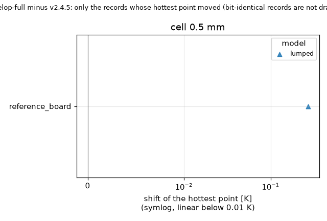

# Results across program versions

Every number comes from result sets of the regression harness (`research/release-regression-245`): the same 17 boards, five models, direct solver, run on each tag extracted with `git archive`; nothing is estimated. A shift is explained only when the table of expected shifts of that release links it to an item; otherwise the CHANGELOG section of the later version is quoted and the shift is left unclassified.

Versions compared (oldest first): v2.4.0, v2.4.1, v2.4.2, v2.4.3, v2.4.4, v2.4.5, develop-full.

## Versions the harness could not run

* v2.0.0, v2.1.0, v2.2.0 and v2.3.0: not run. The harness boards need the board outline API (Board.has_outline, added in 2.4.0); the run stops with AttributeError before the first record, so there are no numbers for these versions.

The last set (develop-full) is the tree of develop at commit 5c29dea, program version still 2.4.5, unreleased 2.5.0. Items of 2.5.0 still missing from develop, per docs/versions.md (Planned): the Gerber import and the zonal Lumped model (research/lumped-zones-adoption is reviewed but not adopted); the cut-cell treatment is moved to 2.6.0. Items already on develop: the memory guard, the two Lumped fixes (footprint potentials in blocks, via warning limits), one LU factor in the animation.

## Hottest point of canonical boards across versions (cell 1 mm, degC)

| Board | Model | v2.4.0 | v2.4.1 | v2.4.2 | v2.4.3 | v2.4.4 | v2.4.5 | develop-full |
| :-- | :-- | --: | --: | --: | --: | --: | --: | --: |
| example_board | fvm | 85.814 | 85.814 | 85.814 | 85.814 | 85.814 | 85.234 | 85.234 |
| example_board | fdm | 84.383 | 84.383 | 84.383 | 84.383 | 84.383 | 85.126 | 85.126 |
| example_board | lumped | 84.659 | 84.659 | 84.659 | 84.659 | 84.659 | 86.628 | 86.628 |
| example_board | analytic | 84.652 | 84.652 | 84.652 | 84.652 | 84.652 | 85.102 | 85.102 |
| example_board | solid3d | 85.975 | 85.975 | 85.975 | 85.975 | 85.975 | 85.975 | 85.975 |
| plate_uniform | fvm | 159.516 | 159.516 | 159.516 | 159.516 | 159.516 | 159.516 | 159.516 |
| plate_uniform | fdm | 159.516 | 159.516 | 159.516 | 159.516 | 159.516 | 159.516 | 159.516 |
| plate_uniform | lumped | 160.360 | 160.360 | 160.390 | 160.390 | 160.390 | 160.390 | 160.390 |
| plate_uniform | analytic | 159.082 | 159.082 | 159.082 | 159.082 | 159.082 | 159.082 | 159.082 |
| plate_uniform | solid3d | 159.723 | 159.723 | 159.723 | 159.723 | 159.723 | 159.723 | 159.723 |
| plate_pad | fvm | 341.794 | 341.794 | 341.794 | 341.794 | 341.794 | 353.384 | 353.384 |
| plate_pad | fdm | 312.263 | 312.263 | 312.263 | 312.263 | 312.263 | 315.249 | 315.249 |
| plate_pad | lumped | 307.391 | 307.391 | 307.435 | 307.435 | 307.435 | 307.435 | 307.435 |
| plate_pad | analytic | 170.997 | 170.997 | 170.997 | 170.997 | 170.997 | 170.997 | 170.997 |
| plate_pad | solid3d | 360.955 | 360.955 | 360.955 | 360.955 | 360.955 | 360.955 | 360.955 |
| plate_vias | fvm | 135.245 | 135.245 | 135.245 | 135.245 | 135.245 | 135.606 | 135.606 |
| plate_vias | fdm | 136.885 | 136.885 | 136.885 | 136.885 | 136.885 | 137.239 | 137.239 |
| plate_vias | lumped | 138.056 | 138.056 | 138.060 | 138.060 | 138.060 | 140.355 | 140.355 |
| plate_vias | analytic | 142.209 | 142.209 | 142.209 | 142.209 | 142.209 | 137.641 | 137.641 |
| plate_vias | solid3d | 135.402 | 135.402 | 135.402 | 135.402 | 135.402 | 135.402 | 135.402 |
| t_outline | fvm | 191.276 | 191.276 | 186.870 | 186.870 | 186.870 | 186.870 | 186.870 |
| t_outline | fdm | 186.541 | 186.541 | 186.541 | 186.541 | 186.541 | 186.541 | 186.541 |
| t_outline | lumped | 138.693 | 138.693 | 134.691 | 134.691 | 134.691 | 134.691 | 134.691 |
| t_outline | analytic | 141.070 | 141.070 | 141.070 | 141.070 | 141.070 | 141.070 | 141.070 |
| t_outline | solid3d | 191.539 | 191.539 | 187.177 | 187.177 | 187.177 | 187.177 | 187.177 |

## Results of develop-full against v2.4.5

Environment of the new set: {'python': '3.13.5', 'numpy': '2.5.4', 'scipy': '1.18.1', 'platform': 'macOS-27.0-arm64-arm-64bit-Mach-O', 'machine': 'arm64'}. Cells in the sets: [2.0, 1.0, 0.5] mm.

Records compared: 251 (skipped or failed in both: 4). Bit-identical in every number and in the warnings: 235. Hottest point moved: 1. Alarms: not applicable, the pair has no table.

No table of expected shifts exists for this pair, so no shift is classified here and none is explained by a cause of mine. What the maintainers recorded for the later version (CHANGELOG, verbatim):

> ## [Unreleased]
> 
> ### Added
> - **Memory guard** (`feature/memory-guard`; `docs/theory.md` 2.7, `docs/validation.md` 26, `research/memory-guard`): the program reads the physical memory, estimates the peak memory of the FVM, the FDM and the 3D solid from their unknown count and the thickness of the graph, and refuses a run above the limit **before** allocating anything, naming the cell that fits (a cheap lower bound first, so a huge board is refused at once). New Preferences field **Memory limit** (fraction of the physical memory, default 0.60, 0.10 to 0.95; a machine preference, not saved in the project; an old project file's value is ignored). The solver panel shows the unknowns and the verdict (ok, slow, refused) of each model, **Run is disabled** with the reason when a model is refused, and **Auto** picks a cell that fits. A run above the memory available now only warns. Time simulations, animations and profile runs count twice the steady estimate. The command line exits with **code 3** on a refusal (2 stays argparse's usage error) and takes `--memory-fraction F`; the variable `PCBTHERMAL_MEMORY_BYTES` states the memory when the machine's limit is not visible. The estimate and the measured peak of each run are logged so that other machines can check the law. The Lumped and the Analytic models are not checked.
> 
> ### Changed
> - The fixed limit of 250 000 unknowns of the 3D solid is replaced by the memory estimate, with an absolute ceiling of 2 million unknowns (`solid3d.size_limit` keeps its meaning as a window for the studies); `solid3d.Solid` checks its own count in its constructor.
> - **SOR guard by bytes** (`fvm.MAX_SOR_BLOCK` removed): the dense inverse of a block costs about 75 n^2 bytes (5 000 unknowns take about 1.9 GB, not the 200 MB the old comment said); the SOR block solve is allowed when the sum over its blocks is at most 25 % of the memory limit, otherwise the direct solver is used and the result says so.
> - **One LU factor in the animation and the transient** (bit-identical frames): the logarithmic time grid kept the factor of every one of its ten steps; it now keeps one, so the peak of an animation is 1.9 times a steady solve instead of 3.5 (on a 111 556-unknown case 2.60 GB became 0.65 GB, a figure reported by the review of the integration).
> 
> ### Fixed
> - **Lumped: footprint potentials of large footprints** (`fix/lumped-footprint-potentials`; `docs/theory.md` 5): the link of the heater footprint to the first ring was 4 to 22 % short on footprints above 900 cells (squares of 20 to 40 mm at a 0.5 mm cell: -4.0, -10.8, -21.6 %) by aliasing of the stride decimation; large footprints are now summed in k x k blocks (within 0.03 % of the all-cell sum on squares, a disc, a rectangle, an L and a ring; the peak term within 0.15 %). Results for footprints of 900 cells or fewer, including the three example boards, are unchanged to the bit. The board maximum at a 0.5 mm cell moves by +1 to +5 K on a 20 W source of 20 to 60 mm on a single copper sheet, and by 0 to +1.1 K at 1 mm. Tests: `tests/test_lumped_footprint.py`. The frozen record `reference_board|lumped|0.5` of `tests/regression/data/v2.4.5.json` moves with it (`t_max` 89.093 to 89.363 degC, `Tj` 79.71 to 79.97 degC) and is refrozen at the 2.5.0 release; the default 2 mm set is unchanged.
> - **Lumped via warnings: the unsafe side** (`fix/lumped-via-warning-limits`; text only, no temperature changes): the 2.4.5 text quoted up to 80 % for an array across the edge of a footprint where up to 221 % of the via effect (the part up to about 11 K, a quarter of its rise, too cool) was measured (`research/lumped-zones-adoption` 8.4). A new warning (`checks.lumped_via_cool_warning`) fires for a part whose via group continues past the footprint edge, stands off its centre (more than 0.1 of the smaller side) or lies under a footprint of side ratio above 1.5; vias farther than twice the array pitch do not count, so scattered vias on a board do not trigger it. The general text now gives up to 14 % of the rise too cool, and the text of the vias outside every part up to 2.3 times the effect (4 K, 9 % of the rise) for an array beside a part.

### Hottest point, every record that moved

The shift in percent is relative to the rise of the old hottest point over the ambient of the record. The item is the one the table of expected shifts links to the shift.

| Board | Model | Cell [mm] | Tmax old [degC] | Tmax new [degC] | Shift [K] | Shift [% of old rise] | Class | Item of the release |
| :-- | :-- | --: | --: | --: | --: | --: | :-- | :-- |
| reference_board | lumped | 0.5 | 89.0933 | 89.3632 | +0.2699 | +0.42 | not classified | no table of expected shifts for this pair; see the CHANGELOG section below |

Records where the hottest point is the same but another number moved (layer mean, a part, the unknowns, the heat split): 0.

### Bit-identical records (steady state, status ok in both)

* example_board: analytic (0.5, 1, 2 mm); fdm (0.5, 1, 2 mm); fvm (0.5, 1, 2 mm); lumped (0.5, 1, 2 mm); solid3d (1, 2 mm)
* example_cut_to_T: analytic (0.5, 1, 2 mm); fdm (0.5, 1, 2 mm); fvm (0.5, 1, 2 mm); lumped (0.5, 1, 2 mm); solid3d (1, 2 mm)
* finned_block: analytic (0.5, 1, 2 mm); fdm (0.5, 1, 2 mm); fvm (0.5, 1, 2 mm); lumped (0.5, 1, 2 mm); solid3d (0.5, 1, 2 mm)
* hatched_copper: analytic (0.5, 1, 2 mm); fdm (0.5, 1, 2 mm); fvm (0.5, 1, 2 mm); lumped (0.5, 1, 2 mm); solid3d (0.5, 1, 2 mm)
* one_layer_full: analytic (0.5, 1, 2 mm); fdm (0.5, 1, 2 mm); fvm (0.5, 1, 2 mm); lumped (0.5, 1, 2 mm); solid3d (0.5, 1, 2 mm)
* one_layer_pad: analytic (0.5, 1, 2 mm); fdm (0.5, 1, 2 mm); fvm (0.5, 1, 2 mm); lumped (0.5, 1, 2 mm); solid3d (0.5, 1, 2 mm)
* part_across_outline: analytic (0.5, 1, 2 mm); fdm (0.5, 1, 2 mm); fvm (0.5, 1, 2 mm); lumped (0.5, 1, 2 mm); solid3d (0.5, 1, 2 mm)
* part_top_path: analytic (0.5, 1, 2 mm); fdm (0.5, 1, 2 mm); fvm (0.5, 1, 2 mm); lumped (0.5, 1, 2 mm); solid3d (0.5, 1, 2 mm)
* plate_lone_via: analytic (0.5, 1, 2 mm); fdm (0.5, 1, 2 mm); fvm (0.5, 1, 2 mm); lumped (0.5, 1, 2 mm); solid3d (0.5, 1, 2 mm)
* plate_pad: analytic (0.5, 1, 2 mm); fdm (0.5, 1, 2 mm); fvm (0.5, 1, 2 mm); lumped (0.5, 1, 2 mm); solid3d (0.5, 1, 2 mm)
* plate_uniform: analytic (0.5, 1, 2 mm); fdm (0.5, 1, 2 mm); fvm (0.5, 1, 2 mm); lumped (0.5, 1, 2 mm); solid3d (0.5, 1, 2 mm)
* plate_vias: analytic (0.5, 1, 2 mm); fdm (0.5, 1, 2 mm); fvm (0.5, 1, 2 mm); lumped (0.5, 1, 2 mm); solid3d (0.5, 1, 2 mm)
* profile_board: analytic (0.5, 1, 2 mm); fdm (0.5, 1, 2 mm); fvm (0.5, 1, 2 mm); lumped (0.5, 1, 2 mm); solid3d (1, 2 mm)
* reference_board: analytic (0.5, 1, 2 mm); fdm (0.5, 1, 2 mm); fvm (0.5, 1, 2 mm); lumped (1, 2 mm); solid3d (1, 2 mm)
* round_outline: analytic (0.5, 1, 2 mm); fdm (0.5, 1, 2 mm); fvm (0.5, 1, 2 mm); lumped (0.5, 1, 2 mm); solid3d (0.5, 1, 2 mm)
* t_outline: analytic (0.5, 1, 2 mm); fdm (0.5, 1, 2 mm); fvm (0.5, 1, 2 mm); lumped (0.5, 1, 2 mm); solid3d (0.5, 1, 2 mm)
* two_layer_partial: analytic (0.5, 1, 2 mm); fdm (0.5, 1, 2 mm); fvm (0.5, 1, 2 mm); lumped (0.5, 1, 2 mm); solid3d (0.5, 1, 2 mm)

### Time to 63 % of the steady resistance that moved

None: every time to 63 % is identical.

### Warning texts that changed

* example_board / lumped / 0.5 mm: added: U1: 9 vias under the footprint; the Lumped model joins the planes through a well and the barrel of each ring, so its via effect was measured from 21 % too small (the part too hot) to 33 % too large (the part too cool by up to 14 % of its rise: dense arrays that cover a quarter or less of a large footprint, sparse arrays and rows; 8 to 20 % on average over 46 boards, 11 % over 36 more); use the FVM for via design. | removed: U1: 9 vias under the footprint; the Lumped model joins the planes through a well and the barrel of each ring, so its via effect was measured from 21 % too small (the part too hot) to 33 % too large (the part too cool: dense arrays that cover a quarter or less of a large footprint, sparse arrays and rows), and up to 80 % too large for an array across the edge of the footprint (8 to 20 % on average over 46 boards, 11 % over 36 more); use the FVM for via design.
* example_board / lumped / 1 mm: added: U1: 9 vias under the footprint; the Lumped model joins the planes through a well and the barrel of each ring, so its via effect was measured from 21 % too small (the part too hot) to 33 % too large (the part too cool by up to 14 % of its rise: dense arrays that cover a quarter or less of a large footprint, sparse arrays and rows; 8 to 20 % on average over 46 boards, 11 % over 36 more); use the FVM for via design. | removed: U1: 9 vias under the footprint; the Lumped model joins the planes through a well and the barrel of each ring, so its via effect was measured from 21 % too small (the part too hot) to 33 % too large (the part too cool: dense arrays that cover a quarter or less of a large footprint, sparse arrays and rows), and up to 80 % too large for an array across the edge of the footprint (8 to 20 % on average over 46 boards, 11 % over 36 more); use the FVM for via design.
* example_board / lumped / 2 mm: added: U1: 9 vias under the footprint; the Lumped model joins the planes through a well and the barrel of each ring, so its via effect was measured from 21 % too small (the part too hot) to 33 % too large (the part too cool by up to 14 % of its rise: dense arrays that cover a quarter or less of a large footprint, sparse arrays and rows; 8 to 20 % on average over 46 boards, 11 % over 36 more); use the FVM for via design. | removed: U1: 9 vias under the footprint; the Lumped model joins the planes through a well and the barrel of each ring, so its via effect was measured from 21 % too small (the part too hot) to 33 % too large (the part too cool: dense arrays that cover a quarter or less of a large footprint, sparse arrays and rows), and up to 80 % too large for an array across the edge of the footprint (8 to 20 % on average over 46 boards, 11 % over 36 more); use the FVM for via design.
* example_cut_to_T / lumped / 0.5 mm: added: U1: 9 vias under the footprint; the Lumped model joins the planes through a well and the barrel of each ring, so its via effect was measured from 21 % too small (the part too hot) to 33 % too large (the part too cool by up to 14 % of its rise: dense arrays that cover a quarter or less of a large footprint, sparse arrays and rows; 8 to 20 % on average over 46 boards, 11 % over 36 more); use the FVM for via design. | removed: U1: 9 vias under the footprint; the Lumped model joins the planes through a well and the barrel of each ring, so its via effect was measured from 21 % too small (the part too hot) to 33 % too large (the part too cool: dense arrays that cover a quarter or less of a large footprint, sparse arrays and rows), and up to 80 % too large for an array across the edge of the footprint (8 to 20 % on average over 46 boards, 11 % over 36 more); use the FVM for via design.
* example_cut_to_T / lumped / 1 mm: added: U1: 9 vias under the footprint; the Lumped model joins the planes through a well and the barrel of each ring, so its via effect was measured from 21 % too small (the part too hot) to 33 % too large (the part too cool by up to 14 % of its rise: dense arrays that cover a quarter or less of a large footprint, sparse arrays and rows; 8 to 20 % on average over 46 boards, 11 % over 36 more); use the FVM for via design. | removed: U1: 9 vias under the footprint; the Lumped model joins the planes through a well and the barrel of each ring, so its via effect was measured from 21 % too small (the part too hot) to 33 % too large (the part too cool: dense arrays that cover a quarter or less of a large footprint, sparse arrays and rows), and up to 80 % too large for an array across the edge of the footprint (8 to 20 % on average over 46 boards, 11 % over 36 more); use the FVM for via design.
* example_cut_to_T / lumped / 2 mm: added: U1: 9 vias under the footprint; the Lumped model joins the planes through a well and the barrel of each ring, so its via effect was measured from 21 % too small (the part too hot) to 33 % too large (the part too cool by up to 14 % of its rise: dense arrays that cover a quarter or less of a large footprint, sparse arrays and rows; 8 to 20 % on average over 46 boards, 11 % over 36 more); use the FVM for via design. | removed: U1: 9 vias under the footprint; the Lumped model joins the planes through a well and the barrel of each ring, so its via effect was measured from 21 % too small (the part too hot) to 33 % too large (the part too cool: dense arrays that cover a quarter or less of a large footprint, sparse arrays and rows), and up to 80 % too large for an array across the edge of the footprint (8 to 20 % on average over 46 boards, 11 % over 36 more); use the FVM for via design.
* plate_lone_via / lumped / 0.5 mm: added: U: 1 via under the footprint; the Lumped model joins the planes through a well and the barrel of each ring, so its via effect was measured from 21 % too small (the part too hot) to 33 % too large (the part too cool by up to 14 % of its rise: dense arrays that cover a quarter or less of a large footprint, sparse arrays and rows; 8 to 20 % on average over 46 boards, 11 % over 36 more); use the FVM for via design. | removed: U: 1 via under the footprint; the Lumped model joins the planes through a well and the barrel of each ring, so its via effect was measured from 21 % too small (the part too hot) to 33 % too large (the part too cool: dense arrays that cover a quarter or less of a large footprint, sparse arrays and rows), and up to 80 % too large for an array across the edge of the footprint (8 to 20 % on average over 46 boards, 11 % over 36 more); use the FVM for via design.
* plate_lone_via / lumped / 1 mm: added: U: 1 via under the footprint; the Lumped model joins the planes through a well and the barrel of each ring, so its via effect was measured from 21 % too small (the part too hot) to 33 % too large (the part too cool by up to 14 % of its rise: dense arrays that cover a quarter or less of a large footprint, sparse arrays and rows; 8 to 20 % on average over 46 boards, 11 % over 36 more); use the FVM for via design. | removed: U: 1 via under the footprint; the Lumped model joins the planes through a well and the barrel of each ring, so its via effect was measured from 21 % too small (the part too hot) to 33 % too large (the part too cool: dense arrays that cover a quarter or less of a large footprint, sparse arrays and rows), and up to 80 % too large for an array across the edge of the footprint (8 to 20 % on average over 46 boards, 11 % over 36 more); use the FVM for via design.
* plate_lone_via / lumped / 2 mm: added: U: 1 via under the footprint; the Lumped model joins the planes through a well and the barrel of each ring, so its via effect was measured from 21 % too small (the part too hot) to 33 % too large (the part too cool by up to 14 % of its rise: dense arrays that cover a quarter or less of a large footprint, sparse arrays and rows; 8 to 20 % on average over 46 boards, 11 % over 36 more); use the FVM for via design. | removed: U: 1 via under the footprint; the Lumped model joins the planes through a well and the barrel of each ring, so its via effect was measured from 21 % too small (the part too hot) to 33 % too large (the part too cool: dense arrays that cover a quarter or less of a large footprint, sparse arrays and rows), and up to 80 % too large for an array across the edge of the footprint (8 to 20 % on average over 46 boards, 11 % over 36 more); use the FVM for via design.
* plate_vias / lumped / 0.5 mm: added: U: 16 vias under the footprint; the Lumped model joins the planes through a well and the barrel of each ring, so its via effect was measured from 21 % too small (the part too hot) to 33 % too large (the part too cool by up to 14 % of its rise: dense arrays that cover a quarter or less of a large footprint, sparse arrays and rows; 8 to 20 % on average over 46 boards, 11 % over 36 more); use the FVM for via design. | removed: U: 16 vias under the footprint; the Lumped model joins the planes through a well and the barrel of each ring, so its via effect was measured from 21 % too small (the part too hot) to 33 % too large (the part too cool: dense arrays that cover a quarter or less of a large footprint, sparse arrays and rows), and up to 80 % too large for an array across the edge of the footprint (8 to 20 % on average over 46 boards, 11 % over 36 more); use the FVM for via design.
* plate_vias / lumped / 1 mm: added: U: 16 vias under the footprint; the Lumped model joins the planes through a well and the barrel of each ring, so its via effect was measured from 21 % too small (the part too hot) to 33 % too large (the part too cool by up to 14 % of its rise: dense arrays that cover a quarter or less of a large footprint, sparse arrays and rows; 8 to 20 % on average over 46 boards, 11 % over 36 more); use the FVM for via design. | removed: U: 16 vias under the footprint; the Lumped model joins the planes through a well and the barrel of each ring, so its via effect was measured from 21 % too small (the part too hot) to 33 % too large (the part too cool: dense arrays that cover a quarter or less of a large footprint, sparse arrays and rows), and up to 80 % too large for an array across the edge of the footprint (8 to 20 % on average over 46 boards, 11 % over 36 more); use the FVM for via design.
* plate_vias / lumped / 2 mm: added: U: 16 vias under the footprint; the Lumped model joins the planes through a well and the barrel of each ring, so its via effect was measured from 21 % too small (the part too hot) to 33 % too large (the part too cool by up to 14 % of its rise: dense arrays that cover a quarter or less of a large footprint, sparse arrays and rows; 8 to 20 % on average over 46 boards, 11 % over 36 more); use the FVM for via design. | removed: U: 16 vias under the footprint; the Lumped model joins the planes through a well and the barrel of each ring, so its via effect was measured from 21 % too small (the part too hot) to 33 % too large (the part too cool: dense arrays that cover a quarter or less of a large footprint, sparse arrays and rows), and up to 80 % too large for an array across the edge of the footprint (8 to 20 % on average over 46 boards, 11 % over 36 more); use the FVM for via design.
* profile_board / lumped / 0.5 mm: added: U1: 9 vias under the footprint; the Lumped model joins the planes through a well and the barrel of each ring, so its via effect was measured from 21 % too small (the part too hot) to 33 % too large (the part too cool by up to 14 % of its rise: dense arrays that cover a quarter or less of a large footprint, sparse arrays and rows; 8 to 20 % on average over 46 boards, 11 % over 36 more); use the FVM for via design. | removed: U1: 9 vias under the footprint; the Lumped model joins the planes through a well and the barrel of each ring, so its via effect was measured from 21 % too small (the part too hot) to 33 % too large (the part too cool: dense arrays that cover a quarter or less of a large footprint, sparse arrays and rows), and up to 80 % too large for an array across the edge of the footprint (8 to 20 % on average over 46 boards, 11 % over 36 more); use the FVM for via design.
* profile_board / lumped / 1 mm: added: U1: 9 vias under the footprint; the Lumped model joins the planes through a well and the barrel of each ring, so its via effect was measured from 21 % too small (the part too hot) to 33 % too large (the part too cool by up to 14 % of its rise: dense arrays that cover a quarter or less of a large footprint, sparse arrays and rows; 8 to 20 % on average over 46 boards, 11 % over 36 more); use the FVM for via design. | removed: U1: 9 vias under the footprint; the Lumped model joins the planes through a well and the barrel of each ring, so its via effect was measured from 21 % too small (the part too hot) to 33 % too large (the part too cool: dense arrays that cover a quarter or less of a large footprint, sparse arrays and rows), and up to 80 % too large for an array across the edge of the footprint (8 to 20 % on average over 46 boards, 11 % over 36 more); use the FVM for via design.
* profile_board / lumped / 2 mm: added: U1: 9 vias under the footprint; the Lumped model joins the planes through a well and the barrel of each ring, so its via effect was measured from 21 % too small (the part too hot) to 33 % too large (the part too cool by up to 14 % of its rise: dense arrays that cover a quarter or less of a large footprint, sparse arrays and rows; 8 to 20 % on average over 46 boards, 11 % over 36 more); use the FVM for via design. | removed: U1: 9 vias under the footprint; the Lumped model joins the planes through a well and the barrel of each ring, so its via effect was measured from 21 % too small (the part too hot) to 33 % too large (the part too cool: dense arrays that cover a quarter or less of a large footprint, sparse arrays and rows), and up to 80 % too large for an array across the edge of the footprint (8 to 20 % on average over 46 boards, 11 % over 36 more); use the FVM for via design.

### Figure

*Figure 04 (`figures/fig_04_version_shift_v2.4.5_vs_develop_full.png`): the shift of the hottest point of every record that moved, per board and model, one panel per cell size; symmetric-log axis, linear below 0.01 K.*

## Results of v2.4.5 against v2.4.4

Environment of the new set: {'python': '3.13.5', 'numpy': '2.5.4', 'scipy': '1.18.1', 'platform': 'macOS-27.0-arm64-arm-64bit-Mach-O', 'machine': 'arm64'}. Cells in the sets: [2.0, 1.0, 0.5] mm.

Records compared: 251 (skipped or failed in both: 4). Bit-identical in every number and in the warnings: 113. Hottest point moved: 113. Alarms (unexplained, must-not-move, out of range): 0.

| Class of the shifted numbers (all metrics) | Count |
| :-- | --: |
| expected | 1422 |
| expected_out_of_range | 0 |
| to_be_explained | 0 |
| unexplained | 0 |
| must_not_move | 0 |
| warnings_only | 14 |

### Items of the release

| Item | What |
| :-- | :-- |
| I1 | Part across the board outline |
| I2 | Board cover sampled 8 x 8 |
| I3 | Laminate nodes for patterned copper |
| I4 | Vias converge with the cell (point via) and block SOR |
| I5 | Constriction of the heat on a via in the Lumped and Analytic models |
| I6 | SOR relaxation factor (Young omega) |
| I7 | Warnings only |
| I8 | Documents, docstrings, theory |
| I9 | Power Calculator row of the CSD17308Q3 |

### Hottest point, every record that moved

The shift in percent is relative to the rise of the old hottest point over the ambient of the record. The item is the one the table of expected shifts links to the shift.

| Board | Model | Cell [mm] | Tmax old [degC] | Tmax new [degC] | Shift [K] | Shift [% of old rise] | Class | Item of the release |
| :-- | :-- | --: | --: | --: | --: | --: | :-- | :-- |
| example_board | analytic | 2 | 84.6522 | 85.1021 | +0.4498 | +0.75 | expected | I5 Constriction of the heat on a via in the Lumped and Analytic models |
| example_board | fdm | 2 | 84.6643 | 84.2657 | -0.3986 | -0.67 | expected | I4 Vias converge with the cell (point via) and block SOR |
| example_board | fvm | 2 | 85.3423 | 85.0746 | -0.2676 | -0.44 | expected | I4 Vias converge with the cell (point via) and block SOR |
| example_board | lumped | 2 | 84.6586 | 86.6277 | +1.9691 | +3.30 | expected | I5 Constriction of the heat on a via in the Lumped and Analytic models |
| example_cut_to_T | analytic | 2 | 91.3379 | 91.9041 | +0.5662 | +0.85 | expected | I5 Constriction of the heat on a via in the Lumped and Analytic models |
| example_cut_to_T | fdm | 2 | 93.6862 | 93.7156 | +0.0294 | +0.04 | expected | I3 Laminate nodes for patterned copper; I4 Vias converge with the cell (point via) and block SOR |
| example_cut_to_T | fvm | 2 | 93.9936 | 94.4545 | +0.4609 | +0.67 | expected | I3 Laminate nodes for patterned copper; I2 Board cover sampled 8 x 8; I4 Vias converge with the cell (point via) and block SOR |
| example_cut_to_T | lumped | 2 | 91.3742 | 93.1443 | +1.7701 | +2.67 | expected | I5 Constriction of the heat on a via in the Lumped and Analytic models |
| hatched_copper | fdm | 2 | 111.4265 | 112.0085 | +0.5820 | +0.67 | expected | I3 Laminate nodes for patterned copper |
| hatched_copper | fvm | 2 | 111.4244 | 112.0050 | +0.5806 | +0.67 | expected | I3 Laminate nodes for patterned copper |
| one_layer_full | fdm | 2 | 55.3611 | 55.3551 | -0.0060 | -0.02 | expected | I3 Laminate nodes for patterned copper |
| one_layer_full | fvm | 2 | 55.3611 | 55.3551 | -0.0060 | -0.02 | expected | I3 Laminate nodes for patterned copper |
| one_layer_pad | fdm | 2 | 81.0749 | 81.1920 | +0.1171 | +0.21 | expected | I3 Laminate nodes for patterned copper |
| one_layer_pad | fvm | 2 | 94.3139 | 95.5649 | +1.2510 | +1.80 | expected | I3 Laminate nodes for patterned copper |
| part_across_outline | fdm | 2 | 246.7576 | 230.5204 | -16.2372 | -7.32 | expected | I1 Part across the board outline |
| part_across_outline | fvm | 2 | 231.6459 | 229.9490 | -1.6969 | -0.82 | expected | I1 Part across the board outline; I2 Board cover sampled 8 x 8 |
| part_across_outline | solid3d | 2 | 232.6448 | 230.9185 | -1.7263 | -0.83 | expected | I1 Part across the board outline; I2 Board cover sampled 8 x 8 |
| part_top_path | fdm | 2 | 71.3533 | 71.5911 | +0.2379 | +0.51 | expected | I3 Laminate nodes for patterned copper |
| part_top_path | fvm | 2 | 73.8188 | 74.7096 | +0.8908 | +1.82 | expected | I3 Laminate nodes for patterned copper |
| plate_lone_via | analytic | 2 | 155.4761 | 152.1101 | -3.3661 | -2.58 | expected | I5 Constriction of the heat on a via in the Lumped and Analytic models |
| plate_lone_via | fdm | 2 | 147.9627 | 148.6873 | +0.7246 | +0.59 | expected | I4 Vias converge with the cell (point via) and block SOR |
| plate_lone_via | fvm | 2 | 152.7777 | 151.5199 | -1.2578 | -0.98 | expected | I4 Vias converge with the cell (point via) and block SOR |
| plate_lone_via | lumped | 2 | 153.8039 | 154.4795 | +0.6756 | +0.52 | expected | I5 Constriction of the heat on a via in the Lumped and Analytic models |
| plate_pad | fdm | 2 | 289.9771 | 291.2924 | +1.3153 | +0.50 | expected | I3 Laminate nodes for patterned copper |
| plate_pad | fvm | 2 | 345.1313 | 362.6071 | +17.4758 | +5.46 | expected | I3 Laminate nodes for patterned copper |
| plate_vias | analytic | 2 | 142.2092 | 137.6411 | -4.5681 | -3.90 | expected | I5 Constriction of the heat on a via in the Lumped and Analytic models |
| plate_vias | fdm | 2 | 132.6113 | 133.4338 | +0.8225 | +0.76 | expected | I4 Vias converge with the cell (point via) and block SOR |
| plate_vias | fvm | 2 | 136.7664 | 137.7239 | +0.9576 | +0.86 | expected | I4 Vias converge with the cell (point via) and block SOR |
| plate_vias | lumped | 2 | 138.0602 | 140.3555 | +2.2953 | +2.03 | expected | I5 Constriction of the heat on a via in the Lumped and Analytic models |
| profile_board | analytic | 2 | 84.6522 | 85.1021 | +0.4498 | +0.75 | expected | I5 Constriction of the heat on a via in the Lumped and Analytic models |
| profile_board | fdm | 2 | 84.6643 | 84.2657 | -0.3986 | -0.67 | expected | I4 Vias converge with the cell (point via) and block SOR |
| profile_board | fvm | 2 | 85.3423 | 85.0746 | -0.2676 | -0.44 | expected | I4 Vias converge with the cell (point via) and block SOR |
| profile_board | lumped | 2 | 84.6586 | 86.6277 | +1.9691 | +3.30 | expected | I5 Constriction of the heat on a via in the Lumped and Analytic models |
| round_outline | fvm | 2 | 174.9731 | 174.9929 | +0.0198 | +0.01 | expected | I2 Board cover sampled 8 x 8 |
| round_outline | solid3d | 2 | 175.7021 | 175.7478 | +0.0457 | +0.03 | expected | I2 Board cover sampled 8 x 8 |
| two_layer_partial | fdm | 2 | 159.0593 | 159.6119 | +0.5526 | +0.41 | expected | I3 Laminate nodes for patterned copper |
| two_layer_partial | fvm | 2 | 161.2585 | 162.6181 | +1.3596 | +1.00 | expected | I3 Laminate nodes for patterned copper |
| example_board | analytic | 1 | 84.6522 | 85.1021 | +0.4498 | +0.75 | expected | I5 Constriction of the heat on a via in the Lumped and Analytic models |
| example_board | fdm | 1 | 84.3829 | 85.1260 | +0.7432 | +1.25 | expected | I3 Laminate nodes for patterned copper; I4 Vias converge with the cell (point via) and block SOR |
| example_board | fvm | 1 | 85.8143 | 85.2335 | -0.5808 | -0.95 | expected | I4 Vias converge with the cell (point via) and block SOR |
| example_board | lumped | 1 | 84.6586 | 86.6277 | +1.9691 | +3.30 | expected | I5 Constriction of the heat on a via in the Lumped and Analytic models |
| example_cut_to_T | analytic | 1 | 91.3379 | 91.9041 | +0.5662 | +0.85 | expected | I5 Constriction of the heat on a via in the Lumped and Analytic models |
| example_cut_to_T | fdm | 1 | 93.1590 | 94.3333 | +1.1743 | +1.72 | expected | I3 Laminate nodes for patterned copper; I4 Vias converge with the cell (point via) and block SOR |
| example_cut_to_T | fvm | 1 | 94.6742 | 94.5009 | -0.1733 | -0.25 | expected | I1 Part across the board outline; I2 Board cover sampled 8 x 8; I4 Vias converge with the cell (point via) and block SOR |
| example_cut_to_T | lumped | 1 | 91.3742 | 93.1443 | +1.7701 | +2.67 | expected | I5 Constriction of the heat on a via in the Lumped and Analytic models |
| hatched_copper | fdm | 1 | 111.6499 | 112.2389 | +0.5890 | +0.68 | expected | I3 Laminate nodes for patterned copper |
| hatched_copper | fvm | 1 | 111.6492 | 112.2367 | +0.5875 | +0.68 | expected | I3 Laminate nodes for patterned copper |
| one_layer_full | fdm | 1 | 55.4475 | 55.4415 | -0.0061 | -0.02 | expected | I3 Laminate nodes for patterned copper |
| one_layer_full | fvm | 1 | 55.4475 | 55.4415 | -0.0061 | -0.02 | expected | I3 Laminate nodes for patterned copper |
| one_layer_pad | fdm | 1 | 85.6770 | 85.9040 | +0.2270 | +0.37 | expected | I3 Laminate nodes for patterned copper |
| one_layer_pad | fvm | 1 | 92.7492 | 93.7159 | +0.9666 | +1.43 | expected | I3 Laminate nodes for patterned copper |
| part_across_outline | fdm | 1 | 252.0294 | 230.2339 | -21.7955 | -9.60 | expected | I1 Part across the board outline |
| part_across_outline | fvm | 1 | 243.7245 | 230.0426 | -13.6819 | -6.26 | expected | I1 Part across the board outline; I2 Board cover sampled 8 x 8 |
| part_across_outline | solid3d | 1 | 245.2111 | 231.1502 | -14.0610 | -6.39 | expected | I1 Part across the board outline; I2 Board cover sampled 8 x 8 |
| part_top_path | fdm | 1 | 72.3425 | 72.7044 | +0.3619 | +0.76 | expected | I3 Laminate nodes for patterned copper |
| part_top_path | fvm | 1 | 73.3252 | 74.0979 | +0.7726 | +1.60 | expected | I3 Laminate nodes for patterned copper |
| plate_lone_via | analytic | 1 | 155.4761 | 152.1101 | -3.3661 | -2.58 | expected | I5 Constriction of the heat on a via in the Lumped and Analytic models |
| plate_lone_via | fdm | 1 | 149.6646 | 149.8734 | +0.2088 | +0.17 | expected | I4 Vias converge with the cell (point via) and block SOR |
| plate_lone_via | fvm | 1 | 151.8262 | 150.3788 | -1.4474 | -1.14 | expected | I4 Vias converge with the cell (point via) and block SOR |
| plate_lone_via | lumped | 1 | 153.8039 | 154.4795 | +0.6756 | +0.52 | expected | I5 Constriction of the heat on a via in the Lumped and Analytic models |
| plate_pad | fdm | 1 | 312.2633 | 315.2488 | +2.9854 | +1.04 | expected | I3 Laminate nodes for patterned copper |
| plate_pad | fvm | 1 | 341.7945 | 353.3838 | +11.5893 | +3.66 | expected | I3 Laminate nodes for patterned copper |
| plate_vias | analytic | 1 | 142.2092 | 137.6411 | -4.5681 | -3.90 | expected | I5 Constriction of the heat on a via in the Lumped and Analytic models |
| plate_vias | fdm | 1 | 136.8845 | 137.2392 | +0.3547 | +0.32 | expected | I4 Vias converge with the cell (point via) and block SOR |
| plate_vias | fvm | 1 | 135.2454 | 135.6061 | +0.3607 | +0.33 | expected | I4 Vias converge with the cell (point via) and block SOR |
| plate_vias | lumped | 1 | 138.0602 | 140.3555 | +2.2953 | +2.03 | expected | I5 Constriction of the heat on a via in the Lumped and Analytic models |
| profile_board | analytic | 1 | 84.6522 | 85.1021 | +0.4498 | +0.75 | expected | I5 Constriction of the heat on a via in the Lumped and Analytic models |
| profile_board | fdm | 1 | 84.3829 | 85.1260 | +0.7432 | +1.25 | expected | I3 Laminate nodes for patterned copper; I4 Vias converge with the cell (point via) and block SOR |
| profile_board | fvm | 1 | 85.8143 | 85.2335 | -0.5808 | -0.95 | expected | I4 Vias converge with the cell (point via) and block SOR |
| profile_board | lumped | 1 | 84.6586 | 86.6277 | +1.9691 | +3.30 | expected | I5 Constriction of the heat on a via in the Lumped and Analytic models |
| round_outline | fvm | 1 | 175.4392 | 175.4300 | -0.0092 | -0.01 | expected | I2 Board cover sampled 8 x 8 |
| round_outline | solid3d | 1 | 176.1642 | 176.1768 | +0.0127 | +0.01 | expected | I2 Board cover sampled 8 x 8 |
| two_layer_partial | fdm | 1 | 160.5649 | 161.3952 | +0.8303 | +0.61 | expected | I3 Laminate nodes for patterned copper |
| two_layer_partial | fvm | 1 | 162.1087 | 163.4703 | +1.3616 | +0.99 | expected | I3 Laminate nodes for patterned copper |
| example_board | analytic | 0.5 | 84.6914 | 85.2167 | +0.5252 | +0.88 | expected | I5 Constriction of the heat on a via in the Lumped and Analytic models |
| example_board | fdm | 0.5 | 85.2200 | 85.1200 | -0.0999 | -0.17 | expected | I4 Vias converge with the cell (point via) and block SOR |
| example_board | fvm | 0.5 | 85.8744 | 85.1808 | -0.6936 | -1.14 | expected | I4 Vias converge with the cell (point via) and block SOR |
| example_board | lumped | 0.5 | 83.5399 | 85.4469 | +1.9070 | +3.26 | expected | I5 Constriction of the heat on a via in the Lumped and Analytic models |
| example_cut_to_T | analytic | 0.5 | 91.3442 | 91.9344 | +0.5902 | +0.89 | expected | I5 Constriction of the heat on a via in the Lumped and Analytic models |
| example_cut_to_T | fdm | 0.5 | 94.4435 | 94.3409 | -0.1025 | -0.15 | expected | I1 Part across the board outline; I4 Vias converge with the cell (point via) and block SOR |
| example_cut_to_T | fvm | 0.5 | 94.7762 | 94.4302 | -0.3459 | -0.50 | expected | I1 Part across the board outline; I2 Board cover sampled 8 x 8; I4 Vias converge with the cell (point via) and block SOR |
| example_cut_to_T | lumped | 0.5 | 91.1313 | 92.9413 | +1.8100 | +2.74 | expected | I5 Constriction of the heat on a via in the Lumped and Analytic models |
| hatched_copper | fdm | 0.5 | 111.7070 | 112.2980 | +0.5910 | +0.68 | expected | I3 Laminate nodes for patterned copper |
| hatched_copper | fvm | 0.5 | 111.7068 | 112.2967 | +0.5899 | +0.68 | expected | I3 Laminate nodes for patterned copper |
| one_layer_full | fdm | 0.5 | 55.4699 | 55.4638 | -0.0061 | -0.02 | expected | I3 Laminate nodes for patterned copper |
| one_layer_full | fvm | 0.5 | 55.4699 | 55.4638 | -0.0061 | -0.02 | expected | I3 Laminate nodes for patterned copper |
| one_layer_pad | fdm | 0.5 | 88.5866 | 88.9805 | +0.3939 | +0.62 | expected | I3 Laminate nodes for patterned copper |
| one_layer_pad | fvm | 0.5 | 92.1564 | 92.9336 | +0.7773 | +1.16 | expected | I3 Laminate nodes for patterned copper |
| part_across_outline | fdm | 0.5 | 234.8561 | 229.1729 | -5.6831 | -2.71 | expected | I1 Part across the board outline |
| part_across_outline | fvm | 0.5 | 232.8846 | 229.1716 | -3.7130 | -1.79 | expected | I1 Part across the board outline; I2 Board cover sampled 8 x 8 |
| part_across_outline | solid3d | 0.5 | 233.9440 | 230.1227 | -3.8213 | -1.83 | expected | I1 Part across the board outline; I2 Board cover sampled 8 x 8 |
| part_top_path | fdm | 0.5 | 72.7528 | 73.2427 | +0.4899 | +1.03 | expected | I3 Laminate nodes for patterned copper |
| part_top_path | fvm | 0.5 | 73.2706 | 73.9654 | +0.6949 | +1.44 | expected | I3 Laminate nodes for patterned copper |
| plate_lone_via | analytic | 0.5 | 155.7533 | 152.2283 | -3.5250 | -2.70 | expected | I5 Constriction of the heat on a via in the Lumped and Analytic models |
| plate_lone_via | fdm | 0.5 | 150.1164 | 150.0614 | -0.0549 | -0.04 | expected | I4 Vias converge with the cell (point via) and block SOR |
| plate_lone_via | fvm | 0.5 | 150.9823 | 150.2451 | -0.7372 | -0.59 | expected | I4 Vias converge with the cell (point via) and block SOR |
| plate_lone_via | lumped | 0.5 | 153.7504 | 154.4345 | +0.6842 | +0.53 | expected | I5 Constriction of the heat on a via in the Lumped and Analytic models |
| plate_lone_via | solid3d | 0.5 | 151.5025 | 151.3630 | -0.1395 | -0.11 | expected | I4 Vias converge with the cell (point via) and block SOR |
| plate_pad | fdm | 0.5 | 325.3730 | 330.3285 | +4.9556 | +1.65 | expected | I3 Laminate nodes for patterned copper |
| plate_pad | fvm | 0.5 | 340.7071 | 349.5995 | +8.8924 | +2.82 | expected | I3 Laminate nodes for patterned copper |
| plate_vias | analytic | 0.5 | 142.5777 | 137.8125 | -4.7652 | -4.05 | expected | I5 Constriction of the heat on a via in the Lumped and Analytic models |
| plate_vias | fdm | 0.5 | 137.2135 | 136.3377 | -0.8758 | -0.78 | expected | I4 Vias converge with the cell (point via) and block SOR |
| plate_vias | fvm | 0.5 | 136.3506 | 136.2417 | -0.1089 | -0.10 | expected | I4 Vias converge with the cell (point via) and block SOR |
| plate_vias | lumped | 0.5 | 137.8315 | 140.1495 | +2.3180 | +2.05 | expected | I5 Constriction of the heat on a via in the Lumped and Analytic models |
| plate_vias | solid3d | 0.5 | 136.5061 | 136.3589 | -0.1472 | -0.13 | expected | I4 Vias converge with the cell (point via) and block SOR |
| profile_board | analytic | 0.5 | 84.6914 | 85.2167 | +0.5252 | +0.88 | expected | I5 Constriction of the heat on a via in the Lumped and Analytic models |
| profile_board | fdm | 0.5 | 85.2200 | 85.1200 | -0.0999 | -0.17 | expected | I4 Vias converge with the cell (point via) and block SOR |
| profile_board | fvm | 0.5 | 85.8744 | 85.1808 | -0.6936 | -1.14 | expected | I4 Vias converge with the cell (point via) and block SOR |
| profile_board | lumped | 0.5 | 83.5399 | 85.4469 | +1.9070 | +3.26 | expected | I5 Constriction of the heat on a via in the Lumped and Analytic models |
| round_outline | fvm | 0.5 | 175.5455 | 175.5516 | +0.0061 | +0.00 | expected | I2 Board cover sampled 8 x 8 |
| round_outline | solid3d | 0.5 | 176.2478 | 176.2634 | +0.0156 | +0.01 | expected | I2 Board cover sampled 8 x 8 |
| two_layer_partial | fdm | 0.5 | 161.2839 | 162.2960 | +1.0121 | +0.74 | expected | I3 Laminate nodes for patterned copper |
| two_layer_partial | fvm | 0.5 | 162.0783 | 163.3350 | +1.2567 | +0.92 | expected | I3 Laminate nodes for patterned copper |

Records where the hottest point is the same but another number moved (layer mean, a part, the unknowns, the heat split): 11.

* part_across_outline / analytic / 0.5 mm: part:U:t_mean
* part_across_outline / analytic / 1 mm: part:U:t_mean
* part_across_outline / analytic / 2 mm: part:U:t_mean
* round_outline / analytic / 0.5 mm: part:U:t_mean
* round_outline / analytic / 1 mm: part:U:t_mean
* round_outline / analytic / 2 mm: part:U:t_mean
* t_outline / analytic / 0.5 mm: part:U:t_mean
* t_outline / analytic / 1 mm: part:U:t_mean
* t_outline / lumped / 1 mm: part:U:t_mean
* t_outline / analytic / 2 mm: part:U:t_mean
* t_outline / lumped / 2 mm: part:U:t_mean

### Bit-identical records (steady state, status ok in both)

* example_board: solid3d (1, 2 mm)
* example_cut_to_T: solid3d (1, 2 mm)
* finned_block: analytic (0.5, 1, 2 mm); fdm (0.5, 1, 2 mm); fvm (0.5, 1, 2 mm); lumped (0.5, 1, 2 mm); solid3d (0.5, 1, 2 mm)
* hatched_copper: analytic (0.5, 1, 2 mm); lumped (0.5, 1, 2 mm); solid3d (0.5, 1, 2 mm)
* one_layer_full: analytic (0.5, 1, 2 mm); lumped (0.5, 1, 2 mm); solid3d (0.5, 1, 2 mm)
* one_layer_pad: analytic (0.5, 1, 2 mm); lumped (0.5, 1, 2 mm); solid3d (0.5, 1, 2 mm)
* part_across_outline: lumped (0.5, 1, 2 mm)
* part_top_path: analytic (0.5, 1, 2 mm); lumped (0.5, 1, 2 mm); solid3d (0.5, 1, 2 mm)
* plate_lone_via: solid3d (1, 2 mm)
* plate_pad: analytic (0.5, 1, 2 mm); lumped (0.5, 1, 2 mm); solid3d (0.5, 1, 2 mm)
* plate_uniform: analytic (0.5, 1, 2 mm); fdm (0.5, 1, 2 mm); fvm (0.5, 1, 2 mm); lumped (0.5, 1, 2 mm); solid3d (0.5, 1, 2 mm)
* plate_vias: solid3d (1, 2 mm)
* profile_board: solid3d (1, 2 mm)
* reference_board: analytic (0.5, 1, 2 mm); fdm (0.5, 1, 2 mm); fvm (0.5, 1, 2 mm); lumped (0.5, 1, 2 mm); solid3d (1, 2 mm)
* round_outline: fdm (0.5, 1, 2 mm); lumped (0.5, 1, 2 mm)
* t_outline: fdm (0.5, 1, 2 mm); fvm (0.5, 1, 2 mm); lumped (0.5 mm); solid3d (0.5, 1, 2 mm)
* two_layer_partial: analytic (0.5, 1, 2 mm); lumped (0.5, 1, 2 mm); solid3d (0.5, 1, 2 mm)

### Time to 63 % of the steady resistance that moved

| Board | Model | Part | Old [s] | New [s] | Change [%] | Class | Rules |
| :-- | :-- | :-- | --: | --: | --: | :-- | :-- |
| example_board | analytic | U1 | 13.8892 | 13.4748 | -2.98 | expected | T4 |
| example_board | fdm | U1 | 10.9038 | 11.2772 | +3.42 | expected | T3, T4 |
| example_board | fdm | U2 | 3.0994 | 3.0990 | -0.01 | expected | T3, T4 |
| example_board | fvm | U1 | 10.3965 | 10.8637 | +4.49 | expected | T3, T4 |
| example_board | fvm | U2 | 2.7592 | 2.7605 | +0.05 | expected | T3, T4 |
| example_board | lumped | U1 | 10.5410 | 9.1555 | -13.14 | expected | T4 |
| example_board | lumped | U2 | 2.8736 | 2.8741 | +0.02 | expected | T4 |
| example_cut_to_T | fdm | U1 | 16.4739 | 16.7030 | +1.39 | expected | T3, T4, T5 |
| example_cut_to_T | fdm | U2 | 4.9389 | 4.9388 | -0.00 | expected | T3, T4, T5 |
| example_cut_to_T | fvm | U1 | 16.1301 | 15.9857 | -0.90 | expected | T3, T4, T5 |
| example_cut_to_T | fvm | U2 | 4.3571 | 4.3589 | +0.04 | expected | T3, T4, T5 |
| hatched_copper | fdm | U | 18.4665 | 17.9890 | -2.59 | expected | T3 |
| hatched_copper | fvm | U | 18.4645 | 17.9857 | -2.59 | expected | T3 |
| one_layer_full | fdm | U | 20.9521 | 20.8406 | -0.53 | expected | T3 |
| one_layer_full | fvm | U | 20.9521 | 20.8406 | -0.53 | expected | T3 |
| one_layer_pad | fdm | U | 56.3478 | 56.1597 | -0.33 | expected | T3 |
| one_layer_pad | fvm | U | 58.6447 | 58.8103 | +0.28 | expected | T3 |
| part_across_outline | fdm | U | 26.4841 | 33.1631 | +25.22 | expected | T5 |
| part_across_outline | fvm | U | 32.3216 | 33.5005 | +3.65 | expected | T5 |
| part_top_path | fdm | Q1 | 20.7524 | 19.3681 | -6.67 | expected | T3 |
| part_top_path | fvm | Q1 | 16.5867 | 14.5268 | -12.42 | expected | T3 |
| plate_lone_via | analytic | U | 20.9335 | 22.8408 | +9.11 | expected | T4 |
| plate_lone_via | fdm | U | 22.4466 | 21.9850 | -2.06 | expected | T4 |
| plate_lone_via | fvm | U | 19.5283 | 20.2503 | +3.70 | expected | T4 |
| plate_lone_via | lumped | U | 19.1475 | 18.7980 | -1.83 | expected | T4 |
| plate_pad | fdm | U | 58.1275 | 57.6310 | -0.85 | expected | T3 |
| plate_pad | fvm | U | 59.4487 | 59.7302 | +0.47 | expected | T3 |
| plate_vias | analytic | U | 29.7959 | 33.6380 | +12.89 | expected | T4 |
| plate_vias | fdm | U | 34.1737 | 33.4684 | -2.06 | expected | T4 |
| plate_vias | fvm | U | 30.4448 | 29.6669 | -2.56 | expected | T4 |
| plate_vias | lumped | U | 29.5932 | 27.8278 | -5.97 | expected | T4 |
| profile_board | analytic | U1 | 13.8892 | 13.4748 | -2.98 | expected | T4 |
| profile_board | fdm | U1 | 10.9038 | 11.2772 | +3.42 | expected | T3, T4 |
| profile_board | fdm | U2 | 3.0994 | 3.0990 | -0.01 | expected | T3, T4 |
| profile_board | fvm | U1 | 10.3965 | 10.8637 | +4.49 | expected | T3, T4 |
| profile_board | fvm | U2 | 2.7592 | 2.7605 | +0.05 | expected | T3, T4 |
| profile_board | lumped | U1 | 10.5410 | 9.1555 | -13.14 | expected | T4 |
| profile_board | lumped | U2 | 2.8736 | 2.8741 | +0.02 | expected | T4 |
| round_outline | fvm | U | 38.8562 | 38.8743 | +0.05 | expected | T5 |
| two_layer_partial | fdm | U | 24.5230 | 24.0260 | -2.03 | expected | T3 |
| two_layer_partial | fvm | U | 24.9649 | 24.5317 | -1.74 | expected | T3 |

41 of 68 times changed; 27 are identical.

### Warning texts that changed

* example_board / lumped / 0.5 mm: added: U1: 9 vias under the footprint; the Lumped model joins the planes through a well and the barrel of each ring, so its via effect was measured from 21 % too small (the part too hot) to 33 % too large (the part too cool: dense arrays that cover a quarter or less of a large footprint, sparse arrays and rows), and up to 80 % too large for an array across the edge of the footprint (8 to 20 % on average over 46 boards, 11 % over 36 more); use the FVM for via design.
* example_board / lumped / 1 mm: added: U1: 9 vias under the footprint; the Lumped model joins the planes through a well and the barrel of each ring, so its via effect was measured from 21 % too small (the part too hot) to 33 % too large (the part too cool: dense arrays that cover a quarter or less of a large footprint, sparse arrays and rows), and up to 80 % too large for an array across the edge of the footprint (8 to 20 % on average over 46 boards, 11 % over 36 more); use the FVM for via design.
* example_board / fdm / 2 mm: added: The cell (2 mm) is coarse for the vias: a via is a fraction of a cell, so the temperature drop they cause is uncertain by about 3 to 4 % at 2 mm and by 5 to 50 % at 3 to 4 mm, depending on where each via falls in its cell (example board: 9 vias, -3 % FVM and -4 % FDM at 2 mm, within 0.5 % at 0.5 mm). Use 1 mm or finer.
* example_board / fvm / 2 mm: added: The cell (2 mm) is coarse for the vias: a via is a fraction of a cell, so the temperature drop they cause is uncertain by about 3 to 4 % at 2 mm and by 5 to 50 % at 3 to 4 mm, depending on where each via falls in its cell (example board: 9 vias, -3 % FVM and -4 % FDM at 2 mm, within 0.5 % at 0.5 mm). Use 1 mm or finer.
* example_board / lumped / 2 mm: added: U1: 9 vias under the footprint; the Lumped model joins the planes through a well and the barrel of each ring, so its via effect was measured from 21 % too small (the part too hot) to 33 % too large (the part too cool: dense arrays that cover a quarter or less of a large footprint, sparse arrays and rows), and up to 80 % too large for an array across the edge of the footprint (8 to 20 % on average over 46 boards, 11 % over 36 more); use the FVM for via design.
* example_cut_to_T / lumped / 0.5 mm: added: U1: 9 vias under the footprint; the Lumped model joins the planes through a well and the barrel of each ring, so its via effect was measured from 21 % too small (the part too hot) to 33 % too large (the part too cool: dense arrays that cover a quarter or less of a large footprint, sparse arrays and rows), and up to 80 % too large for an array across the edge of the footprint (8 to 20 % on average over 46 boards, 11 % over 36 more); use the FVM for via design.
* example_cut_to_T / lumped / 1 mm: added: U1: 9 vias under the footprint; the Lumped model joins the planes through a well and the barrel of each ring, so its via effect was measured from 21 % too small (the part too hot) to 33 % too large (the part too cool: dense arrays that cover a quarter or less of a large footprint, sparse arrays and rows), and up to 80 % too large for an array across the edge of the footprint (8 to 20 % on average over 46 boards, 11 % over 36 more); use the FVM for via design.
* example_cut_to_T / fdm / 2 mm: added: The cell (2 mm) is coarse for the vias: a via is a fraction of a cell, so the temperature drop they cause is uncertain by about 3 to 4 % at 2 mm and by 5 to 50 % at 3 to 4 mm, depending on where each via falls in its cell (example board: 9 vias, -3 % FVM and -4 % FDM at 2 mm, within 0.5 % at 0.5 mm). Use 1 mm or finer.
* example_cut_to_T / fvm / 2 mm: added: The cell (2 mm) is coarse for the vias: a via is a fraction of a cell, so the temperature drop they cause is uncertain by about 3 to 4 % at 2 mm and by 5 to 50 % at 3 to 4 mm, depending on where each via falls in its cell (example board: 9 vias, -3 % FVM and -4 % FDM at 2 mm, within 0.5 % at 0.5 mm). Use 1 mm or finer.
* example_cut_to_T / lumped / 2 mm: added: U1: 9 vias under the footprint; the Lumped model joins the planes through a well and the barrel of each ring, so its via effect was measured from 21 % too small (the part too hot) to 33 % too large (the part too cool: dense arrays that cover a quarter or less of a large footprint, sparse arrays and rows), and up to 80 % too large for an array across the edge of the footprint (8 to 20 % on average over 46 boards, 11 % over 36 more); use the FVM for via design.
* one_layer_pad / analytic / 0.5 mm: added: analytic: copper coverage varies around the heaters (spread 0.50): the Analytic model spreads the copper of each layer into one uniform sheet and has no copper edge; on a part over a copper pad or a window it was measured between 76 % too cool and 9 % too hot against a resolved 3D solution, and the same board entered as one layer or as two (bare second layer) differed by up to 1.8 times. Use the FVM result for this board. | removed: analytic: copper coverage varies strongly around the heaters (spread 0.50); the uniform-sheet assumption is weak, the FVM result is more reliable
* one_layer_pad / analytic / 1 mm: added: analytic: copper coverage varies around the heaters (spread 0.50): the Analytic model spreads the copper of each layer into one uniform sheet and has no copper edge; on a part over a copper pad or a window it was measured between 76 % too cool and 9 % too hot against a resolved 3D solution, and the same board entered as one layer or as two (bare second layer) differed by up to 1.8 times. Use the FVM result for this board. | removed: analytic: copper coverage varies strongly around the heaters (spread 0.50); the uniform-sheet assumption is weak, the FVM result is more reliable
* one_layer_pad / analytic / 2 mm: added: analytic: copper coverage varies around the heaters (spread 0.50): the Analytic model spreads the copper of each layer into one uniform sheet and has no copper edge; on a part over a copper pad or a window it was measured between 76 % too cool and 9 % too hot against a resolved 3D solution, and the same board entered as one layer or as two (bare second layer) differed by up to 1.8 times. Use the FVM result for this board. | removed: analytic: copper coverage varies strongly around the heaters (spread 0.50); the uniform-sheet assumption is weak, the FVM result is more reliable
* part_across_outline / analytic / 0.5 mm: added: U: 21 % of the footprint is outside the board; its full power is applied to the part that is inside. | removed: U: 22 % of the footprint is outside the board; its full power is applied to the part that is inside.
* part_across_outline / fdm / 0.5 mm: added: U: 21 % of the footprint is outside the board; its full power is applied to the part that is inside. | removed: U: 22 % of the footprint is outside the board; its full power is applied to the part that is inside.
* part_across_outline / fvm / 0.5 mm: added: U: 21 % of the footprint is outside the board; its full power is applied to the part that is inside. | removed: U: 22 % of the footprint is outside the board; its full power is applied to the part that is inside.
* part_across_outline / lumped / 0.5 mm: added: U: 21 % of the footprint is outside the board; its full power is applied to the part that is inside. | removed: U: 22 % of the footprint is outside the board; its full power is applied to the part that is inside.
* part_across_outline / solid3d / 0.5 mm: added: U: 21 % of the footprint is outside the board; its full power is applied to the part that is inside. | removed: U: 22 % of the footprint is outside the board; its full power is applied to the part that is inside.
* part_across_outline / analytic / 2 mm: added: U: 22 % of the footprint is outside the board; its full power is applied to the part that is inside. | removed: U: 19 % of the footprint is outside the board; its full power is applied to the part that is inside.
* part_across_outline / fdm / 2 mm: added: U: 22 % of the footprint is outside the board; its full power is applied to the part that is inside. | removed: U: 19 % of the footprint is outside the board; its full power is applied to the part that is inside.
* part_across_outline / fvm / 2 mm: added: U: 22 % of the footprint is outside the board; its full power is applied to the part that is inside. | removed: U: 19 % of the footprint is outside the board; its full power is applied to the part that is inside.
* part_across_outline / lumped / 2 mm: added: U: 22 % of the footprint is outside the board; its full power is applied to the part that is inside. | removed: U: 19 % of the footprint is outside the board; its full power is applied to the part that is inside.
* part_across_outline / solid3d / 2 mm: added: U: 22 % of the footprint is outside the board; its full power is applied to the part that is inside. | removed: U: 19 % of the footprint is outside the board; its full power is applied to the part that is inside.
* part_top_path / analytic / 0.5 mm: added: analytic: copper coverage varies around the heaters (spread 0.49): the Analytic model spreads the copper of each layer into one uniform sheet and has no copper edge; on a part over a copper pad or a window it was measured between 76 % too cool and 9 % too hot against a resolved 3D solution, and the same board entered as one layer or as two (bare second layer) differed by up to 1.8 times. Use the FVM result for this board. | removed: analytic: copper coverage varies strongly around the heaters (spread 0.41); the uniform-sheet assumption is weak, the FVM result is more reliable
* part_top_path / analytic / 1 mm: added: analytic: copper coverage varies around the heaters (spread 0.49): the Analytic model spreads the copper of each layer into one uniform sheet and has no copper edge; on a part over a copper pad or a window it was measured between 76 % too cool and 9 % too hot against a resolved 3D solution, and the same board entered as one layer or as two (bare second layer) differed by up to 1.8 times. Use the FVM result for this board. | removed: analytic: copper coverage varies strongly around the heaters (spread 0.41); the uniform-sheet assumption is weak, the FVM result is more reliable
* part_top_path / analytic / 2 mm: added: analytic: copper coverage varies around the heaters (spread 0.49): the Analytic model spreads the copper of each layer into one uniform sheet and has no copper edge; on a part over a copper pad or a window it was measured between 76 % too cool and 9 % too hot against a resolved 3D solution, and the same board entered as one layer or as two (bare second layer) differed by up to 1.8 times. Use the FVM result for this board. | removed: analytic: copper coverage varies strongly around the heaters (spread 0.41); the uniform-sheet assumption is weak, the FVM result is more reliable
* plate_lone_via / analytic / 0.5 mm: added: Analytic model: one or two vias beside or under a part were measured up to 16 % too small in the via effect (an effect of 1 to 4 K; the tile is 1 mm and the barrel is read at its scale); use the FVM for the value.
* plate_lone_via / lumped / 0.5 mm: added: U: 1 via under the footprint; the Lumped model joins the planes through a well and the barrel of each ring, so its via effect was measured from 21 % too small (the part too hot) to 33 % too large (the part too cool: dense arrays that cover a quarter or less of a large footprint, sparse arrays and rows), and up to 80 % too large for an array across the edge of the footprint (8 to 20 % on average over 46 boards, 11 % over 36 more); use the FVM for via design.
* plate_lone_via / analytic / 1 mm: added: Analytic model: one or two vias beside or under a part were measured up to 16 % too small in the via effect (an effect of 1 to 4 K; the tile is 1 mm and the barrel is read at its scale); use the FVM for the value.
* plate_lone_via / lumped / 1 mm: added: U: 1 via under the footprint; the Lumped model joins the planes through a well and the barrel of each ring, so its via effect was measured from 21 % too small (the part too hot) to 33 % too large (the part too cool: dense arrays that cover a quarter or less of a large footprint, sparse arrays and rows), and up to 80 % too large for an array across the edge of the footprint (8 to 20 % on average over 46 boards, 11 % over 36 more); use the FVM for via design.
* plate_lone_via / analytic / 2 mm: added: Analytic model: one or two vias beside or under a part were measured up to 16 % too small in the via effect (an effect of 1 to 4 K; the tile is 1 mm and the barrel is read at its scale); use the FVM for the value.
* plate_lone_via / fdm / 2 mm: added: The cell (2 mm) is coarse for the vias: a via is a fraction of a cell, so the temperature drop they cause is uncertain by about 3 to 4 % at 2 mm and by 5 to 50 % at 3 to 4 mm, depending on where each via falls in its cell (example board: 9 vias, -3 % FVM and -4 % FDM at 2 mm, within 0.5 % at 0.5 mm). Use 1 mm or finer.
* plate_lone_via / fvm / 2 mm: added: The cell (2 mm) is coarse for the vias: a via is a fraction of a cell, so the temperature drop they cause is uncertain by about 3 to 4 % at 2 mm and by 5 to 50 % at 3 to 4 mm, depending on where each via falls in its cell (example board: 9 vias, -3 % FVM and -4 % FDM at 2 mm, within 0.5 % at 0.5 mm). Use 1 mm or finer.
* plate_lone_via / lumped / 2 mm: added: U: 1 via under the footprint; the Lumped model joins the planes through a well and the barrel of each ring, so its via effect was measured from 21 % too small (the part too hot) to 33 % too large (the part too cool: dense arrays that cover a quarter or less of a large footprint, sparse arrays and rows), and up to 80 % too large for an array across the edge of the footprint (8 to 20 % on average over 46 boards, 11 % over 36 more); use the FVM for via design.
* plate_pad / analytic / 0.5 mm: added: analytic: copper coverage varies around the heaters (spread 0.50): the Analytic model spreads the copper of each layer into one uniform sheet and has no copper edge; on a part over a copper pad or a window it was measured between 76 % too cool and 9 % too hot against a resolved 3D solution, and the same board entered as one layer or as two (bare second layer) differed by up to 1.8 times. Use the FVM result for this board. | removed: analytic: copper coverage varies strongly around the heaters (spread 0.49); the uniform-sheet assumption is weak, the FVM result is more reliable
* plate_pad / analytic / 1 mm: added: analytic: copper coverage varies around the heaters (spread 0.50): the Analytic model spreads the copper of each layer into one uniform sheet and has no copper edge; on a part over a copper pad or a window it was measured between 76 % too cool and 9 % too hot against a resolved 3D solution, and the same board entered as one layer or as two (bare second layer) differed by up to 1.8 times. Use the FVM result for this board. | removed: analytic: copper coverage varies strongly around the heaters (spread 0.49); the uniform-sheet assumption is weak, the FVM result is more reliable
* plate_pad / analytic / 2 mm: added: analytic: copper coverage varies around the heaters (spread 0.50): the Analytic model spreads the copper of each layer into one uniform sheet and has no copper edge; on a part over a copper pad or a window it was measured between 76 % too cool and 9 % too hot against a resolved 3D solution, and the same board entered as one layer or as two (bare second layer) differed by up to 1.8 times. Use the FVM result for this board. | removed: analytic: copper coverage varies strongly around the heaters (spread 0.49); the uniform-sheet assumption is weak, the FVM result is more reliable
* plate_vias / lumped / 0.5 mm: added: U: 16 vias under the footprint; the Lumped model joins the planes through a well and the barrel of each ring, so its via effect was measured from 21 % too small (the part too hot) to 33 % too large (the part too cool: dense arrays that cover a quarter or less of a large footprint, sparse arrays and rows), and up to 80 % too large for an array across the edge of the footprint (8 to 20 % on average over 46 boards, 11 % over 36 more); use the FVM for via design.
* plate_vias / lumped / 1 mm: added: U: 16 vias under the footprint; the Lumped model joins the planes through a well and the barrel of each ring, so its via effect was measured from 21 % too small (the part too hot) to 33 % too large (the part too cool: dense arrays that cover a quarter or less of a large footprint, sparse arrays and rows), and up to 80 % too large for an array across the edge of the footprint (8 to 20 % on average over 46 boards, 11 % over 36 more); use the FVM for via design.
* plate_vias / fdm / 2 mm: added: The cell (2 mm) is coarse for the vias: a via is a fraction of a cell, so the temperature drop they cause is uncertain by about 3 to 4 % at 2 mm and by 5 to 50 % at 3 to 4 mm, depending on where each via falls in its cell (example board: 9 vias, -3 % FVM and -4 % FDM at 2 mm, within 0.5 % at 0.5 mm). Use 1 mm or finer.
* plate_vias / fvm / 2 mm: added: The cell (2 mm) is coarse for the vias: a via is a fraction of a cell, so the temperature drop they cause is uncertain by about 3 to 4 % at 2 mm and by 5 to 50 % at 3 to 4 mm, depending on where each via falls in its cell (example board: 9 vias, -3 % FVM and -4 % FDM at 2 mm, within 0.5 % at 0.5 mm). Use 1 mm or finer.
* plate_vias / lumped / 2 mm: added: U: 16 vias under the footprint; the Lumped model joins the planes through a well and the barrel of each ring, so its via effect was measured from 21 % too small (the part too hot) to 33 % too large (the part too cool: dense arrays that cover a quarter or less of a large footprint, sparse arrays and rows), and up to 80 % too large for an array across the edge of the footprint (8 to 20 % on average over 46 boards, 11 % over 36 more); use the FVM for via design.
* profile_board / lumped / 0.5 mm: added: U1: 9 vias under the footprint; the Lumped model joins the planes through a well and the barrel of each ring, so its via effect was measured from 21 % too small (the part too hot) to 33 % too large (the part too cool: dense arrays that cover a quarter or less of a large footprint, sparse arrays and rows), and up to 80 % too large for an array across the edge of the footprint (8 to 20 % on average over 46 boards, 11 % over 36 more); use the FVM for via design.
* profile_board / lumped / 1 mm: added: U1: 9 vias under the footprint; the Lumped model joins the planes through a well and the barrel of each ring, so its via effect was measured from 21 % too small (the part too hot) to 33 % too large (the part too cool: dense arrays that cover a quarter or less of a large footprint, sparse arrays and rows), and up to 80 % too large for an array across the edge of the footprint (8 to 20 % on average over 46 boards, 11 % over 36 more); use the FVM for via design.
* profile_board / fdm / 2 mm: added: The cell (2 mm) is coarse for the vias: a via is a fraction of a cell, so the temperature drop they cause is uncertain by about 3 to 4 % at 2 mm and by 5 to 50 % at 3 to 4 mm, depending on where each via falls in its cell (example board: 9 vias, -3 % FVM and -4 % FDM at 2 mm, within 0.5 % at 0.5 mm). Use 1 mm or finer.
* profile_board / fvm / 2 mm: added: The cell (2 mm) is coarse for the vias: a via is a fraction of a cell, so the temperature drop they cause is uncertain by about 3 to 4 % at 2 mm and by 5 to 50 % at 3 to 4 mm, depending on where each via falls in its cell (example board: 9 vias, -3 % FVM and -4 % FDM at 2 mm, within 0.5 % at 0.5 mm). Use 1 mm or finer.
* profile_board / lumped / 2 mm: added: U1: 9 vias under the footprint; the Lumped model joins the planes through a well and the barrel of each ring, so its via effect was measured from 21 % too small (the part too hot) to 33 % too large (the part too cool: dense arrays that cover a quarter or less of a large footprint, sparse arrays and rows), and up to 80 % too large for an array across the edge of the footprint (8 to 20 % on average over 46 boards, 11 % over 36 more); use the FVM for via design.
* two_layer_partial / analytic / 0.5 mm: added: analytic: copper coverage varies around the heaters (spread 0.42): the Analytic model spreads the copper of each layer into one uniform sheet and has no copper edge; on a part over a copper pad or a window it was measured between 76 % too cool and 9 % too hot against a resolved 3D solution, and the same board entered as one layer or as two (bare second layer) differed by up to 1.8 times. Use the FVM result for this board.
* two_layer_partial / analytic / 1 mm: added: analytic: copper coverage varies around the heaters (spread 0.42): the Analytic model spreads the copper of each layer into one uniform sheet and has no copper edge; on a part over a copper pad or a window it was measured between 76 % too cool and 9 % too hot against a resolved 3D solution, and the same board entered as one layer or as two (bare second layer) differed by up to 1.8 times. Use the FVM result for this board.
* two_layer_partial / analytic / 2 mm: added: analytic: copper coverage varies around the heaters (spread 0.42): the Analytic model spreads the copper of each layer into one uniform sheet and has no copper edge; on a part over a copper pad or a window it was measured between 76 % too cool and 9 % too hot against a resolved 3D solution, and the same board entered as one layer or as two (bare second layer) differed by up to 1.8 times. Use the FVM result for this board.

### Figure

*Figure 05 (`figures/fig_05_version_shift_v2.4.4_vs_v2.4.5.png`): the shift of the hottest point of every record that moved, per board and model, one panel per cell size; symmetric-log axis, linear below 0.01 K.*

## Results of v2.4.4 against v2.4.3

Environment of the new set: {'python': '3.13.5', 'numpy': '2.5.4', 'scipy': '1.18.1', 'platform': 'macOS-27.0-arm64-arm-64bit-Mach-O', 'machine': 'arm64'}. Cells in the sets: [2.0, 1.0, 0.5] mm.

Records compared: 251 (skipped or failed in both: 4). Bit-identical in every number and in the warnings: 236. Hottest point moved: 0. Alarms: not applicable, the pair has no table.

No table of expected shifts exists for this pair, so no shift is classified here and none is explained by a cause of mine. What the maintainers recorded for the later version (CHANGELOG, verbatim):

> ## [2.4.4] - 2026-10-29
> 
> ### Fixed
> - **Close-fin warning on the channel Rayleigh number**: the warning of plate fins whose air gap was under 4 mm in still air (an input check, which missed 367 of the 667 cases of a 1080-case grid that lose 10 % or more of the finned face) is replaced by a check after the run: it warns when `Ra_b = g beta theta b^4 Pr / (nu^2 L)` is below 90, that is when the channel keeps less than 90 % of the coefficient of an isolated plate (`phi` = 0.9), with `theta` the mean excess of the block over the air from the result, `b` the air gap and `L` the longer side of the block. The text gives `Ra_b`, `phi` and the loss, and says that it is for a vertical board. Warning only: no temperature changes (checked bit by bit on 30 runs of the finned block, five models, gaps 1.5 to 14.5 mm). Evidence: `research/fin-channel`. The message depends on the board orientation and the face of the block (a vertical board, fins up or fins down on a horizontal board: the effect is quantified only for the first two, and for fins up from one measured set), and below `Ra_b` 14 it gives the loss as an upper bound, because the closed-channel model is far too pessimistic for arrays open in front (`research/fin-channel-sources`).
> - **Interface leftovers**: the Simulation footer no longer takes a low window (the warning list shrinks to two lines and scrolls instead of raising the minimum height of the window, it takes at most a quarter of the dock, and the settings keep a strip of 120 px); the count of unknowns spans the whole row of the form; a decimal comma pasted from the right-click menu of a number field is read as a point (the menu keeps Undo, Cut, Copy, Select All, Step up and Step down); a click on a warning after an edit and before the check is ignored instead of selecting another element.

### Hottest point, every record that moved

The shift in percent is relative to the rise of the old hottest point over the ambient of the record. The item is the one the table of expected shifts links to the shift.

| Board | Model | Cell [mm] | Tmax old [degC] | Tmax new [degC] | Shift [K] | Shift [% of old rise] | Class | Item of the release |
| :-- | :-- | --: | --: | --: | --: | --: | :-- | :-- |

Records where the hottest point is the same but another number moved (layer mean, a part, the unknowns, the heat split): 0.

### Bit-identical records (steady state, status ok in both)

* example_board: analytic (0.5, 1, 2 mm); fdm (0.5, 1, 2 mm); fvm (0.5, 1, 2 mm); lumped (0.5, 1, 2 mm); solid3d (1, 2 mm)
* example_cut_to_T: analytic (0.5, 1, 2 mm); fdm (0.5, 1, 2 mm); fvm (0.5, 1, 2 mm); lumped (0.5, 1, 2 mm); solid3d (1, 2 mm)
* finned_block: analytic (0.5, 1, 2 mm); fdm (0.5, 1, 2 mm); fvm (0.5, 1, 2 mm); lumped (0.5, 1, 2 mm); solid3d (0.5, 1, 2 mm)
* hatched_copper: analytic (0.5, 1, 2 mm); fdm (0.5, 1, 2 mm); fvm (0.5, 1, 2 mm); lumped (0.5, 1, 2 mm); solid3d (0.5, 1, 2 mm)
* one_layer_full: analytic (0.5, 1, 2 mm); fdm (0.5, 1, 2 mm); fvm (0.5, 1, 2 mm); lumped (0.5, 1, 2 mm); solid3d (0.5, 1, 2 mm)
* one_layer_pad: analytic (0.5, 1, 2 mm); fdm (0.5, 1, 2 mm); fvm (0.5, 1, 2 mm); lumped (0.5, 1, 2 mm); solid3d (0.5, 1, 2 mm)
* part_across_outline: analytic (0.5, 1, 2 mm); fdm (0.5, 1, 2 mm); fvm (0.5, 1, 2 mm); lumped (0.5, 1, 2 mm); solid3d (0.5, 1, 2 mm)
* part_top_path: analytic (0.5, 1, 2 mm); fdm (0.5, 1, 2 mm); fvm (0.5, 1, 2 mm); lumped (0.5, 1, 2 mm); solid3d (0.5, 1, 2 mm)
* plate_lone_via: analytic (0.5, 1, 2 mm); fdm (0.5, 1, 2 mm); fvm (0.5, 1, 2 mm); lumped (0.5, 1, 2 mm); solid3d (0.5, 1, 2 mm)
* plate_pad: analytic (0.5, 1, 2 mm); fdm (0.5, 1, 2 mm); fvm (0.5, 1, 2 mm); lumped (0.5, 1, 2 mm); solid3d (0.5, 1, 2 mm)
* plate_uniform: analytic (0.5, 1, 2 mm); fdm (0.5, 1, 2 mm); fvm (0.5, 1, 2 mm); lumped (0.5, 1, 2 mm); solid3d (0.5, 1, 2 mm)
* plate_vias: analytic (0.5, 1, 2 mm); fdm (0.5, 1, 2 mm); fvm (0.5, 1, 2 mm); lumped (0.5, 1, 2 mm); solid3d (0.5, 1, 2 mm)
* profile_board: analytic (0.5, 1, 2 mm); fdm (0.5, 1, 2 mm); fvm (0.5, 1, 2 mm); lumped (0.5, 1, 2 mm); solid3d (1, 2 mm)
* reference_board: analytic (0.5, 1, 2 mm); fdm (0.5, 1, 2 mm); fvm (0.5, 1, 2 mm); lumped (0.5, 1, 2 mm); solid3d (1, 2 mm)
* round_outline: analytic (0.5, 1, 2 mm); fdm (0.5, 1, 2 mm); fvm (0.5, 1, 2 mm); lumped (0.5, 1, 2 mm); solid3d (0.5, 1, 2 mm)
* t_outline: analytic (0.5, 1, 2 mm); fdm (0.5, 1, 2 mm); fvm (0.5, 1, 2 mm); lumped (0.5, 1, 2 mm); solid3d (0.5, 1, 2 mm)
* two_layer_partial: analytic (0.5, 1, 2 mm); fdm (0.5, 1, 2 mm); fvm (0.5, 1, 2 mm); lumped (0.5, 1, 2 mm); solid3d (0.5, 1, 2 mm)

### Time to 63 % of the steady resistance that moved

None: every time to 63 % is identical.

### Warning texts that changed

* finned_block / analytic / 0.5 mm: added: block: the channel between the fins (4 mm wide, about 44 mm long, block 40 K above the air) has a channel Rayleigh number of 17; the air between the fins cools 50 % less than a plate of the same height (0.50 of its coefficient), and the model does not slow it. Use a larger pitch, shorter channels, or the datasheet theta_SA. Fins down on a horizontal board: the effect is not quantified (no measurement was found).
* finned_block / fdm / 0.5 mm: added: block: the channel between the fins (4 mm wide, about 44 mm long, block 40 K above the air) has a channel Rayleigh number of 17; the air between the fins cools 50 % less than a plate of the same height (0.50 of its coefficient), and the model does not slow it. Use a larger pitch, shorter channels, or the datasheet theta_SA. Fins down on a horizontal board: the effect is not quantified (no measurement was found).
* finned_block / fvm / 0.5 mm: added: block: the channel between the fins (4 mm wide, about 44 mm long, block 40 K above the air) has a channel Rayleigh number of 17; the air between the fins cools 50 % less than a plate of the same height (0.50 of its coefficient), and the model does not slow it. Use a larger pitch, shorter channels, or the datasheet theta_SA. Fins down on a horizontal board: the effect is not quantified (no measurement was found).
* finned_block / lumped / 0.5 mm: added: block: the channel between the fins (4 mm wide, about 44 mm long, block 40 K above the air) has a channel Rayleigh number of 17; the air between the fins cools 50 % less than a plate of the same height (0.50 of its coefficient), and the model does not slow it. Use a larger pitch, shorter channels, or the datasheet theta_SA. Fins down on a horizontal board: the effect is not quantified (no measurement was found).
* finned_block / solid3d / 0.5 mm: added: block: the channel between the fins (4 mm wide, about 44 mm long, block 40 K above the air) has a channel Rayleigh number of 17; the air between the fins cools 50 % less than a plate of the same height (0.50 of its coefficient), and the model does not slow it. Use a larger pitch, shorter channels, or the datasheet theta_SA. Fins down on a horizontal board: the effect is not quantified (no measurement was found).
* finned_block / analytic / 1 mm: added: block: the channel between the fins (4 mm wide, about 44 mm long, block 40 K above the air) has a channel Rayleigh number of 17; the air between the fins cools 50 % less than a plate of the same height (0.50 of its coefficient), and the model does not slow it. Use a larger pitch, shorter channels, or the datasheet theta_SA. Fins down on a horizontal board: the effect is not quantified (no measurement was found).
* finned_block / fdm / 1 mm: added: block: the channel between the fins (4 mm wide, about 44 mm long, block 40 K above the air) has a channel Rayleigh number of 17; the air between the fins cools 50 % less than a plate of the same height (0.50 of its coefficient), and the model does not slow it. Use a larger pitch, shorter channels, or the datasheet theta_SA. Fins down on a horizontal board: the effect is not quantified (no measurement was found).
* finned_block / fvm / 1 mm: added: block: the channel between the fins (4 mm wide, about 44 mm long, block 40 K above the air) has a channel Rayleigh number of 17; the air between the fins cools 50 % less than a plate of the same height (0.50 of its coefficient), and the model does not slow it. Use a larger pitch, shorter channels, or the datasheet theta_SA. Fins down on a horizontal board: the effect is not quantified (no measurement was found).
* finned_block / lumped / 1 mm: added: block: the channel between the fins (4 mm wide, about 44 mm long, block 40 K above the air) has a channel Rayleigh number of 17; the air between the fins cools 50 % less than a plate of the same height (0.50 of its coefficient), and the model does not slow it. Use a larger pitch, shorter channels, or the datasheet theta_SA. Fins down on a horizontal board: the effect is not quantified (no measurement was found).
* finned_block / solid3d / 1 mm: added: block: the channel between the fins (4 mm wide, about 44 mm long, block 40 K above the air) has a channel Rayleigh number of 17; the air between the fins cools 50 % less than a plate of the same height (0.50 of its coefficient), and the model does not slow it. Use a larger pitch, shorter channels, or the datasheet theta_SA. Fins down on a horizontal board: the effect is not quantified (no measurement was found).
* finned_block / analytic / 2 mm: added: block: the channel between the fins (4 mm wide, about 44 mm long, block 40 K above the air) has a channel Rayleigh number of 17; the air between the fins cools 50 % less than a plate of the same height (0.50 of its coefficient), and the model does not slow it. Use a larger pitch, shorter channels, or the datasheet theta_SA. Fins down on a horizontal board: the effect is not quantified (no measurement was found).
* finned_block / fdm / 2 mm: added: block: the channel between the fins (4 mm wide, about 44 mm long, block 40 K above the air) has a channel Rayleigh number of 17; the air between the fins cools 50 % less than a plate of the same height (0.50 of its coefficient), and the model does not slow it. Use a larger pitch, shorter channels, or the datasheet theta_SA. Fins down on a horizontal board: the effect is not quantified (no measurement was found).
* finned_block / fvm / 2 mm: added: block: the channel between the fins (4 mm wide, about 44 mm long, block 40 K above the air) has a channel Rayleigh number of 17; the air between the fins cools 50 % less than a plate of the same height (0.50 of its coefficient), and the model does not slow it. Use a larger pitch, shorter channels, or the datasheet theta_SA. Fins down on a horizontal board: the effect is not quantified (no measurement was found).
* finned_block / lumped / 2 mm: added: block: the channel between the fins (4 mm wide, about 44 mm long, block 40 K above the air) has a channel Rayleigh number of 17; the air between the fins cools 50 % less than a plate of the same height (0.50 of its coefficient), and the model does not slow it. Use a larger pitch, shorter channels, or the datasheet theta_SA. Fins down on a horizontal board: the effect is not quantified (no measurement was found).
* finned_block / solid3d / 2 mm: added: block: the channel between the fins (4 mm wide, about 44 mm long, block 40 K above the air) has a channel Rayleigh number of 17; the air between the fins cools 50 % less than a plate of the same height (0.50 of its coefficient), and the model does not slow it. Use a larger pitch, shorter channels, or the datasheet theta_SA. Fins down on a horizontal board: the effect is not quantified (no measurement was found).

## Results of v2.4.3 against v2.4.2

Environment of the new set: {'python': '3.13.5', 'numpy': '2.5.4', 'scipy': '1.18.1', 'platform': 'macOS-27.0-arm64-arm-64bit-Mach-O', 'machine': 'arm64'}. Cells in the sets: [2.0, 1.0, 0.5] mm.

Records compared: 251 (skipped or failed in both: 4). Bit-identical in every number and in the warnings: 149. Hottest point moved: 0. Alarms: not applicable, the pair has no table.

No table of expected shifts exists for this pair, so no shift is classified here and none is explained by a cause of mine. What the maintainers recorded for the later version (CHANGELOG, verbatim):

> ## [2.4.3] - 2026-10-29
> 
> ### Fixed
> - **3D solid keeps the copper of a via larger than its cell**: the copper of a via whose area exceeds a cell is spread over the cells of its disc instead of being clipped to the one that holds its centre (a 0.5 mm copper fill kept 32 % at 0.25 mm cells); smaller vias do not change.
> - **Zones that meet inside a cell** keep the copper of both: the zones of a layer are combined by the union of their points (`geometry.zone_fill`) and not by the larger of their shares of a cell, which lost the copper of the other zone (5 to 15 % too cool on real copper, 0.6 to 0.7 K in the test case). The example boards do not change. The input check also warns of a zone whose outline crosses itself.
> - **Input check for a heat source that carries component fields**: a source (role `source`) with `theta`, `theta_jc_top`, `theta_sa`, `interface`, `contact_area` or a top sheet set, from a file or the API, is warned that they are ignored; `tj_max`, `psi_jb` and `power_tc` keep working on a source (new tests).
> - **Interface cleanups**: the model comparison plot writes the names of the models (`Lumped (LPTN)`) and not the keys; a log axis of more than six decades gets a tick every three decades (the step of the engineering notation) so that its labels no longer crowd; the inner tab bar of the Results keeps whole names and scrolls; Preferences open 980 x 600 so that the Defaults page has no horizontal bar; the vertical ruler leaves out a label that would reach the corner where `mm` is written.
> - **Unknowns shown next to the cell size** are the ones the models have: `fvm.unknowns` and `fdm.unknowns` count the laminate nodes of a one-layer board and the layers of the metal blocks, as the models build them (the panel showed 2400 for 9600 on a one-layer 60 x 40 mm board with a block at 1 mm); the FDM count is shown when the FDM is selected.
> - **Via diameter is the drill**: the field, its tooltip, the docstrings, the user guide and `docs/models.md` say *Drill diameter* (the plating is inside it, finished hole = drill minus twice the plating), which is what the model has always used; before they called it the finished hole, and a user who typed the hole of a fabricator drawing got 18 % less copper than the board has. No number changes.
> - **Top path only on a component**: a heat source (role `source`) that carries `theta` and `theta_sa` from a file or the API ignores them; before, the report showed a top resistance with no heat through it, and with an interface under the source a hidden top path cooled the part by 39 K in the test case.
> - **Metal block beyond the board outline** is cut at the outline in the FVM, FDM and 3D solid; before, it drained into the cells off the board and the part read about 38 K too cold (FVM 66.8 against 104.7 degC on the test board) without any warning. The input check now measures the block against the outline.
> 
> ### Changed
> - **Licence header**: every Python file starts with the copyright and MIT notice of Pedro Silva (PMS Labs); `tests/test_license_header.py` checks it for new files.

### Hottest point, every record that moved

The shift in percent is relative to the rise of the old hottest point over the ambient of the record. The item is the one the table of expected shifts links to the shift.

| Board | Model | Cell [mm] | Tmax old [degC] | Tmax new [degC] | Shift [K] | Shift [% of old rise] | Class | Item of the release |
| :-- | :-- | --: | --: | --: | --: | --: | :-- | :-- |

Records where the hottest point is the same but another number moved (layer mean, a part, the unknowns, the heat split): 102.

* example_board / fdm / 0.5 mm: unknowns
* example_board / fvm / 0.5 mm: unknowns
* example_board / fdm / 1 mm: unknowns
* example_board / fvm / 1 mm: unknowns
* example_board / fdm / 2 mm: unknowns
* example_board / fvm / 2 mm: unknowns
* example_cut_to_T / fdm / 0.5 mm: unknowns
* example_cut_to_T / fvm / 0.5 mm: unknowns
* example_cut_to_T / fdm / 1 mm: unknowns
* example_cut_to_T / fvm / 1 mm: unknowns
* example_cut_to_T / fdm / 2 mm: unknowns
* example_cut_to_T / fvm / 2 mm: unknowns
* finned_block / fdm / 0.5 mm: unknowns
* finned_block / fvm / 0.5 mm: unknowns
* finned_block / fdm / 1 mm: unknowns
* finned_block / fvm / 1 mm: unknowns
* finned_block / fdm / 2 mm: unknowns
* finned_block / fvm / 2 mm: unknowns
* hatched_copper / fdm / 0.5 mm: unknowns
* hatched_copper / fvm / 0.5 mm: unknowns
* hatched_copper / fdm / 1 mm: unknowns
* hatched_copper / fvm / 1 mm: unknowns
* hatched_copper / fdm / 2 mm: unknowns
* hatched_copper / fvm / 2 mm: unknowns
* one_layer_full / fdm / 0.5 mm: unknowns
* one_layer_full / fvm / 0.5 mm: unknowns
* one_layer_full / fdm / 1 mm: unknowns
* one_layer_full / fvm / 1 mm: unknowns
* one_layer_full / fdm / 2 mm: unknowns
* one_layer_full / fvm / 2 mm: unknowns
* one_layer_pad / fdm / 0.5 mm: unknowns
* one_layer_pad / fvm / 0.5 mm: unknowns
* one_layer_pad / fdm / 1 mm: unknowns
* one_layer_pad / fvm / 1 mm: unknowns
* one_layer_pad / fdm / 2 mm: unknowns
* one_layer_pad / fvm / 2 mm: unknowns
* part_across_outline / fdm / 0.5 mm: unknowns
* part_across_outline / fvm / 0.5 mm: unknowns
* part_across_outline / fdm / 1 mm: unknowns
* part_across_outline / fvm / 1 mm: unknowns
* part_across_outline / fdm / 2 mm: unknowns
* part_across_outline / fvm / 2 mm: unknowns
* part_top_path / fdm / 0.5 mm: unknowns
* part_top_path / fvm / 0.5 mm: unknowns
* part_top_path / fdm / 1 mm: unknowns
* part_top_path / fvm / 1 mm: unknowns
* part_top_path / fdm / 2 mm: unknowns
* part_top_path / fvm / 2 mm: unknowns
* plate_lone_via / fdm / 0.5 mm: unknowns
* plate_lone_via / fvm / 0.5 mm: unknowns
* plate_lone_via / fdm / 1 mm: unknowns
* plate_lone_via / fvm / 1 mm: unknowns
* plate_lone_via / fdm / 2 mm: unknowns
* plate_lone_via / fvm / 2 mm: unknowns
* plate_pad / fdm / 0.5 mm: unknowns
* plate_pad / fvm / 0.5 mm: unknowns
* plate_pad / fdm / 1 mm: unknowns
* plate_pad / fvm / 1 mm: unknowns
* plate_pad / fdm / 2 mm: unknowns
* plate_pad / fvm / 2 mm: unknowns

### Bit-identical records (steady state, status ok in both)

* example_board: analytic (0.5, 1, 2 mm); lumped (0.5, 1, 2 mm); solid3d (1, 2 mm)
* example_cut_to_T: analytic (0.5, 1, 2 mm); lumped (0.5, 1, 2 mm); solid3d (1, 2 mm)
* finned_block: analytic (0.5, 1, 2 mm); lumped (0.5, 1, 2 mm); solid3d (0.5, 1, 2 mm)
* hatched_copper: analytic (0.5, 1, 2 mm); lumped (0.5, 1, 2 mm); solid3d (0.5, 1, 2 mm)
* one_layer_full: analytic (0.5, 1, 2 mm); lumped (0.5, 1, 2 mm); solid3d (0.5, 1, 2 mm)
* one_layer_pad: analytic (0.5, 1, 2 mm); lumped (0.5, 1, 2 mm); solid3d (0.5, 1, 2 mm)
* part_across_outline: analytic (0.5, 1, 2 mm); lumped (0.5, 1, 2 mm); solid3d (0.5, 1, 2 mm)
* part_top_path: analytic (0.5, 1, 2 mm); lumped (0.5, 1, 2 mm); solid3d (0.5, 1, 2 mm)
* plate_lone_via: analytic (0.5, 1, 2 mm); lumped (0.5, 1, 2 mm); solid3d (0.5, 1, 2 mm)
* plate_pad: analytic (0.5, 1, 2 mm); lumped (0.5, 1, 2 mm); solid3d (0.5, 1, 2 mm)
* plate_uniform: analytic (0.5, 1, 2 mm); lumped (0.5, 1, 2 mm); solid3d (0.5, 1, 2 mm)
* plate_vias: analytic (0.5, 1, 2 mm); lumped (0.5, 1, 2 mm); solid3d (0.5, 1, 2 mm)
* profile_board: analytic (0.5, 1, 2 mm); lumped (0.5, 1, 2 mm); solid3d (1, 2 mm)
* reference_board: analytic (0.5, 1, 2 mm); lumped (0.5, 1, 2 mm); solid3d (1, 2 mm)
* round_outline: analytic (0.5, 1, 2 mm); lumped (0.5, 1, 2 mm); solid3d (0.5, 1, 2 mm)
* t_outline: analytic (0.5, 1, 2 mm); lumped (0.5, 1, 2 mm); solid3d (0.5, 1, 2 mm)
* two_layer_partial: analytic (0.5, 1, 2 mm); lumped (0.5, 1, 2 mm); solid3d (0.5, 1, 2 mm)

### Time to 63 % of the steady resistance that moved

None: every time to 63 % is identical.

### Warning texts that changed

None.

## Results of v2.4.2 against v2.4.1

Environment of the new set: {'python': '3.13.5', 'numpy': '2.5.4', 'scipy': '1.18.1', 'platform': 'macOS-27.0-arm64-arm-64bit-Mach-O', 'machine': 'arm64'}. Cells in the sets: [2.0, 1.0, 0.5] mm.

Records compared: 255 (skipped or failed in both: 0). Bit-identical in every number and in the warnings: 126. Hottest point moved: 98. Alarms: not applicable, the pair has no table.

No table of expected shifts exists for this pair, so no shift is classified here and none is explained by a cause of mine. What the maintainers recorded for the later version (CHANGELOG, verbatim):

> ## [2.4.2] - 2026-10-29
> 
> ### Added
> - **Power Calculator, design uncertainty**: a *Board description* list (none, CAD, hand, estimated) adds copper coverage, copper weight, inner planes and vias to the best / nominal / worst band (default *hand*: the example of `docs/calculators.md` 1.1b goes from 1.62-2.31 to 1.56-2.34 W; *none* reproduces the old band).
> - **Thick-plate warning** when `q'' t / (2 k)` of a copper layer or a metal block under a heater exceeds 5 % of its rise (a bound, never added to the result).
> - **Natural convection form** of a vertical board, `general` (default, bit-identical) or laminar (Churchill and Chu), with a range warning (`Board.natural_form`, Environment panel, CLI `--natural-form`).
> - **Inner copper 0.5 oz (default) or 1 oz** for the typical stack-ups, all dielectrics kept; 6.9 to 7.5 K cooler on the example with inner planes (`docs/validation.md` 14.1).
> - **Independent 3D solver in the tests** (`tests/helpers/layered3d.py`, `tests/test_layered_vs_3d.py`).
> 
> ### Fixed
> - **Interface**: numbers with the decimal point and engineering notation outside 0.01 to 10000 whatever the system language (a comma typed in a field is read as the point); docks of a usable width with the Run button always in sight; a list of all input warnings that selects the element; keyboard focus kept after an edit; readable Preferences; low-contrast notes; two grid icons told apart; no tooltip on command buttons; models table without a scroll bar; texts for a first-time user; the name Power Calculator.
> - **One-layer boards**: two laminate nodes in FVM, FDM and Lumped and a series film in the Analytic; the 3D solid keeps the laminate (a 20 mm pad read 120 degC against about 74 degC); mean error against the 3D solid 3.8 to 1.0 % on nine boards.
> - **Boards with an outline**: the cells off the board no longer count as a path to the air (a round board had a time constant of 0.02 s instead of about 107 s); the whole edge is counted (a 60 mm T lost 70 of 240 mm; a disc 2 to 6 %).
> - **Side walls of a finned block** no longer carry the fin ratio: the rise of a finned block was 5.5 to 6.4 % too low.
> - **Top path on small pads**: the split is a root, not a fixed-point loop that stopped 17 to 58 K cold with a false runaway warning (MOSFET: 33.2 instead of 90.9 degC).
> - **A 3D-solid run that never ended**: the 3D solid is limited to 250 000 unknowns, checked before building, with the cell that fits; a cancel kills a process that survives SIGTERM.
> - **Lumped**: rings narrower than a cell are merged, so the result no longer grows with the ring count.
> - **Smaller**: the Analytic heat balance with a metal block closes (was 9 % off); the block map on a one-layer board; a power loop that does not settle warns; the stack-up templates note and validation section 14 (6 and 8-layer rows had no bottom copper).
> 
> ### Documentation
> - Times and memory of the solves replaced by the measured table (example board at the 250 000 limit: 15 s and 3.5 GB; layered FVM on a plain board about 3 GB per million unknowns; with the laminate nodes of the rule about 7 GB per million, see the entry on them); stale branch pointers removed; corrections from the reviews of the research folders in `docs/validation.md`, `theory.md`, `models.md`, `calculators.md` and `research.md`.
> - Screenshots regenerated (three new: power calculator, 1 oz stack-up, vertical natural convection).
> - `docs/versions.md` shortened to one entry per version; the program roadmap is now its chapter "Planned" (`docs/roadmap.md` removed); the dates of our own work removed from the technical documents.
> 
> ### Changed
> - Licences: everything of ours is MIT; the README lists the licence of every dependency and what the LGPL of Qt means for a bundled executable.
> - **Investigations in `research/`**: the studies of `examples/` moved to one folder per investigation (README with numbered results, `figures/`, `INTEGRATION.md`, `scripts/`); the index is `research/README.md`. Reproducing the block study corrected its case count to 74.
> - Plate check of the metal block: +0.6 %, -0.8 % and -4.6 % from Seri Lee's article (centre, edge, corner), not +4.5 %.

### Records whose status changed (could run in one version and not in the other)

* example_board / solid3d / 0.5 mm: ok to skipped
* example_cut_to_T / solid3d / 0.5 mm: ok to skipped
* profile_board / solid3d / 0.5 mm: ok to skipped
* reference_board / solid3d / 0.5 mm: ok to skipped

### Hottest point, every record that moved

The shift in percent is relative to the rise of the old hottest point over the ambient of the record. The item is the one the table of expected shifts links to the shift.

| Board | Model | Cell [mm] | Tmax old [degC] | Tmax new [degC] | Shift [K] | Shift [% of old rise] | Class | Item of the release |
| :-- | :-- | --: | --: | --: | --: | --: | :-- | :-- |
| example_cut_to_T | fvm | 2 | 94.1561 | 93.9936 | -0.1625 | -0.23 | not classified | no table of expected shifts for this pair; see the CHANGELOG section below |
| example_cut_to_T | solid3d | 2 | 94.3037 | 94.1425 | -0.1612 | -0.23 | not classified | no table of expected shifts for this pair; see the CHANGELOG section below |
| finned_block | analytic | 2 | 124.5990 | 130.6275 | +6.0285 | +6.05 | not classified | no table of expected shifts for this pair; see the CHANGELOG section below |
| finned_block | fdm | 2 | 123.8590 | 129.6428 | +5.7838 | +5.85 | not classified | no table of expected shifts for this pair; see the CHANGELOG section below |
| finned_block | fvm | 2 | 123.8656 | 129.6472 | +5.7816 | +5.85 | not classified | no table of expected shifts for this pair; see the CHANGELOG section below |
| finned_block | lumped | 2 | 130.0127 | 132.1207 | +2.1080 | +2.01 | not classified | no table of expected shifts for this pair; see the CHANGELOG section below |
| finned_block | solid3d | 2 | 124.4786 | 130.2649 | +5.7862 | +5.82 | not classified | no table of expected shifts for this pair; see the CHANGELOG section below |
| hatched_copper | lumped | 2 | 120.0746 | 115.1232 | -4.9515 | -5.21 | not classified | no table of expected shifts for this pair; see the CHANGELOG section below |
| one_layer_full | analytic | 2 | 54.7177 | 55.2803 | +0.5625 | +1.89 | not classified | no table of expected shifts for this pair; see the CHANGELOG section below |
| one_layer_full | fdm | 2 | 54.7351 | 55.3611 | +0.6260 | +2.11 | not classified | no table of expected shifts for this pair; see the CHANGELOG section below |
| one_layer_full | fvm | 2 | 54.7351 | 55.3611 | +0.6260 | +2.11 | not classified | no table of expected shifts for this pair; see the CHANGELOG section below |
| one_layer_full | lumped | 2 | 55.0032 | 55.6332 | +0.6300 | +2.10 | not classified | no table of expected shifts for this pair; see the CHANGELOG section below |
| one_layer_full | solid3d | 2 | 55.3371 | 55.3639 | +0.0268 | +0.09 | not classified | no table of expected shifts for this pair; see the CHANGELOG section below |
| one_layer_pad | analytic | 2 | 69.7511 | 70.8632 | +1.1122 | +2.49 | not classified | no table of expected shifts for this pair; see the CHANGELOG section below |
| one_layer_pad | fdm | 2 | 78.4049 | 81.0749 | +2.6700 | +5.00 | not classified | no table of expected shifts for this pair; see the CHANGELOG section below |
| one_layer_pad | fvm | 2 | 87.5266 | 94.3139 | +6.7872 | +10.85 | not classified | no table of expected shifts for this pair; see the CHANGELOG section below |
| one_layer_pad | lumped | 2 | 81.3406 | 87.1423 | +5.8017 | +10.30 | not classified | no table of expected shifts for this pair; see the CHANGELOG section below |
| one_layer_pad | solid3d | 2 | 126.9235 | 97.0630 | -29.8605 | -29.30 | not classified | no table of expected shifts for this pair; see the CHANGELOG section below |
| part_across_outline | lumped | 2 | 211.9459 | 202.5516 | -9.3943 | -5.03 | not classified | no table of expected shifts for this pair; see the CHANGELOG section below |
| part_top_path | analytic | 2 | 25.0000 | 69.5730 | +44.5730 |  | not classified | no table of expected shifts for this pair; see the CHANGELOG section below |
| part_top_path | fdm | 2 | 25.0000 | 71.3533 | +46.3533 |  | not classified | no table of expected shifts for this pair; see the CHANGELOG section below |
| part_top_path | fvm | 2 | 25.0000 | 73.8188 | +48.8188 |  | not classified | no table of expected shifts for this pair; see the CHANGELOG section below |
| part_top_path | lumped | 2 | 25.0000 | 74.4007 | +49.4007 |  | not classified | no table of expected shifts for this pair; see the CHANGELOG section below |
| part_top_path | solid3d | 2 | 25.0000 | 75.1184 | +50.1184 |  | not classified | no table of expected shifts for this pair; see the CHANGELOG section below |
| plate_lone_via | lumped | 2 | 153.7811 | 153.8039 | +0.0227 | +0.02 | not classified | no table of expected shifts for this pair; see the CHANGELOG section below |
| plate_pad | lumped | 2 | 307.3909 | 307.4351 | +0.0442 | +0.02 | not classified | no table of expected shifts for this pair; see the CHANGELOG section below |
| plate_uniform | lumped | 2 | 160.3602 | 160.3896 | +0.0294 | +0.02 | not classified | no table of expected shifts for this pair; see the CHANGELOG section below |
| plate_vias | lumped | 2 | 138.0562 | 138.0602 | +0.0040 | +0.00 | not classified | no table of expected shifts for this pair; see the CHANGELOG section below |
| reference_board | lumped | 2 | 89.6981 | 89.6889 | -0.0092 | -0.01 | not classified | no table of expected shifts for this pair; see the CHANGELOG section below |
| round_outline | fvm | 2 | 175.0937 | 174.9731 | -0.1206 | -0.08 | not classified | no table of expected shifts for this pair; see the CHANGELOG section below |
| round_outline | lumped | 2 | 183.7797 | 179.6124 | -4.1673 | -2.62 | not classified | no table of expected shifts for this pair; see the CHANGELOG section below |
| round_outline | solid3d | 2 | 175.8187 | 175.7021 | -0.1166 | -0.08 | not classified | no table of expected shifts for this pair; see the CHANGELOG section below |
| t_outline | fvm | 2 | 191.3981 | 186.9946 | -4.4035 | -2.65 | not classified | no table of expected shifts for this pair; see the CHANGELOG section below |
| t_outline | lumped | 2 | 138.6929 | 134.6913 | -4.0016 | -3.52 | not classified | no table of expected shifts for this pair; see the CHANGELOG section below |
| t_outline | solid3d | 2 | 191.6737 | 187.3285 | -4.3452 | -2.61 | not classified | no table of expected shifts for this pair; see the CHANGELOG section below |
| two_layer_partial | lumped | 2 | 162.8957 | 162.8601 | -0.0356 | -0.03 | not classified | no table of expected shifts for this pair; see the CHANGELOG section below |
| example_cut_to_T | fvm | 1 | 95.0381 | 94.6742 | -0.3639 | -0.52 | not classified | no table of expected shifts for this pair; see the CHANGELOG section below |
| example_cut_to_T | solid3d | 1 | 95.2001 | 94.8379 | -0.3622 | -0.52 | not classified | no table of expected shifts for this pair; see the CHANGELOG section below |
| finned_block | analytic | 1 | 124.5990 | 130.6275 | +6.0285 | +6.05 | not classified | no table of expected shifts for this pair; see the CHANGELOG section below |
| finned_block | fdm | 1 | 124.1176 | 129.8997 | +5.7821 | +5.83 | not classified | no table of expected shifts for this pair; see the CHANGELOG section below |
| finned_block | fvm | 1 | 124.1195 | 129.9009 | +5.7814 | +5.83 | not classified | no table of expected shifts for this pair; see the CHANGELOG section below |
| finned_block | lumped | 1 | 130.0127 | 132.1207 | +2.1080 | +2.01 | not classified | no table of expected shifts for this pair; see the CHANGELOG section below |
| finned_block | solid3d | 1 | 124.7326 | 130.5173 | +5.7847 | +5.80 | not classified | no table of expected shifts for this pair; see the CHANGELOG section below |
| hatched_copper | lumped | 1 | 120.0746 | 115.1232 | -4.9515 | -5.21 | not classified | no table of expected shifts for this pair; see the CHANGELOG section below |
| one_layer_full | analytic | 1 | 54.7177 | 55.2803 | +0.5625 | +1.89 | not classified | no table of expected shifts for this pair; see the CHANGELOG section below |
| one_layer_full | fdm | 1 | 54.8211 | 55.4475 | +0.6264 | +2.10 | not classified | no table of expected shifts for this pair; see the CHANGELOG section below |
| one_layer_full | fvm | 1 | 54.8211 | 55.4475 | +0.6264 | +2.10 | not classified | no table of expected shifts for this pair; see the CHANGELOG section below |
| one_layer_full | lumped | 1 | 55.0032 | 55.6332 | +0.6300 | +2.10 | not classified | no table of expected shifts for this pair; see the CHANGELOG section below |
| one_layer_full | solid3d | 1 | 55.4263 | 55.4504 | +0.0241 | +0.08 | not classified | no table of expected shifts for this pair; see the CHANGELOG section below |
| one_layer_pad | analytic | 1 | 69.7511 | 70.8632 | +1.1122 | +2.49 | not classified | no table of expected shifts for this pair; see the CHANGELOG section below |
| one_layer_pad | fdm | 1 | 82.0431 | 85.6770 | +3.6338 | +6.37 | not classified | no table of expected shifts for this pair; see the CHANGELOG section below |
| one_layer_pad | fvm | 1 | 86.9529 | 92.7492 | +5.7963 | +9.36 | not classified | no table of expected shifts for this pair; see the CHANGELOG section below |
| one_layer_pad | lumped | 1 | 81.3406 | 87.1423 | +5.8017 | +10.30 | not classified | no table of expected shifts for this pair; see the CHANGELOG section below |
| one_layer_pad | solid3d | 1 | 124.3865 | 95.0168 | -29.3697 | -29.55 | not classified | no table of expected shifts for this pair; see the CHANGELOG section below |
| part_across_outline | lumped | 1 | 211.9459 | 202.5516 | -9.3943 | -5.03 | not classified | no table of expected shifts for this pair; see the CHANGELOG section below |
| part_top_path | analytic | 1 | 25.0000 | 69.5730 | +44.5730 |  | not classified | no table of expected shifts for this pair; see the CHANGELOG section below |
| part_top_path | fdm | 1 | 25.0000 | 72.3425 | +47.3425 |  | not classified | no table of expected shifts for this pair; see the CHANGELOG section below |
| part_top_path | fvm | 1 | 25.0000 | 73.3252 | +48.3252 |  | not classified | no table of expected shifts for this pair; see the CHANGELOG section below |
| part_top_path | lumped | 1 | 25.0000 | 74.4007 | +49.4007 |  | not classified | no table of expected shifts for this pair; see the CHANGELOG section below |
| part_top_path | solid3d | 1 | 25.0000 | 74.5308 | +49.5308 |  | not classified | no table of expected shifts for this pair; see the CHANGELOG section below |
| plate_lone_via | lumped | 1 | 153.7811 | 153.8039 | +0.0227 | +0.02 | not classified | no table of expected shifts for this pair; see the CHANGELOG section below |
| plate_pad | lumped | 1 | 307.3909 | 307.4351 | +0.0442 | +0.02 | not classified | no table of expected shifts for this pair; see the CHANGELOG section below |
| plate_uniform | lumped | 1 | 160.3602 | 160.3896 | +0.0294 | +0.02 | not classified | no table of expected shifts for this pair; see the CHANGELOG section below |
| plate_vias | lumped | 1 | 138.0562 | 138.0602 | +0.0040 | +0.00 | not classified | no table of expected shifts for this pair; see the CHANGELOG section below |
| reference_board | lumped | 1 | 89.6981 | 89.6889 | -0.0092 | -0.01 | not classified | no table of expected shifts for this pair; see the CHANGELOG section below |
| round_outline | fvm | 1 | 175.5537 | 175.4392 | -0.1145 | -0.08 | not classified | no table of expected shifts for this pair; see the CHANGELOG section below |
| round_outline | lumped | 1 | 183.7797 | 179.6124 | -4.1673 | -2.62 | not classified | no table of expected shifts for this pair; see the CHANGELOG section below |
| round_outline | solid3d | 1 | 176.2759 | 176.1642 | -0.1117 | -0.07 | not classified | no table of expected shifts for this pair; see the CHANGELOG section below |
| t_outline | fvm | 1 | 191.2757 | 186.8702 | -4.4055 | -2.65 | not classified | no table of expected shifts for this pair; see the CHANGELOG section below |
| t_outline | lumped | 1 | 138.6929 | 134.6913 | -4.0016 | -3.52 | not classified | no table of expected shifts for this pair; see the CHANGELOG section below |
| t_outline | solid3d | 1 | 191.5392 | 187.1769 | -4.3624 | -2.62 | not classified | no table of expected shifts for this pair; see the CHANGELOG section below |
| two_layer_partial | lumped | 1 | 162.8957 | 162.8601 | -0.0356 | -0.03 | not classified | no table of expected shifts for this pair; see the CHANGELOG section below |
| example_cut_to_T | fvm | 0.5 | 95.1459 | 94.7762 | -0.3698 | -0.53 | not classified | no table of expected shifts for this pair; see the CHANGELOG section below |
| finned_block | analytic | 0.5 | 124.7902 | 130.8188 | +6.0286 | +6.04 | not classified | no table of expected shifts for this pair; see the CHANGELOG section below |
| finned_block | fdm | 0.5 | 124.1839 | 129.9652 | +5.7814 | +5.83 | not classified | no table of expected shifts for this pair; see the CHANGELOG section below |
| finned_block | fvm | 0.5 | 124.1845 | 129.9655 | +5.7811 | +5.83 | not classified | no table of expected shifts for this pair; see the CHANGELOG section below |
| finned_block | lumped | 0.5 | 123.2308 | 129.0404 | +5.8096 | +5.91 | not classified | no table of expected shifts for this pair; see the CHANGELOG section below |
| finned_block | solid3d | 0.5 | 124.7922 | 130.5742 | +5.7820 | +5.79 | not classified | no table of expected shifts for this pair; see the CHANGELOG section below |
| one_layer_full | analytic | 0.5 | 54.8176 | 55.3803 | +0.5626 | +1.89 | not classified | no table of expected shifts for this pair; see the CHANGELOG section below |
| one_layer_full | fdm | 0.5 | 54.8434 | 55.4699 | +0.6265 | +2.10 | not classified | no table of expected shifts for this pair; see the CHANGELOG section below |
| one_layer_full | fvm | 0.5 | 54.8434 | 55.4699 | +0.6265 | +2.10 | not classified | no table of expected shifts for this pair; see the CHANGELOG section below |
| one_layer_full | lumped | 0.5 | 54.9071 | 55.5318 | +0.6247 | +2.09 | not classified | no table of expected shifts for this pair; see the CHANGELOG section below |
| one_layer_full | solid3d | 0.5 | 55.4494 | 55.4728 | +0.0234 | +0.08 | not classified | no table of expected shifts for this pair; see the CHANGELOG section below |
| one_layer_pad | analytic | 0.5 | 69.9552 | 71.0705 | +1.1154 | +2.48 | not classified | no table of expected shifts for this pair; see the CHANGELOG section below |
| one_layer_pad | fdm | 0.5 | 84.2142 | 88.5866 | +4.3724 | +7.38 | not classified | no table of expected shifts for this pair; see the CHANGELOG section below |
| one_layer_pad | fvm | 0.5 | 86.7738 | 92.1564 | +5.3825 | +8.71 | not classified | no table of expected shifts for this pair; see the CHANGELOG section below |
| one_layer_pad | lumped | 0.5 | 80.8066 | 85.7873 | +4.9807 | +8.92 | not classified | no table of expected shifts for this pair; see the CHANGELOG section below |
| one_layer_pad | solid3d | 0.5 | 122.9561 | 94.1042 | -28.8519 | -29.45 | not classified | no table of expected shifts for this pair; see the CHANGELOG section below |
| part_top_path | analytic | 0.5 | 25.0000 | 69.6851 | +44.6851 |  | not classified | no table of expected shifts for this pair; see the CHANGELOG section below |
| part_top_path | fdm | 0.5 | 25.0000 | 72.7528 | +47.7528 |  | not classified | no table of expected shifts for this pair; see the CHANGELOG section below |
| part_top_path | fvm | 0.5 | 25.0000 | 73.2706 | +48.2706 |  | not classified | no table of expected shifts for this pair; see the CHANGELOG section below |
| part_top_path | lumped | 0.5 | 25.0000 | 74.1595 | +49.1595 |  | not classified | no table of expected shifts for this pair; see the CHANGELOG section below |
| part_top_path | solid3d | 0.5 | 25.0000 | 74.3732 | +49.3732 |  | not classified | no table of expected shifts for this pair; see the CHANGELOG section below |
| round_outline | fvm | 0.5 | 175.6500 | 175.5455 | -0.1045 | -0.07 | not classified | no table of expected shifts for this pair; see the CHANGELOG section below |
| round_outline | lumped | 0.5 | 174.3712 | 174.3606 | -0.0106 | -0.01 | not classified | no table of expected shifts for this pair; see the CHANGELOG section below |
| round_outline | solid3d | 0.5 | 176.3504 | 176.2478 | -0.1026 | -0.07 | not classified | no table of expected shifts for this pair; see the CHANGELOG section below |
| t_outline | fvm | 0.5 | 191.1994 | 186.7904 | -4.4090 | -2.65 | not classified | no table of expected shifts for this pair; see the CHANGELOG section below |
| t_outline | solid3d | 0.5 | 191.4576 | 187.0865 | -4.3710 | -2.63 | not classified | no table of expected shifts for this pair; see the CHANGELOG section below |

Records where the hottest point is the same but another number moved (layer mean, a part, the unknowns, the heat split): 27.

* example_board / solid3d / 1 mm: unknowns
* example_board / solid3d / 2 mm: unknowns
* hatched_copper / solid3d / 0.5 mm: unknowns
* hatched_copper / solid3d / 1 mm: unknowns
* hatched_copper / solid3d / 2 mm: unknowns
* part_across_outline / solid3d / 0.5 mm: unknowns
* part_across_outline / solid3d / 1 mm: unknowns
* part_across_outline / solid3d / 2 mm: unknowns
* plate_lone_via / solid3d / 0.5 mm: unknowns
* plate_lone_via / solid3d / 1 mm: unknowns
* plate_lone_via / solid3d / 2 mm: unknowns
* plate_pad / solid3d / 0.5 mm: unknowns
* plate_pad / solid3d / 1 mm: unknowns
* plate_pad / solid3d / 2 mm: unknowns
* plate_uniform / solid3d / 0.5 mm: unknowns
* plate_uniform / solid3d / 1 mm: unknowns
* plate_uniform / solid3d / 2 mm: unknowns
* plate_vias / solid3d / 0.5 mm: unknowns
* plate_vias / solid3d / 1 mm: unknowns
* plate_vias / solid3d / 2 mm: unknowns
* profile_board / solid3d / 1 mm: unknowns
* profile_board / solid3d / 2 mm: unknowns
* reference_board / solid3d / 1 mm: unknowns
* reference_board / solid3d / 2 mm: unknowns
* two_layer_partial / solid3d / 0.5 mm: unknowns
* two_layer_partial / solid3d / 1 mm: unknowns
* two_layer_partial / solid3d / 2 mm: unknowns

### Bit-identical records (steady state, status ok in both)

* example_board: analytic (0.5, 1, 2 mm); fdm (0.5, 1, 2 mm); fvm (0.5, 1, 2 mm); lumped (0.5, 1, 2 mm)
* example_cut_to_T: analytic (0.5, 1, 2 mm); fdm (0.5, 1, 2 mm); lumped (0.5, 1, 2 mm)
* hatched_copper: analytic (0.5, 1, 2 mm); fdm (0.5, 1, 2 mm); fvm (0.5, 1, 2 mm); lumped (0.5 mm)
* part_across_outline: analytic (0.5, 1, 2 mm); fdm (0.5, 1, 2 mm); fvm (0.5, 1, 2 mm); lumped (0.5 mm)
* plate_lone_via: analytic (0.5, 1, 2 mm); fdm (0.5, 1, 2 mm); fvm (0.5, 1, 2 mm); lumped (0.5 mm)
* plate_pad: analytic (0.5, 1, 2 mm); fdm (0.5, 1, 2 mm); fvm (0.5, 1, 2 mm); lumped (0.5 mm)
* plate_uniform: analytic (0.5, 1, 2 mm); fdm (0.5, 1, 2 mm); fvm (0.5, 1, 2 mm); lumped (0.5 mm)
* plate_vias: analytic (0.5, 1, 2 mm); fdm (0.5, 1, 2 mm); fvm (0.5, 1, 2 mm); lumped (0.5 mm)
* profile_board: analytic (0.5, 1, 2 mm); fdm (0.5, 1, 2 mm); fvm (0.5, 1, 2 mm); lumped (0.5, 1, 2 mm)
* reference_board: analytic (0.5, 1, 2 mm); fdm (0.5, 1, 2 mm); fvm (0.5, 1, 2 mm); lumped (0.5 mm)
* round_outline: analytic (0.5, 1, 2 mm); fdm (0.5, 1, 2 mm)
* t_outline: analytic (0.5, 1, 2 mm); fdm (0.5, 1, 2 mm); lumped (0.5 mm)
* two_layer_partial: analytic (0.5, 1, 2 mm); fdm (0.5, 1, 2 mm); fvm (0.5, 1, 2 mm); lumped (0.5 mm)

### Time to 63 % of the steady resistance that moved

| Board | Model | Part | Old [s] | New [s] | Change [%] | Class | Rules |
| :-- | :-- | :-- | --: | --: | --: | :-- | :-- |
| example_cut_to_T | fdm | U1 |  | 16.4739 |  | unexplained |  |
| example_cut_to_T | fdm | U2 |  | 4.9389 |  | unexplained |  |
| example_cut_to_T | fvm | U1 |  | 16.1301 |  | unexplained |  |
| example_cut_to_T | fvm | U2 |  | 4.3571 |  | unexplained |  |
| finned_block | fdm | U | 10.1596 | 15.3284 | +50.88 | unexplained |  |
| finned_block | fvm | U | 10.1642 | 15.3320 | +50.84 | unexplained |  |
| hatched_copper | lumped | U | 16.8343 | 17.1747 | +2.02 | unexplained |  |
| one_layer_full | analytic | U | 21.1636 | 22.6700 | +7.12 | unexplained |  |
| one_layer_full | fdm | U | 21.0100 | 20.9521 | -0.28 | unexplained |  |
| one_layer_full | fvm | U | 21.0100 | 20.9521 | -0.28 | unexplained |  |
| one_layer_full | lumped | U | 20.6384 | 20.5766 | -0.30 | unexplained |  |
| one_layer_pad | analytic | U | 18.6353 | 19.4436 | +4.34 | unexplained |  |
| one_layer_pad | fdm | U | 58.4819 | 56.3478 | -3.65 | unexplained |  |
| one_layer_pad | fvm | U | 60.4436 | 58.6447 | -2.98 | unexplained |  |
| one_layer_pad | lumped | U | 57.1336 | 57.4293 | +0.52 | unexplained |  |
| part_across_outline | fdm | U |  | 26.4841 |  | unexplained |  |
| part_across_outline | fvm | U |  | 32.3216 |  | unexplained |  |
| part_top_path | lumped | Q1 | 17.2539 | 17.5500 | +1.72 | unexplained |  |
| plate_lone_via | lumped | U | 19.1611 | 19.1475 | -0.07 | unexplained |  |
| plate_pad | lumped | U | 56.2087 | 56.1936 | -0.03 | unexplained |  |
| plate_uniform | lumped | U | 18.4796 | 18.4632 | -0.09 | unexplained |  |
| plate_vias | lumped | U | 29.5971 | 29.5932 | -0.01 | unexplained |  |
| reference_board | lumped | Heater 1 | 17.9835 | 17.9389 | -0.25 | unexplained |  |
| round_outline | fdm | U |  | 38.8765 |  | unexplained |  |
| round_outline | fvm | U |  | 38.8562 |  | unexplained |  |
| t_outline | fdm | U |  | 48.6881 |  | unexplained |  |
| t_outline | fvm | U |  | 48.3950 |  | unexplained |  |
| two_layer_partial | lumped | U | 22.7946 | 22.7737 | -0.09 | unexplained |  |

28 of 68 times changed; 40 are identical.

### Warning texts that changed

* part_top_path / analytic / 0.5 mm: added: analytic: copper coverage varies strongly around the heaters (spread 0.41); the uniform-sheet assumption is weak, the FVM result is more reliable
* part_top_path / analytic / 1 mm: added: analytic: copper coverage varies strongly around the heaters (spread 0.41); the uniform-sheet assumption is weak, the FVM result is more reliable
* part_top_path / analytic / 2 mm: added: analytic: copper coverage varies strongly around the heaters (spread 0.41); the uniform-sheet assumption is weak, the FVM result is more reliable

### Figure

*Figure 06 (`figures/fig_06_version_shift_v2.4.1_vs_v2.4.2.png`): the shift of the hottest point of every record that moved, per board and model, one panel per cell size; symmetric-log axis, linear below 0.01 K.*

## Results of v2.4.1 against v2.4.0

Environment of the new set: {'python': '3.13.5', 'numpy': '2.5.4', 'scipy': '1.18.1', 'platform': 'macOS-27.0-arm64-arm-64bit-Mach-O', 'machine': 'arm64'}. Cells in the sets: [2.0, 1.0, 0.5] mm.

Records compared: 255 (skipped or failed in both: 0). Bit-identical in every number and in the warnings: 255. Hottest point moved: 0. Alarms: not applicable, the pair has no table.

No table of expected shifts exists for this pair, so no shift is classified here and none is explained by a cause of mine. What the maintainers recorded for the later version (CHANGELOG, verbatim):

> ## [2.4.1] - 2026-10-22
> 
> ### Changed
> - Licensing: the MIT License is now stated consistently in `LICENSE`, the README, the About box and `CLAUDE.md` (they previously said "All rights reserved"). Added a note that the results are a design aid, not validated against a physical board.

### Hottest point, every record that moved

The shift in percent is relative to the rise of the old hottest point over the ambient of the record. The item is the one the table of expected shifts links to the shift.

| Board | Model | Cell [mm] | Tmax old [degC] | Tmax new [degC] | Shift [K] | Shift [% of old rise] | Class | Item of the release |
| :-- | :-- | --: | --: | --: | --: | --: | :-- | :-- |

Records where the hottest point is the same but another number moved (layer mean, a part, the unknowns, the heat split): 0.

### Bit-identical records (steady state, status ok in both)

* example_board: analytic (0.5, 1, 2 mm); fdm (0.5, 1, 2 mm); fvm (0.5, 1, 2 mm); lumped (0.5, 1, 2 mm); solid3d (0.5, 1, 2 mm)
* example_cut_to_T: analytic (0.5, 1, 2 mm); fdm (0.5, 1, 2 mm); fvm (0.5, 1, 2 mm); lumped (0.5, 1, 2 mm); solid3d (0.5, 1, 2 mm)
* finned_block: analytic (0.5, 1, 2 mm); fdm (0.5, 1, 2 mm); fvm (0.5, 1, 2 mm); lumped (0.5, 1, 2 mm); solid3d (0.5, 1, 2 mm)
* hatched_copper: analytic (0.5, 1, 2 mm); fdm (0.5, 1, 2 mm); fvm (0.5, 1, 2 mm); lumped (0.5, 1, 2 mm); solid3d (0.5, 1, 2 mm)
* one_layer_full: analytic (0.5, 1, 2 mm); fdm (0.5, 1, 2 mm); fvm (0.5, 1, 2 mm); lumped (0.5, 1, 2 mm); solid3d (0.5, 1, 2 mm)
* one_layer_pad: analytic (0.5, 1, 2 mm); fdm (0.5, 1, 2 mm); fvm (0.5, 1, 2 mm); lumped (0.5, 1, 2 mm); solid3d (0.5, 1, 2 mm)
* part_across_outline: analytic (0.5, 1, 2 mm); fdm (0.5, 1, 2 mm); fvm (0.5, 1, 2 mm); lumped (0.5, 1, 2 mm); solid3d (0.5, 1, 2 mm)
* part_top_path: analytic (0.5, 1, 2 mm); fdm (0.5, 1, 2 mm); fvm (0.5, 1, 2 mm); lumped (0.5, 1, 2 mm); solid3d (0.5, 1, 2 mm)
* plate_lone_via: analytic (0.5, 1, 2 mm); fdm (0.5, 1, 2 mm); fvm (0.5, 1, 2 mm); lumped (0.5, 1, 2 mm); solid3d (0.5, 1, 2 mm)
* plate_pad: analytic (0.5, 1, 2 mm); fdm (0.5, 1, 2 mm); fvm (0.5, 1, 2 mm); lumped (0.5, 1, 2 mm); solid3d (0.5, 1, 2 mm)
* plate_uniform: analytic (0.5, 1, 2 mm); fdm (0.5, 1, 2 mm); fvm (0.5, 1, 2 mm); lumped (0.5, 1, 2 mm); solid3d (0.5, 1, 2 mm)
* plate_vias: analytic (0.5, 1, 2 mm); fdm (0.5, 1, 2 mm); fvm (0.5, 1, 2 mm); lumped (0.5, 1, 2 mm); solid3d (0.5, 1, 2 mm)
* profile_board: analytic (0.5, 1, 2 mm); fdm (0.5, 1, 2 mm); fvm (0.5, 1, 2 mm); lumped (0.5, 1, 2 mm); solid3d (0.5, 1, 2 mm)
* reference_board: analytic (0.5, 1, 2 mm); fdm (0.5, 1, 2 mm); fvm (0.5, 1, 2 mm); lumped (0.5, 1, 2 mm); solid3d (0.5, 1, 2 mm)
* round_outline: analytic (0.5, 1, 2 mm); fdm (0.5, 1, 2 mm); fvm (0.5, 1, 2 mm); lumped (0.5, 1, 2 mm); solid3d (0.5, 1, 2 mm)
* t_outline: analytic (0.5, 1, 2 mm); fdm (0.5, 1, 2 mm); fvm (0.5, 1, 2 mm); lumped (0.5, 1, 2 mm); solid3d (0.5, 1, 2 mm)
* two_layer_partial: analytic (0.5, 1, 2 mm); fdm (0.5, 1, 2 mm); fvm (0.5, 1, 2 mm); lumped (0.5, 1, 2 mm); solid3d (0.5, 1, 2 mm)

### Time to 63 % of the steady resistance that moved

None: every time to 63 % is identical.

### Warning texts that changed

None.
