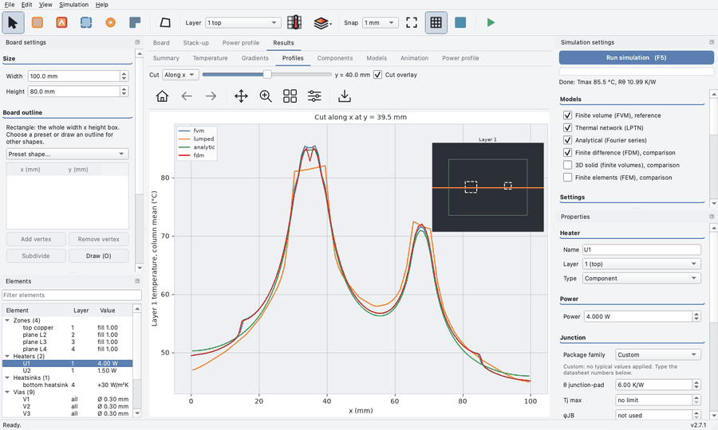

# General review of the window (2.8.0)

Question of the maintainer: an opinion on the GUI as a whole (design, usability, consistency), and on the two GUI branches planned for 2.8.0. Tree: `development` at `6c225276` (version string still 2.7.1). Nothing of the program was changed.

**Method.** The real `MainWindow` was driven offscreen (`QT_QPA_PLATFORM=offscreen`, one window at a time, a fresh configuration folder) in the light and dark themes at 1200 x 800 and 1500 x 900, with: the start-up window, the 4-layer example board run with FVM, LPTN, Analytic and FDM; the 50 x 50 x 10 mm plate of Muzychka case 2 with FVM, FDM and FEM ticked; a 400 x 300 mm board at 0.25 and 0.5 mm (refused models); the same plate at 0.4 mm with FVM, 3D solid and FEM, stopped after 1.2 s (cancel); a 60 x 40 mm board with warnings (a heater half off the board, two overlapping heaters, a part with Tj max 40 °C); the profile example; Preferences, About, Keyboard shortcuts, the Power Calculator, the Gerber import window (on our synthetic `paste-board`, MIT), every menu, the Display popover and every Results tab. About 290 screenshots were taken and looked at (scratchpad of the session, not committed); 17 are kept here in `figures-gui/`. Tab order was recorded with real Tab key presses; contrast ratios were computed from `theme.THEMES` with the WCAG 2.1 formula.

## 1. Verdict

The window is **solid, coherent in its two themes and unusually honest about its numbers** (read-out names on maps and colour bars, the memory guard, warnings with the element). It is **not yet comfortable at 1200 x 800**: three docks leave about 550 px to the centre, and tables, the map title and the Power profile page are cut there. One **real defect** matters more than any polish: opening another board leaves the previous board's results on screen, unmarked (section 6, D1). The two planned branches are good and mostly independent; they share a file set and a visual element (the coloured dot) that should be designed once (section 7).

## 2. Consistency

### 2.1 One model, five names

| Place | FVM | LPTN | Analytic | Source |
| :-- | :-- | :-- | :-- | :-- |
| Models box (checkboxes) | Finite volume (FVM), reference | Thermal network (LPTN) | Analytical (Fourier series) | `gui/panels.py` `SolverPanel` |
| Summary table, Temperature combo, Models chart | FVM | Lumped (LPTN) | Analytic | `results.py:14` `MODEL_LABELS` |
| Card on the board | FVM | Lumped | Analytic | `gui/fieldscale.py:167` `MODEL_SHORT` |
| Animation combo | Finite volume (FVM) | ... | ... | `gui/animation.py:53` |
| Profiles legend, text report, 'Decision from the fvm step response' | fvm | lumped | analytic | `plots.py:957` (`label=name`), `api` text report, profile page |
| Memory lines | finite volume (FVM) | - | - | `memory.py:83` `MODEL_LABELS` (lower case) |
| Settings fields | FVM solver | Lumped rings | Analytic modes | `panels.py` |

The user guide says 'The models are named as in the Simulation panel (FVM, Lumped (LPTN), Analytic, ...)' (`help/index.html:73`), which is not true: the panel says 'Thermal network (LPTN)'. Recommendation: one long name and one short name per model in one table (`results.MODEL_LABELS` grown to long and short), used by every view, the plots and the report; the keys (`fvm`, `lumped`) never shown. Short names: FVM, LPTN, Analytic, FDM, 3D solid, FEM (or keep 'Lumped' everywhere and drop 'Thermal network': the choice is the maintainer's, the point is one word).

*g13_profiles_legend_keys_light_1500.png: the Profiles tab legend uses the keys `fvm`, `lumped`; the cut says y = 40.0 mm, the plot title y = 39.5 mm (the cell centre).*

### 2.2 Units, words and capitalisation

* **Degree sign**: the text report and the warning titles of the Results write `degC` ('U2: the junction reaches 130.4 degC, 90.4 K above its limit'), the tables and fields `°C`; the report table writes `dT C` and `Rth K/W` where the Qt table writes `ΔT °C` and `Rθ K/W`. `ΔT` is a difference and should be in K (already in `SUMMARY_TABLE_REVIEW.md`). *Superseded by the maintainer's unit rule: differences, rises and margins are written in `°C` too; `K` only inside compound units (`GUI_FIX_PLAN.md` 3).*
* **Micrometre**: `µm` in the Stack-up and Properties, `um` in the import window ('35 / 35 um copper').
* **Unit notation**: `x (mm)` in the outline table, `x mm` and `Area mm²` in the hotspot table, `Power W` in the tables, `Power (W)` in the import parts table.
* **Layer names**: toolbar Layer box `1 top`, `4 bottom`; Properties `1 (top)`, `4 (bottom)`; Elements list `1`; map title `layer 1`.
* **Ellipsis**: `Preset shape...` (three dots) next to `Display settings…`, `Export…` (one character).
* **Capitalisation**: sentence case everywhere except `Power Calculator…` (menu and Preferences page); lower case values `off` (Snap), `inferno` (Colour map).
* **Same action, two words**: the menu says `Cancel calculation`, the button and the shortcut list say `Stop`.
* **Tj max empty**: Properties says `no limit`, the import parts table shows `0`.
* **Cryptic counters**: '14 parts (13 to.c+placement, 1 placement only)' in the import window.
* `Holes: vias` (View menu) says 'of the import: 9 on this board' on the example board, which has no import.

### 2.3 Visual language

* The main window uses collapsible headers with an accent hairline (`CollapsibleBox`); the import window and the Stack-up page use framed `QGroupBox` titles ('Files found (6)', 'Board', 'Simple stack-up', 'Materials'); Preferences a list and a table. Two visual languages for the same thing (a group of fields).
* Buttons of dialogs: Help at the left, Close at the right (Calculator, import), action buttons in a row at the bottom left of Preferences, Close alone at the right. Consistent enough; Preferences has no Cancel (its changes are saved by an explicit button, which is clear).
* The Matplotlib toolbars of the maps take a full row of large icons (home, back, forward, pan, zoom, subplots, settings, save) above every plot; at 1200 x 800 that row plus the model row costs about 110 px of a 650 px plot area.
* Charts follow the theme (dark background in the dark theme), the maps use one colour map; the bar charts use Matplotlib's default blue, orange, green and their legends cover a bar (Models tab, FDM value label; Components chart, third bar).

## 3. Density and hierarchy

* **At 1200 x 800** the left docks take 300 px, the right docks 340 px, the centre about 550 px. Cut there:
  * Summary table headers ('max °(', 'mean °', 'ower W', 'ror vs r') and balance cells ('-401....'); the text table under it wraps every row in two ([g04](figures-gui/g04_summary_cut_light_1200.png)).
  * Components table: almost every header ('Heate', 'ower V', 'nction', 'argin', 'er lim', 'p path', 'Max °C surfac estimat'); at 1500 x 900 'Power limit W' is still cut ('ower limit \\') ([g05](figures-gui/g05_components_cut_light_1200.png)).
  * The map title: 'VM - layer 1, column mean  max 85.5 °C  min 43.1 °C  mean 50.(' cut at both ends; the second spin box of the range wraps to a new line ([g06](figures-gui/g06_map_title_cut_light_1200.png)).
  * The Power profile page: the right column is cut ('Power profile of the sele', 'Square w', '1.5000 V'), a horizontal scroll bar appears ([g07](figures-gui/g07_profile_page_clipped_light_1200.png)).
  * The Results tab bar scrolls: Animation and Power profile are behind the arrows.
  * At start-up both the Board settings and the Simulation docks show a horizontal scroll bar and the Elements header reads 'Laye' ([g01](figures-gui/g01_startup_light_1200.png)); after a board is loaded the docks are resized and the bars go.
  * Properties of a heater of type Heat source: a horizontal scroll bar and cut fields ('Interface material preset…') at both sizes ([g14](figures-gui/g14_properties_hscroll_dark_1500.png)).
  * Stack-up: 'Readable (thin layers enl' and 'Not to scale: ... (choose 'True proportions' f' ([g17](figures-gui/g17_stackup_dark_1500.png)).
* **Simulation dock**: at 1200 x 800 only the Run button, an empty progress bar and the six model boxes are visible; the cell size, the memory lines and the Warnings box are below the fold. The empty progress bar is always shown (it could appear only during a run). The memory verdict of a refused model is four lines of red text per model ([g10](figures-gui/g10_memory_lines_refused_light.png)); the compact lines of P2c fix this.
* **Components tab**: three tables with their own scroll bars plus a chart in one page; the zone table shows two rows of four. A tab with three short tables reads better as one scroll page or as a selector (heaters / zones / hotspots).
* **Summary tab**: the table, then the warnings, then the whole text report repeating the table (planned to drop in the a+ option).
* **What the user sees first** after a run: the Results tab with the Summary (good); the hottest number of the reference model is in the status line of the Simulation dock too. The Results open on the FVM even when the FEM was the reason of the run (thick plate): the user has to change the model combo and the Layer box (in the main toolbar, far from the map) to see the resolved surface.

## 4. Discoverability and workflow

* **Drawing a board**: the start-up board is an empty green 100 x 80 mm rectangle; the only hint is the status bar ('Select: click, drag to move, ...'). The tools are icons without text (tooltips with the key: good), Polygon mode is a separate toggle. A first-time user is better served by a short hint on the empty canvas ('Draw a heater (H) on the board, give it a power, press F5', with a link 'Open an example'), or by opening the example board on first start.
* **Running**: Run (F5) is at the top of the right dock and in the toolbar (green triangle): visible. The Run button is enabled on an empty board and answers with a message box 'Add at least one heater...' (acceptable).
* **Refused models**: when every ticked model is refused, Run is greyed; the reason is in the tooltip and in red lines below the fold. At 1200 x 800 the visible area shows a greyed button and the stale 'Done: Tmax 99.2 °C' of an earlier board ([g09](figures-gui/g09_run_greyed_reason_hidden_light_1200.png)). The FVM refusal says which cell to use ('use a cell of 0.7 mm or more'); the FEM refusal says only 'use a coarser cell' and writes '12535575 unknowns, more than the 6000000 it accepts'; its warning title in the Warnings box is 'The finite-element model' (no verb).
* **Reading the result**: map titles and colour bars name the read-out ('FVM - layer 1, column mean', 'Temperature, column mean (°C)'); the Components table names '(column)' and '(surface, estimate)'. Very good. The Summary table does not (planned in a+).
* **Warnings**: live in the Simulation dock (below the settings), after a run in the Results summary. They are not ordered by severity: on the warnings board the alert 'U2: the junction reaches 130.4 degC, 90.4 K above its limit of…' is the fourth and last row, elided, under three notes ([g12](figures-gui/g12_warnings_order_light_1500.png)). The live and the run lists differ (3 and 4 rows) without saying why (the junction one exists only after a run). The opened row repeats its title in the body ('U_off: 50 % of the footprint is outside the board' twice).
* **Undo**: Edit menu and Ctrl+Z / Ctrl+Shift+Z; no toolbar button. **Files**: no recent-files list in the File menu, no Open or Save in the toolbar.
* **Shortcuts**: rich, consistent single keys for tools and views, a two-column dialog, Ctrl+1 to 4 for the tabs (not in any menu, only in the dialog).

## 5. Accessibility

### 5.1 Contrast (WCAG 2.1, against `window` / `base`)

| Token | Light | Dark | Use | Verdict |
| :-- | :-- | :-- | :-- | :-- |
| text | 14.35 / 15.80 | 13.14 / 14.49 | body text | pass |
| hint | 5.33 / 5.86 | 6.31 / 6.96 | secondary text | pass |
| muted | **4.39** / 4.83 | 5.24 / 5.78 | secondary text, greyed titles | light fails 4.5 on `window` (exempt only when the control is disabled) |
| accent (as text) | **3.74** / 4.12 | 4.89 / 5.39 | group titles of P2c | light fails; P2c's `accent_text` #4a6a96 (5.03) fixes it |
| warn (as text) | **3.85** / 4.24 | 9.32 / 10.28 | 'slow' memory lines, 'Probably KiCad' in the import window | light fails |
| alert | 5.39 / 5.93 | 7.10 / 7.83 | warnings today | pass |
| bad | 5.11 / 5.62 | 4.63 / 5.10 | refused lines | pass |
| ok | 4.66 / 5.13 | 6.82 / 7.52 | ok memory lines | pass (light at the limit) |
| on_accent on accent | **4.12** | **3.30** | label of Run, Next, Compute | fails in both themes (bold 9 pt is not large text) |
| border | 1.34 | 1.41 | edges of fields | below the 3:1 of non-text contrast; in the dark theme a field (`base`) on `window` is about 1.1:1 |

### 5.2 Keyboard, names, colour

* **Tab order** (recorded with real Tab presses on the example board, 40 stops per cycle): canvas, Board settings (Size, Width, Height, Board outline, preset, Draw, Environment, ...), Elements filter and tree, Run, Models and their six boxes, Settings fields, Properties, then the toolbar Layer and Snap boxes, then the main tab bar. Logical, left to right and top to bottom; collapsible headers are buttons reachable by Tab; disabled FEM fields are skipped. Tool buttons are not in the chain (single keys cover them).
* **Focus ring**: Fusion's accent focus ring is kept on purpose (`theme.py:225`); it was not inspected on every control.
* **Screen-reader names**: only 6 `setAccessibleName` calls in `gui/`. Spin boxes and combos have no own accessible name; Qt gives them the name of their form label (buddy) on most platforms, which was not verified with VoiceOver. Icon-only tool buttons get the action text.
* **Colour-only information**: memory verdicts carry words for 'slow' and 'refuse' (good); the green 'ok' line has no word (acceptable). Warning rows carry a badge shape (circle, triangle) as well as colour (good; V1 keeps the severity in the accessible name).
* **Tooltips**: every focusable control met on the Tab chain has a tooltip, except containers (scroll areas, tab bars) and the canvas; `tests/test_tooltips.py` keeps it so.

## 6. Robustness cues and defects

### 6.1 Defects (ranked)

| # | Defect | Evidence |
| :-- | :-- | :-- |
| **D1** | **Opening another board keeps the previous board's results on screen**, the Results tab not marked outdated, and the Simulation status keeps 'Done: Tmax ... °C' of the old board. `_after_load` (`gui/main_window.py:1321`) sets `self.sim = None` and resets the tab text but neither clears `ResultsView` nor `solver_panel.status`; every load path (New, Open, examples, import) goes through it. | [g08](figures-gui/g08_stale_results_after_open_light_1500.png): a 30 x 20 mm board with one heater Q9, the Results show the 100 x 80 mm example (U1, U2, 5.5 W) and 'Done: Tmax 85.3 °C'. |
| D2 | Summary and Components headers and cells cut at 1200 x 800 (Components also at 1500 x 900). | g04, g05 |
| D3 | Map title cut at both ends at 1200 x 800. | g06 |
| D4 | Power profile page clipped at 1200 x 800 (horizontal scroll). | g07 |
| D5 | Run greyed with the reason below the fold, while a stale 'Done' line is shown. | g09 |
| D6 | Properties of a Heat source scroll horizontally (fields cut) at both sizes. | g14 |
| D7 | About box: the last line 'Released under the MIT License (see the LICENSE file).' is cut after 'MIT' (offscreen, both themes; confirm on macOS). | [g15](figures-gui/g15_about_cut_light.png) |
| D8 | Warnings not ordered by severity; the alert is last and elided; `degC` in titles. | g12 |
| D9 | Start-up docks show horizontal scroll bars; 'Laye' header. | g01 |
| D10 | Model names in five forms; the guide claims they match the panel. | section 2.1 |
| D11 | Ruler corner: the 'mm' label overlaps the first tick label of the vertical ruler (the 50 of the plate). | g14 |
| D12 | Chart legends cover bars and value labels. | Models and Components tabs |

### 6.2 Feedback during a run

* While running, the button turns to **Stop (Ctrl+.)** in the same accent blue (the toolbar shows a red square); a progress bar and a status line ('Solving FEM (assembly and solve: a large board can take minutes)'); the status bar at the bottom keeps saying 'Ready.' ([g11](figures-gui/g11_running_dark.png)). The progress stays at a fixed 66 % during the FEM solve (a stage counter, not a progress): an indeterminate bar or an elapsed-time counter would be honest. The status line grows to two lines and pushes the Models box down while running.
* After Stop: 'Cancelled.', the button returns to Run after a double-click interval, the next run works. Good.
* A refused run asked from F5 answers with a modal 'Cannot run' message with the cell to use (FVM) - clear.
* Two status places (the dock line and the status bar) say different things; one of them should own the run state.

## 7. The planned branches

`feature/gui-panel-polish` (L3 model labels; P2c groups with compact memory lines) and `feature/gui-results-warnings` (warning rows V1; Summary table a+). Both are at `development` with no commit yet.

**What I would change in the plan**

1. **Warning rows: V1 or V8.** The note `WARNING_SELECT_REVIEW.md` recommends V8 (aligned name column, chevron at the right); the plan says V1 (chip at the end of the title). V1 keeps the name twice (title 'U_off: ...' and the chip 'U_off'), its chips are ragged and the titles wrap earlier; at 1200 x 800 the dock is 322 px, not the 350 px of the prototype. If V1 is kept, drop the leading 'Name:' of the title (as V8 does) and elide long designators in the chip. Order the rows by severity in both boxes (D8) in the same branch: it touches the same function.
2. **The coloured dot is one element, designed once.** P2c draws a verdict dot in the memory lines (ok, slow, refuse); V1 draws a severity dot in the warning rows (alert = `bad`, note = `warn`). Put one painter (`theme.dot_pixmap(token, px)`) and one mapping in the branch merged first; the second uses it. Today warnings are in `alert` amber; after V1 an alert is red, the same red as a refused model: fine, but say it in the decisions log, and keep the import window (`WarningList`, `alert`) in line or on the list for 2.9.0.
3. **Light `warn` text fails contrast (3.85:1).** P2c writes 'slow' rows 'wholly in the verdict colour'; on the light theme that text needs a darker token (`alert` #8a5a00 reaches 5.39:1) or the text in `text` with only the dot in `warn`. The same applies to 'Probably KiCad' in the import window.
4. **Words inside the P2c groups.** Group 'Thermal network (LPTN)' holds 'Lumped rings'; group 'Analytical' (tag 'Analytic') holds 'Analytic modes'. With the group title giving the model, the fields can be 'Rings' and 'Modes' (shorter, and the same word as the title). The spec keeps field labels unchanged because warnings quote them (`tests/test_warning_context.py`); if they stay, at least make the titles and tags use the same word as the fields.
5. **L3 should own the one-name table** (section 2.1): it is the labels branch; a+ then reads its names for the Summary and the report. Otherwise a+ will write model keys or labels of its own into the new column definition.
6. **Summary a+ should include the Components table**: the same cut headers (D2) and the same fix (contents-sized columns, two-line headers naming the read-out, horizontal scroll), and the report's `degC`, `dT C`, `Rth` in the same column definition.
7. **Show why Run is greyed** in the status line under the Run button (replacing the stale text), and give the FEM refusal the cell to use like the other models: a small addition that belongs to P2c's memory-line work.

**Conflicts between the two branches.** No logical conflict; file conflicts are certain in `pcbthermal/gui/panels.py` (P2c rebuilds `SolverPanel`; V1 changes `_element_name` and the accordion it hosts), `pcbthermal/gui/theme.py` (new `accent_text`, the dot), `pcbthermal/gui/tips.py`, `pcbthermal/help/index.html` section 8 (both rewrite the Simulation settings rows), `tests/test_gui_stress.py`, `tests/test_help.py`, `CHANGELOG.md`, `docs/versions.md`, `docs/decisions-log.md`, and the same screenshots (`editor.png`, `editor_warnings*.png`, `simulation_fem.png`). Merge them one after the other (panel first: it defines the token and the dot), and regenerate the screenshots once, after the second merge.

## 8. Ranked improvements

Impact high / medium / low; effort S (hours), M (a day or two), L (more).

**Before the 2.8.0 release**

| Rank | Improvement | Impact | Effort |
| :-- | :-- | :-- | :-- |
| 1 | Clear the Results and the status line when another board is opened or created (D1); a regression test on `_after_load`. | high | S |
| 2 | Summary a+ extended to the Components table: no cut header at 1200 x 800, read-out in the headers, `ΔT K`, one formatter for the table and the report (D2). | high | M |
| 3 | One long and one short name per model everywhere (L3 plus the card, the Animation combo, the Profiles legend, the report, the memory lines, the guide sentence) (D10). | high | S-M |
| 4 | When Run is greyed, say why under the button; the FEM refusal gives the cell to use; warnings ordered by severity, `°C` in their titles (D5, D8). | high | S |
| 5 | Contrast tokens: a darker accent for the Run/Next/Compute label or dark text on it; light `warn` text replaced (also in P2c's slow lines); `accent_text` as specified. | medium | S |
| 6 | Map title on two lines or shortened at narrow widths (D3); About box last line (D7). | medium | S |

**For 2.9.0**

| Rank | Improvement | Impact | Effort |
| :-- | :-- | :-- | :-- |
| 7 | Layout at 1200 x 800: Power profile page stacked when narrow, Properties without a horizontal scroll, start-up dock sizes, Stack-up texts, Results tab bar (D4, D6, D9); a test that grabs every page at 1200 x 800 and fails on a horizontal scroll bar. | high | M |
| 8 | Run feedback: one owner of the run state (dock line or status bar), elapsed time, Stop drawn as a stop (red), an indeterminate bar for stages without a measure, no layout jump. | medium | M |
| 9 | First use: a hint on the empty canvas with 'Open an example', File > Recent, Open/Save/Undo in the toolbar; the Results open on the model and read-out the run was for (FEM surface on a thick plate). | medium | M |
| 10 | One visual language for groups (the import window and the Stack-up page on `CollapsibleBox` headers), `µm` and `no limit` in the import window, compact Matplotlib toolbars, themed bar colours with legends outside the bars (D11, D12); an accessibility pass (VoiceOver names, input borders at 3:1). | medium | L |

## 9. What is already good

* Two themes built on one token table, applied to the widgets, the canvas, the HTML guide and the Matplotlib charts; the dark theme is calm and readable ([g03](figures-gui/g03_editor_dark_1500.png)).
* Read-outs named where the number is: map titles, colour bars, Components headers, the report's 'Read-outs' paragraph; surface rows say 'estimate' or 'resolved'.
* The memory guard: a verdict per model before the run, the cell to use, Run blocked only when nothing can run.
* Warnings live while drawing, each leading to its element; the report keeps them; a disclaimer in every report.
* A single Run/Stop button, F5 and Ctrl+., a clean cancel and a hold against a double click.
* Keyboard: single-key tools and views, Ctrl+1 to 4, a logical Tab order, a two-column shortcuts dialog; a tooltip on every control.
* The Gerber import wizard: three numbered steps, a live preview, the source of every detected function, a clear primary button ([g16](figures-gui/g16_import_step1_light_1200.png)).
* Empty states that say what to do ('No results yet. Draw at least one heater ...').
* Numbers always with a decimal point, commas typed in a field turned into a point.

## 10. What was looked at and what was not verified

* Looked at: every main tab, every Results tab, the four docks, the Display popover, the five menus (texts and shortcuts dumped), Preferences (first page looked at; the eleven pages captured), About, Keyboard shortcuts, the Power Calculator (route 1, the four board descriptions), the import window (three steps), in both themes and both sizes.
* Not verified: native macOS rendering (fonts are wider than offscreen, so the cuts at 1200 x 800 are if anything worse; the About cut may differ), HiDPI scaling, real mouse hover and drag, VoiceOver, the Animation computed and played, GIF export, route 2 of the calculator, the re-import dialog, the background image dialog. The cancelled run was the FEM stage of a small plate, not a minute-long job.
* Contrast is computed from the tokens, not measured on the rendered anti-aliased text.
* The two executor branches had no commit at the time of this review: section 7 reviews their specifications, not code.
