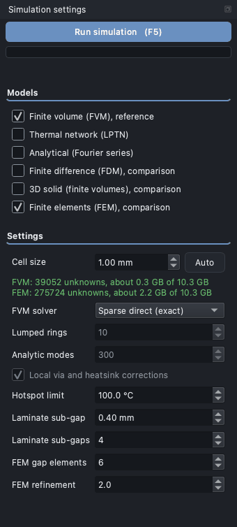
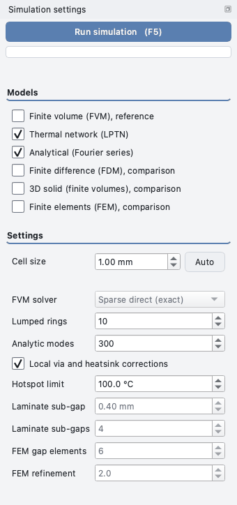
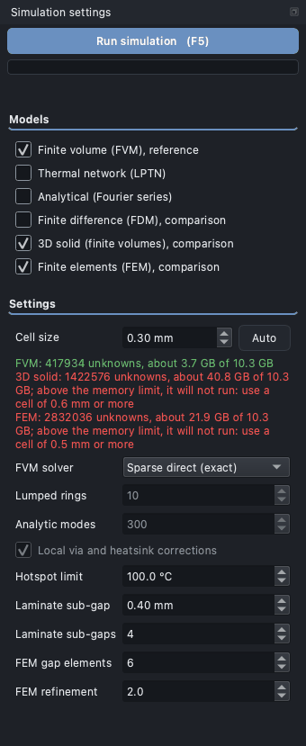
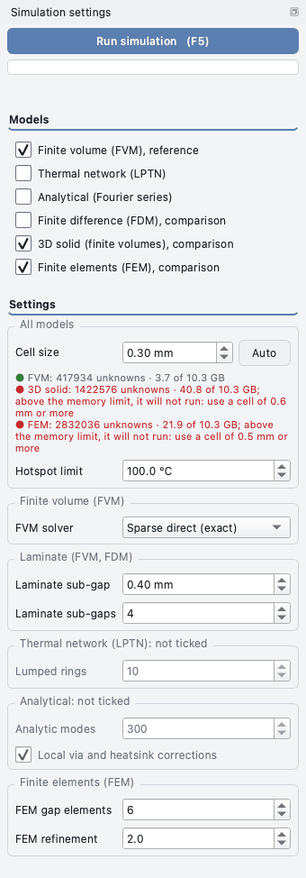
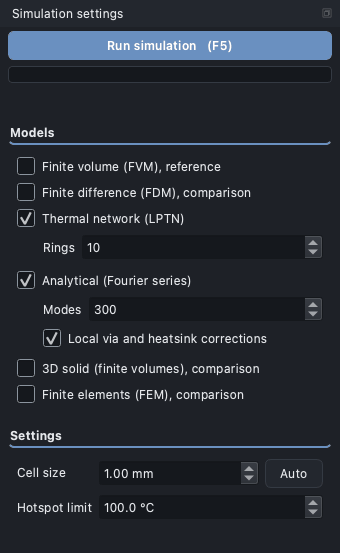

# Simulation panel: which setting serves which model, and a grouped layout

Review of the Simulation dock (`pcbthermal/gui/panels.py`, class `SolverPanel`) on `development` at `6c225276`, for two requests of the maintainer:
(1) group the settings by the models they influence, with a frame around each group; (2) show the memory lines ('FVM: 1793 unknowns, about 0.2 GB of ...') in a smaller font.

Nothing in the program was changed. The layouts below were built as a throwaway prototype on `tmp/settings-layout-proto` (commit `a1522a3d`, one file, `panels.py`; the layout is chosen with the environment variable `PCBT_PANEL_LAYOUT=A|B|C`) to take the screenshots of section 4; that branch is not for merge.

## 1. What each control of the dock really feeds

Read from the code: `SolverOptions` (`api.py` 54-68), the dispatch of the steady models (`api.py` 826-836), of the step responses (`api.py` 1028-1033) and of the time runs (`api.py` 1070-1080), the memory guard (`memory.py` 710-823), `laminate.uses_rule` and the per-control greying of `SolverPanel._update_availability` (`panels.py` 1673-1691).

| Control (option key) | FVM | FDM | Lumped | Analytic | 3D solid | FEM | Steady / time | Notes |
| :-- | :--: | :--: | :--: | :--: | :--: | :--: | :-- | :-- |
| Models checkboxes (`models`) | x | x | x | x | x | x | both | 3D solid and FEM are steady only on this tree (left out of the time run, `SKIPPABLE_MODELS`) |
| Cell size, Auto (`cell_mm`) | x | x | clipped | clipped | x | x | both | Lumped: `lumped.cell_for` clips to 0.5-1.0 mm (0.5 mm or finer when a part is zoned or small); Analytic: clipped to 0.5-1.0 mm sampling grid. Grid of FVM, FDM, 3D solid; base element of the FEM mesh |
| Memory lines (read-only) | x | x | - | - | x | x | steady | Only the guarded models (`GUARDED_MODELS`); none for Lumped and Analytic |
| FVM solver (`linear_solver`) | x | - | - | - | - | - | steady only | The FDM is direct only (`fdm.Network.solve_steady`); the FVM time run and animation factorise on their own and ignore it |
| Laminate sub-gap, sub-gaps (`laminate_s_max_mm`, `laminate_n_max`) | x | x | - | - | - | - | both | Not on a board with a metal block (`laminate.uses_rule`); the 3D solid has its own slab rule (`solid3d.py` 50), the FEM its gap elements. Also counted by the memory guard and by Auto |
| Lumped rings (`lumped_rings`) | - | - | x | - | - | - | both | Steady, step response and time run |
| Analytic modes (`analytic_modes`) | - | - | - | x | - | - | both | Steady, step response and time run |
| Local via and heatsink corrections (`analytic_local_corrections`) | - | - | - | x | - | - | steady only | The analytic step response and time run are always local (`api.py` 1033, 1080 do not pass it); forced on with a metal block (`analytic.py` 653) |
| FEM gap elements, FEM refinement (`fem_gap_elements`, `fem_refine`) | - | - | - | - | - | x | steady | Also counted by the memory guard (`fem_params`) |
| Hotspot limit (`hotspot_c`) | x | x | x | x | x | x | both | A read-out of the results (hotspot list, overlay, profile plots), not a solve input |

Settings that are elsewhere and stay there: the time-run settings and the steady power of a profile (`profile`, `steady_power`) on the Power profile page; the memory limit (`memory_fraction`) in Preferences. The dock has no SOR omega, tolerance or iteration count (they are constants of `fvm.py`).

Side observations found while reading (not fixed here, `development` is frozen for the window test):
- **Auto ignores the FEM mesh numbers.** `_auto_cell` passes `laminate_params` to `suggest_cell_mm` but not `fem_params` (`panels.py` 1795; `suggest_cell_mm` has no such argument, `api.py` 528), so with 24 gap elements Auto may propose a cell that the memory line then marks red for the FEM. Small `fix/` item, or say so in the Auto tooltip.
- **'Local via and heatsink corrections' affects the steady run only**, but its tooltip and the guide row do not say so; the time run is always local. One sentence in the tooltip and in the guide.
- The 'Greyed' tooltip of the laminate on a board with a metal block says 'used only by a board with a metal block, where the rule does not apply' (`panels.py` 1682 and 1691): the sentence reads backwards. Suggested: 'not used on a board with a metal block'.

## 2. Layout options

All three keep the option keys, the project format and the field labels (the warnings quote 'Laminate sub-gap' and 'Laminate sub-gaps', `uicontext.laminate_where`; the guide quotes the others), keep every tooltip, and keep the per-control greying with its 'Greyed: used only by ...' tooltip.

- **A. Frames per group, greyed (recommended).** Inside the Settings box, one frame (`QGroupBox`, already styled by the theme) per group: 'All models' (Cell size with Auto, the memory lines, Hotspot limit), 'Finite volume (FVM)' (FVM solver), 'Laminate (FVM, FDM)', 'Thermal network (LPTN)' (Lumped rings), 'Analytical' (modes, local corrections), 'Finite elements (FEM)' (gap elements, refinement). A frame whose models are not ticked is greyed as a whole and its title gets ': not ticked'; the laminate frame is also greyed on a board with a metal block. The label column is the same width in every frame so the fields line up. Nothing moves when a model is ticked; every setting stays visible. Cost: about 160 px taller (the panel scrolls, the Run button stays above).
- **B. Frames per group, hidden.** As A, but the frames of the models not ticked are hidden. Shortest panel, but a setting disappears from sight (the user cannot set the FEM mesh before ticking the FEM), the panel jumps at every tick, and the guide's 'greyed' rule (section 'Greyed fields') would need an exception.
- **C. Settings under each model.** The Models box lists each model with its own settings indented under its checkbox, shown only while it is ticked; the Settings box keeps only Cell size, the memory lines and Hotspot limit. Clearest link between a model and its numbers, but: the FDM checkbox moves next to the FVM (the order of the list changes), the laminate rows are shared by two models and need their own 'Shared by the FVM and the FDM' line, the labels inside lose their prefixes ('Rings', 'Modes'), and the Models box changes size at every tick. More work for the guide and the screenshots.

## 3. The memory lines

In all three prototypes:
- the label takes the theme's hint style (`theme.hint`: 11 px, colour `hint`, 5.3:1 on the light window and 6.3:1 on the dark one, already used for the small notes), about 2 px below the dock font;
- each row starts with a dot in the verdict colour (`ok`, `warn`, `bad`); a fitting model ('ok') has its text in the hint colour, so the line reads as secondary; a slow or refused model keeps the whole row in the verdict colour, as today;
- compact form: `FVM: 39052 unknowns · 0.3 of 10.3 GB` instead of `FVM: 39052 unknowns, about 0.3 GB of 10.3 GB`; 'at least' becomes '≥'. The counts keep **no thousands separator** (the rule of every count shown, checked by `tests/test_gui_stress.py`), so not '39 052'. The refusal sentence ('above the memory limit, it will not run: use a cell of ...') and the FEM pyamg sentence are kept word for word (the tests read them);
- word wrap stays on; the label is hidden when no guarded model is ticked (it left an empty strip under Cell size with only Lumped and Analytic).

## 4. Screenshots

Simulation dock at the default window width (1480 px window, dock 340 px), the example 4-layer board, light and dark themes; the whole dock (window made tall). Three cases: FVM + FEM at 1 mm; Lumped + Analytic only (the greyed groups); FVM + 3D solid + FEM at 0.3 mm (two red memory rows, before and A only).

| | Light | Dark |
| :-- | :-- | :-- |
| Before, FVM + FEM |  |  |
| A, FVM + FEM |  |  |
| Before, Lumped + Analytic |  |  |
| A, Lumped + Analytic |  |  |
| Before, fine cell |  |  |
| A, fine cell |  |  |
| B, FVM + FEM |  |  |
| B, Lumped + Analytic |  |  |
| C, FVM + FEM |  |  |
| C, Lumped + Analytic |  |  |

*Files in `figures-panel/`, named `<before|optA|optB|optC>_<light|dark>_<case>.png`.*

On the prototype (layout A and layout C), `tests/test_tooltips.py` and `tests/test_gui.py::test_docks_open_wide_enough_and_keep_the_run_button_in_sight` pass; the panel's minimum width is 319 px with A and B (as before, the dock is 340 px) and 282 to 290 px with C.

## 5. Recommendation

**Layout A with the smaller memory lines.** It answers the request directly (a frame per group, with the models in its title), nothing moves or disappears when a model is ticked, the field labels the warnings and the guide quote stay the same, and it reuses the existing frame style and greying. B hides settings the user may want to prepare; C is clearer but reorders the model list and costs more in the guide and the tests.

Effort: **S** (half a day) for A and the memory lines on a `feature/` branch (a GUI change, so a minor item under the numbering rule; it can ride with 2.8.0). The prototype's frame code is close to final; it needs the docstrings, a group-level regression test and the documents below. C would be **M**.

What changes with A:
- `pcbthermal/gui/panels.py` (`SolverPanel.__init__`, `_update_availability`, `_update_cells`); the per-control tooltips stay; the frames need no tooltip of their own (a `QGroupBox` title is not a control; check `tests/test_tooltips.py` still passes, it did on the prototype).
- Tests: `tests/test_gui.py::test_docks_open_wide_enough_and_keep_the_run_button_in_sight` (passes unchanged), `tests/test_fem_gui.py` (reads `cells_label` for 'FEM:', '275724 unknowns', 'above the memory limit, it will not run', 'pyamg', 'will be left out': kept), `tests/test_gui_stress.py` 1183-1217 (reads 'FVM:', 'GB', 'will not run', the verdict hex colours, no thousands separator: kept), `tests/test_theme_coherence.py` 211-214 (verdict text changes with the theme: kept); add a test that a frame greys with its models and the laminate frame with a metal block, and a stress scenario in `tests/test_gui_stress.py`.
- Guide `pcbthermal/help/index.html` section 8: one sentence on the frames ('the settings are grouped by the models they serve; a group is greyed when none of its models is ticked'), the compact memory line, 'steady run only' for the local corrections; the picture `simulation_fem.png` (made by `examples/make_screenshots.py`, the FEM pictures function) and the dock in `editor.png`, `editor_warnings.png` and their dark variants in `docs/images/` and `pcbthermal/help/` are regenerated and looked at; `tests/test_help.py` if a new word is checked.
- `README.md` screenshots (the same files), `CHANGELOG.md` (Unreleased), `docs/versions.md`, `docs/decisions-log.md`.

## 6. Open decisions for the maintainer

1. Layout A, B or C (recommended A).
2. Whether the compact memory form is wanted (`·` and `≥`), or only the smaller font and the hint colour.
3. Whether to fix the two small points of section 1 (Auto ignoring the FEM mesh numbers; the local-corrections tooltip) in the same branch.
