# Simulation panel: which setting serves which model, and a grouped layout

Review of the Simulation dock (`pcbthermal/gui/panels.py`, class `SolverPanel`) on `development` at `6c225276`, for two requests of the maintainer:
(1) group the settings by the models they influence, with a frame around each group; (2) show the memory lines ('FVM: 1793 unknowns, about 0.2 GB of ...') in a smaller font.

Nothing in the program was changed. The layouts below were built as a throwaway prototype on `tmp/settings-layout-proto` (not for merge): first round A, B, C (commit `a1522a3d`, `PCBT_PANEL_LAYOUT=A|B|C`, sections 2 to 5); second round P1 to P8 after the maintainer's answer (commits `db90e857` and `ca481f1f`, new file `pcbthermal/gui/panel_variants.py`, `PCBT_PANEL_LAYOUT=P1..P8`, `PCBT_PANEL_SP` for the room around the Settings toggle; section 7). Third round P2a to P2h after the maintainer chose P2 (commit `35eee250`, `PCBT_PANEL_LAYOUT=P2A..P2H`; section 8). **Section 8 supersedes the recommendations of sections 5 and 7; section 9 is the final decision and the implementation spec** (prototype of the final colour: commit `a2de3304`, `PCBT_PANEL_LAYOUT=P2C PCBT_ACCENT_TEXT=1`).

## 1. What each control of the dock really feeds

Read from the code: `SolverOptions` (`api.py` 54-68), the dispatch of the steady models (`api.py` 826-836), of the step responses (`api.py` 1028-1033) and of the time runs (`api.py` 1070-1080), the memory guard (`memory.py` 710-823), `laminate.uses_rule` and the per-control greying of `SolverPanel._update_availability` (`panels.py` 1673-1691).

| Control (option key) | FVM | FDM | Lumped | Analytic | 3D solid | FEM | Steady / time | Notes |
| :-- | :--: | :--: | :--: | :--: | :--: | :--: | :-- | :-- |
| Models checkboxes (`models`) | x | x | x | x | x | x | both | 3D solid and FEM are steady only on this tree (left out of the time run, `SKIPPABLE_MODELS`) |
| Cell size, Auto (`cell_mm`) | x | x | clipped | clipped | x | x | both | Lumped: `lumped.cell_for` clips to 0.5-1.0 mm (0.5 mm or finer when a part is zoned or small); Analytic: clipped to 0.5-1.0 mm sampling grid. Grid of FVM, FDM, 3D solid; base element of the FEM mesh |
| Memory lines (read-only) | x | x | - | - | x | x | steady | Only the guarded models (`GUARDED_MODELS`); none for Lumped and Analytic |
| FVM solver (`linear_solver`) | x | - | - | - | - | - | steady only | The FDM is direct only (`fdm.Network.solve_steady`); the FVM time run and animation factorise on their own and ignore it |
| Laminate sub-gap, sub-gaps (`laminate_s_max_mm`, `laminate_n_max`) | x | x | - | - | - | - | both | Not on a board with a metal block (`laminate.uses_rule`); the 3D solid has its own slab rule (`solid3d.py` 50), the FEM its gap elements. Also counted by the memory guard and by Auto |
| Lumped rings (`lumped_rings`) | - | - | x | - | - | - | both | Steady, step response and time run |
| Analytic modes (`analytic_modes`) | - | - | - | x | - | - | both | Steady, step response and time run |
| Local via and heatsink corrections (`analytic_local_corrections`) | - | - | - | x | - | - | steady only | The analytic step response and time run are always local (`api.py` 1033, 1080 do not pass it); forced on with a metal block (`analytic.py` 653) |
| FEM gap elements, FEM refinement (`fem_gap_elements`, `fem_refine`) | - | - | - | - | - | x | steady | Also counted by the memory guard (`fem_params`) |
| Hotspot limit (`hotspot_c`) | x | x | x | x | x | x | both | A read-out of the results (hotspot list, overlay, profile plots), not a solve input |

Settings that are elsewhere and stay there: the time-run settings and the steady power of a profile (`profile`, `steady_power`) on the Power profile page; the memory limit (`memory_fraction`) in Preferences. The dock has no SOR omega, tolerance or iteration count (they are constants of `fvm.py`).

Side observations found while reading (not fixed here, `development` is frozen for the window test):
- **Auto ignores the FEM mesh numbers.** `_auto_cell` passes `laminate_params` to `suggest_cell_mm` but not `fem_params` (`panels.py` 1795; `suggest_cell_mm` has no such argument, `api.py` 528), so with 24 gap elements Auto may propose a cell that the memory line then marks red for the FEM. Small `fix/` item, or say so in the Auto tooltip.
- **'Local via and heatsink corrections' affects the steady run only**, but its tooltip and the guide row do not say so; the time run is always local. One sentence in the tooltip and in the guide.
- The 'Greyed' tooltip of the laminate on a board with a metal block says 'used only by a board with a metal block, where the rule does not apply' (`panels.py` 1682 and 1691): the sentence reads backwards. Suggested: 'not used on a board with a metal block'.

## 2. Layout options

All three keep the option keys, the project format and the field labels (the warnings quote 'Laminate sub-gap' and 'Laminate sub-gaps', `uicontext.laminate_where`; the guide quotes the others), keep every tooltip, and keep the per-control greying with its 'Greyed: used only by ...' tooltip.

- **A. Frames per group, greyed (recommended).** Inside the Settings box, one frame (`QGroupBox`, already styled by the theme) per group: 'All models' (Cell size with Auto, the memory lines, Hotspot limit), 'Finite volume (FVM)' (FVM solver), 'Laminate (FVM, FDM)', 'Thermal network (LPTN)' (Lumped rings), 'Analytical' (modes, local corrections), 'Finite elements (FEM)' (gap elements, refinement). A frame whose models are not ticked is greyed as a whole and its title gets ': not ticked'; the laminate frame is also greyed on a board with a metal block. The label column is the same width in every frame so the fields line up. Nothing moves when a model is ticked; every setting stays visible. Cost: about 160 px taller (the panel scrolls, the Run button stays above).
- **B. Frames per group, hidden.** As A, but the frames of the models not ticked are hidden. Shortest panel, but a setting disappears from sight (the user cannot set the FEM mesh before ticking the FEM), the panel jumps at every tick, and the guide's 'greyed' rule (section 'Greyed fields') would need an exception.
- **C. Settings under each model.** The Models box lists each model with its own settings indented under its checkbox, shown only while it is ticked; the Settings box keeps only Cell size, the memory lines and Hotspot limit. Clearest link between a model and its numbers, but: the FDM checkbox moves next to the FVM (the order of the list changes), the laminate rows are shared by two models and need their own 'Shared by the FVM and the FDM' line, the labels inside lose their prefixes ('Rings', 'Modes'), and the Models box changes size at every tick. More work for the guide and the screenshots.

## 3. The memory lines

In all three prototypes:
- the label takes the theme's hint style (`theme.hint`: 11 px, colour `hint`, 5.3:1 on the light window and 6.3:1 on the dark one, already used for the small notes), about 2 px below the dock font;
- each row starts with a dot in the verdict colour (`ok`, `warn`, `bad`); a fitting model ('ok') has its text in the hint colour, so the line reads as secondary; a slow or refused model keeps the whole row in the verdict colour, as today;
- compact form: `FVM: 39052 unknowns · 0.3 of 10.3 GB` instead of `FVM: 39052 unknowns, about 0.3 GB of 10.3 GB`; 'at least' becomes '≥'. The counts keep **no thousands separator** (the rule of every count shown, checked by `tests/test_gui_stress.py`), so not '39 052'. The refusal sentence ('above the memory limit, it will not run: use a cell of ...') and the FEM pyamg sentence are kept word for word (the tests read them);
- word wrap stays on; the label is hidden when no guarded model is ticked (it left an empty strip under Cell size with only Lumped and Analytic).

## 4. Screenshots

Simulation dock at the default window width (1480 px window, dock 340 px), the example 4-layer board, light and dark themes; the whole dock (window made tall). Three cases: FVM + FEM at 1 mm; Lumped + Analytic only (the greyed groups); FVM + 3D solid + FEM at 0.3 mm (two red memory rows, before and A only).

| | Light | Dark |
| :-- | :-- | :-- |
| Before, FVM + FEM |  |  |
| A, FVM + FEM | 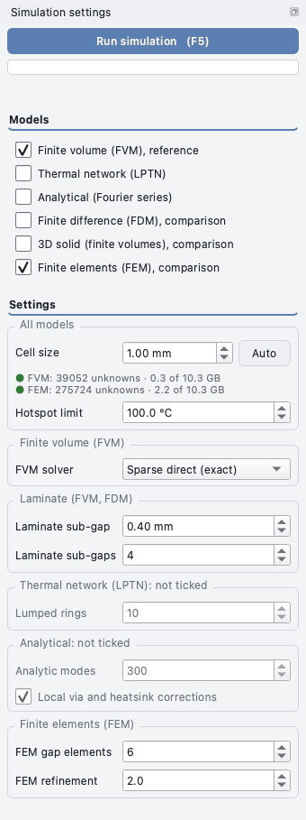 |  |
| Before, Lumped + Analytic |  |  |
| A, Lumped + Analytic |  |  |
| Before, fine cell | 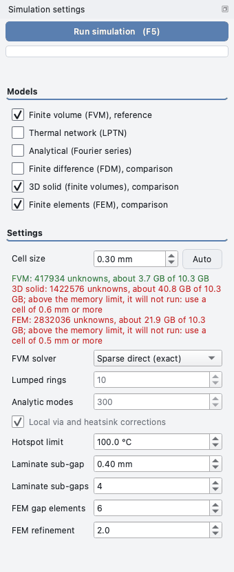 |  |
| A, fine cell |  | 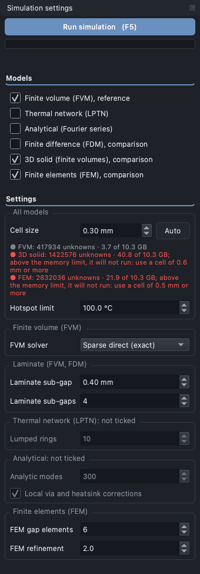 |
| B, FVM + FEM |  |  |
| B, Lumped + Analytic | 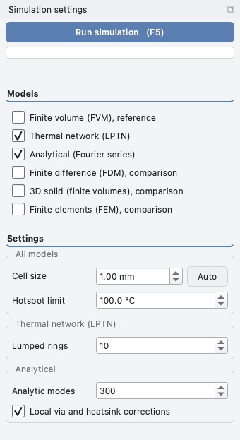 | 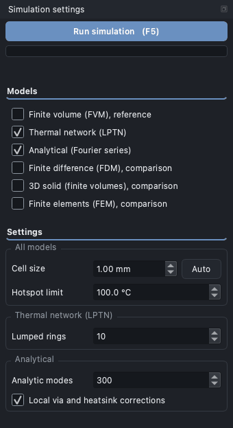 |
| C, FVM + FEM | 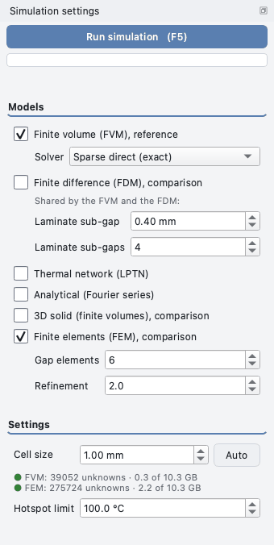 |  |
| C, Lumped + Analytic | 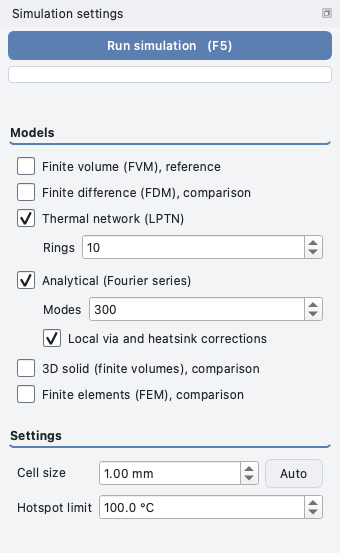 |  |

*Files in `figures-panel/`, named `<before|optA|optB|optC>_<light|dark>_<case>.png`.*

On the prototype (layout A and layout C), `tests/test_tooltips.py` and `tests/test_gui.py::test_docks_open_wide_enough_and_keep_the_run_button_in_sight` pass; the panel's minimum width is 319 px with A and B (as before, the dock is 340 px) and 282 to 290 px with C.

## 5. Recommendation of the first round (superseded by section 7)

**Layout A with the smaller memory lines.** It answers the request directly (a frame per group, with the models in its title), nothing moves or disappears when a model is ticked, the field labels the warnings and the guide quote stay the same, and it reuses the existing frame style and greying. B hides settings the user may want to prepare; C is clearer but reorders the model list and costs more in the guide and the tests.

Effort: **S** (half a day) for A and the memory lines on a `feature/` branch (a GUI change, so a minor item under the numbering rule; it can ride with 2.8.0). The prototype's frame code is close to final; it needs the docstrings, a group-level regression test and the documents below. C would be **M**.

What changes with A:
- `pcbthermal/gui/panels.py` (`SolverPanel.__init__`, `_update_availability`, `_update_cells`); the per-control tooltips stay; the frames need no tooltip of their own (a `QGroupBox` title is not a control; check `tests/test_tooltips.py` still passes, it did on the prototype).
- Tests: `tests/test_gui.py::test_docks_open_wide_enough_and_keep_the_run_button_in_sight` (passes unchanged), `tests/test_fem_gui.py` (reads `cells_label` for 'FEM:', '275724 unknowns', 'above the memory limit, it will not run', 'pyamg', 'will be left out': kept), `tests/test_gui_stress.py` 1183-1217 (reads 'FVM:', 'GB', 'will not run', the verdict hex colours, no thousands separator: kept), `tests/test_theme_coherence.py` 211-214 (verdict text changes with the theme: kept); add a test that a frame greys with its models and the laminate frame with a metal block, and a stress scenario in `tests/test_gui_stress.py`.
- Guide `pcbthermal/help/index.html` section 8: one sentence on the frames ('the settings are grouped by the models they serve; a group is greyed when none of its models is ticked'), the compact memory line, 'steady run only' for the local corrections; the picture `simulation_fem.png` (made by `examples/make_screenshots.py`, the FEM pictures function) and the dock in `editor.png`, `editor_warnings.png` and their dark variants in `docs/images/` and `pcbthermal/help/` are regenerated and looked at; `tests/test_help.py` if a new word is checked.
- `README.md` screenshots (the same files), `CHANGELOG.md` (Unreleased), `docs/versions.md`, `docs/decisions-log.md`.

## 6. Open decisions for the maintainer

1. Decided: P2c, with the title text on the light theme in a darker accent (section 9).
2. The memory lines: taken as in the prototype (dot in the verdict colour, compact form, hint style), the maintainer's answer.
3. Whether to fix the two small points of section 1 (Auto ignoring the FEM mesh numbers; the local-corrections tooltip) in the same branch.

## 7. Second round: eight aligned variants (P1 to P8)

The maintainer kept the memory lines of section 3 as they are (the dot in the verdict colour, the compact form) and turned down layout A as drawn: the labels, the fields and the group titles did not share common left edges, and the first frame sat too close to the Settings toggle. Eight variants were built with one rule: **one label column of one width (the longest label, 'Laminate sub-gaps', plus 6 px) and one field column, the same in every group**. In the grid variants (P2, P3, P5, P6, P8) all groups are rows of ONE `QGridLayout`, so the alignment holds by construction; in the framed ones (P1, P7) every frame has the same inner margins and a fixed label width. Every variant keeps the option keys, the field labels (the warnings quote them) and the tooltips (a grid row gets the tooltip `tips.apply` gave to a form row), and greys a group whose models are not ticked (the laminate group also on a board with a metal block).

| Variant | What it is | Label x / field x (px, from the panel edge) | Minimum width (dock 340) | Remarks |
| :-- | :-- | :-- | :-- | :-- |
| P1 | Titled frames (`QGroupBox`), labels left-aligned; inner left margin 13 px, so the title text, the labels, the memory lines and the checkbox start at the same x (title and label glyphs both at x 23, measured on the grab) | 22 / 148 | 331 | Closest to A, now aligned; frames cost about 10 px per group in height and 14 px in width |
| P2 | No frame: small bold capitals title and a thin rule per group | 8 / 134 | 308 | Compact; capitals are loud in the dark theme |
| P3 | Collapsible groups (chevron header), the groups of the ticked models open, the others closed and greyed | 8 / 134 | 308 | Shortest panel; settings of a model not ticked need a click to be seen; the open/closed state would be overwritten at every tick (prototype) |
| P4 | Common settings above, one tab per model group (FVM, Laminate, LPTN, Analytic, FEM), a tab disabled when its models are not ticked | 8 / 134 | 312 | Hides most settings behind tabs; a disabled tab looks almost like an inactive one in this theme |
| P5 | One flat form, a small tag at the right of each row (FVM, FVM·FDM, LPTN, Analytic, FEM) | 8 / 134 | 329 | No grouping, the tag column steals room: the solver list shows 'Sparse direct (e…' cut |
| P6 | The group name as a narrow left column (small bold), labels and fields in the next two columns, a rule between groups | 65 / 189 | 333 | Opens at 355 px by its own size; at 340 px the solver list is cut and the cell box shrinks to 72 px; tight |
| P7 | Frames as P1 with right-aligned labels and every field 160 px wide (the cell box and Auto together 160 px) | 22 / 148 (right edge of the labels 140) | 325 | Right-aligned labels do not start under the frame title, the request asks for common left edges |
| P8 | No frame: the group title in bold with the models it serves at the right in the hint colour, a thin rule under it; rows below; a group not ticked has its title, tag and rows greyed | 8 / 134 | 308 | Clean, aligned by construction, the narrowest, nothing moves when a model is ticked |

The x positions above were printed by the screenshot script for every case and both themes (`QWidget.mapTo` of every visible label and field to the panel): each variant has exactly one label x and one field x, in all three cases, except the dark P6 (65 and 66, one pixel from the theme font). Both prototype tests (`tests/test_tooltips.py`, `tests/test_gui.py::test_docks_open_wide_enough_and_keep_the_run_button_in_sight`) pass with each of P1 to P8.

**Room around the Settings toggle**: 6, 10 and 14 px were tried above the toggle and between it and the first group (P1 and P8). 6 px leaves the first frame title touching the accent underline; 14 px separates the toggle from what it opens; **10 px** is chosen for every variant.

*spacing_p8.png: P8 with 6, 10 and 14 px around the Settings toggle (light theme).*

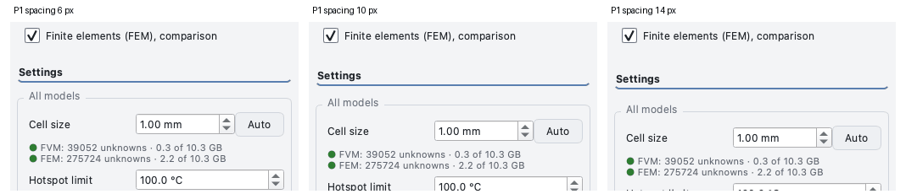
*spacing_p1.png: the same for P1 (frames).*

*panel_variants.png: P1 to P8 with the FVM and the FEM ticked, light theme on top and dark below, cut at the Settings box (the Models box and Run are the same in all).*

*panel_variants_lumped.png: the same with only the Lumped and the Analytic ticked, showing the greyed groups.*

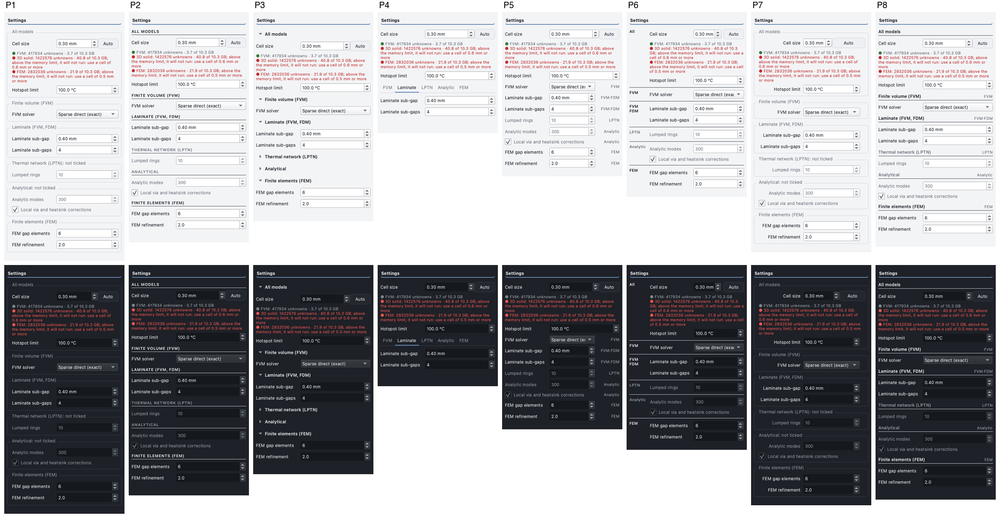
*panel_variants_fine_cell.png: FVM, 3D solid and FEM at a 0.3 mm cell, with two red memory lines.*

The recommended variant at full size (whole dock, 340 px):

| | Light | Dark |
| :-- | :-- | :-- |
| P8, FVM + FEM |  | 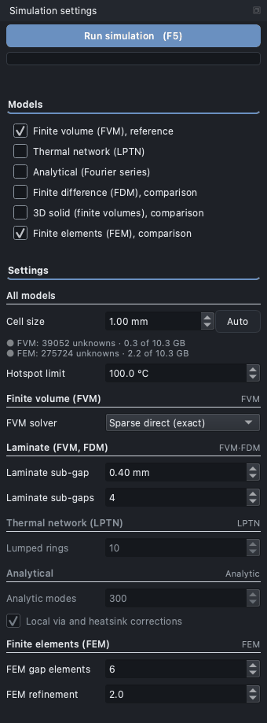 |
| P8, Lumped + Analytic | 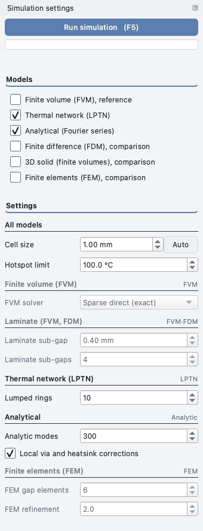 | 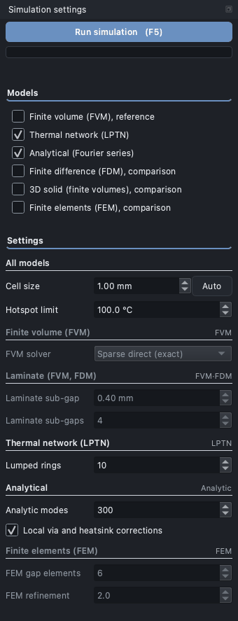 |
| P8, fine cell | 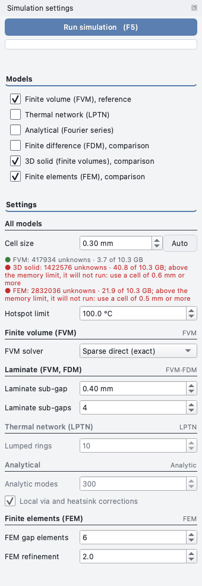 |  |
| P1 (alternative), FVM + FEM / Lumped + Analytic |  |  |

### Recommendation

**P8**, with 10 px around the Settings toggle and the memory lines of section 3. It answers both objections: every label and every field starts at one x in every group (one grid), the group titles start at the same x as the labels, and the toggle has room. It needs no frame, so it is the narrowest variant (308 px, against 331 for P1) and the shortest of those that show every setting; each group says which models it serves (the tag at the right), a group not ticked is greyed, not hidden, as the guide's 'Greyed fields' rule says, and nothing moves when a model is ticked. If the maintainer wants boxes, **P1** is the aligned framed version.

Effort: **S** (half a day) on a `feature/` branch: the prototype's P8 code (`panel_variants.py`) folds into `SolverPanel` with docstrings; one regression test for the alignment (every visible label at one x, every field at one x, the code of the screenshot script) and one for the greying of a group with its models and of the laminate group with a metal block; a stress scenario; the documents and pictures of section 5 ('What changes'), the same list.

## 8. Third round: the design of the group titles of P2 (P2a to P2h)

The maintainer chose P2 (no frames, a group title and a thin separator, the two-column form of one grid). Eight designs of its title and separator were built on the same grid: every one keeps the memory lines of section 3 and the alignment of section 7 (labels at x 8, fields at x 134 in every group, both themes, both cases; P2h at 8 and 146 because its rows are indented), the minimum width (308 px, P2h 320 px; dock 340 px) and the tooltips (both prototype tests pass). In every one a group whose models are not ticked has its title in the `muted` colour, its rows greyed **and its tag says so in words** ('LPTN · not ticked'), so the state never rests on colour alone. The tag at the right names the models the group serves (All, FVM, FVM·FDM, LPTN, Analytic, FEM), 11 px in the `hint` colour.

| | Title | Marker / bar | Separator | Remarks |
| :-- | :-- | :-- | :-- | :-- |
| P2a | Bold (700), text colour, dock size | none | full-width hairline (`border`) under the title | The plainest; looks like a smaller copy of the box header |
| P2b | Capitals, 11 px, 600, letter spacing 0.8 px, `muted` colour | none | hairline after the title, on its line | The classic settings caption; small, and `muted` misses AA on the light window |
| P2c | Bold, `accent` colour | none | `accent` hairline under the title | Strong, but `accent` text misses AA on the light window |
| P2d | 600, text colour | round dot in `accent` before the title | none | Close to the memory lines, but a dot means a verdict or a warning elsewhere |
| P2e | Bold, text colour | short `accent` bar (3 x 14 px) before the title | full-width hairline | Echoes the accent underline of the box header one level down |
| P2f | 600, text colour | square in a colour per model (Matplotlib default cycle) | full-width hairline | The program has no colour per model (results use the default cycle in plot order): invents a mapping; orange and brown fail 3:1 |
| P2g | 600, text colour | `ok` green dot when ticked, `muted` when not | hairline after the title | Green means 'fits in memory' two lines above: a second meaning for the same mark |
| P2h | 12 px (one point below the dock font), 600, `hint` colour | none | none; rows indented 12 px | The quietest; ticked (`hint`) and not ticked (`muted`) titles are almost the same grey, the tag carries the state |

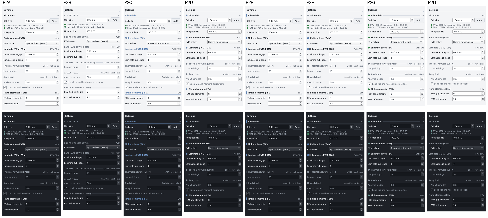
*p2_variants.png: P2a to P2h with the FVM and the FEM ticked, light theme on top and dark below, cut at the Settings box.*

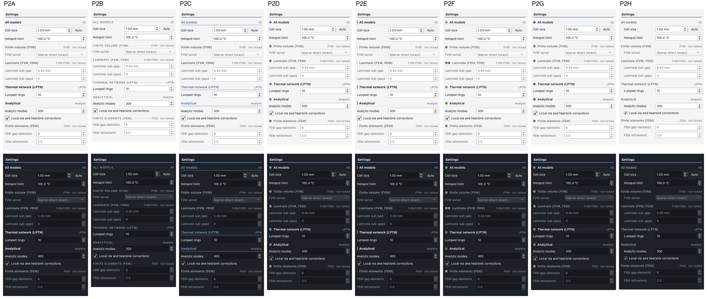
*p2_variants_lumped.png: the same with only the Lumped and the Analytic ticked (FVM, laminate and FEM groups not ticked).*

### Contrast (WCAG 2.1, against the dock background `window`: #f3f4f6 light, #1e2127 dark; `theme.contrast`)

| Colour (token) | Light | Dark | Use here | Verdict |
| :-- | --: | --: | :-- | :-- |
| `text` #1f2328 / #e6e8eb | 14.35 | 13.14 | titles of P2a, P2d to P2g | AA and AAA |
| `hint` #5f6570 / #9aa3ad | 5.33 | 6.31 | tags, title of P2h | AA (4.5:1) |
| `muted` #6b7280 / #8b949e | 4.39 | 5.24 | title of P2b; every title not ticked | below AA on light for P2b; a title not ticked is a disabled control, exempt |
| `accent` #5a7fb0 / #6a90c0 | 3.74 | 4.89 | title of P2c; dot of P2d, bar of P2e (marks) | text below AA on light (bold 13 px is not 'large text', which starts at 18.7 px bold); as a mark above the 3:1 of non-text contrast |
| `ok` #2e7d32 / #66bb6a | 4.66 | 6.82 | dot of P2g | above 3:1 |
| Matplotlib cycle: blue, orange, green, red, brown | 4.38, 2.30, 3.09, 4.56, 5.38 | 3.35, 6.37, 4.74, 3.21, 2.72 | squares of P2f | orange (light) and brown (dark) below 3:1 |
| `border` #d0d5dd / #343a43 | 1.34 | 1.41 | hairlines | decorative (no contrast requirement); the title carries the grouping |

### Design opinion and recommendation

- **Hierarchy and consistency.** The dock already has three levels: the dock title (600 on `alt`), the box headers Models and Settings (bold, text colour, a 2 px `accent` underline, `boxes.CollapsibleBox`) and the field labels (regular). A group title is a fourth level between the box header and the labels: it should be bold text but visibly lighter than the box header. P2e does that by taking the box header's accent in a small dose (a 3 px bar instead of a 2 px full underline) and a neutral hairline; P2a does it with weight alone and reads almost like a second box header; P2c repeats the accent on text and fails contrast.
- **Marks with a meaning.** In this window a round dot already means something: the verdict of the memory lines (green, amber, red) and the badges of the Warnings box (amber triangle, grey circle). A dot before a group title (P2d, P2g) would be a third meaning; P2g's green dot directly under green memory dots is the worst case. A bar (P2e) is not used elsewhere, so it means only 'a group starts here'. Model colours (P2f) would need a mapping the results do not have.
- **Colour-blind safety.** No variant relies on colour: the state 'not ticked' is in the tag text and in the greyed fields; P2e's bar turns from `accent` to `border` but is redundant with those.
- **Contrast.** The recommended title is `text` on `window`: 14.35:1 light, 13.14:1 dark; its bar (`accent`) 3.74:1 and 4.89:1, above the 3:1 of a non-text mark; the tags (`hint`) 5.33:1 and 6.31:1.
- **Density.** P2e costs no width (308 px, as P2) and about 6 px of height per group more than P2b; P2h is the quietest but its active and inactive titles are almost the same grey (5.33 against 4.39 on light), so the tag alone carries the state; P2b's capitals are compact but at 11 px in `muted` they miss AA on the light theme (with `hint` instead they would pass, 5.33).

**I would ship P2e** (bold title in the text colour, a short accent bar before it, a full-width hairline under it, the models as a small tag at the right, 'not ticked' in words; 10 px around the Settings toggle). If the maintainer finds the bar too much, **P2a** is the same without the bar. Effort unchanged: **S** (the title is one small widget per group; the colours come from theme tokens and follow a theme switch in `update()`).

The recommended design at full size:

| | Light | Dark |
| :-- | :-- | :-- |
| P2e, FVM + FEM | 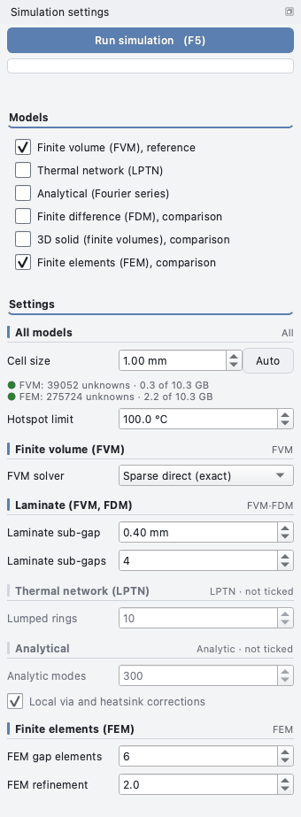 | 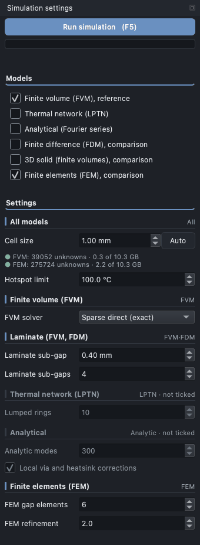 |
| P2e, Lumped + Analytic | 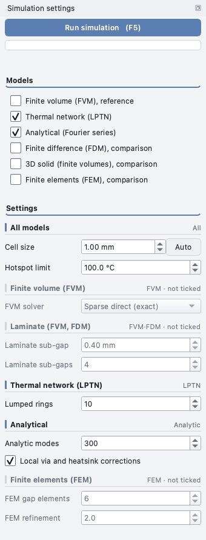 | 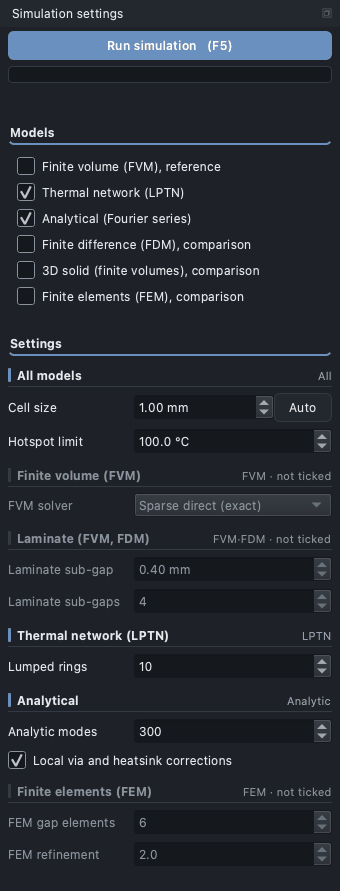 |

## 9. Final: P2c with an accessible title colour, and the implementation spec

### 9.1 Review of the maintainer's choice (P2c)

The maintainer chose P2c (title and hairline in the accent blue). **Agreed, with one adjustment.** The accent text on the light window reaches 3.74:1, below the 4.5:1 of WCAG 2.1 AA for normal text. The 3:1 threshold of 'large text' does not apply: large means 18 pt regular or 14 pt bold (18.7 px bold), and the group title is the dock font in bold (9 pt, 12 px on the offscreen platform of the screenshots; 13 px on macOS), well below. On the dark window the accent passes (4.89:1).

Adjustment that keeps the look: the **title text** takes a darker blue on the light theme only, the theme's own pressed accent `#4a6a96` (**5.03:1** against `window` #f3f4f6, 5.54:1 on `base` white); on the dark theme it stays the accent `#6a90c0` (**4.89:1** against #1e2127). The hairline keeps the accent in both themes (a line is decorative, no minimum). The hue difference between #4a6a96 and #5a7fb0 is barely visible next to each other, so the title and its line still read as one accent element. A title not ticked takes `muted` (4.39:1 light, 5.24:1 dark; a disabled control is exempt) and says 'not ticked' in its tag.

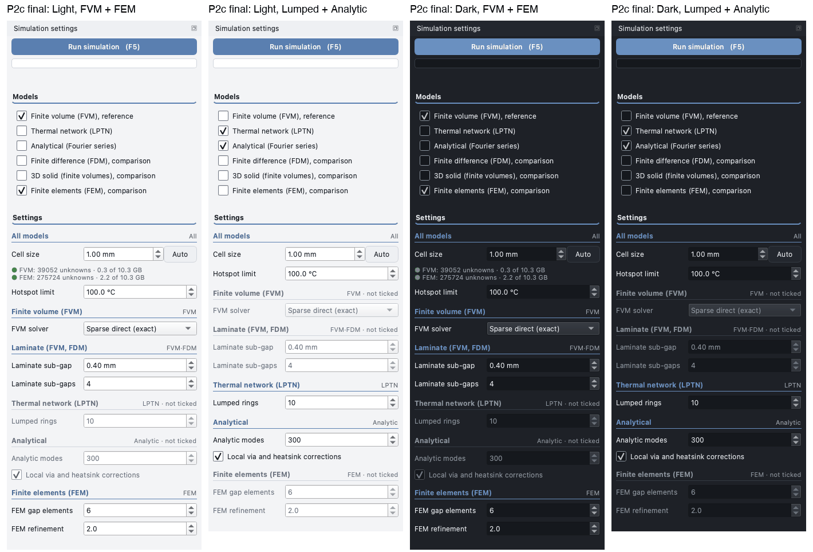
*p2c_final.png: P2c final at the 340 px dock: light with the FVM and the FEM ticked, light with only the Lumped and the Analytic ticked, then the same in dark. Labels at x 8 and fields at x 134 in every group, both themes, both cases; minimum width 308 px.*

### 9.2 Implementation spec for `feature/simulation-panel-groups`

Branch from `development`; a GUI feature (minor item, it can ride with 2.8.0); executor, then reviewer, then maintainer with the whole battery. Option keys, project format, field labels and the per-control 'Greyed: ...' tooltips do not change.

**Layout** (`pcbthermal/gui/panels.py`, `SolverPanel.__init__`):
- The Settings box body holds ONE `QGridLayout` (two columns: labels, fields; horizontal spacing 8, vertical 6, column 1 stretches) for every group, so every label starts at one x and every field at one x. Label column: a fixed width, the advance of the longest label ('Laminate sub-gaps') plus 6 px, labels left-aligned.
- Groups in this order, each a header row (spanning both columns) and its rows:
  1. 'All models', tag 'All': Cell size (spin box + Auto), the memory lines (full width), Hotspot limit.
  2. 'Finite volume (FVM)', tag 'FVM': FVM solver.
  3. 'Laminate (FVM, FDM)', tag 'FVM·FDM': Laminate sub-gap, Laminate sub-gaps.
  4. 'Thermal network (LPTN)', tag 'LPTN': Lumped rings.
  5. 'Analytical', tag 'Analytic': Analytic modes, Local via and heatsink corrections (full width).
  6. 'Finite elements (FEM)', tag 'FEM': FEM gap elements, FEM refinement.
- Header row: the title (`font-weight: 700`, dock size, colour `accent_text`), a stretch, the tag (11 px, colour `hint`), and under them a 1 px line (a `QFrame` with a fixed height of 1 and a style-sheet background; an `HLine` frame with a style sheet drew nothing) in `accent`. 8 px above every header except the first, 3 px between the title and its line.
- Spacing: 10 px above the Settings toggle (between the Models box and it) and 10 px between the toggle and the first header.
- New theme token `accent_text` in `theme.THEMES`: light `#4a6a96`, dark `#6a90c0`, with a comment giving the ratios (5.03:1 and 4.89:1 on `window`); colours are applied in `_update_availability` (called by `refresh`), so they follow a theme switch.

**Not ticked state** (`_update_availability`): a group whose models are none ticked (the laminate group also on a board with a metal block, `laminate.uses_rule`) has its title and line in `muted` (line in `border`), its tag reading '<tag> · not ticked', and its controls disabled with the existing 'Greyed: ...' tooltip. The 'All models' group is never greyed.

**Memory lines** (`_update_cells`), as in the prototype: the label in the `theme.hint` style (11 px, `hint`); each row a dot in the verdict colour; an 'ok' row in the hint colour, 'slow' and 'refuse' rows wholly in the verdict colour; compact text `FVM: 39052 unknowns · 0.3 of 10.3 GB` ('at least' becomes '≥'); no thousands separator; the refusal and pyamg sentences unchanged; the label hidden when no guarded model is ticked.

**Tooltips**: `tips.apply` reads `QFormLayout` rows only, so a grid row gets its label's tooltip from `tips.TIPS` when the panel builds it (label and field, unless the field has its own), or `tips.apply` learns `QGridLayout` label/field pairs; the header titles and tags get a short tooltip ('Settings used by: FVM, FDM'); `tests/test_tooltips.py` must pass unchanged.

**The three small fixes** (same branch):
1. Auto respects the FEM mesh numbers: `api.suggest_cell_mm` gains `fem_params=None`, passed to `memory.check`; `SolverPanel._auto_cell` passes `self.doc.options.fem_params()` (and `cli.py`'s automatic cell passes the `--fem-gap-elements` and refinement options, and the laminate ones it also omits today). No number of a solve moves; regression test: with 24 gap elements and the FEM ticked, Auto gives a cell whose FEM verdict is not 'refuse'.
2. The tooltip of 'Local via and heatsink corrections' ends with 'Steady run only: the time run (power profiles) always treats vias and heatsinks locally.' (and the same sentence in the guide row).
3. The greyed laminate tooltip on a board with a metal block reads 'Greyed: not used on a board with a metal block (the laminate rule does not apply there).' instead of 'used only by a board with a metal block, where the rule does not apply': the 'why' becomes a whole sentence per case in `_update_availability`.

**Tests to add**:
- `tests/test_simulation_panel_groups.py` (offscreen): alignment, for both themes and with the FVM + FEM and the Lumped + Analytic sets: every visible label at one x and every visible field at one x (`QWidget.mapTo(panel, ...)`; a field that is a layout is measured by its first widget), header titles at the label x; the minimum width at most 340 px; a group greys with its models (title colour `muted`, tag contains 'not ticked', its controls disabled) and comes back when ticked; the laminate group greyed on a board with a metal block; the memory line format (a dot, '·', no '\d,\d{3}', the verdict hex colours of `tests/test_gui_stress.py`); fix 1 and the tooltips of fixes 2 and 3.
- `tests/test_theme_coherence.py`: `accent_text` at least 4.5:1 against `window` and `base` in both themes.
- `tests/test_gui_stress.py`: a scenario ticking and unticking every model quickly with a theme switch in between (the headers recoloured, no exception).
- Unchanged and to be re-run: `tests/test_gui.py::test_docks_open_wide_enough_and_keep_the_run_button_in_sight`, `tests/test_fem_gui.py`, `tests/test_gui_stress.py` 1183-1217, `tests/test_theme_coherence.py` 211-214, `tests/test_warning_context.py`, `tests/test_laminate_edge_band.py` (field names quoted by warnings).

**Documents and pictures**:
- Guide `pcbthermal/help/index.html` section 8: a sentence before the table ('The settings are grouped by the models they serve; the tag at the right of a group names them; a group is greyed and marked "not ticked" when none of its models is ticked'); the Cell size row describes the compact memory line; the local-corrections row says 'steady run only'; `tests/test_help.py` if a new word is checked.
- Screenshots regenerated with `examples/make_screenshots.py` and LOOKED at: `simulation_fem.png` (the FEM pictures function), `editor.png`, `editor_warnings.png` and their dark variants, in `docs/images/` and `pcbthermal/help/`; `README.md` uses the same files.
- `CHANGELOG.md` (Unreleased), `docs/versions.md` (implemented, how tested; 'Planned' unchanged), `docs/decisions-log.md` (the layout and the `accent_text` token, with this review as evidence), the battery result at the top of 'How each version was tested'.

Effort: **S to M** (about a day with the tests and the screenshots).
