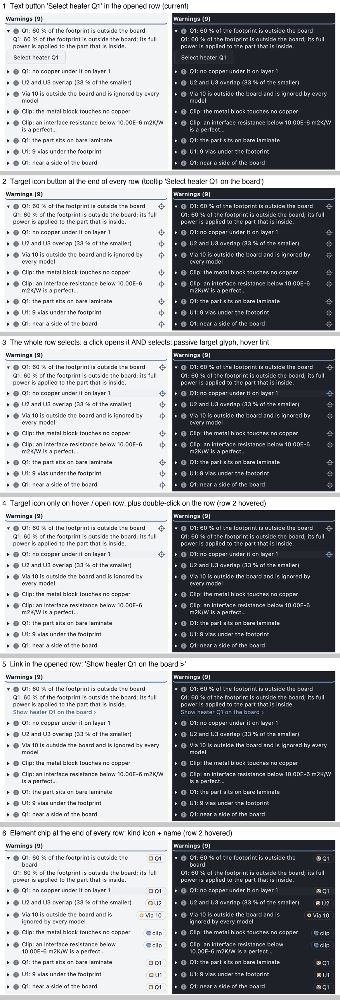
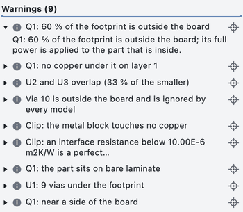
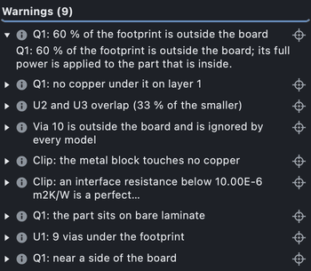
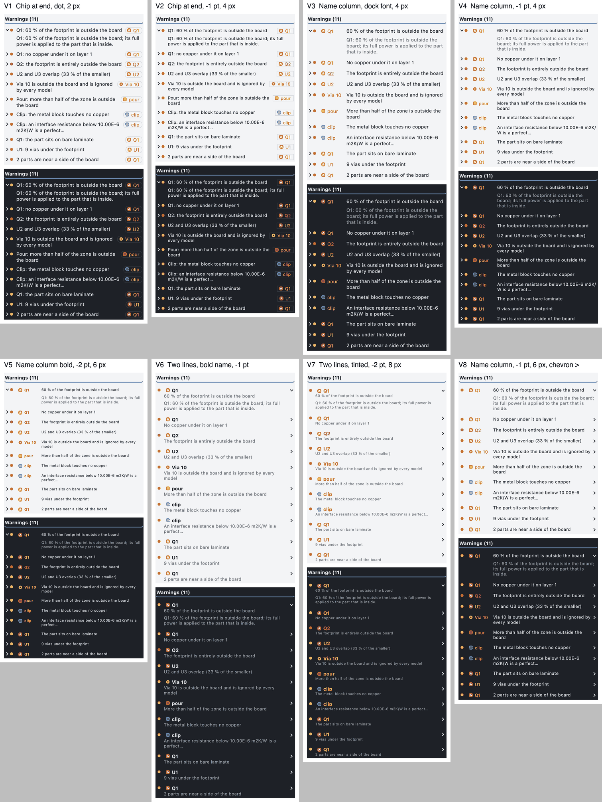
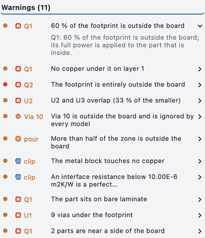
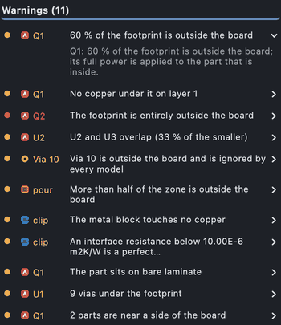

# The 'Select heater U1' button of the warnings: what it is and the options

Question of the maintainer: why do the warnings now carry a button to select the element, and could an icon or something more intuitive replace it? This note answers it, shows six numbered options prototyped on the real widget, and recommends one. Nothing of the program is changed here.

## 1. What the button is

* **Where**: `pcbthermal/gui/warning_box.py`, class `_TopicRow` (lines 241 to 247 and 252 to 267 on `development` 6c225276). It is a `QPushButton` labelled `Select <kind> <name>` (for example `Select heater U1`; the name comes from `SolverPanel._element_name` in `pcbthermal/gui/panels.py`). It is shown **only in an opened row** of the **Warnings (N)** box of the Simulation settings dock, and only for a warning that names an element (`CheckWarning.kind` and `.index`, set by `checks._add`).
* **What it does**: it emits `selected(kind, index)`; `WarningAccordion.warning_clicked` reaches `MainWindow._select_from_warning` (`pcbthermal/gui/main_window.py`), which switches to the layer of the element, selects it on the canvas and shows it in Properties. After an edit the list is stale until the live check runs again (a moment later) and the button is disabled, because its index may now belong to another element.
* **Which warnings point to an element**: only the live input checks of `checks.py` (about 40 call sites): heaters (footprint outside the board, zero area, overlap, no copper under it, bare laminate, vias under the footprint, near a side, too few cells, Lumped core, FEM element size, small against the laminate sub-layer), vias (outside or half outside the board), zones (half outside, self-crossing outline, replaced by imported copper) and heatsinks or metal blocks (part outside, no copper overlap, interface below 1e-5 m2K/W). Kinds: `heater`, `via`, `zone`, `heatsink`. Warnings about the whole design carry no element and get no control.
* **Where warnings appear**: (1) the live Warnings (N) box of the Simulation dock (with the button); (2) the Warnings box of the Results summary (`results_view.py`, `WarningAccordion(..., select=False)`: no button, the notes of a run are plain strings); (3) the Gerber import window, which still uses the older `WarningList` (`panels.py`), where each warning is a coloured link.
* **Why a text button**: added by commit 4ef7f24a (2026-11-12, 'Add collapsible boxes and the warnings accordion...'), the item 'Warnings as collapsible topics (A2)' of 2.7.0, decided on the mock-ups of `docs/mockups-261/README.md`: 'In the opened warning of the Simulation dock a Select heater U1 button replaces the click on the list.' Before it (`WarningList`, since c4a6b487) a click on the warning text selected the element. With the accordion the click on a row opens or closes it, so the selection needed a control of its own; a button whose label says what it does was the plain choice. It has its own tooltip ('Select the element this warning is about.'), so it is not in the `NO_TOOLTIP_BUTTONS` exemption of `tests/test_tooltips.py`.
* **Its weak points**: it takes two clicks (open, then select), it is a full-size push button inside a reading list (heavy, and it pushes the next row down by a button height), and nothing in a closed row tells that the warning can lead to its element.

## 2. The options

Prototyped on the throwaway branch `tmp/warning-select-proto` (a switch `PCBT_WARN_SELECT_STYLE=1..6` in `warning_box.py` of that branch only), the real main window offscreen, the example board plus an overlapping heater U3, a heater Q1 partly off the board, a via off the board and a 2 mm block 'clip' with a 1e-6 m2K/W interface (9 live warnings, all with an element), Simulation dock at its default width for a 1600 px window (384 px; the box is 350 px wide), light and dark themes. In every picture the first row is open; in options 3, 4 and 6 the second row is shown hovered. The icons are drawn with QPainter (ours, MIT, no glyph set, no new dependency); the element-kind icons of option 6 are the existing `theme.tool_icon`. Colours are the theme tokens `hint` (rest) and `link` (hover).

*comparison.png: options 1 to 6 one under the other, light theme left, dark right.*

| # | Option | Clicks to select | Visible in a closed row | Notes |
| :-- | :-- | :-- | :-- | :-- |
| 1 | Text button `Select heater Q1` under the opened text (current) | 2 | no | Clear words, but heavy and two clicks. |
| 2 | Small target icon button at the end of every row that has an element; tooltip `Select heater Q1 on the board.` | 1 | yes | Light, one click, keyboard-focusable; the icon needs its tooltip once to be learnt. |
| 3 | The whole row selects: a click opens it and selects the element; a passive target glyph at the end; hover tint | 1 | yes | Reading a warning changes the selection, the layer and the Properties panel: a side effect on every read. |
| 4 | Target icon only on hover or on the open row, plus double-click on the row | 1 (2 with double-click) | only on hover | Clean at rest, but hidden: not found by keyboard, touch or a new user. |
| 5 | Link `Show heater Q1 on the board >` under the opened text, link colour, underlined | 2 | no | Lighter than 1, reads well, still two clicks. |
| 6 | Chip with the kind icon and the name (`[heater] Q1`) at the end of every row | 1 | yes | Most explicit, but repeats the name the title already starts with, takes about 60 px of title width (more wrapping) and adds colour to every row. |

 

*opt2_light.png and opt2_dark.png: the recommended option at the real dock width.*

The single pictures of every option are in `figures-warnings/` (`opt1_light.png` to `opt6_dark.png`).

## 3. First recommendation (before the maintainer's choice)

**Option 2: a small target icon button at the end of every warning row that names an element.** One click from a closed row, the action is visible without opening the warning, the row keeps the height of its text (the button is one title line high), it reads well in both themes, and it separates the two actions cleanly: the row reads (opens or closes), the target goes to the element. Its tooltip carries the words of the old button (`Select heater Q1 on the board.`). Keep the Results summary without the control (its notes are plain strings) and leave the import window as it is (a separate list).

Variants the maintainer may prefer: the link of option 5 if the words matter more than one click; the chip of option 6 if the element name should be seen at a glance. Option 3 is advised against (side effect of reading), option 4 too (hidden).

## 3a. The maintainer's choice: option 6, and its variants

The maintainer chose **option 6** (a label with the element-kind icon and the name that selects the element) and liked the style of the memory lines of the Simulation panel prototype (`tmp/settings-layout-proto`, a small round dot coloured by the verdict in front of the line). Eight variants of option 6 were prototyped on the same throwaway branch (`PCBT_WARN_VARIANT=1..8`, class `_VariantRow`), on the same board plus a heater Q2 entirely off the board (an **alert**) and a zone 'pour' half off the board, so that the four kinds (heater, via, zone, metal block) and both severities appear: 11 live warnings, the first one opened, Simulation dock at its default width (box 350 px), light and dark.

Common to every variant:

* **Severity dot**: a round dot drawn by us in front of each line, in the tokens of the memory verdicts: `bad` (the colour of 'refuse') for an alert, `warn` (the colour of 'slow') for a note. It replaces the triangle or circle badge; the severity stays in the accessible name (`Warning:` or `Note:`) and in the tooltip, so colour is never the only carrier.
* **Element label**: a flat button with the existing kind icon (`theme.tool_icon`, ours) and the element name; tooltip and accessible name `Select heater Q1 on the board`; hover in the `link` colour, focus ring in `accent`; disabled while the list is stale.
* **Spacing**: the gap above each row (`top`) and above the opened text (`body`) were tried at 2, 4, 6 and 8 px.
* In the column and two-line layouts the title drops its leading `Name:` (the label already names the element: 'Q1: no copper under it' becomes 'No copper under it'); the opened text keeps the full sentence, in the `hint` colour.

| # | Layout | Font of title and text | Gaps (row / opened text) | Notes |
| :-- | :-- | :-- | :-- | :-- |
| V1 | Option 6 as is (chip at the end of the title), dot, tinted name | dock font | 2 / 2 | Closest to option 6; ragged chips, titles wrap early. |
| V2 | As V1 | -1 pt | 4 / 4 | Fewer wraps; still ragged. |
| V3 | Aligned name column (dot, icon and name), then the title | dock font | 4 / 4 | Aligned; the column takes about 90 px, titles wrap. |
| V4 | As V3 | -1 pt | 4 / 4 | Aligned and compact. |
| V5 | As V3, bold name | -2 pt | 6 / 6 | Too small at a device pixel ratio of 1 (about 9 pt on a normal screen). |
| V6 | Two lines: icon and bold name, the title grey below; chevron at the right | -1 pt | 6 / 4 | Very readable, but about twice as tall: 11 warnings fill the dock. |
| V7 | As V6, name tinted by severity | -2 pt | 8 / 6 | Airy, text too small, the tallest. |
| V8 | Aligned name column, chevron at the right, dot at the left | -1 pt | 6 / 4 | Aligned, compact, one line per short warning; the chevron at the right reads as 'open'. |

*variants.png: V1 to V4 in the top band, V5 to V8 in the bottom band; in each, the light theme above the dark one.*

 

*v8_light.png and v8_dark.png: the recommended variant at the real dock width.* The single pictures of every variant are `figures-warnings/v1_light.png` to `v8_dark.png`.

**Recommendation among the variants: V8.** The aligned name column makes the list scannable (the eye runs down the names: Q1, Q2, U2, Via 10, pour, clip), the severity dot follows the memory lines the maintainer liked, the title loses the repeated name, one point smaller keeps most warnings on one line at 350 px, and the chevron at the right frees the left edge for the dot. Spacing: **6 px above each row and 4 px above the opened text** looked right; 2 px is cramped once the text is opened, 8 px wastes height. Font: **-1 pt** for the title and the opened text, the dock font for the box title; -2 pt (V5, V7) is too small on a screen with a device pixel ratio of 1. If height matters less than reading, V6 is the alternative.

Limits of V8 to handle in the implementation: a long element name (an imported designator such as `C123_REG_3V3`) widens the column; it is capped at 40 % of the box and should be elided with the full name in the tooltip; a warning without an element needs an empty cell of the same width (the demo board has none, all 11 name an element); the column width is computed per list, so it can change when the list refreshes.

## 4. Accessibility

* **Keyboard**: Tab reaches the row head (Space or Enter opens or closes it, as today) and then the target button of the same row (Space or Enter selects). Optional: Ctrl+Enter on the row head as a shortcut to select, documented in `SHORTCUTS_HTML`.
* **Screen reader**: the button gets an accessible name `Select heater Q1 on the board` (the prototype sets it); the row head keeps `Warning: <title>` or `Note: <title>`.
* **V8**: Tab reaches the row head (Space or Enter opens it) and then the name label (Space or Enter selects); the label's accessible name is `Select heater Q1 on the board`, the head's `Warning: <title>` or `Note: <title>`.
* **Stale list**: the button is disabled (its icon drawn in the `border` token) until the live check runs again, as the text button is today.
* **Focus**: a visible focus ring on the button (the prototype draws a 1 px highlight border).

## 5. Effort and what it touches

**Effort S** for option 2 (about 2 to 3 hours with the documents); **effort M** for V8 (about 1 working day: a new row layout with the column width, the dot replacing the badge in both the dock and the Results summary for one style, elision, the tests of `tests/test_warning_icons.py` that check the badge, and the same documents).

* Code: `pcbthermal/gui/warning_box.py` only (`_TopicRow`: a `QToolButton` in the head row instead of the `QPushButton` below the text; a `target_pixmap` drawer; tooltip and accessible name with the element name; `set_stale` and `recolour` unchanged in spirit).
* Tests: `tests/test_gui_boxes.py::test_the_accordion_lists_closed_rows_and_the_select_button_names_the_element`, `tests/test_gui.py` (around line 450) and `tests/test_ui_cleanup.py` (around lines 207 to 214) use `row.button` and its text; they move to the new button and its tooltip and accessible name. With the prototype switch at 1 the tests touching warnings and tooltips pass (25 passed); at 2 the first of them fails as expected (it reads the old label). `tests/test_tooltips.py` needs no exemption (the button has a tooltip). A stress scenario in `tests/test_gui_stress.py` is not needed (no new element type or dialog), but the existing warnings stress tests should be read.
* Documents: the user guide `pcbthermal/help/index.html` (the Simulation settings row: 'use the Select heater U1 button in the opened row' becomes 'click the target at the end of the row') and the matching word `Select heater U1` in `tests/test_help.py`; the docstrings of `warning_box.py` and `panels.py` (`_element_name`); `CHANGELOG.md` (Unreleased); `docs/versions.md`; a decisions-log entry.
* Screenshots: `docs/images/editor_warnings.png` (made by `examples/make_screenshots.py --import`, which needs the RP2040 board of the local library) shows an opened warning with the old button and must be regenerated and looked at.

## 6. What was not verified

* The pictures are offscreen renderings at a device pixel ratio of 2, halved for the files here; macOS native rendering of the tool button (hover frame) was not seen.
* Hover in options 3, 4 and 6 is forced in the script, not produced by a real mouse.
* The variants were tested only offscreen; macOS font sizes (points against pixels) may differ by one step.
* The prototype branch `tmp/warning-select-proto` is throwaway and holds nothing that is not described here; it is to be deleted.
