# GUI of 2.8.0 against v2.7.1: before and after

Each figure is a pair: the v2.7.1 tree (`git archive v2.7.1`) on the left (or above) and the development tree on the right (or below), rendered offscreen by the same script on the same board, light theme here and dark theme in the file with the suffix `_dark`. A grey panel says 'not in 2.7.1'. The development tree still prints `v2.7.1` in the status bar (the version is bumped at the release). The reviews quoted are in `releases/2.8.0/fem-model/`. Some windows are cropped to the part that changed.

## 1. Models box and grouped Settings, FVM + FEM ticked (and the Lumped and Analytic)

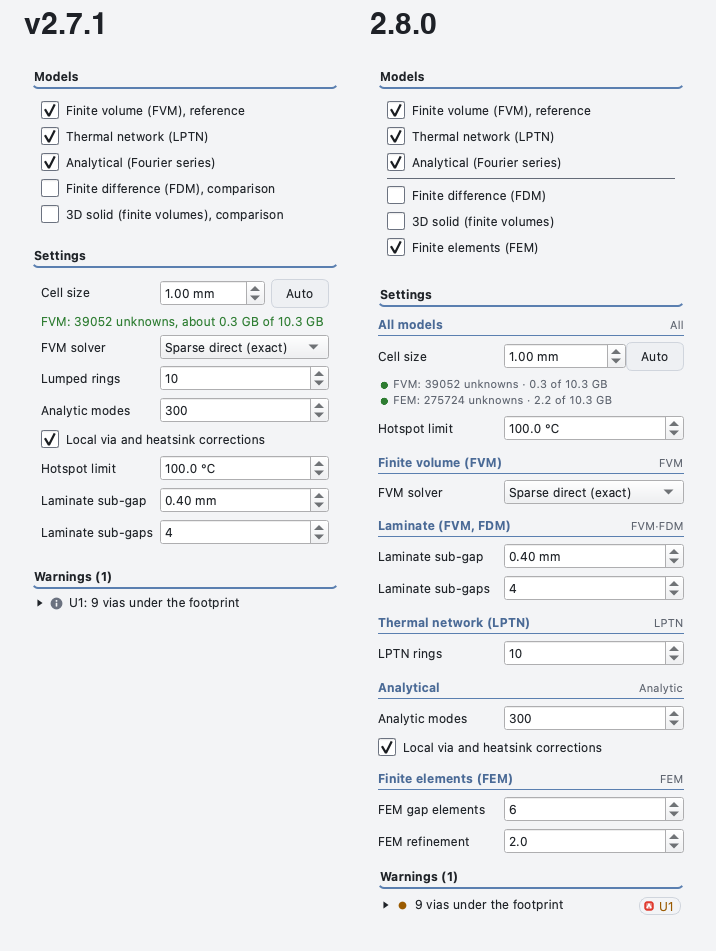

*Figure 1, `01_models_settings_light.png` (dark: `01_models_settings_dark.png`): MODEL_LABELS_REVIEW L3 (', comparison' dropped, a thin separator between the three main models and the other three, ', reference' kept on the FVM) and SIMULATION_PANEL_REVIEW P2c (settings grouped per model with an accent title and a tag; memory lines with a green dot per model).*

## 2. Settings with only the Lumped and the Analytic ticked

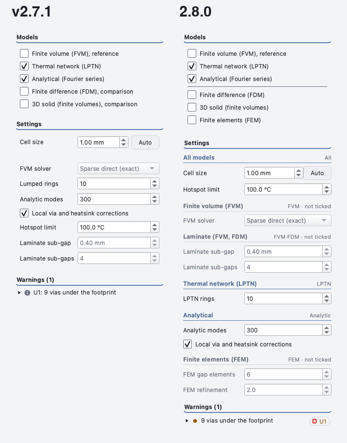

*Figure 2, `02_settings_greyed_light.png` (dark: `02_settings_greyed_dark.png`): SIMULATION_PANEL_REVIEW P2c: the groups of the models not ticked (FVM, laminate, FEM) are greyed and tagged 'not ticked'; before, the FVM solver and laminate fields sat greyed inside one flat list.*

## 3. Warnings box of the Simulation dock, a board with three warnings

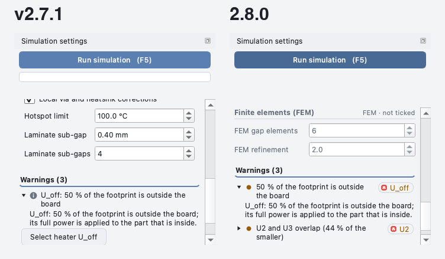

*Figure 3, `03_warnings_dock_light.png` (dark: `03_warnings_dock_dark.png`): WARNING_SELECT_REVIEW V1: a severity dot and a chip with the element icon and name (U_off, U2) replace the grey circle and the 'Select heater U_off' button; the chip selects the element.*

## 4. The same warnings in the editor window (right-hand column)

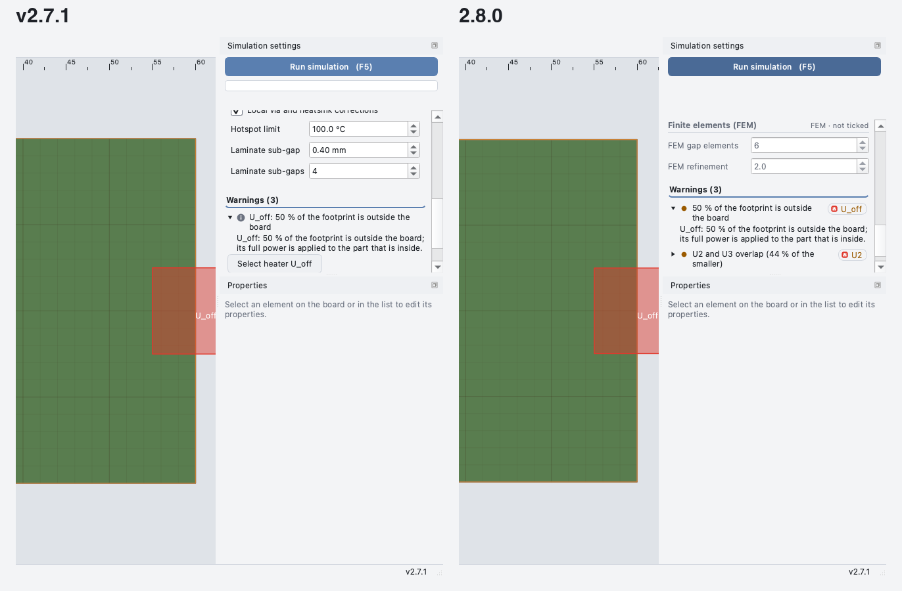

*Figure 4, `04_warnings_editor_light.png` (dark: `04_warnings_editor_dark.png`): WARNING_SELECT_REVIEW V1, seen with the Properties dock and the canvas edge.*

## 5. Results, Summary, 1500 x 900

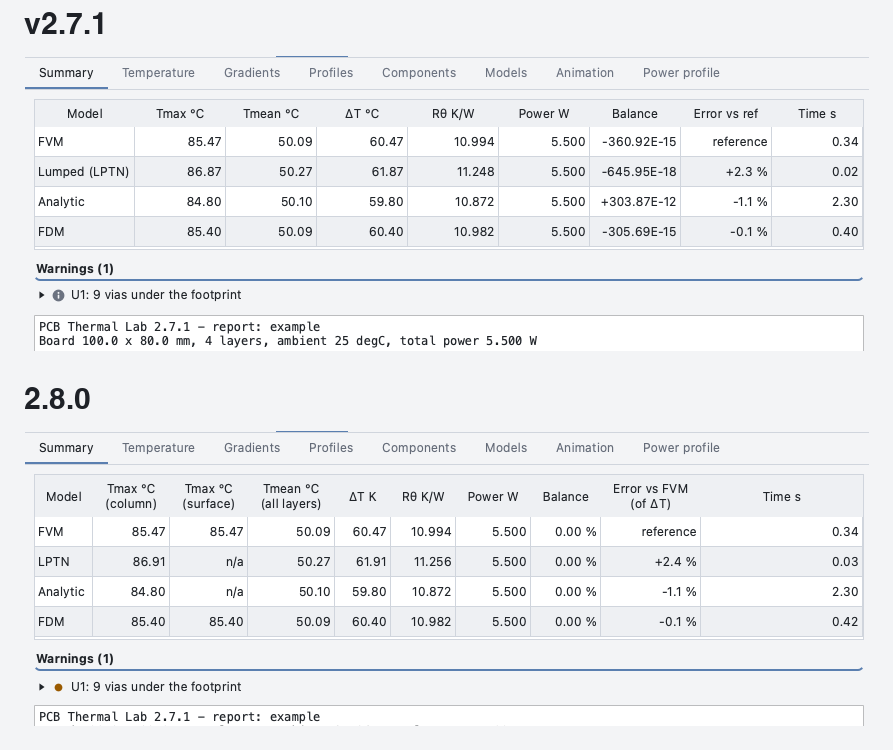

*Figure 5, `05_summary_1500_light.png` (dark: `05_summary_1500_dark.png`): SUMMARY_TABLE_REVIEW a+: two-line headers with the read-out in them, short model names, Balance in percent, 'Error vs FVM (of dT)', and the new column Tmax (surface) ('n/a' for the LPTN and the Analytic).*

## 6. Results, Summary, 1200 x 800

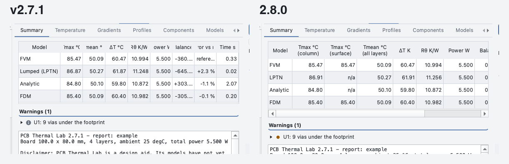

*Figure 6, `06_summary_1200_light.png` (dark: `06_summary_1200_dark.png`): SUMMARY_TABLE_REVIEW a+: the old headers are cut ('max C', 'ower W', 'alance'); the new ones are whole words on two lines, but the table still scrolls sideways from Balance on at this width.*

## 7. Results, Components tables, 1200 x 800

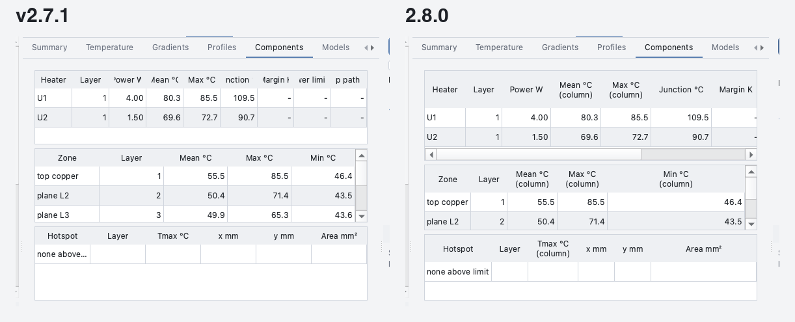

*Figure 7, `07_components_1200_light.png` (dark: `07_components_1200_dark.png`): GUI_GENERAL_REVIEW D2 and SUMMARY_TABLE_REVIEW a+: the cut headers ('ower W', 'Mean C', 'nction') are whole, with the read-out (column) named. The heater table still has a horizontal scroll bar at 1200 (Margin K onwards).*

## 8. Part table of a 50 x 50 x 10 mm plate: the surface column

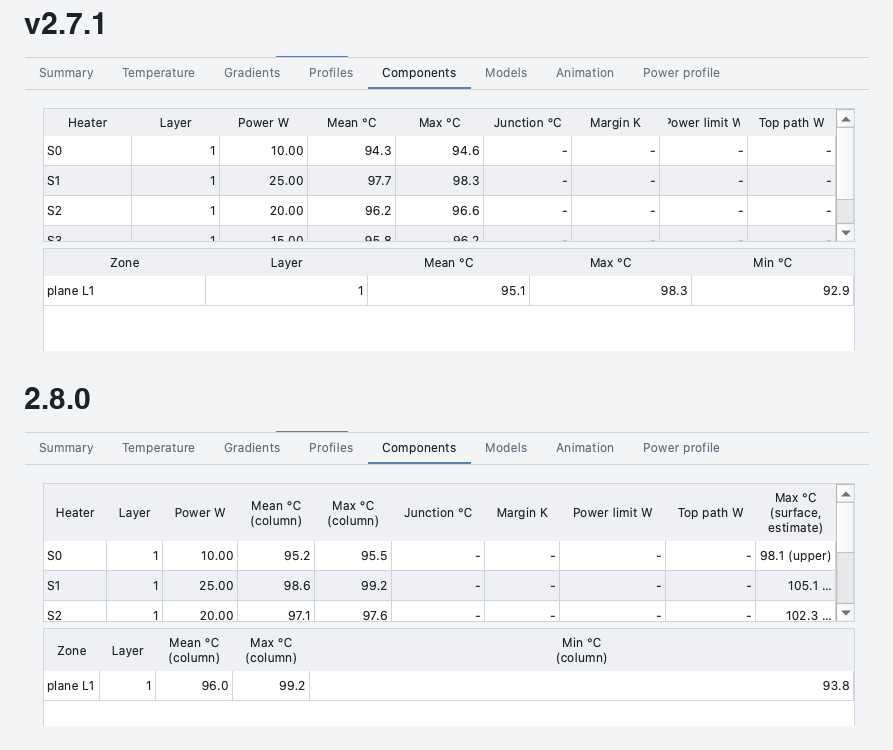

*Figure 8, `08_part_table_surface_light.png` (dark: `08_part_table_surface_dark.png`): SURFACE_DECISIONS 5: one column 'Max C (surface, estimate)', '(upper)' marks a part that is small against the plate; before there was only the column read-out.*

## 9. Tooltip of the surface column header

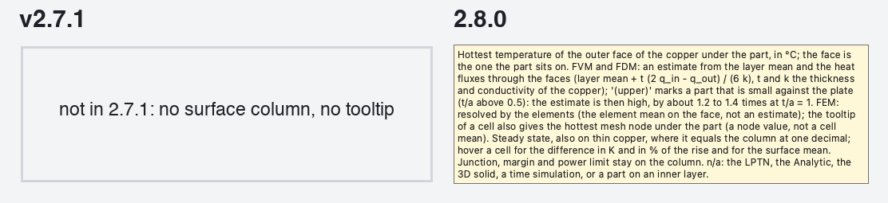

*Figure 9, `09_surface_tooltip_light.png` (dark: `09_surface_tooltip_dark.png`): SURFACE_DECISIONS 5 and 8: the text says what the number is, the FEM resolved case and the n/a cases. The offscreen platform draws no tip window, so the REAL header tooltip text is drawn in a tip-styled label.*

## 10. Layer box of the Temperature tab

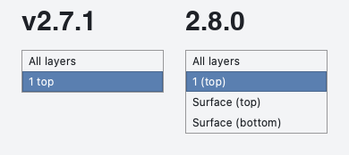

*Figure 10, `10_layer_box_light.png` (dark: `10_layer_box_dark.png`): SURFACE_DECISIONS 3 and 4: 'Surface (top)' and 'Surface (bottom)' are always listed. In 2.7.1 this plate had no such entry in this setup.*

## 11. Temperature map of the plate, default view

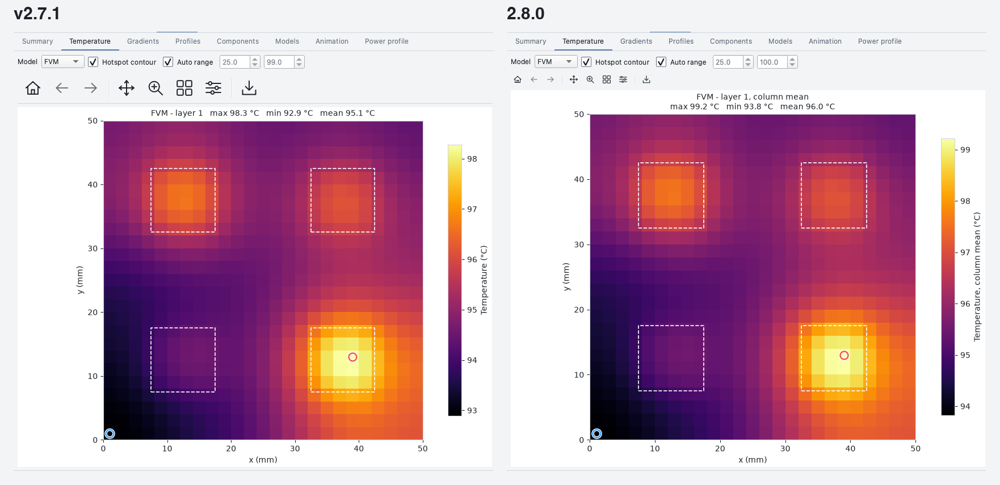

*Figure 11, `11_map_titles_light.png` (dark: `11_map_titles_dark.png`): SURFACE_DECISIONS 4: the map is named 'column mean' in its title and colour bar; before it said only 'layer 1' and 'Temperature'.*

## 12. Temperature map, FVM, Layer box on Surface (top)

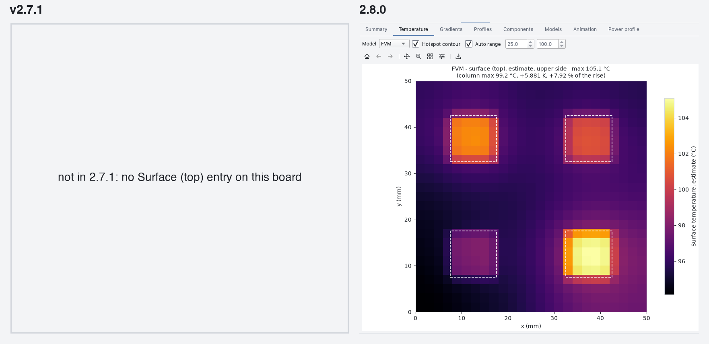

*Figure 12, `12_map_surface_estimate_light.png` (dark: `12_map_surface_estimate_dark.png`): SURFACE_DECISIONS 3, 4 and 11: title 'surface (top), estimate, upper side' with the difference to the column in K and in percent of the rise.*

## 13. Thick plate 50 x 50 x 10 mm (Muzychka case 2), FEM ticked: the map of the surface

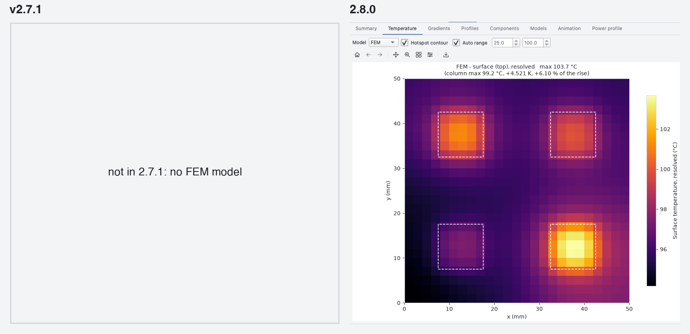

*Figure 13, `13_thick_fem_map_light.png` (dark: `13_thick_fem_map_dark.png`): SURFACE_DECISIONS 4 and the FEM model: 'surface (top), resolved' by the elements, 103.7 C against the column 99.2 C. The FEM does not exist in 2.7.1. Cell 2 mm.*

## 14. Big board 400 x 300 mm, cell 0.25 mm, 3D solid alone

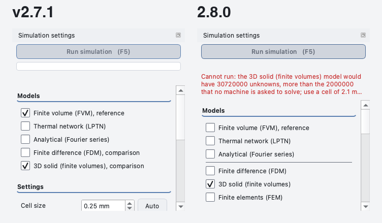

*Figure 14, `14_big_refusal_solid_light.png` (dark: `14_big_refusal_solid_dark.png`): GUI_GENERAL_REVIEW D5 (rank 4): when Run is greyed the dock says why; before, a greyed Run with no reason.*

## 15. The same board with the FEM ticked

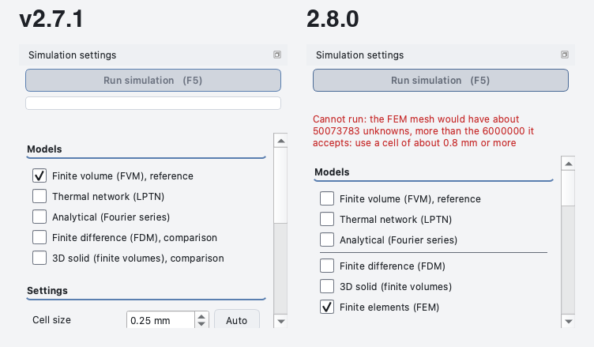

*Figure 15, `15_big_refusal_fem_light.png` (dark: `15_big_refusal_fem_dark.png`): GUI_GENERAL_REVIEW D5 and the FEM memory law: 'Cannot run: ... use a cell of about 0.8 mm or more' gives the cell to use. 2.7.1 has no FEM, so its side shows the FVM alone at the same cell.*

## 16. Simulation dock during a run (FVM + 3D solid, cell 0.15 mm)

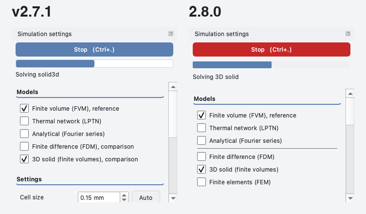

*Figure 16, `16_running_dock_light.png` (dark: `16_running_dock_dark.png`): GUI_GENERAL_REVIEW 6.2: Run turns into a red 'Stop (Ctrl+.)', the bar shows progress and the line names the stage. 2.7.1 shows 'Run simulation' while the 3D solid runs.*

## 17. Toolbar during the same run

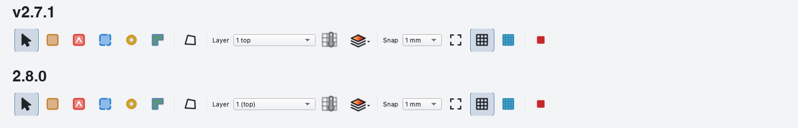

*Figure 17, `17_running_toolbar_light.png` (dark: `17_running_toolbar_dark.png`): GUI_GENERAL_REVIEW 2.2: the Layer box reads '1 (top)'; the toolbar Stop is the same in both.*

## 18. Status bar during the same run

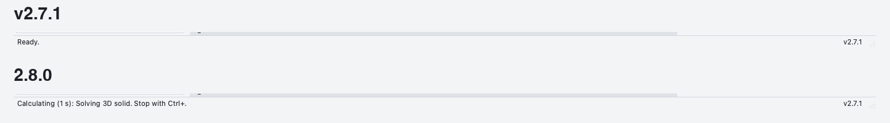

*Figure 18, `18_running_statusbar_light.png` (dark: `18_running_statusbar_dark.png`): GUI_GENERAL_REVIEW 6.2: 'Calculating (1 s): Solving 3D solid. Stop with Ctrl+.'; 2.7.1 stays on 'Ready.' (the version label still reads 2.7.1 on the development tree).*

## 19. Simulation dock after Stop

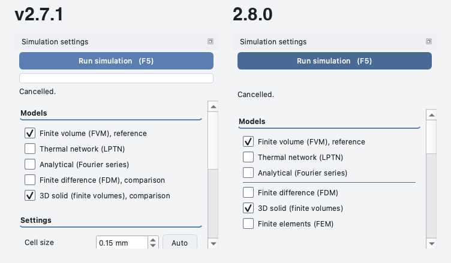

*Figure 19, `19_cancelled_dock_light.png` (dark: `19_cancelled_dock_dark.png`): GUI_GENERAL_REVIEW 6.2: 'Cancelled.'; 2.7.1 keeps the 'Done: Tmax ...' line of an older run.*

## 20. Empty board, first start

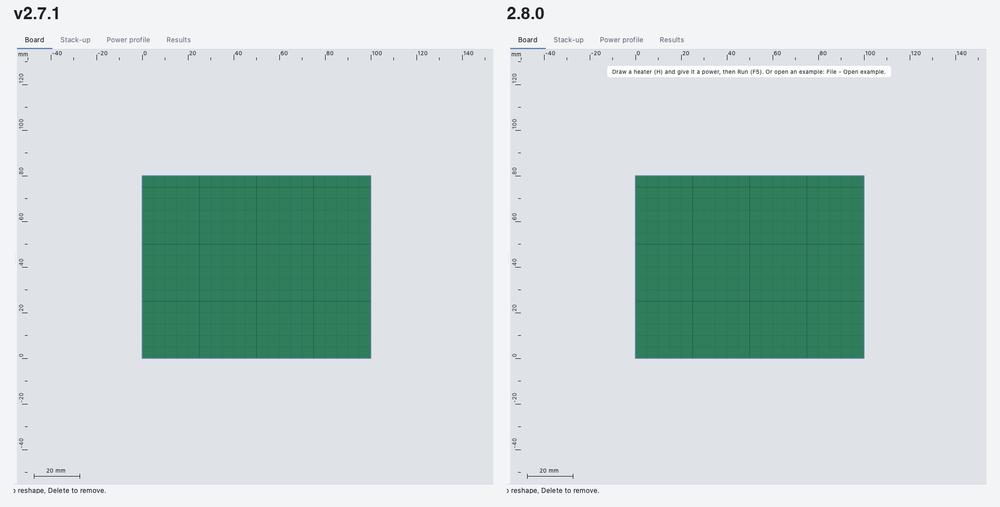

*Figure 20, `20_empty_board_light.png` (dark: `20_empty_board_dark.png`): GUI_GENERAL_REVIEW rank 9 (first use): a hint on the empty canvas ('Draw a heater (H) ... or open an example: File - Open example').*

## 21. Results page before the first run

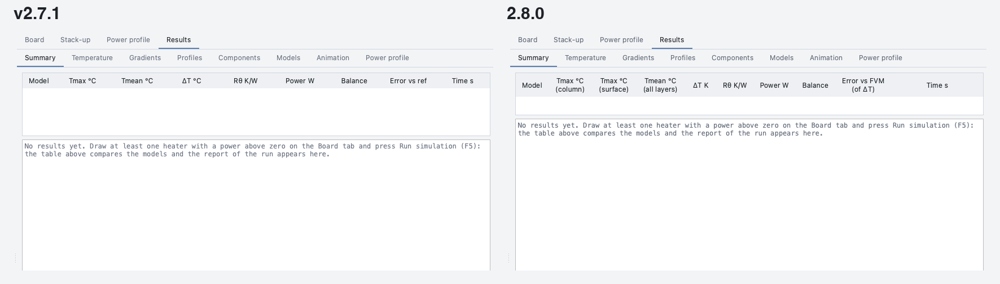

*Figure 21, `21_empty_results_light.png` (dark: `21_empty_results_dark.png`): GUI_GENERAL_REVIEW rank 9: the table shows the new headers and the note says what to do; the page is the same as after a run.*

## 22. File menu

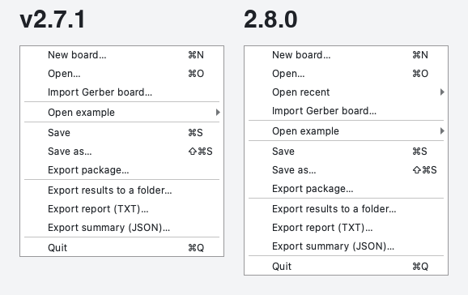

*Figure 22, `22_menu_file_light.png` (dark: `22_menu_file_dark.png`): GUI_GENERAL_REVIEW rank 9: 'Open recent' is a new item.*

## 23. File - Open recent

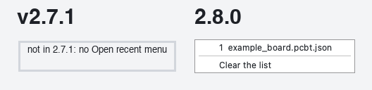

*Figure 23, `23_menu_recent_light.png` (dark: `23_menu_recent_dark.png`): GUI_GENERAL_REVIEW rank 9: the last projects (the example board here) and 'Clear the list'.*

## 24. View menu

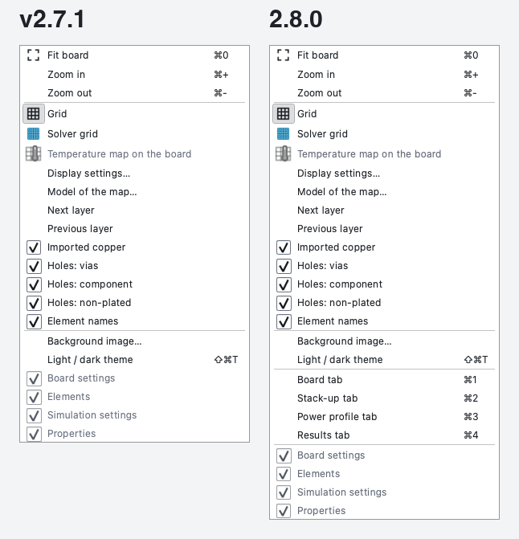

*Figure 24, `24_menu_view_light.png` (dark: `24_menu_view_dark.png`): GUI_GENERAL_REVIEW rank 9: entries for the four tabs with their keys (Board tab Cmd+1 ... Results tab Cmd+4).*

## 25. Power profile page, 1200 x 800

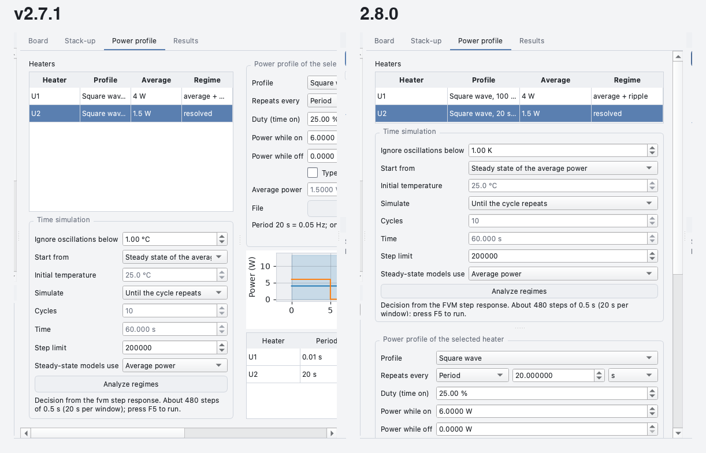

*Figure 25, `25_profile_1200_light.png` (dark: `25_profile_1200_dark.png`): GUI_GENERAL_REVIEW D4 and rank 7: cut in 2.7.1 (the profile fields are behind a horizontal scroll bar); stacked and fitted now, with a vertical scroll only.*

## 26. Stack-up page, 1200 x 800

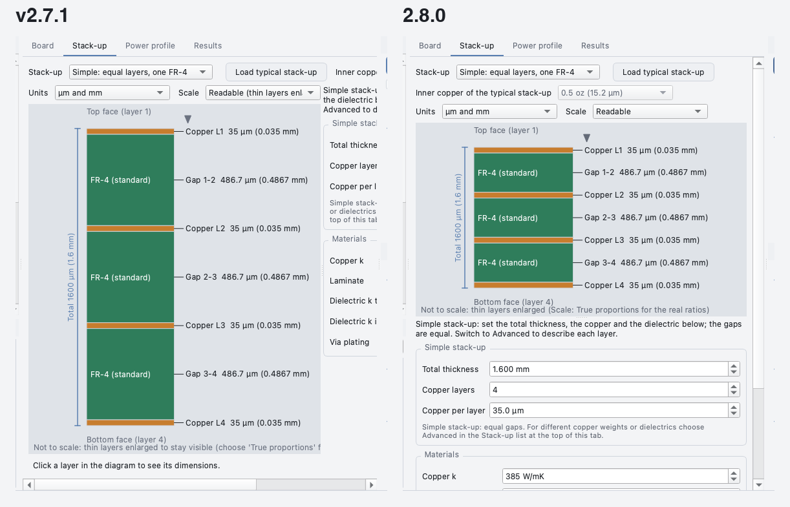

*Figure 26, `26_stackup_1200_light.png` (dark: `26_stackup_1200_dark.png`): GUI_GENERAL_REVIEW D6 and rank 7: texts cut and a horizontal bar before; fitted now.*

## 27. Properties panel of a heat source, 1500 x 900

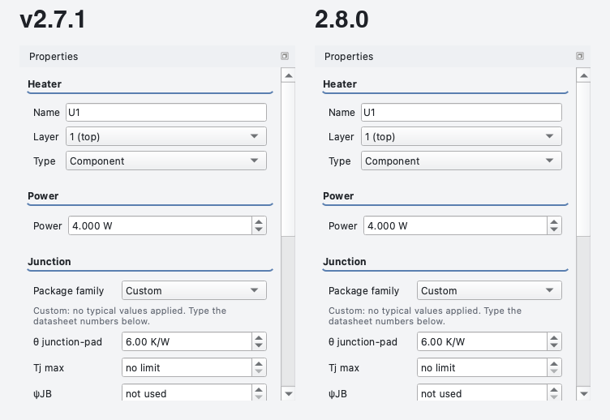

*Figure 27, `27_properties_light.png` (dark: `27_properties_dark.png`): GUI_GENERAL_REVIEW rank 7: the field order and the vertical scroll are the same in both; in the 2.7.1 warnings picture (figure 4) the panel carries a horizontal bar, wrapped now. This one pair shows little change.*

## Not shown or not verified

* Preferences dialog: no visible change was found in the 11 pages, so no pair was made.
* Figures 16 to 19 use the FVM and the 3D solid at cell 0.15 mm (the same set in both trees); a run with the FEM is shown in figure 13 only after it finished.
* The 2.7.1 Properties horizontal bar appears only in figure 4 (the 1500 x 900 window of figure 27 shows none).
* The captions give the review that decided each change; the picture proves what is drawn, not that the review's whole list was implemented.
* Rendered by the offscreen Qt platform with its own fonts: spacing on macOS differs a little. No board of a real project is shown.
