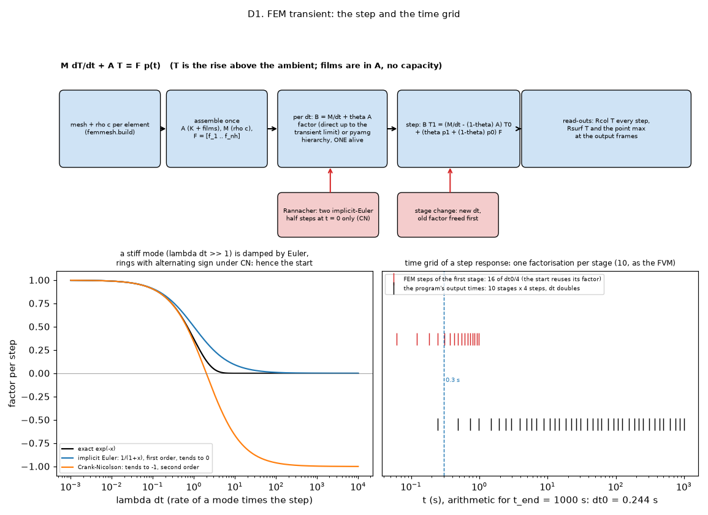
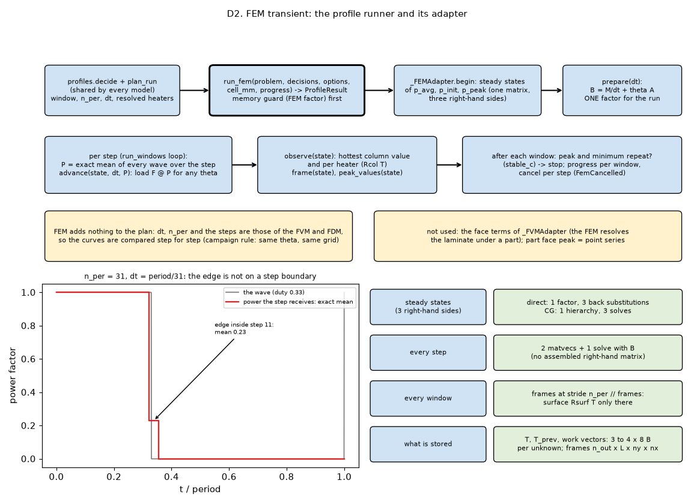
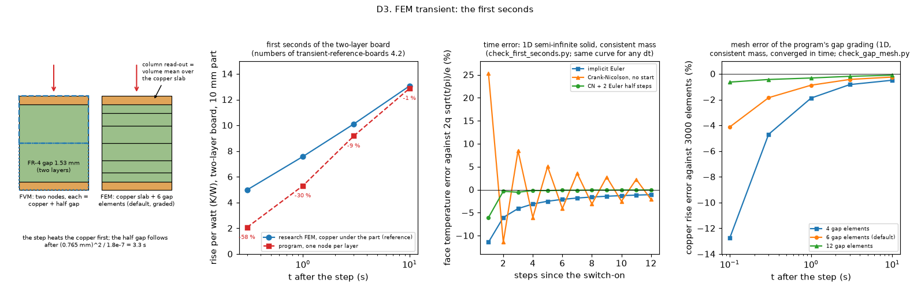

# Design note: the FEM transient (`feature/fem-transient`, 2.9.0 item a)

**Status: design, reviewed before code (section 14: the reviewer's findings, corrections and decisions; where section 14 differs from sections 1 to 13, section 14 wins; it is GO to start `feature/fem-transient`). Section 15: the numerics review of the branch (GO), what it measured and corrected.** Documents and tiny scripts only; no program file is touched and no test or study of the branch was run (the one number printed for this note is the 1D check of `scripts/check_first_seconds.py`, section 3). Tree: `development` at b80d2b71 (2.8.0 released: the steady FEM, its window and the surface read-out are in). Requested by `releases/2.9.0/PLAN.md` 2.2, 3 and 7 (item 1). Every number is quoted with its file or is marked *arithmetic* (hand calculation from named constants) or *H* (hypothesis the first commits must measure). Appendix A is the earlier, longer working draft of this note (formulation, solver strategy, validation, files, risks); where the two differ **this page wins** (section 11 lists the differences). No dates.

## 1. Scope

| In 2.9.0 | Out of 2.9.0 |
| :-- | :-- |
| Linear transient of the FEM (`fem`): the power step (animation, unit-power response) and power profiles (square waves, CSV tables) through the same window runner as the FVM and FDM | Nonlinear terms (radiation, `h(T)`): the plain `h` of `problem.board` is used, as in the steady FEM (`fem.py` docstring) |
| The same outputs as the FVM transient: `TransientResult` (`times`, `t_max`, `t_mean`, `frames`, `steady_t_max`) and `ProfileResult`; **column** read-out is the headline, **surface** beside it at the output frames, the hottest node as a series | The FEM as the **reference** of the time decisions (`api.TIME_MODELS` order: FVM first; `profiles.decide` keeps its step response); FEM on outlines (item d); the frequency-domain periodic state of the research tool |
| A capacity on every element; the capacity inventory in the transient summary (e11, decision 6 of PLAN) | Changing `plan_run` (it would move FVM and FDM records) |
| FEM time records in the regression harness (additions only, e4 remainder) | The 3D solid in time (stays steady) |

The FEM is a comparison model (CLAUDE.md 11): off by default, ticked as `comparison_models: ["fem"]`, no new project key.

## 2. Equations (source of each one)

The research folder `research/independent-fem-extensions` has **no numbered equations**: its method is the docstring of `lib/transient.py` (read in full), `README.md` 7.3 (decision) and 8.3 (results). The labels E1 to E8 below are this note's, each with its location; the program's theory has the theta step as `docs/theory.md` (2.5) for the FVM.

| | Equation | Source |
| :-- | :-- | :-- |
| E1 | `M dT/dt + A T = p(t) F`, `T` the rise above the ambient; `A` = Galerkin stiffness + Robin face matrix, `F` unit load | `transient.py` docstring; `femcore.Model.assemble` returns `A`, `rhs` |
| E2 | `M_ij = integral rho c N_i N_j dV` (consistent); lumped `m_i = sum_j M_ij` (row sums, positive for Q1 hexahedra); `rho c` **per element**, so the capacity enters per layer as the copper slab (fill-weighted with the laminate), the gap elements, via, block and pad each with their own `rho c` (Appendix A1.6) | `transient.py` `consistent_mass`, `lumped_mass`; copper 8960 x 385, FR-4 1850 x 900 J/m3K as the program's `Materials` (README Study 5 text, section 2) |
| E3 | `(M/dt + theta A) T1 = (M/dt - (1 - theta) A) T0 + (theta p1 + (1 - theta) p0) F`; in the profile runner the load is `F p_bar`, `p_bar` the exact mean of the wave over the step, for any theta (review: as `_FVMAdapter.advance`, `profiles.py`) | `transient.py` docstring and `Transient.step`; same as theory (2.5) with `C -> M`, `K -> A` |
| E4 | factor per step of a mode of rate `lambda`: `(1 - (1 - theta) x) / (1 + theta x)`, `x = lambda dt`: Euler 1/(1+x) tends to 0 (L-stable), Crank-Nicolson tends to -1 | theory 2.4 (M: Patankar); figure D1 |
| E5 | Rannacher start: two implicit-Euler steps of `dt/2` open a stretch of constant load (every power change in the research tool, only `t = 0` in the program) | `Transient.march`, `step_response`; README Study 5 text, section 2 ("Crank-Nicolson is not L-stable") |
| E6 | Energy: stored `m . T`, lost `sum h (theta gam.T1 + (1 - theta) gam.T0)`, input `p q_in h`; stored + lost = input | `Transient.march` (`energy`); residual 2.6e-12 (disc), 1e-9 at most (plates), README 8.3 |
| E7 | Read-outs: column `T_col = Rcol T`, surface `T_surf = Rsurf T` (sparse operators made once from the weights `fem.solve_steady` already uses), point `max T` | `fem.py` `_gauss_weights`, `_cell_shares`, `_to_cells`, `_fill_empty` |
| E8 | Closed form of the first seconds: flux `q` on a semi-infinite solid, `T_face = 2 q sqrt(t / pi) / e`, `e = sqrt(k rho c)` | textbook (status M); used by the tiny check and `transient-reference-boards` 4.2 |

**Choices.** Consistent mass (the studies of 8.3 ran `consistent=True`; the class default of the tool is lumped, so the port test must set it). Theta: **1/2 with the Rannacher start for the step response and animation** (the validated integrator; `theta_scheme=1.0` honoured); **`ProfileOptions.theta` (1.0 default, 0.5 allowed) without a start in the runner**, because the runner feeds the exact mean power of every step (`profiles.run_windows`: `waves[i].mean_power(t_start, t_start + dt)`), so the load changes at every step (H2: CN rings negligibly there; if not, the adapter forces Euler and warns). BDF2 rejected (variable-step zero-stability limit 1 + sqrt 2 = 2.41, status M, against the ratio 3 of `step_responses`).

**A difference with the research tool to keep in the port test.** In `Transient.step_response` the two half steps take the place of the first two slots of the first stage, so the grid is shifted by one step (the recorded times are cumulative sums, so they are right, but they are not the nominal grid). The program's stepper keeps the nominal grid and adds the half steps, so that its output times coincide with those of `fvm.transient_from_network` (the Difference view subtracts like for like). The port test therefore compares at the research tool's own times, not at the nominal ones.

## 3. The first seconds (statement and policy)

**Statement proposed for the documents.** The FEM resolves the thickness of the board, the other models carry one node per layer. In the first seconds after a power step they therefore disagree, and the FEM is the one to believe, to the stated residual: `research/transient-reference-boards` 4.2 (R) reads, on the two-layer board, the FEM copper under the part at 4.99 / 7.58 / 10.11 / 13.07 K/W at 0.3 / 1 / 3 / 10 s against the program's node 2.08 / 5.31 / 9.18 / 12.88 (-58 / -30 / -9 / -1.4 %), with the same figure for the FVM, FDM and Analytic at 0.5 and 1 mm, so it is a limit of one node per layer and not of the mesh. The reference there was converged in the gap (24 instead of 12 elements: 0.13 % at 0.3 s) and bounded above by the closed form (8.7 K/W). The residual of the FEM itself against the axisymmetric modal reference on the disc board (21 411 unknowns, consistent mass) is -2.76 / -1.85 / -1.27 / -0.54 / +0.06 / +0.19 % at 0.01 / 0.1 / 1 / 10 / 100 / 500 s (`independent-fem-extensions` README 8.3, R), explained there by the plan mesh at the edge of the source (0.5 to 3.5 % low on the fast swing of a footprint mean). The **column** of the FEM is the volume mean over the copper slab (`fem.py` docstring), i.e. the copper temperature, which is the quantity the program's node reports at the plateau; in the first seconds the copper is hotter than the capacity mean of copper plus half gap (1.68 / 3.95 / 6.93 / 10.43 K/W, same README 4.2) and the text says which is read.

**What is accurate, and from when: the time step policy.** Hand arithmetic with the program's constants: a half-slab of 35 um copper (17.5 um) has `dz^2 / alpha` = 2.7e-6 s (alpha = 390 / (8960 x 385) = 1.13e-4 m2/s); a 20 um dielectric element 2.2e-3 s (alpha = 0.3 / (1850 x 900) = 1.8e-7); the board a few hundred seconds (201 s for the 60 x 40 mm plate, README 8.3). The spectrum spans about eight decades, no explicit method is thinkable, and Euler damps what the first steps cannot resolve. The *tiny check* `scripts/check_first_seconds.py` (1D linear elements, 45 nodes graded from 2 um, a flux switched on, laminate `k = 0.3`, `rho c = 1.665e6`) prints the error of the face temperature against E8 after 1, 2, 4 and 8 steps, the same for any dt because a sqrt(t) response is self-similar:

| scheme (consistent mass) | 1 step | 2 | 4 | 8 |
| :-- | :-- | :-- | :-- | :-- |
| implicit Euler | -11.4 % | -6.0 | -3.1 | -1.6 |
| Crank-Nicolson, two Euler half steps at t = 0 | -6.0 | -0.34 | -0.17 | -0.08 |
| Crank-Nicolson, no start | +25.3 | -11.4 | -6.0 | -3.1 (alternating sign) |

The lumped mass gives the same within 0.1 point on this 1D line (it was 2 to 3 points worse on the 3D disc, README 8.3: the 1D line is not a substitute for that result). Consequences: **(1) no output time has fewer than 4 steps behind it**; the first stage of the doubling grid is walked in steps of `dt0 / 4` (16 steps; no extra factorisation, since the Euler half steps of the start reuse the factor of that stage, review 14.1) while the **output times stay the program's**, so for `t_end` = 1000 s (`dt0` = 0.244 s, arithmetic of `fvm.transient_from_network`: 10 stages, `per_stage` 4) the first output has 4 steps of 61 ms behind it (D1); **(2)** the start (E5) is mandatory for CN and is applied at `t = 0` of every step response; **(3)** Euler is available for the campaign "same theta" rule but its first outputs carry the first-order error of the table; **(4)** the mesh, not the step, limits the extreme start: below about `(first gap element)^2 / alpha` the FEM is not claimed. **Review (14.1): the program's default grading (`femmesh.graded_gap`, 6 elements, ratio 1.4) puts a first element of 175 um in a 1.53 mm gap, `(first)^2 / alpha` = 0.17 s, not 2.2 ms; the mesh error of the copper rise is -4.1 / -1.9 / -0.9 / -0.4 % at 0.1 / 0.3 / 1 / 3 s (`check_gap_mesh.py`), comparable to the time error the start policy removes.** **H5**: the policy keeps every frame within 1 % of the converged `dt` at the first output; measured by halving dt in the integrator study before the adapter is written.

## 4. Memory law per stage (new, to be measured; ties to `memory.py`)

*Superseded by the measurement: the constants of this section (2.0, the direct path up to 30 000 unknowns) were the design's starting values; the shipped ones are in section 16 and `MEASURED.md`.*

The present law is a steady law: `memory.CONTINUOUS["fem"] = (6700 B, p 1, a 0, safety 1.15)`, i.e. peak = base + 1.15 x 6700 x N (7 705 B per unknown, 21 runs of 10 boards at 40 000 to 215 000 unknowns, `memory.py` header comment of `FEM_K1`), the direct path `FEM_DIRECT_BYTES` = 15 900 B per unknown for N <= `FEM_DIRECT_MAX` = 30 000, and `check(..., transient=True)` multiplies by `TRANSIENT_FACTOR` = 2.0 (two FVM factors alive, "measured 1.9, one-factor fix"). The FEM transient is not two factors (one factor or one hierarchy is alive, section 6), so the factor is a new constant `FEM_TRANSIENT_FACTOR`, **2.0 until measured** (it only makes the guard refuse earlier). Predicted stages, kB per unknown (arithmetic and H4):

| Stage | Holds | Bytes per unknown | Source of the figure |
| :-- | :-- | :-- | :-- |
| 1 mesh + assembly of `A` and `M` in **one element loop** | mesh, triplets of `A`, `M`, `F` (the same Jacobians, so `M` adds only its value vector) | peak of the steady law 6.7 kB + about 0.5 kB of triplet values | steady law measured; the 0.5 is *arithmetic* (64 entries x 8 B per element, about one element per unknown) |
| 2 `A`, `M` as csc | two matrices of the pattern of `A` | 2 x 27 x 12 B = 0.65 kB | *arithmetic* (8 B value + 4 B index) |
| 3 per dt, direct (N <= 30 000) | `B = M/dt + theta A` and its factor, the previous factor freed first | 15.9 kB (the steady direct figure) + 0.3 kB | `FEM_DIRECT_BYTES`; the pattern of `B` is that of `A` |
| 3 per dt, CG | `B` and the pyamg hierarchy, the previous freed first; the hierarchy setup is 1 to 5 % of a solve | about the steady hierarchy (inside the 6.7 kB) + 0.3 kB | `fem-amg-thin-layers` README 7.6 |
| 4 state | `T`, `T_prev`, work vectors, `Rcol`, `Rsurf`, `F` | below 0.5 kB | *arithmetic*; `Rcol` has about one nonzero set per used copper element |
| 5 frames | `n_out x L x ny x nx` float64 (+ 2 surface faces), independent of N | 6.4 MB for 40 frames, 2 layers, 100 x 100 cells | *arithmetic* |

The peak is the **largest stage, not their sum**: **H4**: the factor is 1.04 to 1.15 on the CG path and 1.04 on the direct path, instead of 2.0. **Review (14.3): measured on one mesh, 1.07 on the CG path (inside H4) and 1.14 to 1.28 on the direct path (outside H4); iterations per step 272 to 441 (H1 refuted).** The stake: at 276 000 unknowns (the example board at 1 mm, `fem-amg-thin-layers` README 1) the steady law is 7 705 x 276 000 = 2.1 GB (*arithmetic*); with the factor 2.0 the guard would read 4.3 GB. Measured as the steady law was (`releases/2.8.0/fem-model/scripts/measure_fem_law.py`, fresh process, `ru_maxrss` growth over the build), the same 10 boards at 2, 1, 0.5 mm, a step response of 40 frames and a profile run of two windows, one run at a time on a quiet machine; the constant becomes the largest measured growth x 1.1, as in the steady fit. The **time law**: seconds = build (`TIME_LAWS["fem"]` 15.7 s at the reference size, exponent 0.69, a lower bound) + stages x setup + steps x iterations x cost per iteration; iterations per step against `dt / tau_board` is **H1** (the diagonal `M/dt` improves the conditioning: few iterations at small dt) and is measured, not assumed (**refuted by the review's prototype, 14.3: 272 to 441 iterations per step from dt = 0.06 s up, about the steady count**). A **work bound** `unknowns x steps` refuses with the existing `ProfileError` text ("the time simulation needs about N steps ...", `profiles.plan_run`); its number is a maintainer decision after the measurement. Hand arithmetic from the steady figures (15 s for 280 iterations at 276 000 unknowns, about 0.05 s per iteration): a 40-frame step response 40 x 20 x 0.05 s = 40 s plus 11 hierarchy setups; a profile run of 12 windows x 200 steps at 10 iterations is 20 minutes at that size, hence the bound; below the direct limit, seconds.

## 5. Interface

**`femcore.py`** (new, nothing of the steady path changes; the existing keys of `Model.assemble` stay):
* `Model.rho_c`: (E,) volumetric heat capacity per element, J/m3K, default zeros (like `k`, `q`).
* `Model.assemble(cancel=None, capacity=False)`: with `capacity=True` the dict gains `"M"` (csc, used nodes, consistent), `"m_lump"` (n,) and `"capacity_total"` (J/K); one element loop for `A` and `M`. (`structured_model` has no `rho_c` argument; the closed-form tests set `model.rho_c` directly.)
* `Model.load_vector(elem_ids, face_ids=None)` -> (n,) load of a unit power spread over a group (volume source `1 / V` on elements, face flux on thick outer layers); `F` is the column stack, `F @ p` equals the steady `rhs` at the heater powers.
* `class Stepper(A, M, direct_max=FEM_DIRECT_MAX, tol=1e-10, cancel=None)`: `prepare(dt, theta)` (builds `B`, frees the previous factor first, then factors or builds the hierarchy), `step(T0, dt, theta, load0, load1)`, `solve(b)` (the steady solve with `M=None`, so `solve_many` is `Stepper(A, None)` called per right-hand side: one factor, three back substitutions), `solver`, `iterations`, `close()`.

**`femmesh.py`**: `rho c` per element where `kx, ky, kz` are assigned (femmesh has no heat capacity today: no `rho` or `cp` in the file), `FemMesh.rho_c`, copper fill weighting as `fvm.Network.C` (`f rho_cu cp_cu t + diel_t rho_cp_lam`, `fvm.py` line 233), the pad slab with the capacity of its thickness, films none.

**`fem.py`**:
```
solve_transient(problem, t_end, n_out=40, cell_mm=2.0, substeps=4, theta_scheme=0.5, log_times=True,
                gap_elements=6, refine=2.0, memory_fraction=None, cancel=None, progress=None) -> TransientResult
```
the first six arguments in the order of `fvm.solve_transient`; same time grid as the FVM (the stages of `fvm.transient_from_network`, plus the start of section 3); `TransientResult` gains optional `arrays: dict = {}` and `extras: dict = {}` (default empty: the other models and saved projects are untouched) holding `arrays["T_surface"]` (n_out, 2, ny, nx), `extras["t_max_point"]` (series), `extras["energy_residual"]`, `extras["solver"]`, `extras["steps"]`, and the capacity inventory (section 9). Read-out operators `Rcol`, `Rsurf` built once from the steady helpers.

**`profiles.py`**: `run_fem(problem, decisions, options, cell_mm=1.0, progress=None)` = `run_windows(..., _FEMAdapter(problem, cell_mm, ...), "fem", progress)` with the adapter interface of `run_windows`: `dx, dy, ambient, steady_average_max, steady_peak_max`, `begin(options)`, `prepare(dt)`, `advance(state, dt, powers)`, `observe(state)`, `frame(state)`, `peak_values(state)`, `offset = 0.5`; the steady states by `Stepper(A, None).solve` on three right-hand sides; no face-term machinery (D2). `plan_run` is not touched.

**`api.py`, `jobs.py`, `cli.py`** (review 14.4 makes this precise: no split of `SKIPPABLE_MODELS` is needed; `_step_response` gets an explicit FEM branch; the FEM's refusals are caught per model): `TIME_MODELS` stays the list of models that can be the *reference* (FVM, Lumped, Analytic, FDM, in that order, `api.py` line 46); a new tuple of models that run in time, with `"fem"`, is used by `_run_profiles` (`elif name == "fem": profiles.run_fem`, a refusal becomes a profile warning like a skipped steady comparison model: `SKIPPABLE_MODELS` is steady-only today and is split); `step_response` for the decision stays FVM; `jobs.job_transient` gets the FEM branch with `memory.check(("fem",), cell, transient=True)` and per-frame progress and cancel; `cli.py` `transient --model fem`. The `RECTANGLE_ONLY` refusal of a block or outline does not apply to the FEM; a slanted or curved outline is refused as in the steady FEM. **GUI**: the Models list says "steady and time" for the FEM (tooltip in `gui/panels.py`, guide `help/index.html`); the animation's model chooser and the profile results show the FEM curve (theme tokens, no new colour concept); the Layer entry 'Surface (top)/(bottom)' reads `arrays["T_surface"]`. **Warnings** (`checks.py`): one new after-run text when the integrator was forced to Euler (H2) or the run was cut by a limit.

## 6. Solver strategy in one paragraph

*(Section 16: the transient direct limit is now 100 000 unknowns, with a CG fallback when the direct factor does not fit the memory budget.)* One matrix per `dt`, never per power. Step response: 10 matrices (the start stage in steps of `dt0/4`, whose factor also serves the two Euler half steps, + nine stages), 4 steps each (the start: 16); profile run: one for the whole run (constant `dt = window / n_per`). Direct up to 30 000 unknowns (**review 14.3: up to a transient direct limit set by measurement, at least 67 229 unknowns, because the CG costs about the steady iteration count at every step**) (one factor alive, freed before the next is built, as `fvm.transient_from_network`), otherwise CG with pyamg smoothed aggregation, a hierarchy per stage (not reused across stages: `fem-amg-thin-layers` E8 c found a stale hierarchy of `K` a poor preconditioner for `K + s diag`, and the reverse direction of stage-to-stage was not measured), warm start from the previous field. The right-hand side is two matrix-vector products and no assembled `B_rhs`.

## 7. Tests (section 2.2 of the PLAN, mapped)

| Test file (new, in the branch) | Content |
| :-- | :-- |
| `tests/test_fem_transient_closed_forms.py` | lumped RC (`Bi << 1`); 1D mode with exact rate (order 1 for Euler, 2 for CN: halve dt, ratio 2 and 4); slab with convection (eigenseries, M); semi-infinite solid (E8: the first-seconds test, and the choice of the start); energy balance every step (< 1e-9); steady limit after 10 tau |
| `tests/test_fem_transient_port.py` | the program's `Stepper` against `research/independent-fem-extensions/lib/transient.py` (`Transient.march`, `step_response`) on the same structured model, same `rho c`, same steps, at the tool's own times (section 2): fields agree to solver tolerance (as `tests/test_fem_port.py` does for the steady model) |
| `tests/test_fem_transient_load.py` | `F @ p` equals the steady `rhs`; `sum(M)` equals the integral of `rho c` of the layered description; the identity against `fvm.Network.C.sum()` on plain boards, differences on vias, blocks, laminate bands explained, never tuned |
| `tests/test_fem_transient_readouts.py` | `Rcol T` equals `solve_steady`'s column on the same field to round-off; `Rsurf T` equals its surface |
| `tests/test_fem_profile_adapter.py` | adapter interface; periodicity and energy per window on a small plate; Euler against a direct FVM-style stepper on the same matrices |
| `tests/test_fem_transient_memory.py` | the law against recorded peaks, the refusal, the work bound |
| `tests/test_gui_stress.py`, `tests/test_help.py`, `tests/test_tooltips.py` | start, cancel in the middle of a stage, a long profile refused by the bound, a memory-refused board, an outline refused, the FEM ticked with the Analytic and Lumped on a block board, the 3D solid next to it |

## 8. Validation plan and error targets (rule 14 of CLAUDE.md 9)

Independent references first, then the program's models. **Reproduced published numerical case: none exists in the papers library** (Appendix A3.3: only an index search was done, no paper opened; Carslaw and Jaeger, Patankar, Rannacher 1984 not obtained, status N). Until a published value is reproduced the status in `validation.md` 57 is "an independent solver of a different construction and closed forms", which is what the 2.8.0 research did; the first step of the branch is to obtain an open copy of the slab-with-convection tables and of Rannacher's paper. **Review (14.6)**: a published benchmark with a stated reference value is required before the transient is called validated (release gate of 2.9.0, not a gate to start coding); the nearest candidate is the NAFEMS 1D linear transient benchmark (from memory, to be obtained and read before use).

| Case | Reference | Target (from the research numbers) |
| :-- | :-- | :-- |
| Disc board step response, 21 411 unknowns | axisymmetric modal reference (`axisym_stack`), research README 8.3 | within -3.5 / -2.0 / -1.5 / -0.7 / +-0.3 / +-0.3 % at 0.01 / 0.1 / 1 / 10 / 100 / 500 s (the observed residual -2.76 .. +0.19 % plus a margin; the program's mesh differs from the research plan mesh, so the numbers are not required to coincide) |
| Plate with a cluster and a block (study 2 board, 68 672 unknowns) | research tool: steady 103.847 K/W, time to 63 % 201.39 s (footprint mean) / 200.287 s (hottest top node) | time to 63 % and plateau within 0.5 % at the hottest-node read-out (the program's `fvm.step_responses` reads the hottest cell) |
| Two-layer plain board, 0.3 to 10 s | research FEM copper 4.99 / 7.58 / 10.11 / 13.07 K/W (`transient-reference-boards` 4.2) | within 1 % from 1 s, 3 % at 0.3 s |
| 20 Hz, 30 % wave on the 60 x 40 mm plate through `run_fem` | centre swing 0.63788 K/W of on-power (README 8.3, converged 0.01 %) | within 2 %; H3 measures the unaligned-edge part (below 1 % of the swing at 10 steps per shortest feature) |
| FVM and FDM on the same boards, column read-out for all | the five boards of `transient-reference-boards` | classified differences; the first seconds are **not** a pass criterion (row T3, `COMPARE_PLAN.md`), they are the stated limit of the others |

The targets are proposals from the research numbers, not requirements the program already meets: nothing is run.

## 9. The capacity inventory (e11), the frozen records (e4), the surface of the transient (e23)

* **e11** (PLAN decision 6: yes, with the transient). The transient summary lists the heat capacity each model holds in J/K by category (copper per layer, laminate, via barrels, blocks and pads, parts) against the capacity computed from the description (`integral rho c dV`, independent of any mesh), so that a missing mass is visible; the FEM reports `capacity_total` (sum of `M`), the FVM and FDM `Network.C.sum()`; a difference above a stated tolerance becomes a warning. **Answered by the review from the code (14.7)**: the FVM and FDM do NOT count a via barrel (`viawell.build` returns conductances only; the barrel volume keeps the laminate's capacity in `Network.C`, `fvm.py` line 233, `fdm.py` line 213), DO count a metal block (`blocks.py` line 167, `rho_cp thickness area share`), do NOT count the interface pad (a resistance with no thickness) nor a part; laminate sub-nodes carry their own `rho c` (`laminate.py` lines 108, 426, 432). Needs a tooltip and a guide sentence (PLAN).
* **e4**. The FEM steady records with the surface are in `tests/regression/data/v2.8.0.json` (38 `|fem|` records among 332; its settings hold `transient_cell` 1.0). What the branch adds are **time records** for the FEM boards (`transients`: `board|fem` -> `t63` per part, the format of `regress_frozen.py`; checked in `v2.8.0.json`: its 70 `transients` records hold the models analytic, fdm, fvm and lumped, none for the FEM), additions only: pending file `fem-transient.json`, the other records do not move (PLAN 2.2). The PLAN is inconsistent here (1.1 lists e4 for this branch, 2.1 says the steady surface part was done in 2.8.0); this note takes the second reading.
* **e23** (surface of the transient in the FVM and FDM, the last item of `feature/surface-readout-models`). This branch delivers the resolved surface at the output frames only (`Rsurf T`, never every step) and so the reference that e23 needs; it does **not** put a surface in the other models' transients. Until e23 the other models show 'n/a' (PLAN 1.1).

## 10. Open questions for the reviewer

1. **Start policy**: is a first stage of `dt0/4` steps with the program's output times the right reading of "no frame with fewer than 4 steps behind it", or should the output times of the FEM move (breaking the like-for-like subtraction)? Is the self-similarity argument (the 1D table) enough for a 3D mesh, or must H5 be measured first?
2. **Consistent mass in the profile runner**: the research validated it on step responses and on the 20 Hz wave (README 8.3); the runner uses Euler by default. Is Euler plus consistent mass acceptable as the default, or should the FEM default to `theta 1/2` there (H2)?
3. **`FEM_TRANSIENT_FACTOR`**: ship 2.0 and measure later, or hold the branch until measured? (Ship, I propose: it only refuses earlier.)
4. **Splitting `SKIPPABLE_MODELS`** touches `api.py` shared with the surface branches; is the new tuple of "runs in time" models the least invasive way?
5. **Unaligned edges** (H3) when `duty x n_per` is not an integer: acceptable as first-order edge placement common to all models, or does it justify an optional edge list in `plan_run` as a separate branch?
6. **The reference of the first seconds is the research tool's own FEM** (a different code, the same family of method): is "an independent solver of a different construction" enough for validation 57 without a published case?
7. **e11**: the tolerance for "missing mass" and whether a part body gets a capacity at all (today a part is a source without mass).

## 11. Corrections to the earlier draft (Appendix A) and to the plan

* Appendix A1.2 and A3.1 mention `femcore.structured_model` "with `rho_c`": the function has no such argument; `Model.rho_c` is new (section 5).
* Appendix A3.2 d says the FEM "is expected to follow the reference"; the cited reference is a FEM of the research tool, so the statement is "agrees with an independent implementation to the residual of section 8", not "is exact".
* The earlier draft proposed an `assemble_mass` separate pass; this note assembles `A` and `M` in one loop (section 4, stage 1).
* The earlier draft started the step response at `dt0`; section 3 shows one step is -6 % (CN + start) and -11 % (Euler), so a finer first stage is added.
* The earlier draft's figures 1 to 8 (never run, schematic) are replaced by D1 to D3 below; the other pictures belong to the branch (`make_figures.py`, with numbers the branch prints).
* Appendix A4 quotes line numbers of `help/index.html` and `gui/panels.py` from a tree that has changed since (228 commits); they were not re-read in this pass.

## 12. Diagrams



*Figure D1 (`figures/fig_01_time_step_scheme.png`): the flow of one run (assembly once, one matrix per dt, the Rannacher start and the stage change), the factor per step of the three schemes (textbook formulas, E4), and the time grid of a step response for `t_end` = 1000 s with the finer first stage (arithmetic; ten factorisations as the FVM, the start reusing the factor of the first stage).*



*Figure D2 (`figures/fig_02_profile_runner.png`): `run_fem` and its adapter inside `run_windows`, what the FEM adds and does not use, and the exact step-mean power of a duty 0.33 wave with `n_per` = 31 (the program's `plan_run` rule), whose edge falls inside step 11.*



*Figure D3 (`figures/fig_03_first_seconds.png`): the node of the FVM against the resolved copper and gap elements of the FEM; the two-layer board in the first seconds (numbers of `transient-reference-boards` 4.2); the error against the number of steps since switch-on of the three schemes (`check_first_seconds.py`); and the mesh error of the program's gap grading with 4, 6 (default) and 12 elements (`check_gap_mesh.py`, added by the review).*

`scripts/make_diagrams.py` draws the three figures (`.venv/bin/python releases/2.9.0/fem-transient/scripts/make_diagrams.py`); each was looked at after drawing (and again by the review, which corrected D1's factor count and legend, D2's adapter box and load, D3's node outline, gap grading and reference label, and added D3's fourth panel).

## 13. What was read and what was not verified

| Source | Status | Notes |
| :-- | :-- | :-- |
| `releases/2.9.0/PLAN.md` | R (all) | 2.2, 3, 7, decisions 5 and 6; e4 is stated twice with two readings (section 9) |
| `releases/2.8.0/fem-model/DESIGN.md` | S | the memory law and the interface by the earlier draft and by `memory.py`; not re-read end to end in this pass |
| `pcbthermal/femcore.py` (`Model`, `assemble`, `solve`), `fem.py` (docstring, `solve_steady` head), `memory.py` (constants and `check`), `fvm.py` (`transient_from_network`, `step_responses_from_network`, capacity lines), `profiles.py` (`run_windows`, `plan_run`, `_FVMAdapter` head), `api.py` (`_step_response`, `_run_profiles`), `jobs.py` (`job_transient`), `results.py` (`TransientResult`) | R for the parts quoted | `femmesh.py` read only by `grep` (no `rho`/`cp` in it), the mesh grading of the gap not read |
| `research/independent-fem-extensions/lib/transient.py` | R (the class, mass functions, `march`, `step_response`) | no numbered equations exist; E1 to E8 are this note's labels |
| `research/independent-fem-extensions/README.md` 7.3, 8.3 | R | the numbers of sections 3 and 8 |
| `research/transient-reference-boards/README.md` 2.2 table lines, 2.3 item 3, 4.2 | R (those parts) | the first-seconds numbers; rest S |
| `docs/theory.md` 2.4 | R | the theta method (2.5) and the grids |
| `tests/regression/data/v2.8.0.json` and `regress_frozen.py` docstring | R (keys inspected) | 332 `records` (38 FEM), 70 `transients` (no FEM): the time records are an addition |
| `docs/validation.md` sections 56 and 57 | N | the sections are reserved by `COMPARE_PLAN.md` (rows T1 to T3, read) and are not in the file yet |
| `research/fem-amg-thin-layers`, `papers/` | S, N | from the earlier draft; no paper opened |
| Textbook statements (BDF2 limit, slab eigenseries, semi-infinite solid, Rannacher) | M | to be derived in the tests; the papers to be obtained |
| `scripts/check_first_seconds.py` output | run for this note | a 1D line, not a study of the branch and not a validation of the 3D model |
| Hypotheses H1 to H5 and every cost estimate | **not measured** by the author | hypotheses and arithmetic; the review measured H1 and H4 on one mesh (14.3) |

## 14. Reviewer decisions

Early design review asked by `releases/2.9.0/PLAN.md` 3. The reviewer re-read the note against the code of the tree (`femcore.py`, `femmesh.py`, `fem.py`, `fvm.py` transient, `fdm.py`, `blocks.py`, `viawell.py`, `laminate.py`, `profiles.py`, `api.py`, `jobs.py`, `memory.py`, `cli.py`, `gui/animation.py`, `results.py`, `tests/regression/regress_harness.py`, `make_pending.py`, `test_frozen_numbers.py`) and against `research/independent-fem-extensions` (`lib/transient.py` in full, README 7.3, 8.3, 9.3) and `research/transient-reference-boards` (2.1, 4.2); re-ran `check_first_seconds.py`; added three small scripts whose numbers are quoted below (`check_gap_mesh.py`, `check_memory_prototype.py`, `check_benchmark_1d.py`). **The decisions below are the maintainer's by delegation; where they differ from sections 1 to 13 they win.**

### 14.0 Verdict

**GO to start `feature/fem-transient`**, with the changes of 14.1 to 14.8 written into the branch's plan. Nothing found blocks the formulation: the equations E1 to E7 are those of the research tool and of the program's theta method; the table of section 3 is reproduced to the last digit. What the review changes is the cost picture (the CG path is about the steady iteration count at EVERY step, not "a few"), the mesh side of the first seconds, the interface details that would have broken the frozen harness and the profile run, and the published-case requirement. The merge (not the start) is gated by: the port test, the closed forms, the published benchmark (14.6), the measured memory factor (14.3) and the whole battery.

### 14.1 Equations, scheme, first seconds (questions 1 and 2)

* **E1 to E7 checked** against `lib/transient.py` (`consistent_mass`, `lumped_mass`, `step`, `march`, `step_response`, the energy bookkeeping) and against `fvm.transient_from_network` and `_FVMAdapter`: correct. Two precisions: (a) in the profile runner the load of a step is `F p_bar` with `p_bar` the exact step mean that `run_windows` passes, for Euler AND for Crank-Nicolson (the FVM does exactly this; the theta-weighted endpoints of E3 belong to the step response, where `p0 = p1 = 1` after `t = 0+`); (b) the research `step_response` puts the half steps in the first two slots (the grid is shifted by one step), as section 2 says: the port test compares at the tool's own times.
* **The table of section 3 is reproduced**: `check_first_seconds.py` prints -11.42 / -6.04 / -3.11 / -1.59 (Euler), -6.04 / -0.34 / -0.17 / -0.08 (CN with start), +25.27 / -11.41 / -6.04 / -3.11 (CN without), the same within 0.04 point at 0.24, 0.06 and 0.015 s (self-similarity holds), lumped mass within 0.1 point. **Independent check by hand** (the time-discrete problem on the exact continuum, no mesh): one Euler step of a flux switched on gives a face rise `q sqrt(dt) / e` against `2 q sqrt(dt / pi) / e`, i.e. `sqrt(pi) / 2 - 1` = **-11.38 %**; one CN step without a start gives `sqrt(2) q sqrt(dt) / e`, i.e. `sqrt(pi / 2) - 1` = **+25.33 %**; the script's -11.42 and +25.27 differ by the mesh only.
* **Question 1 (start policy): ACCEPTED as written, with one correction.** The FEM keeps the program's output times (`fvm.transient_from_network`: ten stages, `per_stage = ceil(n_out / 10)`, `dt0 = t_end / (per_stage (2^10 - 1))`, every step an output, `t = 0` included), and walks the first stage in steps of `dt0 / 4` so that the first output has four steps behind it. **Correction**: no extra factorisation: the Euler half step of the start has the matrix `M / (h/2) + A = 2 (M / h + A / 2)`, so the factor of the first stage serves it (solve with the halved right-hand side): ten factorisations, as the FVM. The doubling stages after it need no new start (no load change). **H5 is not a prerequisite for coding but is a test of the branch**: halve every step on a small board (direct path) and require the frames within 1 % from the first output on; the 1D argument covers the time error only.
* **The mesh side of the first seconds (new, from the code).** `femmesh.graded_gap` with the default 6 elements and ratio 1.4 gives a first gap element of **175 um** on the 1.53 mm gap of `two2` (`(first)^2 / alpha` = 0.17 s), not the 20 um the note assumed (2.2 ms). The 1D mesh error of the copper rise against a 3000-element line (`check_gap_mesh.py`, CN with start converged in time, the reference checked against the closed form to 0.00 % up to 1 s): **6 elements -4.12 / -1.85 / -0.88 / -0.43 / -0.25 %** at 0.1 / 0.3 / 1 / 3 / 10 s (consistent mass; lumped -12.28 / -5.48 / -2.57 / -1.07 / -0.26), **12 elements -0.64 / -0.43 / -0.32 / -0.19 / -0.10 %**, 4 elements -12.7 % at 0.1 s. **Decisions**: (a) the statement of section 3 ("the FEM is the one to believe in the first seconds") stands **with the mesh named**: at the default 6 gap elements the FEM is claimed from about 0.3 s on a 1.5 mm gap (2 % in 1D), at 12 elements from about 0.03 s; the text gives the rule `t >= 2 (first gap element)^2 / alpha` and the help says that more gap elements (the existing `fem_gap_elements` option, 2 to 24) resolve earlier times; (b) the first frames below that time carry no accuracy claim (a sentence in the guide, no new warning); (c) the target of section 8 for `two2` ("1 % from 1 s, 3 % at 0.3 s") is kept for the default mesh but now has its budget written: about 1.9 % of it is the gap grading alone; (d) consistent mass confirmed (the lumped mass is 3 times worse here as on the disc).
* **Question 2 (consistent mass with Euler in the profile runner): ACCEPTED.** The runner uses `ProfileOptions.theta` (default 1.0) like every model (campaign rule: same theta, same grid), with the consistent mass and the step-mean load. Euler's first-order error is common to all models and is bounded by the plan's 10 steps per shortest feature; the consistent mass under Euler is not monotone at tiny steps, harmless at these steps. CN (0.5) stays allowed without a start in the runner; H2 is measured by the integrator study before the adapter is finished, and if CN rings above 1 % of the swing the adapter forces Euler with the warning of section 5.
* **Default theta of `fem.solve_transient`: 1.0, as `fvm.solve_transient`** (change from the note's 0.5). Every caller passes the scheme (the animation's chooser defaults to Euler, `cli.py --theta` to 1.0), so the default only matters to direct API calls, which should get the same answer shape from every model. The step response of the FEM used for the frozen times to 63 % (14.5) runs CN with the start, as `fvm.step_responses` runs CN. The accuracy statement ("within 0.5 % of the independent reference at the plateau and the time to 63 %") is made for CN with the start.

### 14.2 Capacity per element (`femmesh`)

`femmesh.py` has no heat capacity (confirmed: no `rho`, `cp`, `rho_c` in the file). What the branch adds, where `kx, ky, kz` are assigned (`build`): copper slab `f rho_cu cp_cu + (1 - f) rho c` of the laminate of that slab (the FVM's blend, `fvm.py` 233, with the materials of `problem.board.materials`, never constants); gap elements the `rho c` of their gap (`Board.gap_properties()[2]`, per gap, so a mixed stack-up is right); laminate bands with their own `rho c` where `kx..kz` come from a band; via barrel (patch) elements copper; the via rod `via_frac rho_cu cp_cu + (1 - via_frac) rho c` of the gap (same blend as its `kz`); a resin-filled drill the fill material if the program has one for it, else the laminate, stated; block elements the block's `rho_cp`; **the interface pad slab: zero capacity** (change from the note: its thickness is `R x K_PAD`, a numerical device for a contact resistance with an invented conductivity of 1 W/mK, so any `rho c` would be an invented mass; the FVM has none either; the pad's nodes are shared with the board and block elements, so `M` stays positive definite); films and parts nothing. `FemMesh.rho_c` (E,), and `capacity_total` = `sum(M)` checked against the description by the load test.

### 14.3 Memory and cost (question 3)

Measured by the review on ONE mesh, the example board at 2 mm (67 229 unknowns), each case in a fresh process (`check_memory_prototype.py`: a prototype from the program's own pieces, the mass assembled after `A` by a second element loop, eleven step sizes of four CN steps, one factor or hierarchy alive):

| case | peak growth | bytes per unknown | seconds | CG iterations per step |
| :-- | :-- | :-- | :-- | :-- |
| steady, CG | 446.8 MB | 6 647 | 4.8 | (as `Model.solve`) |
| transient, CG | 478.5 MB | 7 117 (**1.07 x steady**) | 155.2 | 272 to 441 (289 at the first stage, rising to about 440 at the last) |
| steady, direct | 1 620.4 MB | 24 103 | 8.3 | - |
| transient, direct | 1 845.0 MB | 27 443 (**1.14 x steady**) | 90.2 | - |

* **H4**: inside on the CG path (1.07), **outside on the direct path (1.14, the note said 1.04)**; one mesh, so not a law. A first run of the same prototype from the scratchpad, minutes earlier, gave 1.08 (CG) and **1.28** (direct, 2 092 against 1 638 MB): the direct ratio moves by more than 0.1 between two runs of one case (allocator reuse of freed factors on a loaded machine), which is why the constant needs several cases and the 1.1 margin. **H1 refuted**: the CG takes about the steady count at every step from dt = 0.06 s up (the matrix stays dominated by the copper sheets: the in-plane diffusion time of a 1 mm copper element is 9 ms, so `M / dt` is a small diagonal at every step the program takes), about 3.5 s per step at 67 229 unknowns (155.2 s for 44 steps).
* **Question 3: CHANGED.** Code ships `FEM_TRANSIENT_FACTOR = 2.0` until the branch's own measurement (step 6 of A5.3) on at least the example board, one via board and one block board at two sizes on each path; **the merge waits for that measurement** (minutes per case: the review's cases took 5 to 170 s), and the constant becomes the largest measured ratio x 1.1 (from these numbers it will be about 1.2 on CG and about 1.4 on the direct path, never 2.0 and never 1.04). The factor is **per model and per path**: `memory._check` applies one `mult` to every model of a call today, so the FEM factor must be looked up per model (the FVM and FDM keep `TRANSIENT_FACTOR` and `PROFILE_FACTOR`).
* **The guard refuses before the run, never crashes**: `fem.solve_transient` and `profiles.run_fem` call `memory.check(problem, ("fem",), cell, ..., fem_params=...)` before `femmesh.build` (as `fem.solve_steady` line 175), and the window and `jobs.job_transient` check before sending the job (as they do for the FVM, `main_window.py` 1837, `jobs.py` 55, which today test `in ("fvm", "fdm")`: the FEM must be added there). The frames and the surface frames (`n_out x (L + 2) x ny x nx` float64, independent of N) are added to the estimate as bytes, not through the factor.
* **Direct path beyond 30 000 unknowns (new decision).** `FEM_DIRECT_MAX` = 30 000 was set for ONE steady solve. In time the factor is reused for every step of a stage: the direct transient at 67 229 unknowns took 90.2 s against 155.2 s on CG, at 1 845.0 MB. The `Stepper` therefore takes the direct path up to a **transient direct limit** (`FEM_TRANSIENT_DIRECT_MAX`, measured by the branch: the largest N whose direct estimate fits the guard's limit on the reference machine), with its own measured bytes per unknown (24 100 B steady at 67 229, against `FEM_DIRECT_BYTES` 15 900 fitted below 30 000: the fill is superlinear, so the direct law is refitted above 30 000, not extrapolated). The steady FEM keeps `FEM_DIRECT_MAX`.
* **The work bound is necessary** (it was a "maintainer decision after the measurement"): on the CG path a step costs about the steady solve, so the bound is `unknowns x steps` with the threshold set so that the predicted time stays under the existing `SLOW_SECONDS` verdict scale; the profile run is refused with the `ProfileError` text, the step response warned "slow". Two cheap studies precede the adapter: the CG stopping rule (the tolerance 1e-10 of `||b||`, where `b` contains `M T / dt`, may be far tighter than the step needs; a tolerance on the increment is to be measured, never assumed) and the cross-stage reuse of the hierarchy (the old M1).

### 14.4 Interface (question 4, and 4b)

* **Question 4: ACCEPTED in substance, made precise; no split of `SKIPPABLE_MODELS`.** `TIME_MODELS` stays the reference order (FVM, LPTN, Analytic, FDM; `api.py` 46; read by `_run_profiles`, `jobs.job_analyze`, `gui/profile_page.py`), so no decision and no FVM/FDM number moves. A new tuple `TIME_RUN_MODELS = TIME_MODELS + ("fem",)` lists the models that run in time; `_run_profiles` replaces `if name in SKIPPABLE_MODELS: continue` by `if name not in TIME_RUN_MODELS: continue` (the 3D solid is still left out, nothing else changes) and adds the FEM branch. `SKIPPABLE_MODELS` keeps its steady meaning and is not touched.
* **Defect the note would have shipped: the profile loop has one `try` for all models** and catches only `ProfileError` (`api.py` 1315): a `MemoryGuardError`, `FemUnavailable`, `FemCancelled` (when the user cancels it is a cancel, not a warning) or a `ValueError` (no mesh: a slanted outline) raised by `run_fem` would abort every model's profile, or the whole run. The FEM call gets its own `try` that turns these refusals into a profile warning naming the FEM (as the steady run leaves the FEM out with its reason), and a FEM `ProfileError` (the work bound) likewise; the others' results stand.
* **Defect in the program today (latent, no number moves until the FEM is added): `api._step_response` sends ANY model that is not fvm, fdm or lumped to the Analytic** (`else:` branch, `api.py` 1266), so `step_response(p, "fem", o)` would silently return the Analytic's response. The harness's `t63` (`regress_harness.py` 244) calls exactly that. The branch adds an explicit `"fem"` branch (the FEM step responses per heater: CN with the start, the hottest column cell of every footprint, i.e. the FVM's read-out, `rth` from the steady FEM) and an `elif model == "analytic"` with a final `raise ValueError(f"no step response for {model}")`, with a test.
* **FEM alone**: when the FEM is the only time model ticked there is no reference, and the existing message ("select the FVM or the FDM ...") is extended to say that the FEM runs in time beside one of them. The FEM is never the reference of the decision in 2.9.0.
* **4b, the surface (e23)**: not blocked, if the key and shape are fixed now: `TransientResult.arrays["T_surface"]` of shape `(len(times), 2, ny, nx)` aligned with `times` (`t = 0` included, as `frames`), `NaN` where a face has no board, on the run grid; the same key on `ProfileResult` aligned with `frame_times`. The GUI reads `arrays.get("T_surface")` and shows 'n/a' when it is missing, so e23 only fills the key in the FVM and FDM. The surface stays a view (CLAUDE.md 11): it never changes the solve.
* **Consumers checked**: `TransientResult` and `ProfileResult` are not written to project files or packages (`project.py`, `package.py`), so the optional fields change no file format; the animation chooser is a fixed list (`gui/animation.py` 57: fvm, fdm, analytic) to which the FEM is added when ticked and available; `cli.py` `transient --model` choices (405) and its guard call (177) get the FEM; `jobs.job_transient` dispatches by `model == "fdm"` else FVM (60), so the FEM branch must come first or it would run the FVM. The GUI stress tests of section 7 cover these paths. (Appendix A4 still says `TIME_MODELS` gains the FEM: superseded by this section.)

### 14.5 Frozen numbers (e4)

The note's "pending file `fem-transient.json`, additions only" does not work with the tools as they are: (a) `make_pending.py` writes a time record only for keys already in the frozen file (`if tk in frozen["transients"]`, line 141), and `--new-model` adds steady records only; (b) `test_frozen_numbers.py` asserts every pending time record is in the frozen file (line 220), so an added FEM time record fails the battery; (c) `regress_harness.run_suite` lists the time models by hand (`("fvm", "fdm", "lumped", "analytic")`, line 319); (d) `t63` goes through `api.step_response` (14.4). The branch changes the harness side (`tests/regression/` and its copy in `releases/regression-harness/lib/`, kept equal by `test_harness_copy.py`): `--new-model fem` also adds `board|fem` time records, the pending check accepts added time records of a model listed in `new_models` and nothing else, the harness's time model list includes the FEM. The read-out of the FEM time to 63 % is the hottest column cell of the footprint (like the FVM), stated in the record's `why`.

### 14.6 Validation (questions 5 and 6)

* **Where**: `docs/validation.md` 57 'FEM transient' is created by the documentation branch of the campaign (`docs/fem-campaign-validation`, PLAN 2.2; 56 is the steady campaign), from the tables of `release/2.9.0-fem-campaign` (rows T1 to T3 of `releases/2.8.0/fem-model/COMPARE_PLAN.md`). `feature/fem-transient` itself writes its verification into `docs/theory.md` and `docs/models.md` and leaves 57 to the campaign, as planned.
* **Question 6: an independent solver of a different construction plus closed forms is NOT enough to call the transient validated** (CLAUDE.md 9, rule 14 asks for a published numerical case reproduced). The research tool is a FEM of the same family and the same integrator; the closed forms are derived, not published values. **Decision**: the merge of `feature/fem-transient` may happen with the status "verified against an independent solver and closed forms" stated plainly; **before 2.9.0 is released the transient must reproduce one published benchmark with a stated reference value**, or `validation.md` 57 says in its first line that no published case was reproduced. **Nearest candidate**: the NAFEMS 1D linear transient benchmark (status **M**, to be obtained and read before use: a bar of 0.1 m, k 35 W/mK, rho 7200 kg/m3, c 440.5 J/kgK, from 0 degC, one end held at 0 degC, the other at 100 sin(pi t / 40) degC; the reference is 36.60 degC at x = 0.08 m, t = 32 s). The review solved it with an independent 1D finite-element line (`check_benchmark_1d.py`: Crank-Nicolson, the held values eliminated): 36.633 degC at 50 elements and 3200 steps, 36.605 at 200 and 12 800, which agrees with the value remembered, so the memory is probably right, but the publication itself was not opened (status M) and must be. It fits the program's form E1 (a held temperature is a film of large `h` whose load is `h T_b(t)`, one load column with a time factor) and is cheap as a test of `femcore`'s stepper on `structured_model`. A second one if obtainable: a published slab-with-convection value (Heisler/Incropera one-term tables). Neither is a board case; the board cases stay the independent research references, and the text says so.
* **Question 5 (unaligned edges): ACCEPTED** as first-order edge placement common to all models, with exact energy per step (the step mean). H3 is measured on the 20 Hz, 30 % case against the aligned research reference; an optional edge list in `plan_run` is a separate branch only if H3 fails (above 1 % of the swing), because it would move the FVM and FDM profile numbers.

### 14.7 Capacity inventory (question 7, e11)

* **From the code** (the note could not find it): the FVM and FDM count copper (fill-weighted) and the remaining laminate of every slab, the laminate sub-nodes and the metal blocks; they do **not** count the copper of a via barrel (the barrel volume carries the laminate's `rho c`; `viawell.build` adds conductances only), the interface pad, or a part. Size of the via omission (*arithmetic*, 0.3 mm drill, 25 um plating, 1.5 mm): 3.5e-11 m3 of copper, `(3.45e6 - 1.665e6)` J/m3K more than the laminate it replaces: 6.3e-5 J/K per via, 1e-3 J/K for a 4 x 4 cluster: about 4 % of the capacity of the board column under that cluster, 0.02 % of a 60 x 40 mm board. Recorded, never tuned; the inventory makes it visible.
* **Question 7: tolerance and part mass. DECIDED**: the inventory always lists, per model and category (copper per layer, laminate, via barrels, blocks), the capacity in J/K against `integral rho c dV` of the description; a warning only when a model's total differs from the description by more than **1 %** (the known omissions are far below it; a plain board should agree to the copper-fill sampling, so the branch first checks that every harness board is below 0.1 % and investigates any that is not). **A part gets no capacity in 2.9.0**: the program has no part body (a part is a source), and a capacity would need a mass and a `cp` per package that no source in the project provides; the inventory says "parts: not modelled" and the hot-spot capacity items of PLAN stay where they are.

### 14.8 Tests to add to section 7

`test_fem_transient_closed_forms.py` also holds the published benchmark of 14.6 and the two exact one-step values of 14.1 (Euler `sqrt(pi)/2 - 1`, CN `sqrt(pi/2) - 1` on a fine 1D mesh); the Rannacher factor reuse (half step solved with the CN factor equals a fresh Euler factor to round-off); `test_api` (or the existing API tests): `step_response(p, "fem", o)` is the FEM's and an unknown model raises; a profile run with the FVM and the FEM where the FEM is refused (memory, no pyamg, outline, work bound) keeps the FVM result and holds one warning; `tests/regression`: a pending file with added FEM time records passes, a time record of a model not in `new_models` fails; H5 (frames within 1 % under halved steps); the gap-element sweep 6 / 12 on `two2` at 0.3 s. Stress (`test_gui_stress.py`): add the FEM chosen in the animation chooser and cancelled in the middle of a stage, and the FEM ticked alone in the profile tab (the message of 14.4).

### 14.9 Not verified by the review

The prototype of 14.3 is one mesh of one board on a loaded machine (a test battery ran beside it): the ratios are indications for the design, not the law. The NAFEMS reference value and its definition are from memory (M). The research tool's numbers were read, not re-run. The 3D first-second error (plan mesh plus gap) was not measured: only its 1D gap part. The CG tolerance study, the cross-stage hierarchy reuse and H2, H3, H5 are left to the branch, as planned.

## 15. Numerics review of the branch

The reviewer re-read the code of `feature/fem-transient` (`femcore.Stepper`, `assemble(capacity=True)`, `load_vector`; `femmesh` `rho_c`; `fem.solve_transient`, `step_responses`, `time_grid`, `march`, `column_operator`, `capacity_inventory`; `profiles._FEMAdapter`, `run_fem`; `api._step_response`, `_run_fem_profile`, `TIME_RUN_MODELS`; `jobs`, `cli`, `memory`; the harness side) against sections 1 to 14 and `research/independent-fem-extensions/lib/transient.py`, re-ran every new test and measured what the executor left open. Numbers on this tree, light runs on a loaded machine.

* **Verdict on the numerics: GO.** The theta step and its right-hand side, the Rannacher half step with the Crank-Nicolson factor (`M/h + A/2`, halved load), the quarter steps of the first stage with the output times of `fvm.transient_from_network`, the step-mean load of the runner for both schemes, the energy bookkeeping (residual 1e-11 on two boards, both schemes, also with halved steps) and the one-factor lifetime (`prepare` frees before it factors; `close` after the march) are right. The port test (1e-14), the closed forms and the 1D benchmark (36.611 degC) pass as stated; the 49 core tests run in 6 s, the adapter tests in 3 s, the two GUI scenarios in 7 s (the 116 s seen by the executor was the load of a battery beside it; nothing to lighten).
* **Capacity** (re-checked independently: `sum(M)`, `sum(rho c V)` of the elements and `fvm.Network.C.sum()`): finned block 15.7117, plate with 4 x 4 vias 10.0401, example 23.0295, hatched 9.8602, one-layer pad 9.6154 J/K, equal to round-off at 2 mm (example 6e-6); at 1 mm the via boards differ by -5.5e-5 (via plate) and -3.7e-5 (example), far below the 1 % warning. **The via barrel: NOT counted is right** for the program as it is: the FVM and FDM do not count it, the identity `sum(M) = C.sum()` is the check that catches a real missing mass, and the FEM-FVM differences of the campaign would otherwise mix a capacity choice with the model; the omission is 0.009 % of the via plate and is listed by the inventory; measured on that plate at 2 mm (the 16 vias are rods there), adding the copper of the rods (8.8e-4 J/K) lowers the hottest column by 0.33 / 0.23 / 0.13 / 0.06 % at 0.15 / 0.9 / 2.3 / 5.3 s, below the mesh error of the first seconds. Counting the barrel copper in every model is a separate item (`docs/versions.md` 'Planned' if the maintainer wants it).
* **H5 (halved steps)**: with Crank-Nicolson and the start every frame moves by at most 0.15 % (via plate) and 0.24 % (reference board) of its hottest rise: holds. With implicit Euler 2.0 % and 2.1 % at the first frame, about 1 % later: does not hold, as a first-order scheme; the guide tells the user to choose Crank-Nicolson for the first seconds; test `test_the_frames_move_little_when_every_step_is_halved`.
* **Gap grading in 3D** (reference board, 4 mm, hottest column against 24 gap elements): 6 elements -2.7 / -0.9 / -0.46 % at 0.15 / 0.44 / 0.88 s, 12 elements -0.34 / -0.15 / -0.08 %, 4 elements -8.5 / -2.3 / -1.1 %: the 1D budget of 14.1 holds in 3D; test `test_more_gap_elements_resolve_the_first_second`.
* **H3 (unaligned edges): fails its 1 % threshold, in every model.** `scripts/check_unaligned_edges.py` (60 x 40 mm plate, 20 Hz, 30 %, 4 mm): the program's 34 steps per period put the edge at 10.2 steps; the swing is -2.93 % (Euler) and -1.72 % (Crank-Nicolson) of a converged reference for the FEM, -1.99 / -1.93 % for the FVM; aligned 30 or 40 steps give -1.39 / -1.05 % (Euler) and 0.00 % (Crank-Nicolson); the peak moves by 0.12 K at most on a rise of 84 K. By 14.6 the edge-aligned step count in `plan_run` is a separate branch, since it moves the FVM and FDM profile numbers: **a maintainer decision**.
* **Corrections made by the review**: a conjugate-gradient failure in a FEM profile step was a RuntimeError that aborted the profiles of every model: now the warning *FEM: refused (reason)* (test); `FEM_RUN_SECONDS_MAX` 1 200 -> 600 s (a 2.8.0 project with the FEM ticked runs it in its profiles inside Run simulation, without a progress of its own); `estimate_bytes` has a direct law only below `FEM_DIRECT_MAX`, so a test holds `FEM_TRANSIENT_DIRECT_MAX <= FEM_DIRECT_MAX` until a direct law above 30 000 unknowns is fitted; the comment of `FEM_STEP_SECONDS_DIRECT` quoted 55 ms per step at 21 000 unknowns, the review timed 3 to 10 ms at 14 400 to 39 204 unknowns (0.21 to 0.41 us per unknown and step), so 3e-6 is about ten times conservative and stays until the refit; a cancel in the middle of the stepping is tested; the measuring scripts refuse a case whose expected peak x 1.5 is above the memory available, and the law script takes the FVM decision of a profile case before it reads the resident size; `[Rannacher1984]` (N) and `[NAFEMS-T3]` (M) are in `research/theory/BIBLIOGRAPHY.md`.
* **The measurements** (heavy, on a quiet machine, one at a time, each case a fresh process): first `scripts/measure_fem_transient_direct_limit.py` (ten cases on the example board, 21 000 to 106 000 unknowns, a few minutes, peak about 3.4 GB on the direct path at 1.6 mm), because its answer sets `FEM_TRANSIENT_DIRECT_MAX` and so the path of the other cases and of the frozen time records; then `scripts/measure_fem_transient_law.py` (fifteen cases, about an hour, peak of the law 4.25 GB for the example board at 1 mm on CG, the review's prototype suggests about 2.3 GB). Raising `FEM_TRANSIENT_DIRECT_MAX` needs a direct law above 30 000 unknowns in `memory.estimate_bytes` in the same commit (the guard test above fails otherwise).
* **The FEM time records** (after the constants are final): `.venv/bin/python tests/regression/make_pending.py fem-transient --new-times fem --board <b> ... --item "FEM transient (2.9.0 item a)" --branch feature/fem-transient --why "the FEM gets a time simulation: its times to 63 % are added; no record moves" --evidence "releases/2.9.0/fem-transient/DESIGN.md 15"` with the 15 boards whose step response is on the direct path at the 2 mm response cell (drawn_ell, drawn_inset_square, drawn_stripes_pad, finned_block, hatched_copper, one_layer_full, one_layer_pad, part_across_outline, part_top_path, plate_lone_via, plate_pad, plate_uniform, plate_vias, t_outline, two_layer_partial: 0.3 to 5 s each, under a minute in all); example_board, profile_board, example_cut_to_T and reference_board (39 000 to 67 000 unknowns, conjugate gradients, 18 hierarchies and 84 steps each) would add about 18 minutes to every battery and are left out unless the direct limit is raised above them. The FEM times to 63 % differ from the FVM's by -5 to +15 % on these boards (plate 20.5 against 19.1 s): the normalised responses differ by 0.7 % near 63 % and the log grid turns that into 7 % of time; this is the campaign's material (validation 57), not a defect.

## 16. Measured constants and second review

The measurements of section 15 were run by the tester (tree ec15bdc0, Apple M4 16 GB, `MEASURED.md`) and the constants refitted by the executor; the reviewer checked the refit against the raw outputs, re-ran the regression selection and corrected what follows. This section supersedes the constants quoted in sections 4, 6, 14.3, 15 and Appendix A (2.0, the direct path up to 30 000 unknowns, 3e-6 and 5.2e-5 s per unknown and step, the 15 time records).

* **Shipped constants** (`pcbthermal/memory.py`, `femcore.py`): `FEM_TRANSIENT_FACTOR_DIRECT` 2.31 (largest direct ratio 2.011 x 1.15), the direct time law 15.9 kB x 2.31 = 36.7 kB per unknown at every size up to `FEM_TRANSIENT_DIRECT_MAX` = 100 000 (measured growth 15.3 to 32 kB per unknown; 3.11 GB at 106 122 unknowns against 3.90 GB estimated); `FEM_TRANSIENT_FACTOR_CG` **1.27** (largest ratio 1.10 over the CG time law at 106 122 unknowns, x 1.15); a setup per stage (7.31 s (n / 67 229)^1.7 direct, 0.2 s CG) plus a cost per step (5.7e-7 and 6.0e-5 s per unknown); `FEM_RUN_SECONDS_MAX` 600 s.
* **Review correction 1, the CG factor.** The first refit took the CG ratio over the steady estimate, which has a floor at the direct limit (15.9 kB x 30 000 = 0.48 GB) that the time law `fem_time_cg` does not have; the ratio over the law actually used is 1.03 to 1.10 on the cases above 30 000 unknowns (1.18 on a forced CG case of 20 930 unknowns, a size that always runs direct), so 1.22 left 11 % at 106 122 unknowns instead of 15 %. Now 1.27; the measuring script takes the ratio over the time law and fits only the cases above `FEM_DIRECT_MAX`; a test holds the 15 % margin on every CG row above it.
* **Review correction 2, the path with the frames.** The guard added the frames to the estimate but chose the path without them, and `fem._check_transient` chose it without the imported copper masks in the base: a direct factor that fitted only without the frames was refused although CG fitted. Both now choose against the limit less the frames with the guard's base (test). A real fallback run (a small board with the direct factor made too big for the budget) agrees with the direct run to 1.2e-10 K (3e-12 of the rise; test).
* **The direct law is conservative but refuses nothing real**: 2.4 times the measured bytes at 21 000 unknowns, 1.25 times at 106 000; with the default 60 % of 16 GB (9.6 GB) or 8 GB (4.8 GB) every mesh up to the 100 000 limit fits (3.7 GB at most), so the fallback matters only on a machine of about 4 GB. The example board: 2 mm (67 229 unknowns) direct, 2.55 GB estimated with the base, measured 2.15 GB of growth; 1.6 mm and finer above the limit, CG (1 mm: 275 724 unknowns, 2.7 GB estimated, 2.06 GB measured; the step response is predicted at 14 minutes and measured at 6, an animation only carries the note). **The CG cost per step is conservative at large meshes**: 6.0e-5 s per unknown and step is the small-mesh figure (5.5e-5 at 20 930 unknowns), while the iterations fall with the size (4.0e-5 at 106 122, about 2.5e-5 at 275 724), so a two-window profile run of the example board at 1 mm (68 steps) is predicted at 19 minutes and refused, although the measured cost would give about 8; a cost per step growing as n^0.8 (1.15 s at 20 930 unknowns to 4.2 s at 106 122) would follow the table. Left to the maintainer (it only refuses earlier).
* **The time records**: the direct limit of 100 000 put the four boards that were left out on the direct path, so the harness has a cap of its own, `FEM_TIME_CAP` = 50 000 unknowns at the response cell (`tests/regression/regress_harness.py` and its copy): the reference board (39 204 unknowns, direct above the steady limit, 15 s, 0.72 GB) is added, so a frozen record covers the new direct range; the example board, the profile board and the T-cut board (54 671 to 67 229 unknowns, 55 to 82 s and about 2.2 GB each, factorisation-bound) stay out, and the release refreeze freezes the same 16 (the harness skips them there too). The pending file `tests/regression/data/pending/fem-transient.json` holds 16 times (the 15 earlier ones bit-identical); the whole regression at 2 mm: 217 passed in 88 s. The times are cell-independent (one response cell, 2 mm), so the three-cell release run adds them once.
* **FEM against FVM times to 63 %** (re-derived): on the uniform plate the FEM is +7.0 % (20.46 against 19.11 s); the normalised responses differ by 0.0067 at that time and the response climbs only 0.097 per unit of ln t there, so 0.0067 / 0.097 = +6.9 % of time; on the pad plate and the one-layer pad the difference is 0.0026 and 0.0022 with a slope of 0.27 to 0.28, +0.9 and +0.8 % (measured +1.0 and +0.8 %). The steady resistances differ by -2.0, -7.0 and -7.5 % (the FEM is cooler). The amplification is the flatness of the normalised response near 63 %, not a defect of either model.
* **The steady direct limit** (30 000, `FEM_DIRECT_MAX`) was not changed: one steady solve on CG costs about one CG stage (0.06 to 0.16 s hierarchy plus 330 to 475 iterations, about 3 s at 67 229 unknowns) against 7.3 s of factorisation, so the limit is right for time; its only cost is that without pyamg a steady mesh above 30 000 is refused although the direct factor would fit (a note for 2.9.0 planning, not a change of this branch).

Appendix A follows (the earlier working draft, unchanged except for its headings, which carry an `A` so that its internal references 1.2, 3.1 and so on mean A1.2, A3.1).

---

# Appendix A: the earlier working draft

## A1. Formulation

### A1.1 The semi-discrete system

The steady FEM assembles (`femcore.Model.assemble`) the Galerkin stiffness plus the Robin face matrix `A`, and the unit load `f` of the sources, on the unknowns that belong to elements (`used`), with the ambient at zero (the field is a rise above the ambient). The transient adds a heat capacity matrix `M` of the same sparsity:

    M dT/dt + A T = p(t) f ,        M_ij = integral of (rho c) N_i N_j dV   (consistent)

with `p(t)` the power factor (one scalar for the power step; one per heater in the profile runner, so `f` becomes a matrix `F = [f_1 ... f_nh]`, see 1.7). Q1 hexahedra, 2 x 2 x 2 Gauss rule, the same quadrature and the same chunks (20 000 elements) as the stiffness, so `M` costs one more pass of the element loop and no new mesh data. This is exactly the semi-discrete system of the research tool `research/independent-fem-extensions/lib/transient.py` (read in full, the class `Transient` and `lumped_mass`, `consistent_mass`), which is what the port test must reproduce.

### A1.2 Lumped or consistent mass

| | consistent | lumped (row sums) |
| :-- | :-- | :-- |
| Matrix | same 27-point pattern as `A`, so `A + M/dt` has the fill of `A` | diagonal |
| Cost over the steady model | storage of one more matrix pattern (arithmetic: 27 nonzeros x (8 + 4) bytes = about 0.3 kB per unknown, against the 6.7 kB per unknown of the CG law, `memory.FEM_K1`); the assembly of `M` after `A` is stored, never together with the triplets of `A` | none (a vector) |
| Early times | validated: the step response of the disc board is -2.8 % (0.01 s) to +0.2 % (500 s) against the axisymmetric modal reference, consistent mass, 21 411 unknowns (`independent-fem-extensions` README 8.3, read) | the research found the lumped mass 2 to 3 points lower in the step response at 0.01 s, and the 20 Hz swing -4.7 % against -2.5 % consistent (same README, 8.3, read) |
| Known drawback | the consistent mass is not monotone: a sharp front (a heat flux switched on at a surface) can undershoot ahead of itself at small steps | satisfies a discrete maximum principle for implicit Euler on well-shaped elements |

**Choice: the consistent mass, the lumped mass kept as a switch for tests and a diagnostic (`mass="consistent"|"lumped"` in the transient function, not in the saved options).** Reason: it is the integrator that was validated against an independent solver, the lumped one is measurably worse in the first seconds that this model exists to resolve, and the memory cost is about 4 % of the law. Check in the first commit (study, not asked for a decision): the semi-infinite solid test (3.1 d) at the first element-diffusion times, to see the undershoot of the consistent mass and to set the Rannacher start (1.3) accordingly.

### A1.3 Time integration: implicit Euler, Crank-Nicolson, BDF2

The system is stiff in the extreme. Arithmetic, with the program's constants (copper 390 W/mK and 8960 x 385 J/m3K, FR-4 0.3 W/mK through and 1850 x 900 J/m3K) and assumed element sizes: a half-slab of 35 um copper (17.5 um) has `dz^2 / alpha` = (17.5e-6)^2 / 1.13e-4 = 2.7e-6 s; a fine dielectric element of 20 um has (20e-6)^2 / 1.8e-7 = 2.2e-3 s; the board time constant is of the order of 100 to 200 s (201 s for the 60 x 40 mm study plate, `independent-fem-extensions` README 8.3). The spectrum spans about eight decades, and no explicit method is thinkable.

| Method | Order | L-stable (amplification at lambda dt -> infinity) | Fit with the program |
| :-- | :-- | :-- | :-- |
| implicit Euler (theta = 1) | 1 | yes (0) | the default of `fvm.solve_transient` and of `ProfileOptions.theta`; robust, damps the stiff modes at once; error visible in a step response at a few steps per decade |
| Crank-Nicolson (theta = 1/2) | 2 | **no** (-1): a stiff mode excited by a jump of the load rings with alternating sign and is not damped | validated reference (the research tool); needs the Rannacher start (two implicit-Euler half steps after every change of load) |
| BDF2 | 2 | yes | variable-step BDF2 is zero-stable only for a step ratio below 1 + sqrt 2 = 2.41 (textbook result, status M, not opened here): the doubling stages of the animation (ratio 2) are close to the limit and the ratio 3 of `step_responses` is outside it. Rejected. |

**Choice.**
* The **step response and the animation** use theta = 1/2 with the Rannacher start (two implicit-Euler half steps at t = 0, the only change of load) as the default for the FEM, because that is the validated integrator; `theta_scheme=1.0` is honoured (like `fvm.solve_transient`, same signature: `solve_transient(problem, t_end, n_out, cell_mm, substeps, theta_scheme, log_times)`). The time grid is the program's: ten stages with the step doubling (`log_times`), one factorisation per stage; or linear with `substeps`. n_out frames, one step per frame in the logarithmic mode, so the frames of the FEM sit at the same times as the FVM's and the Difference view subtracts like for like.
* The **profile runner** uses the `theta` of `ProfileOptions` (1.0 by default, 0.5 allowed) with **no** Rannacher: the runner feeds the exact mean of the wave over every step (`profiles.run_windows`), so the load changes at every step and a half-step restart at every step would double the cost for nothing. Under CN the stiff modes excited by a step-mean jump ring with factor -1 per step; their amplitude is the projection of the jump on stiff modes, small away from the heated elements. **H2**: the ring is negligible for theta = 1/2 at 10 or more steps per shortest feature (the runner's `n_per`); if not, the FEM adapter forces implicit Euler and says so in a warning. Measured in 3.2 b before the adapter is finished.
* A **like-for-like** comparison between models uses the same theta and the same time grid on all of them (campaign rule): the option exists in every model. The accuracy statement of the FEM (within 0.5 % of an independent reference at the plateau and the time to 63 %) is made with theta = 1/2 + Rannacher.

### A1.4 Step control and the edges of the power profile

* **Power step** (animation, step response, the unit-power response): the only edge is t = 0, so it is aligned by construction; the Rannacher half steps sit there.
* **Profile runner**: the plan is shared (`profiles.plan_run`: `n_per = ceil(window / (shortest / 10))`, `dt = window / n_per`, constant) and is not changed by this branch (it would move the FVM and FDM profile records). The edges of a square wave then fall inside a step unless `duty x n_per` is an integer. This is harmless for energy (the power of a step is the exact mean over the step: `waves[i].mean_power(t_start, t_start + dt)`), and costs first-order accuracy of the edge position, the same in every model. The research tool aligns the steps to the edges (`march` with segments, `square_segments`), so the independent reference is aligned and the program is not: the validation (3.3) reports the FEM run unaligned against the aligned reference, the difference to be measured and stated, **H3**: below 1 % of the swing at 10 steps per shortest feature. If H3 fails, the proposal is an optional `edges` list in the plan (a second small branch, not this one, because it touches every model).
* The runner needs **one factorisation or one hierarchy for the whole run** (constant dt); the step response needs one per stage (ten for the doubling grid, plus one for the half step of the Rannacher start).

### A1.5 Initial condition

* Power step: the board at ambient (rise 0).
* Profiles: the steady state of the average power (`ProfileOptions.initial = "average"`, the runner's default; for a one-shot profile, the steady state of its first power) or a uniform temperature. The steady states (`th_avg`, `th_init`, `th_peak`, which give `steady_average_max` and `steady_peak_max`) are **three right-hand sides of one steady matrix**: the steady solve must accept several (direct: one factorisation, several back substitutions; CG: one hierarchy, three solves, which the E8 measurement says keeps the iteration count exactly, `research/fem-amg-thin-layers` README 7.6 (a)). New in `femcore`: `Model.solve_many(rhs_list)` (S).
* The frequency-domain periodic state of the research tool (`harmonic_response`, `periodic_wave`) is **not brought in**: complex SuperLU is limited to 25 000 unknowns there and the runner already finds the periodic state by windows. It stays in the research folder as the reference (3.3).

### A1.6 Heat capacity per element (`femmesh`)

`rho c` per element, in the same places where `femmesh.build` assigns `kx, ky, kz` (README of the mesh: "Materials per element", `femmesh.py` around line 1112 to 1230; this was read from the source, only the places named here):

| Region | rho c |
| :-- | :-- |
| Copper slab of fill `f` (the zone fill of the element) | `f rho_cu cp_cu + (1 - f) rho c of the adjacent laminate` (as `fvm.Network.C`: `f m.rho_copper m.cp_copper tc + diel_t rho_cp_lam`, `fvm.py` line 233, and `Board.layer_inplane_props`) |
| Dielectric gap element | `rho cp` of the gap (`Board.gap_properties()`, third return) |
| Via barrel (patch elements) | copper |
| Via as a rod (the fallback under a drill) | `via_frac rho_cu cp_cu + (1 - via_frac) rho c of the gap` (the same blend as the `kz` of the rod) |
| Metal block and its interface pad slab | block material `rho c`; the pad slab has the capacity of its own thickness |
| Heater (part) | nothing: the programs model a part as a source with no body mass (thermal-capacity inventory e11 is a separate small item, PLAN 6.6) |
| Films (Robin faces) | nothing (no capacity) |

**Identity test** (a closed form of the mesh, the first test of the branch): the total capacity `sum(M)` equals `integral rho c dV` of the layered description, and equals the FVM's total `net.C.sum()` on the plain boards to the precision of the copper area fills; any difference on a board with vias, a block or a laminate band is explained by the feature (the FVM adds laminate sub-nodes by `laminate.build`, the FEM resolves the gap), never silently. **To read before coding** (not read in this pass): whether the FVM/FDM counts the capacity of the via barrel; if it does not, the FEM must still count it (it is the model of the physics) and the difference is recorded, not tuned away.

### A1.7 Loads in time

The steady FEM sums all heaters into one `f`. The transient needs the load of each heater separately: `F` (n x nh, sparse: a heater touches few elements), built by a helper `Model.load_vector(elem_ids, q)` (Gauss quadrature of `N q`) from `mesh.heater_elems`, plus the face-flux loads of parts on a thick outer layer (`add_faces(flux=)`, one label per heater). The sum `F @ p` must equal the steady `f` at the heater powers: the first assertion of the load test. Radiation and `h`: the transient takes the **plain `h` of `problem.board`**, as the steady FEM does (the computed-h loop of the API sets them before the call; the profile run takes `sim.effective_problem`, so it carries the same coefficients). No nonlinear term is added.

### A1.8 Read-outs per step (the three read-outs of the steady model, `DESIGN.md` 5.4 of 2.8.0)

The steady read-outs are **linear in the nodal field** except the point maximum: `column = Rcol T`, `surface = Rsurf T`, with `Rcol` (layers x ny x nx rows, n columns) and `Rsurf` (2 x ny x nx rows) sparse operators made once from the Gauss weights and the cell shares that `solve_steady` already computes (`_gauss_weights`, `_cell_shares`, `_to_cells`, `_fill_empty`). Building them once and applying one `matvec` per frame replaces the Python loops of the steady read-out (which would be the slowest part of a many-step run). Empty-cell filling (`_fill_empty`) is a fixed gather, so it joins the operator.

| Read-out | In the transient | Where it goes |
| :-- | :-- | :-- |
| **column** (headline, like for like) | every step in the runner (for `observe`: the hottest of the board and per heater, over the footprint cells, `peak_values` for the peak map) and every output frame in the step response | `TransientResult.frames`, `t_max`, `t_mean` (area-weighted by the cell cover, as `fvm.mean_weights`); `ProfileResult.frames`, `t_max`, `t_heaters`, `peak_map` |
| **surface** | the output frames only (never every step): `Rsurf T`, two faces | optional `arrays["T_surface"]` of the result (the `TransientResult` gains an optional `arrays: dict = {}` field; default empty, so the other models and the saved projects are untouched); resolved, not an estimate |
| **point** (hottest node, per part face peak) | the maximum of `T` over the used nodes at every step (a vector maximum, cheap) and the hottest node under each footprint (precomputed index sets) | `extras["t_max_point"]`-like series (`t_max_point(t)`), reported beside the column, never replacing it |

Decision 5 of PLAN 6 holds: the column is the headline. What the **energy balance** needs per step is `gam . T` (the heat leaving through the films) and `M . T` (stored heat), both vectors of the system; they are free.

### A1.9 What the results object holds

* `fem.solve_transient(...)` returns the same `results.TransientResult` as `fvm.solve_transient`: `times`, `t_max`, `t_mean`, `frames` (n_out, layers, ny, nx) in degC, `steady_t_max` (the steady FEM column maximum: one more steady solve, a back substitution if the factor is kept, one CG otherwise), `ambient`, `grid="cells"`, `warnings`. New optional fields only (`arrays` as above; `extras` with the energy residual, the solver per stage and the step count). The animation tab, `plots.plot_transient`, `plots.save_transient_gif` and the CSV of the CLI work unchanged.
* `profiles.run_fem(problem, decisions, options, cell_mm, progress)` returns the same `ProfileResult` through `run_windows` with a `_FEMAdapter` that has the interface of `_FVMAdapter`: `dx, dy, ambient, steady_average_max, steady_peak_max`, `begin`, `prepare(dt)`, `advance`, `observe`, `frame`, `peak_values`, `shape_field`, `offset = 0.5` (the cells of the run grid), `warnings`. The face-term machinery of `_FVMAdapter._face_setup` is **not** needed (the FEM resolves the laminate under a part, so a part over absent copper has its own face temperature; `observe` reads the per-heater column maximum, and the part face peak is the extra `t_max_point` series).

## A2. Solver strategy

### A2.1 One matrix per dt

The matrix is `B = M/dt + theta A` (`A + M/dt` for implicit Euler, `M/dt + A/2` for Crank-Nicolson), symmetric positive definite, with the sparsity of `A`. It changes with dt and theta only, never with the power.

* **Power step**: one matrix per stage (ten stages on the doubling grid, plus one with the half step), 4 to 6 steps per stage. **Profile runner**: one matrix for the whole run.
* The right-hand side of a step needs `M T/dt - (1 - theta) A T`: two matrix-vector products, **no assembled `B_rhs`** (the FVM forms it as a matrix; here it would store a third pattern).

### A2.2 Direct or AMG, and what to reuse

| | Direct (SuperLU, symmetric mode, `n <= FEM_DIRECT_MAX = 30 000`) | CG with pyamg smoothed aggregation (above) |
| :-- | :-- | :-- |
| Per matrix | one factorisation (steady, measured: 0.7 s at 22 509 unknowns, 3.9 s at 57 523 in `DESIGN.md` 5.3 of 2.8.0) | hierarchy setup: 1 to 5 % of a solve at the default variant (0.07 s at 2 mm, 0.51 s of 10.2 s at 1 mm, `fem-amg-thin-layers` README 7.6) |
| Per step | back substitution, milliseconds | CG iterations, each a matvec and a V cycle |
| Memory | the factor, 15.9 kB per unknown (`memory.FEM_DIRECT_BYTES`), freed before the next is built (as `fvm.transient_from_network`: one factor alive) | the matrix, the hierarchy (rebuilt per stage, the old freed first) |
| Warm start | not applicable | `x0` = previous field (or the linear extrapolation `2 T_n - T_{n-1}` after the first step of a stage) |

**Reuse of the AMG hierarchy, from the measurements of `research/fem-amg-thin-layers`** (reviewed, closed; its column preconditioner is not adopted; the program keeps the default pyamg setup):
* the same matrix with other sources keeps the iteration count exactly (E8 a): one hierarchy for the three steady right-hand sides and for the whole profile run;
* a stale hierarchy after a film change by factors 0.5 to 2 costs at most 4 % more iterations (E8 b), so the hierarchy of the steady stage could even serve the computed-h loop;
* a hierarchy of `K` used for `K + s x (mean diagonal)` with s from 0.01 to 10 was a **poor preconditioner**, 2405 to 5000 (not converged) iterations against 525 fresh (E8 c). That test used a made-up scale (the transient matrix did not exist then, the research text says so), and the reverse direction (the hierarchy of stage j for stage j + 1, whose matrix differs by a factor 2 in `M/dt`) was not measured. **So the design does not rely on stale hierarchies across stages: it builds one per stage, since the setup is 1 to 5 % of a solve.** The measurement of the cross-stage reuse is a study of the first commits (M1 of 3.2), not a premise.
* **H1** (the reason the transient CG should be cheap): `M/dt` adds a positive diagonal that shrinks the condition number, so the iteration count per step is a few at small dt and rises toward the steady count (280 at 1 mm on the example board, 276 000 unknowns, `REVIEW_SPEED` as quoted in the AMG README 1) only for dt of the order of the board time constant. To measure: iterations per step against `dt / tau_board`, at 3 sizes (M2).

### A2.3 Cost per step and the estimate

Hand arithmetic from the measured steady figures, not a prediction: the steady CG solve of the example board at 1 mm is about 15 s for 280 iterations, so one iteration is of the order of 0.05 s at 276 000 unknowns (V cycle + matvec; the build and assembly are the other 30 %). A step response of 40 frames with 10 to 30 iterations per step on average: about 40 x 20 x 0.05 s = 40 s plus 10 hierarchy setups (0.5 s each) and the operators of the read-out: **under two minutes at 276 000 unknowns (to measure)**. A profile run of 12 windows x 200 steps = 2400 steps at 10 iterations is 2400 x 10 x 0.05 s = 20 minutes at that size: **too slow to offer without a verdict**, so the guard needs a work bound (2.4). For the direct range (up to 30 000 unknowns) the steps are milliseconds and the factorisation (about 1 s) per stage dominates: seconds for a step response, a minute at most for a profile run.

### A2.4 Memory law and time law (what to measure; new coefficients of `memory.py`)

The present law (`memory.CONTINUOUS["fem"]`: `peak = base + safety x k1 x N`, k1 = 6700 B, safety 1.15, p = 1, a = 0; direct 15 900 B per unknown) is a steady law, and `check(..., transient=True)` multiplies it by `TRANSIENT_FACTOR = 2.0` (two factors alive in the FVM, "measured 1.9, one-factor fix"). For the FEM the transient is not two factors. Predicted stages (to be measured, hypotheses H4):

| Stage | Contents | Prediction |
| :-- | :-- | :-- |
| mesh + assembly of `A` | as steady (the peak of the steady law: the triplet lists) | 6.7 kB/unknown, unchanged |
| assembly of `M` | triplets of `M` while `A` is stored | below the steady peak (A as csc is about 0.3 kB/unknown, the triplets of M as much as those of A): about the same peak, not additive |
| `B = A + M/dt`, hierarchy or factor | one extra matrix + the hierarchy / the factor | CG: +0.3 kB (B) + hierarchy (about the steady hierarchy); direct: the factor 15.9 kB, same as steady |
| state | `T`, the previous `T`, a few work vectors, the operators `Rcol`, `Rsurf` (sparse, about one nonzero set per used copper element, below 0.5 kB/unknown), `F` | small |
| frames | `n_out x L x ny x nx` float64 (+ the surface frames, 2 faces) | per run, computed exactly like the other models |

So **H4: the FEM transient factor is 1.1 to 1.3 of the steady law on the CG path and 1.0 on the direct path**, not 2.0. What to measure, in one fresh process per run with the peak `ru_maxrss` (the method of `releases/2.8.0/fem-model/scripts/measure_fem_law.py` and `measure_fem_cost.py`): the same 10 boards as the steady law at 2, 1 and 0.5 mm where the harness caps allow (vias, block, outline, one layer), a step response of 40 frames and a profile run of 2 windows; the memory growth over the build (the quantity the steady law fits), with the frames and results held. The coefficient is stored as `FEM_TRANSIENT_FACTOR` (a constant of `memory.py`, applied as `factor` of the FEM row in `check`), the safety factor kept at the largest measured growth x 1.1 as in the steady fit.

**Time law**: seconds = build (the steady build time law, `TIME_LAWS["fem"]`: 15.7 s at N_REF, q = 0.69, a lower bound) + stages x setup + steps x iterations x cost per iteration. To measure: iterations per step (H1) and cost per iteration against N, giving `memory.fem_transient_seconds(unknowns, steps, stages)`; the verdict "slow" at `SLOW_SECONDS` and a **work bound** `unknowns x steps` above which the guard refuses with the message that already exists for `ProfileError` ("the time simulation needs about N steps ...", `profiles.plan_run`): a coarser cell, fewer windows, a higher oscillation threshold. The number of the bound is a **decision** after the measurement (7).

### A2.5 Cancel and progress

`jobs.job_transient` today reports nothing ("the solvers report nothing"). A step loop makes real progress possible: `progress("Time step k of n", k / n)` once per frame (the step response) or once per window (the runner already calls `progress(f"Window ...")`); a **cooperative cancel** per step through the same `cancel` callable as the assembly (`femcore.FemCancelled`), on top of the process termination the job system already uses. The assembly stays chunked (20 000 elements).

## A3. Validation plan

Independent references first (CLAUDE.md 9, 13 and 14); the program's own models are compared second.

### A3.1 Closed forms (in the battery, small meshes, `femcore.structured_model` with `rho_c`)

a. **Lumped RC**: a plate of one element across the thickness with `Bi = h t / k << 1` and a source, uniform temperature: `T(t) = (q / hA)(1 - exp(-t / tau))`, `tau = rho c V / (h A)`. Tests `M`, the film matrix and the step.
b. **1D mode with an exact rate**: a bar with insulated ends, initial `cos(k pi x / L)`, decay `exp(-alpha (k pi / L)^2 t)`. Temporal order: implicit Euler 1, Crank-Nicolson 2 (halve dt, ratio of the errors 2 and 4); spatial order on the mesh refinement. Shows the lumped mass against the consistent one on a smooth mode.
c. **1D slab with a flux at one face and convection at the other**: the series of exponentials with the roots of `lambda tan(lambda) = Bi`: derived in the test, summed numerically to 1e-12 and cross-checked with the lumped RC for `Bi -> 0` (source status of the formula: M, the classical Carslaw and Jaeger / Incropera slab solution; **not obtained** in this pass).
d. **Semi-infinite solid**: surface rise `2 q sqrt(t / (pi k rho c))` before the heat reaches the far face: the first seconds, the test that chooses between lumped and consistent mass and that sets whether the Rannacher start is enough.
e. **Energy balance in time** at every step: `M (T_n - T_0)` stored + `integral gam . T dt` lost = `integral p f dt` input, residual below 1e-9 of the input (the research tool reaches 2.6e-12 on the disc board and 1e-9 at most on the plate runs).
f. **Steady limit**: after 10 `tau` the transient field equals the steady solve (research: 174.35599 against 174.35726 K/W, 7e-6).
g. **Load**: `F p` equals the steady `f`; `sum(M)` equals the integral of `rho c`.

### A3.2 Against the independent solver and against the program's models

a. **Port test** (first test after the mass assembly, as `tests/test_fem_port.py`): the same structured model, the same `rho c`, the same steps: the program's `femcore` stepper against `research/independent-fem-extensions/lib/transient.py` (`Transient.march` and `step_response`), the fields agree to solver tolerance. The research copy stays as the independent reference and its README numbers stay.
b. **Integrator study** (a script of the branch, `study_fem_transient_integrator.py`): theta 1 and 1/2, Rannacher on and off, at 10, 20 and 40 steps per shortest feature, on a square wave and a step (H2 and H3); lumped against consistent mass (the 1.2 check).
c. **Cross-stage hierarchy reuse** (M1) and **iterations per step against dt / tau** (M2): the two measurements behind 2.2 (H1).
d. **The program's FVM and FDM on the same boards** (the five boards of `research/transient-reference-boards`: plain plates, via boards, a block board; those folders hold the boards and the reference results already): time to 63 %, plateau, the response at 0.3 / 1 / 3 / 10 s, the peak and swing of a slow and of a fast square wave, **column read-out for all** (like for like). **The first seconds**: the FEM is mesh-resolved and the other models are not, so they differ there and the text must say which is right. The transient-reference-boards numbers are the control: at 0.3 s the FVM, FDM and Analytic read -58 % against the reference, the FEM is expected to follow the reference (-2.8 % at 0.01 s is the disc-board result with the consistent mass, 21 411 unknowns). The statement for the document: the FEM is the reference of the first seconds up to the stated residual, with the shown limit that the fast swing of a footprint mean of a small source reads 0.5 to 3.5 % low (`independent-fem-extensions` README 8.3, read).
e. **The average-or-resolve windows**: the FEM runs the plan of `profiles.decide` with the same decisions as the others; checks: the periodicity of the last two windows (peak and valley repeat within `stable_c`), the energy per window (mean loss through the films equals mean power in, to 1e-6 at convergence), and the swing against the research periodic state (frequency domain, up to 25 000 unknowns) and against the closed-form floor (`stackimpedance`, theory 10.5), as the research did for 20 Hz, 30 %, 1 W on the 60 x 40 mm plate (reference centre 0.63788 K/W per watt of on-power, program closed form -0.38 %).
f. **Convergence**: dt halved (tolerance on the time to 63 % and the swing), mesh `cell_mm` 2, 1, 0.5 where the cap allows, gap elements 6, 12, 24; the unaligned-edge sensitivity of H3.
g. **Stress** (GUI/API tests in `tests/test_gui_stress.py`): start, cancel in the middle of the stages, a long profile that the work bound refuses, a memory-refused board, a board with an outline refused as the steady FEM refuses it, the FEM ticked with the Analytic and Lumped on a board with a block (those two refuse transients there, `RECTANGLE_ONLY`), the 3D solid ticked next to it (still steady only).

### A3.3 Published cases (rule 14), and what the papers library offers

Read in this pass: the research folders named above (their README sections quoted here), `profiles.py`, `fvm.py` transient, `api.py` and `jobs.py` where cited, `femcore.py`, `fem.py` and `memory.py` where cited. The papers library was only searched by its index (`papers/notes/INDEX.md` and the file list of `papers/pdf/`, **no paper opened**): the entries that touch transient heat flow are `Ibragimov2023PeacemanTimeDependent.pdf` (time-dependent Peaceman well, arXiv:2309.05372: about wells, a way to the via in time, not a board case) and `TI-SLUAAT8.pdf` (a MOSFET transient thermal impedance, Foster network from datasheet curves: a package, not a board with a mesh), both with only the first page checked in the index; the classical sources (Carslaw and Jaeger 1959, Patankar 1980, Incropera) are books or paywalled and listed as not obtained in the index. **No published numerical transient case of a board that the papers library lets this pass reproduce was found.** Proposal for the branch (a first step with the researcher, since the rule asks for a published case): obtain the tabulated roots and Heisler-type values of the slab with convection (open copy, to be searched: the fetch tools work from the maintainer's machine), and Rannacher's paper on irregular data in diffusion problems (Numer. Math. 43, 1984, the origin of the start; not obtained, status N; the Rannacher start is used from the research tool as a measured practice, not from the paper). Until a published number is reproduced, the status of the transient in `validation.md` 57 is "independent solver of a different construction and closed forms", which is what the 2.8.0 research did, and says so.

## A4. Window, command line, project file

* **Project file**: no new key. The FEM is already stored as `comparison_models: ["fem"]` (`SolverOptions.to_dict`), and the same ticked model now also runs in time. No format version change; 2.7.1 reads the project as before (the file compatibility test stays). No new option is saved: the mass is fixed consistent, the integrator comes from `ProfileOptions.theta` and the animation's `theta_scheme`, the cell from the run's cell. If a measured need adds an option (for example a work bound), it is stored under a key older readers drop, as `comparison_models` is.
* **API** (`api.py`): `TIME_MODELS` gains "fem" **only as a model that runs** and not as the reference of the decision (`ref = next(m for m in TIME_MODELS if m in usable)`: the FVM, then the others; the FEM never becomes the reference); `SKIPPABLE_MODELS` is split so that "fem" stays skippable for time runs (memory refusal, no pyamg, no mesh, a work bound) when other models run next to it, and "solid3d" remains the steady-only one. `_run_profiles` gets an `elif name == "fem"` branch (`profiles.run_fem`) that turns a refusal into a profile warning, not an error that stops the others. The `RECTANGLE_ONLY` rule for a block does not apply to the FEM.
* **Jobs** (`jobs.job_transient`): the model "fem" branch with the guard (`memory.check(..., ("fem",), cell, transient=True)`), the per-step progress and cancel.
* **Command line**: `transient --model fem` (the `choices` list of `cli.py`), `--theta` as for the others, `run` and `profiles` include the FEM when ticked; the guard and the exit code 3 as for every model.
* **Window**: the Models list says "steady and time" instead of "steady state only" for the FEM (tooltip in `panels.py` near line 1571, guide section `#fem` and the table row of `help/index.html` line 246, 251, 298); the animation tab offers the FEM in its model chooser when it is ticked and available; the Results profile page draws the FEM curve as a comparison curve (theme tokens, no new colour concept) and the summary table adds its row; the Display Layer entries and the Difference view (item b) work on the frames of the FEM because they are on the run grid in the layout of the others; the surface frames appear as the Layer entry 'Surface (top)' / '(bottom)' in the animation, from `arrays["T_surface"]`. Tooltips for every new control (none new is expected: only the model chooser entry), `tests/test_tooltips.py` and `tests/test_help.py` words updated by the maintainer in the same branch.
* **Warnings** (`checks.py`): the existing FEM text (mesh, copper fill, imported copper) is shared; one new after-run warning when the integrator was forced to implicit Euler (H2) or the run was cut by a limit.

## A5. Files to touch, tests to add, effort, order, risks

### A5.1 Files and size

| Piece | File | What | Size |
| :-- | :-- | :-- | :-- |
| 1 | `pcbthermal/femcore.py` | `assemble_mass`, `Model.load_vector`, `solve_many`, the stepper class with its factor/hierarchy cache (one alive), consistent and lumped | M |
| 2 | `pcbthermal/femmesh.py` | `rho c` per element, `rho_c` in `FemMesh`, heater loads `F`, total capacity | M |
| 3 | `pcbthermal/fem.py` | read-out operators `Rcol`, `Rsurf`, `solve_transient`, energy balance, `TransientResult` building | M |
| 4 | `pcbthermal/profiles.py` | `_FEMAdapter`, `run_fem`; nothing of `plan_run` or the others | M |
| 5 | `pcbthermal/results.py` | optional `arrays` on `TransientResult` | S |
| 6 | `pcbthermal/api.py`, `jobs.py`, `cli.py` | wiring in 4 | S to M |
| 7 | `pcbthermal/memory.py` | `FEM_TRANSIENT_FACTOR`, the time law, the work bound, `check` | M (and the heavy measurement, run alone on a quiet machine) |
| 8 | `pcbthermal/checks.py`, `gui/panels.py`, `gui/animation.py`, `gui/profile_page.py`, `gui/profile_results.py`, `gui/tips.py`, `help/index.html` | texts and the chooser | S to M |
| 9 | `releases/regression-harness/` | FEM time records (time to 63 %, plateau, surface at the peak) and the FEM frozen records with surface (e4); pending file `fem-transient.json` (additions only; the others do not move) | S |
| 10 | `docs/` (maintainer): `theory.md` (a section after 2.4 / 4a with its picture), `models.md`, `validation.md` 57, `versions.md`, `CHANGELOG.md`, the guide | S to M |

Total: **L** as in the PLAN (about 9 agent days with review and battery: this note 1, code 6 (1 + 1 + 1.5 + 1.5 + 1 for the rest), measurement and law 1, review 2).

### A5.2 Tests to add (all in the branch; no test is run here)

`tests/test_fem_transient_closed_forms.py` (3.1 a to g), `tests/test_fem_transient_port.py` (3.2 a), `tests/test_fem_transient_load.py` (loads, capacity, identity), `tests/test_fem_transient_readouts.py` (operators against the steady read-out on the same field: `Rcol T` equals `solve_steady`'s column to round-off), `tests/test_fem_profile_adapter.py` (interface of the adapter, periodicity and energy per window on a small plate, equal results with theta 1 against a direct FVM-style stepper on the same matrices), `tests/test_fem_transient_memory.py` (the law: the estimate against recorded peaks, the refusal, the work bound), the stress scenarios in `tests/test_gui_stress.py`, `tests/test_help.py` and `tests/test_tooltips.py` words. Research side (`research/fem-transient-*` is not opened; the studies of the branch live in `releases/2.9.0/fem-transient/scripts/` or in the campaign folder): `study_fem_transient_integrator.py`, `study_fem_transient_amg.py` (M1, M2), `study_fem_transient_memory.py`.

### A5.3 Order of the commits

1. Mass assembly, `load_vector`, `solve_many`, the stepper in `femcore`, with 3.1 a, b, e, f and the port test. (Stops here if the port test fails.)
2. `femmesh` capacity and the identity tests (3.1 g); the first study M1 and M2 (the iteration counts and the cross-stage reuse) and the integrator study (H2) run at this point, to fix the design before the adapter is written.
3. `fem.py` read-out operators and `solve_transient`; the step response against the closed forms (3.1 c, d) and the program's models on the plain boards (3.2 d).
4. `profiles._FEMAdapter` and `run_fem`; windows and edges (3.2 e, H3).
5. `api`, `jobs`, `cli`, GUI texts and the model chooser; stress tests.
6. The memory and time law (alone, quiet machine), the work bound, the guard tests.
7. Harness records and the pending file; documents by the maintainer; the reviewer's pass.

The reviewer is called on this note first, and again after step 4 (the numerics) and at the end.

### A5.4 Risks

1. **A second solver path**: the stepper and the adapter are code with their own numerics. Mitigation: the port test against the independent research tool, the identity and energy tests, and no change of `plan_run` or of any FVM/FDM number.
2. **The first seconds**: the FEM resolves the thickness, the others do not, so the comparison tables differ there by tens of percent (the FVM -58 % at 0.3 s). Mitigation: the text says which is right and why (limit of one node per layer), a campaign row (T3) that is not a pass criterion, the Difference view labelled.
3. **Crank-Nicolson ringing** in the runner (H2) and **edge alignment** (H3): measured before the adapter; fallbacks named (implicit Euler with a warning; an optional edge list as a separate branch).
4. **Cost of the CG per step** (H1) unknown until measured: a profile run could be too slow at large meshes. Mitigation: the work bound and the verdicts; the direct path up to 30 000 unknowns is cheap.
5. **The memory law is new and heavy to measure**, on a machine that is busy: measured in series, alone (the rule of CLAUDE.md 12); until measured, a conservative `FEM_TRANSIENT_FACTOR = 2.0` is the safe default (the present transient factor), which only makes the guard refuse earlier.
6. **Heaters on a face flux and the per-heater load matrix**: a part on a thick outer layer enters through a face flux in the steady model; the load matrix must carry it. Test 3.1 g.
7. **Shared files**: `femcore`, `femmesh`, `fem`, `memory`, `checks`, `api`, `gui/panels.py` and the results pages are shared with the other 2.9.0 code branches: this branch goes after compare-differences and before the surface read-out branches, one at a time (PLAN 2.3).
8. **Capacity of the via barrel and the laminate**: read the FVM/FDM before coding (1.6), so that a difference is explained, not tuned.
9. **The published case**: none is available in the library; the rule 14 of CLAUDE.md is met only partly (3.3) and the validation text says so.

