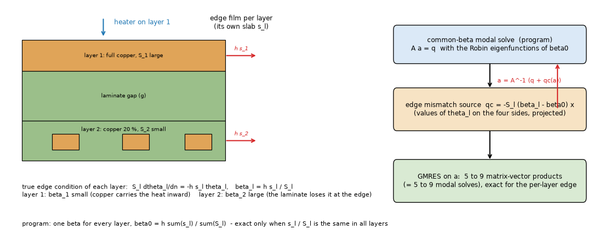
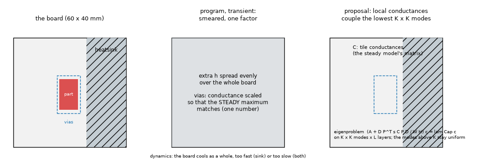
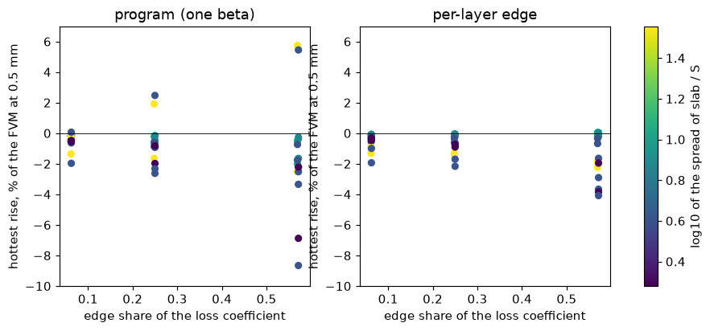
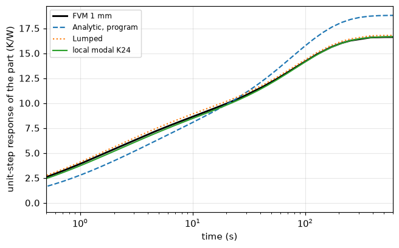
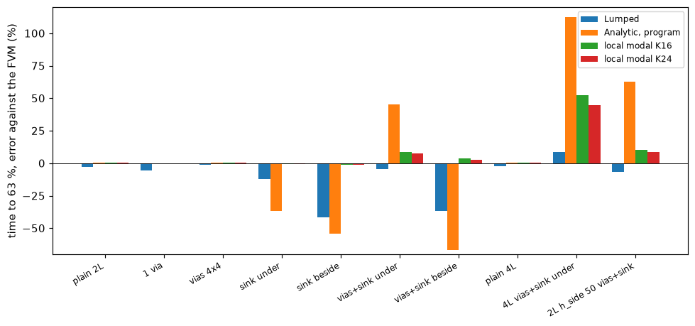

# Analytic model for 2.6.0: the edge of unequal layers and the transient with vias and a heatsink

Questions: (A) the Robin edge basis of the Analytic steady model uses one parameter `beta0 = h_side sum(s_l) / sum(S_l)` for all layers and is exact only when `s_l / S_l` is
the same in every layer; how far does that go, and what is the per-layer treatment? (B) the Analytic transient with vias and a heatsink reads the time to 63 % far from the
FVM; what is the cause and what is the fix? (C) does the Lumped transient have the same problem? The program is not touched: every prototype is in `lib/` and imports the
program (`perlayer_local.py` patches the source of `analytic.solve_steady` in memory). Proposals with exact code changes are in `INTEGRATION.md`.

Layout: `lib/` (`boards26.py`, `robin_perlayer.py`, `perlayer_local.py`, `calib_variants.py`, `local_modal.py`), `scripts/` (studies, `make_figures.py`, `make_diagrams.py`),
`tests/test_analytic_2_6.py` (6 tests, 4 s), `figures/`, `docs/`. Outputs of the runs are in `out/` (git-ignored); every table below was printed by the script named in it.

## 1. The situation

*Figure 1 (`figures/fig_01_edge_per_layer.png`): a thick-copper layer and a thin-copper layer have different `beta_l = h s_l / S_l`; the program uses one `beta0`; the proposal
adds the mismatch as a modal source and iterates.*

*Figure 3 (`figures/fig_03_local_transient.png`): the program's transient smears vias and heatsinks over the board and corrects one factor; the proposal keeps the local
conductances in a coupled block of the lowest `K x K` modes.*

## 2. (A) The per-layer edge

### 2.1 Method

Weak form of layer `l` in the basis of `beta0` (Green's identity twice): `S_l lam^2 N_m N_n a_l,mn + S_l (beta_l - beta0) closed-integral(theta_l phi_m phi_n) + (faces, gaps) =
projection of q`. The edge integral needs only the values of `theta_l` on the four sides and, by orthogonality of the eigenfunctions along each side, reduces to two small matrix
products. The extra modal source is `qc_l = -S_l (beta_l - beta0) [ (Ex^T / Nx)(Ex a_l) + (a_l Ey^T)(Ey / Ny) ]` (`E` the eigenfunctions at the two ends of a direction, `N` the squared
norms), and the loop `a = A^-1 (q + qc(a))` is solved with GMRES (`lib/robin_perlayer.py`). With equal `s_l / S_l` the mismatch is zero and the loop is skipped (bit-identical).

### 2.2 Does the iteration solve the right problem? (`scripts/study_perlayer_edge.py --part 1`)

The idealised sheets (`analytic._effective_sheet`) solved by an independent 2D finite-difference code with the TRUE per-layer Robin edge (`sheet_fd` of
`research/analytic-edge-spatial`, 0.5 and 0.25 mm, Richardson), corner part, hottest rise:

| board | h_side | FD (K) | program | per-layer | matvecs | heated-layer beta |
| :-- | --: | --: | --: | --: | --: | --: |
| advanced 4 L | 50 | 85.667 | -0.60 % | -0.04 % | 6 | +10.82 % |
| advanced 4 L | 200 | 65.979 | -2.07 % | -0.02 % | 8 | +28.37 % |
| 2 L top full, bottom 0.2 | 50 | 111.747 | -1.83 % | -0.01 % | 7 | +4.85 % |
| 2 L top full, bottom 0.2 | 200 | 81.404 | -5.27 % | -0.10 % | 9 | +10.25 % |
| 2 L top full, bottom 0.5 | 200 | 77.555 | -3.21 % | -0.06 % | 8 | +5.20 % |
| 2 L top 0.2, bottom full | 50 | 149.397 | +4.23 % | -0.02 % | 7 | -10.15 % |
| 2 L top 0.2, bottom full | 200 | 110.872 | +9.90 % | -0.03 % | 9 | -14.42 % |
| 2 L equal 1 / 1 | 200 | 73.645 | -0.03 % | -0.03 % | 0 | -0.03 % |

The iteration is within 0.1 % of the exact solution of the idealised model (balance 1.0000), on 5 to 9 matrix-vector products, and costs 0.01 to 0.07 s more than the program on
a uniform board. The cheap alternative, the `beta` of the heated layer, is much worse (up to +38 % on the 54 boards) and is dropped. The error of the program is of both signs:
cold (unsafe) when the heated layer has the thicker copper, hot when it has the thinner.

### 2.3 54 boards outside the first study against the FVM at 0.5 mm (`--part 2`, figure 2)

*Figure 2 (`figures/fig_02_perlayer_error.png`): hottest-rise error against the edge share of the loss coefficient, colour = spread of slab / S.*

48 boards of two or more layers (the 6 one-layer rows of the run are not valid for the copy, which has no series film; the program's own one-layer rule is not in the loop):

| | max abs error | mean abs error |
| :-- | --: | --: |
| program (one beta) | 8.64 % (2 L top full / bottom 0.2, corner, h_side 200: cold) | 1.51 % |
| per-layer | 4.07 % (2 L top 0.2 / bottom full, corner, h_side 200: cold) | 0.90 % |
| edge share 0.25 or more (24 boards): program / per-layer | 8.64 % / 4.07 % | 2.43 % / 1.29 % |

Per-layer is better on 35 boards, worse by more than 0.05 point on 2. The brief's figures are confirmed (8.6 % at h_side 200, cold) and the error also has the other sign (+5.5 %
on 2 L top 0.2 / bottom full). The error that remains after the per-layer edge (up to 4 %, cold) is not the edge treatment, which equals the finite-difference solution of the
same sheets to 0.1 % (2.2); it is the layered idealisation against the FVM (laminate nodes of the FVM where copper is partial, `research/analytic-edge-spatial` README 8.4). Not
decomposed again here.

### 2.4 With vias and a heatsink (`--part 3`; the loop wraps the complete program solve)

Corner part, 4 x 4 via array, h_side 200, FVM at 0.5 mm:

| board | program | per-layer | full solves in the loop |
| :-- | --: | --: | --: |
| 2 L top full, bottom 0.2, vias | -6.64 % | -3.60 % | 8 |
| 2 L top full, bottom 0.2, vias + 30 mm heatsink | -4.77 % | -2.32 % | 8 |
| 2 L top 0.2, bottom full, vias | +4.00 % | -4.67 % | 8 |
| 2 L top 0.2, bottom full, vias + heatsink | +6.32 % | -1.61 % | 8 |
| advanced 4 L, vias | -2.04 % | +0.00 % | 7 |
| advanced 4 L, vias + heatsink | -1.30 % | +0.45 % | 7 |
| advanced 4 L partial, vias | -2.03 % | -0.17 % | 6 |
| advanced 4 L partial, vias + heatsink | -0.86 % | +0.91 % | 6 |

The Green-function step is linear in the modal source, so the loop around it works as designed. In the copy every loop step repeats the whole solve (0.7 to 35 s); the integration
reuses the factorisation (INTEGRATION 1.3), an estimate that was not measured. One board (2 L top 0.2 / bottom full, vias) went from +4.00 to -4.67 %: the sign changed and the
magnitude grew, because the FVM's laminate nodes (not in the Analytic) now dominate; flagged for the reviewer.

### 2.5 Frozen records (`scripts/study_frozen_impact.py`)

Of the 17 harness boards, 10 have an edge coefficient, a part and no outline or block: the layers are equal (`s_l / S_l` spread 1.00) on 7 (shift 0, bit-identical by the skip rule)
and unequal on `two_layer_partial` (spread 1.31, +0.004 K), `part_top_path` (1.25, -0.003 K), `hatched_copper` (1.36, -0.001 K). Those three Analytic steady records move by more than the
1e-8 K tolerance but by less than 0.01 K; the boards with an outline or a block were not run (they pass through the rectangle conversion and the block path that the copy lacks); the
frozen Analytic records of the outline boards have equal layers, so the expected shift is 0 (not run). The existing pending file `analytic-edge.json` would be regenerated.

## 3. (B) The transient with vias and a heatsink

### 3.1 What the program does and what is wrong (`scripts/study_transient_both.py`, figure 4)

`_calibrated_dynamics` smears vias and heatsinks over the board and bisects ONE factor, on the vias if the board has vias, otherwise on the heatsink, until the steady maximum of
the smeared model equals the locally corrected steady solution. Three separate defects, seen in the same run (10 boards, FVM at 1 mm, time to 63 % of the unit step of the part):

1. **One-sided calibration**: `if steady(1.0) <= local: return d` keeps the smeared model when it is colder than the local one. A heatsink at the far side of the board
   (`sink beside`) makes the smeared board colder at the part: steady resistance 19.53 K/W against 24.13 (FVM) and 23.92 (the program's own steady solve), t63 10.6 s against 23.1.
2. **Failed calibration with both**: with vias and a heatsink under the part the via factor reaches the bisection ceiling (9955, limit 1e4) and the smeared model still ends at 18.81
   K/W against 16.67 (the local steady solve) and 16.63 (FVM): t63 +45.6 %.
3. **Even a matched steady value gives wrong dynamics**: a heatsink under the part calibrated to the right steady maximum (factor 2.14 on the whole-board coefficient) cools
   the whole board: t63 8.5 s against 13.4 s (-36.7 %).

Plain boards, one via and via arrays are right (+0.1 to +0.6 %), so the issue is the heatsink. The brief's "+28 to +49 % above the FVM, the isolated board the worst" was not
reproduced as stated: on these 10 boards the program's t63 error ranges from -66.9 % to +112.7 %, a plain board is +0.6 %, and I could not identify which "isolated board" gave +49 %.

### 3.2 The fix: local conductances in a coupled modal block

`lib/local_modal.py` puts the tile conductance matrix `C` of the steady model into the modal equations on the lowest `K x K` modes: `(A + D P^T s C P D / W H) c = lam Cap c`
(symmetric after `a = D c`, see the module header), the modes above `K` stay the uniform diagonal system, and one factor `s` on `C` is bisected so that the steady
rise at the part's point equals that of `analytic.solve_steady` (the truncation loses the constriction of the barrels and the sink edge). The steady limit is the program's; the
dynamics follow the local physics.

| board | FVM t63 (s) | Lumped | Analytic, program | two-factor calibration | local K 16 | local K 24 |
| :-- | --: | --: | --: | --: | --: | --: |
| plain 2 L | 74.4 | -2.6 % | +0.6 % | +0.6 % | +0.6 % | +0.6 % |
| 1 via | 78.2 | -5.7 % | +0.1 % | +0.1 % | +0.1 % | +0.1 % |
| vias 4 x 4 | 88.4 | -1.1 % | +0.5 % | +0.5 % | +0.5 % | +0.5 % |
| sink under | 13.4 | -11.8 % | -36.7 % | +19.2 % | -0.4 % | -0.5 % |
| sink beside | 23.1 | -41.8 % | -54.3 % | -7.7 % | -1.3 % | -1.3 % |
| vias + sink under | 26.1 | -4.6 % | +45.6 % | +19.8 % | +8.7 % | +7.4 % |
| vias + sink beside | 33.9 | -36.6 % | -66.9 % | -15.2 % | +3.8 % | +2.9 % |
| plain 4 L | 89.8 | -2.2 % | +0.5 % | +0.5 % | +0.5 % | +0.5 % |
| 4 L vias + sink under (300 W/m2K) | 9.89 | +8.5 % | +112.7 % | +71.6 % | +52.2 % | +44.6 % |
| 2 L h_side 50 vias + sink | 18.3 | -6.4 % | +62.6 % | +31.6 % | +10.1 % | +8.7 % |

(`two-factor`: heatsink factor on the extracted heat, via factor on the maximum; `analytic/two` of `lib/calib_variants.py`; the variant that matches the maximum in the
heatsink-only case, `two_max`, gives +13.6 % on `sink beside` and the rest equal.) The local system also follows the whole curve: largest difference of the unit-step response
over time, in percent of R, 0.2 to 1.5 % on the nine boards other than the 4 L one (program: 8 to 19 % where a heatsink is present), and the periodic response (square wave, duty 0.5, period t63/2
and 2 t63, peak and swing error at the last cycle) is within 1.8 % (peak) and 3.9 % (swing) of the FVM on every board except the 4 L one (-6.5 / -13.2 % at K 16).

*Figure 5 (`figures/fig_05_step_vias_sink.png`): vias + heatsink under the part, FVM at 1 mm, Analytic as in the program, local K 24, Lumped.*

*Figure 4 (`figures/fig_04_t63_error.png`): error of the time to 63 % against the FVM at 1 mm.*

**The remaining +45 % of the 4 L board is not the local system** (`scripts/study_4l_convergence.py`): the FVM's own t63 is 9.89 s at 1 mm and 11.40 s at 0.5 mm (the reference
moves 15 % with the cell), and the local system gives 15.0 / 14.3 / 14.0 s at K 16 / 24 / 32 (+32 / +25 / +23 % of the FVM at 0.5 mm). The step response is too slow already at
1 s (3.12 against 3.41 K/W, FVM 0.5 mm) and converges to the FVM at 50 s (7.05 against 7.09): the early time is the capacity of the layer node (half laminate on each side of the
copper), an idealisation of the layered model that applies to the plain board too, hidden there because t63 is set by the late time. Not changed by any calibration.

Cost: K 16 takes 0.1 to 1.4 s on the 2-layer boards and 3.8 s on the 4-layer board (dense eigenproblem of `K^2 L` unknowns, one per part when there are several parts: the
program already builds one system per part), K 24 up to 8.5 s; the matrix is `(K^2 L)^2` doubles (42 MB at K 16, L 4). K 16 resolves a part of 10 mm on a 60 mm board;
K 24 changes t63 by at most 1.4 points relative to K 16 here.

### 3.3 The harness boards (`scripts/study_frozen_transient.py`)

The four boards with vias or a heatsink and no outline or block, first part alone, FVM at 2 mm: example_board (and profile_board) program +18.0 % -> local +3.8 %, plate_vias
+4.5 % -> +5.9 %, plate_lone_via +3.2 % -> +4.3 %. These four Analytic times to 63 % are frozen records and would move (by -12.0 / +1.3 / +1.1 % against the program); no steady record
moves.

### 3.4 Experiment that failed: the per-layer edge inside the coupled block (`scripts/study_transient_edge_block.py`)

The steady per-layer edge makes the final value of the transient (the steady resistance of the modal system) inconsistent with the steady solve by the difference of 2.3. Adding
the mismatch matrix `S_l (beta_l - beta0) G` to the coupled block with one calibration factor was tried on four boards: the matrix is indefinite where `beta_l - beta0` changes sign
and the factor diverges (8.5 and 13.0) on two of them; on the other two the plateau improves (R 54.9 against 57.4 K/W FVM and 60.9 program). Not a usable method; the consistent
alternative is to calibrate the plateau by a plain scale of the steady resistance (INTEGRATION 2.5).

## 4. (C) The Lumped transient

On the same 10 boards (same table, column Lumped): within -12 % to +8.5 % for plain boards, vias, a heatsink under the part and both under the part (`vias + sink under` -4.6 %).
It is bad when the heatsink is not under the part: `sink beside` -41.8 %, `vias + sink beside` -36.6 %, with the steady resistance 7 to 10 % low (22.46 against 24.13 K/W;
19.12 against 21.15). So the Lumped does not have the Analytic's calibration defect: its steady is wrong first, because the ring network averages the heatsink over the
angle of each ring (a one-sided sink looks like a sink all around), which also shortens the time constant. That is the angular resolution limit of the rings already recorded
(Decisions Log, via constriction); not studied further here, no fix proposed.

## 5. Limits

* Prototype of the transient: step responses only (one part per system, no profile adapter, no metal block, no field). The steady loop with vias: no block.
* 10 transient boards (one 60 x 40 mm board family, one 10 x 10 mm part, 2 or 4 layers); boards with several parts, outlines, partial copper and the profile runs were not
  swept. The references are the FVM at 1 mm; the 4 L board shows the reference moves 15 % with the cell.
* Per-layer edge: uniform sheets of the idealised model; one-layer boards and the thick-board limit of the layered idealisation are outside it.

## What was read and what was not verified

* **Muzychka, Culham, Yovanovich 2003 Part II** (eq. 12 to 21, the Robin basis): not re-read here; used through the program and the reviewed `research/analytic-edge-spatial` (status of that
  folder: R for eq. 12 to 21 as an OCR reading confirmed by the derivation). The per-layer weak form of 2.1 is my own derivation (Green's identity), checked numerically
  against an independent finite-difference solver, not taken from a source. No new literature was opened: the transient local system is my own formulation (a Galerkin projection
  of the program's own steady Woodbury step), also not from a source; no published numerical case was reproduced in this folder (the references are the program's FVM and
  the independent 2D finite differences of the previous folder).
* Reproduced: 2.2 (independent finite differences), 2.3 and 2.4 (FVM at 0.5 mm), all of 3 (FVM at 1 mm, and 0.5 mm for the 4 L board), 6 tests.
* **Not verified**: the cost of the integrated per-layer loop with a reused factorisation (an estimate); the transient with several parts, partial copper, a board outline and the
  profile runs; the profile adapter with a coupled block; the cause of the 4 L early-time capacity (stated from the curves, not isolated by a capacity experiment); the one-layer
  rule inside the per-layer loop; the Lumped's angular averaging as the cause of the `sink beside` errors (consistent with the steady resistance, not tested by a ring-count or
  angle experiment); the brief's "+28 to +49 %" board.
