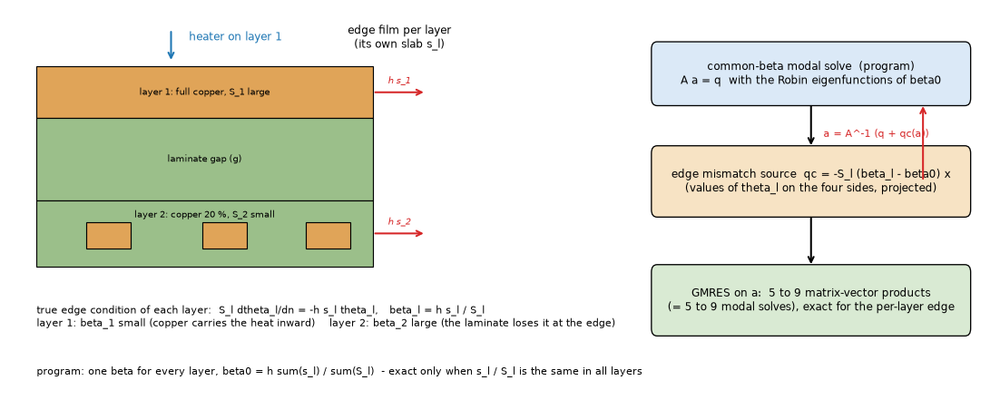
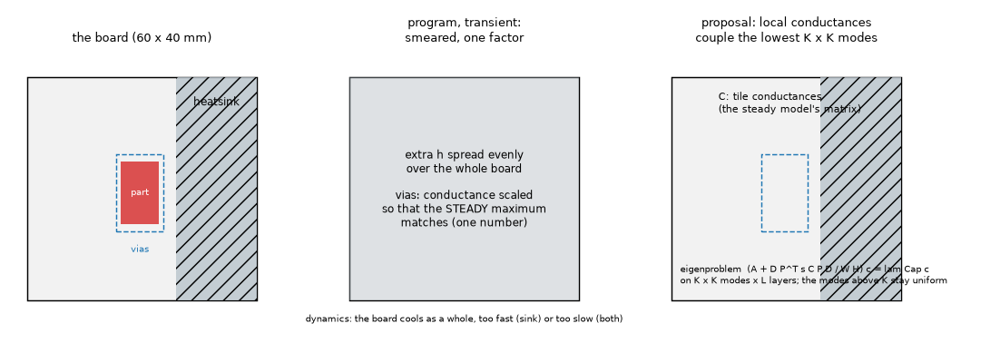
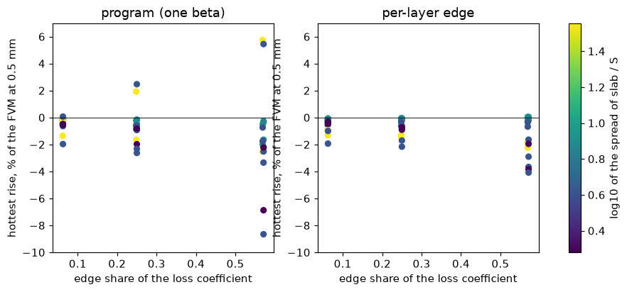
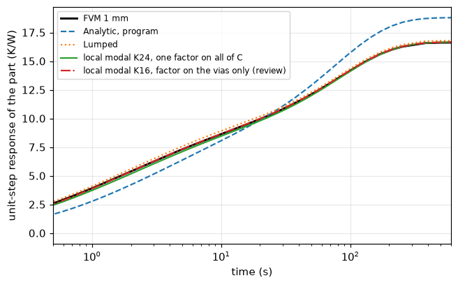
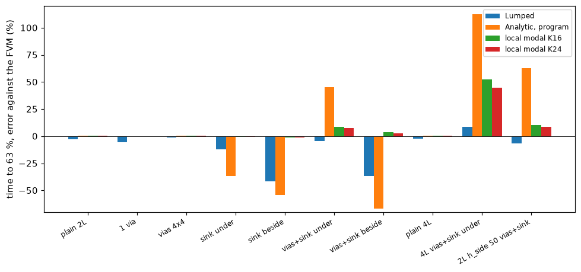
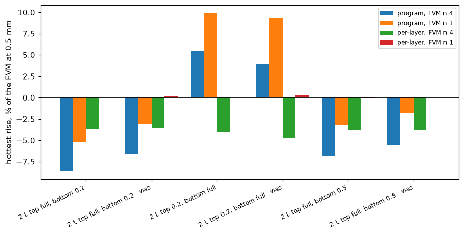
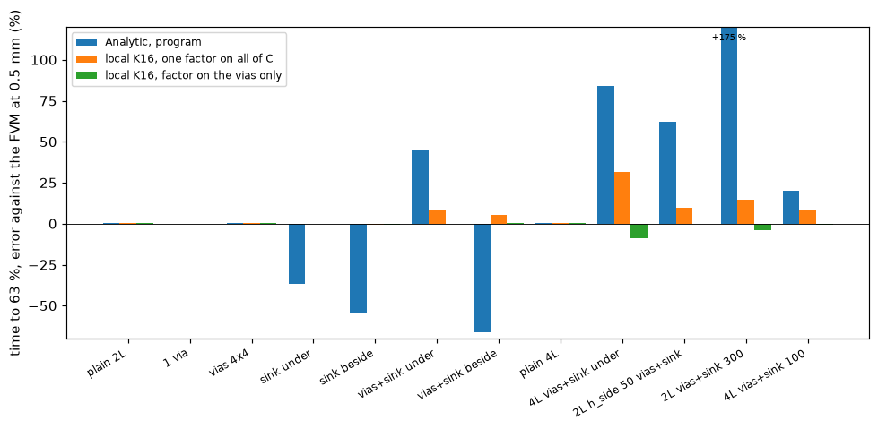

# Analytic model for 2.6.0: the edge of unequal layers and the transient with vias and a heatsink

**Status (audit 2.6.1): adopted in 2.6.0** (`feature/analytic-edge-and-local-transient`: `analytic._per_layer_edge`, `analytic._local_dynamics`, `analytic_local.LocalSystem`, `EDGE_MISMATCH_MIN`, `LOCAL_MODES`; `docs/theory.md` 6, `docs/validation.md` 4.1). The folder was `research/analytic-2-6/` and was renamed by topic in 2.6.1. "The program" in sections 2 and 3 is the 2.5.x Analytic (one `beta`, the smeared transient with `_calibrated_dynamics`, which no longer exists); `lib/calib_variants.py` reads a frozen v2.5.1 copy of that calibration (`lib/analytic_v251.py`), and the folder tests now assert that the program agrees with the prototypes. The text-only warning B0 was merged in 2.5.0 and was replaced by the 2.6.0 heatsink-transient warning (-8 % to +1 %).

Questions: (A) the Robin edge basis of the Analytic steady model uses one parameter `beta0 = h_side sum(s_l) / sum(S_l)` for all layers and is exact only when `s_l / S_l` is
the same in every layer; how far does that go, and what is the per-layer treatment? (B) the Analytic transient with vias and a heatsink reads the time to 63 % far from the
FVM; what is the cause and what is the fix? (C) does the Lumped transient have the same problem? The program is not touched: every prototype is in `lib/` and imports the
program (`perlayer_local.py` patches the source of `analytic.solve_steady` in memory). Proposals with exact code changes are in `INTEGRATION.md`.

Layout: `lib/` (`boards26.py`, `robin_perlayer.py`, `perlayer_local.py`, `calib_variants.py`, `local_modal.py`), `scripts/` (studies, `make_figures.py`, `make_diagrams.py`),
`tests/test_analytic_edge_and_transient.py` (9 tests, 7 s; three added by the review), `figures/`, `docs/`. Outputs of the runs are in `out/` (git-ignored); every table below was printed by the script named in it.

## 1. The situation

*Figure 1 (`figures/fig_01_edge_per_layer.png`): a thick-copper layer and a thin-copper layer have different `beta_l = h s_l / S_l`; the program uses one `beta0`; the proposal adds the mismatch as a modal source and iterates.*

*Figure 3 (`figures/fig_03_local_transient.png`): the program's transient smears vias and heatsinks over the board and corrects one factor; the proposal keeps the local conductances in a coupled block of the lowest `K x K` modes.*

## 2. (A) The per-layer edge

### 2.1 Method

Weak form of layer `l` in the basis of `beta0` (Green's identity twice): `S_l lam^2 N_m N_n a_l,mn + S_l (beta_l - beta0) closed-integral(theta_l phi_m phi_n) + (faces, gaps) =
projection of q`. The edge integral needs only the values of `theta_l` on the four sides and, by orthogonality of the eigenfunctions along each side, reduces to two small matrix
products. The extra modal source is `qc_l = -S_l (beta_l - beta0) [ (Ex^T / Nx)(Ex a_l) + (a_l Ey^T)(Ey / Ny) ]` (`E` the eigenfunctions at the two ends of a direction, `N` the squared
norms), and the loop `a = A^-1 (q + qc(a))` is solved with GMRES (`lib/robin_perlayer.py`). With equal `s_l / S_l` the mismatch is zero and the loop is skipped (bit-identical).

### 2.2 Does the iteration solve the right problem? (`scripts/study_perlayer_edge.py --part 1`)

The idealised sheets (`analytic._effective_sheet`) solved by an independent 2D finite-difference code with the TRUE per-layer Robin edge (`sheet_fd` of
`research/analytic-edge-spatial`, 0.5 and 0.25 mm, Richardson), corner part, hottest rise:

| board | h_side | FD (K) | program | per-layer | matvecs | heated-layer beta |
| :-- | --: | --: | --: | --: | --: | --: |
| advanced 4 L | 50 | 85.667 | -0.60 % | -0.04 % | 6 | +10.82 % |
| advanced 4 L | 200 | 65.979 | -2.07 % | -0.02 % | 8 | +28.37 % |
| 2 L top full, bottom 0.2 | 50 | 111.747 | -1.83 % | -0.01 % | 7 | +4.85 % |
| 2 L top full, bottom 0.2 | 200 | 81.404 | -5.27 % | -0.10 % | 9 | +10.25 % |
| 2 L top full, bottom 0.5 | 200 | 77.555 | -3.21 % | -0.06 % | 8 | +5.20 % |
| 2 L top 0.2, bottom full | 50 | 149.397 | +4.23 % | -0.02 % | 7 | -10.15 % |
| 2 L top 0.2, bottom full | 200 | 110.872 | +9.90 % | -0.03 % | 9 | -14.42 % |
| 2 L equal 1 / 1 | 200 | 73.645 | -0.03 % | -0.03 % | 0 | -0.03 % |

The iteration is within 0.1 % of the exact solution of the idealised model (balance 1.0000), on 5 to 9 matrix-vector products, and costs 0.01 to 0.07 s more than the program on
a uniform board. The cheap alternative, the `beta` of the heated layer, is much worse (up to +38 % on the 54 boards) and is dropped. The error of the program is of both signs:
cold (unsafe) when the heated layer has the thicker copper, hot when it has the thinner.

### 2.3 54 boards outside the first study against the FVM at 0.5 mm (`--part 2`, figure 2)

*Figure 2 (`figures/fig_02_perlayer_error.png`): hottest-rise error against the edge share of the loss coefficient, colour = spread of slab / S.*

48 boards of two or more layers (the 6 one-layer rows of the run are not valid for the copy, which has no series film; the program's own one-layer rule is not in the loop):

| | max abs error | mean abs error |
| :-- | --: | --: |
| program (one beta) | 8.64 % (2 L top full / bottom 0.2, corner, h_side 200: cold) | 1.51 % |
| per-layer | 4.07 % (2 L top 0.2 / bottom full, corner, h_side 200: cold) | 0.90 % |
| edge share 0.25 or more (24 boards): program / per-layer | 8.64 % / 4.07 % | 2.43 % / 1.29 % |

*Audit 2.6.1 (`study_perlayer_edge.py --part 2` re-run, 38 s).* The program now **is** the per-layer edge, so the `program` and `per-layer` columns print the same numbers. Against the FVM of the 2.6.x tree the 48 boards read max 4.91 % (the same board, 2 L top 0.2 / bottom full, corner, `h_side` 200), mean 1.19 %, signed -4.91 to -0.01 %, not 4.07 / 0.90 %: the FVM reference moved. With the laminate edge band switched off the numbers are 4.91 / 1.02 %; with the band **and** the cut-cell film (which since 2.6.0 also puts the film of a rectangle's border in series with half a cell of sheet, `fvm.Network._cut_edge_film`) switched off they are 4.07 / 0.896 %, the table above to the digit. So the move is the FVM's edge film in series (+0.84 point on the worst board) and the band (mean only), both on the cold side of the Analytic as section 6.1 explains; the edge treatment of the Analytic did not change.

Per-layer is better on 39 boards and worse on 9, by more than 0.05 point on 2 (review count; the first text said 35). The brief's figures are confirmed (8.6 % at h_side 200, cold)
and the error also has the other sign (up to +5.76 %, advanced 4 L 0.2, corner, h_side 200; the first text said +5.5 % on 2 L top 0.2 / bottom full, which is +5.46 %). The error
that remains after the per-layer edge (up to 4 %) is **always cold** (signed -4.07 to +0.06 % on the 48 boards, against -8.64 to +5.76 % for the program): it is not the edge
treatment, which equals the finite-difference solution of the same sheets to 0.1 % (2.2), but the laminate sub-gaps of the FVM where copper is partial (`research/analytic-edge-spatial`
README 8.4). **Checked by the review** (6.1): with one laminate link in the FVM (`laminate_n_max = 1`, the idealisation the Analytic shares) the per-layer edge is within
-0.03 to +0.25 % on the six worst boards.

### 2.4 With vias and a heatsink (`--part 3`; the loop wraps the complete program solve)

Corner part, 4 x 4 via array, h_side 200, FVM at 0.5 mm:

| board | program | per-layer | full solves in the loop |
| :-- | --: | --: | --: |
| 2 L top full, bottom 0.2, vias | -6.64 % | -3.60 % | 8 |
| 2 L top full, bottom 0.2, vias + 30 mm heatsink | -4.77 % | -2.32 % | 8 |
| 2 L top 0.2, bottom full, vias | +4.00 % | -4.67 % | 8 |
| 2 L top 0.2, bottom full, vias + heatsink | +6.32 % | -1.61 % | 8 |
| advanced 4 L, vias | -2.04 % | +0.00 % | 7 |
| advanced 4 L, vias + heatsink | -1.30 % | +0.45 % | 7 |
| advanced 4 L partial, vias | -2.03 % | -0.17 % | 6 |
| advanced 4 L partial, vias + heatsink | -0.86 % | +0.91 % | 6 |

The Green-function step is linear in the modal source, so the loop around it works as designed. In the copy every loop step repeats the whole solve (0.7 to 35 s); the integration
reuses the factorisation (INTEGRATION 1.3), an estimate that was not measured. One board (2 L top 0.2 / bottom full, vias) went from +4.00 to -4.67 %: the sign changed and the
magnitude grew. **Resolved by the review** (6.1): the program's +4.00 % was two errors cancelling (the common beta +9.37 % against the FVM with one laminate link, the laminate
sub-gaps about -5 %); the per-layer edge removes the first (+0.25 % against the FVM with one link) and leaves the second.

### 2.5 Frozen records (`scripts/study_frozen_impact.py`)

Of the 17 harness boards, 10 have an edge coefficient, a part and no outline or block: the layers are equal (`s_l / S_l` spread 1.00) on 7 (shift 0, bit-identical by the skip rule)
and unequal on `two_layer_partial` (spread 1.31, +0.004 K), `part_top_path` (1.25, -0.003 K), `hatched_copper` (1.36, -0.001 K). Those three Analytic steady records move by more than the
1e-8 K tolerance but by less than 0.01 K; the boards with an outline or a block were not run (they pass through the rectangle conversion and the block path that the copy lacks); the
frozen Analytic records of the outline boards have equal layers, so the expected shift is 0 (not run). The existing pending file `analytic-edge.json` would be regenerated.

## 3. (B) The transient with vias and a heatsink

### 3.1 What the program does and what is wrong (`scripts/study_transient_both.py`, figure 4)

`_calibrated_dynamics` smears vias and heatsinks over the board and bisects ONE factor, on the vias if the board has vias, otherwise on the heatsink, until the steady maximum of
the smeared model equals the locally corrected steady solution. Three separate defects, seen in the same run (10 boards, FVM at 1 mm, time to 63 % of the unit step of the part):

1. **One-sided calibration**: `if steady(1.0) <= local: return d` keeps the smeared model when it is colder than the local one. A heatsink at the far side of the board
   (`sink beside`) makes the smeared board colder at the part: steady resistance 19.53 K/W against 24.13 (FVM) and 23.92 (the program's own steady solve), t63 10.6 s against 23.1.
2. **Failed calibration with both**: with vias and a heatsink under the part the via factor reaches the bisection ceiling (9955, limit 1e4) and the smeared model still ends at 18.81
   K/W against 16.67 (the local steady solve) and 16.63 (FVM): t63 +45.6 %.
3. **Even a matched steady value gives wrong dynamics**: a heatsink under the part calibrated to the right steady maximum (factor 2.14 on the whole-board coefficient) cools
   the whole board: t63 8.5 s against 13.4 s (-36.7 %).

Plain boards, one via and via arrays are right (+0.1 to +0.6 %), so the issue is the heatsink. The brief's "+28 to +49 % above the FVM, the isolated board the worst" was not
reproduced as stated: on these 10 boards the program's t63 error ranges from -66.9 % to +112.7 %, a plain board is +0.6 %, and I could not identify which "isolated board" gave +49 %.

### 3.2 The fix: local conductances in a coupled modal block

`lib/local_modal.py` puts the tile conductance matrix `C` of the steady model into the modal equations on the lowest `K x K` modes: `(A + D P^T s C P D / W H) c = lam Cap c`
(symmetric after `a = D c`, see the module header), the modes above `K` stay the uniform diagonal system, and one factor `s` on `C` is bisected so that the steady
rise at the part's point equals that of `analytic.solve_steady` (the truncation loses the constriction of the barrels and the sink edge). The steady limit is the program's; the
dynamics follow the local physics.

| board | FVM t63 (s) | Lumped | Analytic, program | two-factor calibration | local K 16 | local K 24 |
| :-- | --: | --: | --: | --: | --: | --: |
| plain 2 L | 74.4 | -2.6 % | +0.6 % | +0.6 % | +0.6 % | +0.6 % |
| 1 via | 78.2 | -5.7 % | +0.1 % | +0.1 % | +0.1 % | +0.1 % |
| vias 4 x 4 | 88.4 | -1.1 % | +0.5 % | +0.5 % | +0.5 % | +0.5 % |
| sink under | 13.4 | -11.8 % | -36.7 % | +19.2 % | -0.4 % | -0.5 % |
| sink beside | 23.1 | -41.8 % | -54.3 % | -7.7 % | -1.3 % | -1.3 % |
| vias + sink under | 26.1 | -4.6 % | +45.6 % | +19.8 % | +8.7 % | +7.4 % |
| vias + sink beside | 33.9 | -36.6 % | -66.9 % | -15.2 % | +3.8 % | +2.9 % |
| plain 4 L | 89.8 | -2.2 % | +0.5 % | +0.5 % | +0.5 % | +0.5 % |
| 4 L vias + sink under (300 W/m2K) | 9.89 | +8.5 % | +112.7 % | +71.6 % | +52.2 % | +44.6 % |
| 2 L h_side 50 vias + sink | 18.3 | -6.4 % | +62.6 % | +31.6 % | +10.1 % | +8.7 % |

**Review**: this table is against the FVM at 1 mm and the local columns use one factor on the whole tile matrix; the converged reference (0.5 mm) and the corrected
calibration (factor on the vias only) are in 6.3 and figure 6: nine of the ten boards within 2 %, the 4 L board -8.1 %.

(`two-factor`: heatsink factor on the extracted heat, via factor on the maximum; `analytic/two` of `lib/calib_variants.py`; the variant that matches the maximum in the
heatsink-only case, `two_max`, gives +13.6 % on `sink beside` and the rest equal.) The local system also follows the whole curve: largest difference of the unit-step response
over time, in percent of R, 0.2 to 1.5 % on the nine boards other than the 4 L one (program: 8 to 19 % where a heatsink is present), and the periodic response (square wave, duty 0.5, period t63/2
and 2 t63, peak and swing error at the last cycle) is within 1.8 % (peak) and 3.9 % (swing) of the FVM on every board except the 4 L one (-6.5 / -13.2 % at K 16).

*Figure 5 (`figures/fig_05_step_vias_sink.png`): vias + heatsink under the part, FVM at 1 mm, Analytic as in the program, local K 24 with one factor on all of C, local K 16 with the factor on the vias only (added by the review, 6.3), Lumped.*

*Figure 4 (`figures/fig_04_t63_error.png`): error of the time to 63 % against the FVM at 1 mm.*

**The 4 L board** (`scripts/study_4l_convergence.py`): the FVM's own t63 is 9.89 s at 1 mm and 11.40 s at 0.5 mm (11.41 s at 0.25 mm and 11.31 s in the FDM at 0.5 mm, review
6.2: the reference is converged at 0.5 mm, so the 1 mm column of the table is 13 % short on this board only; the 2-layer boards move by at most 1.6 % between 1 and 0.5 mm),
and the local system gives 15.0 / 14.3 / 14.0 s at K 16 / 24 / 32 (+32 / +25 / +23 % of the FVM at 0.5 mm). ~~The early time is the capacity of the layer node, an idealisation
that applies to the plain board too~~: **withdrawn by the review** (6.2): the plain 4 L board follows the FVM at 0.1 and 1 s (z/R 0.044 / 0.043 and 0.215 / 0.214), and so do
the boards with a heatsink alone or vias alone; only vias WITH a heatsink are slow, and the cause is the single calibration factor on the whole tile matrix (6.3). With the
factor on the vias only the 4 L board is -8.1 % (K 16).

Cost: K 16 takes 0.1 to 1.4 s on the 2-layer boards and 3.8 s on the 4-layer board (dense eigenproblem of `K^2 L` unknowns, one per part when there are several parts: the
program already builds one system per part), K 24 up to 8.5 s; the matrix is `(K^2 L)^2` doubles (42 MB at K 16, L 4). K 16 resolves a part of 10 mm on a 60 mm board;
K 24 changes t63 by at most 1.4 points relative to K 16 here.

### 3.3 The harness boards (`scripts/study_frozen_transient.py`)

The four boards with vias or a heatsink and no outline or block, first part alone, FVM at 2 mm: example_board (and profile_board) program +18.0 % -> local +3.8 %, plate_vias
+4.5 % -> +5.9 %, plate_lone_via +3.2 % -> +4.3 %. These four Analytic times to 63 % are frozen records and would move (by -12.0 / +1.3 / +1.1 % against the program); no steady record
moves. Review (6.4): the example board's FVM is converged at 2 mm (10.86 / 10.70 / 10.71 s at 2 / 1 / 0.5 mm); with the factor on the vias only the local system is 10.43 s
(-2.6 % of the FVM at 0.5 mm, a shift of -18.6 % against the program's 12.82 s), with one factor on all of C 11.27 s (+5.3 %). plate_vias and plate_lone_via have no heatsink,
so the two calibrations are the same there.

### 3.4 Experiment that failed: the per-layer edge inside the coupled block (`scripts/study_transient_edge_block.py`)

The steady per-layer edge makes the final value of the transient (the steady resistance of the modal system) inconsistent with the steady solve by the difference of 2.3. Adding
the mismatch matrix `S_l (beta_l - beta0) G` to the coupled block with one calibration factor was tried on four boards: the matrix is indefinite where `beta_l - beta0` changes sign
and on two of them no factor matches (the first run reported the factor drifting to 8.5 and 13.0; with the bracket check the review added to the bisection, `out/edge_block.txt`, no
factor between 0.05 and 20 reaches the target); on the other two the plateau improves (R 54.9 against 57.4 K/W FVM and 60.9 program). Not a usable method; the consistent
alternative is to calibrate the plateau by a plain scale of the steady resistance (INTEGRATION 2.5).

## 4. (C) The Lumped transient

On the same 10 boards (same table, column Lumped, both at 1 mm): within -12 % to +8.5 % for plain boards, vias, a heatsink under the part and both under the part (`vias + sink under`
-4.6 %). It is bad when the heatsink is not under the part: `sink beside` -41.8 %, `vias + sink beside` -36.6 %, with the steady resistance 7 to 10 % low (22.46 against 24.13 K/W;
19.12 against 21.15). Review: with the Lumped and the FVM both at 0.5 mm (`out/transient_vias_05.txt`) the first group is -2.5 to +13.1 % (the 4 L board +13.1 %, `vias + sink
under` +8.9 %) and the second -38.1 / -30.3 %: the Lumped's numbers move with its cell, the conclusion does not. So the Lumped does not have the Analytic's calibration defect: its steady is wrong first, because the ring network averages the heatsink over the
angle of each ring (a one-sided sink looks like a sink all around), which also shortens the time constant. That is the angular resolution limit of the rings already recorded
(Decisions Log, via constriction); not studied further here, no fix proposed.

## 5. Limits

* Prototype of the transient: step responses only (one part per system, no profile adapter, no metal block, no field). The steady loop with vias: no block.
* 10 transient boards (one 60 x 40 mm board family, one 10 x 10 mm part, 2 or 4 layers); boards with several parts, outlines, partial copper and the profile runs were not
  swept. The references are the FVM at 1 mm; the 4 L board shows the reference moves 15 % with the cell.
* Per-layer edge: uniform sheets of the idealised model; one-layer boards and the thick-board limit of the layered idealisation are outside it. What it leaves is the laminate
  sub-gaps of the FVM on partial copper, always on the cold side (6.1).
* Partial copper in the transient (seen by the review, not studied): without vias or a heatsink the program's t63 on `2 L top 0.2 / bottom full`, h_side 200, is 10.8 s against
  8.8 s for the FVM at 1 mm (+23 %, `out/edge_block.txt`), the same laminate idealisation in time; the local system does not touch it.

## 6. Review

Independent review of the folder: every study re-run on `develop` at `9f50d7a` merged into the branch (program 2.4.5 plus the merged 2.5.0 branches), outputs compared with
`out/` (identical to the digit: part 1, 2 and 3 of `study_perlayer_edge.py`, `study_transient_both.py`, `study_frozen_impact.py`, `study_frozen_transient.py`,
`study_4l_convergence.py`; the edge-block experiment differs only by the bracket check, 3.4). New script `scripts/study_review.py` (about 3 minutes, peak 1.1 GB), output
`out/review.txt`; figures 6 and 7.

### 6.1 Is what the per-layer edge leaves the laminate rule of the FVM? Yes

The derivation of 2.1 was re-done (Green's identity: `integral grad theta . grad phi = lam^2 integral theta phi - beta0 closed-integral theta phi`, so the true edge adds
`S_l (beta_l - beta0) closed-integral theta phi`; the side integrals reduce by the orthogonality along each side) and the independent check of 2.2 re-run (the finite-difference
code `sheet_fd` writes the edge of layer `l` as `h_side s_l` behind half a cell; it shares only the sheets with the series). The explanation of the error left against the FVM was
tested directly by switching the laminate sub-gaps off in the FVM (`laminate_n_max = 1`):

| board (corner, h_side 200) | program, FVM n 4 / n 1 | per-layer, FVM n 4 / n 1 |
| :-- | --: | --: |
| 2 L top full, bottom 0.2 | -8.64 / -5.18 % | -3.65 / +0.00 % |
| same, vias | -6.64 / -3.05 % | -3.60 / +0.12 % |
| 2 L top 0.2, bottom full | +5.46 / +9.96 % | -4.07 / +0.02 % |
| same, vias | +4.00 / +9.37 % | -4.67 / +0.25 % |
| 2 L top full, bottom 0.5 | -6.87 / -3.18 % | -3.83 / -0.03 % |
| same, vias | -5.53 / -1.81 % | -3.79 / +0.00 % |

*Figure 7 (`figures/fig_07_perlayer_laminate.png`): hottest-rise error of the program and of the per-layer edge against the FVM at 0.5 mm with the laminate rule (n 4) and with one laminate link (n 1).*

Against the FVM of the same idealisation the per-layer edge is exact to 0.25 %, with vias as well; the 3 to 5 % left against the shipped FVM is the laminate rule (which
`research/laminate-nodes` checked against a resolved 3D reference), and it is always on the cold side. The program's "+4.00 %" of 2.4 was two errors cancelling. Consequence for
the maintainer: the per-layer edge makes the Analytic consistently a few per cent cold on partial copper with a strong edge instead of sometimes hot and sometimes cold; the
largest error falls from 8.64 to 4.67 %.

### 6.2 Is the FVM reference of the transient converged? Yes, except the 4 L board at 1 mm

FVM 1 / 0.5 / 0.25 mm on the 4 L board with vias and a 300 W/m2K heatsink: t63 9.89 / 11.40 / 11.41 s, R 8.676 / 8.580 / 8.581 K/W; FDM 10.14 / 11.31 s. The 2-layer boards
move by at most 1.6 % between 1 and 0.5 mm and the example board by 1.4 % between 2 and 0.5 mm. The 1 mm table of 3.2 overstates the 4 L errors (program +112.7 %, +83.8 %
against the converged FVM). The explanation "the capacity of the layer node" was tested and is wrong (3.2): the plain 4 L board, vias alone and a heatsink alone follow the FVM
from 0.1 s on (table of part 3 of `out/review.txt`; z/R at 1 s 0.215 / 0.214, 0.143 / 0.137, 0.554 / 0.555); only vias together with a heatsink are slow (4 L with 100 and
300 W/m2K: +7.1 % and +25.4 % at K 24; 2 L with 300 W/m2K: +12.3 %).

### 6.3 The cause: one factor for two kinds of local conductance; the correction

The tile matrix of the steady model holds the via couplings (barrel copper over the gap, without the constriction of the steady model's via treatment) and the heatsink
conductances (`h_extra` times the tile area, exact for a tile average). The calibration of 3.2 scales both by one factor `s`. Alone, the vias need `s` 0.76 to 0.98 and a
heatsink 1.00 (`out/review.txt`); together the bisection finds 0.94 to 0.97: the vias stay too strong and the heatsink too weak, so the early response is too slow. With the
factor on the via couplings only (`lib/local_modal.py`, `calibrate_on="vias"`; the heatsink conductances as built), against the FVM at 0.5 mm, K 16:

| board | program | one factor on all of C | factor on the vias only (s) |
| :-- | --: | --: | --: |
| sink under | -36.5 % | -0.0 % | +0.0 % (1.000) |
| sink beside | -54.0 % | -0.7 % | -0.7 % (1.000) |
| vias + sink under | +45.4 % | +8.5 % | -0.1 % (0.746) |
| vias + sink beside | -66.3 % | +5.4 % | +0.3 % (0.792) |
| 4 L vias + sink under (300) | +84.4 % | +31.9 % | -9.0 % (0.608) |
| 2 L h_side 50 vias + sink | +62.2 % | +9.9 % | +0.0 % (0.750) |
| 2 L vias + sink under (300) | +175.2 % | +14.7 % | -3.9 % (0.676) |
| 4 L vias + sink under (100) | +20.1 % | +8.7 % | -0.7 % (0.671) |

(plain boards and vias alone: identical in both calibrations, +0.1 to +0.6 %.) The whole curve with the factor on the vias, the Lumped and the Analytic at 0.5 mm
(`study_transient_both.py --variants program --local 16 --cell 0.5 --calibrate-on vias`, `out/transient_vias_05.txt`): t63 -8.1 to +0.5 % on the ten boards (nine within
2 %), largest curve difference 0.1 to 1.4 % of R, square-wave peak and swing within 3.6 % on every board, the 4 L one included (the first proposal: -6.5 / -13.2 %). The
remaining -8 to -9 % of the 4 L board (with 300 W/m2K the strongest heatsink tried) is on the fast side, so a pulse is read a little hot. Why one factor on the vias is
the right split: the factor exists because the coupled block cannot hold the constriction of the barrel, which the steady model has and the heatsink does not.

*Figure 6 (`figures/fig_06_calibration_on_vias.png`): time to 63 % against the FVM at 0.5 mm: the program, the local system with one factor on all of C, and with the factor on the vias only; the program's +175 % bar is clipped.*

### 6.4 Other checks and corrections

* 2.3 counts corrected from `out/perlayer_54.txt`: 39 boards better, 9 worse (2 by more than 0.05 point); the largest hot error of the program is +5.76 %.
* `INTEGRATION.md` 1.5 asked "max error <= 4.5 % on the 54-board study": the 6 one-layer rows keep the program's own one-layer error (-7.3 % at h_side 200), so the test must run
  on the 48 boards of two or more layers; corrected there.
* The text for the project documents (`docs/for-the-project-documents.md`) quoted the 4 L board as "+45 % against 1 mm and +23 % against 0.5 mm" (the K 24 and K 32 values, the
  proposal is K 16) and the layer-node explanation; replaced by the corrected calibration.
* `lib/local_modal.py`: the bisection of the factor did not check that the target lay inside its bracket (the program's own defect of 3.1 in another form); it now raises, and
  the edge-block experiment (3.4) reports the two boards where no factor matches. Its docstring said "no edge coefficient" while one board of 3.2 has one (the common Robin basis
  of the program is used); corrected. Tests added: the factor on the vias fixes the vias-and-heatsink board (t63 within 2 % of the FVM at 0.5 mm, one factor on all of C more than
  5 % slow), a board without vias is unchanged, the bracket check.
* The example board (frozen record, 3.3): the FVM at 2 mm is converged (10.86 / 10.70 / 10.71 s); with the factor on the vias the frozen Analytic t63 would move by -18.6 %
  (12.82 to 10.43 s), not -12.0 %.
* Not re-checked: the cost figures of 3.2 (they are timings under a loaded machine, load average 4 to 6 during the review); `make_diagrams.py` (figures 1 and 3 were looked at,
  not regenerated). No published case was reproduced in this folder (both proposals are own derivations checked against an independent finite-difference solver and the FVM);
  the Robin basis rests on the reviewed `research/analytic-edge-spatial`.

### 6.5 Verdict

**Go** for closing the investigation and merging the folder. For the program: A (per-layer edge) is sound and ready for a 2.6.0 `feature/` branch as written in
`INTEGRATION.md` 1; B (local transient) is sound **with the review's calibration on the vias only** (INTEGRATION 2.2 corrected), for 2.6.0; the 2.5.0 text warning (B0) should
quote the range against the converged FVM (-66 % to +84 % of the time to 63 % on these boards; +175 % with a 300 W/m2K heatsink on 2 layers) rather than the 1 mm numbers. The warning was merged into `develop` while this review ran, with the 1 mm text (-67 % to +113 %); a text correction on `fix/analytic-transient-warning` is recommended (the program is not edited from this branch).

## What was read and what was not verified

* **Muzychka, Culham, Yovanovich 2003 Part II** (eq. 12 to 21, the Robin basis): not re-read here; used through the program and the reviewed `research/analytic-edge-spatial` (status of that
  folder: R for eq. 12 to 21 as an OCR reading confirmed by the derivation). The per-layer weak form of 2.1 is my own derivation (Green's identity), checked numerically
  against an independent finite-difference solver, not taken from a source. No new literature was opened: the transient local system is my own formulation (a Galerkin projection
  of the program's own steady Woodbury step), also not from a source; no published numerical case was reproduced in this folder (the references are the program's FVM and
  the independent 2D finite differences of the previous folder).
* Reproduced: 2.2 (independent finite differences), 2.3 and 2.4 (FVM at 0.5 mm), all of 3 (FVM at 1 mm, and 0.5 mm for the 4 L board), 9 tests; every table re-run by the
  review (6).
* **Not verified**: the cost of the integrated per-layer loop with a reused factorisation (an estimate); the transient with several parts, partial copper, a board outline and the
  profile runs; the profile adapter with a coupled block; the one-layer
  rule inside the per-layer loop; the Lumped's angular averaging as the cause of the `sink beside` errors (consistent with the steady resistance, not tested by a ring-count or
  angle experiment); the brief's "+28 to +49 %" board.
