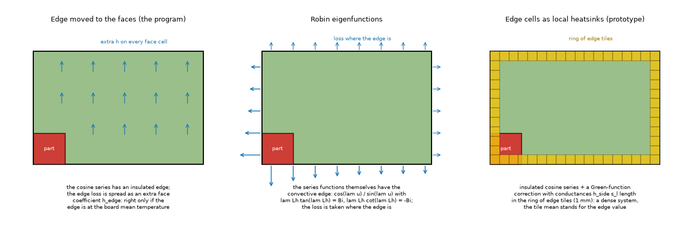
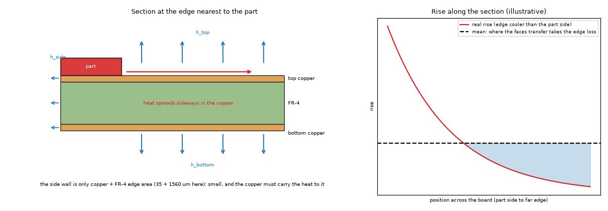
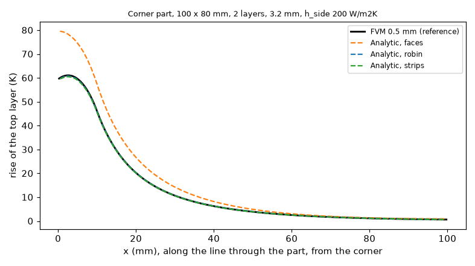
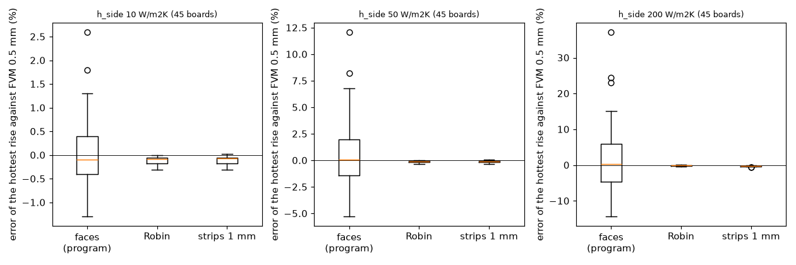
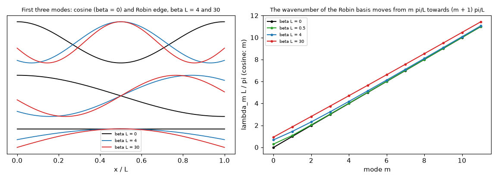
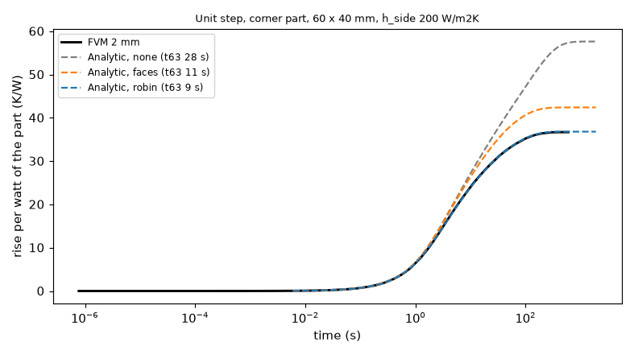
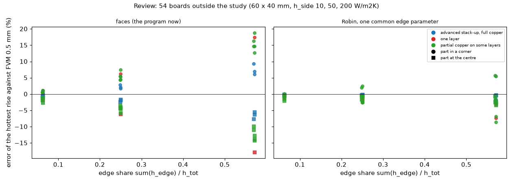

# Analytic model: a spatial treatment of the convective board edge

## 1. Question

The Analytic model (`pcbthermal/analytic.py`, `docs/theory.md` 6) expands every layer in cosines, which have an insulated edge. Since `fix/analytic-edge-transfer` the edge loss
is moved to the faces, `h_edge,l = h_side P s_l / (W H)` (Muzychka, Culham and Yovanovich 2003, Part II, eq. 27 to 29), which is exact only if the edge is at the
board mean temperature. With a part in a corner or a large `h_side` the hottest rise reads up to +37 % (part at the edge) or -14 % (part at the centre) against the FVM.
Can a spatial treatment of the edge enter 2.5.0 without delaying it?

Three treatments are compared on the same steady solver (a copy of the program's, `lib/analytic_edge.py`, equal to `analytic.solve_steady` to 1e-9 K):

* **faces**: the program now.
* **none**: the edge left out.
* **robin**: the cosine basis is replaced by the eigenfunctions of the **convective edge**, `phi'' = -lam^2 phi`, `phi' = +-beta phi` at the ends, `beta = h_side s / S`
  (`lib/robin_basis.py`; even functions `cos(lam u)`, `lam Lh tan(lam Lh) = beta Lh`, odd functions `sin(lam u)`, `lam Lh cot(lam Lh) = -beta Lh`). Everything else is unchanged:
  the layers still decouple by mode into the tridiagonal `L x L` system, only `(m pi/L)^2` becomes `lam_m^2`, the cosine norm `L/eps_m` becomes the norm of the function, and
  the projections and evaluations use the new functions. One `beta` is common to all layers (`beta = h_side sum(slab) / sum(S)`, which keeps the total edge conductance).
* **strips**: the reviewer's prototype, the edge cells as local heatsinks in the Green-function correction (insulated cosine basis), tiles along the outline.

*Figure 1 (`figures/fig_01_edge_treatments.png`): plan view with a part in a corner; the three treatments.*

*Figure 2 (`figures/fig_02_edge_section.png`): section at the edge nearest to the part, with the sideways heat path; the right panel is illustrative (the shape only).*

## 2. Published case reproduced (`scripts/study_muzychka_eq21.py`)

Equation 21 of Muzychka, Culham, Yovanovich Part II (rectangular flux channel with edge cooling, eigenvalues `delta tan delta = Bi_e`, read as an image of p. 4, the OCR text
being untrusted) is implemented in `lib/muzychka.py` and compared with an independent 3D finite-volume solver with side convection (`lib/layered3d_side.py`, tested against a
series circuit and an energy balance), 50 x 50 mm, 10 x 10 mm source, adiabatic top outside it, `h` = 100 W/m2K, 24 cases (k 50 and 385 W/mK, t 0.2, 1, 3 mm, `h_e` 0, 50, 200, 1000):

| quantity | result |
| :-- | :-- |
| equation 21 against the 3D solver | -0.16 to +1.06 % (k 50), -0.07 to +0.28 % (k 385) |
| thin-sheet series of the Robin basis (what the Analytic solves) against equation 21 | -0.03 to -0.59 % at tau = t/sqrt(A_s) up to 0.1; up to -6.1 % at tau 0.3, k 50, Bi_e 0.5 |

So the formula as printed holds, and the Robin basis is its fin limit; the gap at large tau is the through-thickness variation that no layered model has. The paper prints
no table for the rectangle (the 2006 journal version has plots for the disc only), so the numerical reproduction is against the independent solver. It treats a centred source
(even functions only); the board needs the odd functions too, which the code has.

## 3. Uniform boards (`scripts/study_edge_variants.py`)

135 boards: 30 x 20, 60 x 40, 100 x 80 mm; (layers, mm) 2 x 0.8, 2 x 1.6, 2 x 3.2, 4 x 1.6, 6 x 1.6; `h_side` 10, 50, 200; a 10 mm, 2 W part at the centre, a corner or the middle
of an edge; faces 10 W/m2K. Hottest rise against the FVM at 0.5 mm:

| treatment | mean abs. error | max abs. error | signed range | mean time |
| :-- | --: | --: | --: | --: |
| none | 38.2 % | 252 % | +0.1 to +252 % | |
| faces (program) | 3.36 % | 37.2 % | -14.4 to +37.2 % | 0.04 s |
| **robin** | **0.12 %** | **0.32 %** | -0.3 to +0.2 % | 0.05 s |
| strips, 1 mm tiles | 0.17 % | 0.65 % | -0.6 to +0.1 % | 0.5 s (max 3.3 s) |

By `h_side`: faces max 2.6, 12.1 and 37.2 % at 10, 50, 200 W/m2K; Robin 0.31, 0.32, 0.32 %. The Robin energy balance (faces plus edge) over the power is 1.0000 on every board.
Against the independent 3D solver (117 boards that fit 2 GB) the FVM is 0 to 17.4 % low, and the Robin Analytic 0.1 to 17.2 % low: what is left is not the edge treatment
of the Analytic. **Corrected by the review (8.4)**: it was put down to "the layered idealisation (one node through the thickness)"; measured, most of it is the FVM's laminate rule,
which puts no laminate node where both copper layers are full, so the edge loss of the laminate slab leaves at the copper temperature (switching the nodes on brings a
60 x 40 mm, 3.2 mm board at `h_side` 200 from -15.1 % to -4.4 % of the 3D solver). The Robin Analytic reproduces the FVM's idealisation, not the 3D solid.

*Figure 4 (`figures/fig_04_profile_corner.png`): top layer through a corner part, 100 x 80 mm, 3.2 mm, `h_side` 200; faces reads 80 K at the part against 61 K.*

*Figure 5 (`figures/fig_05_errors_by_treatment.png`): the errors of the 135 boards.*

*Figure 3 (`figures/fig_03_robin_modes.png`): first modes (cosine, Robin beta L = 4 and 30) and the wavenumbers; the Robin ones move up to (m+1) pi/L as the edge cools.*

### 3.1 The strips prototype (`scripts/study_strip_sensitivity.py`, 16 boards)

| variant | mean abs. | max abs. | time |
| :-- | --: | --: | --: |
| strips 5 mm, 64 modes | 1.46 % | 3.95 % | 0.05 s |
| strips 2.5 mm | 0.62 % | 1.73 % | 0.06 s |
| strips 1 mm (64 or 150 modes) | 0.27 % | 0.65 % | 0.13 to 0.22 s |
| robin | 0.13 % | 0.32 % | 0.04 s |

The tile size, not the mode count, sets the error (the tile mean stands for the edge value); a 1 mm ring needs a dense `Nt L` system (356 tiles x 6 layers on 100 x 80 mm) and
shares no grid with the via tiles. The Robin basis has no tile.

## 4. Unequal layers, vias, heatsinks, the example board (`scripts/study_edge_complications.py`)

**A. Unequal copper** (60 x 40, 4 layers, 16 boards, fills (1,1,1,1), (.5,1,1,.5), (.3,1,1,1), (.2,.2,1,1)). One `beta` for all layers is exact only when `slab_l/S_l` is the same;
the spread of that ratio is 1, 1.95, 3.14, 4.53 and the Robin error is up to 0.2, 1.2, 3.2, 5.4 % (faces: 8.1, 9.9, 10.3, 13.2 %). Moving the mismatch to the faces ("robin_res") gives
up to 4.0 % (better in the corner, worse at the centre). Two other rules for the common parameter, least squares and the heater layer, are worse (up to 12 and 30 %): the
flux-conserving one stays. Robin is better than faces in all 16. **The review (8.3) found larger errors outside these 16 boards** (up to -8.6 % on a two-layer board with full top and partial
bottom copper, -7.3 % on a one-layer board) and that the spread of `slab/S` does not predict them; the warning rule of `INTEGRATION.md` was replaced.

**B. Vias and heatsinks** (60 x 40, 2 layers, 3 x 3 vias and/or a 20 x 20 mm heatsink, centre and corner, `h_side` 50 and 200, 12 boards): rise error faces up to 15.4 %, Robin
up to 0.25 %; error of the via/heatsink effect faces up to 30.4 %, Robin up to 4.6 % (the via model's own error, the same at `h_side` 0). The copy with faces equals the program to 3e-14 K.
Example board (100 x 80, partial top copper, 9 vias, heatsink), hottest rise against FVM 0.5 mm: `h_side` 10 / 50 / 200: faces -1.3 / -2.6 / -6.9 %, Robin -1.0 / -1.2 / -1.9 %
(the rest is the partial copper, present at `h_side` 10).

**C. Time** (uniform 2 x 1.6 mm boards, 12 cases). Time to 63 % of the unit step, FVM 2 mm cell as reference:

| treatment | error range |
| :-- | :-- |
| program now (faces) | -31.1 to +38.5 % |
| Robin | -3.3 to +6.0 % (nine of 12 within 2 %) |

The Robin step response differs from the FVM one by at most 1.5 % of the steady resistance, and its steady resistance is within 1.5 % of the FVM (faces: up to 23 %). The same modal machinery works because
the basis is common to the layers.

*Figure 6 (`figures/fig_06_step_response.png`): unit step, corner part, 60 x 40 mm, `h_side` 200.*

## 5. Impact on the frozen boards and outlines (`scripts/study_frozen_impact.py`)

On the harness boards that have an edge coefficient (all at 10 W/m2K) the Robin Analytic moves +0.29 to +0.70 % (10 boards, 2 mm frozen cell, equivalent rectangle for outlines, the
round and T outlines +0.44, +0.52) and -0.04 % on the part across the outline (11 boards); the error against the FVM improves or stays on every board (those with errors of -7 and -31 % are the copper
and T-arm limits, unchanged). The top-path and block boards are not covered by the copy. Boards without `h_side` are bit-identical (beta = 0 returns the cosines).

## 6. Verdict

* **Robin basis**: fits 2.5.0. Cost is nil (600 roots in 2 ms, same matrices), the error against the FVM is within 0.35 % on 135 uniform boards and 12 via/heatsink boards, the time
  response improves from -31/+38 % to -3/+6 %, it removes the warning's reason to exist for the uniform-copper case, and the faces transfer it replaces was merged in this release
  and never shipped, so the Analytic frozen numbers shift once (the second shift costs nothing extra now; after the release it is a visible change).
* **Strips as heatsinks**: not recommended (needs 1 mm tiles, 10 times the time, a dense system that grows with the perimeter and the layers, shares no grid with the via tiles).
* **Limit that stays**: unequal layers and one-layer boards with a large edge share: up to 8.6 % (the review, 8.3; first written as "up to 5 % above a spread of 3", which the
  review did not confirm: the spread is high on every advanced stack-up, where the error is at most 2.2 %, and low (1.9) on a two-layer board with 6.9 %); a warning, not a fix
  (a per-layer basis would couple the modes). The rule of the warning is in `INTEGRATION.md` 1.6, as corrected by the review.
* **Not changed**: copper not uniform, outline (equivalent rectangle), the layered idealisation at thick boards (up to 17 % low against the 3D solid, existing warning).

`INTEGRATION.md` has the exact changes.

## 7. Tests

`tests/test_analytic_edge.py` (19; the review added the roots for any edge parameter (9 cases) and the continuity to the insulated board): orthogonality and Robin condition of the basis, beta = 0 is the cosine, the copy equals the program (uniform and example board with vias and
heatsinks), the "none" copy equals the insulated board, the Robin energy balance, the series against 1D finite differences, the 3D solver's balance and series circuit, equation 21
against the 3D solver and the thin-sheet limit, the step response ends at the steady resistance. Run: `.venv/bin/python -m pytest -q research/analytic-edge-spatial/tests`.

## 8. Review

Independent review of the folder (the `reviewer` agent), on the branch merged with `develop` (the physics of the program unchanged since `2f3bd73`). Verdict: **go** for the Robin
basis in 2.5.0, with the corrections below written into `INTEGRATION.md` (the warning rule, the root finding, the pending file, the extra tests). Script of the review:
`scripts/study_review_checks.py` (parts 1 to 4); figure 7.

### 8.1 Re-run

Every study of the folder was re-run: `study_edge_variants.py` (135 boards: faces mean 3.36 %, max 37.18 %; Robin 0.12 %, 0.32 %; strips 0.17 %, 0.65 %; FVM against 3D -17.4 to
-0.0 % on 117; balance 1.0000), `study_muzychka_eq21.py` (the 24 rows to the digit), `study_frozen_impact.py` (the 11 boards, +0.29 to +0.70 % and -0.04 %),
`study_edge_complications.py` (A: 13.2 / 5.42 / 3.99 %; B: 15.4 / 0.25 %, effect 30.4 / 4.6 %; example board -1.00 / -1.20 / -1.92 %; C: program -31.1 to +38.5 %, Robin -3.3 to
+6.0 %): all reproduced. Only the run times differ (strips mean 0.4 s, max 2.2 s against 0.5 s and 3.3 s; they depend on the load of the machine).

### 8.2 The series, checked independently

* **Basis** (part 1): orthogonality and norms by quadrature to 1e-9 for `beta` 1e-3 to 1e5 1/m; the first 50 wavenumbers equal the eigenvalues of a 4000-cell 1D finite-difference
  Laplacian with the Robin end to 6e-5 (its second-order error). The eigen-equations were re-derived (even `lam tan(lam Lh) = beta`, odd `lam cot(lam Lh) = -beta`), and equation
  21 of the paper re-derived from its equations 13 to 20 (norm `(c / 2 delta)(delta + sin(2 delta) / 2)`, projection `sin(delta a / c) / lam`): `lib/muzychka.py` is that formula.
* **Defect in the prototype, corrected**: `Basis` failed (no sign change for `brentq`) below `beta Lh` of about 1e-9 times the highest root, i.e. `h_side` near 3e-7 W/m2K on a
  60 x 40 mm, 1.6 mm board, and above `beta Lh` of about 1e12. The roots are now found on the pole-free forms `d sin d - bl cos d` and `d cos d + bl sin d`, with the first-order
  asymptote when the root sits at an end of its interval to rounding (`lib/robin_basis.py`, two regression tests); the program needs the same (`INTEGRATION.md` 1.1). 1200 roots
  take 8 ms. A vanishing `h_side` tends to the insulated board linearly (tested).
* **The same sheets solved by another method** (part 2): the sheet conductances, gaps and slabs of `analytic._effective_sheet` in a 2D finite-difference solver written for the
  review, with the true per-layer Robin edge `h_side s_l` (not the common `beta`): the Robin series is within -0.003 to -0.21 % of the extrapolated solution on five uniform boards
  (2, 4, 6 layers; corner, edge and centre parts; `h_side` 50 and 200), energy balance 1.00000. This checks the projections, the norms, the evaluation and the coupling of the layers
  without the FVM.
* **`lib/layered3d_side.py`** against a closed form written for the review: a 1D fin (a strip one cell wide, uniform heating, films on the faces, the sides and both ends,
  `theta = theta_inf (1 - C cosh(m u))`): 1.9e-3, 9.8e-4, 4.9e-4 at 1, 0.5, 0.25 mm (first order: the strip is one cell wide), energy balance 1.00000000; a near-isothermal plate
  equals `P / (2 h A + h_s P_e t)` to 1e-7.
* Bit-identical at `h_side` None and 0 (0.0 K against `analytic.solve_steady`); `n_terms` 60 / 120 / 300 / 600 agree within 1.4 mK at `beta` 5.8, 58 and 580 1/m (corner part).

### 8.3 Boards outside the study (part 3, figure 7)

*Figure 7 (`figures/fig_07_review_unequal_layers.png`): error of the hottest rise against the FVM at 0.5 mm, faces (left) and Robin (right), against the edge share, for the advanced
stack-ups with full copper, boards with partial copper on some layers and one-layer boards (60 x 40 mm, `h_side` 10, 50, 200).*

| boards (60 x 40 mm, part centre / corner, `h_side` 10 to 200) | `slab/S` spread | `S` max/min | faces, max abs. | Robin, max abs. |
| :-- | --: | --: | --: | --: |
| advanced stack-ups 4, 6, 8 layers, full copper | 7.6 to 9.8 | 2.1 to 2.2 | 9.4 % | 2.2 % |
| advanced 4 layers, fills (0.4, 1, 1, 0.4) | 4.0 | 1.2 | 14.6 % | 1.7 % |
| advanced 4 layers, fills (0.2, 0.2, 1, 1) | 36 | 7.7 | 16.2 % | 5.8 % |
| 2 layers, top full, bottom 0.2 | 4.2 | 4.2 | 14.7 % | 8.6 % |
| 2 layers, top full, bottom 0.5 | 1.9 | 1.9 | 12.7 % | 6.9 % |
| 2 layers, top 0.2, bottom full | 4.2 | 4.2 | 18.8 % | 5.5 % |
| 1 layer | 1 | 1 | 17.8 % | 7.3 % |

The largest errors are at `h_side` 200 (edge share 0.57) with the part in the corner; at `h_side` 50 (share 0.25) Robin stays within 2.6 %, at 10 (share 0.06) within 2.0 % (the rest
is the copper weighting, present without an edge). **Robin is better than faces on all 54 boards**, but on the two-layer boards with full top copper and on one-layer boards it reads
**cool** (the unsafe side) where faces read hot in the corner. The spread of `slab/S` does not predict the error: it is 7.6 to 9.8 on the advanced stack-ups with full copper (thin
inner copper, thin outer prepreg), where the error is at most 2.2 %, and 1.9 on the two-layer board with 6.9 %. Neither `robin_res` (up to 7.3 %) nor a common `beta` weighted by the
edge temperature of each layer (three passes, up to 7.5 %) removes it.

### 8.4 Where the rest of the error sits (part 4)

* **The FVM's laminate rule at the edge** (a limit of the program, FVM and FDM): the sub-gap nodes of `laminate.py` are made only where the copper of an adjacent layer is not
  full, so on full copper the edge loss of the laminate slab leaves at the copper temperature. A fill of 0.9999 on every layer (0.01 % less copper) switches the nodes on and the
  hottest rise jumps: +0.29 % (2 x 1.6 mm, `h_side` 10, corner), +1.20 % (3.2 mm, `h_side` 10), +4.12 % (1.6 mm, `h_side` 200), +12.6 % (3.2 mm, `h_side` 200). Against the 3D
  solver with the side film the FVM goes from -0.3 / -1.4 / -6.3 / -15.1 % to -0.0 / -0.2 / -2.5 / -4.4 % on those four boards. So the gap to the 3D solid in section 3 is mostly
  this rule, not the one node through the thickness. Not part of this change; proposed for an investigation (`research/ROADMAP.md` A16).
* **The common `beta` alone**: against the FVM with one laminate node per gap (`laminate_n_max = 1`, the Analytic's idealisation) Robin is -5.2 % (top full, bottom 0.2), +10.0 %
  (top 0.2, bottom full), -3.2 % (top full, bottom 0.5), +5.9 % and +3.6 % (four layers, A), -2.0 % (advanced, full) at `h_side` 200 in the corner; faces +9.4 to +23.9 % on the same.
  So both causes count on the two-layer boards: the common `beta` and the laminate nodes of the FVM where the copper is partial.
* **One-layer boards**: the Analytic puts the laminate in series with the bottom film and gives the edge of the whole slab to the copper node; the FVM has laminate nodes with their
  own edge: -7.3 % at `h_side` 200, -2.5 % at 50.

### 8.5 Findings and what was corrected

| finding | class | evidence | done |
| :-- | :-- | :-- | :-- |
| root finding fails at very small and very large `beta` | defect in the study library | part 1; `test_basis_roots_any_beta` | corrected in `lib/robin_basis.py`, tests added; `INTEGRATION.md` 1.1 |
| unequal-layer limit "up to 5.4 % above a spread of 3" | wrong claim | part 3: 8.6 % at spread 4.2, 6.9 % at 1.9, 2.2 % at 9.8 | README 4, 6 and `INTEGRATION.md` 1.6 corrected |
| warning rule on the spread | wrong rule | the same | replaced by a rule on the edge share and the sheet conductances (`INTEGRATION.md` 1.6), to be calibrated |
| one-layer boards not studied | limit to record | parts 3 and 4: -7.3 % | recorded; `INTEGRATION.md` 1.6 and 4 |
| the gap to the 3D solid put on the layered idealisation | wrong explanation | part 4: the laminate rule, -15.1 % to -4.4 % | README 3 corrected; ROADMAP A16 |
| FVM jump between fill 1 and 0.9999 with an edge coefficient | limit of the program (FVM, FDM) | part 4: +0.3 to +12.6 % | recorded, not changed here |
| "the records are already held by the pending file" | incomplete | `tests/regression/data/pending/analytic-edge.json` holds the faces values | `INTEGRATION.md` 3: the file is regenerated with the Robin values |
| the text for the documents quoted eq. 21 against 3D as 0.06 to 1.06 % | stale number | README 2: -0.16 to +1.06 % | `docs/for-the-project-documents.md` corrected |
| `lib/muzychka.py` and `lib/robin_basis.py` said eq. 21 was read as an image | wrong status | the README says the OCR text layer | docstrings corrected; bibliography entry added |

### 8.6 Not verified by the review

Boards with metal blocks and the top-path split under Robin (the copy has neither); the transient with vias and heatsinks (the copy's step response has no via calibration);
imported copper (merged into `develop` after the study; the Analytic warns on it); boards with an outline other than the two frozen ones; the time response against an FVM finer than
2 mm; the page of eq. 21 as an image (only the OCR text layer and the derivation).

## What was read and what was not verified

* **Muzychka, Culham, Yovanovich 2003 Part II (AIAA 2003-4188)**: pages 3 to 5 (eq. 6 to 31) read from the local page OCR (untrusted; the page was not seen as an image in this
  investigation); eq. 21 re-derived by the reviewer from eq. 13 to 20 and checked numerically against an independent solver (status R for eq. 12 to 21 as an OCR reading confirmed by
  the derivation, reproduced; `research/theory/BIBLIOGRAPHY.md` [Muzychka2003Part2]). Its eq. 18 as OCR'd is not dimensionally consistent (`beta t` over `h t / k + beta tanh`); the
  dimensional form `(beta + (h/k) tanh(beta t)) / (h/k + beta tanh(beta t))` of eq. 24 is used. The paper's own plots/tables for the rectangle: none printed; not reproduced.
* **Muzychka, Yovanovich, Culham 2006 (J. Thermophys. Heat Transfer)**: text extraction read around the edge-cooling section (S; the disc results are plots, not reproduced).
* **Sturm-Liouville eigenfunctions with Robin ends**, Carslaw and Jaeger: from memory (M); the eigenfunctions are verified numerically (orthogonality, boundary condition, 1D finite differences).
* Not verified: boards with metal blocks (the copy has none), the top-path split, the Lumped model (no analogue), a real measured board, the effect of `n_terms` below 300 on the Robin
  basis (tests use 120; the review checked 60 to 600 on three boards, 8.2), the frozen-number refreeze itself (an estimate from 11 boards at 2 mm), partial copper with an edge
  across the heater. The review's own limits are in 8.6.
