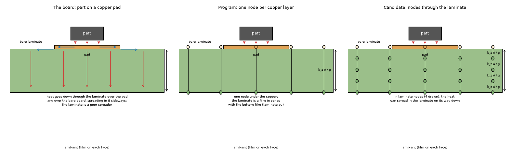
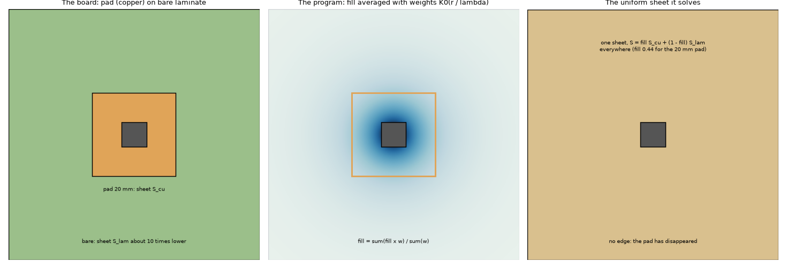
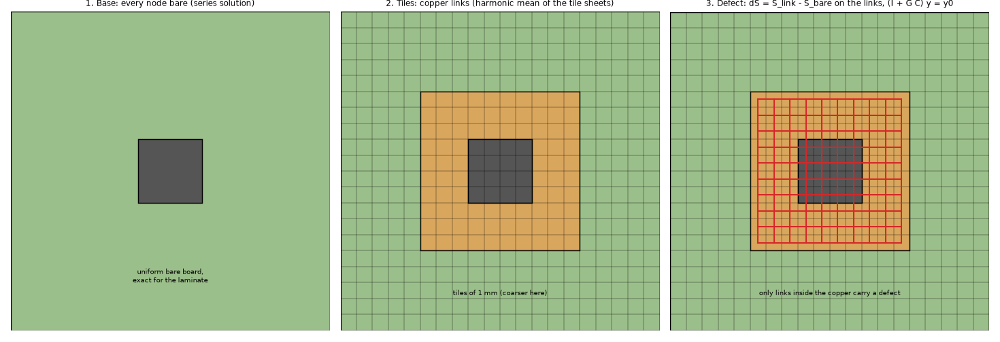
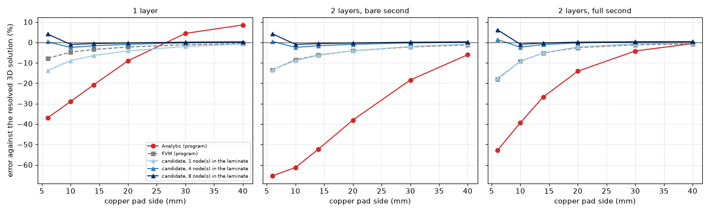
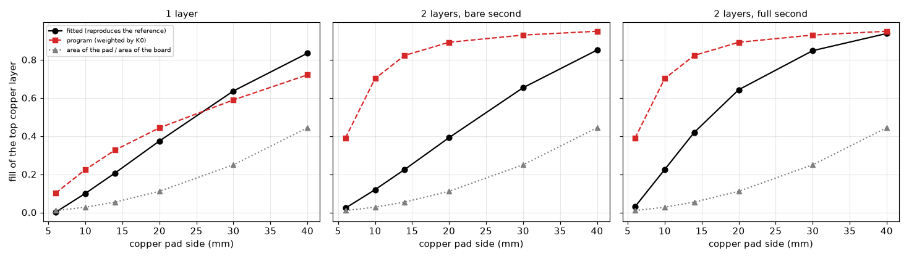
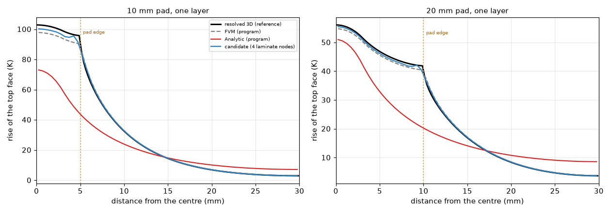
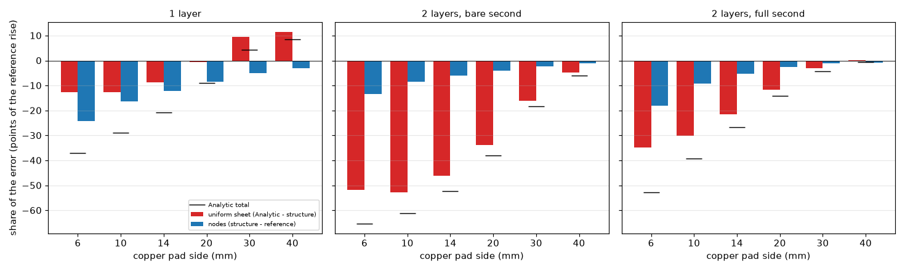
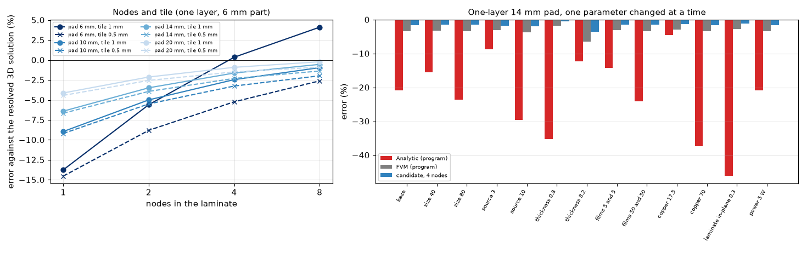

# Why the Analytic model is far from a 3D solution on a copper pad over bare laminate (A2)

Status: **studied, awaiting the reviewer.** Branch `research/analytic-partial-copper`. Nothing in `pcbthermal/`, `tests/`, `examples/` or the project documents is edited; the candidate lives in `lib/defect.py` and is measured on a copy.

**Question.** The Analytic model (`pcbthermal/analytic.py`) is far from a resolved 3D solution on a board whose copper is a pad on bare laminate (`power-calculator` 4.7; `research/effective-conductivity` 4.11: -28.8 % on a one-layer board with a 20 mm pad; `research/gap-subdivision` README 3.2: -67 to +1 % on its two-layer pad boards). Which of three candidate causes is it: (1) the copper weighting and the **uniform sheet** it produces, (2) the **laminate** treatment (a film in series with the bottom film on a one-layer board, one node per copper layer on a multilayer one), (3) the **Green-function or Fourier truncation** at the pad edge? Is there a better estimate within the model, or is it a limit to state and warn about?

**Answer in short.**

* **(3) is not a cause, because the series has no pad edge.** The Analytic solves one *uniform* sheet per layer; the pad enters only through a single number, the fill averaged with weights `K0(r / lambda)` around the heaters. Doubling the number of modes (300 to 600) moves the peak by 8e-6 relative, halving the sampling cell by 0.2 % (section 4.1).
* **(1) and (2) both matter, and the first dominates on multilayer boards.** With the copper exact and the Analytic's own nodes (the program's FVM with one node per copper layer, and for a one-layer board one laminate node and the laminate in series with the bottom film) the error splits into the cost of the uniform sheet and the cost of the nodes (section 4.3). On a one-layer board with a 10 mm pad (reference 102.8 K): Analytic -28.9 % = **-12.6 points** (sheet) **-16.3 points** (nodes). On two layers with a bare second layer and the same pad (the same physical board): Analytic -61.2 % = -52.8 (sheet) -8.5 (nodes).
* **The result depends on how the same board is entered.** The same physical board entered as one layer or as two layers with a bare second one gives 73.1 K or 39.9 K (10 mm pad), up to **1.8 times** apart, because the weights use a length `lambda_l = sqrt(S / (h + g_adjacent))` that changes when the vertical path is a gap conductance instead of a film (section 4.4). The error is a **shortfall** (the model is too cool) for pads up to 20 mm and an **excess** (+4.4 and +8.6 %) for one-layer pads of 30 and 40 mm; the roadmap called it "hot", which is the other sign.
* **No fill value fixes it.** The fill that makes the uniform sheet reproduce the reference (`f*`) is neither the program's weighted fill nor the pad's area fraction, and it moves with the board (section 4.2).
* **A better estimate exists in the same machinery** (section 5): put the laminate nodes through the thickness into the modal system, solve the series for a board of bare nodes, and put the copper back as extra lateral conductance on the links between tiles, through the Green-function (Woodbury) system the program already uses for vias (`(I + G C) y = y0`, `C` the lateral Laplacian of the added conductance). It follows the FVM with the same nodes (within 0.4 % on the one-layer 10 and 20 mm pads for 1 to 8 nodes; 0.6 to 0.7 % on the small board of the test), reaches **-0.9 to -3.4 % with 4 and 8 nodes** on pads of 10 to 20 mm at a converged tile (the layered limit, like the FVM with the same nodes), and on the 52 pad rows of the common baseline of `gap-subdivision` (graded 3D references) the program's Analytic is -66.7 to +1.3 % (mean absolute 17.9 %) while the candidate with 4 nodes is -2.9 to +2.1 % (mean 0.83 %, 46 rows where it runs). Boards with copper everywhere do not change (0.3 points at most).
* **Limits of the candidate** (section 5.4 to 5.6): the tile must be at most a sixth of the part (three tiles across overshoots by 13 to 18 %); a part as small as its pad is -5 % with four nodes at a converged tile; a part over a 6 mm window in full copper is -6 % (the FVM is -20 %, the Analytic -57 %); heaters on the first layer only; vias, blocks and the transient are not combined with it.
* **Cheaper fallback:** the program's input warning ("copper coverage varies strongly around the heaters", spread above 0.25) fires on 16 of the 18 pad boards of section 4 (errors -65.3 to +8.6 %), and the two it misses are -6.0 and -0.6 %; it does not say how large the error can be (section 6).

## Scripts and files

| Script | Question | Output |
| :-- | :-- | :-- |
| `scripts/study_baseline.py` | The five models on 20 pad boards (one layer; two layers with a bare or a full second layer; pads of 6 to 40 mm and full copper) against the independent solver; the cell convergence of the reference | `data/baseline.csv` |
| `scripts/study_causes.py` | Truncation of the series, parity of the copy, the fill that reproduces the reference, the structure with exact copper, the split of the error, the warning | `data/causes.csv` |
| `scripts/study_candidate.py` | The candidate: nodes, tiles, the opposite construction, out-of-sample cases, off-centre pads, two pads, a window, the board of `effective-conductivity` 4.11 | `data/candidate_*.csv` |
| `scripts/study_rows.py` | The candidate on the 52 pad rows and the 44 uniform rows of `research/gap-subdivision/baseline` | `data/rows_pads.csv`, `data/rows_uniform.csv` |
| `scripts/make_diagrams.py`, `scripts/make_figures.py` | Figures 01 to 03 (drawings) and 04 to 08 (data) | `figures/` |
| `lib/pads.py` | The designed boards, the program's Problem, the reference | |
| `lib/general.py` | Boards that are not symmetric (off-centre pads, two pads, a window) and their whole-board reference | |
| `lib/modal.py` | A copy of the modal solution of the Analytic with the sheet conductances given from outside (equals the program to 2e-16) | |
| `lib/defect.py` | The candidate (nodes through the laminate, copper as a lateral defect on a bare base) | |
| `lib/strip.py` | The closed form of a heated strip with a step in the sheet conductance | |
| `tests/` | `test_modal_defect.py` (8 tests: the copy equals the program, the candidate equals the program on uniform boards, follows the FVM and conserves energy, beats the program on a pad, the tile rule and size limit, the coarse-tile overshoot, the reference converges) and `test_strip.py` (2 tests: the solver against the closed form of the strip, its limits) | |

Run from the repository root with `.venv/bin/python research/analytic-partial-copper/scripts/<script>.py` (the first four in that order; the references are cached in `out/`, git-ignored). Tests: `.venv/bin/python -m pytest -q research/analytic-partial-copper/tests` (10 pass).

## 1. The situation

*Figure 1 (`figures/fig_01_part_on_a_pad_section.png`): a part on a copper pad over bare laminate. Left: the heat spreads in the pad (strong, blue) and goes down through the laminate over the pad and over the bare board, spreading in the laminate sideways only weakly (red arrows are the vertical paths). Middle: the program's nodes, one per copper layer, with the laminate of a one-layer board as a film in series with the bottom film (`pcbthermal/laminate.py`). Right: the candidate, n laminate nodes (4 drawn).*

*Figure 2 (`figures/fig_02_uniform_sheet_against_the_pad.png`): top view of the 20 mm pad on a 60 mm board (left), the weights of the fill average (middle: `K0(r / lambda)` around the part, lambda drawn as 12 mm, illustrative) and the uniform sheet the Analytic solves instead (right): one sheet with fill 0.444 for this pad everywhere, so the pad has no edge.*

*Figure 3 (`figures/fig_03_nodes_and_tiles_of_the_candidate.png`): the candidate. The series is solved for a bare board; the copper that the tiles carry is put back as extra conductance on the links between tiles (red), with the tile Green-function system.*

### 1.1 What the program does (read from `analytic.py` and `laminate.py`)

* Each copper layer is one sheet of conductance `S_l = fill k_cu t_c + k_lam (slab - fill t_c)` (W/K), coupled to its neighbours through `g = k_z / d` and to the ambient through `h_top`, `h_bottom`; the cosine series gives `a_mn` from a small `L x L` system per mode (`solve_steady`).
* `fill` is the copper fill of the layer **averaged with the weights** `sum_h P_h K0(r / lambda_l)` over the cells (`_effective_sheet`); `lambda_l = sqrt(S_mean / (h_surface + g_adjacent))` for a layer with a heater (the vertical coupling shortens it), `sqrt(S_mean / h_tot)` for the others. A **warning** is added when the spread of the fill under that weight exceeds 0.25.
* A one-layer board has one node; the laminate is a film in series with the bottom film (`laminate.series_bottom_problem`): `h_b' = 1 / (1/h_b + t_lam / k_z)`. `laminate.py` says extra nodes made the uniform-sheet estimate of a small pad worse (-51 % against -30 %); this was not reproduced here.
* Vias and heatsinks are added after the uniform solution through a tile Green-function (Woodbury) system; patterned copper is **not**.

## 2. The boards and the references

Boards (`lib/pads.py`): 60 x 60 mm, 1.6 mm, copper 35 um, FR-4 0.3 W/mK through and 0.9 in the plane (the program's), a 6 x 6 mm part of 1 W in the centre, films 10 (top) and 15 W/m2K (bottom), no edge loss, a centred square pad on the top layer of 6, 10, 14, 20, 30 or 40 mm or full copper. Three kinds: **one layer**; **two layers with a bare second layer** (physically the same board as the one-layer one, with the laminate cut at the middle); **two layers with a full second layer**. The program's cell is 0.5 mm.

### 2.1 The reference and its checks

* The reference is the resolved 3D solver of `research/bare-spot-under-source/lib/resolved3d.py` (imports nothing from the program), on a quadrant, 0.25 mm cells, 8 sub-slabs through the laminate, the copper slab being laminate where there is no copper; the peak is the hottest 0.5 mm block of the source surface. All numbers of the board (copper, laminate, films) are read from the program's Problem.
* **Energy balance** closes to 1e-9 on every board (`ref_balance` in `data/baseline.csv`).
* **Cell convergence** (one layer, `study_baseline.py`): 10 mm pad 103.84 / 102.80 / 102.37 K at 0.5 / 0.25 / 0.125 mm, 20 mm pad 56.30 / 56.00 / 55.89 K. The differences fall by about 2.4 each time, so the 0.25 mm reference is about **0.4 to 0.7 % above the converged value** at these pads; every error quoted against it is that much too negative for a model below it. (The whole-board references of section 5.5 are at 0.5 mm: about 1 to 1.5 % high.)
* **A published case reproduced:** the solver reproduces Eq. 27 of Muzychka, Culham and Yovanovich (2003) for a rectangular source on a plate to +0.20 % at 0.1 mm (`research/bare-spot-under-source` 2.1; its four solver tests were re-run here and pass). **A closed form at a pad edge:** the heated strip of copper in a bare sheet (`lib/strip.py`, the fin equation with a step in the sheet conductance) against the solver, `tests/test_strip.py`: the rise next to the centre differs by 0.84, 0.67, 0.33 and 0.16 % at cells of 0.25, 0.2, 0.1 and 0.05 mm (first order in the cell, as the edge is under-resolved); the limits of the closed form (equal sheets: the infinite fin; a wide strip: `q / h`) are tested to 1e-9 and 1e-6. **No published numerical case of a part on a copper pad over bare laminate was found** (none in the repository either, `bare-spot-under-source` README 10).
* **The board of `effective-conductivity` 4.11** (one layer, 20 mm pad, laminate 0.3 / 0.3) is reproduced: independent 71.61 K (0.72 % below its 72.12 at 0.5 mm cells), FVM 70.32 K (-1.8 %, there -2.5 %), Analytic 51.33 K (-28.3 %, there -28.8 %): the quoted number holds on that board; with the program's laminate (0.9 in the plane) the same pad is **-9.0 %**, a hint of cause (1), section 4.4.
* The values of the 3D solid (+0.3 to +3.5 %) and of the other models are in section 3 for context; they are not the subject.

## 3. The five models on the pad boards

Error against the reference (reference rise in K in brackets; `data/baseline.csv`; cell 0.5 mm, program unchanged):

| Board | pad (mm) | ref (K) | FVM | FDM | Lumped | **Analytic** | 3D solid |
| :-- | --: | --: | --: | --: | --: | --: | --: |
| 1 layer | 6 | 161.9 | -7.8 | -17.1 | -5.1 | **-36.9** | +2.9 |
| 1 layer | 10 | 102.8 | -4.8 | -11.2 | -9.7 | **-28.9** | +1.7 |
| 1 layer | 14 | 76.1 | -3.4 | -8.2 | -12.6 | **-20.8** | +1.3 |
| 1 layer | 20 | 56.0 | -2.2 | -5.4 | -9.5 | **-9.0** | +0.9 |
| 1 layer | 30 | 41.5 | -1.1 | -2.8 | -6.6 | **+4.4** | +0.5 |
| 1 layer | 40 | 35.7 | -0.5 | -1.4 | -3.1 | **+8.6** | +0.3 |
| 1 layer | full | 32.7 | +0.1 | +0.1 | -1.4 | -1.2 | +0.2 |
| 2 layers, bare second | 6 | 161.8 | -13.4 | -20.7 | -11.2 | **-65.3** | +2.8 |
| 2 layers, bare second | 10 | 102.8 | -8.5 | -13.7 | -12.4 | **-61.2** | +1.7 |
| 2 layers, bare second | 14 | 76.1 | -6.1 | -10.1 | -14.4 | **-52.2** | +1.2 |
| 2 layers, bare second | 20 | 56.0 | -4.1 | -6.8 | -11.1 | **-38.0** | +0.8 |
| 2 layers, bare second | 30 | 41.5 | -2.2 | -3.6 | -7.5 | **-18.4** | +0.5 |
| 2 layers, bare second | 40 | 35.7 | -1.2 | -1.9 | -3.6 | **-6.0** | +0.3 |
| 2 layers, full second | 6 | 96.3 | -18.0 | -26.0 | -16.0 | **-52.9** | +3.5 |
| 2 layers, full second | 10 | 57.2 | -9.2 | -13.9 | -13.0 | **-39.3** | +1.7 |
| 2 layers, full second | 14 | 43.9 | -5.2 | -7.9 | -10.4 | **-26.7** | +1.0 |
| 2 layers, full second | 20 | 36.1 | -2.5 | -3.9 | -6.0 | **-14.1** | +0.5 |
| 2 layers, full second | 30 | 31.8 | -1.2 | -1.6 | -3.2 | **-4.2** | +0.3 |
| 2 layers, full second | 40 | 30.3 | -0.7 | -0.9 | -2.1 | **-0.6** | +0.2 |
| 2 layers, full second | full | 29.6 | -0.5 | -0.5 | -1.9 | -0.6 | +0.2 |

*Figure 4 (`figures/fig_04_error_against_pad_size.png`): error against the resolved reference of the program's Analytic (red), the FVM (grey) and the candidate of section 5 with 1, 4 and 8 laminate nodes (blues), against the pad size, on the three kinds of board. Data: `data/candidate_pads.csv`.*

* The Analytic is the model farthest from the reference on every pad board; on a board with copper everywhere it is within -1.2 %. The other layered models (FVM, FDM, Lumped) are low by up to 26 % on the smallest pad: that is the bare-laminate effect of `gap-subdivision` and `bare-spot-under-source`, **not repeated here**.
* The Analytic is **not always cool**: one-layer boards with 30 and 40 mm pads are +4.4 and +8.6 % (and the roadmap's "hot" was this), two-layer boards are always cool.
* The two-layer bare-second board is physically the one-layer board; the FVM differs by 1 to 6 points between them (one node and a film against two nodes), the Analytic by 20 to 36 points.

## 4. Separating the causes

`scripts/study_causes.py` on the 18 pad boards (the references from section 3). Parity: the copy of the modal solution in `lib/modal.py` equals `analytic.solve_steady` to 2e-16 relative on every board.

### 4.1 (3) The series: nothing to truncate

* The cosine series has **no pad edge**: the pad is one number (the fill). Raising the modes from 300 to 600 changes the peak by at most **8e-6** relative; halving the sampling cell (0.5 to 0.25 mm) by at most **0.21 %**. The source projection is exact for a rectangle. This candidate cause is excluded.
* (The tile Green-function machinery of the program, which does know edges, is used for vias and heatsinks only, with `Mg = Ng = 64` modes; it is not involved in a pad.)

### 4.2 (1) The fill: neither a rule nor a fit

`f*` is the fill of the top copper layer that makes the uniform sheet (`lib/modal.py`, `S` from the program's formula) reproduce the reference, found by root-finding (`fill_fitted`; for the 6 mm pad on a one-layer board it is 0.002, i.e. no copper at all: the pad is no larger than the part).

| Board | pad (mm) | program (weighted) | area of the pad / board | **fitted f\*** |
| :-- | --: | --: | --: | --: |
| 1 layer | 6 / 10 / 14 / 20 / 30 / 40 | 0.102 / 0.225 / 0.327 / 0.444 / 0.590 / 0.721 | 0.010 / 0.028 / 0.054 / 0.111 / 0.250 / 0.444 | 0.002 / 0.100 / 0.207 / 0.375 / 0.637 / 0.835 |
| 2 layers, bare second | the same | 0.390 / 0.702 / 0.823 / 0.892 / 0.930 / 0.950 | the same | 0.023 / 0.120 / 0.225 / 0.392 / 0.654 / 0.851 |
| 2 layers, full second | the same | 0.390 / 0.702 / 0.823 / 0.892 / 0.930 / 0.950 | the same | 0.031 / 0.225 / 0.420 / 0.643 / 0.848 / 0.938 |

*Figure 6 (`figures/fig_06_fill_that_reproduces_the_reference.png`): the fitted fill (black), the program's weighted fill (red) and the area fraction of the pad (grey) against the pad size, three kinds of board. Data: `data/causes.csv`.*

* The program's weighted fill is **1.0 to 17 times larger than f\*** on two layers (0.70 against 0.12 for a 10 mm pad on the bare-second board) and larger than f\* for pads up to 20 mm but **smaller** for the larger ones on one layer (0.59 against 0.64 at 30 mm): this is why the Analytic is cool on small pads and hot on large ones on a one-layer board.
* `f*` is not a function of the area fraction alone and differs between the two boards that share the top layer (bare second 0.120 and full second 0.225 at 10 mm), because the second layer changes how much the top sheet has to spread. No weight function of the same kind can be right for them all; and a single uniform sheet cannot have an edge in any case (Fig. 7).

*Figure 7 (`figures/fig_07_profile_through_the_centre.png`): rise of the top face along a line through the centre, one layer, 10 mm (left) and 20 mm pad (right): the resolved reference (black, with the step at the pad edge), the program's FVM (grey) and Analytic (red), and the candidate of section 5 with four laminate nodes (blue). The Analytic has no edge and is too cool under the part and too warm far away. The candidate's small wiggle near the edge (10 mm pad) is the tile discretisation of the defect.*

### 4.3 (1) and (2): the cost of the sheet and the cost of the nodes

The **structure with the copper exact** is the program's FVM with the nodes of the Analytic: one node per copper layer and, on a one-layer board, one laminate node whose laminate is a film in series with the bottom film (`laminate.LAMINATE_NODES` set to 0 in memory on `series_bottom_problem`). It is what a perfect treatment of the pad would give with the Analytic's nodes. Then (Analytic - structure) is the cost of the uniform sheet and (structure - reference) the cost of the nodes (points of the reference rise; `data/causes.csv`):

| Board | pad (mm) | Analytic total | cost of the sheet | cost of the nodes |
| :-- | --: | --: | --: | --: |
| 1 layer | 6 / 10 / 14 / 20 / 30 / 40 | -36.9 / -28.9 / -20.8 / -9.0 / +4.4 / +8.6 | -12.7 / -12.6 / -8.6 / -0.5 / +9.4 / +11.5 | -24.3 / -16.3 / -12.2 / -8.5 / -4.9 / -3.0 |
| 2 layers, bare second | the same | -65.3 / -61.2 / -52.2 / -38.0 / -18.4 / -6.0 | -51.9 / -52.8 / -46.1 / -33.9 / -16.1 / -4.8 | -13.4 / -8.5 / -6.1 / -4.1 / -2.2 / -1.2 |
| 2 layers, full second | the same | -52.9 / -39.3 / -26.7 / -14.1 / -4.2 / -0.6 | -34.9 / -30.1 / -21.5 / -11.6 / -3.0 / +0.2 | -18.0 / -9.2 / -5.2 / -2.5 / -1.2 / -0.7 |

*Figure 5 (`figures/fig_05_decomposition_of_the_error.png`): the same table as bars (red: the uniform sheet; blue: the nodes; the black tick is the Analytic total). Data: `data/causes.csv`.*

* On a **multilayer board the uniform sheet is the cause** (-52.8 of -61.2 points at a 10 mm pad with a bare second layer). On a **one-layer board** the nodes are the larger cost for pads up to 20 mm (-16.3 against -12.6 points at 10 mm, -24.3 against -12.7 at 6 mm) and the sheet changes sign above 20 mm (+9.4 and +11.5 points at 30 and 40 mm).
* **The nodes are the layered limit found by `gap-subdivision` and `bare-spot-under-source`** (bare laminate around a pad on a thick gap; it is also the FVM's error), and is removed by laminate nodes: the FVM of a one-layer 10 mm pad with 1, 2, 4 and 8 laminate nodes (`laminate.LAMINATE_NODES` in memory) is 93.95 / 97.86 / 100.26 / 101.70 K (reference 102.80), i.e. -8.6 / -4.8 / -2.5 / -1.1 %; the program uses 2.
* **What the "laminate in series" decision of `laminate.py` did**: it made the one-layer Analytic better than extra nodes *because the sheet's error is of the opposite sign*, not because the film is right: with the copper exact the film structure is 3 to 24 points low (one-layer boards, 40 to 6 mm pads), the program's FVM with two nodes -0.5 to -7.8 %. I did not run the uniform-sheet Analytic with laminate nodes (the `-51 %` of `laminate.py` is quoted, not reproduced).

### 4.4 (1) The same board entered two ways, and the laminate conductivity

* The one-layer board and the two-layer board with a bare second layer are the same physical board. Analytic peak (K): 102.1 / 56.2 (6 mm), 73.1 / 39.9 (10), 60.3 / 36.3 (14), 51.0 / 34.7 (20), 43.4 / 33.9 (30), 38.7 / 33.5 (40 mm), one layer against two; the reference is 161.9, 102.8, 76.1, 56.0, 41.5, 35.7. The weights use `lambda_l = sqrt(S_mean / (h_surface + g_adjacent))`; on two layers `g_adjacent` (about 196 W/m2K, 0.3 / 1.53 mm) makes `lambda` about 2.3 mm against about 8.7 mm for the one-layer node (hand-computed from the formula for the 10 mm pad, not printed by a script), so the fill under the weights is 0.70 against 0.225 for the same pad.
* The Analytic depends strongly on the laminate in-plane conductivity (out-of-sample table of section 5.3: -20.8 % at 0.9 W/mK, **-46.1 %** at 0.3 for a 14 mm pad; and the 20 mm pad is -9.0 % with 0.9 and -28.3 % with 0.3), because `S_lam` enters `lambda` and the fill average; the layered FVM changes by under 1 point.

### 4.5 Which warning fires

`analytic._effective_sheet` warns when the spread of the fill under the weights is above 0.25. It fires on 16 of the 18 pad boards (spread 0.26 to 0.50) and does not fire on the two-layer 40 mm pad boards (-6.0 % and -0.6 %). Every board with an error beyond 6.1 % in magnitude is warned (the unwarned two-layer 40 mm pad is -6.0 %). The warning text says the uniform-sheet assumption is weak and the FVM more reliable; it says nothing about the size or the sign (section 6).

## 5. A candidate: nodes through the laminate and the copper as a lateral defect on a bare base

`lib/defect.py`, measured on a copy; the program is not changed.

### 5.1 Construction

1. **Nodes**: every copper layer is a node (copper plus half of each adjacent sub-gap), and every laminate gap is cut into `n` sub-gaps with `n - 1` interior nodes (a one-layer board gets `n` laminate nodes under the copper, the last one holding half a gap and the bottom film: the construction of `laminate.py`); consecutive nodes are joined by `k_z / (gap / n)`. `n = 1` is the program's multilayer node set.
2. **Base**: the cosine series (the program's `_cos_projection` and heater sources) for a board in which every node has the sheet conductance of its **weakest tile** (the bare laminate where a copper layer has gaps).
3. **Copper as a defect**: on a square tile grid (tile size a parameter) every link between two tiles gets `dS = S_link - S_base >= 0`, `S_link` the harmonic mean of the two tile sheets (the FVM's rule), `S_tile = fill k_cu t_c + k_lam (slab - fill t_c)` with the fill of the tile from the program's `zone_fill`; the tile mean temperatures `y` solve `(I + G C) y = y0` (`G` the modal response between tiles, `C` the lateral Laplacian of `dS`: the **same system the program uses for vias**, with a lateral instead of a vertical `C`); the heat the defect injects, `f = -C y`, goes back to the modes. Energy balance closes (test).
4. **Why a bare base and not a copper one**: the discrete Laplacian of the tiles removes less than the continuous one at the wave numbers of a 6 mm part, so negative defects on a copper base converge slowly. Against the FVM with the same nodes (n = 1; 93.95 K on the 10 mm pad, 53.68 K on the 20 mm pad) the copper base is -17 / -8 % at 2 / 1 mm tiles (10 mm pad) and -6 / -4 % (20 mm pad), the bare base -8 / -0.4 % and +4 / 0.0 % (section 5.4, `data/candidate_tiles.csv`; the 2 mm values are the coarse-tile overshoot or undershoot of 5.4).

### 5.2 It is the same layered model as the FVM, and it beats the program's Analytic

Candidate with `n` nodes against the FVM with `n` laminate nodes (one layer, 1 mm tile; reference 102.8 K for 10 mm): 93.6 / 97.7 / 100.3 / 101.8 K against FVM 93.95 / 97.86 / 100.26 / 101.70 K; on a 20 mm pad 53.7 / 54.8 / 55.5 / 55.9 against 53.68 / 54.75 / 55.38 / 55.76 (reference 56.0); the test `test_candidate_follows_the_fvm_with_the_same_nodes` (24 mm board, 8 mm pad, 4 mm part, 0.5 mm tile) requires 1.5 % and measures -0.58 / -0.65 / -0.72 % for n = 1 / 2 / 4. Error against the resolved reference (%, `data/candidate_pads.csv`, 1 mm tile = a sixth of the part):

| Board | pad (mm) | Analytic (program) | n = 1 | n = 2 | n = 4 | n = 8 |
| :-- | --: | --: | --: | --: | --: | --: |
| 1 layer | 6 | -36.9 | -13.7 | -5.6 | +0.4 | +4.1 |
| 1 layer | 10 | -28.9 | -9.0 | -5.0 | -2.5 | -1.0 |
| 1 layer | 14 | -20.8 | -6.4 | -3.5 | -1.6 | -0.5 |
| 1 layer | 20 | -9.0 | -4.1 | -2.1 | -0.9 | -0.2 |
| 1 layer | 30 | +4.4 | -2.0 | -0.8 | -0.2 | +0.1 |
| 1 layer | 40 | +8.6 | -0.8 | -0.1 | +0.2 | +0.3 |
| 1 layer | full | -1.2 | -0.3 | -0.1 | -0.0 | -0.0 |
| 2 layers, bare second | 6 / 10 / 14 / 20 / 30 / 40 | -65.3 / -61.2 / -52.2 / -38.0 / -18.4 / -6.0 | -13.4 / -8.8 / -6.3 / -4.1 / -2.0 / -0.8 | -5.3 / -4.9 / -3.4 / -2.1 / -0.8 / -0.1 | +0.5 / -2.4 / -1.6 / -0.9 / -0.2 / +0.2 | +4.2 / -0.9 / -0.6 / -0.2 / +0.1 / +0.3 |
| 2 layers, full second | 6 / 10 / 14 / 20 / 30 / 40 | -52.9 / -39.3 / -26.7 / -14.1 / -4.2 / -0.6 | -17.6 / -9.3 / -5.0 / -2.2 / -0.7 / -0.2 | -6.4 / -4.9 / -2.5 / -0.9 / +0.0 / +0.3 | +1.4 / -2.3 / -1.0 / -0.2 / +0.3 / +0.4 | +6.2 / -0.9 / -0.3 / +0.1 / +0.3 / +0.4 |

The same physical board entered with one layer or with two and a bare second one gives the same answer (10 mm pad, n = 4: -2.5 and -2.4 %), where the program's Analytic gives 73.1 and 39.9 K: the **consistency failure of section 4.4 is removed**. On the board of `effective-conductivity` 4.11 (laminate 0.3 / 0.3, 20 mm pad): Analytic -28.3 %, FVM -1.8 %, candidate -3.6 / -1.8 / -0.7 % for n = 1 / 2 / 4 (`data/candidate_earlier_board.csv`).

*Figure 8 (`figures/fig_08_candidate_nodes_tiles_and_range.png`): left, the candidate's error against the number of laminate nodes for the four one-layer pads and two tile sizes (solid 1 mm, dashed 0.5 mm); right, the out-of-sample cases of 5.3 (red: the program's Analytic; grey: FVM; blue: the candidate with four nodes).*

### 5.3 Out of sample

One-layer 14 mm pad (reference 76.1 K), one parameter changed at a time; the candidate with 4 nodes and a tile of a sixth of the part (at most 1 mm); error against the reference (`data/candidate_out_of_sample.csv`):

| Case | ref (K) | Analytic | FVM | candidate, n = 4 | tile (mm) |
| :-- | --: | --: | --: | --: | --: |
| base | 76.1 | -20.8 | -3.4 | -1.6 | 1.0 |
| board 40 mm | 78.0 | -15.5 | -3.3 | -1.5 | 1.0 |
| board 80 mm | 76.0 | -23.6 | -3.4 | -1.5 | 1.0 |
| part 3 mm | 83.6 | -8.8 | -3.0 | -1.8 | 0.5 |
| part 10 mm | 70.9 | -29.6 | -3.8 | -1.9 | 1.0 |
| thickness 0.8 mm | 90.7 | -35.3 | -1.7 | -0.4 | 1.0 |
| thickness 3.2 mm | 65.3 | -12.2 | -6.4 | -3.6 | 1.0 |
| films 5 and 5 | 110.8 | -14.2 | -3.0 | -1.5 | 1.0 |
| films 50 and 50 | 39.8 | -24.0 | -3.5 | -1.5 | 1.0 |
| copper 17.5 um | 85.8 | -4.6 | -2.9 | -1.2 | 1.0 |
| copper 70 um | 70.1 | -37.4 | -3.4 | -1.7 | 1.0 |
| laminate in-plane 0.3 | 107.6 | -46.1 | -2.8 | -1.1 | 1.0 |
| power 5 W | 380.5 | -20.8 | -3.4 | -1.6 | 1.0 |

The candidate stays within -0.4 to -3.6 % on all 13 cases while the Analytic runs from -4.6 to -46.1 %. (The first version of this table used a 1 mm tile for the 3 mm part and was **+12.9 %**: the tile rule of 5.4 was found there and the row re-run.)

### 5.4 The tile and the number of nodes (the limit found)

* `data/candidate_tiles_nodes.csv`, one layer, 1, 0.5 and (pads 6 and 10) 0.25 mm tiles, n = 1 / 2 / 4 / 8 (error %): pad 6: -13.7 / -5.6 / +0.4 / +4.1, -14.5 / -8.8 / -5.2 / -2.6 and -14.5 / -8.8 / -5.5 / -3.6; pad 10: -9.0 / -5.0 / -2.5 / -1.0, -9.2 / -5.5 / -3.3 / -2.0 and -9.1 / -5.5 / -3.4 / -2.2; pad 14: -6.4 / -3.5 / -1.6 / -0.5 and -6.7 / -3.9 / -2.3 / -1.4; pad 20: -4.1 / -2.1 / -0.9 / -0.2 and -4.4 / -2.6 / -1.5 / -0.9. The 0.5 and 0.25 mm tiles agree within 0.2 points, so 0.5 mm is converged for a 6 mm part. **At the converged tile the candidate is below the reference and falls toward it as nodes are added** (like the FVM); the +0.4 and +4.1 % of the 1 mm tile at pad 6 are coarse-tile overshoot. **Use a converged tile: the converged accuracy is -3.4 / -2.3 / -1.5 % (n = 4) and -2.2 / -1.4 / -0.9 % (n = 8) for pads of 10 / 14 / 20 mm.** On the 1 mm tile the numbers of sections 5.2 and 5.6 are up to 1 point more favourable for n >= 4 (the tile rule of a sixth of the part is a compromise between cost and this bias).
* **The tile must be at most a sixth of the part.** A 2 mm tile (the part three tiles across) with 4 nodes: +17.9 % on the 20 mm pad (66.0 K against 55.5 K at 1 mm; `test_three_tiles_across_the_part_overshoot` requires more than 10 %); a 1 mm tile on a 3 mm part: +12.9 % (0.5 mm: -1.8 %). The number of Green-function modes does not matter (240 against 100 modes at a 1 mm tile: 0.1 %; 500 against 300 base modes: 0.01 %). `defect.tile_for` applies the rule.
* The opposite construction (copper base, bare tiles subtract; `base="max"`, n = 1, `data/candidate_tiles.csv`): 10 mm pad 77.8 / 86.4 K at 2 / 1 mm tiles, the bare base 86.6 / 93.6 K, the FVM with one laminate node 93.95 K; 20 mm pad 50.6 / 51.5 K against 56.0 / 53.7 and 53.68 (the 0.5 mm copper-base case was not run: its tile system is 12 000 unknowns). The copper base is below the FVM at every tile run, the bare base reaches it at 1 mm.
* **Cost**: the dense tile system has (tiles with a defect) x (nodes that carry one) unknowns: one layer, 1 mm tiles, pad 10 / 20 / 40 mm: 140 / 480 / 1760; 0.5 mm: 480 / 1760 / 6720 (the research code refuses above 6000; times are not quoted, other agents were running). The base series needs the modal matrices (modes x modes x nodes squared: 300 x 300 x 15 squared is 160 MB at 15 nodes).

### 5.5 Other layouts (whole-board references at 0.5 mm, about 1 to 1.5 % high; `data/candidate_layouts.csv`)

| Case | ref (K) | Analytic | FVM | candidate n = 1 | candidate n = 4 |
| :-- | --: | --: | --: | --: | --: |
| one layer, 14 mm pad off the centre, part on it | 76.9 | -21.4 | -4.1 | -7.1 | -2.4 |
| one layer, 14 mm pad, part off its centre | 81.7 | -21.3 | -4.3 | -7.3 | -1.5 |
| one layer, two pads 14 and 10 mm 4 mm apart, part on the first | 76.0 | -22.3 | -4.5 | -7.9 | -2.6 |
| two layers (full second), 10 mm pad, 30 mm board | 83.4 | -19.6 | -6.9 | -7.0 | -2.2 |
| **limit:** two layers, 6 mm window in full copper, part over it | 141.8 | **-56.7** | -20.2 | -21.2 | **-6.0** |
| two layers, the same window, part beside it | 65.8 | -5.1 | -1.1 | -0.1 | +1.9 |

Off-centre pads, a part off the pad and two pads are no harder than the centred one (the tile machinery has no symmetry). The window in full copper is the bare spot of A12: the Analytic does not see it (-56.7 %), the candidate does at -6 % with 4 nodes, thanks to the nodes (n = 1 equals the FVM, -21 %); it is the dense case (every copper tile of the top layer carries a defect: about 900 tiles of 1 mm on this 30 mm board).

### 5.6 Impact on the common baseline of `gap-subdivision`

`scripts/study_rows.py`: the 52 pad rows (30 mm board, 3 mm part, converged graded 3D reference, `research/gap-subdivision/baseline/pads.csv`) and the 44 uniform rows (exact series, `uniform.csv`), the candidate with a tile of a sixth of the part (0.5 mm for the 3 mm part). The program's Analytic recomputed here equals the committed column to 5.7e-7 relative.

| Table | model | rows | min | max | mean absolute | rows beyond 5 % | rows beyond 10 % |
| :-- | :-- | --: | --: | --: | --: | --: | --: |
| pads | **Analytic (program)** | 52 | -66.7 | +1.3 | 17.94 | 41 | 32 |
| pads | candidate, n = 1 | 52 | -11.1 | +0.2 | 3.53 | 14 | 5 |
| pads | candidate, n = 2 | 52 | -5.7 | +0.5 | 1.68 | 5 | 0 |
| pads | candidate, n = 4 | 46 | -2.9 | +2.1 | 0.83 | 0 | 0 |
| uniform | Analytic (program) | 44 | -0.9 | +0.0 | 0.29 | 0 | 0 |
| uniform | candidate, n = 1 | 44 | -0.9 | +0.1 | 0.25 | 0 | 0 |
| uniform | candidate, n = 2 | 44 | -0.2 | +0.3 | 0.06 | 0 | 0 |

Examples (error %, program Analytic / n = 2 / n = 4): `pad6-empty` -45.6 / -5.3 / -2.1; `pad10-empty` -29.2 / -3.3 / -1.4; `gap0.1-empty` -66.7 / +0.5 / +0.9; `gap3.2-empty` -15.8 / -5.7 / -2.9; `L4-gap0.4-all-pads` -37.7 / -0.6 / +0.1; `src9` -17.6 / -2.1 / +2.1 (the largest excess); `h100` -20.1 / -3.6 / -1.4. Six rows (`L6` and `L8`) have no n = 4 value (more than 16 nodes). The `pad26` rows, where the program is +1.0 to +1.1 %, give +0.2 to +0.3 % with n = 4. **Where the board has copper everywhere** (the uniform rows) nothing is lost: n = 1 equals the program, and n = 2 brings the mean absolute error from 0.29 to 0.06 %, except that the candidate always uses the nodes of the advanced stack-up (copper plus half of each gap) instead of thickness / layers: on the four simple-stack-up uniform rows the program is -0.5 to -0.8 % and the candidate -0.2 % (`stack` rows). The `rows_pads` table has two rows of this kind (`L4-simple-top-pad`, `L6-simple-top-pad`) that equal their advanced twins in the candidate.

## 6. The warning, as a cheaper limit

The program's warning (section 4.5) is the right trigger; what is missing is its content. Measured on these boards the Analytic can be **65 % too cool** (two layers, bare second, 6 mm pad) and **9 % too hot** (one layer, 40 mm pad), and the same board entered with one or two layers differs by 1.8 times. A text that says so (and that the FVM is the reference for any board with partial copper under or around a heater) costs nothing in physics and is proposal P1 of `INTEGRATION.md`.

## 7. Limits of this study

* Boards: square, 24 to 80 mm, a centred or off-centre rectangular pad on the top layer, one or two copper layers (the rows of 5.6 go to 8), one heater (two pads and one heater in 5.5); heaters on the first layer only. No via, heatsink, block, outline or edge loss: the candidate was not combined with them (the program's Woodbury system already carries vias and blocks; adding the lateral defect to it is an extension, not measured).
* **Steady state only.** The Analytic's transient uses the same fill; the candidate does not touch it.
* The references: 0.25 mm quadrant (0.4 to 0.7 % above the converged value at 10 and 20 mm pads) and 0.5 mm whole board (1 to 1.5 % high); the nodes' error of the candidate itself is a layered-model limit (n = 8 on a 6 mm pad is still -3.6 % at a converged tile).
* The candidate with a coarse tile can be right for the wrong reason (the +0.4 % of pad 6 at 1 mm and n = 4); only converged tiles are claimed.
* No real board (a window of the Stormduino) was run through the candidate; the window case of 5.5 is a designed one.

## 8. What was read and what was not verified

* **Read in full (R):** `pcbthermal/analytic.py` (steady solution, effective sheet, tile Green-function block) and `pcbthermal/laminate.py`; the sources of the independent solver (`research/bare-spot-under-source/lib/resolved3d.py`) and the baselines of `research/gap-subdivision` and `research/effective-conductivity` 4.11. **No new literature was opened** (`research/theory/BIBLIOGRAPHY.md` has the entry): Muzychka, Culham and Yovanovich (2003) stands as reproduced by `bare-spot-under-source`; Carslaw and Jaeger is status **M** for the fin equation (the algebra of the strip is derived in `lib/strip.py` and checked). No web search was made in this session; no published numerical case of a part on a pad over bare laminate was found in the repository (status **N**).
* **Reproduced:** the program's Analytic on every row of the `gap-subdivision` baseline (5.7e-7); the board of `effective-conductivity` 4.11 (section 2.1); the modal copy (2e-16); the solver's four tests and the strip.
* **Not verified:** whether the roadmap's "-32 % to -13 % on a 2-layer board with a 20 mm pad" comes from `power-calculator` (not found in 4.7; on the boards here the two-layer 20 mm pad is -38.0 % or -14.1 % on a 60 mm board and -2.4 % or +1.3 % on the 30 mm, 3 mm-part rows); the uniform-sheet Analytic with laminate nodes (the `-51 %` of `laminate.py`); the transient; vias, blocks and outlines with the candidate; boards from Gerber files; the candidate at more than 16 nodes (memory) or above 6000 tile unknowns; my own doubts: the candidate's tile rule rests on two boards (a 20 mm pad with a 6 mm part, a 14 mm pad with a 3 mm part) and may need `n` and the tile together (the coarse tile overshoots more with more nodes: n = 1 was +0.0 % at 2 mm, n = 4 +17.9 %), and the base solution with `nodes^2` modal matrices grows with `n` times the layers.
