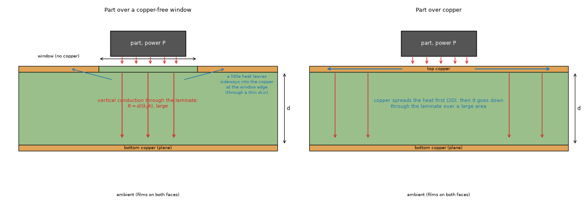
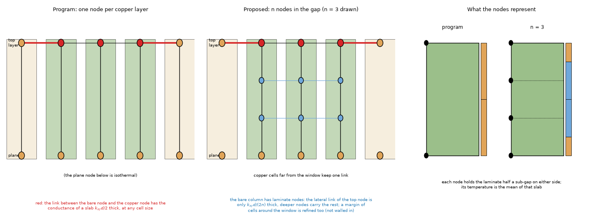
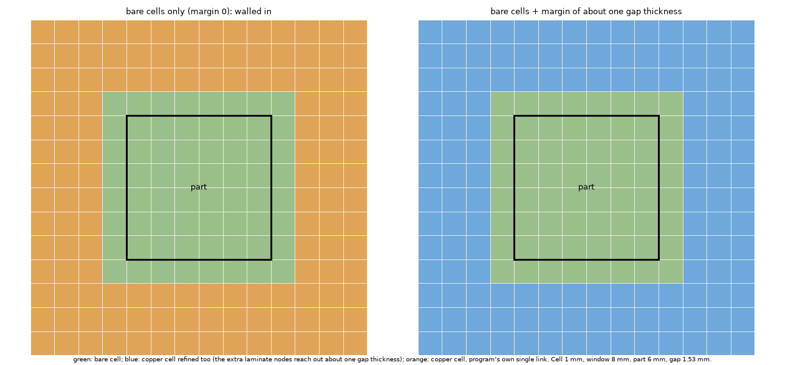
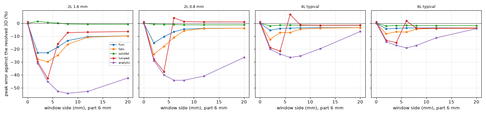
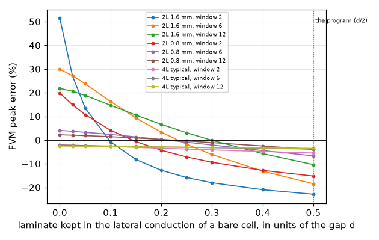
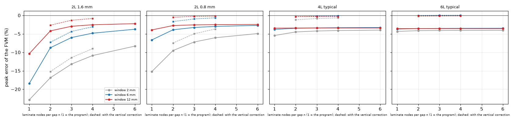
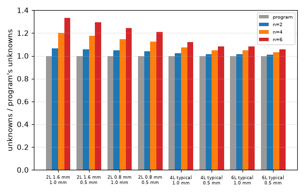
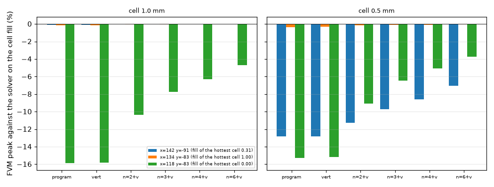

# A spot without copper under a source, in the layered models (investigation A12)

**Question.** In the layered models (FVM, FDM, Lumped, Analytic) one node per copper layer holds the copper and half of the laminate around it, and its temperature is the mean through that thickness. Where the hottest cell under a part has no copper, is the vertical path through the laminate resolved? On a real board the FVM read another 12.5 to 14.4 points cool in that situation (`zone-union` 8.3). Does a number of nodes in the laminate (A1, A11), or a bare-spot-aware vertical resistance, remove the error against a resolved 3D solver?

**Answer in short.**

* **The layered models are cool over a bare spot, and the size depends on the stack-up.** Peak of a 6 mm part (1 W, h = 10 / 10 W/m2K, 30 mm board) over a 6 mm copper-free window in the top layer, against a resolved 3D solver (cell 0.5 mm; section 3): FVM **-18.4 %** (two layers 1.6 mm), -6.6 % (two layers 0.8 mm), -3.8 % (4-layer typical stack-up), -3.7 % (6-layer); FDM -24.7 / -11.0 / -7.1 / -6.8 %; the 3D solid +0.2 / -0.9 / -1.3 / -1.6 %; the Analytic -52.6 / -44.1 / -26.4 / -19.0 % (it averages the copper over the board and does not see the window); the Lumped -15.9 / +4.2 / +6.9 / +1.8 % (not systematic). With full copper every model is within 1.1 %. The error does not depend on the cell (2 to 0.25 mm: -16.7 to -19.3 %).
* **Two causes, separated by experiment** (sections 4 and 5). (a) **The vertical path of a bare cell is short of the laminate that replaces the copper**: half the thickness of each adjacent layer, and the part sits on the face, half a layer above the node. A vertical correction without a new unknown removes 3 to 4 points: **all** of the error of the 4- and 6-layer typical stack-ups (-3.8 % -> -0.6 % and -3.7 % -> -0.1 %). (b) **On a board with a thick gap (0.8 and 1.6 mm two-layer boards) the bare node has the temperature of the hot surface but the lateral conductance of half the gap**, so the heat leaves sideways into the copper through a path that does not exist in the laminate: 8 to 18 more points, growing with the gap over the window size. Cutting the laminate of the bare cells in the gap into sub-gaps with their own nodes (a margin of about a gap thickness around the bare cells, so that the extra nodes are not walled in) recovers it: n = 2 / 4 nodes with the vertical correction bring the 1.6 mm board from -17.2 % (the correction alone) to -7.3 / -3.1 % (-3.7 % with n = 6 alone).
* **The remaining error converges slowly (about 1 / n)** because the edge of the window is singular in the laminate; a window narrower than the gap is the worst case (2 mm under a 6 mm part on 1.6 mm: -22.9 % -> -9.0 % with n = 4). An empirical thinner lateral path without new nodes was tried and rejected: the thickness that gives zero error is 0.10 to 0.30 of the gap depending on the window (section 5.2).
* **Real boards** (three windows of the Stormduino, section 7.1): where the hottest cell is bare (fill 0.00) the FVM is -12.8 % and -15.3 % of the independent solver on the program's own cell fill (the 12.5 to 14.4 points of `zone-union`); the treatment brings them to -8.6 / -5.1 % (n = 4) and -7.0 / -3.7 % (n = 6); where the hottest cell is copper nothing changes (-0.3 -> -0.1 %). The scalar fill at the cell size remains the larger part of the real-board error (-20.1 % and -12.9 % of the fine reference).
* **What it costs and what stays** (section 7.2): only cells with some laminate showing, plus a margin, are refined (1.06 to 1.5 times the unknowns for the 1.6 mm board with n = 4, 2.0 for a 20 mm window); boards with copper in every cell are the program's own **to the last bit** (the refined set is empty and the copy takes the program's path); the example boards and 19 validation scenarios move by 0.00 to 0.08 K except the three rows with bare cells under the part (+4.2 to +5.4 K, +4.4 to +4.6 K, +1.5 K).

The design for entering the program, with the impact of each proposal, is in `INTEGRATION.md`; the text for the project documents in `docs/`. Everything is measured on copies in memory (`lib/layered.py`); `pcbthermal/` is untouched.

## 1. Situation and method



*Figure 1 (`figures/fig_01_part_over_bare_window.png`): section of a two-layer board with a part on the face; left, the top copper has a window under the part (heat goes down through the laminate, a little leaves sideways at the window edge); right, copper under the part (it spreads the heat in 2D first).*



*Figure 2 (`figures/fig_02_nodes_of_the_layered_model.png`): left, the program (one node per copper layer; the red link between a bare node and a copper node has the conductance of a slab half a gap thick); middle, n = 3 nodes in the gap of the bare cells and a margin; right, the slab that each node holds.*



*Figure 3 (`figures/fig_03_top_view_refined_cells.png`): top view of the 8 mm window, the 6 mm part and the cells that get extra nodes: bare cells only (the extra nodes would be walled in at the edge) and bare cells plus a margin of about a gap thickness.*

* **Boards** (`lib/cases.py`): a 30 mm square board, a 6 mm part of 1 W in the middle of the top layer, h_top = h_bottom = 10 W/m2K, insulated edges, laminate 0.9 (in the plane) / 0.3 W/mK (through), copper 385 W/mK. Stack-ups: two layers 1.6 mm and 0.8 mm (35 µm copper, one gap), the typical 4-layer (35 / 15.2 / 15.2 / 35 µm; gaps 210.4 / 1065 / 210.4 µm) and 6-layer (gaps 115.2 / 519.4 / 200 / 519.4 / 115.2 µm) stack-ups of `model.stackup_template`. Windows (no copper): squares of 2, 4, 6, 8, 12, 20 mm centred under the part, in the top layer; also through every layer, and a half-bare footprint (a 10 x 20 mm window whose edge is the centre line of the part).
* **Reference** (`lib/resolved3d.py`, imports nothing from the program): resolved 3D finite volumes, orthotropic laminate, copper where the mask says (a bare part of a copper layer is laminate), films on both faces (also under the part, as the program does), insulated sides; a quadrant or half of the board is solved (the symmetry planes are exact with insulated sides). Peak = hottest cell of the face under the part, corrected from the cell centre to the face. Cell 0.25 mm, 8 sub-slabs per gap in the sweeps.
* **The program** (unchanged): FVM, FDM, 3D solid, Lumped, Analytic at cells of 1 and 0.5 mm; peak = `t_max` less the ambient.
* **The program on copies** (`lib/layered.py`): the arrays of `fvm.Network(assemble=False)` (sheet conductances, vertical conductances including the vias, films, sources, the program's own cell fill) are read and the matrix is assembled again with the gaps cut into sub-gaps; with no refinement it reproduces the program's peak and field to 1e-9 (test). Treatments (`lib/treatments.py`): `vert` (the vertical correction), `nodes` (n equal sub-gaps in the flagged cells, `ceil(d / dx) + 1` cells of margin), `skin` (an empirical lateral cut).
* **Metric.** Error of the peak in percent of the reference rise.

## 2. The reference

`scripts/study_reference.py` (out/reference.txt):

### 2.1 Closed forms and balance

* The 1D column (three slabs, anisotropic laminate in five sub-slabs) is the series circuit to 5e-7 relative (347.231258 against 347.231100 K, an error of the top-face correction, 0.00005 %); the energy balance closes to 1e-9 in every run (`tests/test_resolved3d.py`).
* A 4 x 4 mm source in the middle of a 10 x 10 x 1 mm isotropic plate (k 0.3, bottom film 500, top adiabatic), mean source rise against Eq. 27 of Muzychka, Culham and Yovanovich (2003) (the series reimplemented in `lib/closed_forms.py` from Eqs. 16 to 28): +2.54 % at a 0.5 mm cell, +0.67 % at 0.2 mm and **+0.20 %** at 0.1 mm (the error falls roughly in proportion to the cell, as expected of a source edge that is a staircase of the cell).

### 2.2 Convergence on the bare-window board

Two layers 1.6 mm, 6 mm window (peak / mean in K):

| cell (mm) | 8 sub-slabs per gap | 16 sub-slabs |
| --: | :-- | :-- |
| 0.5 | 152.31 / 124.21 | 151.99 / 123.55 |
| 0.25 | 151.59 / 121.33 | 151.19 / 120.49 |
| 0.125 | 151.23 / 120.06 | 150.91 / 119.42 (12 slabs) |

Two layers 1.6 mm, 2 mm window: 102.44 / 101.70 (0.5 mm, 8 / 16 slabs), 102.00 / 101.17 (0.25 mm), 101.63 / 100.99 (0.125 mm, 8 / 12 slabs). Four layers typical, 6 mm window: 96.87 / 96.87 (0.5 mm), 96.60 / 96.59 (0.25 mm), 8 / 16 slabs (the 0.125 mm run did not fit the memory of the machine).

The peak is converged to about 0.3 to 1 %: the reference of the sweeps (0.25 mm, 8 slabs) is 0.4 % above the 0.125 mm / 12-slab value for the 6 mm window (151.59 against 150.91 K; an earlier exploration with 24 slabs gave 150.67 K, 0.6 %) and 1.0 % above for the 2 mm window (102.00 against 100.99 K); the 4-layer board changes by 0.3 % from 0.5 to 0.25 mm and not at all with the slabs. The errors in this README are therefore up to 0.6 points (1 point for the narrowest window) more negative than against the converged solution. The mean over the part converges slower (124 to 119 K) and is not used.

### 2.3 Second opinion

The isotropic window board (laminate 0.3 / 0.3, 0.25 mm, 8 slabs) by `tests/helpers/layered3d.py` (the independent 3D solver of the program's tests; cell-centre maximum 181.53 K, mean 145.30 K) and by `resolved3d` (face values 183.15 K and 146.92 K): the two differ by 1.62 K, the drop across half of the 35 µm top slab at the flux of the part (27.8 kW/m2 x 17.5 µm / 0.3 W/mK = 1.62 K), as designed.

## 3. The program against the reference



*Figure 4 (`figures/fig_04_models_against_window.png`): error of the peak of the five models against the side of the window, one panel per stack-up, cell 0.5 mm.*

### 3.1 FVM, FDM and the 3D solid (cell 0.5 mm; 1 mm in `out/tables.md`)

| Stack-up | window (mm) | reference (K) | FVM | FDM | 3D solid |
| :-- | --: | --: | --: | --: | --: |
| 2L 1.6 mm | 0 | 70.46 | -0.3 | -0.3 | -0.0 |
| | 2 | 102.00 | -22.9 | -27.8 | +1.5 |
| | 4 | 129.15 | -22.8 | -29.8 | +0.7 |
| | 6 | 151.59 | -18.4 | -24.7 | +0.2 |
| | 8 | 160.15 | -13.4 | -16.3 | -0.6 |
| | 12 | 163.72 | -10.4 | -10.8 | -0.8 |
| | 20 | 164.51 | -9.8 | -9.8 | -0.8 |
| 2L 0.8 mm | 0 | 68.81 | -0.1 | -0.1 | -0.0 |
| | 2 | 96.96 | -15.2 | -23.9 | -0.7 |
| | 4 | 115.73 | -10.4 | -17.8 | -0.9 |
| | 6 | 126.50 | -6.6 | -11.0 | -0.9 |
| | 8 | 129.65 | -4.5 | -5.8 | -1.2 |
| | 12 | 130.83 | -3.9 | -4.1 | -1.2 |
| | 20 | 131.33 | -3.8 | -3.8 | -1.3 |
| 4L typical | 0 | 68.22 | -0.1 | -0.1 | -0.0 |
| | 2 | 85.52 | -5.4 | -12.5 | -2.0 |
| | 4 | 90.94 | -4.0 | -7.2 | -1.5 |
| | 6 | 96.60 | -3.8 | -7.1 | -1.3 |
| | 8 | 98.86 | -3.5 | -4.5 | -1.5 |
| | 12 | 100.50 | -3.4 | -3.8 | -1.5 |
| | 20 | 101.41 | -3.4 | -3.4 | -1.5 |
| 6L typical | 0 | 67.20 | -0.0 | -0.0 | -0.0 |
| | 2 | 78.76 | -4.3 | -8.1 | -2.0 |
| | 4 | 82.43 | -3.9 | -6.5 | -1.7 |
| | 6 | 86.94 | -3.7 | -6.8 | -1.6 |
| | 8 | 88.68 | -3.6 | -4.5 | -1.7 |
| | 12 | 90.04 | -3.6 | -3.9 | -1.7 |
| | 20 | 90.73 | -3.5 | -3.6 | -1.7 |

* With full copper (window 0) every model is within 1.1 % of the reference (the Lumped +1.0 to +1.1 %, the others within 0.3 %).
* The error of the FVM grows with the gap and shrinks with the window: it is the thick-gap boards that are 10 to 23 % low; for windows larger than the part (20 mm) it stays at 9.8 % (1.6 mm), 3.8 % (0.8 mm), 3.4 and 3.5 % (4 and 6 layers): a floor that is not the edge of the window (section 4).
* The FDM is below the FVM by 0 to 9 points, most when the window is not much larger than the part (node-centred values at the boundary of the window).
* **The 3D solid** is within 0.2 to 2 % everywhere; the 1.3 to 2 % low on the thin-gap stack-ups is the same missing half layer of laminate that section 4 finds in the layered models (not checked in `solid3d.py`).
* The cell does not change the picture: at 1 mm the FVM errors are 0.5 to 1.5 points different (2L 1.6, 6 mm window: -19.3 %).

### 3.2 The Analytic model

-11 to -63 % on every stack-up (2L 1.6 mm: -31 % to -54 %, -63 % with a window through both layers; 4 layers: -20 to -26 %; 6 layers: -11 to -19 % for windows from 2 to 12 mm) and -4 to -6 % only for the 4- and 6-layer boards with a 20 mm window. The model averages the copper fill of each layer with the influence of the heaters over the whole board (`analytic.py`), so a 6 mm window in a 30 mm board is averaged away: it gives 71.9 K for the board of the first row (reference 151.6 K), the value of the full-copper board. This is A2/A6, not treated here.

### 3.3 The Lumped model

-6.4 to -42.7 % for the 1.6 mm board, +1.1 to +4.2 % (windows of 6 mm or more) and -27.8 / -37.4 % (2 and 4 mm) for the 0.8 mm board, +6.9 % (6 mm window) and -1.3 to -21.4 % (others) for four layers, +1.8 % and -3.8 to -14.9 % for six. The sign changes with the window: the rings are built from the footprint and the window is the same size as the footprint in the 6 mm case. The cause was not separated.

### 3.4 Windows through every layer and a half-bare footprint (cell 0.5 mm)

| Case | reference (K) | FVM | FDM | 3D solid | Lumped | Analytic |
| :-- | --: | --: | --: | --: | --: | --: |
| 2L 1.6 mm, 6 mm window in both layers | 164.70 | -20.0 | -27.9 | +1.2 | -20.4 | -56.3 |
| 2L 1.6 mm, 12 mm window in both layers | 209.43 | -10.4 | -12.5 | -0.0 | -6.0 | -62.9 |
| 4L, 6 mm window in all four layers | 158.16 | -10.6 | -19.6 | +0.8 | -16.6 | -55.0 |
| 4L, 12 mm window in all four layers | 207.51 | -5.5 | -7.7 | -0.3 | -5.4 | -60.4 |
| 2L 1.6 mm, half-bare footprint | 135.41 | -17.5 | -21.7 | +0.2 | -40.2 | -43.7 |
| 2L 0.8 mm, half-bare footprint | 117.72 | -7.8 | -11.8 | -1.1 | -33.7 | -36.5 |
| 4L, half-bare footprint | 93.03 | -3.8 | -5.5 | -1.5 | -18.8 | -20.6 |
| 6L, half-bare footprint | 84.17 | -3.7 | -5.1 | -1.7 | -12.9 | -14.5 |

A window through every layer (no plane under the part either) roughly triples the error of the 4-layer board (it has laminate in every gap: -3.8 % -> -10.6 %) and leaves the two-layer board as it was; a footprint that is half bare is as bad as the full window for the two-layer boards (-17.5 % against -18.4 %).

### 3.5 The cell does not matter

2L 1.6 mm, 6 mm window, FVM: peak 126.24, 122.40, 123.64, 123.96 K at cells of 2, 1, 0.5, 0.25 mm (-16.7, -19.3, -18.4, -18.2 % of 151.59 K) (`out/skin.txt`, part b). The error is not a discretisation error of the window edge.

## 4. The vertical path (cause a)

In the layered model the vertical link between two copper nodes is `k_z A / d` whatever the copper. The node sits at mid-thickness of its copper layer; copper conducts across its thickness for free, laminate does not, so where a layer has no copper the path is `d + (1 - f_a) t_a / 2 + (1 - f_b) t_b / 2`; the heat enters at the face of the board, `(1 - f) t / 2` above the node of the top layer. For a gap of 0.115 mm and 35 µm of copper this is 15 % of the gap's resistance and, for the part, 3.5 to 4 % of the total rise.

Check: the correction `vert` (no new unknown), cell 0.5 mm, 6 mm window: **4-layer -3.8 % -> -0.6 %, 6-layer -3.7 % -> -0.1 %**; for all windows of 4 mm or more on the 6-layer board the residue is -0.1 to +0.1 % (tables of section 6). For the two-layer boards the same term is 1.2 points (1.6 mm) and 2 points (0.8 mm) of the error.

## 5. The lateral path (cause b)

### 5.1 The mechanism

With the vertical path right, the thick-gap boards are still 10 to 20 % low. The heat of the part enters the bare top node. The node's temperature is that of the hot surface (the node is at the top of the gap and the gap is the main resistance), but its lateral conductance is `k_xy (d / 2)`: the whole upper half of the gap, which in reality is much colder than the surface (the temperature falls across the gap from the part to the plane), carries heat sideways in the model and does not in the laminate. The heat reaches the copper at the window edge through the conductance of that slab (figure 2, red link). This is the interpretation that the experiment of 5.2 supports (cutting that conductance removes the error); a rough count for the 1.6 mm gap puts the lateral drain at the same order as the vertical conductance of the window (7 mW/K for 36 mm2), an estimate that was not measured separately. It does not depend on the cell (section 3.5); it depends on the gap over the size of the window (the error falls from -22.9 % at 2 mm to -9.8 % at 20 mm for 1.6 mm and from -15.2 % to -3.8 % for 0.8 mm), and the extra nodes have no effect on the 4- and 6-layer boards (table of 6.1, columns n=2 to n=6), where the gap is 0.1 to 0.2 mm.

### 5.2 The empirical cut (rejected)



*Figure 8 (`figures/fig_08_lateral_short_experiment.png`): error of the FVM peak when the copper nodes of the bare cells keep only a fraction alpha of the gap (instead of 0.5) in their lateral conduction, no new node; cell 0.5 mm.*

Without new nodes, cutting the laminate that a bare cell's nodes keep in the lateral conduction to `alpha d`: the alpha that gives zero error is **0.10** (1.6 mm, 2 mm window), **0.23** (6 mm), **0.30** (12 mm), 0.14 / 0.21 / 0.22 (0.8 mm, 2 / 6 / 12 mm); on the 4-layer board no alpha does (the residue is the vertical term). It confirms the mechanism (a cut of the lateral path brings the error to zero) and shows that a single factor is not a treatment: the right thickness depends on the window and the board (`out/skin.txt`).

## 6. Treatments

### 6.1 The vertical correction (`vert`)

No new unknown; the vertical conductance of the cell becomes `k_z A / (d + (1 - f_a) t_a / 2 + (1 - f_b) t_b / 2)` (vias in parallel as now) and the reported peak of a heated cell of the top layer adds `Q (1 - f) t / (2 k_z A)`. Cells with fill 1 in both layers are untouched. Errors of the FVM peak (%), cell 0.5 mm:

| Stack-up | window | program | vert | n=2 | n=4 | n=6 | n=2+v | n=3+v | n=4+v | unknowns of n=4+v / program |
| :-- | --: | --: | --: | --: | --: | --: | --: | --: | --: | --: |
| 2L 1.6 mm | 2 | -22.9 | -21.3 | -16.9 | -10.9 | -8.3 | -15.2 | -11.4 | -9.0 | 1.06 |
| | 4 | -22.8 | -21.5 | -12.6 | -6.8 | -5.1 | -11.1 | -7.0 | -5.0 | 1.11 |
| | 6 | -18.4 | -17.2 | -8.7 | -4.8 | -3.7 | -7.3 | -4.3 | -3.1 | 1.18 |
| | 8 | -13.4 | -12.1 | -5.5 | -3.1 | -2.6 | -4.0 | -2.1 | -1.4 | 1.26 |
| | 12 | -10.4 | -9.1 | -4.2 | -2.5 | -2.2 | -2.6 | -1.3 | -0.8 | 1.46 |
| | 20 | -9.8 | -8.4 | -4.0 | -2.4 | -2.2 | -2.4 | -1.2 | -0.8 | 2.02 |
| 2L 0.8 mm | 2 | -15.2 | -13.4 | -9.5 | -6.0 | -4.9 | -7.5 | -5.0 | -3.7 | 1.03 |
| | 4 | -10.4 | -8.5 | -5.6 | -3.8 | -3.3 | -3.4 | -2.0 | -1.4 | 1.07 |
| | 6 | -6.6 | -4.6 | -3.9 | -3.0 | -2.7 | -1.6 | -0.9 | -0.6 | 1.12 |
| | 8 | -4.5 | -2.4 | -3.0 | -2.6 | -2.5 | -0.7 | -0.4 | -0.2 | 1.19 |
| | 12 | -3.9 | -1.8 | -2.7 | -2.5 | -2.4 | -0.5 | -0.3 | -0.2 | 1.36 |
| | 20 | -3.8 | -1.7 | -2.7 | -2.5 | -2.4 | -0.5 | -0.2 | -0.2 | 1.87 |
| 4L typical | 2 | -5.4 | -2.4 | -4.5 | -4.1 | -4.0 | -1.2 | -0.8 | -0.7 | 1.01 |
| | 4 | -4.0 | -0.7 | -3.7 | -3.5 | -3.5 | -0.3 | -0.2 | -0.1 | 1.03 |
| | 6 | -3.8 | -0.6 | -3.5 | -3.3 | -3.3 | -0.3 | -0.2 | -0.1 | 1.05 |
| | 8 | -3.5 | -0.4 | -3.4 | -3.4 | -3.4 | -0.3 | -0.3 | -0.3 | 1.08 |
| | 12 | -3.4 | -0.4 | -3.4 | -3.4 | -3.4 | -0.3 | -0.3 | -0.3 | 1.16 |
| | 20 | -3.4 | -0.3 | -3.4 | -3.4 | -3.4 | -0.3 | -0.3 | -0.3 | 1.40 |
| 6L typical | 2 | -4.3 | -0.6 | -4.1 | -4.0 | -4.0 | -0.3 | -0.2 | -0.1 | 1.01 |
| | 4 | -3.9 | -0.1 | -3.8 | -3.7 | -3.7 | +0.0 | +0.1 | +0.1 | 1.02 |
| | 6 | -3.7 | -0.1 | -3.6 | -3.5 | -3.5 | +0.0 | +0.1 | +0.1 | 1.03 |
| | 8 | -3.6 | -0.1 | -3.6 | -3.6 | -3.6 | -0.1 | -0.0 | -0.0 | 1.05 |
| | 12 | -3.6 | -0.1 | -3.6 | -3.5 | -3.5 | -0.1 | -0.1 | -0.1 | 1.11 |
| | 20 | -3.5 | -0.1 | -3.5 | -3.5 | -3.5 | -0.1 | -0.1 | -0.1 | 1.27 |

(`n = k` alone: laminate nodes without the vertical correction; `+v` with it. `out/sweep_treat.txt` has the cell 1 mm table, with the same picture: 2L 1.6 mm, 6 mm window: -19.3 % -> -3.3 % with n = 4 + v.) The windows through every layer and the half-bare footprint (cell 0.5 mm): 2L 1.6 mm, 6 mm window in both layers -20.0 % -> -18.8 % (vert), -8.9 % (n=2+v), -4.1 % (n=4+v); 4L with a 6 mm window in all four layers -10.6 % -> -8.4 / -3.6 / -1.3 %; half-bare footprints 2L 1.6 mm -17.5 % -> -7.3 / -2.8 %, 2L 0.8 mm -7.8 % -> -2.0 / -0.7 %, 4L -3.8 % -> -0.3 / -0.2 %, 6L -3.7 % -> 0.0 / +0.1 % (`out/sweep_extra.txt`).



*Figure 5 (`figures/fig_05_fvm_with_laminate_nodes.png`): error of the FVM against the nodes per gap, windows 2, 6, 12 mm, one panel per stack-up; dashed with the vertical correction.*

### 6.2 Laminate nodes next to the bare cells

The gap is cut into n equal sub-gaps in the flagged cells (some laminate showing in either layer of the gap, plus `ceil(d / dx) + 1` cells of margin); a node at every boundary holds the laminate half a sub-gap on either side; the copper node keeps the copper and half the first sub-gap. Without the margin the extra nodes are walled in at the edge of the zone (no lateral partner at the copper side) and the result is too hot, by a growing amount (`scripts/study_margin.py`, 2L 1.6 mm, 6 mm window, 0.5 mm cell, reference 151.59 K, no vertical correction): n = 2 / 4 / 8 give 141.6 / 152.1 / 159.1 K with margin 0 (-6.6 / +0.3 / +5.0 %: the +0.3 % of n = 4 is a coincidence of two errors, n = 8 shows the artefact), 139.5 / 146.5 / 149.4 K with 1 cell, 138.8 / 145.0 / 147.6 K with 2 cells, 138.4 / 144.4 / 146.8 K with 4 cells and 138.3 / 144.2 / 146.6 K with the whole board refined (-8.8 / -4.9 / -3.3 %). The margin of `ceil(d / dx) + 1` = 5 cells is within 0.2 K of the whole board.



*Figure 6 (`figures/fig_06_cost_in_unknowns.png`): unknowns of the refined zone against the program's, window 6 mm, per stack-up and cell.*

Cost for the 6 mm window (n = 4 with the correction): 1.18 (1.6 mm board) and 1.12 (0.8 mm) times the program's unknowns at 0.5 mm; 1.05 and 1.03 for the 4 and 6 layer boards (where n is useless: the vertical correction alone reaches the same result). The cost grows with the bare area (2.0 times for a 20 mm window).

### 6.3 What was tried and did not help

Grading the sub-gaps (the first one 0.1 to 0.5 of a cell, growing by the geometric ratio that fills the gap) is no better than equal sub-gaps and worse at n = 2 (`scripts/study_margin.py`, margin 5 cells, n = 2 / 3 / 4 / 6: equal -8.7 / -6.0 / -4.8 / -3.7 %; first sub-gap 0.1 cell -12.9 / -7.1 / -4.4 / -2.8 %; 0.25 cell -11.0 / -5.5 / -3.8 / -3.0 %; 0.5 cell -9.1 / -5.0 / -4.1 / -3.7 %): no gain that justifies the extra parameter. The cut of the lateral conductance of section 5.2 is rejected.

## 7. Real boards and the validation scenarios

### 7.1 Three windows of the Stormduino (`scripts/study_real_stormduino.py`)



*Figure 7 (`figures/fig_07_real_board_windows.png`): error of the FVM peak against the independent solver run on the program's own cell fill, three windows of the Stormduino (24 mm, two layers, 6 mm part, as in `zone-union` 8.3), the program and the treatments with the vertical correction.*

The windows, the board model (two layers 1.6 mm, laminate 0.3 / 0.3, h 10) and the fine reference are those of `zone-union` (used read only; the Stormduino from `gerber-import/scripts/fetch_boards.py`, nothing downloaded is committed; the fine reference reproduces its 133.14 / 151.16, 118.60 / 124.28 and 173.79 / 181.99 K at 0.25 / 0.125 mm). Peak of the FVM and of the treatments against the solver on the cell fill (n with the correction):

| Window | cell | fill of the hottest cell | cell-fill solver (K) | program | vert | n=2 | n=3 | n=4 | n=6 |
| :-- | --: | --: | --: | --: | --: | --: | --: | --: | --: |
| x = 142, y = -91 | 1.0 | 0.31 | 104.25 | -0.1 | -0.1 | -0.0 | -0.0 | +0.0 | +0.0 |
| | 0.5 | 0.00 | 120.82 | -12.8 | -12.8 | -11.3 | -9.7 | -8.6 | -7.0 |
| x = 134, y = -83 | 1.0 | 1.00 | 103.33 | -0.2 | -0.2 | -0.1 | -0.0 | -0.0 | -0.0 |
| | 0.5 | 1.00 | 104.22 | -0.3 | -0.3 | -0.2 | -0.1 | -0.1 | -0.0 |
| x = 118, y = -83 | 1.0 | 0.00 | 151.97 | -15.9 | -15.8 | -10.4 | -7.8 | -6.3 | -4.7 |
| | 0.5 | 0.00 | 158.53 | -15.3 | -15.2 | -9.1 | -6.5 | -5.1 | -3.7 |

* Where the hottest cell has no copper the program is -12.8 and -15.3 % (0.5 mm), -15.9 % (1 mm), the 12.5 to 14.4 points of `zone-union`; where it has copper nothing is lost (-0.1 to -0.3 %). With the treatment: -8.6 / -5.1 % (n = 4), -7.0 / -3.7 % (n = 6) at 0.5 mm; -6.3 % (n = 4) at 1 mm.
* The real boards have the thick-gap structure (1.53 mm gap) of the 1.6 mm two-layer case of section 3, so the vertical correction alone does nothing (0.0 to 0.1 points) and the nodes carry the gain; the remaining error is the 1 / n tail plus partial-fill cells.
* Against the fine reference (0.125 mm): the cell-fill solver itself is -20.1 % (first window, 0.5 mm) and -12.9 % (third): the **scalar fill at the cell size remains the larger part** of the total error (`zone-union` 8.3); the treatment does not touch it.
* Only one real board could be run: the other boards of `gerber-models` need the layered copper to be rebuilt as polygons for the program's two-layer case; not done.

### 7.2 The validation scenarios and the example projects (`scripts/study_validation_rows.py`)

The 19 scenarios of `docs/validation.md` section 2 (from `research/models-comparison`) and the three example projects, FVM, 1 mm cells. Peak in °C: the program, the copy with no refinement, the vertical correction, n = 2 and 4 with it, the 3D solid:

| Scenario | program | vert | n=2+v | n=4+v | 3D solid | refined cells |
| :-- | --: | --: | --: | --: | --: | --: |
| reference board; corner; small heater; 8 layers; island-free rows | identical to 0.01 K | | | | | 0 |
| example board (full), no heatsink, no vias, only U1 | 85.81 / 88.91 / 94.67 / 79.97 | +0.01 | +0.01 | +0.02 | 85.98 / 89.08 / 94.91 / 80.12 | 4964 |
| heater 5 mm inside the top-copper edge | 94.45 | 94.45 | 94.48 | 94.50 | 94.78 | 4964 |
| **heater straddling the top-copper edge** | 143.89 | 148.05 | 148.98 | 149.29 | 149.27 | 4964 |
| **no copper on the heater layer** | 150.16 | 154.58 | 154.70 | 154.73 | 153.19 | 8000 |
| 30 x 30 mm copper island around the heater | 92.38 | 92.39 | 92.44 | 92.46 | 92.78 | 7324 |
| **hatched copper (fill 0.5) on the top layer** | 105.78 | 107.25 | 107.34 | 107.37 | 106.23 | 8000 |
| example projects (example, profile, reference) | 85.81 / 85.81 / 90.13 | +0.01 | +0.01 | +0.02 | 85.98 / 85.98 / 90.27 | 4964 / 4964 / 0 |

(Full table in `out/validation_rows.txt`; boards with copper everywhere give refined cells 0 and the program's value.) The copy with no refinement reproduces the program's value on every row (column "copy" of the file). The three bold rows are the ones with bare cells under the part: the straddling row goes from -4.3 % to +0.0 % of the 3D solid's rise (n = 4); the row without copper on the heater layer from -2.4 % to +1.2 %; the hatched row overshoots the 3D solid by 1.1 K (+1.4 % of its rise) because a cell with fill 0.5 gets the mean thickness (the parallel of the two paths would be the exact form). Boards with a metal block are skipped (the copy does not model them).

## 8. Limits of the study

* **One part (6 mm, 1 W) on a 30 mm board with h = 10 / 10 W/m2K**, a laminate of 0.9 / 0.3 W/mK; the error scales with the gap over the window and with the bare area, not with the power (linear), but other part sizes were not swept.
* **The reference is converged to about 0.3 to 0.7 %** on the 1.6 mm board and was not run finer on the 4- and 6-layer boards; the errors are slightly pessimistic by that amount. The mean over the part converges slower and is not used.
* **Steady state only**; the transient capacity of the extra nodes is not built; the metal block and the one-layer laminate nodes are not in the copy.
* **FDM**: measured as the program, not with the construction.
* **Real boards**: one board (three windows); the copper is a scalar fill per cell, so the real-board numbers mix the layered idealisation with the scalar fill (the second is not touched).
* **Windows narrower than the gap** (2 mm under a 6 mm part on 1.6 mm) remain 5 to 9 % low with n = 4; the treatment is a reduction, not a cure.
* **Not reproduced from a publication**: no published numerical case of a part over a copper-free window was found; the reference is checked against the series of Muzychka et al. for a plate (section 2) and against a second solver, not against a paper's PCB case.

## 9. How to run

From the repository root (the research environment is the program's `.venv`):

```sh
.venv/bin/python -m pytest -q research/bare-spot-under-source/tests
.venv/bin/python research/bare-spot-under-source/scripts/study_reference.py          # section 2
.venv/bin/python research/bare-spot-under-source/scripts/study_window_sweep.py all   # sections 3, 6 (about 40 minutes: 28 resolved references)
.venv/bin/python research/bare-spot-under-source/scripts/study_skin.py               # section 5
.venv/bin/python research/bare-spot-under-source/scripts/study_margin.py             # section 6.2, 6.3
.venv/bin/python research/bare-spot-under-source/scripts/study_real_stormduino.py reference   # then: treat (section 7.1; needs the fetched Stormduino)
.venv/bin/python research/bare-spot-under-source/scripts/study_validation_rows.py    # section 7.2
.venv/bin/python research/bare-spot-under-source/scripts/make_tables.py > research/bare-spot-under-source/out/tables.md
.venv/bin/python research/bare-spot-under-source/scripts/make_diagrams.py; .venv/bin/python research/bare-spot-under-source/scripts/make_figures.py
```

| File | Section |
| :-- | :-- |
| `lib/resolved3d.py`, `lib/closed_forms.py` | the reference (2) |
| `lib/cases.py`, `lib/sweep.py` | the boards and the sweep (1, 3) |
| `lib/layered.py`, `lib/treatments.py` | the copy of the layered FVM and the treatments (4 to 7) |
| `scripts/study_*.py`, `make_*.py` | as listed above |
| `tests/test_resolved3d.py`, `tests/test_layered.py` | 10 tests: the reference against the series circuit, Eq. 27 and the energy balance; the copy against the program, bit-identity on full copper, via barrels, the vertical correction |

## 10. What was read and what was not verified

* **Read in full (R):** Muzychka, Culham, Yovanovich (2003) Eqs. 16 to 28 (open copy of the Waterloo group, extracted locally), **reproduced** (section 2.1); Muzychka, Yovanovich, Culham (2004) the orthotropic section, Eqs. 37 to 42 (not used in a calculation). Both in `research/theory/BIBLIOGRAPHY.md` section 15.
* **From a summary or abstract (S):** the layered-orthotropic channel paper (Muzychka), vendor and vendor-adjacent notes on the cells through a board (Cadence, Wolfspeed, Siemens, CFD-Online, Ansys). **Not obtained (N):** the HAL multilayer PCB model, Lasance and Vinke. **From memory (M):** nothing is quoted from memory as a finding.
* **No source was found** that prescribes how many nodes to put through a laminate under a bare spot, and no published numerical case of a part over a copper-free window was found: the reference is therefore checked against closed forms for a plate and a second solver, and the choice of the treatment rests on this folder's own convergence study.
* **Reproduced here:** the reference against Eq. 27 (0.20 % at 0.1 mm), the series circuit, the energy balance; `zone-union` 8.3 (the 12.5 to 14.4 points) on the same windows (-12.8 / -15.3 / -15.9 %); the fine reference of those windows to the digit.
* **Not verified:** the FDM with the construction; the transient capacity; Lumped and Analytic (causes); boards other than the Stormduino; a measured board; the cause of the 3D solid's 1.3 to 2 % low on thin gaps (suspected: the same half layer of laminate, not checked in `solid3d.py`); the reference on the 4- and 6-layer boards at 0.125 mm.
* **Doubts:** (1) the vertical correction for a partially covered cell uses the mean thickness (hatched row +1.1 K over the 3D solid); (2) the 1 / n tail means the number of nodes is a cost-accuracy choice for the maintainer; (3) the 0.25 mm / 8-slab reference is about 0.6 % above the converged value on the 1.6 mm board, so every error of the sweeps is about 0.6 points too negative there.
