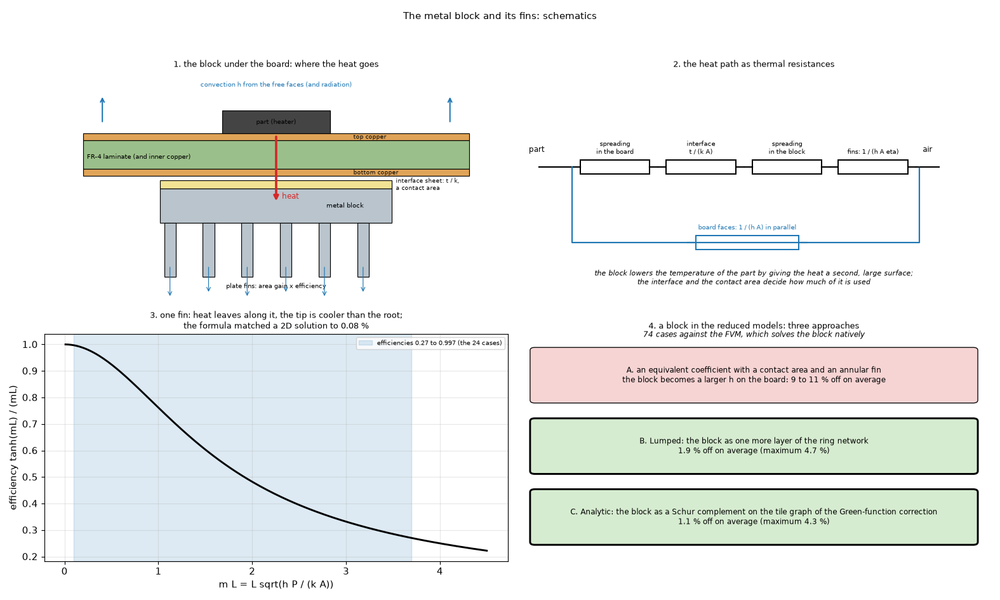
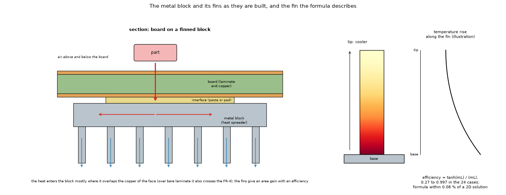
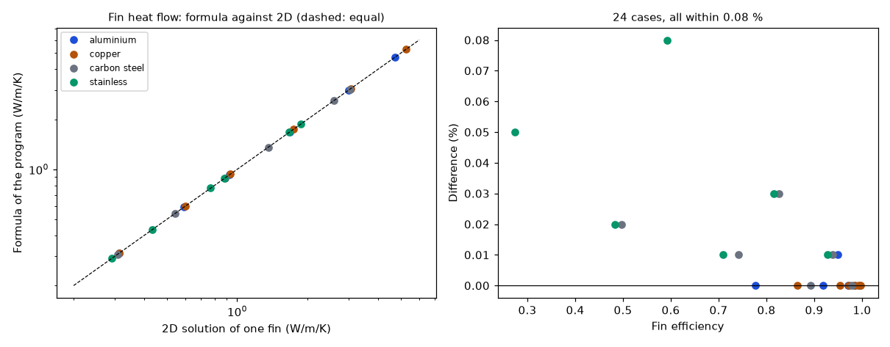
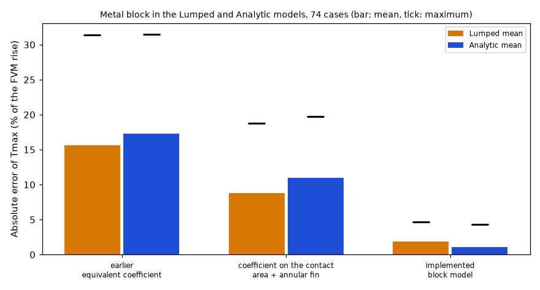
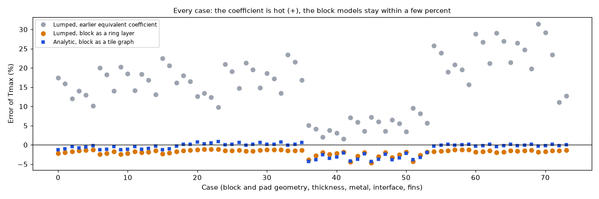

# The metal block and its fins: models and verification

Status: **implemented** in the program (2.3.0 and 2.4.0; see the program's `docs/versions.md` and `docs/validation.md`). Studies: `fin_validation.py`, `block_equivalent_study.py`, `study_finned_block_all_models.py`, `study_why_coefficients_fail.py`, `study_thick_plate_criterion.py`; figures: `make_figures.py`, `make_diagrams.py`. Reviewed (section 7); a defect of the program found in the review is written up in `INTEGRATION.md`.

## 1. The questions

1. Is the formula that replaces the fins of a metal block by an area gain and an efficiency right?
2. Can the Lumped and Analytic models represent a metal block (a heat spreader under the board), and with what error against the FVM, which solves it natively?

### 1.1 Diagrams and illustrations



*Figure 4 (`figures/fig_04_block_and_fins_schematic.png`): The metal block and its fins as schematics: 1, the block under the board and the heat path; 2, the same path as thermal resistances (the board faces in parallel); 3, the efficiency of a fin as a function of mL, with the range of the 24 validated cases shaded; 4, the three ways of representing a block in the Lumped and Analytic models, with their mean error against the FVM (Lumped 1.9 % mean and 4.7 % maximum, Analytic 1.1 % and 4.3 %, section 4.2).*



*Figure 5 (`figures/fig_05_block_section.png`): the section of a board on a finned metal block (the part, the board, the interface, the block, the fins) and one plate fin with the temperature falling from the base to the tip; the efficiency range and the 0.08 % are those of section 4.1. Redrawn in the review: the colour of the fin was upside down (the tip was drawn hottest), and the caption said the block touches the board only where a patch of interface is, while the program puts the heat into the block mostly where it overlaps the copper of the face.*

## 2. Findings in short

* The fin formula (`blocks.fin_ratio`) agrees with a 2D conduction solution of one fin to within 0.08 % in 24 cases on the 12 × 240 grid of the script (four metals, three coefficients, two fin sizes, efficiencies 0.27 to 0.997); refined to 24 × 480 the largest difference is 0.09 % and tends to about 0.1 % (section 4.1). What is **not** validated is the coefficient itself on a real fin array (channel effect between fins, section 4.1).
* An equivalent coefficient (with a contact area and an annular fin) is 9 to 11 % off on average in the Lumped and Analytic models; the block as one more layer of the ring network (Lumped) and as a Schur-complement tile graph in the Green-function correction (Analytic) is 1.9 % and 1.1 % off on average (maxima 4.7 % and 4.3 %, both on the block equal to its pad with 1 K·cm²/W), on 74 cases. The equivalents fail because they drop the block's lateral conduction: the FVM itself, with the block's `k t` set to zero, is as hot as the equivalent (section 4.2).
* The FVM, FDM and 3D solid agree within 1 % on a finned block (FDM −0.1 to 0.0 %, 3D solid +0.6 to +0.8 %); the Lumped and Analytic models with the block are +1.6 to +3.6 % at 1 mm cells (section 4.3; the table of `docs/validation.md` section 12 D still has their earlier, equivalent-coefficient columns, 10 to 13 % high).
* **Defect of the program found in the review** (`INTEGRATION.md`): the sides of the base plate of a finned block get the fin ratio too (the fins stand on the base face, not on the sides); on the finned blocks of section 4.3 this makes the rise 5.4 to 6.4 % too low in the FVM (and in every model, which share the code).
* The temperature drop across the block's own thickness (the layered models keep one node per layer) is checked by the program's thick-plate warning (`checks.check_thick_plates`) with the flux that really enters the block: over these 74 cases it is 0.07 % of the rise at the median and 0.34 % at most, none above the 5 % limit (`study_thick_plate_criterion.py`, section 4.4).

## 3. Folder layout

| File | What it is |
| :-- | :-- |
| `scripts/fin_validation.py` | The fin formula against a 2D finite-volume solution of one fin (24 cases). |
| `scripts/block_equivalent_study.py` | Three approaches to the block in the Lumped and Analytic models against the FVM, on 74 cases. |
| `scripts/study_finned_block_all_models.py` | A finned block in all five models (table of section 4.3) and the effect of the fin ratio on the sides of the block. |
| `scripts/study_why_coefficients_fail.py` | Direct test of why the equivalent coefficients are hot: the FVM without the block's lateral conduction, and the FVM on the equivalent problems. |
| `scripts/study_thick_plate_criterion.py` | The thick-plate criterion of the program over the 74 cases (section 4.4). |
| `scripts/make_figures.py` | Draws figures 1 to 3 (runs `fin_validation.py` and `block_equivalent_study.py` and reads what they print). |
| `scripts/make_diagrams.py` | Draws the schematic diagram and the illustration (figures 4 and 5; no data, no program; uses `research/diagram_kit.py`). |
| `figures/` | `fig_01` to `fig_05`; figures 4 and 5 are the diagram and the illustration (`make_diagrams.py`). |
| `INTEGRATION.md` | The defect of the program found in the review (fin ratio on the sides) and its correction, applied afterwards (`fix/finned-block-sides`). |
| `docs/for-the-project-documents.md` | Replacement text for the stale numbers of `docs/validation.md`, `docs/models.md` and `docs/theory.md`. |

## 4. How to run, and the results

```sh
.venv/bin/python research/block-and-fins/scripts/fin_validation.py               # under a second
.venv/bin/python research/block-and-fins/scripts/block_equivalent_study.py       # about 15 seconds
.venv/bin/python research/block-and-fins/scripts/study_finned_block_all_models.py [cell_mm]   # 2 s at 1 mm, 7 s at 0.5 mm
.venv/bin/python research/block-and-fins/scripts/study_why_coefficients_fail.py  # about 2 seconds
.venv/bin/python research/block-and-fins/scripts/study_thick_plate_criterion.py [cell_mm]     # 2 s at 2 mm, 5 s at 1 mm
.venv/bin/python research/block-and-fins/scripts/make_figures.py                 # about 20 seconds
.venv/bin/python research/block-and-fins/scripts/make_diagrams.py
```

### 4.1 The fins against a 2D fin

`fin_validation.py` (and `tests/test_fin_model.py`, which also checks that `blocks.fin_ratio` is the same expression). The program replaces the fins by an area gain and an efficiency (`blocks.fin_ratio`): per unit of base area `(1 − t/p) + 2 Hc η/p`, `Hc = H + t/2`, `η = tanh(m Hc)/(m Hc)`, `m = √(2h/(k t))` (straight fin, convecting tip taken as an adiabatic tip at the corrected length; Incropera and DeWitt). Here the same fin is solved as a two-dimensional conduction problem (width `t`, height `H`, root at 1 K, convection `h` on both faces and on the tip, 12 × 240 finite volumes), which keeps the transverse temperature drop and the real tip.

| Metal | k (W/mK) | h (W/m²K) | fin | efficiency | 2D (W/m/K) | formula (W/m/K) | difference |
| :-- | --: | --: | :-- | --: | --: | --: | --: |
| aluminium | 204 | 10 | 1.5 × 15 mm | 0.995 | 0.3133 | 0.3133 | +0.00 % |
| aluminium | 204 | 100 | 1 × 30 mm | 0.777 | 4.7395 | 4.7397 | +0.00 % |
| copper | 386 | 30 | 1 × 30 mm | 0.954 | 1.7466 | 1.7466 | +0.00 % |
| carbon steel | 50 | 100 | 1 × 30 mm | 0.497 | 3.0311 | 3.0315 | +0.02 % |
| stainless | 14 | 100 | 1.5 × 15 mm | 0.593 | 1.8668 | 1.8683 | +0.08 % |
| stainless | 14 | 100 | 1 × 30 mm | 0.274 | 1.6702 | 1.6710 | +0.05 % |

All 24 cases of the script (four metals, h = 10, 30, 100 W/m²K, two fin sizes, efficiencies from 0.27 to 0.997) are within 0.08 % on the 12 × 240 grid. The difference grows slightly as the 2D grid is refined (stainless, 100 W/m²K, 1.5 × 15 mm: +0.059, +0.081, +0.093 % at 6 × 120, 12 × 240, 24 × 480; it tends to about +0.1 %; the other cases move by less), so the converged statement is "within about 0.1 %" (review, run by hand with `fin_heat_2d(..., nx, ny)`). So **the fin formula is right for a fin with a uniform coefficient**; what is not validated is the coefficient itself.

**What is not validated** (the honest limits): (1) the coefficient on a real fin array is not the flat-plate `h` of the board face: between close fins the air in a channel is slower and the fins preheat each other, which Elenbaas (1942) and Bar-Cohen and Rohsenow (1984) describe with an optimum spacing and a channel Rayleigh number; the program ignores this and only warns below 4 mm of air gap in still air, so a closely spaced array is optimistic. An estimate of the review, with the Bar-Cohen and Rohsenow composite correlation for symmetric isothermal plates **as remembered from Incropera and DeWitt** (`Nu_S = [576/El² + 2.873/El^0.5]^−1/2`, `El = Ra_S S/L`; not re-opened, not reproduced from the paper): for channels 30 to 40 mm long and a rise of 30 to 50 K the convective coefficient in the channel is about 3.5 to 6 W/m²K at a 4 mm gap and 7 to 9 W/m²K at the 6.5 mm gap of the finned blocks below, and the optimum spacing is 4.7 to 5.7 mm; so even without a warning the finned cases use a coefficient that is 10 to 30 % too high on the fins (radiation between fins, also blocked, not counted); (2) the 3D solid uses the same fin ratio, so it does not test the fins independently; (3) no comparison with a measured heatsink or a manufacturer's θSA curve was made (the searches found fin-efficiency equations and worked examples but no datasheet with the dimensions needed). To do: a channel correlation (`docs/versions.md` "Planned") and a comparison with θSA of catalogue extrusions.



*Figure 1 (`figures/fig_01_fin_formula_against_2d.png`): the heat of one fin from the formula against the 2D solution (left) and the difference against the efficiency (right), 24 cases.*

### 4.2 The block in the Lumped and Analytic models

`block_equivalent_study.py` compares the Lumped and Analytic models with the FVM, which has the block, on 74 cases (1 mm cells): a 100 × 80 mm two-layer board with full copper on the top, a 5 W part of 10 × 10 mm at the centre of the top, a copper pad on the bottom and the block under it; four block and pad geometries (a 30 × 30 pad in a 60 × 60 block, 50 × 40 in 90 × 70, pad equal to the 40 × 40 block, 20 × 20 in 80 × 60), blocks of 1, 3 and 6 mm of aluminium, 3 mm of copper, 1 and 3 mm of steel, interface 1, 5 and 20 K·cm²/W (4 × 6 × 3 = 72), and two finned blocks (15/1.5/8 mm). Error: difference of the maximum temperature divided by the FVM rise, in percent (negative = too cool).

| Approach | Lumped mean / max | Analytic mean / max |
| :-- | --: | --: |
| earlier equivalent coefficient (isothermal block over the whole polygon) | 15.6 / 31.4 | 17.3 / 31.5 |
| equivalent coefficient on the copper contact area plus an annular fin for the block outside it | 8.8 / 18.8 | 11.0 / 19.7 |
| **implemented**: Lumped: block layer in the ring network; Analytic: tile graph (Schur complement) in the Green-function correction | **1.9 / 4.7** | **1.1 / 4.3** |

* **Why the coefficient approaches fail**: they are too hot in every case, and more so with a thicker or better-conducting block (30 × 30 pad, 5 K·cm²/W, earlier coefficient, Lumped / Analytic: +15.9 / +17.4 % for 1 mm of aluminium, +20.6 / +22.2 % for 6 mm; with the contact area and annular fin +7.2 / +9.4 % and +11.6 / +13.8 %). The explanation, that a uniform coefficient drops the lateral conduction `k t` with which the block carries the heat of the centre of the pad to the rest of the pad and of the block, was **tested directly** in the review (`study_why_coefficients_fail.py`, 5 K·cm²/W, 1 mm cells):

  | Case | FVM rise (K) | FVM, block `k t` = 0 | FVM, earlier equivalent | Lumped / Analytic, earlier | FVM, equivalent A | Lumped / Analytic, A |
  | :-- | --: | --: | --: | --: | --: | --: |
  | pad 30x30 in block 60x60, 1 mm Al | 91.8 | +17.8 | +17.9 | +15.9 / +17.4 | +9.1 | +7.2 / +9.4 |
  | pad 30x30 in block 60x60, 3 mm Al | 90.0 | +19.7 | +20.3 | +18.2 / +19.8 | +11.3 | +9.4 / +11.6 |
  | pad 30x30 in block 60x60, 6 mm Al | 88.2 | +21.6 | +22.7 | +20.6 / +22.2 | +13.5 | +11.6 / +13.8 |
  | pad 30x30 in block 60x60, 3 mm steel | 91.0 | +18.4 | +18.9 | +16.9 / +18.4 | +10.1 | +8.2 / +10.4 |
  | pad = block 40x40, 3 mm Al | 97.4 | +5.7 | +7.5 | +5.9 / +8.2 | +7.5 | +5.9 / +8.2 |
  | pad 20x20 in block 80x60, 3 mm Al | 87.6 | +28.5 | +28.9 | +26.7 / +26.9 | +17.4 | +15.3 / +16.2 |

  The FVM with the block's lateral conduction removed is within 0.1 to 1.8 points of the FVM on the earlier equivalent, and the Lumped and Analytic errors with an equivalent are within 2.2 points (Lumped 1.6 to 2.2 points lower, Analytic within 2.0 points) of the FVM on the same equivalent: the error is the equivalent's, not the reduced models'. The implemented versions keep the lateral conduction `k t` of the block.
* The finned blocks are at −1.5 and −1.4 % (Lumped) and −0.2 and −0.0 % (Analytic). Typical case: 30 × 30 pad in a 60 × 60 block, 3 mm of aluminium, 5 K·cm²/W: FVM rise 90.0 K, Lumped −2.2 %, Analytic −1.1 %. The largest errors of the implemented models (−4.7 % Lumped, −4.3 % Analytic) are all on the block equal to its 40 × 40 pad with the lowest interface resistance (1 K·cm²/W).
* **Cell size** (review, seven cases at 2, 1 and 0.5 mm): the FVM rise moves by at most 0.08 K from 1 to 0.5 mm, and the Lumped and Analytic errors by at most 0.3 points (for example the pad = block, 3 mm Cu, 1 K·cm²/W case: Lumped −4.7 → −4.5 %, Analytic −4.3 → −4.0 %); at 2 mm they move by up to 1.2 points.
* **Why the numbers moved by 0.1 point** (traced in the review): the earlier 15.5 / 31.3, 8.8 / 18.7 and 2.0 / 4.8 of the Lumped columns came from the program before commit `738a09e` ("Add laminate nodes for one-layer boards and merge thin Lumped rings"), which merged Lumped rings narrower than a cell (`lumped.RING_MIN_WIDTH = 1`). Running the study now with `lumped.RING_MIN_WIDTH = 0` reprints 15.5 / 31.3, 8.8 / 18.7 and 2.0 / 4.8 exactly, with the Analytic columns unchanged; the boards here have two layers, so the laminate nodes of the same commit play no part. `docs/validation.md` section 17 on `develop` (`a9c1cd1`) already has the new values.
* Limits: steady state only (the capacity of the block is in the ring sums but no transient with a block was tested, and the time simulation refuses it); a rectangular block and rectangular copper pads were tested, a block over scattered copper not; the Analytic keeps its own weak spots (copper that is far from uniform around the heater). In approach A the board face under the block outside the contact keeps its own coefficient (the block hides it in the FVM), which makes A slightly cooler than it should be; A is rejected anyway.
* Sources: static condensation / Schur complement as used by finite-element codes (MFEM documentation, https://docs.mfem.org/4.6/staticcond_8hpp_source.html) and Kron reduction of a network (https://arxiv.org/pdf/2204.05554); the annular-fin efficiency tested in the coefficient approach (Incropera and DeWitt; https://scipython.com/books/book2/chapter-8-scipy/problems/heat-dissipation-of-an-annular-fin-heatsink/; the review checked the script's Bessel expression against a numerical solution of the annular-fin equation, agreement to 1e-15); hybrid analytical models of the PCB, Zhang and Chen, PLOS ONE (2024), https://journals.plos.org/plosone/article?id=10.1371%2Fjournal.pone.0310237. None of these addresses was re-opened in the review.



*Figure 2 (`figures/fig_02_block_approaches.png`): mean (bar) and maximum (tick) absolute error of the three approaches, 74 cases.*



*Figure 3 (`figures/fig_03_block_error_per_case.png`): the error of every case, the earlier equivalent coefficient (Lumped) against the implemented block models (Lumped and, added in the review, Analytic).*

### 4.3 A finned block in every model

`study_finned_block_all_models.py` (the board of `tests/test_heatsink_part.py`: 60 × 40 mm two-layer board with copper on both faces, 3 W part of 10 × 10 mm, aluminium block 40 × 30 mm and 3 mm on the bottom face, 5e-5 m²K/W interface, typed 10 W/m²K; rise of the hottest point in K, 1 mm cells):

| Block | Fin ratio at 10 W/m²K | FVM | FDM | 3D solid | Lumped | Analytic |
| :-- | --: | --: | --: | --: | --: | --: |
| plain plate 3 mm | 1.0 | 88.3 | 88.2 | 88.9 | 89.8 | 91.5 |
| fins 15 × 1.5 mm, pitch 8 mm | 4.7 | 61.2 | 61.2 | 61.7 | 62.7 | 62.1 |
| fins 15 × 1.5 mm, pitch 12 mm | 3.5 | 66.4 | 66.3 | 66.8 | 67.8 | 67.5 |
| fins 30 × 1.5 mm, pitch 8 mm | 8.3 | 53.2 | 53.2 | 53.6 | 54.6 | 53.7 |

The FVM, the FDM and the 3D solid agree within 1 % (FDM −0.1 to 0.0 %, 3D solid +0.6 to +0.8 %; the same fin ratio in all three, so the fins are not tested by this agreement). The Lumped is +1.6 to +2.7 % and the Analytic +1.0 to +3.6 % at 1 mm; at 0.5 mm the Lumped is within 0.1 % and the Analytic +1.2 to +3.8 %. The earlier version of this table (and `docs/validation.md` section 12 D) had Lumped 100.3, 72.1, 77.8, 62.4 and Analytic 99.8, 69.4, 75.5, 59.3 K, from the time the two models replaced the block by an equivalent coefficient; no script printed it, and the fin ratio of the 30 mm fins is 8.35, printed 8.3 (the documents say 8.4).

**The sides of the base plate** (a defect of the program, corrected afterwards on `fix/finned-block-sides`, `INTEGRATION.md`; the numbers below are those of the old program): the program gives the sides of the block the exposed coefficient with the fin ratio, `h_tot (A c + t L_edge)` with `h_tot = h_face × fin_ratio + h_extra` (`blocks.extra_layers`, and the same in `solid3d.py`). The fins stand on the base face; the sides of the plate see `h_face + h_extra`. The FVM with the sides at `h_face + h_extra` (the same study, the function wrapped in memory):

| Block | sides × fin ratio (program) | sides without fins | difference |
| :-- | --: | --: | --: |
| plain plate 3 mm | 88.3 | 88.3 | +0.0 % |
| fins 15 × 1.5 mm, pitch 8 mm | 61.2 | 65.0 | +6.2 % |
| fins 15 × 1.5 mm, pitch 12 mm | 66.4 | 70.0 | +5.5 % |
| fins 30 × 1.5 mm, pitch 8 mm | 53.2 | 56.6 | +6.4 % |

(0.5 mm cells: +6.2, +5.4, +6.4 %.) On this block the sides are 4.2 cm² against 12 cm² of base; multiplied by the fin ratio (4.73) they make the exposed conductance of the block 26 % larger than with the sides at the face coefficient. The end faces of a fin array (the fin cross-sections) are not in the formula either, but they are a few percent of the side area; the outer faces of the outer fins are already counted in `2 Hc η / p`.

### 4.4 The thick-plate check on the same 74 cases

The program warns when `q'' t / (2 k)` over the rise of the heater exceeds 5 % (a thick, poorly conducting plate under a source: the surface under the source is hotter than the node of the layered models by up to that amount). `study_thick_plate_criterion.py` computes it on these 74 cases with the program's own functions (`checks._block_flux_under`, `checks.thick_plate_bound`):

| flux (2 mm cells, FVM rise) | median | maximum | above 5 % |
| :-- | --: | --: | --: |
| into the block (the program) | 0.07 % | 0.34 % | 0 |
| power over the footprint (first version) | 0.50 % | 1.78 % | 0 |

At 1 mm: 0.07 / 0.34 % and 0.49 / 1.75 %. The flux that enters the block is 8 to 21 % of the footprint flux at 2 mm (9 to 22 % at 1 mm), because a block under the board is fed through the laminate and the copper, which spread the heat. These are the numbers of `docs/validation.md` section 22, now printed by a script of this folder. Not reproduced here: the FDM at 2 mm, the "flux over the pad at a rise of 90 K" (0.04 / 0.42 %) of `research/effective-conductivity`, and the "1 to 3 % under a 2 or 3 mm part" (other boards, section 22).

## 5. Limits of this study

* The fin formula is checked against a 2D solution of a straight fin with a uniform coefficient, not against a measured heatsink or a manufacturer's θSA curve; the 3D solid uses the same fin ratio, so it does not test the fins independently.
* The channel effect between close fins (Elenbaas 1942; Bar-Cohen and Rohsenow 1984) is not modelled: a closely spaced array is optimistic, and by the estimate of section 4.1 (from a remembered correlation) a 6.5 mm gap, which does not warn, already has a channel coefficient 10 to 30 % below the typed one. The program only warns below 4 mm of air gap in still air.
* Steady state only for the Lumped and Analytic block models; rectangular blocks and rectangular copper pads were tested, a block over scattered copper not; one board size per study.
* The FVM is the reference of the 74 cases: it is the same layered model; the plate model of the block itself is checked elsewhere (`research/solid3d-verification`, the block against an independent FEM solution, and `docs/theory.md` section 7, Seri Lee's spreading resistance).
* No measurement of a physical board.

## 6. Sources

Incropera and DeWitt (fin efficiency, straight fin with a corrected length, annular fin; the parallel-plate correlation of section 4.1 is quoted from memory); static condensation and Kron reduction of a network (references in section 4.2); Elenbaas (1942) and Bar-Cohen and Rohsenow (1984) for the channel effect, known from the searches and from memory, not read in full. Seri Lee, "Calculating spreading resistance in heat sinks", Electronics Cooling (January 1998), https://www.electronics-cooling.com/1998/01/calculating-spreading-resistance-in-heat-sinks/: the earlier README called it "Lee, Song, Au and Moran (1995)" and said it could not be read; that 1995 paper is a different one (the ASME constriction/spreading model), and the 1998 article's numbers were read and reproduced in `research/effective-conductivity` (quoted in `docs/theory.md` section 7). Not re-opened in this review. See `docs/validation.md` sections 15 and 17 for the other addresses.

## What was read and what was not verified

* Not verified: no measured heatsink; the fin array channel effect (only the remembered correlation of section 4.1); the formulas of Lee, Song, Au and Moran (1995), not read.
* While reproducing the study (before the review) two corrections were made: the script still called flags that no longer exist (`block_nodes`, `block_tiles`) and the case count was 74, not 62 (4 geometries × 6 thickness/metal pairs × 3 interfaces + 2 finned); the documents were corrected.
* Not implemented: the channel effect between fins; a time simulation with a block in Lumped and Analytic.

## 7. Review

* **Status**: reviewed on `develop` `a9c1cd1` (the physics code is that of `1674d52`); every study was re-run and the tables of this README are the ones the scripts print.
* **Independent checks**: the annular-fin efficiency of the script against a numerical solution of the fin equation (1e-15); the 2D fin on three grids (section 4.1); the explanation of why the equivalent coefficients fail, tested directly (section 4.2: the FVM without the block's lateral conduction `k t` reproduces the equivalent's error within 0.1 to 1.8 points); the 0.1-point shift of the Lumped columns traced to `lumped.RING_MIN_WIDTH` (section 4.2). The FVM reference of the 74 cases is the program's own model; the block plate model is checked against independent solutions in `research/solid3d-verification` and `research/effective-conductivity`, not again here.
* **Limits**: the Bar-Cohen and Rohsenow composite correlation and the optimum spacing used for the estimate of 4.1 are from memory (Incropera and DeWitt), not opened; no measured heatsink; the FDM at 2 mm of the thick-plate criterion, the flux over the pad at 90 K and the 3D-solid table of `docs/validation.md` section 22 were not reproduced here; the channel effect between fins is not modelled.
* **Defects of the program found**: the fin ratio applied to the sides of the base plate (finned blocks 5.4 to 6.4 % too cool): corrected in the program (`fix/finned-block-sides`); a block beyond the board outline drained into cells pinned to the ambient with no warning: corrected in the program (`fix/block-beyond-outline`).
* **Text for the project documents**: `docs/for-the-project-documents.md`.