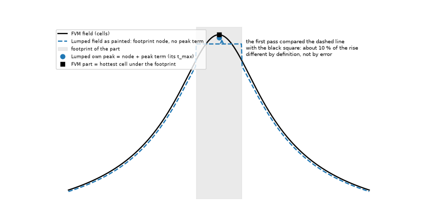

# Metal block in the Lumped and Analytic models: re-measure of "within about 5 % of the FVM"

Status: closed for now, reviewed (section 7). Runs at 1 mm (all cases), 0.5 mm (all 33 cases) and 0.25 mm (4 cases); the 3D solid at 1 mm on 4 cases. **The review found that the
"part on a block 8 to 17 % too cool" of the first pass compared two different quantities** (the Lumped footprint node against the FVM peak); with the same definition the Lumped
part error equals its hottest-point error (section 4, section 7.2). The proposal for the warning text is in `INTEGRATION.md`.

## 1. Question

The warning of `pcbthermal/api.py` (line 1053), the hint of `gui/panels.py`, `docs/models.md` (section on blocks), `pcbthermal/help/index.html` and
`docs/validation.md` section 17 say that the Lumped and Analytic models represent a metal block "within about 5 % of the FVM in 74 test cases". Those 74 cases
(`research/block-and-fins/scripts/block_equivalent_study.py`) have ONE 10 mm source on the top face over ONE pad. Does the claim hold when the block is joined to the board
through several pads, with parts of different power on them, and where does it stop holding?

*Figure 1 (`fig_01_block_several_pads.png`): schematic cross-section; heat enters the plate mostly through the bottom copper pads and the interface sheet (over bare laminate the
contact is R'' plus half a laminate slab, `blocks.py`), is shared inside the plate and leaves by its free face and its side walls.*

## 2. Design

`scripts/study_block_pads.py`: synthetic board of ours, 100 x 80 mm, two layers, full top copper, 1.5 mm aluminium plate (204 W/mK) on the bottom face (80 x 60 mm, centred, by default),
a 12 mm bottom copper pad and a 6 mm part on the top face for each pad, 5 W in total (3 : 1 : 1 : 1 when unequal, so that sharing between pads is tested), interface 5 K cm2/W
by default, the board's default convection on both faces and on the plate (h_extra 0 by default). Reference: the FVM at the same cell.
Error = (model - FVM) / FVM rise, percent. Sweeps: pad count 1, 2, 4; pad side 8, 12, 25 mm; interface 0.1 to 20 K cm2/W; block 40x30 to 100x80 mm; h_extra 0 to 200 W/m2K.
CONTROL rows run the same board WITHOUT the block, so that an error of the models that is not about the block can be told apart.

**The temperature of a part** is the hottest value under its footprint: the hottest cell of the FVM field and of the Analytic field, and for the Lumped **its own peak**
(ring-0 node plus its peak term plus the other heaters read at the centroid, the formula of `lumped.solve_steady` that gives its `t_max`). The Lumped paints its footprint with
the ring-0 node, a footprint mean without the peak term, so reading its FIELD (as `analysis.heater_stats` did before `fix/lumped-part-readout`; it now reads the own peak, `docs/validation.md` 48, and the script holds that array aside for this column) gives another quantity; that column (`lumped_part_max`, "field")
is kept only as the record of the first pass (section 7.2, figure 3).

## 3. Results at a 0.5 mm cell (numbers as printed by `--cell-mm 0.5 --set all`)

Hottest point of the board (L = Lumped, A = Analytic), worst part, and the change in the hottest-to-coolest part spread (sharing between pads), percent of the FVM rise:

| Case | FVM rise K | L hot | A hot | L worst part (own peak) | A worst part | L spread (own peak) | A spread | L worst part (field, first pass) |
| :-- | --: | --: | --: | --: | --: | --: | --: | --: |
| control, 1 pad, no block | 144.0 | -1.6 | -2.1 | -1.6 | -2.1 | 0 | 0 | -10.5 |
| control, 2 pads, no block | 113.7 | -3.1 | -2.2 | -3.1 | -2.2 | -5.1 | -1.7 | -11.4 |
| control, 4 pads, no block | 83.6 | -1.6 | -2.4 | +3.5 | -2.4 | -5.2 | -2.0 | -8.3 |
| 1 pad 12 mm, block | 115.4 | -1.0 | -0.3 | -1.0 | -0.3 | 0 | 0 | -11.7 |
| 2 pads 12 mm, block | 92.5 | -4.5 | -0.4 | -4.5 | -0.4 | -2.6 | -0.1 | -14.5 |
| 4 pads 12 mm, block | 69.5 | -2.9 | -0.5 | -2.9 | -0.5 | -2.1 | -0.1 | -11.5 |
| 2 pads 25 mm, block | 91.7 | -4.6 | -0.6 | -4.6 | -0.6 | -2.7 | 0.0 | -14.7 |
| 2 pads, block 40x30 | 101.8 | -7.0 | +0.1 | -7.0 | -1.3 | -2.5 | +1.3 | -15.9 |
| 2 pads, block 60x45 | 96.2 | -5.8 | -1.0 | -5.8 | -1.0 | -2.2 | -0.2 | -15.4 |
| 2 pads, block 100x80 | 90.4 | -3.3 | -0.1 | -3.3 | -0.1 | -2.9 | -0.1 | -13.5 |
| 2 pads, h_extra 200 | 72.6 | -4.2 | -0.2 | -4.2 | -0.2 | -3.6 | -0.1 | -16.9 |

The other 22 cases (interface 0.1 to 20 K cm2/W for 1, 2 and 4 pads, pad side 8 and 25 mm, h_extra 10 and 50) are in `out/cell05.csv` (git-ignored; rerun the script).
Ranges over the 29 cases with a block: Lumped hottest point -0.8 to -7.0 %, Lumped worst part (own peak) -0.8 to -7.0 %, Lumped spread 0 to -3.6 points; Analytic hottest point
-1.0 to +0.1 %, worst part -1.3 to 0.0 %, spread -0.4 to +1.3 points. The 4 control boards without a block: Lumped hottest point -1.6 to -3.1 %, worst part -3.1 to +3.5 %, spread
0 to -5.2; Analytic -2.1 to -2.4 %, spread 0 to -2.0.

### 3.1 Cell dependence (1 mm all cases; 0.25 mm four cases)

| Case | cell | L hot | A hot | L worst part (own peak) | L spread (own peak) |
| :-- | --: | --: | --: | --: | --: |
| 2 pads 12 mm, block | 1 / 0.5 / 0.25 mm | -4.4 / -4.5 / -4.8 | -0.9 / -0.4 / -0.3 | -4.4 / -4.5 / -4.8 | -2.4 / -2.6 / -2.8 |
| 4 pads 12 mm, block | 1 / 0.5 / 0.25 mm | -2.2 / -2.9 / -3.9 | -0.9 / -0.5 / -0.4 | -2.2 / -2.9 / -3.9 | -1.5 / -2.1 / -2.7 |
| 2 pads, block 40x30 | 1 / 0.5 / 0.25 mm | -6.8 / -7.0 / -7.3 | -0.4 / +0.1 / +0.2 | -6.8 / -7.0 / -7.3 | -2.2 / -2.5 / -2.8 |
| control, 2 pads, no block | 1 / 0.5 / 0.25 mm | -2.5 / -3.1 / -3.7 | -2.8 / -2.2 / -2.1 | -2.5 / -3.1 / -3.7 | -4.5 / -5.1 / -5.6 |

The errors against the FVM grow slowly in size for the Lumped as the FVM reference is refined (the Lumped is its own network, the FVM converges); the Analytic improves. Conclusions
do not change between 1 and 0.25 mm. The 1 mm own-peak numbers are from `scripts/study_review_definitions.py --cell-mm 1`; the 1 mm table of the first
pass is printed by `study_block_pads.py --cell-mm 1.0`.

*Figure 2 (`fig_02_block_errors.png`, from `out/cell05.csv`): the grey band is the claim to be tested; lower panel, the Lumped part with its own peak (filled) and the field reading of
the first pass (dashed outline, not comparable).*

## 4. Where "within about 5 %" holds and where not

1. **Analytic**: holds everywhere tested with a block (hottest point and parts -1.3 to +0.1 %); the control without a block is already -2.1 to -2.4 %, so the block adds nothing.
2. **Lumped, hottest point and parts** (the same numbers once the part is read with its own peak): holds with one pad (-0.8 to -1.2 %) and with four pads on a block of
   80 x 60 mm (-2.6 to -3.2 %); borderline with two pads (-3.3 to -4.8 %, the control without a block is -3.1); fails when the block is small against the board (40 x 30 mm on the
   100 x 80 mm board -7.0 %, 60 x 45 mm -5.8 %). Always on the cool side.
3. **Heat shared between pads**: the Lumped spread is 0 to 3.6 points of the rise too small with a block and 5.1 to 5.2 points without one, so the block does not make it worse;
   the Analytic is within 1.3 points.
4. Pad area (8 to 25 mm), interface (0.1 to 20 K cm2/W) and h on the free face move the errors by at most 1 point (the Lumped hottest point by at most 0.6 points over the interface and the h sweeps).
5. **Withdrawn**: "the temperature of a part on a block is 8 to 17 % too cool in the Lumped". It compared the Lumped field (the footprint node, a mean) with the FVM peak (section 7.2).

## 5. Limits

* One metal and thickness (1.5 mm Al), no vias, no fins, one board size (100 x 80 mm, two layers); the old 74 cases (one pad) were not re-run.
* The FVM and the 3D solid are the references; both are models of the program that share the boundary conditions of the block (`blocks.exposed_h`, `wall_h`, the contact rule);
  no independent solver with a metal block was run (section 7.3).
* Block temperature and the heat into the block per pad are not reported by the Lumped and Analytic (columns nan); sharing is judged by the part temperatures.

## 6. What was read and what was not verified

No literature was needed (the question is about the program against itself). The old study (`research/block-and-fins/scripts/block_equivalent_study.py`: one 10 mm heater on
one pad, 74 cases) and `docs/validation.md` 17 were read for the claim; `pcbthermal/blocks.py`, `lumped.solve_steady` and `analysis.heater_stats` were read for the definitions.
Reproduced by the review: all 33 cases at 0.5 mm (the CSV of the first pass to the last digit), the 4 cases at 0.25 mm and 4 cases at 1 mm with the 3D solid. Not verified:
other metals, thicknesses, fins, vias under the pads, boards of another size or layer count, an independent (non-program) 3D reference with a metal block.

## 7. Review

The reviewer re-ran the studies on the program as it is (`development` at the base of the branch, tree `e02ba367`, and again after merging `development` into the branch, last program commit `0d3b5ad2`: the 33-case CSV is byte-identical) and checked each claim against a second reading or another model.

### 7.1 Re-run

`study_block_pads.py --cell-mm 0.5 --set all`: the 33 rows equal the first pass's `out/cell05.csv` to the last digit (maximum absolute difference 0 in every column). The four
0.25 mm cases reproduce the table of 3.1 to the printed digit. Setup read in the script against section 2: plate 1.5 mm, 204 W/mK, 80 x 60 mm centred; pads 12 mm; interface
`contact_r` 5e-4 m2K/W = 5 K cm2/W; `h_extra` 0 (the plate face keeps the board face coefficient, `blocks.exposed_h`); powers 3 : 1 : 1 : 1 of 5 W (the first docstring said
"split equally": corrected). The Lumped and the Analytic both take the block (ring layer, tile graph); the FDM and 3D solid also have it but were not in the comparison of the
first pass. The first caption said "heat enters the plate only through the pads": wrong, `blocks.py` joins the plate to bare laminate through R'' plus half a laminate slab
(little heat, but not none); figure 1 and its caption corrected.

### 7.2 The temperature of a part is not the same quantity in the three models (the first pass's main finding was a definition mismatch)

*Figure 3 (`fig_03_part_reading.png`, illustrative curves): across one part, the FVM field (its hottest cell is the part temperature), the Lumped field as painted (the footprint
node, flat, without the peak term) and the Lumped's own peak (node plus peak term, its `t_max`).*

`analysis.heater_stats` reads the hottest value of the drawn field under the footprint. The Lumped draws its footprint at the ring-0 node; its peak term (`peak_extra`) enters only
`SteadyResult.t_max`. On the one-pad board the Lumped hottest point is -1.0 % and its "part" -11.7 % of the FVM rise: the same part, two readings. `scripts/study_review_definitions.py`
reads each model three ways (0.5 mm, worst part, percent of the FVM part rise):

| Case | L part, field (first pass) | L part, own peak | L footprint mean vs FVM mean | L hot | A part max | A footprint mean |
| :-- | --: | --: | --: | --: | --: | --: |
| 1 pad 12 mm, block | -11.7 | -1.0 | -1.1 | -1.0 | -0.3 | -0.4 |
| 2 pads 12 mm, block | -14.5 | -4.5 | -4.7 | -4.5 | -0.4 | -0.5 |
| 4 pads 12 mm, block | -11.5 | -2.9 | -3.0 | -2.9 | -0.5 | -0.5 |
| 2 pads, block 40x30 | -15.9 | -7.0 | -7.1 | -7.0 | -1.3 | -1.3 |
| 2 pads, h_extra 200 | -16.9 | -4.2 | -4.3 | -4.2 | -0.2 | -0.3 |
| control, 1 pad, no block | -10.5 | -1.6 | -1.6 | -1.6 | -2.1 | -2.2 |
| control, 2 pads, no block | -11.4 | -3.1 | -3.3 | -3.1 | -2.2 | -2.4 |

Peak against peak and mean against mean agree within 0.2 points; the 8 to 17 % of the first pass is the peak term of the Lumped (about 10 % of the rise on these 6 mm parts),
not an error of the block or of the small-part limit. The spread of the first pass (8 to 12 points) shrinks to 0 to 3.6 with a block (5.1 to 5.6 without) for the same reason:
the peak term is proportional to the part's own power.

**A finding about the program (not about the block), measured with the program as it is, nothing edited**: when the Lumped is the only model run, the part rows of the
application (`SimulationResult.heater_rows` reads the reference result through `heater_stats`) take the footprint node, so the part temperature, the junction temperature, the
margin and the power limit are below the Lumped's own `t_max`: on the one-pad board at 0.5 mm, 101.9 K against 114.3 K of rise (with the block) and 128.8 against 141.7 K
(without), about 11 % of the rise on the unsafe side. When the FVM is also run the rows read the FVM and are right. Proposal in `INTEGRATION.md` 3.

### 7.3 A second model with the block

The 3D solid of the program (real slabs: copper, laminate, interface and plate as solids) at 1 mm against the FVM at 1 mm (104 000 unknowns, 11 s for the four cases, peak
resident memory 1.08 GB):

| Case | 3D hot | 3D worst part | 3D part mean | L hot | A hot |
| :-- | --: | --: | --: | --: | --: |
| 1 pad 12 mm, block | -0.0 | -0.0 | -0.2 | -0.7 | -0.9 |
| 2 pads 12 mm, block | +0.0 | +0.1 | -0.1 | -4.4 | -0.9 |
| 2 pads, block 40x30 | +0.5 | +0.5 | +0.3 | -6.8 | -0.4 |
| control, 2 pads, no block | +0.3 | +0.3 | +0.1 | -2.5 | -2.8 |

The 3D solid and the FVM agree within 0.5 % with and without the block, so no error common to the layered idealisation is visible here and the Lumped deficit is the Lumped's.
This is not an independent reference: the 3D solid shares the program's block boundary conditions (exposed face, side walls, contact over copper and over bare laminate).
`research/independent-fem-edge` has no metal-block case and its scratch environment (scikit-fem, pyamg) is not installed in this worktree, so it was not run; the
`layered3d.py` solver has uniform slabs with insulated sides and cannot hold a plate smaller than the board. Not verified independently.

### 7.4 Verdict of the review

The study is correct once the part is read with the same definition in every model; the corrected numbers above replace the first pass. GO for merging the branch into
`development` (research folder only, the program untouched).
