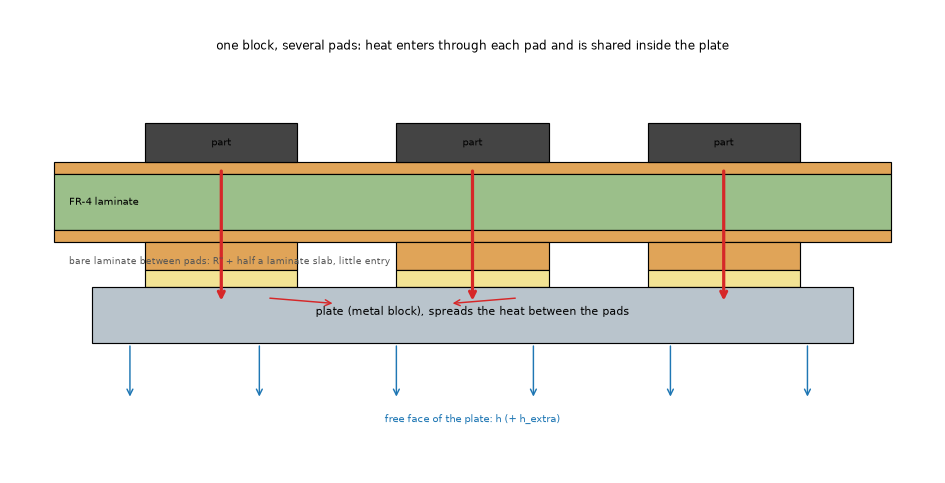
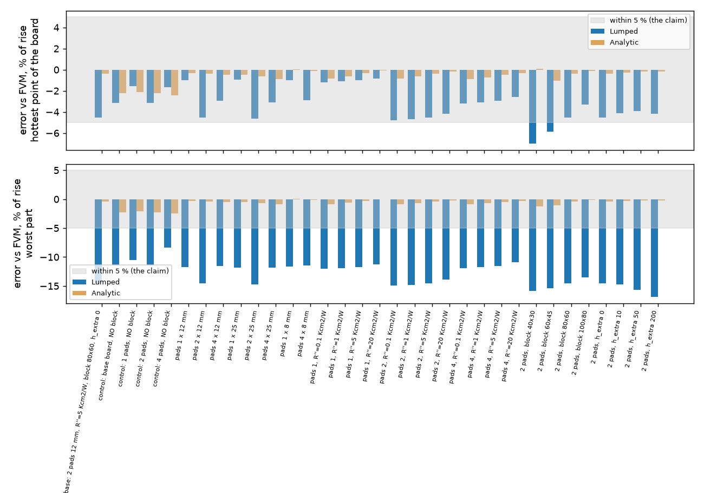

# Metal block in the Lumped and Analytic models: re-measure of "within about 5 % of the FVM"

Status: runs done at 1 mm (all cases), 0.5 mm (all 33 cases) and 0.25 mm (4 cases); the independent 3D reference and the review are NOT done.

## 1. Question

The warning of `pcbthermal/api.py` (line 1053), the hint of `gui/panels.py`, `docs/models.md` (section on blocks), `pcbthermal/help/index.html` and
`docs/validation.md` section 17 say that the Lumped and Analytic models represent a metal block "within about 5 % of the FVM in 74 test cases". Those 74 cases
(`research/block-and-fins/scripts/block_equivalent_study.py`) have ONE source on the top face over ONE pad. Does the claim hold when the block is joined to the board
through several pads, with parts of different power on them, and where does it stop holding?

*Figure 1 (`fig_01_block_several_pads.png`): schematic cross-section; heat enters the plate only through the bottom copper pads (and the interface sheet), is shared inside the plate and leaves by its free face.*

## 2. Design

`scripts/study_block_pads.py`: synthetic board of ours, 100 x 80 mm, two layers, full top copper, 1.5 mm aluminium plate (204 W/mK) on the bottom face, a bottom copper pad
and a 6 mm part on the top face for each pad, 5 W in total (3 : 1 : 1 : 1 when unequal, so that sharing between pads is tested), default convection. Reference: the FVM at the same cell.
Error = (model - FVM) / FVM rise, percent. Sweeps: pad count 1, 2, 4; pad side 8, 12, 25 mm; interface 0.1 to 20 K cm2/W; block 40x30 to 100x80 mm; h_extra 0 to 200 W/m2K.
CONTROL rows run the same board WITHOUT the block, so that an error of the models that is not about the block can be told apart.

## 3. Results at a 0.5 mm cell (numbers as printed by `--cell-mm 0.5 --set all`)

Hottest point of the board (L = Lumped, A = Analytic), worst part, and the change in the hottest-to-coolest part spread (sharing between pads), percent of the FVM rise:

| Case | FVM rise K | L hot | A hot | L worst part | A worst part | L spread | A spread |
| :-- | --: | --: | --: | --: | --: | --: | --: |
| control, 1 pad, no block | 144.0 | -1.6 | -2.1 | -10.5 | -2.1 | 0 | 0 |
| control, 2 pads, no block | 113.7 | -3.1 | -2.2 | -11.4 | -2.2 | -11.6 | -1.7 |
| control, 4 pads, no block | 83.6 | -1.6 | -2.4 | -8.3 | -2.4 | -11.1 | -2.0 |
| 1 pad 12 mm, block | 115.4 | -1.0 | -0.3 | -11.7 | -0.3 | 0 | 0 |
| 2 pads 12 mm, block | 92.5 | -4.5 | -0.4 | -14.5 | -0.4 | -9.6 | -0.1 |
| 4 pads 12 mm, block | 69.5 | -2.9 | -0.5 | -11.5 | -0.5 | -8.2 | -0.1 |
| 2 pads 25 mm, block | 91.7 | -4.6 | -0.6 | -14.7 | -0.6 | -9.7 | 0.0 |
| 2 pads, block 40x30 | 101.8 | -7.0 | +0.1 | -15.9 | -1.3 | -9.6 | +1.3 |
| 2 pads, block 60x45 | 96.2 | -5.8 | -1.0 | -15.4 | -1.0 | -9.1 | -0.2 |
| 2 pads, block 100x80 | 90.4 | -3.3 | -0.1 | -13.5 | -0.1 | -10.0 | -0.1 |
| 2 pads, h_extra 200 | 72.6 | -4.2 | -0.2 | -16.9 | -0.2 | -12.4 | -0.1 |

The other 22 cases (interface 0.1 to 20 K cm2/W for 1, 2 and 4 pads, pad side 8 and 25 mm, h_extra 10 and 50) are in `out/cell05.csv` (git-ignored; rerun the script). Maximum absolute errors over the 33 cases: Lumped hottest point 7.0 %, Analytic 2.4 %, Lumped worst part 16.9 %, Analytic 2.4 %, Lumped spread 12.4, Analytic 2.0.

### 3.1 Cell dependence (1 mm all cases; 0.25 mm four cases)

| Case | cell | L hot | A hot | L worst part | L spread |
| :-- | --: | --: | --: | --: | --: |
| 2 pads 12 mm, block | 1 / 0.5 / 0.25 mm | -4.4 / -4.5 / -4.8 | -0.9 / -0.4 / -0.3 | -13.5 / -14.5 / -15.0 | -8.9 / -9.6 / -9.9 |
| 4 pads 12 mm, block | 1 / 0.5 / 0.25 mm | -2.2 / -2.9 / -3.9 | -0.9 / -0.5 / -0.4 | -10.1 / -11.5 / -12.6 | -7.1 / -8.2 / -9.0 |
| 2 pads, block 40x30 | 1 / 0.5 / 0.25 mm | -6.8 / -7.0 / -7.3 | -0.4 / +0.1 / +0.2 | -14.9 / -15.9 / -16.3 | -8.8 / -9.6 / -10.0 |
| control, 2 pads, no block | 1 / 0.5 / 0.25 mm | -2.5 / -3.1 / -3.7 | -2.8 / -2.2 / -2.1 | -10.0 / -11.4 / -12.1 | -10.6 / -11.6 / -12.1 |

The errors against the FVM grow slowly in size for the Lumped as the FVM reference is refined (the Lumped is its own network, the FVM converges); the Analytic improves. Conclusions do not change between 1 and 0.25 mm. The 1 mm table of the first pass is printed by `--cell-mm 1.0`.

*Figure 2 (`fig_02_block_errors.png`, from `out/cell05.csv`): the grey band is the claim to be tested.*

## 4. Where "within about 5 %" holds and where not

1. **Analytic**: holds everywhere tested (hottest point and parts 0.0 to 2.4 %; the control without a block is already -2.1 to -2.4 %, so the block adds nothing, it improves).
2. **Lumped, hottest point**: holds for 1 and 4 pads on a block of at least 80 x 60 mm on this 100 x 80 mm board (-1.0 to -3.3 %); borderline with 2 pads (-4.2 to -4.8 %, the control is -3.1) and fails when the block is small against the board (40x30 mm -7.0 %, 60x45 mm -5.8 %).
3. **Lumped, the temperature of a part on a block**: does NOT hold, -8 to -17 % (control without a block -8.3 to -11.4 %: most is the known small-part limit of the Lumped, the block adds 1 to 5 points).
4. **Heat shared between pads**: the Lumped spread between the hot and the cool part is 8 to 12 points of the rise too small (also -11 without a block); the Analytic is within 2 points.
5. Pad area (8 to 25 mm), interface (0.1 to 20 K cm2/W) and h on the free face move the errors by at most 2 points (3 points for the Lumped part at h_extra 200).

## 5. Not done, not verified

* The independent 3D reference (`research/independent-fem-edge`) and the 3D solid were not run: the FVM is the only reference, so an error common to the layered models is invisible.
* The 0.25 mm check covers 4 cases only.
* Block temperature and the heat into the block per pad are not reported by the Lumped and Analytic (columns nan); sharing is judged by the part temperatures.
* One metal and thickness (1.5 mm Al); no vias, no fins, one board size; the old 74 cases were not re-run.
* Not reviewed by the reviewer agent.

## 6. What was read and what was not verified

No literature was needed (the question is about the program against itself). The old study README of `research/block-and-fins` and `docs/validation.md` 17 were read for the claim. Reproduced: the script reruns on the program as it is
(tree `development`), 1, 0.5 and (four cases) 0.25 mm. Nothing from outside the repository.
