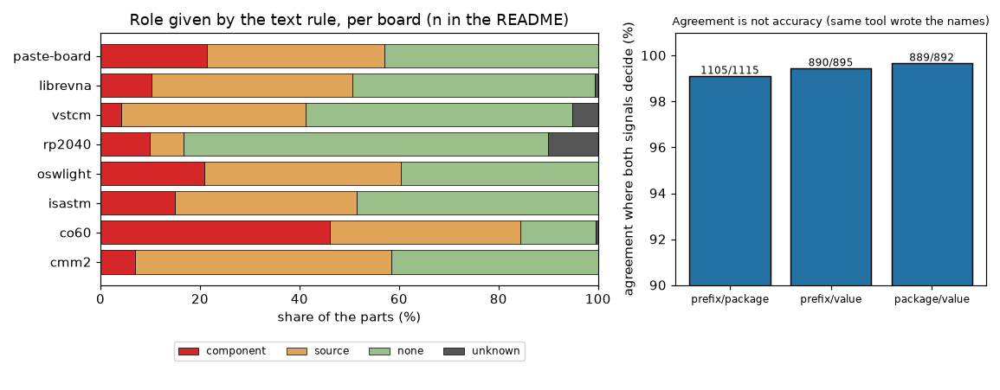
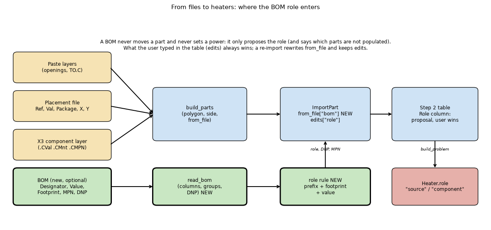
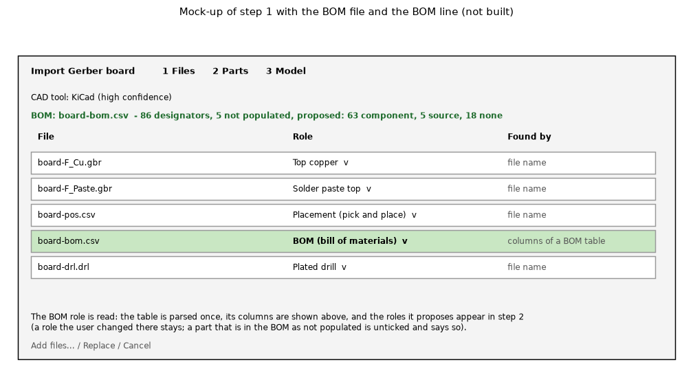
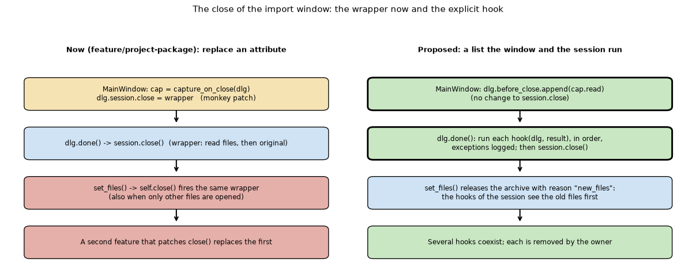

# BOM role and an explicit before-close hook

*(audit 2.6.1, against the program of 2.6.0: the before-close and before-release hooks are in the program since 2.6.0 (`ImportBoardWindow.before_close`, `ImportSession.before_release`; the 'new_files' hooks run in the GUI thread before the reader's worker starts, the alternative of section 6, not the worker-thread rule). The BOM role was implemented on `feature/bom-role-and-close-hook` and then **deferred by the maintainer** and reverted in the 2.6.0 integration: `pcbthermal/gerber/bom.py` does not exist in the program; the item is 5 of 'After 2.6.0' in `docs/versions.md` 'Planned'; the research question is `research/ROADMAP.md` E14.)*

Item 14 of `docs/versions.md` 'Planned' (2.6.0): "the role of a part (source or component) taken from a bill of materials, and a hook that lets a front end act before the window closes". The design was not written; this folder writes it and measures what can be measured. Nothing here changes `pcbthermal/`; the prototype is `lib/bomroles.py`, the study `scripts/study_bom_roles.py`, the tests `tests/test_bomroles.py` (17 passed). Reviewed: see section 12 (several statements below were corrected by the review; each correction says so).

## 1. What was asked

### 1.1 The maintainer's words (from the session transcript)

* On the plan of the project package (after 2.5.0 was released; the first text of this folder said "on the Gerber import, before it was built", which is wrong): "Antencao que quando se fala em gerber, tem que ir o resto que interessa como PNP, BOM, etc para saber os componente e afins. A BOM pode nao fazer sentido se souberes com o PNP onde esta o componente, mas acho que percebeste a ideia." (When we say Gerber, the rest that matters comes along: pick-and-place, BOM, to know the components. The BOM may make no sense if the placement file already says where the part is, but you get the idea.)
* On the package: "Nota, se a BOM vier no pacote dos gerbers, podemos exportar essa no nosso projeto tambem." (If the BOM comes in the Gerber package, we can export it in our project too.)
* Later, answering the decisions of the package review (BOM file role, explicit hook, version): "concordo com as decisoes, vamos deixar isto para a 2.6.0, e vamos agora focar nos fixes da 2.5.1" (I agree with the decisions, we leave this for 2.6.0 and now focus on the 2.5.1 fixes). The first text quoted it with an inserted bracket; the words are given in full here.

### 1.2 What the reviewer of the package branch proposed (the origin of the two words)

* "BOM: a heurística \"bom no nome\" é frágil (um \"parts.csv\" pode ser lido como placement, e os `.json` são saltados). Proponho **um papel BOM no combo do passo 1** (\"stored, not read\") em vez de um seletor novo; o \"Add files\" já serve para anexar. O parsing para a tabela de peças fica para 2.6.0." So "BOM role" first meant the FILE role "BOM" in the step-1 role combo (stored, not read), and reading it into the parts table was left for 2.6.0.
* "Ganchos com a reimportação: **frágeis**, e o defeito grave estava precisamente aí. [...] recomendo um gancho explícito na `ImportBoardWindow` (por exemplo uma lista `before_close`) em vez de substituir `session.close`." (Both quotes are now exact, accents included; the first text had them without accents.) So the hook is about the IMPORT window releasing its session (a ZIP can no longer be read after that), not about the main window.

### 1.3 The two readings of "role", both covered here

1. the **file role** BOM in step 1 (`import_session.ROLES`, today without a BOM entry: a BOM in the folder is ignored or, by name, mistaken for a placement file); the package branch already stores a file of kind `bom` (`package.KINDS`);
2. the **part role**: the Role column of step 2 (`Component` / `Source`, stored as `ImportPart.edits["role"]`, `Heater.role` "source" / "component" / "" inferred) which today defaults to Component for every part, resistors included.

Both are designed below (section 5). The hook is section 6. The scope that goes into 2.6.0 is section 8.

## 2. What the program already knows

* The placement file already carries designator, value and package (`parts._FIELDS`: ref, value, package, x, y, rot, side), so the **role can be inferred without a BOM**. The BOM adds what the placement file lacks: quantity, manufacturer part number (MPN), supplier number (LCSC), description and, above all, **do-not-populate** (DNP/DNI) flags.
* The X3 component layer carries `.CVal`, `.CFtp`, `.CMnt` (SMD, TH, Pressfit, Other), `.CMfr`, `.CMPN` (`components.Component`).
* `ImportPart.from_file` holds what the files say (rewritten at every import, never an edit); `ImportPart.edits` holds the user's choices (`use`, `tj_max`, `role`, `shape_user`), kept at a re-import; step 2 already has the Role combo.
* `ImportBoardWindow.done()` calls `session.close()` (releases the archive and caches); `ImportSession.set_files()` calls `close()` too. The package branch captures the source files by **replacing the attribute `session.close` of the instance** (`package_actions.capture_on_close`).

## 3. BOM and placement formats met

Read from the local boards library (not copied; only column names and counts are quoted). One real BOM exists in the library (the Pulsonix sample "rabbit watch"); the other tables are placement files, which carry the same three fields.

| Source | Header (column names) | What it has beyond the placement |
| :-- | :-- | :-- |
| KiCad position report (cmm2, co60, isastm, oswlight, vstcm, librevna; and the synthetic board) | `Ref, Val, Package, PosX, PosY, Rot, Side` | nothing (it is the placement) |
| JLCPCB-style CPL: rp2040 (`Designator, Val, Package, Mid X, Mid Y, Rotation, Side`, the file the study reads); cmm2 and isastm (`... Rotation, Layer`, present but not read by the study, same parts as their `pos.csv`) | as on the left | nothing |
| Pulsonix BOM (rabbit watch) | preamble lines, then three sections (TOP SIDE, BOTTOM SIDE, ASSOCIATED PARTS) each with `No, Part Name, Qty, Manufacturer, Part Number, Distributor, Distributor Part Number, Unit Price, Footprint, Type, Components` | grouped designators in one cell (`C2 C6 C7 C10`, 60 LEDs in one row), manufacturer, MPN, distributor number, **Type = SM / LL / DNI** |
| Pulsonix placement (rabbit watch) | preamble, then `Ref, Part Name, Side, X, Y, Rotation` | none; **the program's `read_placement` refuses it** (3.2) |
| X3 component layer (stickhub) | attributes `.CVal .CFtp .CMnt .CMPN` | mount type, MPN |
| Not in the library (statuses in 12.6) | KiCad BOM: columns are user presets of the Symbol Fields Table (virtual fields `${QUANTITY}` and `${DNP}`, configurable reference and range delimiters; S); the header words `Reference, Value, Footprint, Qty, DNP` are M; JLCPCB BOM: `Comment, Designator, Footprint` required (S), `LCSC Part #` M (not on that page); Altium: `Comment, Designator, Footprint, LibRef, Quantity` (M); PCBWay: `Item, Qty, Reference(s), Part Number, Package, Type` (M) | MPN or LCSC number, DNP column |

3.1 The prototype reader (`bomroles.read_bom`) maps those header words to `ref, value, package, qty, mpn, lcsc, description, manufacturer, dnp, populate, type`, finds the header below a preamble, restarts at each new section header, expands `C2 C6 C7` and `R1-R4` (range limit 2000), and treats every cell as text. On the Pulsonix BOM it reads 3 sections, 86 designators (the 60 LEDs in one cell included), columns `value=Part Name, qty, manufacturer, mpn=Part Number, lcsc=Distributor Part Number, package=Footprint, type, ref=Components`; unknown columns `No, Distributor, Unit Price`.

3.2 Finding: the program's placement reader refuses the Pulsonix position file (`no placement header found (first line 'rabbit watch - COMPONENT PLACEMENT,')`), because it expects the header on the first line (`parts.parse_placement`). That is a placement-reader limitation, separate from the BOM; a BOM reader needs the preamble tolerance from the start. Reproduced by the review through the program's `ImportSession` on the library set (12.3): the import goes on, the file is reported in the notes as "not used", and no part gets a designator.

3.3 The DNP flag is a real addition: in the Pulsonix sample 5 test points are `DNI` and **all 5 are in its placement file**, so a placement file alone would offer them as parts.

## 4. How reliably does a part's role follow from its names

Rule (prototype): three signals, each may be silent: the **designator prefix** (U, Q, D, LED, IC -> component; R, L, F, FB -> source; C, J, SW, TP, H, FID, Y, X, BT -> none), the **footprint name** (keywords: QFN, SOT-23, DPAK, SMA, LED_, R_, L_, C_, Connector, TestPoint, MountingHole, ...), the **value or description** (a number with an ohm, farad or henry unit, then keywords). The role is the majority of the signals that speak; a tie is "unknown". Roles: `component` (a junction), `source` (a dissipator without a junction: resistor, inductor, ferrite, fuse), `none` (no heat source offered by default: connector, switch, test point, hole, fiducial, battery, crystal, capacitor), `unknown`.

4.1 Over 1180 parts of nine placement tables: seven real KiCad-written boards (librevna has two files) plus the synthetic board (`study_bom_roles.py`; the Pulsonix placement is the ninth board of the script and is refused, 3.2). The first text said "eight KiCad-written boards":

| board | parts | prefix speaks | footprint speaks | value speaks | component / source / none / unknown | conflicts |
| :-- | --: | --: | --: | --: | :-- | --: |
| cmm2 | 101 | 101 | 99 | 92 | 7 / 52 / 42 / 0 | 0 |
| co60 | 193 | 171 | 192 | 101 | 89 / 74 / 29 / 1 | 0 |
| isastm | 134 | 134 | 132 | 112 | 20 / 49 / 65 / 0 | 1 |
| oswlight | 43 | 43 | 43 | 34 | 9 / 17 / 17 / 0 | 0 |
| rp2040 | 30 | 30 | 30 | 22 | 3 / 2 / 22 / 3 | 5 |
| vstcm | 97 | 87 | 82 | 77 | 4 / 36 / 52 / 5 | 5 |
| librevna | 568 | 565 | 557 | 459 | 58 / 230 / 276 / 4 | 4 |
| paste-board (invented) | 14 | 14 | 14 | 11 | 3 / 5 / 6 / 0 | 0 |
| all | 1180 | 1145 | 1149 | 908 | 193 / 465 / 509 / 13 | 15 |

*Figure 04 (fig_04_role_shares.png): the role the text rule gives, per board, and the agreement of the signal pairs.*

4.2 **Agreement of the signals** where both speak: prefix against footprint 1105 of 1115 (99.1 %), prefix against value 890 of 895 (99.4 %), footprint against value 889 of 892 (99.7 %). **This is agreement, not accuracy**: there is no labelled ground truth, and the signals are not independent (one CAD tool wrote the designator, the footprint and the value of a board). The figure says what the names say, and the number to take from it is the coverage: 13 of 1180 parts (1.1 %) end as unknown and 15 (1.3 %) have conflicting signals. Two further cautions from the review (12.2): the keyword lists were written while looking at these same boards (there is no held-out set, so even the coverage is in-sample), and 855 of the 1180 parts (72 %) are R and C designators, which every signal decides trivially; on the other 325 parts the agreement is 97.0 to 99.4 % and 10 (3.1 %) are unknown. librevna is 568 of the 1180 parts; without it the figures are 98.2 to 99.8 % and 9 unknown of 612.

4.3 The disagreements are informative, not noise: 5 parts named `IC` sit on a DIP-14 *socket* footprint (the footprint says connector, the part is a chip: unknown), 5 parts named `R` sit on a 0402 *capacitor* footprint (3 end unknown, 2 are decided by the value signal; a project that reuses footprints), 2 `J` and 2 `X` designators are SMA RF connectors whose value `SMA` the text rule reads as the SMA diode package (the first text said "a part-number value"; corrected by the review: `SMA` is an ambiguous keyword, connector or diode package). The prefix alone is wrong or silent on these; nothing is guessed: they are "unknown" and left to the user.

4.4 **Two physical proxies, not made by the text rule.** (a) The program's paste rule (`parts.default_shape_kind`) finds an exposed pad on 8 parts of the boards with paste layers (cmm2 2, isastm 2, rp2040 2, oswlight 1, paste-board 1); the text rule calls 7 of them `component` and the eighth (oswlight) is a part the placement file does not name (matched by position), so it has no designator to classify. (b) The StickHub X3 layer: 85 SMD and 1 TH component; the TH one is `none`; of the SMD ones 27 are `component`, 13 `source`, 45 `none` (capacitors, test points). Small samples: these are consistency checks, not an accuracy.

4.5 What the role does NOT say: a power. A resistor is a `source` that may dissipate 0.1 mW or 1 W; the BOM has no power column (the Pulsonix one has a unit price, not a rating), so **nothing in a BOM sets the watts**. The role changes only which fields step 2 offers (junction theta and Tj max for a component; the interface under the part for a source) and which parts are proposed as heat sources.

4.6 Limit: footprint keywords are in English and KiCad style (`C_0402_1005Metric`); the Pulsonix footprints (`SMD-2-1.6x1`, `0402-tight`, `QFN-32`) only partly match; EasyEDA, Altium and Allegro naming were not measured (no BOM or placement file of them in the library with a BOM). The 99 % is for KiCad-written names.

## 5. Design of the BOM role

*Figure 01 (fig_01_data_flow.png): the files, the new reader and rule (green), and where the proposal enters the parts and the step-2 table.*

5.1 **File role.** Add `BOM = "BOM (bill of materials)"` to `import_session.ROLES`. Detection by content, not by name (the reviewer's fragility): a CSV/TSV/semicolon text (not Gerber, not Excellon) whose header has a designator column and at least one of value, footprint, quantity, MPN, LCSC, and which is not a placement table (no X and Y columns). `files` with the function `BOM` are shown in the step-1 list with "found by: columns of a BOM table". The user can set the role in the combo like any other; the role is stored in `ImportFile.function` (a plain text: a 2.5.x program ignores a role it does not know, `take_stored_roles` tests `r in ROLES`; read from the code, not run on a real project).

5.2 **Reading.** `gerber/bom.py` (no GUI, hostile input as the placement reader: 64 MB, 200 000 rows, range limit, cells as text): `read_bom(text) -> BomTable` with the rows, the column map and the unknown columns. Several BOMs (top and bottom sections or two files) are merged by designator; a designator in two rows keeps the first and warns.

5.3 **Where it enters the part.** An optional dict `ImportPart.from_file["bom"] = {"role": ..., "votes": ..., "dnp": bool, "mpn": ..., "lcsc": ..., "value": ..., "package": ..., "qty": n}`, written only when a BOM was read (project files without a BOM stay byte-identical; a `from_file` key is already kept by the program, tested in `tests/test_bomroles.py`). It is rewritten at every import and is **never an edit**: the user's `edits["role"]` always wins, as in the re-import rules of the program.

5.4 **What the proposal does in step 2.**
* the Role combo starts at the BOM role (`source` or `component`) instead of the default Component; a `none` role (connector, capacitor, test point) leaves Role at its default and shows the word in a tooltip, because the combo has no "none";
* a part the BOM says is not populated (DNP/DNI) says "not populated (BOM)" and stays unticked. Correction of the review: every imported part already starts unticked (`edits.setdefault("use", False)`, `import_session.py`; a typed power ticks it), so there is nothing to untick; what the DNP flag can do is mark the part, keep it unticked when a power is typed (or warn), and never write `edits["use"]`, which is the user's; a part in the BOM and not in the placement file is listed with no polygon ("in BOM only"), a part in the placement file and not in the BOM is marked "not in BOM";
* the MPN and the supplier number are shown in the tooltip and kept for a later datasheet lookup (not used now);
* a part with `unknown` role keeps the default and says "role not decided: ..." with the conflict in the tooltip.

5.5 **Re-import.** Same rules as the existing ones: the BOM is read again from the new files; `from_file["bom"]` is replaced; a role the user changed (`edits["role"]`) stays, a part whose BOM role changed between the two imports is reported in the re-import line, the same way a moved part is. A BOM added later by Add files only adds `from_file["bom"]` and never changes a power, a position or an edit. Note of the review: Add files today keeps every stored part as a deep copy unless a parts file was taken (`import_session.py`, the `rematch` rule), so `from_file` is NOT rewritten on that path; the BOM must be written into the kept parts by an explicit step. And a part whose heater the user deleted is kept unticked by the re-import (`carry_over`), so a DNP flag that a later BOM drops does not bring the part back: the user's deletion wins, as it should.

5.6 **The package.** The package branch already has the kind `bom` in its manifest, so a BOM that came with the Gerbers is stored and exported with the project (the maintainer's note in 1.1). The file role BOM makes that automatic instead of by name.

5.7 **Not in this design:** a BOM never moves or creates a part, never sets a power, never overrides an edit.

*Figure 02 (fig_02_step1_mockup.png): step 1 with a BOM file in the list, role "BOM", and the BOM line under the CAD tool line (numbers are those of the Pulsonix sample of 3.1 and 4.1). Not built.*

## 6. Design of the before-close hook

6.1 **What exists.** (a) `MainWindow.closeEvent`: asks `_confirm_discard()` (unsaved changes, the veto the user knows), closes the Display popover, `compute.shutdown()`, saves the geometry. It has no extension point and does not need one for the package. (b) `ImportBoardWindow.reject()` defers while a call runs (`_close_asked`); `done()` stops the timer, calls `session.close()` and `super().done()`. (c) `ImportSession.close()` releases the archive and caches and is also called by `set_files()`.

6.2 **The problem.** The package branch needs the source files **before the ZIP archive is released**, so it replaces `session.close` on the instance. Fragilities (reasoning from the code, one not reproduced): the package branch already patches it twice (`capture_on_close`, then `offer_stored_sources` chains the removal of the extracted stored-sources folder on the previous `close`), so the order of the wrappers is the order of the calls and is invisible in `ImportBoardWindow`; `set_files()` fires the wrappers too, and it runs in the WORKER thread (`open_path` calls `_in_thread(lambda: (session.set_files(...), session.load()))`, with the cyclic garbage collector disabled); the capture does nothing there because `dlg.record` is set only when the import is accepted (review, from the code), but the folder removal does run in the worker thread; the wrapper is invisible to a reader of `ImportBoardWindow`.

*Figure 03 (fig_03_close_hook.png): what runs at close now (left) and with the proposed list (right).*

6.3 **Smallest explicit API.**
* `ImportBoardWindow.before_close: list` of callables `fn(window, result) -> None` (`result` the dialog result code), registered by the front end before `exec()`. `done()` runs them in registration order, **once**, after the busy check (so never while a slow call runs) and **before** `session.close()`. An exception in a hook is logged (`logging`, the hook name) and shown on the status line, never raised, and does not stop the next hook or the close.
* `ImportSession.before_release: list` of `fn(session, reason)` with `reason` "close" or "new_files", run by `close()` before the release, so that the package capture also sees the old files when `set_files()` replaces them. `close()` is idempotent: the hooks of a session run once per release. **Thread rule (added by the review):** with reason "new_files" the hooks run in the reader's worker thread with the garbage collector disabled (the rule of the Decisions Log that stopped a segmentation fault), so a session hook must not create, touch or drop a Qt object and must not report on the status line; it may read files and remove folders. Alternative, simpler for the reader of the code: run the "new_files" hooks in the GUI thread from `open_path` before the worker starts, and keep `close()` free of hooks.
* **No veto** in 2.6.0. The only user (the package capture) must not block the close, and the unsaved-changes veto already exists where it belongs (`MainWindow.closeEvent` and `_confirm_discard`). A veto from the import window would have to answer "what happens to the typed powers", which is a different design (a "discard the import?" question) and is listed as a later item.
* The main window needs no hook for 2.6.0; the name `before_close` is kept on the import window only, so that a reader does not expect a hook on `MainWindow.closeEvent`.

6.4 **Tests** (written in the feature branch, not here): a hook runs once on accept and on cancel; order of two hooks; an exception in the first does not skip the second or the release; no hook runs while `_busy` and it runs once after; `set_files` runs the session hooks with reason `new_files`; the package capture reads the files of a ZIP before the archive is released (a test that fails with the hook removed); two features register without replacing each other. GUI stress scenario: the import window closed by Escape during a read.

## 7. Power values from a BOM (the "power list")

`docs/versions.md` 'Planned' mentions a power list from a CSV or BOM by designator. **Scoped out of this item.** Reasons: no BOM of the library has a watts column (the only real BOM has a price column); a power is a different kind of data (user input with a unit and a source) that deserves its own table and its own validation (a designator typed in lower case, two rows for one part, a power for a part that is not on the board); and the role design above does not depend on it. A separate "Power list" import (CSV `designator, power_w[, tj_max_c]`) is a small later item: it would write `power` and `use` of the matching `ImportPart` (the same fields step 2 edits) and report the unmatched designators. Not designed further here.

## 8. What goes into 2.6.0

| Piece | In 2.6.0 | Effort (hours, with tests, user guide, tooltips, stress scenario) |
| :-- | :-- | --: |
| `gerber/bom.py` reader + role rule + tests (hostile input, three exporters) | yes | 8 |
| File role BOM in step 1 (content detection, list, stored in the record) | yes | 5 |
| Role and DNP proposal in step 2 (`from_file["bom"]`, tooltips, "in BOM only", "not in BOM") | yes | 8 |
| Re-import and Add files rules, project round trip, byte-identical without BOM | yes | 5 |
| `before_close` on the import window and `before_release` on the session, package capture moved onto them | yes (with the package) | 5 |
| User guide (import chapter), tests of the help words, `docs/models.md` / `versions.md` text | yes | 4 |
| Power list import by designator | later | 8 |
| Veto from the import window; BOM-driven datasheet theta lookup by MPN | later | not estimated |
| **Total for 2.6.0** | | **about 35 h** |

The hook (5 h) comes first because the package depends on it; the reader and the file role next; the step-2 proposal last.

## 9. Risks

* The role rule is a guess from names: a wrong `source` or `component` changes only a default the user can change, never a temperature on its own. The remedy is to propose, never to enforce, and to say "role from BOM (guess)" in the tooltip.
* Hostile or huge tables (a spreadsheet saved as CSV with formula cells, a million rows): caps and text-only cells, as the placement reader; tested with formula-like cells and a 100 000-character cell in `tests/test_bomroles.py`.
* A BOM in a ZIP with a Gerber extension, a BOM that the content test takes for a placement file (a column named X): the file role stays editable by the user.
* Third-party BOMs carry part numbers and prices: only the role and the columns used are stored (`from_file["bom"]`: role, dnp, mpn, lcsc, qty), never the price or the distributor; the package stores the original file only when the user asked for the sources (default off).
* The hook runs user-interface code at close: it must stay fast and must not raise; a slow hook would make the window look hung (a hook that needs time runs its work before `exec()` returns, not inside `done()`; the package capture reads files already in memory or the open archive).

## 10. Questions for the maintainer

1. Is "BOM role" the file role in step 1 plus a role proposal in step 2 (this design), or only the file role (the reviewer's smaller 'stored, not read')?
2. Should a BOM mark a part as not populated (DNP) and untick it as a heat source?
3. Hook without a veto in 2.6.0 (this design), or with a veto ("discard the import?")?
4. Power list by designator: a separate later item (this design) or inside this one?
5. The text rule uses English KiCad-style words; is that enough for 2.6.0 (limit in 4.6)?

## 11. What was read and what was not verified

* **Read in full:** `CLAUDE.md`; `docs/versions.md` item 14 and the import paragraph; `pcbthermal/gui/import_session.py` (ROLES, `close`, role and edit handling), `import_window.py` (`reject`, `done`, the Role combo), `main_window.py` (`closeEvent`), `model.py` (`Heater.role`, `ImportPart`, `ImportFile`), `gerber/parts.py` (the placement reader and `build_parts`), `gerber/components.py` (the X3 attributes); `feature/project-package`: `package.py` (kinds) and `gui/package_actions.py` (`capture_on_close`).
* **Read from the session transcript** (searched with context, not read whole): the maintainer's words in 1.1, the reviewer's proposal in 1.2.
* **Run:** `scripts/study_bom_roles.py` on 9 placement tables (KiCad, JLCPCB CPL, synthetic), one real BOM (Pulsonix), one X3 set; `tests/test_bomroles.py` (17 passed).
* **Not verified:** accuracy of the roles (no labelled ground truth; only agreement and two proxies on 8 and 86 parts); BOM exports of KiCad, JLCPCB, Altium, PCBWay (the only real BOM is Pulsonix; the statuses of the column names after the review are in 12.6: JLCPCB and KiCad partly S, the rest M); the effect of a 2.6.0 program reading a project with the new `function` text (read from the code, not run on a project written by it); whether the package wrapper reads a stale set on `set_files` (not reproduced); the behaviour of the Role combo with `none`; no GUI was built or driven; the effort numbers are estimates.
* **Third-party material:** the boards and the BOM stay in the local library; this folder quotes counts, column names and footprint names only.

## 12. Review

Independent review of the folder: the studies and tests re-run, the quotes checked in the session transcript, the design read against the program of `develop` and against `feature/project-package`. Verdict: **GO** for the merge as a design record (nothing of the program is changed); the corrections below are made in this folder.

12.1 **Numbers reproduced.** `scripts/study_bom_roles.py` (2 s, 87 MB) prints exactly the table of 4.1 (1180 parts, 193 / 465 / 509 / 13, 15 conflicts), the agreements of 4.2 (1105 of 1115, 890 of 895, 889 of 892), the 8 exposed-pad parts of 4.4 (7 `component`, 1 matched by position with no designator), the X3 counts (27 / 13 / 45 SMD, 1 TH `none`) and the Pulsonix BOM of 3.1 (3 sections, 86 designators, 5 DNI, all 5 in the placement file). `tests/test_bomroles.py`: 17 passed. The study also prints "role agrees with placement rule: 86 of 86" for the Pulsonix BOM: that is the same rule on the same names and is not evidence of anything (not quoted above).

12.2 **Agreement, not accuracy; coverage dominated by easy parts and one CAD program.** Stated honestly in 4.2 and repeated in the study header; the review added: (a) circularity: the keyword lists name parts of these very boards (`rp2040`, `atsam`, `Molex`), so there is no held-out measurement; (b) 72 % of the parts are R and C designators; without them the pair agreements are 98.2 / 97.0 / 99.4 % and 10 of 325 parts (3.1 %) are unknown; (c) librevna is 48 % of the parts; without it 98.2 / 99.8 / 99.3 %, 9 unknown of 612; (d) every table is KiCad-written (rp2040's file is a JLCPCB-style CPL with KiCad names), so 4.6 is the right limit: the figures say nothing about Altium, EasyEDA, Allegro or Pulsonix naming (the Pulsonix footprints only partly match). No accuracy is implied anywhere in the folder after the corrections.

12.3 **The Pulsonix placement refusal, through the program.** `ImportSession().set_files(<library>/samples/pulsonix/rabbit); load()` on this tree: the position file is given the role Placement by its name, then the notes say `... is not used: no placement header found (first line 'rabbit watch - COMPONENT PLACEMENT,')`; 0 heat sources, every part is "paste only" (clicked by the user). Not silent, so not a data-loss defect, but a gap: `data/cad_profiles.json` recognises Pulsonix, and its own position file (four preamble lines, `Units,mm,`, then `Ref, Part Name, Side, X, Y, Rotation`) is refused. Classified as a **limit of the program's placement reader**, worth a small `fix/` branch (skip a preamble up to the first header row, read a `Units,<unit>` line) with a test on an invented Pulsonix-style table. Found on the way, a **wrong text in the program**: with the placement file refused, the parts warning still says "0 parts were matched to the placement file by position ... Usually right", which describes a match that did not happen; to fix on the same branch (both in `INTEGRATION.md` 7).

12.4 **The design against the program.** (a) Byte-identical without a BOM: checked with the program's writer on a real import (rp2040 at 1 mm): save, load, save gives the same SHA-256 and no `bom` key; a format 2 file with `from_file["bom"]` and a file function "BOM (bill of materials)" is loaded and saved back unchanged by this (2.5.x) program. (b) "User edits always win" agrees with `ImportPart.edits` and `carry_over`. (c) Corrected: DNP cannot "untick" (every part starts unticked, 5.4); Add files keeps stored parts as copies, so the BOM must be written into them explicitly (5.5). (d) The hook: placing it on `ImportBoardWindow` follows from the package reviewer's words (1.2) and from what `capture_on_close` does (it wraps `session.close` of the instance to read the files before the archive is released; `offer_stored_sources` chains a second wrapper). **No veto is right**: the veto the user knows is `MainWindow.closeEvent` / `_confirm_discard`, and the only users (capture, folder removal) must never block a close; `done()` already defers while `_busy`. Added: the thread rule of `before_release` (6.3), since `set_files` runs in the reader's worker thread with the collector disabled; the first text and figure 03 did not say it.

12.5 **Effort and order.** About 35 h is plausible for the pieces listed (add about 1 h for the thread rule and its test); the order (hook first, because the package depends on it) is right. Figures 01 to 03 are drawings of the real flow; figure 02 said "KiCad" over the Pulsonix numbers and "unticked", figure 03 said "a second patch replaces the first" and did not name the worker thread: corrected and redrawn. No dates in the folder.

12.6 **Sources and their status.** JLCPCB, "Bill of Materials for PCB Assembly" (jlcpcb.com help article): required columns `Comment`, `Designator`, `Footprint`, designators separated by commas: **S** (read through a fetch summary); `LCSC Part #` is not on that page: **M**. KiCad 9 Schematic Editor manual, "Generating a bill of materials": columns are presets of the Symbol Fields Table, virtual fields `${QUANTITY}` and `${DNP}`, a reference delimiter and an optional range delimiter: **S**; the exact default header words: **M**. Altium and PCBWay BOM headers: **M** (not opened). Pulsonix: the real files of the local library: **R**. Not a literature topic otherwise (no physics).

12.7 **Not verified by the review.** Any GUI behaviour (nothing built); the role rule on a non-KiCad naming with a BOM; the exact KiCad default headers; the stale-set question of the wrappers beyond the code reading (the capture is guarded by `dlg.record`).
