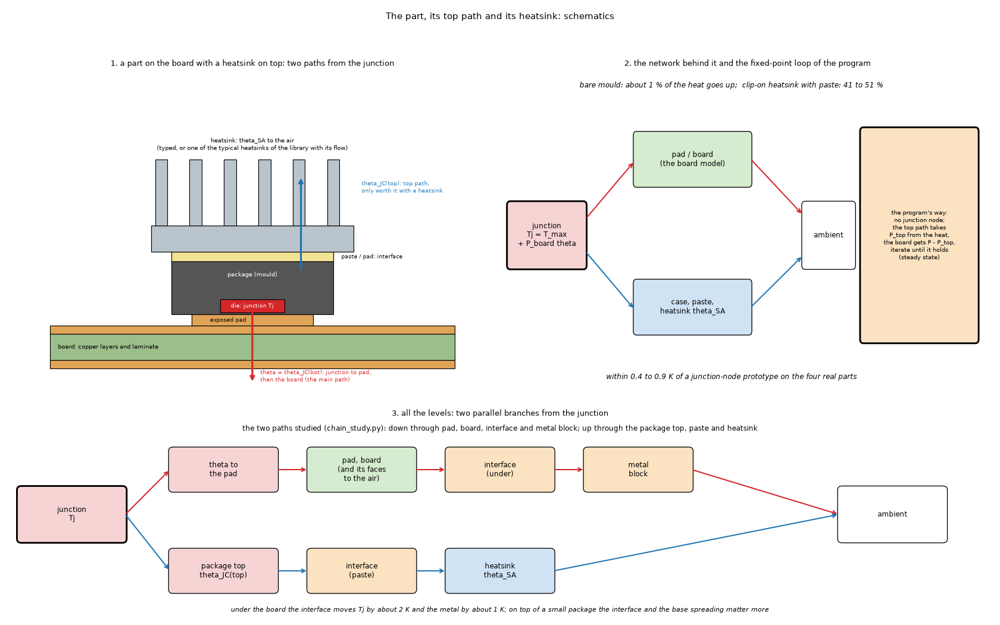
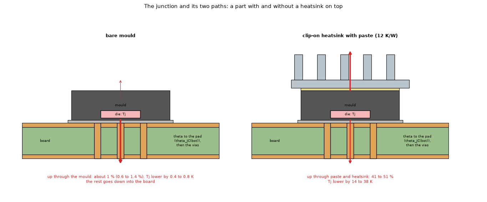
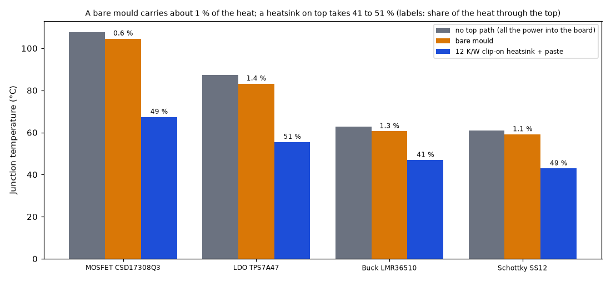
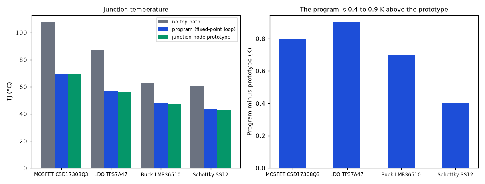
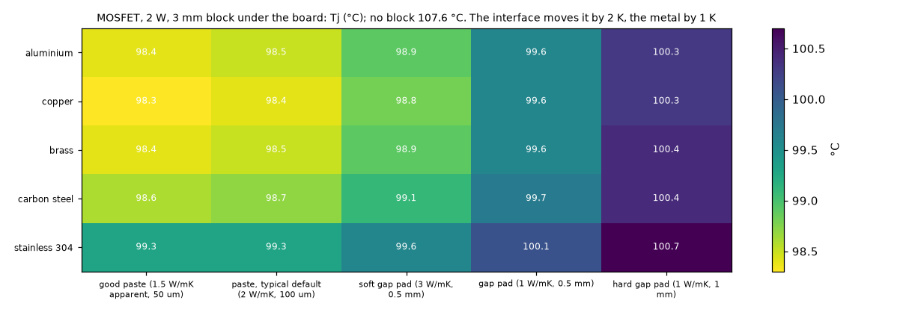
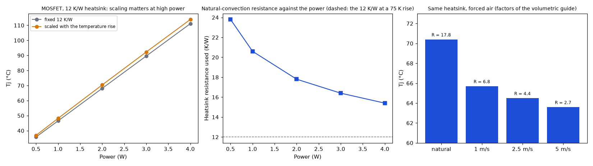

# The part, its top path and its heatsinks: junction temperature, interfaces and metal blocks

Status: **mostly implemented**; reviewed (section 7: one defect of the program found, the top-path loop on small pads) (θ junction-pad, junction limit, power coefficient, the top path, the interface sheet, the typical heatsink list, the metal block); the junction node (JESD15-3 two-resistor), the heatsink scenarios (θSA with the temperature rise, forced air, fin channel effect) and the Foster chain are **open** (see `INTEGRATION.md`). The long running notes (what was read, section by section) are in `NOTES.md`.

## 1. The questions

1. What does a Component (a package with a junction resistance) add to a plain heater, on real parts with datasheet numbers?
2. Is a junction node worth it, or is a worst-case offset enough?
3. What does a top path (θJC(top), paste, heatsink) change, and how well does the program's fixed-point loop reproduce a junction-node network?
4. What do the interface material, the metal of a block under the board and the base of a heatsink matter?
5. How should a heatsink known only by its sink-to-ambient resistance behave (natural-convection scaling, forced air)?

### 1.1 Diagrams and illustrations



*Figure 5 (`figures/fig_05_part_and_top_path_schematic.png`): A part with its top path as schematics: 1, the section of a package on the board with a heatsink on top and its two paths from the junction (theta = theta_JC(bot) through the pad and the board, theta_JC(top) through the paste and the heatsink); 2, the network behind it and the fixed-point loop that the program uses instead of a junction node; 3, the two parallel branches from the junction to the air studied in `chain_study.py` (an earlier version drew them as one series chain and labelled the downward resistance theta_JB, which is the number the program must not be given).*



*Figure 6 (`figures/fig_06_package_sections.png`): a package on the board without and with a heatsink: the die (junction), the mould, the pad and vias, and how much of the heat takes the path up (about 1 % bare, lowering Tj by 0.4 to 0.8 K; 41 to 51 % with a 12 K/W clip-on heatsink and paste, lowering it by 14 to 38 K against the same junction-node network without a top path; section 4.10).*

## 2. Findings in short

* The junction-to-pad resistance adds a **worst-case offset** `Tj = T_board,max + P·θ`: 2.5 to 10 K on the four real parts (2 to 28 % of the rise above ambient, more on a 25 mm pad than on an 8 mm one), and 100 K on a 0603 resistor (θ = 1000 K/W, 88 to 94 % of the rise).
* A bare mould carries about **1 %** of the heat (0.6 to 1.4 %); a 12 K/W clip-on heatsink with paste takes **41 to 51 %**. Against the same junction-node network without a top path the mould lowers `Tj` by 0.4 to 0.8 K and the heatsink by 14 to 38 K (the 2 to 4 K and 16 to 40 K quoted before compared the node with the worst-case offset, section 4.10). So a junction node is only worth it with a heatsink on top.
* The program's fixed-point top path (`api._solve_with_tc`, steady state) is within **0.4 to 0.9 K** of a junction-node prototype on the four parts on a 25 mm pad, and the five models agree within 1.4 % of the rise. **On an 8 mm pad the loop does not converge** (the board under the part resists more than the top path) and reports the junction 17 to 58 K too low with a misleading runaway message: a defect of the program, measured in section 4.11, correction proposed in `INTEGRATION.md`.
* Under the board the **interface** moves `Tj` by about 2 K and the **metal** by about 1 K; on top of a small package the interface and the base spreading matter more (steel 1 mm base adds 6.5 K/W of spreading against 0.9 for copper, within 13 % of Lee's closed form).
* With a heatsink known only by θSA, natural-convection scaling with the temperature rise changes `Tj` by 1 to 3 K from 0.5 to 4 W (fixed 12 K/W against a resistance of 24 K/W at 0.5 W to 15 K/W at 4 W) and forced air (1 to 5 m/s) lowers it by 6 to 8 K against the scaled natural value (an earlier version scaled the forced values with the rise too and read 5 to 7 K); the factors are from a guide (Electronics Cooling, 1995), not verified against a datasheet (see the typical-heatsink list in `docs/models.md` and `docs/research.md` R3 in `NOTES.md`).
* Power rising with temperature (positive coefficient) can run away: 2 W at 25 °C with 0.67 %/K gives 210 °C and 4.5 W.

## 3. Folder layout

| File | What it is |
| :-- | :-- |
| `scripts/component_study.py` | Real parts (CSD17308Q3, TPS7A47, LMR36510, SS12, a 0603 resistor) at three levels: plain heater, junction offset, top path. |
| `scripts/package_prototype.py` | A MOSFET as a simple heater and as a junction node, outside the program. |
| `scripts/top_path_study.py` | The program's top path against the junction-node prototype on the four chips. |
| `scripts/chain_study.py` | Several levels in one chain: junction, pad, board, interface, metal block, package top, interface, heatsink. |
| `scripts/heatsink_study.py` | Top heatsink with different pastes and pads; block under the board by metal and interface. |
| `scripts/heatsink_convection_study.py` | A heatsink known only by its resistance: fixed, natural scaling, forced convection. |
| `scripts/study_notes_r2.py` | The metal block with fins (metals, thickness) and the "perfect contact" table of `NOTES.md` R2. |
| `scripts/base_spreading_study.py` | The extra resistance of a heatsink base for a small component (3D conduction). |
| `scripts/block_contact_study.py` | A plate model against a published spreading example; a big block touching the board only in a patch; temperature-dependent power. |
| `scripts/study_top_path_convergence.py` | Does the program's top-path loop reach the operating point? Loop against the exact root and the node prototype on 8 and 25 mm pads (section 4.11). |
| `scripts/make_figures.py` | Draws the four figures (about 1.5 minutes). |
| `scripts/make_diagrams.py` | Draws the schematic diagram and the illustration (figures 5 and 6; no data, no program; uses `research/diagram_kit.py`). |
| `figures/` | `fig_01` to `fig_06`; figures 5 and 6 are the schematic diagram and the illustration (`make_diagrams.py`). |
| `docs/for-the-project-documents.md` | Text for the program's documents (`docs/theory.md`, `docs/validation.md`, `docs/research.md`, `docs/models.md`) found stale or missing in the review. |
| `NOTES.md` | The running research notes of `docs/research.md` (what was read, what was simulated, open questions). |
| `INTEGRATION.md` | What entered the program and what is open. |

## 4. How to run, and the results

Every study is run from the repository root, for example `.venv/bin/python research/component-heatsink/scripts/component_study.py` (each takes 2 seconds to 2 minutes). The outputs below were produced on the program of `develop` commit `1674d52`.

### 4.1 Real parts at three levels (`component_study.py`)

A. What the junction-to-pad resistance adds (level 1 against level 0), natural convection, 60 x 60 mm board
| Part | P [W] | theta [K/W] | Pad | Level 0: board under part [degC] | Level 1: Tj [degC] | P*theta [K] | Share of the rise | Tj max |
| :-- | --: | --: | --: | --: | --: | --: | --: | --: |
| MOSFET CSD17308Q3 (SON 3.3x3.3) | 2 | 4.5 | 8 mm | 227.4 | 236.4 | 9.0 | 4 % | 150 |
| MOSFET CSD17308Q3 (SON 3.3x3.3) | 2 | 4.5 | 25 mm | 98.6 | 107.6 | 9.0 | 11 % | 150 |
| LDO TPS7A47 (QFN-20 5x5) | 1.5 | 1.7 | 8 mm | 176.7 | 179.2 | 2.5 | 2 % | 125 |
| LDO TPS7A47 (QFN-20 5x5) | 1.5 | 1.7 | 25 mm | 84.8 | 87.3 | 2.5 | 4 % | 125 |
| Buck LMR36510 (HSOIC-8) | 0.8 | 4.3 | 8 mm | 109.9 | 113.3 | 3.4 | 4 % | 150 |
| Buck LMR36510 (HSOIC-8) | 0.8 | 4.3 | 25 mm | 59.3 | 62.8 | 3.4 | 9 % | 150 |
| Schottky SS12 (SMA) | 0.5 | 20 | 8 mm | 85.6 | 95.6 | 10.0 | 14 % | 125 |
| Schottky SS12 (SMA) | 0.5 | 20 | 25 mm | 50.9 | 60.9 | 10.0 | 28 % | 125 |
| Resistor 0603, 0.1 W | 0.1 | 1000 | 8 mm | 38.9 | 138.9 | 100.0 | 88 % | 170 (derating end) |
| Resistor 0603, 0.1 W | 0.1 | 1000 | 25 mm | 31.6 | 131.6 | 100.0 | 94 % | 170 (derating end) |

B. Wrong number from the datasheet: theta_JB instead of theta_JC(bottom) (pad 25 mm)
| Part | theta_JC(bot) [K/W] | Tj | theta_JB [K/W] | Tj with theta_JB | Difference |
| :-- | --: | --: | --: | --: | --: |
| LDO TPS7A47 (QFN-20 5x5) | 1.7 | 87.3 | 11.9 | 102.6 | +15.3 K (+25 % of the rise) |
| Buck LMR36510 (HSOIC-8) | 4.3 | 62.8 | 13.6 | 70.2 | +7.4 K (+20 % of the rise) |

C. Sensitivity to the theta entered (+-30 %, pad 25 mm)
| Part | Tj nominal | Tj at -30 % | Tj at +30 % |
| :-- | --: | --: | --: |
| MOSFET CSD17308Q3 (SON 3.3x3.3) | 107.6 | 104.9 (-2.7 K) | 110.3 (+2.7 K) |
| LDO TPS7A47 (QFN-20 5x5) | 87.3 | 86.6 (-0.8 K) | 88.1 (+0.8 K) |
| Buck LMR36510 (HSOIC-8) | 62.8 | 61.7 (-1.0 K) | 63.8 (+1.0 K) |
| Schottky SS12 (SMA) | 60.9 | 57.9 (-3.0 K) | 63.9 (+3.0 K) |
| Resistor 0603, 0.1 W | 131.6 | 101.6 (-30.0 K) | 161.6 (+30.0 K) |

D. A top path (level 2): bare mould (theta_JC(top) + convection on the body) and with a 12 K/W clip-on heatsink + 1 K/W paste (pad 25 mm)
   Level 2 is a junction node joined to the footprint by a uniform conductance; the node column without a top path is the same network
   with no path up, so the bare-mould and heatsink columns are compared with it (the level 1 offset is 1.4 to 3.4 K hotter by convention on these pads).
| Part | Level 1 Tj (offset) | Junction node, no top path | Bare mould Tj (heat through top) | With heatsink Tj (heat through top) | theta_JC(top) [K/W] |
| :-- | --: | --: | --: | --: | --: |
| MOSFET CSD17308Q3 (SON 3.3x3.3) | 107.6 | 105.1 | 104.6 (0.6 %) | 67.4 (49 %) | 30 (assumed) |
| LDO TPS7A47 (QFN-20 5x5) | 87.3 | 84.0 | 83.2 (1.4 %) | 55.5 (51 %) | 27 |
| Buck LMR36510 (HSOIC-8) | 62.8 | 61.0 | 60.6 (1.3 %) | 46.9 (41 %) | 54 |
| Schottky SS12 (SMA) | 60.9 | 59.5 | 59.1 (1.1 %) | 42.9 (49 %) | 60 (assumed) |

E. The psi_JB route of the program (Tj = mean board temperature in the ring 0.5 to 1.5 mm outside the body + psi_JB P), FVM at 0.5 mm, pad 25 mm
| Part | psi_JB [K/W] | T_ring [degC] | Tj psi_JB route | Tj with theta_JC(bot) | Tj with theta_JB as theta |
| :-- | --: | --: | --: | --: | --: |
| LDO TPS7A47 (QFN-20 5x5) | 11.9 | 75.9 | 93.7 | 87.4 | 102.7 |
| Buck LMR36510 (HSOIC-8) | 13.8 | 54.0 | 65.1 | 62.8 | 70.2 |



*Figure 1: `figures/fig_01_parts_with_and_without_top_path.png`.*

### 4.2 The program's top path against a junction node (`top_path_study.py`)

Top path: theta_JC(top) of the part + 0.5 K cm2/W paste + 12.0 K/W heatsink; pad 25 mm, computed h, FVM at 0.5 mm
| Part | Tj without top path | Tj program | Top share program | Tj node prototype | Top share prototype |
| :-- | --: | --: | --: | --: | --: |
| MOSFET CSD17308Q3 (SON 3.3x3.3) | 107.6 | 69.8 | 48 % | 69.0 | 47 % |
| LDO TPS7A47 (QFN-20 5x5) | 87.4 | 56.7 | 51 % | 55.8 | 50 % |
| Buck LMR36510 (HSOIC-8) | 62.8 | 47.8 | 41 % | 47.1 | 40 % |
| Schottky SS12 (SMA) | 60.9 | 43.7 | 49 % | 43.3 | 48 % |

The top path in every model: 60 x 60 mm board, copper 50 x 50 mm on both faces, h 15 / 10 W/m2K, 4 x 4 mm part, 2 W, theta 4.5, theta_JC(top) 30, theta_SA 12 K/W, 1 mm cells
| Model | Tj [degC] | Top share | Difference from the FVM [% of the rise] |
| :-- | --: | --: | --: |
| fvm | 64.89 | 47.5 % | +0.0 |
| fdm | 64.80 | 47.4 % | -0.2 |
| lumped | 64.32 | 46.8 % | -1.4 |
| analytic | 64.94 | 47.5 % | +0.1 |
| solid3d | 65.15 | 47.8 % | +0.6 |

The models agree on the top path within 1.4 % of the rise (the test `tests/test_component.py` only asks for 10 %); the program's 0.4 to 0.9 K above the node prototype is the worst-case convention (section 4.10).



*Figure 2: `figures/fig_02_program_top_path_vs_node_prototype.png`.*

### 4.3 The prototype (`package_prototype.py`)

```
A. The datasheet's own test: RthJA on the test board (1 W)
   datasheet: typical 46, maximum 58 K/W on 1 in2; maximum 165 K/W on the minimum pad

   board                        model        Tj   RthJA   Tfoot
   1 in2 pad (25.4 mm)          offset     71.7    46.7    67.2
   1 in2 pad (25.4 mm)          node       70.1    45.1    66.8
   5 mm pad (minimum, assumed)  offset    189.2   164.2   184.7
   5 mm pad (minimum, assumed)  node      187.8   162.8   184.3

B. A real use: 2 W in the FET on the 1 in2 pad, without and with a heat heatsink on the package top
   case                                         model        Tj  Tj<=150?  top share
   no top path                                  offset    112.5       yes       0.0 %
   no top path                                  node      109.4       yes       0.0 %
   bare mould: 30 K/W + 15 W/m2K on 3.3 mm (assumed) node      108.9       yes       0.7 %
   heat heatsink 12 K/W, theta_JC(top) = 40 (assumed) node       73.6       yes      45.8 %
   heat heatsink 12 K/W, theta_JC(top) = 20 (assumed) node       63.4       yes      58.2 %
   heat heatsink 12 K/W, theta_JC(top) = 5 (assumed) node       51.1       yes      72.6 %
   good heat heatsink 4 K/W, theta_JC(top) = 20 (assumed) node       57.6       yes      65.1 %

C. Sensitivity to the junction-to-pad resistance (2 W, 1 in2 pad, no top path)
   theta =  1.1 K/W   Tj =  101.9 degC   footprint  101.1
   theta =  4.5 K/W   Tj =  109.4 degC   footprint  102.6
   theta =  8.0 K/W   Tj =  116.5 degC   footprint  103.0
```

### 4.4 Several levels in one chain (`chain_study.py`)

MOSFET CSD17308Q3 (SON 3.3x3.3), 2 W, pad 25 mm, h = 14.6 / 10.3 W/m2K; top chain = theta_JC(top) 30 + paste 4.6 + heatsink 12 = 46.6 K/W
| Case | Tj [degC] | heat through the top | heat through the block |
| :-- | --: | --: | --: |
| board only | 105.0 | 0 % | 0 % |
| + block 30x30x3 mm, paste 0.5 | 95.6 | 0 % | 27 % |
| + block, gap pad 5 K cm2/W | 96.7 | 0 % | 28 % |
| + top heatsink with paste | 68.1 | 46 % | 0 % |
| + both (block with paste and top heatsink) | 65.2 | 43 % | 16 % |

LDO TPS7A47 (QFN-20 5x5), 1.5 W, pad 25 mm, h = 14.0 / 9.9 W/m2K; top chain = theta_JC(top) 27 + paste 2.0 + heatsink 12 = 41.0 K/W
| Case | Tj [degC] | heat through the top | heat through the block |
| :-- | --: | --: | --: |
| board only | 84.0 | 0 % | 0 % |
| + block 30x30x3 mm, paste 0.5 | 72.0 | 0 % | 28 % |
| + block, gap pad 5 K cm2/W | 74.4 | 0 % | 28 % |
| + top heatsink with paste | 55.1 | 49 % | 0 % |
| + both (block with paste and top heatsink) | 51.6 | 43 % | 16 % |

### 4.5 Top heatsink pastes and pads, block metals and interfaces (`heatsink_study.py`)

E. Heatsink on top of the package (12 K/W), different interface materials (pad 25 mm)
| Part | no heatsink | good paste (1.5 W/mK apparent, 50 um) [0.33 K cm2/W] | paste, typical default (2 W/mK, 100 um) [0.50 K cm2/W] | soft gap pad (3 W/mK, 0.5 mm) [1.67 K cm2/W] | gap pad (1 W/mK, 0.5 mm) [5.00 K cm2/W] | hard gap pad (1 W/mK, 1 mm) [10.00 K cm2/W] |
| :-- | --: | --: | --: | --: | --: | --: |
| MOSFET CSD17308Q3 (SON 3.3x3.3) | 107.6 | 68.4 (48 %) | 69.0 (47 %) | 73.1 (42 %) | 81.0 (32 %) | 87.5 (23 %) |
| LDO TPS7A47 (QFN-20 5x5) | 87.3 | 55.6 (51 %) | 55.8 (50 %) | 57.4 (47 %) | 61.2 (41 %) | 65.1 (34 %) |
| Buck LMR36510 (HSOIC-8) | 62.8 | 47.0 (41 %) | 47.1 (40 %) | 47.8 (38 %) | 49.5 (33 %) | 51.4 (28 %) |
| Schottky SS12 (SMA) | 60.9 | 43.2 (48 %) | 43.3 (48 %) | 44.4 (45 %) | 46.9 (38 %) | 49.4 (30 %) |

F. MOSFET CSD17308Q3 (SON 3.3x3.3), 2 W, 3 mm block 30 x 30 mm under the board: Tj [degC] by metal (rows) and interface (columns); block face in natural convection
| Metal | no block | good paste (1.5 W/mK apparent, 50 um) [0.33] | paste, typical default (2 W/mK, 100 um) [0.50] | soft gap pad (3 W/mK, 0.5 mm) [1.67] | gap pad (1 W/mK, 0.5 mm) [5.00] | hard gap pad (1 W/mK, 1 mm) [10.00] |
| :-- | --: | --: | --: | --: | --: | --: |
| aluminium | 107.6 | 98.4 | 98.5 | 98.9 | 99.6 | 100.3 |
| copper | 107.6 | 98.3 | 98.4 | 98.8 | 99.6 | 100.3 |
| brass | 107.6 | 98.4 | 98.5 | 98.9 | 99.6 | 100.4 |
| carbon steel | 107.6 | 98.6 | 98.7 | 99.1 | 99.7 | 100.4 |
| stainless 304 | 107.6 | 99.3 | 99.3 | 99.6 | 100.1 | 100.7 |



*Figure 4: `figures/fig_04_block_metal_and_interface.png`.*

### 4.6 Heatsink scenarios: natural scaling and forced air (`heatsink_convection_study.py`)

MOSFET, top heatsink 12 K/W catalogue value at a 75 K rise, default paste; fixed resistance against natural-convection scaling (Tj in degC, sink resistance in K/W)
| Power [W] | fixed 12 K/W | natural scaling: Tj | sink R used | heat through the top |
| --: | --: | --: | --: | --: |
| 0.5 | 35.8 | 36.9 | 23.8 | 41 % |
| 1 | 46.5 | 48.2 | 20.6 | 42 % |
| 2 | 68.1 | 70.4 | 17.8 | 43 % |
| 3 | 89.6 | 92.3 | 16.4 | 44 % |
| 4 | 111.1 | 113.9 | 15.4 | 44 % |

Same heatsink (12 K/W natural at a 75 K rise, 2 W) in forced convection (factors of the volumetric performance on the catalogue value, held fixed; natural row scaled with the rise)
| Air | sink R used [K/W] | Tj [degC] | heat through the top |
| :-- | --: | --: | --: |
| natural | 17.8 | 70.4 | 43 % |
| 1 m/s | 3.7 | 64.1 | 51 % |
| 2.5 m/s | 2.2 | 63.3 | 52 % |
| 5 m/s | 1.2 | 62.8 | 53 % |

Size to resistance (volumetric performance 500-800 cm3 K/W natural): heatsink volume for a given resistance
| Volume [cm3] | natural R [K/W] | 1 m/s | 2.5 m/s | 5 m/s |
| --: | --: | --: | --: | --: |
| 5 | 100 to 160 | 30 to 50 | 16.0 to 30.0 | 10.0 to 16.0 |
| 10 | 50 to 80 | 15 to 25 | 8.0 to 15.0 | 5.0 to 8.0 |
| 20 | 25 to 40 | 8 to 12 | 4.0 to 7.5 | 2.5 to 4.0 |
| 50 | 10 to 16 | 3 to 5 | 1.6 to 3.0 | 1.0 to 1.6 |

An earlier version of the study also scaled the forced-air values with the rise as in natural convection, which made them 1.8 to 2 times too high at the small rises of forced air (6.8, 4.4 and 2.7 K/W, Tj 65.7, 64.5 and 63.6 °C); the factor now multiplies the catalogue value and is held fixed, as the proposal in `NOTES.md` R6 says.



*Figure 3: `figures/fig_03_heatsink_convection_scenarios.png` (a study with a prototype scaling of the heatsink resistance with the temperature rise and with the air speed; the program has a typed or typical theta_SA only, the scaling is still open in `docs/research.md` R3 and R6).*

### 4.7 The base of a heatsink (`base_spreading_study.py`)

Extra resistance of a 40 x 40 mm heatsink base (catalogue 12 K/W) for a small component, K/W (mean over the source); share of the top chain in brackets
Lee: the closed form of Seri Lee and others (equivalent discs), an independent reference
| Base | 3.3 mm source (chain 46.6 K/W) | Lee, 3.3 mm | 5 mm source (chain 41 K/W) | Lee, 5 mm |
| :-- | --: | --: | --: | --: |
| aluminium 1 mm | 1.73 (3.7 %) | 1.85 | 1.33 (3.3 %) | 1.48 |
| aluminium 3 mm | 0.87 (1.9 %) | 0.89 | 0.60 (1.5 %) | 0.64 |
| aluminium 6 mm | 0.78 (1.7 %) | 0.79 | 0.49 (1.2 %) | 0.52 |
| copper 1 mm | 0.92 (2.0 %) | 0.98 | 0.71 (1.7 %) | 0.78 |
| copper 3 mm | 0.46 (1.0 %) | 0.47 | 0.32 (0.8 %) | 0.34 |
| copper 6 mm | 0.41 (0.9 %) | 0.42 | 0.26 (0.6 %) | 0.27 |
| carbon steel 1 mm | 6.46 (13.9 %) | 6.97 | 4.97 (12.1 %) | 5.56 |
| carbon steel 3 mm | 3.28 (7.0 %) | 3.38 | 2.25 (5.5 %) | 2.41 |
| carbon steel 6 mm | 2.95 (6.3 %) | 3.00 | 1.85 (4.5 %) | 1.96 |

Mesh check (3.3 mm source): 100 x 100 x 6 cells against 200 x 200 x 12
| Base | coarse | fine | change |
| :-- | --: | --: | --: |
| aluminium 1 mm | 1.730 | 1.717 | +0.8 % |
| aluminium 6 mm | 0.781 | 0.730 | +7.0 % |
| carbon steel 1 mm | 6.464 | 6.413 | +0.8 % |

The earlier table (aluminium 6 mm 0.54, steel 1 mm 6.31 K/W) read the temperature of the first cell centre, half a cell above the face that carries the source; on a thick base with 1 mm cells that hid 0.24 K/W (30 %). The study now adds the conduction of that half cell. The numbers are 0 to 13 % below Lee's closed form (closest on thick bases; the closed form replaces both squares by discs) and the thick bases still move by 7 % with the mesh, so read them to about 10 %. The conclusion holds: on aluminium or copper the base adds 1 to 4 % of the top chain, on a thin steel base 12 to 14 %. Run time about 1.5 minutes.

### 4.8 A block larger than its contact, and power rising with temperature (`block_contact_study.py`)

1. Plate against Lee et al.: maximum constriction resistance 0.66 K/W (paper 0.66), total 1.66 K/W (paper 1.66)

An earlier run read 0.69 K/W (+4.5 %): on 1 mm cells `round()` rounded the source edges 37.5 and 62.5 mm to the even cells 38 and 62, a 24 mm source; the script now uses 0.5 mm cells and rounds halves up, and the 25 mm source gives 0.664 K/W (+0.6 %; `research/effective-conductivity/` 4.8 A).

2. MOSFET 2 W, Al block 40 x 40 x 3 mm under the board, contact only in a centred patch (default interface 5 K cm2/W)
| Contact patch | Tj [degC] |
| :-- | --: |
| whole block (40 x 40) | 87.8 |
| 25 x 25 mm | 96.6 |
| 12 x 12 mm | 97.0 |
| 6 x 6 mm | 99.5 |
| none | 124.3 |

2b. The same with an air gap outside the patch (conduction + radiation; gap in mm, block bare aluminium, emissivity 0.1)
| Gap outside the contact | patch 25 mm | 12 mm | 6 mm | none |
| :-- | --: | --: | --: | --: |
| insulated (board face hidden, as above) | 96.6 | 97.0 | 99.5 | 124.3 |
| 0.5 mm  (h = 57 W/m2K) | 92.2 | 93.2 | 95.7 | 101.7 |
| 1 mm  (h = 29 W/m2K) | 93.7 | 94.5 | 97.3 | 106.1 |
| 2 mm  (h = 15 W/m2K) | 94.8 | 95.5 | 98.2 | 110.5 |
| 5 mm  (h = 6 W/m2K) | 95.7 | 96.3 | 98.9 | 115.6 |

3. MOSFET 2 W (at 25 C) with the power rising with temperature (pad 25 mm, no top path)
| alpha [%/K] | Tj [degC] | power at Tj [W] |
| --: | --: | --: |
| 0.00 | 107.6 | 2.00 |
| 0.33 | 138.6 | 2.75 |
| 0.50 | 165.8 | 3.41 |
| 0.67 | 210.0 | 4.48 |

### 4.9 The junction temperature in the program (validation)

`python research/component-heatsink/scripts/component_study.py`, `research/component-heatsink/scripts/block_contact_study.py` (power coefficient) and `tests/test_component.py`. Five parts of the datasheets read (`docs/models.md` section 6) on a 60 × 60 mm, 2-layer board with a copper pad under the part on both faces (vias under footprints of 3 mm and more), computed natural convection, FVM at 0.5 mm. Level 0 is the plain source (the hottest board point under the part); level 1 adds θ.

| Part | P [W] | θ [K/W] | Pad | Board under part | Tj | P·θ | Share of the rise |
| :-- | --: | --: | --: | --: | --: | --: | --: |
| MOSFET CSD17308Q3 | 2 | 4.5 | 8 mm | 227.4 °C | 236.4 °C | 9.0 K | 4 % |
| MOSFET CSD17308Q3 | 2 | 4.5 | 25 mm | 98.6 °C | 107.6 °C | 9.0 K | 11 % |
| LDO TPS7A47 | 1.5 | 1.7 | 8 mm | 176.7 °C | 179.2 °C | 2.5 K | 2 % |
| LDO TPS7A47 | 1.5 | 1.7 | 25 mm | 84.8 °C | 87.3 °C | 2.5 K | 4 % |
| Buck LMR36510 | 0.8 | 4.3 | 8 mm | 109.9 °C | 113.3 °C | 3.4 K | 4 % |
| Buck LMR36510 | 0.8 | 4.3 | 25 mm | 59.3 °C | 62.8 °C | 3.4 K | 9 % |
| Schottky SS12 (SMA) | 0.5 | 20 | 8 mm | 85.6 °C | 95.6 °C | 10.0 K | 14 % |
| Schottky SS12 (SMA) | 0.5 | 20 | 25 mm | 50.9 °C | 60.9 °C | 10.0 K | 28 % |
| Resistor 0603 | 0.1 | 1000 (derived) | 8 mm | 38.9 °C | 138.9 °C | 100 K | 88 % |
| Resistor 0603 | 0.1 | 1000 (derived) | 25 mm | 31.6 °C | 131.6 °C | 100 K | 94 % |

* **Sensitivity** (pad 25 mm): θ ±30 % moves `Tj` by ±0.8 K (LDO), ±1.0 K (buck), ±2.7 K (MOSFET), ±3.0 K (diode) and ±30 K (resistor, where the derived number is the whole answer).
* **The number chosen matters more than its accuracy**: `θJB` instead of `θJC(bot)` gives 102.6 against 87.3 °C (LDO) and 70.2 against 62.8 °C (buck).
* **`ψJB` route** (`Tj = T_ring + ψJB·P`, ring 0.5 to 1.5 mm outside the body, pad 25 mm; table E of 4.1, printed by the program since this review): LDO 93.7 °C and buck 65.1 °C against 87.4 and 62.8 °C with `θJC(bot)`; with `θJB` as θ 102.7 and 70.2 °C.
* **Datasheet check** (CSD17308Q3, 1 W on its own board of 1 in² of 2 oz copper, computed natural convection): `RθJA` 46.7 K/W against the datasheet's typical 46 and maximum 58; on a minimum pad of 5 mm (assumed size) 164 against the maximum 165 K/W.
* **Power temperature coefficient** against the closed form `ΔT = P0 R/(1 − tc P0 R)` on a linear board (the FVM, Lumped and Analytic models, `tests/test_component.py`): agreement to 0.05 K; for the MOSFET 2 W at 25 °C (107.6 °C without feedback) the junction reaches 138.6, 165.8 and 210 °C for 0.33, 0.5 and 0.67 %/K, with the power rising to 2.75, 3.41 and 4.48 W; a coefficient of 3 %/K has no stable point and the program says so.
* **Top path** (`python research/component-heatsink/scripts/top_path_study.py`, `tests/test_component.py`; θJC(top) of the part, 0.5 K·cm²/W paste, 12 K/W clip-on heatsink, pad 25 mm): the heatsink takes 41 to 51 % of the heat and lowers `Tj` of the chips by 15 to 38 K. Against the junction-node prototype of `research/component-heatsink/scripts/package_prototype.py` (uniform conductance under the footprint) the program is 0.4 to 0.9 K higher and the top share differs by one point.

| Part | Tj without top path | Tj program | Top share | Tj node prototype | Top share |
| :-- | --: | --: | --: | --: | --: |
| MOSFET CSD17308Q3 | 107.6 | 69.8 | 48 % | 69.0 | 47 % |
| LDO TPS7A47 | 87.4 | 56.6 | 51 % | 55.8 | 50 % |
| Buck LMR36510 | 62.8 | 47.8 | 41 % | 47.1 | 40 % |
| Schottky SS12 (SMA) | 60.9 | 43.7 | 49 % | 43.3 | 48 % |

  The series-parallel closure is exact (`Tj − T_amb = R_top·P_top`, `P_top + P_board = P`, test to 1e-4) and the FVM, FDM, Lumped, Analytic and 3D solid models agree on `Tj` within 1.4 % of its rise (section 4.2; the test only asks for 10 %).
  **These rows hold because the 25 mm pad keeps the board's resistance under the part below the top path's: on a small pad the program's loop does not reach the operating point and reports `Tj` 17 to 58 K too low (section 4.11).** The LDO row above comes from a loop that stopped at 80 iterations with the warning "did not settle" (the value is right to 0.1 K).
* **Limits of the approach**: worst case without `theta_sa` (no heat through the top of the package); `θ` is a single number for the whole junction; the junction is the hottest board point under the footprint plus `P·θ` (1.3 to 3.4 K above a junction node with a uniform conductance on the chips, 0.2 K on the resistor, which is the conservative side; section 4.10).

### 4.10 The worst-case convention against a junction node (measured in this review)

The program puts the junction at the hottest board point under the footprint plus `P·θ` ("offset"); the prototype joins a junction node to every footprint cell with a uniform conductance ("node"). Without a top path, the same board (`package_prototype.solve`, FVM at 0.5 mm, computed h); the 25 mm rows are printed by `component_study.py` (table D, first two columns):

| Part | Pad | Offset Tj [degC] | Node Tj [degC] | Offset minus node [K] | Rise [K] |
| :-- | --: | --: | --: | --: | --: |
| MOSFET CSD17308Q3 | 8 mm | 236.4 | 234.2 | 2.2 | 211.4 |
| MOSFET CSD17308Q3 | 25 mm | 107.6 | 105.1 | 2.6 | 82.6 |
| LDO TPS7A47 | 8 mm | 179.2 | 176.2 | 3.0 | 154.2 |
| LDO TPS7A47 | 25 mm | 87.3 | 84.0 | 3.3 | 62.3 |
| Buck LMR36510 | 8 mm | 113.3 | 111.7 | 1.7 | 88.3 |
| Buck LMR36510 | 25 mm | 62.8 | 61.0 | 1.8 | 37.8 |
| Schottky SS12 | 8 mm | 95.6 | 94.3 | 1.3 | 70.6 |
| Schottky SS12 | 25 mm | 60.9 | 59.5 | 1.4 | 35.9 |
| Resistor 0603 | 8 mm | 138.9 | 138.7 | 0.2 | 113.9 |
| Resistor 0603 | 25 mm | 131.6 | 131.4 | 0.2 | 106.6 |

So "about 3 K" (`docs/theory.md` 9, `docs/validation.md` 9) is the MOSFET and the LDO; the range is 1.3 to 3.4 K on the chips. This also explains an earlier reading of table D: the bare mould seemed to lower `Tj` by 2 to 4 K, but table D compared the offset (level 1) with a node (level 2); against the node without a top path the mould lowers `Tj` by 0.4 to 0.8 K, and the 12 K/W heatsink by 14 to 38 K (16 to 40 K was against the offset).

### 4.11 Does the program's top-path loop converge? (`study_top_path_convergence.py`, measured in this review)

The loop of `api._solve_with_tc` repeats `P_b <- P − p_top(T_max(P_b))`. With `T_max − T_amb ≈ R_b P_b` (R_b the board's resistance under the part) and `p_top = (T_max − T_amb + P θ)/(R_top + θ)` (`analysis.part_split`), the map has the slope `−R_b/(R_top + θ)`: it converges only when the board under the part is a better path than the top (ratio below 1), slowly near 1, and oscillates with a growing amplitude above 1. The exact operating point is the root of `P_b − P + p_top(P_b) = 0` (monotone), found by Brent's method with the program's own board solve:

```
| Part | Pad | R_b / (R_top + theta) | Program Tj [degC] | Program top share | Loop iterations | Settled | Exact Tj [degC] | Exact top share | Program minus exact [K] | Node prototype Tj [degC] |
| MOSFET CSD17308Q3 (SON 3.3x3.3) | 8 mm | 1.98 | 33.2 | 9 % | 80 | NO | 90.9 | 71 % | -57.7 | 90.7 |
| MOSFET CSD17308Q3 (SON 3.3x3.3) | 25 mm | 0.72 | 69.8 | 48 % | 36 | yes | 69.8 | 48 % | -0.0 | 69.0 |
| LDO TPS7A47 (QFN-20 5x5) | 8 mm | 2.37 | 27.4 | 4 % | 80 | NO | 69.8 | 73 % | -42.3 | 69.5 |
| LDO TPS7A47 (QFN-20 5x5) | 25 mm | 0.93 | 56.6 | 51 % | 80 | NO | 56.7 | 51 % | -0.0 | 55.8 |
| Buck LMR36510 (HSOIC-8) | 8 mm | 1.46 | 28.2 | 6 % | 80 | NO | 59.4 | 63 % | -31.2 | 59.2 |
| Buck LMR36510 (HSOIC-8) | 25 mm | 0.59 | 47.8 | 41 % | 22 | yes | 47.8 | 41 % | -0.0 | 47.1 |
| Schottky SS12 (SMA) | 8 mm | 1.26 | 32.9 | 21 % | 80 | NO | 50.1 | 66 % | -17.2 | 49.9 |
| Schottky SS12 (SMA) | 25 mm | 0.54 | 43.7 | 49 % | 20 | yes | 43.7 | 49 % | -0.0 | 43.3 |
```

* **Defect in the program** (measured here, not corrected: `pcbthermal/` is not edited on a research branch): on every 8 mm pad the loop stops after 80 iterations at a junction 17 to 58 K **below** the operating point (33 °C against 91 °C for the MOSFET), on the unsafe side, with the message "the board is close to thermal runaway and the temperatures are underestimated", which names the wrong cause. A small pad with a heatsink on the part is exactly the case the top path is for.
* The exact root agrees with the independent node prototype within 0.2 K on the 8 mm pads (most of the heat goes up, so the convention matters little) and reproduces the published 25 mm rows to 0.1 K.
* The proposed correction (in `INTEGRATION.md`): solve the scalar equation of each part by a secant (the board is affine in `P_b` for fixed coefficients, so two solves give the root, as in the power calculator), or relax the iteration with the measured slope; keep the plain loop only for the power coefficient. Run time about 2 minutes.

## 5. Limits of this study

* No measurement of a physical board or part: all numbers are model against model, with datasheet inputs; entries marked *assumed* (θJC(top) of the MOSFET and the Schottky, the pad of some parts, a bare-mould coefficient of 15 W/m²K) are not from a datasheet.
* The top path is steady state only; the junction has no capacity (no Foster chain); the interface has no area of its own other than the contact area field.
* The natural-convection scaling and the forced-air factors come from a guide and a few catalogue values, not from a verified heatsink model; the fin channel effect is not modelled.
* Five parts only; a 0603 resistor shows how strongly a large θ moves the result (100 K at 0.1 W).

## 6. Sources

See `NOTES.md` (the references of every section, from JEDEC-based application notes of TI, Renesas, Richtek, ROHM and Microchip to the heatsink catalogues) and `docs/models.md` for the typical-heatsink list. Where a source was only seen in a search summary, `NOTES.md` says so.

## What was read and what was not verified

* Read in full, from summaries, or from memory: see `NOTES.md` section by section and the list below for the review. The factors for forced air come from a guide (Electronics Cooling, 1995) and were compared with a few catalogue values only. θJC(top) of the MOSFET and the Schottky are assumed. Not verified: no measurement of a physical part; the junction node was only prototyped.
* Datasheets opened in the review (text extracted with pypdf, the PDFs downloaded to a scratch directory and not committed): TI CSD17308Q3 (SLPS262C: RθJC 4.5 maximum, RθJA 46 typical and 58 maximum on 1 in² of 2 oz copper, Tj −55 to 150 °C), TI TPS7A47 (SBVS204G: θJC(bot) 1.7, θJB 11.9, ψJB 11.9, θJC(top) 27; operating Tj −40 to 125 °C), TI LMR36510 (θJC(bot) 4.3, θJB 13.6, ψJB 13.8, θJC(top) 54; Tj −40 to 150 °C), Vishay SS12 (document 88746: RθJL 28 K/W, Tj −65 to 150 °C). The SX Semiconductor SS12 sheet the study uses (RθJ-L 20 K/W, `NOTES.md` [14]) was not re-opened; the junction-to-terminal resistance of an SS12 is maker-dependent (20 against 28 K/W).
* What was run in the review: `package_prototype.py`, `component_study.py`, `top_path_study.py`, `chain_study.py`, `heatsink_study.py`, `heatsink_convection_study.py`, `base_spreading_study.py`, `block_contact_study.py`, `make_figures.py`, `make_diagrams.py` and the new `study_top_path_convergence.py`, on the program of `develop` `1674d52` (physics code identical on `research/gerbers`). Every table of this README before the review reproduced to the last digit, except what section 7 corrected. Afterwards `study_notes_r2.py` reproduced the "perfect contact" table of `NOTES.md` R2 to the printed digit; the fin and thickness numbers did not (71.2 to 71.8 °C across metals at 6 mm, 76.4 at 1 mm, 73.8 at 3 mm, 71.2 at 6 mm; the earlier values were about 0.5 K higher) and were replaced by the printed ones.
* Not re-opened: onsemi's SS14 page returned HTML, not the PDF. From memory only: Seri Lee and others' spreading formula (Electronics Cooling, 1998), used as a closed-form check of the heatsink base; the Electronics Cooling volumetric factors of forced air; the heatsink catalogue values of the library.
* An earlier draft said "1 to 3 K" for the junction offset; the table was re-read from the output and corrected to 2.5 to 10 K. All nine studies reproduce the numbers of this README; `docs/validation.md` section 9 is current except the points listed in `docs/for-the-project-documents.md`.

## 7. Review (reviewer agent)

Every study was re-run on the program of `develop` `1674d52` (the physics code is the same on this branch). Tables 4.1 A to C, 4.2 to 4.5, 4.6 natural rows and 4.8 reproduce to the last digit; the plate check of 4.8 is 0.664 K/W against 0.66 in Seri Lee (1998).

Findings and what was done:

1. **Defect in the program: the top-path loop diverges on small pads** (section 4.11). The plain fixed-point iteration converges only when the board's resistance under the part is below `R_top + θ`; on 8 mm pads it stops after 80 iterations 17 to 58 K below the operating point, with a warning that blames thermal runaway. Measured with `scripts/study_top_path_convergence.py` against the exact root (Brent's method on the program's own board solve) and the independent node prototype (within 0.2 K of the root). Not corrected here (`pcbthermal/` is not edited on a research branch): design in `INTEGRATION.md`; `tests/test_component.py` passes because its board has 50 mm of copper.
2. **Defect in a study: forced air was scaled like natural convection** (`heatsink_convection_study.py`): the forced values were multiplied by `(75/ΔT)^0.25` as well, 1.8 to 2 times too high (6.8, 4.4, 2.7 K/W instead of 3.7, 2.2, 1.2). Fixed; `Tj` 64.1, 63.3, 62.8 °C instead of 65.7, 64.5, 63.6; figure 3 redrawn.
3. **Defect in a study: the base of a heatsink read half a cell above its face** (`base_spreading_study.py`): thick bases were 30 % low (aluminium 6 mm 0.54 instead of 0.78 K/W). Fixed with the conduction of the half cell; Lee's closed form added as the reference (0 to 13 % above the study) and a mesh check (thick bases move 7 %).
4. **Explanation tested and corrected: the bare mould "2 to 4 K"** compared the worst-case offset with a node; against the same node it is 0.4 to 0.8 K, and the heatsink 14 to 38 K instead of 16 to 40 (section 4.10; table D has the node column, figures 1 and 6 redrawn). The convention gap itself is 1.3 to 3.4 K on the chips, not "about 3 K".
5. **Wrong column: Tj max 150 for every part.** The column was a constant; the TPS7A47 is rated 125 °C in operation and the SS12 sheet of the study 125 °C (Vishay's 150). Now per part, with the source in `component_study.py`.
6. **Numbers no script printed**: the ψJB route (93.7, 65.1, 102.7 °C) is now table E of `component_study.py`; the agreement of the models on the top path (1.4 %, not the 10 % of the test) is printed by `top_path_study.py`. The fin and block-thickness numbers and the "perfect contact" table of `NOTES.md` R2 are now printed by `study_notes_r2.py`: the table reproduces exactly; the fin numbers were about 0.5 K too high (71.7 to 72.2, 76.8, 74.3, 71.7 became 71.2 to 71.8, 76.4, 73.8, 71.2 °C) and NOTES.md has the printed values.
7. **Claims contradicted by the tables** (`NOTES.md`, the same text in `docs/research.md`): "the default paste costs 0.6 to 1 K against a good paste" (table E: 0.1 to 0.6 K); "the same change on top moves it by 10 to 20 K" (0.5 to 5 K cm²/W on top: 2.4 to 12 K); "+4 K at 4 W the other way: 113.9 against 111.1" (2.8 K, the same way). Corrected in `NOTES.md`; text for `docs/research.md` in `docs/for-the-project-documents.md`.
8. **Diagrams**: figure 5 labelled the downward resistance `theta_JB` (the study's own table B shows that `θJB` is the wrong number), drew the two paths as one series chain and wrote `Tj = T + P theta` (with a top path it is `P_board`); figure 6 also said `theta_JB`; text overlapped the arrows. Redrawn. Figure 4 had white numbers on yellow cells (now dark), figure 3 overlapping titles.
9. **Stale cross-references** in the scripts (`docs/roadmap.md` 1.6, 1.9c and "section 1.8", which no longer exist), dead code in `heatsink_study.py`; corrected.
10. **Missing in `docs/theory.md`**: section 9 does not describe the top path (`part_split` and the loop); text proposed in `docs/for-the-project-documents.md`.

Checked and unchanged: the series-parallel closure of `analysis.part_split` against `docs/models.md` 6 (algebra re-derived); the power coefficient against `ΔT = P₀R/(1 − αP₀R)` (138.6, 165.8, 210.0 °C reproduced by hand from R = 41.3 K/W); the interface presets (`t/k` of each preset of `defaults.json` gives the K cm²/W of the tables), the metal values against the notes of `defaults.json`; the chain block share 27.5 % with paste and 27.6 % with a gap pad (the block's surface, about 100 K/W, dominates its 0.6 K/W interface, so the share barely moves). Not verified: the heatsink catalogue values of the library (`defaults.json`, `heatsinks`; distributor listings, not re-opened in this review), the Electronics Cooling volumetric factors (not re-opened), the SX Semiconductor SS12 sheet.
