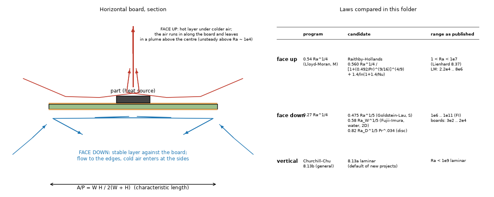
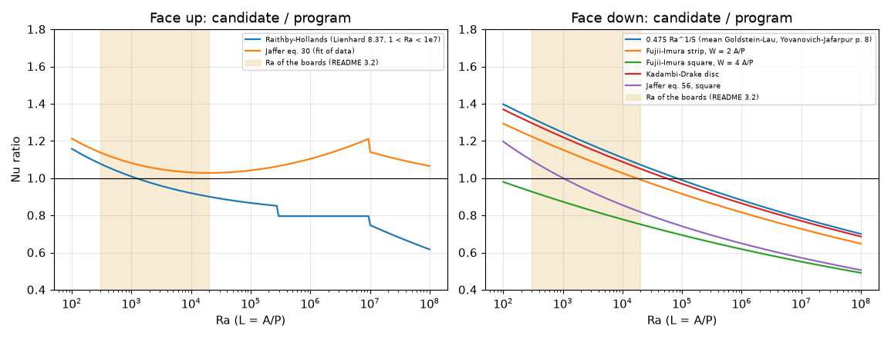
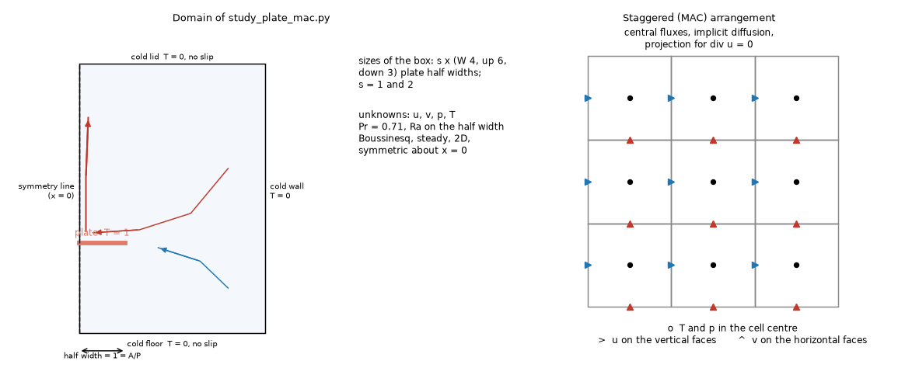
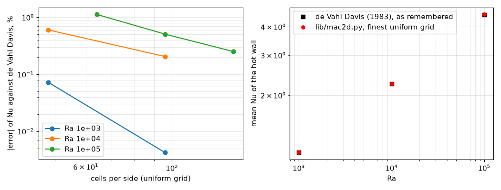
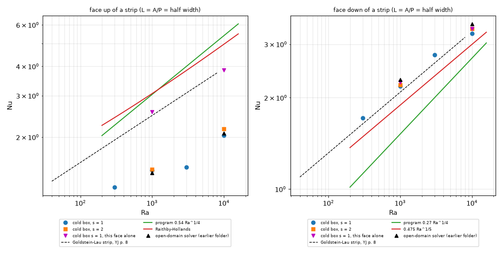
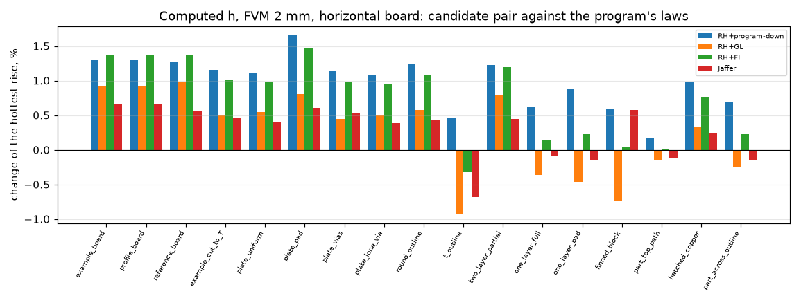
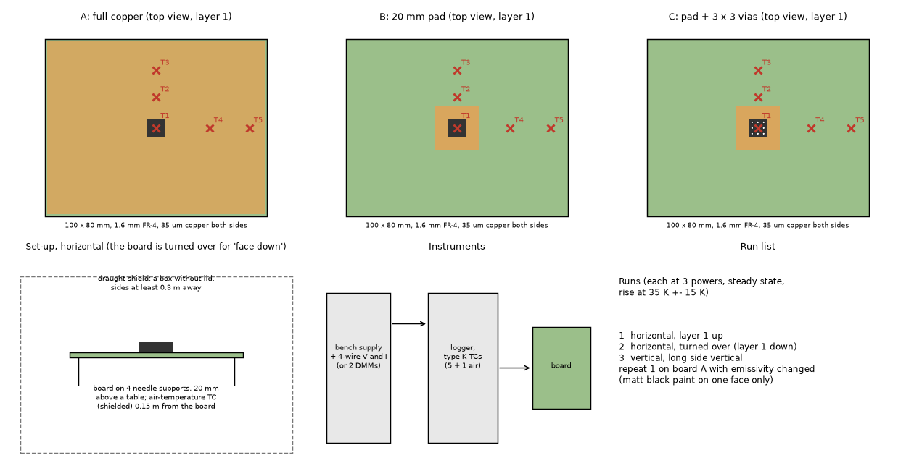

# convection-laws: the natural-convection laws of the horizontal faces of a board

Study S4 of the paper case studies, prepared for 2.6.0. The program's laws are `Nu = 0.54 Ra^(1/4)` (face up, then `0.15 Ra^(1/3)` above Ra = 1e7) and `Nu = 0.27 Ra^(1/4)` (face down),
with `L = A/P`, from textbook memory; what the sources say and what the program does with them is in `research/horizontal-plate-h`, `research/plate-h-level` and
`research/theory-sources/docs/models-evidence-and-gaps.md` (L1). This folder (1) tabulates the candidate laws over the Ra of the boards, (2) builds a second, independent numerical solver and asks what
it can say about a small hot horizontal plate, (3) measures on the program (on a copy in memory) how far the hottest temperature moves with each law on the 17 harness boards, (4) recommends,
and (5) writes the measurement that would decide (`docs/measurement-plan.md`). The program is untouched (`git diff origin/develop --stat -- pcbthermal tests examples ico` is empty).

**Summary in six lines**

1. Over the Ra of the boards (5e2 to 5e5 on the face, A/P, for 40 to 200 mm at 5 to 80 K; 3e2 to 2e4 for most boards at a modest excess) the program's up face is -7 % to +15 % of Raithby-Hollands (Lienhard 8.37a/b, range 1 < Ra < 1e7, read in the page image: -7 % at 3e2, -1 % at 1e3, +9 % at 1e4, +15 % at 1e5; the first version wrote +1 % at 1e3) and its down face is -20 % (Ra 1e3), -10 % (1e4), +1 % (1e5) of the mean Goldstein-Lau law `0.475 Ra^(1/5)` (read on page 8 of Yovanovich and Jafarpur 1993).
2. The new solver (`lib/mac2d.py`, primitive variables, staggered grid, imports nothing from the program or from the other plate solvers) reproduces the differentially heated cavity of de Vahl Davis (Table V, read by the review in the paper) to 0.0 / 0.2 / 0.25 % of the cavity-mean Nu and 0.1 / 0.4 / 0.5 % of the hot-wall Nu at Ra 1e3 / 1e4 / 1e5 on uniform grids of 96, 96 and 144 cells (midplane velocities within 0.1 %); it reproduces the numerical strip of Goldstein and Lau (as printed on page 8 of Yovanovich and Jafarpur) within 8 % on the isolated faces at Ra 1e3 and 1e4, and the earlier open-domain solver within 2 to 7 % on the thin plate with both faces hot. **It cannot choose a law**: the two-dimensional steady symmetric flow is not the flow of a board above Ra of about 1e4, and the heat of the cold box is not the open air (section 5).
3. **With the 17 boards of the regression harness** the hottest rise changes by **-0.9 to +1.0 % (mean +0.26 %)** if the program used Raithby-Hollands above and Goldstein-Lau below (-1.7 to +2.9 % without radiation); the two faces nearly cancel (+0.2 to +1.7 % with the face up alone). For the three test boards at 35 K of rise (local heater) the change is at most 0.5 %.
4. A board with a local heater is blind to the law; a uniform plate with one bright face is not: the ratio of the rise face up to face down is 0.62 for the program, 0.69 for Raithby-Hollands with Goldstein-Lau, 0.66 with Fujii-Imura, 0.52 for Jaffer (section 8): a measurement of one afternoon decides.
5. Recommendation (INTEGRATION.md): measure first; if one must change before, the pair Raithby-Hollands (up) with the mean Goldstein-Lau (down) rests on equations that were read, costs -0.9 to +1.0 % of the rise, and its acceptance tests are written; otherwise keep the laws and write the limit.
6. Not verified: the Goldstein-Lau paper was not obtained; no measurement exists. (The de Vahl Davis numbers, first quoted from memory, were read in the paper by the review: every value agreed; section 12.)

## 1. The situation

*Figure 1 (`figures/fig_01_air_paths_and_laws_of_a_horizontal_board.png`): left, section of a horizontal board: the face up (hot layer under colder air, air running in along the face and rising in a plume above the centre, unsteady above Ra of about 1e4) and the face down (a stable layer against the board; flow to the edges, cold air entering at the sides); right, the laws compared.*

The question (S4 of `PLAN-PAPER-STUDIES`): the boards sit at Ra 3e2 to 5e4 on `L = A/P`; which published law is closest on each face, and does it matter for a temperature?
What would answer it: a table of the laws (section 3), an independent numerical reference for a small hot plate (section 4 and 5), the effect on the program's temperatures (section 6), a measurement (section 8).

## 2. Sources and how they were read

| key | what | status |
| :-- | :-- | :-- |
| [Lienhard2024] pp 435 and 436 (PDF 449, 450) | eq. 8.35 `0.14 Ra^(1/3) (1 + 0.0107 Pr)/(1 + 0.01 Pr)`, `Ra >= 1e7`; eq. 8.37a/b Raithby-Hollands, `L* = A/P`, correction `1.4/ln(1 + 1.4/Nu)` for `Nu <= 10`, "recommended for 1 < Ra < 1e7" | **R** (page images rendered and read in this study) |
| [YovanovichJafarpur1993] p 8 (PDF 8) | Goldstein-Lau: downward `C` 0.44 to 0.527, mean at Pr 0.71 `C = 0.475`, numerical strip `0.524 Ra^(1/5)`, 40 < Ra < 8e3; upward numerical strip `0.621 Ra^(1/5)` in the same range | **R** (page image); the Goldstein-Lau paper itself **N** |
| [Lienhard2024] p 437 | Fujii-Imura `0.58 Ra_W^(1/5)` on the width W (water, 2D, 1e6 to 1e11) | R in `research/horizontal-plate-h`, not re-read |
| Jaffer 2023 | eq. 30 (up) and 56 (down), through `research/horizontal-plate-h/lib/correlations.py` (reviewed there) | R there, not re-read |
| Lloyd and Moran 1974 | the program's 0.54 | M (via [YovanovichJafarpur1993] p 7: range 2.2e4 to 8e6) |
| de Vahl Davis 1983 (Int. J. Numer. Meth. Fluids 3, 249-264) | Table V, printed p 256 (PDF 8): cavity mean `Nu` 1.118, 2.243, 4.519, 8.800; hot wall `Nu_0` 1.117, 2.238, 4.509, 8.817; midplane maxima `u` 3.649, 16.178, 34.73, 64.63 and `w` 3.697, 19.617, 68.59, 219.36; Table VII p 261: estimated error 0.1, 0.2, 0.3, 1 % | **R** (page images, read by the review from an open course copy; first version M) |
| Churchill and Chu | vertical forms | R through Lienhard 8.13a/b in earlier folders |

Nothing of a third party is stored here. [YovanovichJafarpur1993] is the file `YovanovichJafarpur1993Bounds.pdf` of the local library (the upper and lower bounds paper), not the cuboids paper. The same page 8 also gives, for the face up, the theoretical single-face results summarised by Goldstein and Lau, `C Ra^(1/5)` with `C` 0.560 to 0.688 on `L = A/P` (no range of Ra): at Ra 1e3 that is 2.23 to 2.74, below the program (3.04) and Raithby-Hollands (3.06) by 10 to 27 %. The correlations were not copied from `research/horizontal-plate-h/lib/correlations.py`: they are imported from it (it is in `develop`).

## 3. The candidate laws

`scripts/study_laws_table.py` (no solver; Pr 0.71, `L = A/P` for the horizontal faces, the height for the vertical ones). Ratio to the program in brackets; RH above 1e7 is outside its range.

### 3.1 Face up and face down over Ra 1e2 to 1e8

| Ra | program | Raithby-Hollands (1 < Ra < 1e7) | Jaffer 30 |
| --: | --: | --: | --: |
| 1e2 | 1.708 | 1.977 (1.16) | 2.071 (1.21) |
| 3e2 | 2.247 | 2.422 (1.08) | 2.558 (1.14) |
| 1e3 | 3.037 | 3.064 (1.01) | 3.283 (1.08) |
| 3e3 | 3.996 | 3.839 (0.96) | 4.191 (1.05) |
| 1e4 | 5.400 | 4.965 (0.92) | 5.567 (1.03) |
| 3e4 | 7.107 | 6.331 (0.89) | 7.314 (1.03) |
| 1e5 | 9.603 | 8.324 (0.87) | 10.003 (1.04) |
| 1e6 | 17.076 | 13.592 (0.80) | 18.853 (1.10) |
| 1e7 | 30.366 | 24.170 (0.80) | 36.880 (1.21) |

| Ra | program | 0.475 Ra^(1/5) (GL mean) | Fujii-Imura strip (w = 2) | Fujii-Imura square (w = 4) | Kadambi-Drake disc | Jaffer 56, square | Jaffer 56, strip |
| --: | --: | --: | --: | --: | --: | --: | --: |
| 1e2 | 0.854 | 1.193 (1.40) | 1.104 (1.29) | 0.837 (0.98) | 1.169 (1.37) | 1.022 (1.20) | 1.464 (1.72) |
| 3e2 | 1.124 | 1.486 (1.32) | 1.375 (1.22) | 1.042 (0.93) | 1.457 (1.30) | 1.231 (1.10) | 1.740 (1.55) |
| 1e3 | 1.518 | 1.891 (1.25) | 1.750 (1.15) | 1.326 (0.87) | 1.853 (1.22) | 1.520 (1.00) | 2.122 (1.40) |
| 3e3 | 1.998 | 2.356 (1.18) | 2.180 (1.09) | 1.652 (0.83) | 2.309 (1.16) | 1.851 (0.93) | 2.559 (1.28) |
| 1e4 | 2.700 | 2.997 (1.11) | 2.773 (1.03) | 2.102 (0.78) | 2.937 (1.09) | 2.309 (0.86) | 3.163 (1.17) |
| 3e4 | 3.553 | 3.734 (1.05) | 3.455 (0.97) | 2.618 (0.74) | 3.659 (1.03) | 2.835 (0.80) | 3.856 (1.09) |
| 1e5 | 4.801 | 4.750 (0.99) | 4.396 (0.92) | 3.331 (0.69) | 4.655 (0.97) | 3.560 (0.74) | 4.813 (1.00) |
| 1e6 | 8.538 | 7.528 (0.88) | 6.967 (0.82) | 5.280 (0.62) | 7.378 (0.86) | 5.542 (0.65) | 7.429 (0.87) |

*Figure 4 (`figures/fig_04_laws_against_the_program_over_ra.png`): each law divided by the program's, face up (left) and face down (right); the band is the Ra of the boards of 3.2. The kinks are the correction of Raithby-Hollands at Nu = 10 (about 3e5) and the program's switch at 1e7; Raithby-Hollands above 1e7 is outside its published range.*

The up face of the program lies inside the published bracket: Raithby-Hollands is below it from Ra 1e3 (0.92 at 1e4), Jaffer's fit is above it (1.03 to 1.08). The down face has the exponent 1/4 against 1/5 in every published form, and the published levels
differ from each other by 40 % at Ra 1e3 (0.87 to 1.40 of the program, Fujii-Imura on a square to Goldstein-Lau mean, or 1.00 for Jaffer's square) and 30 % at 1e4 (0.78 to 1.17): no law is "the" value, the means (Goldstein-Lau, Fujii-Imura strip, Kadambi-Drake) are above the program by 10 to 40 % at Ra 1e3 to 1e4 and the shape matters.
The Fujii-Imura numbers are the book's form on a width W, evaluated on `A/P` with W a multiple of A/P, and the data are for water in two-dimensional plates (1e6 to 1e11): outside its range here.

### 3.2 The boards in Ra

| board | excess | A/P (mm) | Ra | h up, program | h up, RH | h down, program | h down, GL |
| :-- | --: | --: | --: | --: | --: | --: | --: |
| 40 x 40 | 5 K | 10.0 | 4.7e2 | 6.60 | 6.93 | 3.30 | 4.27 |
| 40 x 40 | 80 K | 10.0 | 4.3e3 | 12.77 | 12.07 | 6.39 | 7.39 |
| 60 x 60 | 20 K | 15.0 | 5.6e3 | 8.38 | 7.85 | 4.19 | 4.79 |
| 100 x 80 | 5 K | 22.2 | 5.1e3 | 5.41 | 5.09 | 2.70 | 3.10 |
| 100 x 80 | 10 K | 22.2 | 9.8e3 | 6.41 | 5.90 | 3.21 | 3.56 |
| 100 x 80 | 40 K | 22.2 | 3.1e4 | 8.95 | 7.95 | 4.47 | 4.69 |
| 100 x 80 | 80 K | 22.2 | 4.7e4 | 10.46 | 9.20 | 5.23 | 5.37 |
| 160 x 100 | 20 K | 30.8 | 4.8e4 | 7.00 | 6.16 | 3.50 | 3.59 |
| 200 x 200 | 5 K | 50.0 | 5.8e4 | 4.41 | 3.87 | 2.21 | 2.24 |
| 200 x 200 | 80 K | 50.0 | 5.4e5 | 8.54 | 6.78 | 4.27 | 3.88 |

(W/m2K, convection only, 25 degC ambient; the full table of 30 rows is printed by the script.) A board of 40 to 200 mm at 5 to 80 K is at Ra 4e2 to 5e5; the band of the figure is 3e2 to 2e4 where most of the boards of the harness and of the examples at modest excess sit.

### 3.3 Vertical

Churchill and Chu: the laminar form (8.13a, the program's default for new projects) against the general one (8.13b): 0.993 (Ra 1e2), 1.043 (1e3), 1.072 (1e4), 1.066 (1e5), 1.023 (1e6), 0.948 (1e7), 0.853 (1e8) of the general. Already checked in `research/plate-h-level` and `research/effective-conductivity`; nothing changes here.

## 4. A second, independent solver

`lib/mac2d.py` (about 400 lines; documented; no import of the program or of `plate2d.py` / `plate_h2d.py`). Primitive variables on a staggered (MAC) grid, central fluxes, implicit diffusion (a factorised sparse matrix per field),
incremental pressure-correction projection, steady state by pseudo-time marching; closed box with no-slip walls or symmetry lines, an optional zero-thickness isothermal plate on `y = 0` with either or both faces hot.
The other two solvers of the repository are stream function and vorticity codes with free (open) boundaries; this one is a different formulation and a different boundary treatment, so an agreement is not the same code run twice.

*Figure 2 (`figures/fig_02_numerical_domain_and_staggered_grid.png`): left, the half domain of the strip in a cold box (symmetry line at x = 0, plate half width 1 = A/P); right, the staggered arrangement of the unknowns.*

### 4.1 Validation on the published cavity (de Vahl Davis)

`scripts/study_cavity.py`: air, Pr 0.71, square cavity, hot wall on the left, cold on the right, adiabatic top and bottom; mean `Nu` of the hot wall against the benchmark values (Table V, read) and the maxima of the velocities on the midplanes.

| Ra | cells | Nu hot wall | Nu cold wall | Nu-bar (dVD) | error | Nu_0 hot wall (dVD) | error | max u on x = 0.5 (ref) | max v on y = 0.5 (ref) |
| --: | --: | --: | --: | --: | --: | --: | --: | --: | --: |
| 1e+03 | 48 | 1.1188 | 1.1188 | 1.118 | +0.07 % | 1.117 | +0.16 % | 3.65 (3.649) | 3.70 (3.697) |
| 1e+03 | 96 | 1.1180 | 1.1180 | 1.118 | +0.00 % | 1.117 | +0.09 % | 3.65 (3.649) | 3.70 (3.697) |
| 1e+04 | 48 | 2.2565 | 2.2565 | 2.243 | +0.60 % | 2.238 | +0.83 % | 16.18 (16.178) | 19.64 (19.617) |
| 1e+04 | 96 | 2.2476 | 2.2476 | 2.243 | +0.20 % | 2.238 | +0.43 % | 16.18 (16.178) | 19.63 (19.617) |
| 1e+05 | 64 | 4.5697 | 4.5697 | 4.519 | +1.12 % | 4.509 | +1.35 % | 34.79 (34.73) | 68.50 (68.59) |
| 1e+05 | 96 | 4.5418 | 4.5418 | 4.519 | +0.50 % | 4.509 | +0.73 % | 34.74 (34.73) | 68.65 (68.59) |
| 1e+05 | 144 | 4.5302 | 4.5302 | 4.519 | +0.25 % | 4.509 | +0.47 % | 34.74 (34.73) | 68.66 (68.59) |

(Review: the reference columns are Table V of de Vahl Davis, read in the paper; the solver's wall Nusselt number is compared with the cavity mean Nu-bar, as the first version did, and with the hot-wall `Nu_0`, which is the like quantity.)

*Figure 5 (`figures/fig_05_cavity_benchmark_of_the_new_solver.png`): left, the error of the hot-wall Nusselt number against the uniform grid; right, the Nusselt number against Ra.*

Second order on uniform grids (Ra 1e4: +0.60 % on 48 cells, +0.20 % on 96; Ra 1e5: +1.12, +0.50, +0.25 % on 64, 96, 144 cells), the midplane velocities within 0.1 %. The two walls carry the same heat (the energy balance) in every case. **A defect found on the way, fixed**: the first runs used a strongly graded grid (ratio 1.12 on 48 cells) and read +0.7 % at Ra 1e3 and +18 % at Ra 1e5; the central differences lose their second order on a stretched grid, so the validation is on uniform grids and the plate (which needs clustering at its tip) is run with milder grading (0.93 to 1.08 per cell) and its numbers carry a stated uncertainty (section 5); a graded grid of ratio 1.03 on 96 cells gave +1.7 % at Ra 1e5 against +0.5 % uniform.
Regression tests: `tests/test_convection_laws.py` (graded faces, exact conduction `Nu = 1`, the cavity at Ra 1e3 on 32 and 64 cells within 1 % and 0.4 %, the energy balance of the plate at Ra 100).

## 5. The hot strip

`scripts/study_plate_mac.py` (about an hour in three processes): the strip of half width 1 (`L = A/P = 1`, Ra on that length, Pr 0.71, plate T = 1, cold walls T = 0) in a closed box of 4 half widths to the side, 6 above and 3 below the plate (s = 1) or twice that (s = 2), on a base grid of 66 x 76 cells (clustered at the tip and at the plate, ratios 0.94 to 1.08 per cell) and a finer one (92 x 107). "balance" is the heat reaching the cold walls over the heat leaving the plate (second-order wall gradients).

| faces hot | Ra | box s | grid | Nu up | Nu down | balance | converged | max u | steps |
| :-- | --: | --: | :-- | --: | --: | --: | :-- | --: | --: |
| both | 3e+02 | 1 | 66 x 76 | 1.225 | 1.717 | 1.003 | True | 9.7 | 74854 |
| both | 1e+03 | 1 | 66 x 76 | 1.447 | 2.182 | 1.046 | True | 20.0 | 135820 |
| both | 3e+03 | 1 | 66 x 76 | 1.490 | 2.766 | 1.098 | True | 32.7 | 194967 |
| both | 1e+04 | 1 | 66 x 76 | 2.036 | 3.248 | 1.160 | True | 65.3 | 225156 |
| both | 1e+03 | 1 | 92 x 107 | 1.439 | 2.170 | 1.049 | True | 20.2 | 273062 |
| both | 1e+03 | 2 | 76 x 98 | 1.460 | 2.204 | 1.133 | True | 25.2 | 327498 |
| both | 1e+04 | 2 | 76 x 98 | 2.166 | 3.372 | 1.248 | False | 80.2 | 400000 |
| up | 1e+03 | 1 | 66 x 76 | 2.563 | 0.000 | 1.012 | True | 17.8 | 101871 |
| down | 1e+03 | 1 | 66 x 76 | 0.000 | 2.248 | 1.025 | True | 15.3 | 130445 |
| up | 1e+04 | 1 | 66 x 76 | 3.859 | 0.000 | 1.127 | True | 57.1 | 234600 |
| down | 1e+04 | 1 | 66 x 76 | 0.000 | 3.376 | 1.141 | True | 51.9 | 178235 |

*Figure 6 (`figures/fig_06_strip_in_a_cold_box_against_the_laws.png`): Nusselt number of each face of the strip (both faces hot: circles, s = 1, and squares, s = 2; one face alone: triangles pointing down) against the program, Raithby-Hollands, 0.475 Ra^(1/5) and the Goldstein-Lau numerical strip (dashed, 40 < Ra < 8e3); the black triangles are the numbers of the earlier open-domain solver as printed in `research/horizontal-plate-h`. The square at Ra 1e4 (s = 2) did not converge.*

**5.1 What the numbers say**

* **Reproduction of a published numerical case.** The isolated faces of the strip (the other face insulated, as Goldstein and Lau's single active face) against the numerical strip they published, as read on page 8 of Yovanovich and Jafarpur (face up `0.621 Ra^(1/5)`, face down `0.524 Ra^(1/5)`, 40 < Ra < 8e3; Ra 1e4 is outside that range and compared by extension of the power law): up 2.563 against 2.472 at Ra 1e3 (+3.7 %), 3.859 against 3.920 at 1e4 (-1.5 %); down 2.248 against 2.085 (+7.8 %) and 3.376 against 3.306 (+2.1 %). The earlier open-domain solver of `research/horizontal-plate-h` (stream function and vorticity, free boundaries) is -6.5 / -6.3 % (up) and +11 / +5 % (down) of the same numbers: the three codes agree within 2 to 11 %. The comparison is at the level of the published power-law coefficient, not of a table of values (the paper was not obtained).
* **Against the other forms for the strip.** The lower face of the strip is within +6.0 % (Ra 1e3: 2.248 against Jaffer's equation 56 with the strip metric, 2.122) and +6.7 % (1e4: 3.376 against 3.163).
* **Two codes, both faces hot** (the situation of a thin board): 1.447 / 2.182 (Ra 1e3) and 2.036 / 3.248 (1e4) against 1.412 / 2.296 and 2.075 / 3.501 of the earlier solver: +2.5 / -5.0 % and -1.9 / -7.2 %. Both find the same large effect that the earlier folder reported: **with both faces hot the face up is 44 % (Ra 1e3: 1.447 against 2.563) and 47 % (1e4: 2.036 against 3.859) below the same face alone, and barely grows from Ra 1e3 to 3e3 (1.447, 1.490)**. It is the steady, symmetric two-dimensional flow of a thin plate whose plume is fed by the air of the lower face; whether a board does this in three dimensions is not answered here (boards E and D of the measurement separate it).
* **Grid and box.** Ra 1e3, fine grid against base: -0.6 % (up) and -0.5 % (down); box twice as large: +0.9 % and +1.0 %. The cold walls change the Nusselt numbers by about 1 % at that Ra, so the box is not what limits the numbers. At Ra 1e4 the box of s = 2 did **not converge** in 400 000 steps (2.166 / 3.372, balance 1.25, +6 % / +4 % of s = 1): the steady symmetric solution is not reached there, as the earlier folder estimated from the local Rayleigh number of the hot layer (about 1700 at 1e4).
* **Energy balance.** 1.00 at Ra 3e2, 1.05 at 1e3, 1.10 at 3e3, 1.14 to 1.16 at 1e4 (1.25 in the large box): the wall gradients at the singular tip of a zero-thickness plate under-read as Ra grows (the earlier folder found the same on its own closed boxes). **Absolute Nusselt numbers are good to about 5 % up to Ra 1e3 and 15 % at 1e4; the comparisons above stand within those margins.**
* **Against the program's laws and Raithby-Hollands.** A strip is not a board: the isolated upper face of the strip is 16 % below the program at Ra 1e3 (2.563 against 3.037) and 29 % below at 1e4 (3.859 against 5.400), 16 % and 22 % below Raithby-Hollands (3.064, 4.965); Goldstein and Lau's own strip (0.621 Ra^(1/5)) is 19 % and 21 % below Raithby-Hollands at 1e3 and 1e4 (2.47 against 3.06 and 3.92 against 4.97): a strip has no air drawn in at the ends and a board has, so **the strip says that Raithby-Hollands is the nearer of the two up-face laws at 1e4 and equal at 1e3, and nothing more**. The lower face of the strip is 48 % (1e3) and 25 % (1e4) above the program's law and 19 % and 13 % above the mean Goldstein-Lau law; the strip is the upper end of the shapes (0.524 against the mean 0.475, +10 %), and Jaffer's shape factor accounts for most of the rest, so the 1/5 law is the family of every published lower-face form and the program's exponent 1/4 is not; the coefficient of a board needs its shape. **Review note:** the strip does not add evidence on the exponent of one face against the other: its isolated upper face grows as Ra^0.18 from 1e3 to 1e4 (2.563 to 3.859) just as its lower face does (Ra^0.18, 2.248 to 3.376), so a two-dimensional strip gives a 1/5 slope on both faces (as Goldstein and Lau's 0.621 and 0.524 do) and would, read alone, reject Raithby-Hollands' 1/4 on the face up as well; and the heat balance drifts from 1.01 to 1.14 over the same interval. The exponent argument for the face down rests on the published forms, not on this strip.
* **What cannot be concluded.** Which law is right for a finite board in free air on the upper face (unsteady and three-dimensional above Ra of about 1e4, a thin hot layer with the coupling above); the size of the coupling of the faces in three dimensions; any number above Ra 1e4.

## 6. The effect on the program

`scripts/study_board_effect.py`: the program's own FVM (cell 2 mm), horizontal board (layer 1 up), computed h, emissivity 0.9, with `convection.h_natural_horizontal` replaced in memory by each pair of laws (`research/horizontal-plate-h/lib/correlations.py use_horizontal`; the program is not edited), on the **17 boards of the regression harness** (`tests/regression/regress_boards.py`).
(The rises of these boards are 30 to 400 K because the harness powers are large; the effect at the moderate rises of real boards is in section 6.2.)

Hottest rise of the program (K) and change for each pair, with radiation:

| board | program (K) | RH+program-down | RH+GL | RH+FI | Jaffer |
| :-- | --: | --: | --: | --: | --: |
| example_board | 60.06 | +1.3 % | +0.9 % | +1.4 % | +0.7 % |
| profile_board | 60.06 | +1.3 % | +0.9 % | +1.4 % | +0.7 % |
| reference_board | 65.82 | +1.3 % | +1.0 % | +1.4 % | +0.6 % |
| example_cut_to_T | 67.20 | +1.2 % | +0.5 % | +1.0 % | +0.5 % |
| plate_uniform | 123.90 | +1.1 % | +0.5 % | +1.0 % | +0.4 % |
| plate_pad | 301.59 | +1.7 % | +0.8 % | +1.5 % | +0.6 % |
| plate_vias | 104.65 | +1.1 % | +0.4 % | +1.0 % | +0.5 % |
| plate_lone_via | 117.46 | +1.1 % | +0.5 % | +0.9 % | +0.4 % |
| round_outline | 131.80 | +1.2 % | +0.6 % | +1.1 % | +0.4 % |
| t_outline | 140.15 | +0.5 % | -0.9 % | -0.3 % | -0.7 % |
| two_layer_partial | 128.96 | +1.2 % | +0.8 % | +1.2 % | +0.4 % |
| one_layer_full | 31.32 | +0.6 % | -0.4 % | +0.1 % | -0.1 % |
| one_layer_pad | 73.50 | +0.9 % | -0.5 % | +0.2 % | -0.2 % |
| finned_block | 102.60 | +0.6 % | -0.7 % | +0.0 % | +0.6 % |
| part_top_path | 49.54 | +0.2 % | -0.1 % | +0.0 % | -0.1 % |
| hatched_copper | 83.62 | +1.0 % | +0.3 % | +0.8 % | +0.2 % |
| part_across_outline | 173.55 | +0.7 % | -0.2 % | +0.2 % | -0.2 % |
| **min / max / mean** | | +0.2 / +1.7 / +0.99 % | -0.9 / +1.0 / +0.26 % | -0.3 / +1.5 / +0.76 % | -0.7 / +0.7 / +0.28 % |

The summary rows of the other three runs (the full tables are printed by `scripts/print_tables.py`):

Hottest rise of the program (K) and change for each pair, convection only (emissivity 0):

| board | program (K) | RH+program-down | RH+GL | RH+FI | Jaffer |
| :-- | --: | --: | --: | --: | --: |
| **min / max / mean** | | +0.4 / +3.3 / +2.44 % | -1.7 / +2.9 / +0.97 % | -0.2 / +3.9 / +2.16 % | -0.7 / +2.7 / +1.18 % |

Hottest rise of the program (K) and change for each pair, double power:

| board | program (K) | RH+program-down | RH+GL | RH+FI | Jaffer |
| :-- | --: | --: | --: | --: | --: |
| **min / max / mean** | | +0.3 / +1.7 / +1.05 % | -0.5 / +1.2 / +0.50 % | +0.0 / +1.6 / +0.94 % | -0.4 / +0.7 / +0.37 % |

Hottest rise of the program (K) and change for each pair, half power:

| board | program (K) | RH+program-down | RH+GL | RH+FI | Jaffer |
| :-- | --: | --: | --: | --: | --: |
| **min / max / mean** | | +0.1 / +1.4 / +0.82 % | -1.5 / +0.9 / -0.10 % | -0.8 / +1.4 / +0.43 % | -1.1 / +0.7 / +0.07 % |

(The first version left this table empty; the row is the printout of `scripts/print_tables.py` after the review's re-run, identical to the committed run.)

*Figure 7 (`figures/fig_07_effect_on_the_harness_boards.png`): change of the hottest rise of the 17 boards for each pair of laws (with radiation).*

### 6.1 Reading

* The pair with **both faces changed** (RH up, GL down): -0.9 to +1.0 % of the rise, mean +0.26 %; with the up face alone +0.2 to +1.7 % (mean +0.99 %), because Raithby-Hollands is below the program's face up from Ra 1e3, and the Goldstein-Lau face down is above it below Ra 1e5 so that its cooling brings the sum back. Fujii-Imura strip (outside its range) +0.76 % mean; Jaffer +0.28 %.
* Convection only (emissivity zero): the same signs and about two to three times larger (-1.7 to +2.9 % for RH + GL), which is the upper bound of the effect for a bright board; at double and half the power RH + GL moves the rise by -0.5 to +1.2 % and -1.5 to +0.9 % (summary rows above).
* In kelvin: 0.1 to 1 K for the boards of 60 to 80 K; up to 2.4 K (RH + GL, +0.8 %) and 5.1 K (the up face alone, +1.7 %) for the 300 K plate with a pad.
* The boards that move most (up face alone, +1.7 %) are the ones with the least copper spreading (`plate_pad`); the Lumped, Analytic, FDM and 3D solid take the same coefficients and move in the same direction (the coefficient is the same input; not re-run here for every model).

### 6.2 At the Ra of real boards

`scripts/study_measurement_prediction.py` (section 8): for the three test boards (100 x 80 mm, 35 K of rise, a local 8 x 8 mm heater) the pair RH + GL moves the hottest rise by +0.3 % (A), -0.1 % (B) and -0.2 % (C) horizontal, 0.0 % vertical; the other pairs by at most +0.6 %. A local heater on a copper board is dominated by the spreading resistance (the mean rise of board A is 5 K of the 35 K).

## 7. Reproduction of earlier numbers (consistency)

* The L1 ratios of the evidence file are reproduced: program against Raithby-Hollands -7 % at 3e2, -1 % at 1e3, +9 % at 1e4, +15 % at 1e5 (section 3.1: 2.247/2.422, 3.037/3.064, 5.400/4.965, 9.603/8.324); program down against 0.475 Ra^(1/5) -20 % at 1e3 and -10 % at 1e4.
* The isolated-face strip of the earlier open-domain solver (`research/horizontal-plate-h` section 5: up 2.309 / 3.673, down 2.322 / 3.483 at Ra 1e3 / 1e4) against the Goldstein-Lau numerical strip (0.621 and 0.524 Ra^(1/5), read on page 8): 2.47 / 3.92 and 2.09 / 3.31: the earlier solver is -6.5 / -6.3 % (up) and +11 / +5 % (down) of it; section 5 adds the third code.

## 8. The measurement (docs/measurement-plan.md)

*Figure 3 (`figures/fig_03_test_boards_and_set_up.png`): the three local-heater boards (full copper, 20 mm pad, pad with 3 x 3 vias) with the five thermocouples, the set-up and the run list; boards D (bright face, foam) and E (film heater, both faces open) are the same 100 x 80 mm full-copper design with a film heater and are described in `docs/measurement-plan.md`.*

`scripts/study_measurement_prediction.py` (the "true" film is a model, the numbers are predictions of the program, not measurements):

* Powers for a 35 K rise with the program's laws: A 1.52 W, B 0.62 W, C 0.66 W (3 x 3 vias of 0.3 mm on a 1.3 mm pitch: +6.2 % of the power for the same rise against the pad alone; 5 x 5 +9.4 %, 6 x 6 +10.4 %).
* The hottest rise of the three boards horizontal, turned over and vertical differs between the four sets of laws by at most 0.5 % (table in the script output): a board with a local heater cannot choose a law.
* A multiplier on h fitted on A to a film "RH + GL" (0.977) makes the program's laws predict B and C to 0.4 to 0.8 %; without it to 0.0 to 0.4 %: the multiplier hides the law.
* **A uniform plate with one bright face** (board D, back loss 1 W/m2K, emissivity 0.07; the program's own convection functions, a 1D balance, no board solver): rise up / rise down at 2, 4 and 8 W: program 0.629 / 0.625 / 0.624, RH + GL 0.699 / 0.693 / 0.691, RH + FI 0.665 / 0.659 / 0.658, Jaffer 0.533 / 0.521 / 0.518; the back loss (0.5 to 2 W/m2K) and the emissivity (0.05 to 0.10) move the ratios by 0.045 and 0.015 (the first version wrote 0.03 for the back loss: that is per 1 W/m2K) and keep the order. The full spread between the laws (0.52 to 0.69) is 5 times the resolution of a ratio of two runs (0.03), but **neighbouring laws are only about one resolution apart** (program 0.625, RH + FI 0.659, RH + GL 0.693 at 4 W): the test separates Jaffer from the rest and the program from RH + GL, not every pair. The 8 W rows are model points only: the plan runs board D at 2 and 4 W (8 W is 132 to 155 K face down; review correction, `docs/measurement-plan.md`).
* **Both faces open** (board E: a film heater under board A, emissivity 0.9): rise at 3 / 6 / 12 W: program 16.8 / 30.2 / 53.4 K, RH + GL 17.0 / 30.9 / 54.9 K, RH + FI 17.2 / 31.3 / 55.5 K, Jaffer 17.0 / 30.8 / 54.6 K (a spread of 3.5 %), and 18.9 / 34.1 / 60.0 K (+13 %) if the upper face carried 40 % less (the coupling hypothesis of section 5, not a result): that test separates a coupling of the faces from every law.
* The protocol, the bill of materials, the uncertainty budget (2 to 3 % of the rise when the air is still; estimates, not measured) and the comparison list are in `docs/measurement-plan.md`.

## 9. Recommendation

In `INTEGRATION.md`: (1) measure board D first (one to two days, about 150 EUR; at 2 and 4 W on a high-temperature insulation, review correction); (2) if the maintainer prefers to change before, option B (Raithby-Hollands up, 0.475 Ra^(1/5) down) rests on read equations, moves the rise of the 17 boards by -0.9 to +1.0 %, and has acceptance tests; (3) otherwise keep the laws and write the limit (`docs/theory-text.md`).
The reviewer's recommendation (section 12, `INTEGRATION.md` 3 with the cost of each way): keep the laws and write the limit now, and measure board D before any change; B only if a change is wanted without a measurement. The decision is the maintainer's.

## 10. Limits of this study

* The new solver is two-dimensional, steady and symmetric about the plate centre; it is validated on a closed cavity, not on a plate in free space. The strip results are in a **cold closed box**: the cold walls add cooling, the box is not the open air.
* The Ra 1e4 results carry a heat balance of 1.16 (the wall gradients at the singular tip of a zero-thickness plate): absolute `Nu` to about 15 %, ratios between cases on the same grid better.
* The effect on temperatures is the program's FVM at 2 mm with computed h; the other models take the same coefficients (not re-run here for every model); every number of section 6 is a **model change**, not a measurement.
* The measurement plan is not performed; its uncertainty budget is an estimate.

## 11. What was read and what was not verified

* **Read in full (page images, this study):** Lienhard 6.00 printed pages 435 and 436 (eq. 8.35, 8.37a/b with the correction and the range), Yovanovich and Jafarpur (1993) page 8 (Goldstein-Lau coefficients: 0.475, 0.524, 0.621, the ranges 40 < Ra < 8e3).
* **Read earlier (other folders, not re-read):** Lienhard p 437 (Fujii-Imura, Kadambi-Drake), Jaffer (2023) equations 30 and 56, Churchill-Chu forms.
* **From memory:** Lloyd and Moran. (de Vahl Davis (1983) was from memory in the first version; read by the review, Table V p 256 and Table VII p 261, section 12.)
* **Not obtained:** the paper of Goldstein and Lau (1983), the Raithby-Hollands chapter, Fujii and Imura (1972), Lloyd and Moran (1974).
* **Reproduced:** the cavity (section 4.1, against the table read in the paper) with an independent solver written here; the program's L1 ratios (section 3.1); the program's numbers of section 6 are runs of the program on a copy in memory. **Not reproduced:** any published horizontal-plate number with a flow in free space.
* **Tests:** `research/convection-laws/tests/test_convection_laws.py`, 6 tests.
* **Reproduce:** `scripts/study_laws_table.py`, `study_cavity.py` (about 4 minutes), `study_plate_mac.py` (about an hour, two processes with `--both` and `--isolated`), `study_board_effect.py` (1 minute), `study_measurement_prediction.py` (2 minutes; `--vias`, `--faces`), `print_tables.py`, `make_diagrams.py`, `make_figures.py`.

## 12. Review

Independent review of the folder (reviewer agent), on the branch merged with `develop` (program unchanged: `git diff origin/develop --stat -- pcbthermal tests examples ico` empty).

**Sources checked in the page images** (rendered from the local library by the reviewer, not from the OCR transcriptions):
* Lienhard 6.00 printed pp 435 and 436 (PDF 449, 450): eq. 8.35 `0.14 Ra^(1/3) (1 + 0.0107 Pr)/(1 + 0.01 Pr)`, `0.024 <= Pr <= 2000`, for `Ra >= 1e7`; eq. 8.37a `0.560 Ra^(1/4) / [1 + (0.492/Pr)^(9/16)]^(4/9)` on `L* = A/P`, 8.37b `1.4 / ln(1 + 1.4/Nu)` when `Nu <= 10`, "recommended for 1 < Ra < 1e7". As tabulated. Recomputed by hand at Pr 0.71: Ra 1e3 3.064, 1e4 4.966 (table 3.064, 4.965); the jump at 1e7 is 24.17 to 30.18 (+25 %).
* Yovanovich and Jafarpur (1993), the bounds paper (`YovanovichJafarpur1993Bounds.pdf`), page 8: face up, Goldstein and Lau's numerical strip `0.621 Ra^(1/5)`, Pr 0.71, `40 < Ra < 8e3`; face down `C` 0.44 to 0.527, the mean of the Pr 0.71 results 0.475, the strip 0.524 in the same range. As tabulated. Not quoted by the first version and added to section 2: the theoretical single-face results for the face up, `C` 0.560 to 0.688 on A/P.
* de Vahl Davis (1983), Int. J. Numer. Meth. Fluids 3, 249-264, opened by the review (an open course copy, page images; nothing stored): Table V p 256 gives every value the study had quoted from memory (Nu-bar 1.118, 2.243, 4.519, 8.800; `u_max` 3.649, 16.178, 34.73, 64.63; `w_max` 3.697, 19.617, 68.59, 219.36): all agree. The table also gives the **hot-wall** value `Nu_0` 1.117, 2.238, 4.509, 8.817, which is what the solver's wall Nusselt number is; the first version compared it with the cavity mean. The second opened source, Fischer and others (arXiv physics/0305049, Table 1), prints the same 2.243, 4.519, 8.800 and the finer reference of Hortmann and others, 2.245, 4.522, 8.825.

**Re-runs** (load average 4 to 5.6, swap steady at 1.06 GB, peak memory of a study 0.12 GB):
* `study_laws_table.py`: every number of sections 3.1 and 3.2 reproduced to the digit.
* `study_board_effect.py` (all 17 boards, 57 s): every rise identical to the committed output (largest relative difference 0); the half-power summary row, missing in the first version, is now in section 6.
* `study_measurement_prediction.py` (default, `--vias`, `--faces`): powers 1.52 / 0.62 / 0.66 W, vias +6.2 / +9.4 / +10.4 %, the fit 0.977, ratios 0.629 / 0.699 / 0.665 / 0.533 at 2 W, board E 16.76 / 30.21 / 53.40 K: all reproduced.
* `study_cavity.py`, now printing both references: the table of 4.1 reproduced to the digit (finest grids: hot wall +0.09 / +0.43 / +0.47 % of `Nu_0`, +0.00 / +0.20 / +0.25 % of Nu-bar; 219 s, 0.25 GB); Richardson extrapolation of the solver's own grids: 2.2446 at Ra 1e4 (48, 96) and 4.5209 at 1e5 (96, 144), within 0.1 % of Nu-bar and of Hortmann's 2.245 and 4.522, 0.3 % above `Nu_0`.
* `study_plate_mac.py`: the case with both faces hot at Ra 1e3 in the box s = 1 (`--quick`, 160 s) gave 1.447 / 2.182, balance 1.046, the numbers of the table of section 5 to the digit; the other ten cases (about an hour) were not re-run (the load of the machine stayed near 6 with other agents), their numbers are read from the committed outputs of the first two commits.

**Findings, corrected in the folder:**
1. Summary line 1 and `docs/theory-text.md`: the up face against Raithby-Hollands at Ra 1e3 is -1 %, not +1 % (3.037 / 3.064); the Ra range of the boards was given as 3e2 to 5e4 against the 5e2 to 5e5 of table 3.2.
2. Cavity: the benchmark was from memory (now read, all values agree) and the wall Nusselt number was compared with the cavity mean; the hot-wall errors are 0.1 / 0.4 / 0.5 % on the finest grids, and the Richardson extrapolation of the solver's own grids lands within 0.1 % of Nu-bar and of Hortmann's values and within 0.3 % of `Nu_0`, inside the benchmark's own error (0.1 to 0.3 %, Table VII).
3. `INTEGRATION.md`: option B moves **no** frozen record (the 17 harness boards use manual h, and manual is the default of the class and of new projects); the pending file it asked for is not needed. What moves is every computed-h result on a horizontal board.
4. Section 5.1: "the 1/5 law ... which the numbers of a strip confirm" overstated: the strip's isolated upper face also grows as Ra^0.18, so a strip would reject the 1/4 of the face up as well; the exponent of the face down rests on the published forms. The claim that the strip cannot choose a law for a board stands and is stronger for it.
5. Measurement plan: board D was to run at 8 W (132 to 155 K face down, above the glass transition of FR-4) on XPS foam (softens near 75 degC, passed at 4 W face down); now 2 and 4 W on mineral wool or calcium silicate, 2 W only on XPS. The back-loss sensitivity is 0.045 over 0.5 to 2 W/m2K (written 0.03), and neighbouring laws are only one resolution apart (the test separates Jaffer and the program from RH + GL, not every pair). The supply wires of boards B and C can carry 4.5 to 6.5 % of the power (fin estimate) unless taped along the board: added to the budget. The uncertainty budget itself (2 to 3 %, board A) is an estimate and was only checked for arithmetic (root sum of squares 2.0 %).
6. `study_measurement_prediction.py` docstring said 1.2 mm via pitch; the code and the plan use 1.3 mm.
7. Outputs committed by mistake: the first two commits of the branch (`ef99854`, `a1532be`) added eight `out/*.json` files; `c2afd3a` removed them and added `out/` to the `.gitignore`. They stay in the history (published history is not rewritten); nothing else generated is tracked.

**Not verified:** the strip runs other than those re-run above; the three-dimensional flow of a board (no solver here does it); the Goldstein-Lau paper; any measurement; the textbook service temperature of XPS and the conductivities of the insulations (estimates). The figures were not redrawn: none quotes a number that moved (figure 3 shows T1 at the heater in a top view; the plan glues it on the bottom face).

**Verdict: go** for the merge as a closed investigation that waits for the maintainer's decision. **Recommendation:** keep the laws and write the limit now (most of it is already in `docs/theory.md` 8), and measure board D (then E) before changing anything; option B only if the maintainer wants a change without a measurement. Costs in `INTEGRATION.md` 3.
