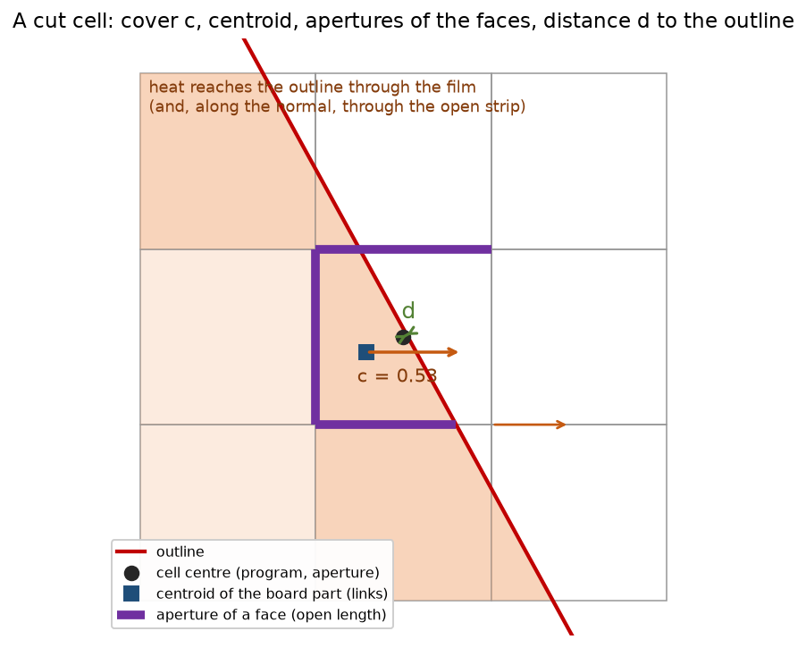
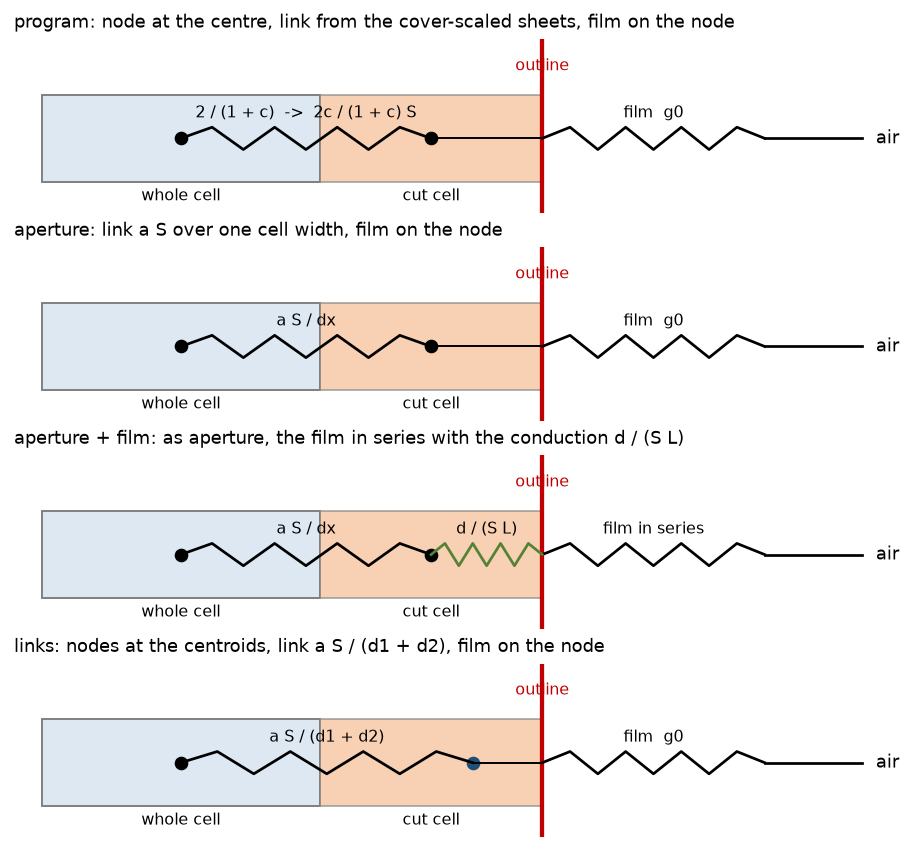
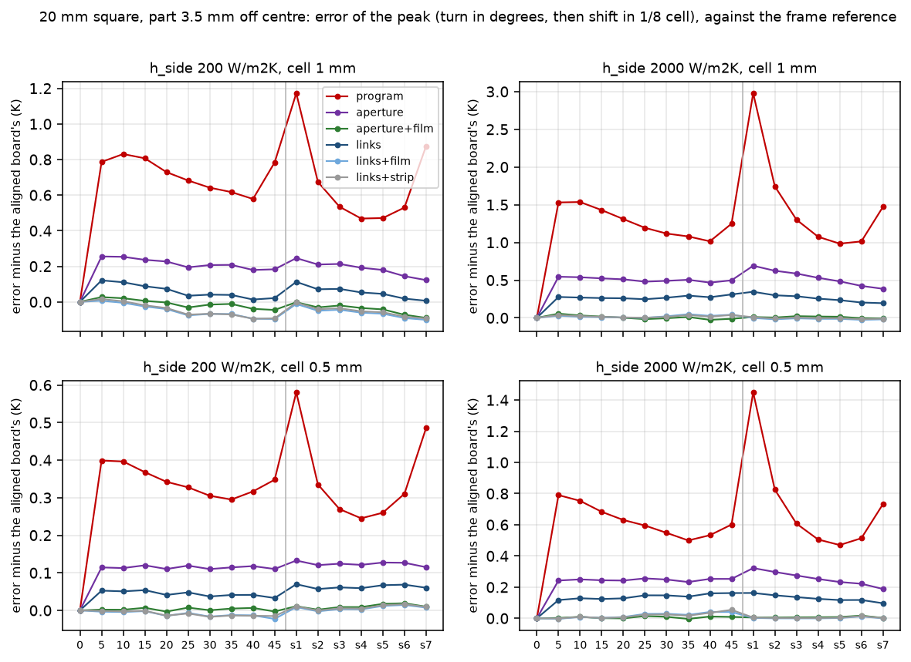
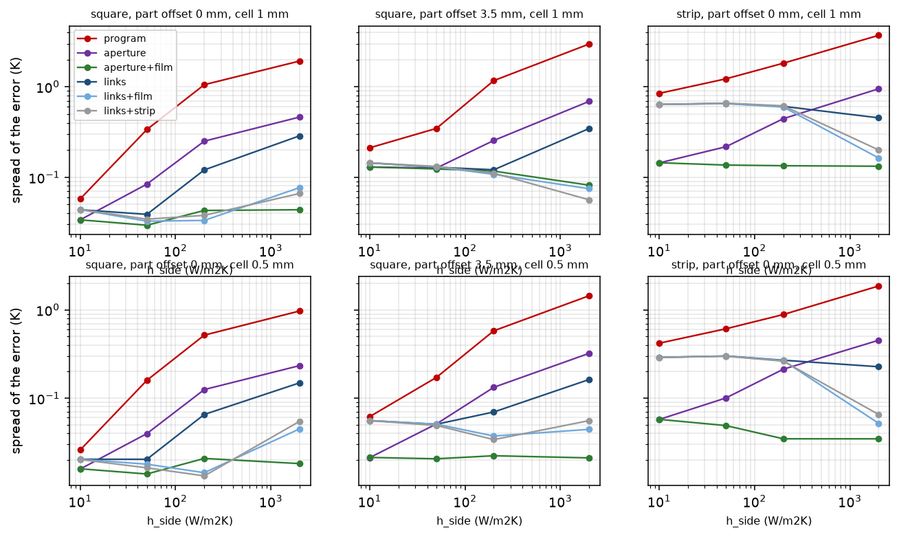
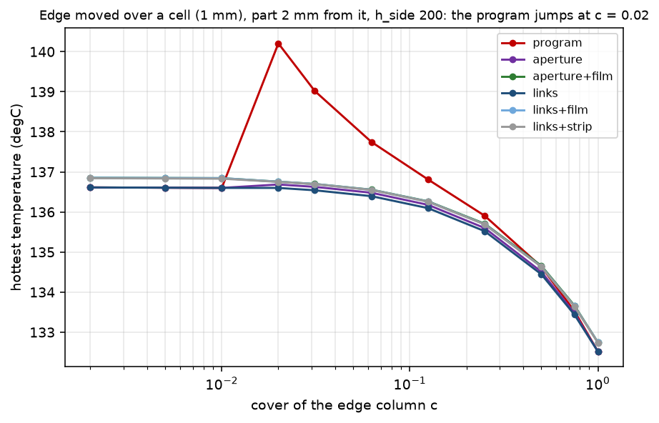
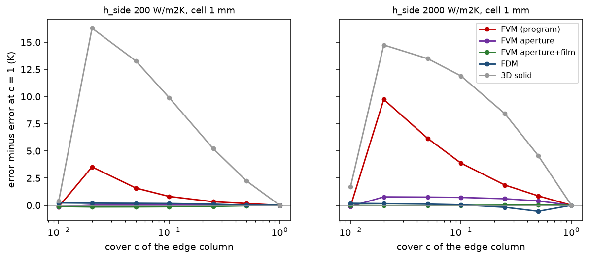
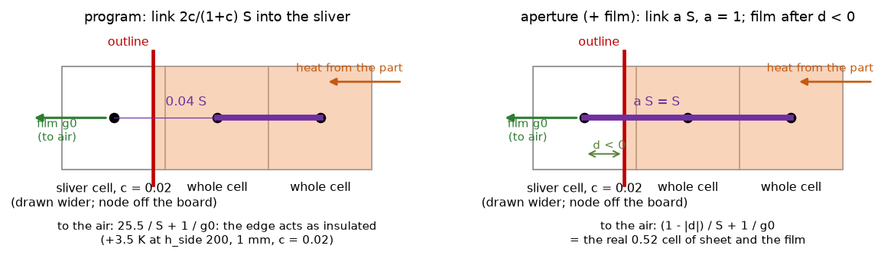

# Cut-cell links after the exact board cover (step 2 of the cut-cell plan)

**Status (audit 2.7.0): adopted.** The recommended scheme `aperture+film` is the program since 2.6.0 (`fix/cut-cell-aperture-film`: `geometry.face_apertures`, `fvm.Network._lateral_links`, `fvm.Network._cut_edge_film`, floor 0.25, on rectangles too; `docs/validation.md` 32), on top of the exact cover (`fix/exact-board-cover`, 2.6.0); the 3D solid sliver defect of 10.1 is fixed by `fix/solid3d-sliver-cells` (`docs/validation.md` 33); the FDM is unchanged. Checked by the audit: the program of the tree with the laminate edge band switched off equals the prototype `aperture+film` (with the rectangle film) to four decimals on three edge boards (126.0252, 78.1927 and 244.1553 degC at `h_side` 200, 2000 and 10). In the tables below `program` is the network **before 2.6.0** (exact cover, cut cells off, no edge band); `lib/cutlinks.py` builds it that way, and the scheme `current` is the program of the tree, which also has the laminate edge band of 2.6.0 (+4.6 K and +6.0 K on the first two of those boards; `research/laminate-edge-band`). **Correction (audit 2.7.0)**: after 2.6.0 the prototype added its links and its film on top of the program's own (the program's assembly reads `_lateral_links`, which the prototype overrides, and applies the cut-cell film itself), so every scheme was counted twice; the 2.6.0 reproduction pass read that as a property of the prototype ("aperture moves 1.25 K on the sliver pair", "the film floor binds on full copper") and restated two tests. Both statements were wrong; `lib/cutlinks.py` now builds on `cut_cells=False` without the band and the original bounds of `tests/test_review.py` hold again.

**Depends on** the branch `fix/exact-board-cover` (reviewed, then merged in 2.6.0): `Board.cover` is the exact area of every cell and the part weights are exact. This branch was made from it. The program is untouched here (`pcbthermal/`, `tests/`, `examples/`, `ico/` identical to the base); everything below is measured on copies in `lib/`.

**Question.** After the exact cover, what is left of the cut-cell error of the layered FVM, and which scheme for the links and for the edge film removes it (steady state and the implicit transient)?

**Answer in short** (details, tables and limits below; every number is printed by the script named in its section):

* **What is left is the way a cut cell is joined to its neighbours and to the air**, not the volume. The program joins two cells with the harmonic mean of the cover-scaled sheets over one cell width, which is a factor `c` (the cover) too weak into a cut cell, and puts the edge film on the node. Two consequences were measured: the spread of the peak over the positions of the outline (turns 0 to 45 degrees and shifts by 1/8 cell) against an independent reference is **0.06 to 3.7 K at 1 mm and 0.03 to 1.9 K at 0.5 mm** (the larger values at `h_side` 200 to 2000 W/m2K), and a **sliver anomaly**: with the edge column of cover 0.02 the hottest point is **+3.5 K** too hot at `h_side` 200 (+9.0 K at 2000, +0.09 K at the default 10), because the film of the sliver sits behind a link of `2c/(1+c)` of a whole one (section 4).
* **Recommended scheme: `aperture+film`** (section 2): nodes stay at the cell centres, the link is `a S dy/dx` with `a` the open fraction of the shared face (aperture), and the edge film is put in series with the conduction from the cell centre to the closest outline point, `g = g0 / (1 + g0 d / (S L))` (the Robin form of Barrett and others eq. 12 to 14, after Bochkov and Gibou). The spread over the positions falls to **0.03 to 0.14 K at 1 mm and 0.01 to 0.06 K at 0.5 mm** for every `h_side` from 10 to 2000 (program 0.06 to 3.7 K and 0.03 to 1.9 K); the sliver anomaly disappears; the matrix keeps its size and pattern, stays symmetric, has no positive off-diagonal entry (M-matrix) and the symmetric LU of the program accepts it; the energy balance closes to 1e-9.
* **Without the film (`aperture` alone)** the gain is smaller at stiff edges (spread 0.25 / 0.46 K at 200 / 2000 W/m2K, 1 mm, square) but it already removes the sliver anomaly, it moves **no** board without an outline (so no frozen record of a rectangle), and it needs only the aperture geometry. **The `links` schemes (nodes at the centroids) are not recommended**: with the film on the node they are worse than `aperture` on the strip (spread 0.64 K against 0.14 K at 1 mm, 0.29 against 0.06 K at 0.5 mm at `h_side` 10) and need a centroid and a distance per face.
* **What no scheme removes**: the copper edge held inside the outline (laminate nodes in the cut cells): spread 2 to 3 K at `h_side` 200 for every scheme (`aperture+film` 3.0 / 2.0 K, program 6.3 / 4.4 K at 1 / 0.5 mm, section 5.2); and the residual of the small T board (bias +1.4 K at 1 mm is present with the neck edge **on** a grid line, so it is not a cut-cell effect; its scatter over the edge positions, 0.4 to 0.9 K, is not reduced, section 3.2).
* **Cost and impact**: unknowns and sparsity unchanged; the geometry of the prototype (Python loop over the cut cells, 0.4 ms each) must be vectorised for Gerber outlines (section 6). Frozen harness boards: with `aperture` only `part_across_outline` (-0.80 / -0.37 / -0.05 K at 2 / 1 / 0.5 mm), `example_cut_to_T` (-0.014 K at 2 mm) and `round_outline` (-0.006 / -0.002 / -0.001 K) move; with the film on the rectangles too every board with a non-zero `h_side` moves by at most 0.014 K (0.01 % of the rise) except those three (section 6).
* **Decisions for the maintainer** are in `INTEGRATION.md` (section 8 there).
* **Review** (section 10): the sliver defect, the spreads and the frozen shifts were reproduced against an independent solver that shares no code with the program; the film is Barrett and others eq. 12 to 14 (read); corrected: the film floor **is** reached at `h_side` 2000 when the copper stops short of the outline (bare-laminate nodes), the aperture at a re-entrant corner is exact (the suspicion of 3.2 is withdrawn: the T scatter is the resolution of the part and the read-out of the peak), the 0.5 mm spreads of `aperture+film` are at the resolution of the references (below about 0.1 K, not 0.01 to 0.06 K); found: **the 3D solid has the sliver defect four to five times larger** (+15.9 K at `h_side` 200, +1.6 K at the default 10, cover 0.02, 1 mm), the FDM does not have it.

## 1. Method

### 1.1 What the pictures show

*Figure 1 (`figures/fig_01_cut_cell_quantities.png`): a 3 x 3 patch cut by a slanted outline: the board part (shaded), the cover c of the cell, its centre (the program's and the aperture scheme's node), the centroid of its board part (the `links` node), the apertures of the faces (thick purple: the open length of each face) and the distance d from the centre to the closest outline point. Heat leaves the board through the film on the outline.*

*Figure 2 (`figures/fig_02_scheme_chains.png`): the chain from a whole neighbour to the air along the normal to the outline, for the program (the link is a factor c too weak into a cut cell, the film is on the node), `aperture` (link `a S/dx`), `aperture+film` (the conduction `d/(S L)` from the node to the outline in series with the film) and `links` (nodes at the centroids).*

### 1.2 The schemes (`lib/cutlinks.py`)

A subclass of `pcbthermal.fvm.Network` adds to the program's own matrix the difference between the scheme's lateral links and the program's, and changes the edge film `g_side` (and `g_amb` with it, so the heat balance of `power_out` still adds up). Vertical links, vias, capacities, films on the faces and the heat sources are the program's. Direct solver only. Schemes: `program` (unmodified, exact cover), `aperture`, `aperture+film` (floor 0.25 of the film denominator), `links`, `links+film`, `links+strip` (`links` with the half-depth of the board strip, the earlier prototype). The geometry (apertures, centroids) is exact (clipping, `lib/cutgeom.py`, a copy of the earlier `cutcell_exact.py`).

### 1.3 The references (`lib/boards.py`)

The same continuum problem written **in the frame of the board**: an aligned rectangle (no outline, so no cut cell) with the part and the vias turned and shifted by the inverse transformation, solved by the program's FVM at 1/8, 1/16 and 1/32 mm and extrapolated with the order read from the three values (`frame_reference`, first order assumed when the ratio is outside 1.5 to 6). Nothing in it depends on the scheme under test. In every sweep the **part stays on a cell centre and only the outline moves**, so the cell-centred read-out of the peak is the same for every position and the spread is the effect of the cut cell. The bias (mean error) is mostly the read-out and the part on the grid, and is common to all schemes (+1.4 K at 1 mm for the centred part).
The disc is compared with the axisymmetric reduction `lib/layered_disc.py` (rings times the same slabs), the small T with the program at 1/12 and 1/24 mm (the neck edge on grid lines there).

**A defect of this study found and fixed**: the first sweep shared the cached references of the turns between the cell of 1 mm and of 0.5 mm although the part sits at half a cell, so the 0.5 mm turn rows had a wrong reference (a jump of 0.55 K between the turn and shift rows of every scheme); the cache key now includes the cell and the 0.5 mm rows were recomputed. All tables below are from the corrected run.

## 2. The sweep: turns and shifts of a square and a strip

`scripts/study_scheme_sweep.py` (24 min). 20 mm square with a 3 mm, 2 W part at the centre or 3.5 mm off, 24 x 8 mm strip; two copper layers; positions: turns 0 to 45 degrees (step 5) and diagonal shifts of 1/8 to 7/8 cell (17 positions); error of the hottest point against the frame reference. Cell entries: bias / spread (max - min) / worst |error| in K.

**Cell 1 mm**

| case | h_side | program | aperture | aperture+film | links | links+film | links+strip |
| :-- | --: | --: | --: | --: | --: | --: | --: |
| square off 0 | 10 | +1.44 / 0.06 / 1.46 | +1.41 / 0.03 / 1.42 | +1.41 / 0.03 / 1.42 | +1.40 / 0.04 / 1.41 | +1.40 / 0.04 / 1.42 | +1.40 / 0.04 / 1.42 |
| square off 0 | 50 | +1.56 / 0.34 / 1.68 | +1.41 / 0.08 / 1.42 | +1.41 / 0.03 / 1.42 | +1.36 / 0.04 / 1.38 | +1.40 / 0.03 / 1.41 | +1.40 / 0.03 / 1.41 |
| square off 0 | 200 | +1.83 / 1.06 / 2.24 | +1.40 / 0.25 / 1.44 | +1.41 / 0.04 / 1.43 | +1.29 / 0.12 / 1.31 | +1.40 / 0.03 / 1.42 | +1.40 / 0.04 / 1.41 |
| square off 0 | 2000 | +2.08 / 1.93 / 2.90 | +1.39 / 0.46 / 1.44 | +1.42 / 0.04 / 1.44 | +1.19 / 0.29 / 1.26 | +1.42 / 0.08 / 1.47 | +1.42 / 0.07 / 1.46 |
| square off 3.5 | 10 | +0.04 / 0.21 / 0.13 | -0.03 / 0.13 / 0.11 | -0.03 / 0.13 / 0.11 | -0.07 / 0.14 / 0.14 | -0.06 / 0.14 / 0.13 | -0.06 / 0.14 / 0.13 |
| square off 3.5 | 50 | +0.11 / 0.35 / 0.23 | -0.09 / 0.13 / 0.16 | -0.08 / 0.12 / 0.16 | -0.15 / 0.13 / 0.21 | -0.12 / 0.13 / 0.18 | -0.12 / 0.13 / 0.18 |
| square off 3.5 | 200 | +0.29 / 1.17 / 0.80 | -0.18 / 0.26 / 0.37 | -0.16 / 0.12 / 0.23 | -0.31 / 0.12 / 0.37 | -0.19 / 0.11 / 0.24 | -0.20 / 0.11 / 0.25 |
| square off 3.5 | 2000 | +0.34 / 2.98 / 2.02 | -0.47 / 0.69 / 0.96 | -0.44 / 0.08 / 0.47 | -0.70 / 0.35 / 0.96 | -0.44 / 0.07 / 0.47 | -0.44 / 0.06 / 0.47 |
| strip off 0 | 10 | +1.76 / 0.85 / 2.21 | +1.40 / 0.14 / 1.45 | +1.40 / 0.14 / 1.45 | +1.22 / 0.64 / 1.38 | +1.23 / 0.64 / 1.39 | +1.23 / 0.64 / 1.39 |
| strip off 0 | 50 | +2.03 / 1.23 / 2.47 | +1.40 / 0.22 / 1.46 | +1.41 / 0.14 / 1.46 | +1.15 / 0.66 / 1.32 | +1.22 / 0.65 / 1.40 | +1.22 / 0.66 / 1.39 |
| strip off 0 | 200 | +2.40 / 1.83 / 2.86 | +1.40 / 0.44 / 1.48 | +1.42 / 0.13 / 1.48 | +1.04 / 0.61 / 1.22 | +1.24 / 0.60 / 1.40 | +1.23 / 0.62 / 1.40 |
| strip off 0 | 2000 | +2.84 / 3.72 / 4.27 | +1.37 / 0.95 / 1.50 | +1.43 / 0.13 / 1.48 | +0.90 / 0.45 / 1.00 | +1.35 / 0.16 / 1.41 | +1.34 / 0.20 / 1.41 |

**Cell 0.5 mm**

| case | h_side | program | aperture | aperture+film | links | links+film | links+strip |
| :-- | --: | --: | --: | --: | --: | --: | --: |
| square off 0 | 10 | -0.09 / 0.03 / 0.11 | -0.10 / 0.02 / 0.11 | -0.10 / 0.02 / 0.11 | -0.11 / 0.02 / 0.12 | -0.10 / 0.02 / 0.12 | -0.10 / 0.02 / 0.12 |
| square off 0 | 50 | -0.04 / 0.16 / 0.14 | -0.10 / 0.04 / 0.14 | -0.10 / 0.01 / 0.11 | -0.12 / 0.02 / 0.14 | -0.11 / 0.02 / 0.12 | -0.11 / 0.02 / 0.12 |
| square off 0 | 200 | +0.09 / 0.52 / 0.30 | -0.11 / 0.13 / 0.22 | -0.10 / 0.02 / 0.11 | -0.16 / 0.07 / 0.22 | -0.10 / 0.01 / 0.11 | -0.10 / 0.01 / 0.11 |
| square off 0 | 2000 | +0.23 / 0.97 / 0.65 | -0.12 / 0.23 / 0.32 | -0.10 / 0.02 / 0.11 | -0.21 / 0.15 / 0.32 | -0.09 / 0.04 / 0.11 | -0.10 / 0.05 / 0.11 |
| square off 3.5 | 10 | -0.13 / 0.06 / 0.16 | -0.15 / 0.02 / 0.16 | -0.15 / 0.02 / 0.16 | -0.16 / 0.06 / 0.20 | -0.16 / 0.06 / 0.20 | -0.16 / 0.06 / 0.20 |
| square off 3.5 | 50 | -0.06 / 0.17 / 0.18 | -0.14 / 0.05 / 0.18 | -0.14 / 0.02 / 0.15 | -0.17 / 0.05 / 0.20 | -0.15 / 0.05 / 0.18 | -0.15 / 0.05 / 0.18 |
| square off 3.5 | 200 | +0.09 / 0.58 / 0.34 | -0.13 / 0.13 / 0.24 | -0.12 / 0.02 / 0.13 | -0.19 / 0.07 / 0.24 | -0.13 / 0.04 / 0.15 | -0.13 / 0.03 / 0.15 |
| square off 3.5 | 2000 | +0.28 / 1.45 / 1.10 | -0.12 / 0.32 / 0.35 | -0.10 / 0.02 / 0.11 | -0.23 / 0.16 / 0.35 | -0.10 / 0.04 / 0.11 | -0.10 / 0.05 / 0.11 |
| strip off 0 | 10 | +0.07 / 0.42 / 0.31 | -0.09 / 0.06 / 0.12 | -0.09 / 0.06 / 0.12 | -0.17 / 0.29 / 0.39 | -0.16 / 0.29 / 0.38 | -0.16 / 0.29 / 0.38 |
| strip off 0 | 50 | +0.19 / 0.61 / 0.44 | -0.09 / 0.10 / 0.17 | -0.09 / 0.05 / 0.12 | -0.21 / 0.30 / 0.43 | -0.17 / 0.30 / 0.39 | -0.17 / 0.30 / 0.39 |
| strip off 0 | 200 | +0.37 / 0.89 / 0.60 | -0.10 / 0.21 / 0.29 | -0.09 / 0.03 / 0.11 | -0.27 / 0.27 / 0.45 | -0.17 / 0.27 / 0.36 | -0.17 / 0.26 / 0.36 |
| strip off 0 | 2000 | +0.61 / 1.87 / 1.34 | -0.12 / 0.45 / 0.53 | -0.09 / 0.03 / 0.11 | -0.34 / 0.23 / 0.53 | -0.12 / 0.05 / 0.14 | -0.12 / 0.07 / 0.16 |

*Figure 3 (`figures/fig_03_error_against_position.png`): square with the part 3.5 mm off centre, error of the peak minus that of the aligned board against the position of the outline (turn in degrees, then shift in 1/8 cell), for four conditions.*

*Figure 4 (`figures/fig_04_spread_against_hside.png`): spread of the error over the 17 positions against `h_side` for the six schemes, one panel per case and cell. The program's spread grows with `h_side`; `aperture+film` stays flat.*

**Audit 2.7.0 (re-run with the corrected prototype, centred square, cached frame references; the whole sweep takes about 25 minutes and was not repeated)**: `program`, `aperture` and `aperture+film` print the digits of the tables above at `h_side` 10 and 200, 1 and 0.5 mm (for example +1.83 / 1.06 / 2.24 and +1.41 / 0.04 / 1.43 at 200, 1 mm). The program of the tree (`current`: `aperture+film` plus the laminate edge band of 2.6.0) reads +1.56 / 0.06 / 1.60 and +0.04 / 0.02 / 0.05 at `h_side` 10 (1 and 0.5 mm) and **+6.08 / 1.25 / 7.01** and +4.76 / 0.34 / 5.00 at 200: the bias is the laminate of the band, which the frame reference (the network before 2.6.0) does not have, and the spread of 1.25 K at 1 mm is the half-cell film on the laminate nodes of the band, the limit stated in `docs/validation.md` 36.3 (1.0 K at 1 mm, 0.26 K at 0.5 mm on its board), not a return of the cut-cell error.

What the tables say, and no more:

* The program's spread grows with `h_side` (square, 1 mm: 0.06, 0.34, 1.06, 1.93 K at 10, 50, 200, 2000) and `aperture+film` keeps it at 0.03 to 0.04 K for the centred square at every `h_side` (and 0.04 to 0.08 K at the off-centre part, 0.12 to 0.14 K at 10 to 200 where something else sets the floor).
* The film is what removes the dependence at stiff edges (`aperture` 0.46 K, `aperture+film` 0.04 K at 2000, 1 mm); at `h_side` 10 the film changes nothing (identical digits), as expected from the sheet and the film (`H d / S` is about 5e-4 per mm at `h_side` 10 and 0.1 per mm at 2000, with `H` = `h_side` times 0.8 mm and `S` about 0.015 W/K).
* `links` without the film is worse than `aperture` on the strip (0.64 against 0.14 K at 1 mm, `h_side` 10): the node at the centroid of a thin board strip is a poor point for the film on the node. With the film (`links+film`, `links+strip`) it is as good as `aperture+film` on the square and strip at 2000 but not at 10 to 200 on the strip (0.29 K against 0.06 K at 0.5 mm): the centroid placement leaves a first-order residual that the centre placement does not have in these boards.
* The residual that is left after `aperture+film` at 1 mm, 0.12 to 0.14 K (off-centre part and strip at `h_side` 10 to 200), is the same for all the link schemes with the film and does not grow with `h_side`: not a link or film effect (not resolved here).
* The bias against the continuum (+1.4 K centred, 1 mm) is common to all schemes and to the aligned board: the cell-centred read-out of a 3 mm part on a 1 mm grid, outside this study's question.

## 3. The round board and the small T

`scripts/study_disc_tee.py` (about 6 minutes).

### 3.1 Disc against the axisymmetric reduction

40 mm round two-layer board, 3 mm round part, peak at the centre of the hot cell and heat through the rim, per cent against `layered_disc.solve` (rings times the same slabs: no square grid). Entries: peak / rim.

| h_side | rise there (K) | cell (mm) | program | aperture | aperture+film | links | links+film |
| --: | --: | --: | --: | --: | --: | --: | --: |
| 10 | 94.144 | 1 | +0.16 / -0.02 | +0.16 / +0.02 | +0.16 / +0.01 | +0.16 / +0.03 | +0.16 / +0.02 |
| 200 | 65.225 | 1 | +0.33 / -0.18 | +0.21 / +0.05 | +0.23 / +0.00 | +0.17 / +0.12 | +0.24 / -0.02 |
| 200 | 65.649 | 0.5 | +0.11 / -0.12 | +0.04 / +0.02 | +0.05 / +0.00 | +0.02 / +0.06 | +0.05 / -0.01 |
| 200 | 65.755 | 0.25 | +0.04 / -0.07 | +0.01 / +0.01 | +0.01 / +0.00 | -0.00 / +0.03 | +0.01 / -0.00 |
| 1000 | 48.309 | 1 | +0.59 / -0.26 | +0.24 / +0.07 | +0.31 / -0.00 | +0.13 / +0.18 | +0.35 / -0.05 |
| 1000 | 48.734 | 0.5 | +0.25 / -0.18 | +0.04 / +0.02 | +0.07 / -0.00 | -0.02 / +0.08 | +0.09 / -0.02 |
| 1000 | 48.840 | 0.25 | +0.12 / -0.10 | +0.01 / +0.01 | +0.02 / -0.00 | -0.03 / +0.04 | +0.03 / -0.01 |
| 5000 | 42.539 | 1 | +0.65 / -0.21 | +0.24 / +0.09 | +0.36 / -0.00 | +0.08 / +0.20 | +0.42 / -0.05 |
| 5000 | 42.965 | 0.5 | +0.30 / -0.17 | +0.04 / +0.03 | +0.08 / -0.00 | -0.05 / +0.09 | +0.11 / -0.03 |
| 5000 | 43.071 | 0.25 | +0.16 / -0.10 | +0.01 / +0.01 | +0.02 / -0.00 | -0.04 / +0.04 | +0.03 / -0.01 |

(the rows at `h_side` 10 for 0.5 and 0.25 mm and at 5000 are in `out/disc.json`). Convergence at `h_side` 1000: the program's peak error halves per halving of the cell (+0.59, +0.25, +0.12: first order) and `aperture` falls by 4 to 6 times per halving (+0.24, +0.04, +0.01: second order or better); the rim loss of the program is -0.26, -0.18, -0.10 % (slow), `aperture+film` is -0.00 % at every cell. The film puts the peak 0.07 to 0.12 % above `aperture` at 1 mm (it is a read-out far from the rim; the disc has no heat path that the film changes except the rim loss, which it makes exact), and the two coincide at 0.25 mm. Not "better in every number": the peak of the disc is best with `aperture`, the rim loss with `aperture+film`.

### 3.2 Small T, neck edge moved over a cell

The 30 x 24 mm T whose 2 W part crosses the neck edge, neck edge at x = 10 + k/12 mm (k = 0..11), error of the hottest point against the program at 1/12 and 1/24 mm extrapolated. Bias / spread over the 12 positions (K):

| h_side | cell | program | aperture | aperture+film | links | links+film |
| --: | --: | --: | --: | --: | --: | --: |
| 10 | 1 | +1.41 / 0.63 | +1.06 / 0.60 | +1.06 / 0.60 | +0.87 / 0.90 | +0.87 / 0.90 |
| 10 | 0.5 | +0.27 / 0.49 | +0.24 / 0.42 | +0.24 / 0.42 | +0.19 / 0.42 | +0.19 / 0.42 |
| 200 | 1 | +1.28 / 0.68 | +1.06 / 0.83 | +1.20 / 0.79 | +0.93 / 0.98 | +1.10 / 0.96 |
| 200 | 0.5 | +0.20 / 0.39 | +0.19 / 0.41 | +0.27 / 0.45 | +0.17 / 0.43 | +0.25 / 0.45 |

**None of the schemes removes the scatter of the small T**, and the bias of +1.3 K at 1 mm is present with the neck edge exactly on a grid line (a = 10.000: +1.33 K for the program, `aperture` and `links`, which are then identical): it is not a cut-cell effect. The T has a re-entrant corner and a part across the edge. *The first version of this section suspected the aperture at the re-entrant corner; the review (10.4) found that aperture exact and the scatter to be the resolution of the part's board share and the read-out of the peak, not the links.*

## 4. The small cell: conditioning, the M-matrix, the sliver anomaly

`scripts/study_small_cells.py`. A 20 mm board whose left edge column has the cover c from 0.002 to 1, the part 2 mm from the edge, `h_side` 200, 1 mm cell. For every scheme and every c: heat to the air over the power (1.000000 in every row), symmetry of K (0 in every row), positive off-diagonal entries (**0 in every row**: M-matrix), the smallest diagonal dominance (1.4e-4 to 1.8e-4, equal to the program's to the second digit), the smallest eigenvalue and the condition number of the Jacobi-scaled matrix (2.4e3 to 2.6e3 for every scheme and cover, program 2.4e3 to 2.5e3), and the number of fallbacks of the symmetric LU of `fvm.lu_factor` (**0 in every row**; the matrix is symmetric positive definite). A cell with a cover under 0.01 is dropped as in the program; the schemes do not change that rule. No small-cell stabilisation, merging or redistribution was needed or tried: for a steady state and an implicit step there is none to make ([CalhounLeVeque2000] p. 151 as read by the earlier folder: no restriction from small cells; the small-cell problem is that of explicit schemes). The distance `d` of the `links` schemes is floored at 1e-3 of a cell; the film denominator is floored at 0.25 (section 7).

*Figure 5 (`figures/fig_05_sliver_curve.png`): hottest temperature against the cover of the edge column. The program jumps by 3.6 K between c = 0.01 (the sliver is dropped) and c = 0.02; the aperture and link schemes are continuous.*

**The anomaly of the program** (`out/small_cells.json`, last table of the script, which the review added because these numbers had been quoted without a script; the difference program - aperture at 1 mm, in K, `h_side` 10 / 50 / 200 / 2000): c = 0.02: +0.09 / +1.02 / +3.52 / +8.97; c = 0.05: +0.05 / +0.43 / +1.57 / +5.40; c = 0.1: +0.03 / +0.22 / +0.80 / +3.15. Mechanism: a sliver of cover c carries the whole edge film of its cell (the length of the outline inside it) but is reached through a link of `2c/(1+c)` of a whole one, so its film is almost cut off from the board (the board edge behaves as insulated next to it); the aperture of the face of a sliver is 1, so `aperture` reaches it fully. Errors against the board at 1/32 mm for the covers that are multiples of 1/32 (c = 1/32 to 1; the error also holds the common -0.8 K of the 1 mm read-out): program +1.60 K at c = 1/32, +0.49 K at 1/16, -0.15 at 1/8 ... -0.80 at c = 1; `aperture` -0.79, -0.78, -0.78, ... -0.80; `aperture+film` -0.72 to -0.57; `links` -0.88 to -0.80. So the curve of the program has a range of 2.4 K over the position of the edge, the aperture schemes 0.2 K or less.
This anomaly is a **defect of the present program** (it exists with the exact cover; it is not an artefact of the prototype, the program is the unmodified `fvm.solve_steady`). Its size at the default `h_side` is small (0.09 K at 10).

## 5. Interplay with vias, patterned copper, time, and the part across the outline

`scripts/study_interplay.py`, `study_across_reference.py`. Bias / spread over 8 positions (turns 0, 10, 20, 30, 45 and shifts 2/8, 4/8, 6/8 of a cell) against the frame reference with the vias or the pattern turned with the board.

### 5.1 Vias near the cut edge

The 3 x 3 via array (0.3 mm drills, 1 mm pitch) under the part, 7 mm from the board centre, so that the vias are 1.5 to 3.5 mm from the edge (the program's footprints and wells are used as they are; with a turned edge the program's edge image does not apply).

| h_side | cell | program | aperture | aperture+film | links | links+film |
| --: | --: | --: | --: | --: | --: | --: |
| 10 | 1 | +0.21 / 0.46 | -0.01 / 0.24 | -0.01 / 0.24 | -0.12 / 0.45 | -0.12 / 0.45 |
| 10 | 0.5 | +0.01 / 0.23 | -0.08 / 0.03 | -0.08 / 0.03 | -0.13 / 0.18 | -0.13 / 0.18 |
| 200 | 1 | +0.71 / 1.32 | +0.19 / 0.49 | +0.21 / 0.28 | +0.00 / 0.36 | +0.13 / 0.32 |
| 200 | 0.5 | +0.12 / 0.45 | -0.12 / 0.12 | -0.11 / 0.05 | -0.21 / 0.15 | -0.15 / 0.16 |

The gain holds with vias: the spread falls from 1.32 to 0.28 K (1 mm) and from 0.45 to 0.05 K (0.5 mm) at `h_side` 200 for `aperture+film`. The vias are not changed (the well uses the cover-scaled sheet as in the program); that a via sitting in a sliver is treated well was **not** tested separately.

### 5.2 Copper held 1.2 mm inside the outline (laminate nodes in the cut cells)

| h_side | cell | program | aperture | aperture+film | links | links+film |
| --: | --: | --: | --: | --: | --: | --: |
| 10 | 1 | +1.31 / 0.77 | +1.04 / 0.81 | +1.05 / 0.81 | +0.92 / 0.89 | +0.97 / 0.89 |
| 10 | 0.5 | -0.27 / 0.71 | -0.36 / 0.72 | -0.35 / 0.72 | -0.39 / 0.71 | -0.36 / 0.71 |
| 200 | 1 | +2.15 / 6.26 | -0.73 / 2.86 | -0.27 / 3.01 | -1.89 / 2.97 | -0.05 / 3.09 |
| 200 | 0.5 | +0.41 / 4.40 | -1.22 / 3.12 | -0.99 / 2.03 | -1.75 / 2.44 | -0.84 / 1.94 |

Every scheme leaves 2 to 3 K (program 4.4 to 6.3 K): the edge of the **copper** is cut by the grid too (the top copper polygon is turned with the board) and its position against the grid is a second cut-cell problem, which these link and film schemes do not address (the sheet of a cell cut by a copper edge is the cover-weighted mean of copper and bare laminate, and the laminate sub-gap nodes appear only in the flagged cells). This agrees with the earlier folder (section 11.5 of `rotated-square-3d`: "the study cannot separate the two cut-cell problems") and is **open**; it belongs to the laminate/zone investigation, not to this scheme. The schemes still reduce the spread, never increase it.

### 5.3 Transient

The program's implicit transient on each scheme's matrix (`fvm.solve_transient`, the capacities are the program's exact-cover ones), time to 63 % of the steady rise of the hottest point, 20 mm square turned 0 to 45 degrees (5 positions), `h_side` 200, cell 1 mm; the frame problem at 0.25 mm is the reference (the program's):

| scheme | mean (s) | spread over the turns (s) | mean - frame (s) |
| :-- | --: | --: | --: |
| program | 16.160 | 0.355 | -0.286 |
| aperture | 16.005 | 0.116 | -0.441 |
| aperture+film | 16.025 | 0.005 | -0.420 |
| links | 15.968 | 0.075 | -0.477 |
| links+film | 16.032 | 0.020 | -0.413 |

The turn dependence of the time constant falls from 0.36 s (2.2 %) to 0.005 s with `aperture+film`; the mean offset of -0.4 s (2.6 % at 1 mm) is the cell, common to all schemes. The matrix is the same size and symmetric positive definite, so the implicit step needs nothing new.

### 5.4 The harness board with a part across the outline

`scripts/study_across_reference.py`: `part_across_outline` (edge at 37.3 mm, never on a grid line below 1/8 mm), hottest temperature (degC); the value at 1/16 mm, 229.225, is the same for all schemes to 0.001 K.

| scheme | 2 mm | 1 mm | 0.5 mm | 0.25 mm | 0.125 mm | 0.0625 mm |
| :-- | --: | --: | --: | --: | --: | --: |
| program | 229.402 | 229.591 | 229.290 | 229.220 | 229.224 | 229.225 |
| aperture | 228.606 | 229.218 | 229.236 | 229.220 | 229.224 | 229.225 |
| aperture+film | 228.609 | 229.219 | 229.236 | 229.220 | 229.224 | 229.225 |
| links | 228.073 | 229.104 | 229.203 | 229.220 | 229.224 | 229.225 |

Errors against 229.225 at 2 / 1 / 0.5 mm: program +0.18 / +0.37 / +0.07 K, `aperture` -0.62 / -0.01 / +0.01 K, `links` -1.15 / -0.12 / -0.02 K. `aperture` is the best at 1 and 0.5 mm; at 2 mm the program is nearer by luck of sign (all schemes converge to the same value, the cells of 2 mm are too coarse to rank them). This is the record that moves most (section 6).

## 6. Impact on the frozen numbers and cost

`scripts/study_interplay.py harness` (links schemes on the four boards with an outline) and `scripts/study_harness_film.py` (all 17 boards, `aperture+film` with the film on the rectangles too). Shift of the hottest temperature (K) from the program of this tree (exact cover already in it):

| board | `aperture` (outline boards only) 2 / 1 / 0.5 mm | `aperture+film`, film also on rectangles, 2 / 1 / 0.5 mm |
| :-- | --: | --: |
| `part_across_outline` | -0.796 / -0.372 / -0.054 | -0.793 / -0.371 / -0.054 |
| `example_cut_to_T` | -0.014 / -0.000 / +0.000 | -0.011 / +0.001 / +0.001 |
| `round_outline` | -0.006 / -0.002 / -0.001 | -0.006 / -0.002 / -0.001 |
| `t_outline` | +0.000 / -0.000 / +0.000 | +0.004 / +0.002 / +0.001 |
| `example_board`, `profile_board` (no outline) | 0 (not touched) | +0.002 / +0.001 / +0.000 |
| `reference_board`, `plate_uniform`, `plate_pad`, `one_layer_*` | 0 | 0.000 (to the third decimal) |
| `plate_vias`, `plate_lone_via` | 0 | +0.001 / 0.000 / 0.000 |
| `two_layer_partial` | 0 | +0.008 / +0.004 / +0.002 |
| `part_top_path` | 0 | +0.014 / +0.007 / +0.003 |
| `hatched_copper` | 0 | +0.007 / +0.003 / +0.002 |
| `finned_block` | (prototype refuses a metal block) | not measured |

(The shifts of `part_across_outline` are against the program that already has the exact cover; the exact cover alone moved it by -0.55 / -0.45 / +0.12 K in the earlier folder, on the old tree.) With the film every board with `h_side` > 0 changes at the level of a few mK (at most 0.014 K = 0.01 % of the rise at the harness's `h_side` 10), so all the 17 records would move by more than the frozen tolerance of 1e-8 K and the whole file would be refrozen; without the film only the three boards with cut cells move. The `t_outline` (axis-parallel outline on grid lines) is bit-identical for `aperture` without the film and moves by the film only.

**Cost**: unknowns and sparsity unchanged (same pattern: the links join the same pairs), the film changes only the diagonal. The prototype's geometry (`cutgeom.cut_geometry_exact`) is a Python loop over the cut cells and faces: 0.125 s at 324 cut cells, 0.5 s at 1284, 1.1 s at 2564 (a 40 mm disc, 128 sides, 0.5 to 0.0625 mm cells) i.e. 0.4 ms per cut cell, so a Gerber outline with 20 000 cut cells would take about 9 s: the production version needs a vectorised aperture (the same cumulative-sum construction as `geometry.exact_coverage`, which already gives the cover in milliseconds). The signed distance to the outline for the cut cells is 5 ms at 2564 cells (all-pairs, chunked; a polygon with thousands of vertices needs a bounding-box prune). Condition number and SOR/CG behaviour were not measured here (the Jacobi-scaled extreme eigenvalues are equal to the program's, section 4); the prototype runs the direct solver only.

## 7. The film at a stiff edge (`scripts/study_harness_film.py floor`)

`1 + g0 d / (S L)` is below 1 when the centre of the cell lies outside the board (d < 0), and non-positive when `|d| H / S` reaches 1, which would make the film conductance infinite or negative (not defined, as in the source). The prototype floors the denominator at 0.25 (the film at most 4 times stiffer). Spread of the error over the turns 0, 15, 30, 45 (K), square, part 3.5 mm off, cell 1 / 0.5 mm:

| h_side | cell | program | aperture | floor 0.5 | floor 0.25 | floor 0.1 | cells at the floor (0.25) |
| --: | --: | --: | --: | --: | --: | --: | --: |
| 2000 | 1 | 1.43 | 0.52 | 0.03 | 0.03 | 0.03 | 0 |
| 2000 | 0.5 | 0.68 | 0.25 | 0.01 | 0.01 | 0.01 | 0 |
| 1e4 | 1 | 1.55 | 0.74 | 0.02 | 0.02 | 0.02 | 0 |
| 1e4 | 0.5 | 0.87 | 0.38 | 0.03 | 0.03 | 0.03 | 0 |
| 1e5 | 1 | 1.34 | 0.84 | 0.13 | 0.11 | 0.10 | 72 |
| 1e5 | 0.5 | 0.74 | 0.41 | 0.09 | 0.08 | 0.07 | 112 |

On this full-copper board the floor is not reached up to `h_side` 1e4 (a film beyond any physical edge) and, at the limit 1e5 W/m2K of `Board.validate`, it binds in 72 to 112 cells and the result barely depends on its value (0.07 to 0.13 K). **Correction of the review (10.5)**: where the copper stops short of the outline the edge cells are bare-laminate nodes, whose factor is `1 - h_side |d| / k_lam` (the slab cancels), so the floor binds from about `0.75 k_lam / |d|`, i.e. near 1000 W/m2K at 1 mm: 80 node cells at the floor at `h_side` 2000 on the turned square with the copper 1.2 mm inside (`study_review.py geometry`); the effect of the floor on the answer there was not measured. The matrix stays positive because the floor keeps `g > 0`. For a thin board the criterion `H d / S`: with `H` = `h_side` times the slab (0.8 mm) and `S` about 0.015 W/K for 35 um copper on 1.6 mm FR-4, `|d| H / S` reaches 1 at `|d|` of about 9 mm at `h_side` 2000, 0.9 mm at 2e4 and 0.19 mm at 1e5; a thick plate or a thin copper layer makes it worse (S smaller), so the floor is a safety net that a test must keep (INTEGRATION).

## 8. What the independent references and the tests say

* **Independence**: the references of sections 2 to 7 are the program's own FVM on an aligned rectangle at 1/8, 1/16, 1/32 mm (the frame problem, no cut cell), the axisymmetric reduction of the disc (rings, no square grid) and the program at a finer cell for the small T and the harness board; the schemes under test never enter them. They share the program's layered model, so the study answers "which treatment of the cut cell reproduces the same layered model without the cut", not "is the layered model right" (see `research/rotated-square-3d` for the 3D solid and the continuum).
* **Tests** (`tests/test_cutlinks.py`, 15 pass in 0.6 s): aperture and links equal the program to 1e-9 K when the outline is on grid lines; the film factor of a whole edge cell is `1 + g0 (dx/2)/(S L)`; energy balance of every scheme on a turned square; the matrix of every link scheme is symmetric with no positive off-diagonal and positive smallest eigenvalue on a turned square with slivers; the signed distance of a square; the frame problem equals the outline problem at zero turn.
* A rectangle without an outline and the same rectangle drawn as an outline give the same network with `film_rect=True` (126.0189 degC for both at 1 mm, 20 x 20 mm board, `h_side` 200, checked in a scratch run, not in the tests).

## 9. Limits of the study

* One layered model, full copper on two layers for the sweeps; one patterned and one via case; one part size (3 mm).
* **Imported copper** is refused by the prototype (the faces of an imported layer are built from pixel masks times the cell cover, `copper.lateral`; the aperture would have to be applied there as the board mask at pixel level, so that the pixel sheet is zero outside the board instead of the cell sheet being scaled by the cover): **not tested**.
* **Metal blocks** refused (the 3D solid, the FDM: see `INTEGRATION.md`).
* The direct solver only; SOR/CG of the program use their own copy of the links and would need the same change.
* The aperture of a face is the smaller of the even-odd inside lengths just left and right of it; the review checked it exact at re-entrant corners and on a face crossed twice (10.4).
* The first-order residual of the strip with the centroid nodes and the 0.12 to 0.14 K floor at 1 mm are unexplained.
* The `floor` of 0.25 is a choice of this study (Barrett and others have none); the distance from the cell centre is theirs (eq. 13). Bochkov and Gibou's own text was not read.
* No measurement of a physical board.

## 10. Review

The reviewer re-ran the studies' key numbers and checked them against references that share no code with the schemes or with the program's treatment of an edge. Script `scripts/study_review.py` (subcommands `sliver`, `frame`, `tee`, `geometry`), library `lib/indep_sheet.py` (an independent two-sheet solver on an aligned rectangle: its own assembly, the edge film in series with half a cell, nothing imported from `pcbthermal`; within 0.03 to 0.11 K of the program on a 30 mm rectangle at 1 to 0.25 mm, the difference being the film placement) and `lib/vecaperture.py`; tests `tests/test_review.py`.

### 10.1 The sliver defect, against the independent reference

The board of section 4 at 1 mm; reference: the same board as an aligned rectangle in `indep_sheet` at 1/4, 1/8, 1/16 mm, extrapolated (the three values differ by at most 0.05 K). Error of the hottest point (K):

| h_side | c | reference (degC) | program | aperture | aperture+film | FDM | 3D solid |
| --: | --: | --: | --: | --: | --: | --: | --: |
| 10 | 0.01 | 265.934 | -0.746 | -0.746 | -0.740 | -1.251 | +0.187 |
| 10 | 0.02 | 265.801 | -0.770 | -0.865 | -0.863 | -1.312 | +1.844 |
| 10 | 0.1 | 264.753 | -0.814 | -0.847 | -0.844 | -1.329 | +0.526 |
| 10 | 1 | 253.995 | -0.658 | -0.658 | -0.652 | -1.504 | +0.232 |
| 200 | 0.01 | 137.530 | -0.929 | -0.929 | -0.686 | -1.282 | +8.194 |
| 200 | 0.02 | 137.479 | +2.727 | -0.793 | -0.722 | -1.307 | +24.075 |
| 200 | 0.05 | 137.330 | +0.779 | -0.792 | -0.717 | -1.319 | +21.056 |
| 200 | 0.1 | 137.092 | +0.009 | -0.786 | -0.703 | -1.336 | +17.679 |
| 200 | 1 | 133.321 | -0.803 | -0.803 | -0.574 | -1.502 | +7.792 |
| 2000 | 0.01 | 81.314 | -1.181 | -1.181 | -0.505 | -1.509 | +16.817 |
| 2000 | 0.02 | 81.309 | +8.667 | -0.299 | -0.522 | -1.537 | +29.870 |
| 2000 | 0.1 | 81.244 | +2.805 | -0.349 | -0.495 | -1.645 | +27.021 |
| 2000 | 1 | 80.811 | -1.072 | -1.072 | -0.492 | -1.691 | +15.125 |

(all seven covers in `out/review_sliver.json`). **The FVM defect is confirmed**: the program jumps by +3.66 K between c = 0.01 and 0.02 at 200 W/m2K and +9.85 K at 2000, the aperture schemes change smoothly with c (range over the seven covers 0.17 K for `aperture` and 0.15 K for `aperture+film` at 200 W/m2K; 0.88 and 0.05 K at 2000, where the film is what removes the rest). The "+0.09 K at the default 10" of section 4 is the difference program - aperture; against the reference the program is not worse than `aperture` at 10 W/m2K (both about -0.8 K).

*Figure 7 (`figures/fig_07_sliver_models.png`): error of the hottest point against the cover of the edge column, minus its value at c = 1, for the FVM schemes, the FDM and the 3D solid (independent reference, 1 mm).*

*Figure 6 (`figures/fig_06_sliver_heat_path.png`): plan of an edge column whose board part is a sliver: in the program the link into the sliver is about 0.04 S and the film on the sliver node is nearly cut off (the edge acts as insulated); with the aperture the face is open (a = 1) and the film follows the real 0.52 cell of sheet.*

**New finding, a defect of the 3D solid** (the program, unmodified): the 3D solid has the same sliver defect, four to five times larger: +15.9 K between c = 0.01 and 0.02 at 200 W/m2K (13 % of the rise), +13 K at 2000, and **+1.6 K at the default 10** (0.7 % of a 240 K rise). Checked a second way, against the same board drawn as a rectangle in the 3D solid itself (no cut cell): +15.87 K at c = 0.02 and 1 mm, +11.69 K at 0.5 mm, +14.52 K at c = 0.01 and 0.5 mm (that column is a 0.02 sliver of a 0.5 mm cell), +1.72 K at 10 W/m2K. Mechanism as in the FVM (`solid3d.py` scales the in-plane conductivity of every slab by the cover and joins cells with the harmonic mean; the side film sits on the sliver). The FDM does not have it (its error changes smoothly by 0.25 K or less over c at 10 and 200 W/m2K, no jump; its node covers average four cells). The offset of the 3D solid at c = 1 (+7.8 K at 200, +15.1 K at 2000) is the known model difference at a stiff edge (the laminate at the edge, `research/ROADMAP.md` A16), not a cut cell. Since the 3D solid is the reference of the other models on outline boards (`docs/validation.md` 13 and 23), this is the most important finding of the review; it is written up in `INTEGRATION.md` 3.

### 10.2 The frame reference and the spreads

The study's frame references (the program on an aligned rectangle at 1/8 to 1/32 mm) were recomputed with `indep_sheet` (turned part sampled 8 x 8 per cell, 1/4 to 1/16 mm) on the square with the part 3.5 mm off (1 mm) and the strip (0.5 mm), on the study's 17 positions plus 7 shifts along x and 10 random turns of 0 to 45 degrees combined with random shifts (34 positions; box 32 mm so that every combination fits). The two references agree within 0.01 K on average and within a range of 0.05 to 0.07 K. Spread of the error (K), study's 17 positions / all 34:

| case | h_side | cell | program | aperture | aperture+film |
| :-- | --: | --: | --: | --: | --: |
| square off 3.5 | 200 | 1 | 1.18 / 1.18 | 0.26 / 0.26 | 0.09 / 0.12 |
| square off 3.5 | 2000 | 1 | 2.98 / 2.98 | 0.69 / 0.69 | 0.08 / 0.08 |
| strip | 10 | 0.5 | 0.41 / 0.41 | 0.11 / 0.11 | 0.11 / 0.11 |
| strip | 200 | 0.5 | 0.86 / 0.86 | 0.20 / 0.20 | 0.09 / 0.09 |

The ranking and the size of the program's spread are reproduced (study: 1.17, 2.98, 0.42, 0.89 K); the extra positions do not widen the program's or the aperture's spread. The frame reference **is** independent of the scheme (a rigid motion of an in-plane isotropic board; the part, not the outline, is turned). Correction: the spreads of `aperture+film` below about 0.1 K are at the resolution of the references (two references of the same problem differ by up to 0.07 K), so "0.01 to 0.06 K at 0.5 mm" in the summary is read as "below about 0.1 K".

### 10.3 The film formula

[BarrettEtAl2022] was opened in its arXiv version (2102.07966, the ar5iv HTML, equations read through a fetch tool that quotes them): eq. 10 is the two-point flux through a face times its length fraction (the `aperture` link), eq. 11 the length fraction from the level set (the aperture), eq. 12 the Robin flux `L^Gamma (g - a q(r))` at the closest boundary point r, eq. 13 `q(x) = q(r) + d dq/dn(r)` with `d = phi / |grad phi|` (negative inside), eq. 14 the Robin condition at r. Eliminating `q(r)` with g = 0 gives the boundary conductance `a L / (1 + a |d| / D)` for a centre inside, which in sheet terms (`a` the film, `D` times the slab the sheet `S`, `a L` times the slab the `g0` of the program) is the prototype's `g0 / (1 + g0 d / (S L))` with `d` positive inside: **the formula, its sign and its dimensions are right** (`g0 d / (S L)` = `h_side t d / S`, dimensionless). The paper has **no floor**: the 0.25 is this study's. The paper's statement that the method is second order was not reproduced here; the disc of section 3.1 is consistent with it (rim loss exact, peak error falling 4 to 6 times per halving).

### 10.4 Re-entrant corners and the small T

The prototype's apertures were compared with 4000 point samples per face on a turned L, the small T and a notch whose spike crosses faces twice, turned 0, 7, 23, 45 degrees: equal within 2.4e-4 (the sampling resolution) on every face between two board cells; the faces that lie on the outline get 0 (board on one side only), which is right. `_inside_length` already sums the even-odd intervals on each side of a face, so a face crossed twice is handled; **the suspicion of 3.2 and of `INTEGRATION.md` 1.1 is withdrawn**.

The small T was re-run with two read-outs, the hottest node and the mean over the part on the board (`heater_stats`), against the program at 1/12 and 1/24 mm (which differ by 0.02 K or less). At 10 W/m2K, 1 mm: program peak +1.42 / 0.63 K (bias / spread), part mean +2.22 / 0.48; `aperture` peak +1.07 / 0.61, part mean +2.14 / 0.41. The part mean of `aperture` rises smoothly from +1.99 to +2.39 K as the neck edge moves from 10 to 10.92 mm (the board share of the part narrows from 2 mm to about one cell), and the peak has a V of 0.6 K whose bottom is at the cell centre a = 10.5 mm (the hottest node changes cell): **the T scatter is the resolution of the part and the read-out of the peak**, which no link scheme addresses. (The bias common to the aligned case is the read-out of a 3 mm part on a 1 mm grid.)

### 10.5 Geometry cost, the film floor, the solvers

* **Vectorised aperture** (`lib/vecaperture.py`): the crossings of all edges with all grid lines at once, sorted per line, even-odd signs, prefix sums for the inside length below every grid node; an edge lying on a grid line is handled by evaluating just left and right of the line and keeping the smaller value. Equal to the prototype within 1e-5 (the prototype's own 1e-6-cell offset) on the L, the T and the notch at every turn; on a wavy 100 mm disc of **20 000 vertices at 0.25 mm** (400 x 400 cells, 13 447 partly open faces) **0.12 s and 6 MB** (the prototype takes 9 s on a tenth of the vertices). The same signed-clamp sum over the edges that cross a grid line is what `geometry.exact_coverage` integrates over a column, so in production the apertures can come from the same pass (the crossings of the column lines are shared).
* **Film floor**: see the correction in section 7 (bare-laminate edge nodes reach the floor near 1000 W/m2K at 1 mm).
* **CG**: Jacobi-preconditioned CG on the program's and the schemes' matrices: 129 / 132 iterations (sliver c = 0.02), 125 / 127 (turned square, 2000 W/m2K, 1 mm), 250 / 252 at 0.5 mm: no change. **SOR** was not run (the prototype refuses it; the program's `solve_sor` builds its own copy of the links, so adoption must change both; the matrices stay symmetric M-matrices, so the convergence of SOR for 0 < omega < 2 is kept).
* **M-matrix, SPD, energy balance**: by construction (`a >= 0`, physical sheets positive, film positive above the floor) and confirmed by the study's checks and the folder's tests (15 + 15 pass).
* **Frozen shifts**: `part_across_outline` -0.7961 / -0.3722 / -0.0541 K, `example_cut_to_T` -0.0138 K at 2 mm, `round_outline` -0.0060 / -0.0020 / -0.0007 K (aperture); film on the rectangles at 2 mm: `part_top_path` +0.0137, `two_layer_partial` +0.0080, `example_board` +0.0018 K: section 6 reproduced to the digit.

### 10.6 Not verified by the review

A via inside a sliver cell (the well uses the cover-scaled sheet), imported copper with a cut edge (`copper.lateral` scales every pixel sheet of a cut cell by the cell cover: the aperture must enter there as a pixel board mask), metal blocks, the SOR, the effect of the film floor on the answer with the copper held off the edge at 1000 W/m2K and above, the transient table of 5.3, the disc table of 3.1, the `links` columns, Bochkov and Gibou (2019) themselves, and a physical board.

### 10.7 Verdict

Go for closing the investigation. The `aperture+film` scheme is the literature's (Barrett and others eq. 10 to 14), removes a real defect of the FVM measured against an independent solver, and is cheap once vectorised. The study's claims stand except the corrections above (film floor, re-entrant corner, the 0.5 mm spreads at the reference resolution, the sliver numbers without a script). The 3D solid has the larger form of the same defect and should not stay the reference on outline boards without its own fix.

## What was read and what was not verified

* **Read (earlier folder `rotated-square-3d`, `docs/literature.md`; not re-opened here)**: [SchwartzEtAl2006] printed pages 1 to 16 (R; eq. 11 to 13 on p. 7: truncation error `O(h)` on cut cells, second order in the solution), [CalhounLeVeque2000] pages 143 to 151 (R; **the Claim 2 on page 178 named in the task was not among the pages read**, so what is said here about small cells and implicit steps rests on p. 151 and on [JohansenColella1998] (R, pp. 1 to 18); status M for page 178), [BarrettEtAl2022] sections 1 to 3.1 and 3.3 (R; the Robin film with the signed distance, eq. 12 to 14, is the form implemented as `aperture+film`; **re-opened by the review** in the arXiv version 2102.07966, ar5iv HTML, eq. 10 to 14 read and the formula derived again, section 10.3; no floor in the paper).
* **Bochkov and Gibou (2019)**: not obtained (N). The journal copy is paywalled, `core.ac.uk/download/199470815.pdf` answered HTTP 403 from the fetch tool, and a search returns only the abstract and the MaRDI and INIS records (two finite-volume schemes for Robin conditions on piecewise smooth boundaries, one symmetric and one not). The film used here follows the description in [BarrettEtAl2022], **not** the paper's text; the paper's treatment of the cut cells at a Robin boundary, its well-posedness condition and its reconstruction of the integrals were not read. [PapacEtAl2010]: not obtained (N). Entries for `research/theory/BIBLIOGRAPHY.md` are in `docs/literature.md`.
* **Reproduced**: no published numerical case was reproduced in this folder (the Johansen and Colella Problem 1 reproduction is in `rotated-square-3d`); the references are the aligned-rectangle frame problem, the axisymmetric reduction and the program at finer cells; the closed form of a round sheet with a film of the earlier folder was not repeated.
* **Run here**: `study_scheme_sweep.py` (twice: the first run had the cache defect of 1.3), `study_small_cells.py`, `study_disc_tee.py`, `study_interplay.py all`, `study_harness_film.py`, `study_across_reference.py`, the 15 tests; `make_diagrams.py`, `make_figures.py`. Reviewed (section 10): `study_review.py` all four parts, `study_small_cells.py` again (its last table added), the harness shifts spot-checked, 30 tests.
* **Not verified**: imported copper, metal blocks, the FDM and the 3D solid (design only; the review measured only their sliver behaviour), SOR with the new links (CG checked by the review), the quality of the geometry for a Gerber outline with tens of thousands of cut cells (cost extrapolated from 2564 cut cells), the film for the Lumped and Analytic models (they run on the equivalent rectangle and do not see the grid), the film's behaviour beyond `h_side` 1e5 (refused by the program), a physical board.
