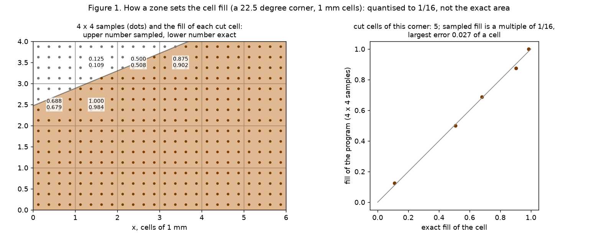
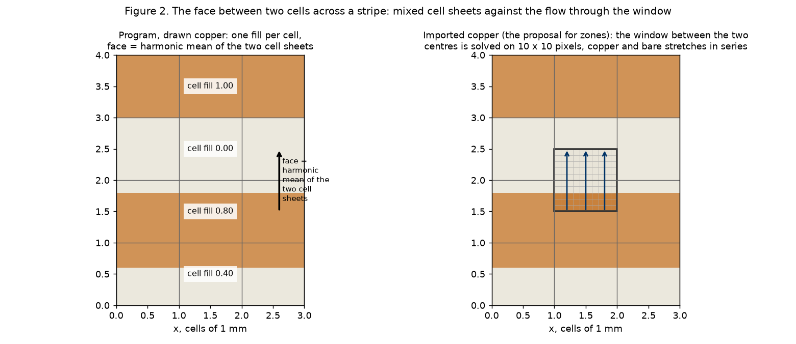
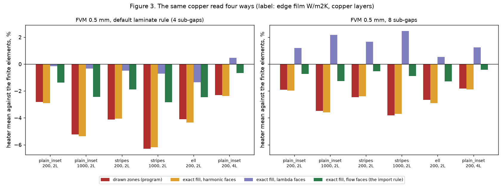
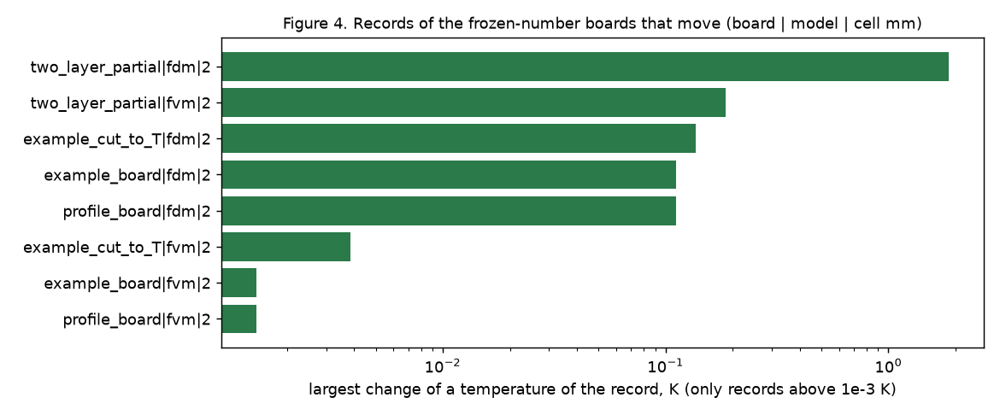

# Drawn copper read as imported copper: exact fill and flow-based faces (FVM and FDM)

Branch `research/drawn-copper-faces`; item 5a of `docs/versions.md` 'Planned: 2.8.0'. The program is not touched: everything below runs on a COPY of its networks (`lib/patched.py`) or on a deep copy of the problem (`lib/dc_cases.py`).

## 1. Question and answer

**Question.** Drawn copper (zones, hatching) reads cooler than the same copper imported (validation 40.4: the 20 mm square with the copper 1.2 mm inside the wall, 200 W/m2K, 1 mm cell: -3.15 % drawn, -0.93 % imported against the 3D truth; striped and padded tops 5 to 12 % cool; the only unsafe-side FVM error with no warning). What is the gap made of, and does it go away when a zone is read the way an import is read?

**Answer, in short** (numbers in sections 3 to 6; every error is the heater mean against an independent finite-element solution with the copper resolved, unless said):

1. **The gap is the faces, not the fill.** Replacing the 4 x 4 samples of a zone by the exact area share moves the heater mean by 0.0 to 0.3 point (and in the FDM it makes things worse). Replacing the harmonic mean of the two cell sheets by the flow through the window of pixels between the two cell centres (the imported default, `copper.face_conductances`, mapping `faces`) moves it by 0.2 point (weak edge) to 10.3 points (stripes, 1000 W/m2K) at 1 mm and by 0.2 to 4.2 points at 0.25 mm on the boards tried.
2. **FVM, default laminate rule (4 sub-gaps), 1 mm / 0.5 mm / 0.25 mm:** the 20 mm inset square at 200 W/m2K -1.2 / -2.8 / -3.3 % becomes +0.1 / -1.4 / -1.2 %; the stripes board at 200 W/m2K -8.0 / -4.1 / -4.4 % becomes -0.6 / -1.9 / -1.9 %; the L-shaped copper -1.4 / -4.1 / -5.1 % becomes -0.0 / -2.5 / -2.6 %. What is left (1 to 3 % cool at the fine cells) is the laminate rule: with 8 sub-gaps the same boards read -0.2 to -1.3 % (section 3.3).
3. **FDM:** -5.2 / -4.0 / -3.6 % (inset square, 200 W/m2K) and -12.9 / -6.1 / -5.0 % (stripes) become -1.0 / -1.2 / -1.4 % and -1.8 / -1.9 / -2.1 %.
4. **Boards with an outline** (the turned and shifted squares, T and L of validation 40, independent 3D truths): mean error of the 20 mm inset square at 200 W/m2K and 1 mm -3.15 % becomes -1.26 %, the stripes board -11.8 % becomes -2.6 %, T and L inset -2.7 / -3.1 % become -0.7 / -1.1 %. Copper that reaches the outline does not move (T +1.19 / +1.24 %, L +0.81 / +0.83 %).
5. **Cost, pixels, frozen numbers:** see sections 5 to 7 (10 pixels per cell; 2.5 to 4 times the time and +20 to +60 % memory on a 100 x 75 mm board). The 17 frozen-number boards are almost blind to the change (their copper edges lie on cell lines): with a raster only for the layers that have a cut cell, 8 of the 102 FVM and FDM records move (all at 2 mm; FVM at most 0.19 K, FDM at most 1.87 K, `two_layer_partial`) and the other 94 are bit for bit the same.
6. **Recommendation:** adopt in 2.8.0 as a fix for the FVM and the FDM (section 8 and `INTEGRATION.md`); the fall-back, if the maintainer prefers not to move numbers, is a warning with the measured range of section 3.

## 2. Method

*Figure 1 (fig_01_fill_sampling.png): a copper corner turned 22.5 degrees over 1 mm cells; the 4 x 4 sample points of each cut cell and the fill they give against the exact fill. The sampled fill is a multiple of 1/16 and differs from the exact one by at most 0.027 of a cell here.*

*Figure 2 (fig_02_face_rules.png): heat across a stripe. The program joins two cell sheets (one number per cell) by the harmonic mean; the import rule solves the window between the two centres on 10 x 10 pixels, so a bare stretch is a resistance in series.*

**Boards** (`lib/dc_cases.py`): 20 mm square, 1.6 mm, 35 um copper, laminate 0.9 / 0.3 W/mK, a 4 mm heater of 1 W at the centre of the top layer, `h_top = h_bottom = 10`, edge film `h_side` 10 to 1000 W/m2K; no outline unless said. Copper: `plain_inset` (every layer 1.2 mm inside the wall), `plain_wall` (to the wall), `stripes` (top layer stripes 1.2 mm every 2.4 mm plus a 7.2 mm pad, the `sq_stripes` of validation 40), `ell` (the inset square with an 8 mm corner removed on the top layer), `hatch` (inset, fill 0.5; no resolved reference), four layers (`plain_inset`, planes on the inner layers).

**Four readings of the same copper in the program's FVM and FDM** (the problem is handed to the program as an import made from the zones, `dc_cases.zones_to_imported`, pixel `cell / 10`; the zones' exact coverage `geometry.exact_coverage`):

| reading | cell fill | in-plane faces |
| :-- | :-- | :-- |
| `drawn` | 4 x 4 samples (`geometry.zone_fill`) | the program's drawn rule (harmonic mean of the fill-weighted cell sheets; FDM: the face fill rule of validation 47) |
| `fill` | exact | the same harmonic mean (mapping `fill` of the import) |
| `lambda` | exact | the geometric mean of the Wiener bounds per cell (mapping `lambda`) |
| `faces` | exact | flow through the window of pixels between the cell centres on the reduced sheet (mapping `faces`, the imported default) |

**References.** An independent hexahedral finite-element solution (`research/independent-fem-edge/lib`, scikit-fem and pyamg, in a scratch environment OUTSIDE git; its tests need it) with every copper edge a mesh line and 12 elements per laminate gap (`lib/dc_fem.py`, `scripts/study_fem_reference.py`), at plan sizes 0.4 and 0.2 mm (0.4 and 0.3 mm for the four-layer board: 0.2 mm is refused above 2 GB), extrapolated to zero size assuming second order. The extrapolation is an ESTIMATE (the move from 0.2 mm to it is 0.1 to 0.35 %). The `stripes` and `plain_inset` 200 W/m2K values reproduce the numbers of `independent-fem-extensions` README 8.4 (73.3435 / 73.7400 and 56.9358 / 57.1020 K) to the digit. For the boards with an outline the references are the 3D truths stored by `research/imported-copper-edge-film` (extrapolated, about 0.2 % uncertain).

### 2.1 Finite-element references (heater mean rise, K)

| board | h_side W/m2K | layers | 0.4 mm | 0.2 mm (0.3 for 4 layers) | extrapolated |
| :-- | --: | --: | --: | --: | --: |
| plain_inset | 10 | 2 | 124.452 | 124.527 | 124.552 |
| plain_inset | 50 | 2 | 90.242 | 90.357 | 90.395 |
| plain_inset | 200 | 2 | 56.936 | 57.102 | 57.157 |
| plain_inset | 1000 | 2 | 38.657 | 38.850 | 38.914 |
| plain_wall | 200 | 2 | 50.558 | 50.624 | 50.646 |
| plain_wall | 1000 | 2 | 29.988 | 30.081 | 30.113 |
| stripes | 200 | 2 | 73.344 | 73.740 | 73.872 |
| stripes | 1000 | 2 | 55.605 | 56.042 | 56.187 |
| ell | 200 | 2 | 64.017 | 64.427 | 64.563 |
| plain_inset | 200 | 4 | 52.913 | 52.996 | 53.102 |

The finite-element heater mean is the mean over the heater elements of the copper-layer temperature; the program's is the mean of the copper-node temperatures under the footprint with its own weights (the face term of a part over bare laminate is not added in either).

## 3. Where the gap comes from (`study_decomposition.py`, `out/dec.json`)

### 3.1 FVM, default laminate rule (error of the heater mean against the finite elements, %; cells 1 / 0.5 / 0.25 mm)

| board, h_side W/m2K, layers | drawn | exact fill alone | lambda faces | flow faces (import rule) |
| :-- | :-- | :-- | :-- | :-- |
| plain_inset, 10, 2 | +0.1 / -0.4 / -0.5 | +0.1 / -0.4 / -0.5 | +0.7 / -0.0 / -0.2 | +0.3 / -0.2 / -0.3 |
| plain_inset, 50, 2 | -0.2 / -1.0 / -1.3 | -0.3 / -1.1 / -1.2 | +1.3 / -0.0 / -0.5 | +0.2 / -0.5 / -0.5 |
| plain_inset, 200, 2 | -1.2 / -2.8 / -3.3 | -1.3 / -2.9 / -3.2 | +2.5 / -0.2 / -1.1 | +0.1 / -1.4 / -1.2 |
| plain_inset, 1000, 2 | -2.6 / -5.2 / -5.9 | -2.7 / -5.4 / -5.8 | +4.0 / -0.3 / -1.9 | -0.0 / -2.4 / -2.1 |
| plain_wall, 200, 2 | +0.8 / -0.6 / -0.9 | +0.8 / -0.6 / -0.9 | +0.8 / -0.6 / -0.9 | +0.8 / -0.6 / -0.9 |
| plain_wall, 1000, 2 | -0.2 / -2.6 / -3.1 | -0.2 / -2.6 / -3.1 | -0.2 / -2.6 / -3.1 | -0.2 / -2.6 / -3.1 |
| stripes, 200, 2 | -8.0 / -4.1 / -4.4 | -8.0 / -4.1 / -4.3 | +3.2 / -0.5 / -1.6 | -0.6 / -1.9 / -1.9 |
| stripes, 1000, 2 | -11.2 / -6.3 / -6.6 | -11.2 / -6.2 / -6.5 | +4.5 / -0.7 / -2.4 | -0.9 / -2.8 / -2.8 |
| ell, 200, 2 | -1.4 / -4.1 / -5.1 | -1.7 / -4.3 / -5.0 | +2.4 / -1.3 / -2.5 | -0.0 / -2.5 / -2.6 |
| plain_inset, 200, 4 | -0.8 / -2.3 / -2.8 | -0.8 / -2.4 / -2.7 | +2.8 / +0.5 / -0.5 | +0.9 / -0.7 / -0.6 |
| hatch, 200, 2 (*) | +1.0 / -0.9 / -1.4 | +0.8 / -1.1 / -1.4 | +3.6 / +1.0 / +0.1 | +1.9 / +0.1 / +0.0 |

(*) no resolved reference for a hatch: the reference is the flow reading at 0.25 mm itself, so this row only says that the readings agree among themselves. `plain_wall` is a control: copper to the wall means every cell is full or empty, the four readings are identical by construction.

*Figure 3 (fig_03_decomposition.png): the same copper read four ways, FVM at 0.5 mm, with the default laminate rule (left) and with eight sub-gaps (right).*

**Reading.**

* **The fill is not the cause.** The 4 x 4 samples quantise the fill to 1/16 (Figure 1), but the exact fill alone moves the heater mean by at most 0.3 point on every board (the largest: `ell` at 1 mm, -1.4 to -1.7 %). The copper area of the board is the same to the sample; what differs is where the copper sits.
* **The faces are the cause.** A cell cut by a copper edge is one number (a mixed sheet); the heat across a stripe or across the copper edge in the program's rule passes through a mixture instead of a series of the copper and the bare stretch (Figure 2). With the flow faces: `stripes` 200 W/m2K -8.0 -> -0.6 % at 1 mm (-4.1 -> -1.9 % at 0.5 mm), `plain_inset` 1000 W/m2K -2.6 -> -0.0 %.
* **The `lambda` mapping is not the answer** (+2.4 to +4.5 % hot at 1 mm on the boards with cut cells and a 1 mm cell, up to +9 % with eight sub-gaps): it was a candidate of the Gerber study and stays as it is.
* **At 0.5 and 0.25 mm the flow faces still read 1.2 to 2.8 % cool** on the boards with copper inset from the wall: that is not the faces but the laminate rule, as 3.3 shows.

### 3.2 FDM (default laminate rule)

| board, h_side W/m2K, layers | drawn | exact fill alone | lambda faces | flow faces |
| :-- | :-- | :-- | :-- | :-- |
| plain_inset, 10, 2 | -1.0 / -0.7 / -0.6 | -1.1 / -0.8 / -0.6 | -0.1 / -0.3 / -0.3 | -0.4 / -0.3 / -0.3 |
| plain_inset, 50, 2 | -2.2 / -1.6 / -1.4 | -2.8 / -2.1 / -1.7 | +0.2 / -0.5 / -0.5 | -0.5 / -0.5 / -0.6 |
| plain_inset, 200, 2 | -5.2 / -4.0 / -3.6 | -7.4 / -5.6 / -4.3 | +0.7 / -1.0 / -1.1 | -1.0 / -1.2 / -1.4 |
| plain_inset, 1000, 2 | -9.3 / -7.2 / -6.5 | -14.0 / -10.5 / -8.0 | +1.3 / -1.8 / -2.0 | -1.6 / -2.0 / -2.4 |
| plain_wall, 200, 2 | -2.5 / -1.5 / -1.1 | -2.5 / -1.5 / -1.1 | -2.5 / -1.5 / -1.1 | -2.5 / -1.5 / -1.1 |
| plain_wall, 1000, 2 | -6.1 / -4.2 / -3.5 | -6.1 / -4.2 / -3.5 | -6.1 / -4.2 / -3.5 | -6.1 / -4.2 / -3.5 |
| stripes, 200, 2 | -12.9 / -6.1 / -5.0 | -22.2 / -9.7 / -6.7 | +2.4 / -0.5 / -1.6 | -1.8 / -1.9 / -2.1 |
| stripes, 1000, 2 | -18.3 / -9.1 / -7.5 | -31.9 / -14.4 / -10.0 | +3.3 / -0.9 / -2.3 | -2.5 / -2.7 / -3.1 |
| ell, 200, 2 | -8.1 / -6.3 / -5.8 | -10.3 / -8.1 / -6.6 | -2.5 / -3.0 / -2.4 | -4.0 / -3.1 / -2.6 |
| plain_inset, 200, 4 | -4.6 / -3.5 / -3.1 | -7.7 / -5.4 / -4.0 | +1.0 / -0.4 / -0.5 | -0.4 / -0.5 / -0.8 |
| hatch, 200, 2 (*) | -3.4 / -1.9 / -1.5 | -5.1 / -3.3 / -2.1 | +1.0 / +0.2 / +0.2 | -0.3 / +0.1 / +0.0 |

The FDM is the larger beneficiary (it has the larger drawn error), **and its exact-fill-alone reading is worse than the drawn one** (-31.9 % against -18.3 % on the stripes at 1 mm): the node-centred harmonic mean of nodal sheets leaks the more the more exactly the fill is known, and only the flow faces repair it. So for the FDM the fill must not be changed without the faces. `plain_wall` is -2.5 / -6.1 % in the FDM whatever the reading: a different defect (the FDM at a copper-to-the-wall edge, A40 / A32 of `research/ROADMAP.md`), not touched.

### 3.3 FVM with eight laminate sub-gaps (`--n8`, the same boards)

| board, h_side W/m2K, layers | drawn | exact fill alone | lambda faces | flow faces |
| :-- | :-- | :-- | :-- | :-- |
| plain_inset, 10, 2 | +0.3 / -0.3 / -0.4 | +0.2 / -0.3 / -0.4 | +1.1 / +0.2 / -0.1 | +0.4 / -0.1 / -0.1 |
| plain_inset, 50, 2 | +0.2 / -0.7 / -1.0 | +0.2 / -0.8 / -1.0 | +2.2 / +0.5 / -0.2 | +0.5 / -0.3 / -0.2 |
| plain_inset, 200, 2 | -0.0 / -1.9 / -2.5 | -0.1 / -2.0 / -2.5 | +4.8 / +1.2 / -0.2 | +1.0 / -0.7 / -0.4 |
| plain_inset, 1000, 2 | -0.3 / -3.5 / -4.5 | -0.4 / -3.6 / -4.4 | +8.2 / +2.2 / -0.3 | +1.6 / -1.3 / -0.6 |
| plain_wall, 200, 2 | +1.7 / +0.1 / -0.3 | +1.7 / +0.1 / -0.3 | +1.7 / +0.1 / -0.3 | +1.7 / +0.1 / -0.3 |
| plain_wall, 1000, 2 | +2.8 / -0.2 / -1.0 | +2.8 / -0.2 / -1.0 | +2.8 / -0.2 / -1.0 | +2.8 / -0.2 / -1.0 |
| stripes, 200, 2 | -6.3 / -2.5 / -2.9 | -6.2 / -2.4 / -2.8 | +6.4 / +1.7 / -0.0 | +1.3 / -0.5 / -0.4 |
| stripes, 1000, 2 | -8.6 / -3.8 / -4.4 | -8.5 / -3.7 / -4.3 | +9.2 / +2.5 / -0.0 | +1.7 / -0.9 / -0.6 |
| ell, 200, 2 | +0.4 / -2.7 / -4.0 | +0.2 / -2.9 / -3.9 | +5.3 / +0.5 / -1.1 | +1.5 / -1.3 / -1.2 |
| plain_inset, 200, 4 | +0.0 / -1.8 / -2.4 | -0.0 / -1.9 / -2.4 | +4.2 / +1.2 / -0.0 | +1.5 / -0.4 / -0.2 |
| hatch, 200, 2 (*) | +1.3 / -0.8 / -1.5 | +1.1 / -1.0 / -1.5 | +4.7 / +1.4 / +0.1 | +1.9 / -0.1 / +0.0 |

(Eight sub-gaps, `laminate.using(0.2e-3, 8)`; this is a study switch, not the default.) With the flow faces and eight sub-gaps the boards read -0.1 to -1.3 % at 0.5 and 0.25 mm, against -1.4 to -4.5 % drawn: the 2 to 3 % that remained after the faces is the laminate at the inset edge (the known A16 / A18 / A34 limit, `validation.md` 36 and 44), and it is **independent** of the drawn-or-imported question. At 1 mm the flow faces with eight sub-gaps read +1.0 to +1.7 % hot on the inset boards (the half-cell film of the cut cell is first-order hot at a coarse cell, validation 40.5).

## 4. Boards with an outline (`study_outline_boards.py`, `out/outline.json`)

The turned (0, 11.25, 22.5, 33.75, 45 degrees) and shifted (0 and 0.3 of a cell) boards of `research/imported-copper-edge-film/scripts/study_drawn_film.py` with the copper drawn, ten boards per row, against the 3D truths stored there (validation 40). Mean / spread (largest minus smallest) / worst error of the heater mean in %; the left column reproduces validation 40.2 to the digit.

| case, h_side, cell mm | program mean / spread / worst | zones read as an import |
| :-- | :-- | :-- |
| sq_in, 10, 1 | -0.58 / 0.90 / 0.79 | -0.43 / 0.89 / 0.66 |
| sq_in, 10, 0.5 | -0.52 / 0.19 / 0.57 | -0.39 / 0.21 / 0.44 |
| sq_in, 50, 1 | -1.35 / 1.62 / 1.90 | -0.75 / 1.43 / 1.27 |
| sq_in, 50, 0.5 | -1.19 / 0.22 / 1.29 | -0.74 / 0.44 / 0.85 |
| sq_in, 200, 1 | -3.15 / 3.78 / 4.62 | -1.26 / 2.48 / 2.53 |
| sq_in, 200, 0.5 | -2.76 / 0.64 / 3.01 | -1.47 / 1.25 / 1.75 |
| sq_in, 500, 1 | -4.66 / 5.78 / 6.90 | -1.62 / 3.78 / 3.49 |
| sq_in, 500, 0.5 | -4.03 / 1.11 / 4.54 | -2.02 / 1.96 / 2.46 |
| sq_in, 1000, 1 | -5.66 / 7.00 / 8.39 | -1.86 / 4.68 / 4.10 |
| sq_in, 1000, 0.5 | -4.82 / 1.43 / 5.50 | -2.36 / 2.43 / 2.90 |
| sq_wall, 200, 1 | +0.25 / 1.19 / 0.90 | +0.39 / 0.83 / 0.90 |
| sq_wall, 200, 0.5 | -0.34 / 0.26 / 0.52 | -0.27 / 0.35 / 0.52 |
| sq_wall, 1000, 1 | -0.93 / 1.69 / 1.86 | -0.51 / 1.70 / 1.10 |
| sq_wall, 1000, 0.5 | -2.12 / 0.66 / 2.58 | -1.85 / 1.26 / 2.58 |
| sq_4l, 200, 1 | -2.99 / 4.41 / 4.78 | -0.56 / 2.66 / 1.91 |
| sq_4l, 200, 0.5 | -2.28 / 0.70 / 2.56 | -0.82 / 1.33 / 1.12 |
| sq_4l, 1000, 1 | -5.96 / 8.55 / 9.44 | -0.72 / 5.58 / 3.30 |
| sq_4l, 1000, 0.5 | -4.38 / 1.64 / 5.18 | -1.37 / 2.80 / 1.99 |
| sq_pad, 200, 1 | -8.22 / 3.40 / 9.72 | -4.69 / 6.38 / 6.50 |
| sq_pad, 200, 0.5 | -6.63 / 4.36 / 9.13 | -4.12 / 2.71 / 5.00 |
| sq_stripes, 200, 1 | -11.81 / 10.96 / 14.64 | -2.58 / 2.53 / 3.47 |
| sq_stripes, 200, 0.5 | -5.17 / 2.11 / 5.82 | -2.55 / 1.15 / 2.80 |
| T_in, 200, 1 | -2.68 / 3.07 / 4.00 | -0.69 / 1.58 / 1.48 |
| T_in, 200, 0.5 | -2.92 / 0.92 / 3.27 | -1.36 / 1.06 / 1.73 |
| T_wall, 200, 1 | +1.19 / 0.97 / 1.48 | +1.24 / 0.32 / 1.38 |
| T_wall, 200, 0.5 | +0.24 / 0.79 / 0.42 | +0.25 / 0.70 / 0.46 |
| L_in, 200, 1 | -3.12 / 3.86 / 3.86 | -1.11 / 2.27 / 2.07 |
| L_in, 200, 0.5 | -2.86 / 1.21 / 3.59 | -1.38 / 1.98 / 2.27 |
| L_wall, 200, 1 | +0.81 / 1.26 / 1.16 | +0.83 / 1.51 / 1.41 |
| L_wall, 200, 0.5 | +0.05 / 1.24 / 0.98 | +0.07 / 1.27 / 0.98 |

The absolute mean error falls on 25 of the 30 rows; the worst board of the ten falls on 24, is equal on 4 and rises on 2. **Where it does not improve** (stated, not hidden):

* The five rows where the mean error rises are the boards with the copper TO the wall (`sq_wall` 200 at 1 mm +0.25 -> +0.39 %, `T_wall` and `L_wall`, 0.01 to 0.14 point): there the drawn and the imported path differ only in how the outline is taken (aperture links against the pixel mask), and the difference is small and hot-side.
* The worst board rises on `L_wall` at 1 mm (1.16 -> 1.41 %) and on `T_wall` at 0.5 mm (0.42 -> 0.46 %).
* **The spread of the ten turned and shifted boards RISES on 15 of the 30 rows**, mostly at 0.5 mm: `sq_in` 200 0.64 -> 1.25 %, 1000 1.43 -> 2.43 %, `sq_4l` 1000 1.64 -> 2.80 %, `L_in` 1.21 -> 1.98 %, and `sq_pad` at 1 mm 3.40 -> 6.38 %. The mean error improves and the whole distribution moves up towards the truth (so the worst error falls), but the board-to-board scatter at a fine cell grows: the probable cause (NOT tested here) is the cut-cell sensitivity of the pixel-level outline of the imported path (validation 38, 39), which the drawn path covers by reading every board about equally cool. It is not a defect of the faces, but a cost of adopting the imported path on outline boards that has to be stated.
* The pad board (a 7.2 mm pad over bare laminate on the top layer) stays 4 to 5 % cool: a small pad on bare laminate is the A18 / bare-spot limit, not the faces.

These rows use the design of section 7 (float coverage, a raster only for a layer that has a cut cell); the first run with a raster for every layer and 8-bit coverage gave the same table to 0.01 point.

### 4.1 The fill itself and the 8-bit raster

A zone with fill f read through a stored import is quantised to round(255 f) / 255 (0.7 reads 0.698). The copy keeps the coverage as float (`patched.FloatSource`, in memory, never stored), which moves `hatched_copper` by less than 1e-4 K instead of the 0.10 K of the 8-bit version (`study_harness_shift.py`). Adoption must not store the raster of a drawn board (the zones are the stored object) and must not quantise it.

## 5. How many pixels per cell (`study_pixels.py`)

FVM, flow faces, error against the finite elements in % at cells 1 / 0.5 / 0.25 mm and seconds for the three runs (a 20 mm board, one core):

| board | program (drawn) | n = 2 | n = 4 | n = 6 | **n = 10** | n = 16 |
| :-- | :-- | :-- | :-- | :-- | :-- | :-- |
| stripes, 200 | -8.0 / -4.1 / -4.4 (0.2 s) | -3.3 / -4.0 / -3.4 (0.2) | -3.0 / -2.8 / -2.4 (0.2) | -2.0 / -2.3 / -2.5 (0.3) | **-0.6 / -1.9 / -1.9 (0.6)** | -1.0 / -2.0 / -2.1 (1.3) |
| stripes, 1000 | -11.2 / -6.3 / -6.6 | -5.0 / -6.0 / -5.0 | -4.6 / -4.1 / -3.4 | -2.9 / -3.4 / -3.6 | **-0.9 / -2.9 / -2.8 (0.5)** | -1.6 / -3.1 / -3.1 (1.2) |
| plain_inset, 200 | -1.2 / -2.8 / -3.3 (0.1 s) | -1.3 / -2.8 / -2.2 (0.1) | -1.2 / -1.9 / -1.4 (0.1) | -0.1 / -1.6 / -1.6 (0.2) | **+0.1 / -1.4 / -1.2 (0.3)** | +0.0 / -1.5 / -1.4 (0.6) |
| plain_inset, 1000 | -2.6 / -5.2 / -5.9 | -2.8 / -5.2 / -4.0 | -2.6 / -3.4 / -2.4 | -0.4 / -2.9 / -2.9 | **-0.0 / -2.4 / -2.1 (0.3)** | -0.2 / -2.6 / -2.4 (0.6) |
| ell, 200 | -1.4 / -4.1 / -5.1 (0.2 s) | -1.7 / -4.3 / -3.8 | -1.6 / -3.1 / -2.8 | -0.3 / -2.7 / -3.1 | **-0.0 / -2.5 / -2.6 (0.3)** | -0.1 / -2.6 / -2.8 (0.7) |

Ten pixels per cell side (the program's own `copper.MAX_PIXELS_PER_CELL` is 24 and its pixel rule `min(m w / 4, cell / 10)`) is where the answer stops moving: 16 pixels differ by 0.1 to 0.5 point and cost twice; 4 pixels keep about half of the gain at 0.5 mm; 2 pixels almost none.

## 6. Cost (`study_cost.py`)

A 100 x 75 mm board, 4 layers (planes 1.5 mm inside the wall on the inner layers, stripes 1.2 mm every 2.4 mm plus a 20 mm pad on the top layer, bottom plane), six 6 mm parts of 1 W, `h_side` 10 (`scripts/study_cost.py all`, each run a fresh process, the program as it is against the copy with a raster only for the layers that have a cut cell, 10 pixels per cell side). Seconds of the whole `solve_steady` and peak resident memory (`ru_maxrss`):

| model, cell | program | copy (drawn zones read as an import) |
| :-- | :-- | :-- |
| FVM 2 mm | 0.0 s, 105 MB | 0.4 s, 169 MB |
| FVM 1 mm | 0.4 s, 221 MB | 1.1 s, 306 MB |
| FVM 0.5 mm | 1.5 s, 725 MB | 3.7 s, 879 MB (+21 %) |
| FDM 2 mm | 0.1 s, 107 MB | 0.4 s, 182 MB |
| FDM 1 mm | 0.2 s, 208 MB | 1.1 s, 280 MB |
| FDM 0.5 mm | 2.0 s, 817 MB | 4.2 s, 970 MB (+19 %) |

Time 2.5 to 4 times, memory +20 to +60 % (the raster of the layers that have a cut cell: at 0.5 mm that is the top layer only, the inner planes sit on cell lines there; at 2 and 1 mm the planes at 1.5 mm are cut too). The heat balance closes to 3e-12 in all of them. The hottest rise moves by +8.4 K at 2 mm (stripes 1.2 mm on a 2 mm cell: the program's mixed cells read 15 % cool), +0.9 K at 1 mm and +1.9 K at 0.5 mm. Not measured: boards of 200 x 150 mm and larger (the raster is 100 pixels per cell per layer that needs it, float32: 400 x 300 cells at 0.5 mm would be 48 MB per layer at the raster plus the windows; `memory.py` charges 40 bytes per pixel for the faces of an import, `FACES_BYTES_PER_PIXEL`, which is 4 MB per 1000 cells, 480 MB for a layer of 120 000 cells: not checked against a run of that size).

## 7. The 17 frozen-number boards (`study_harness_shift.py`, `study_harness_t63.py`)

**The design that is measured here** (`lib/patched.py`): a layer takes the import rule only if at least one of its cells is cut by a zone edge (`layers_with_cut_cells`: the summed exact coverage of the zones is neither 0 nor 1 in some cell); a layer whose every cell is full or empty keeps the program's own path, because the two rules agree there (a window half copper and half bare is the harmonic mean) and the float32 raster would only add a rounding of 1e-7 K. Without this rule all 102 records move by 1e-7 K or more (tolerance of the frozen test: 1e-8 K) and 19 of them by more than 1e-4 K; with it only the boards that have a cut cell move, the rest are bit for bit the same.

The steady records of `tests/regression/regress_boards.py` through `regress_harness.run_one`, FVM and FDM at 2, 1 and 0.5 mm, with the program as it is and inside the copy (102 records each; the 3D solid, Lumped and Analytic read the cell fill only and are not part of this change): **8 records move (all at 2 mm), 94 are bit for bit the same**. The largest change of any temperature of the record:

| record (board, model, cell mm) | largest change K | at | rise of the hottest value K | change % of the rise |
| :-- | --: | :-- | --: | --: |
| two_layer_partial, fdm, 2 | +1.8655 | U:t_mean | 161.33 | +1.37 |
| two_layer_partial, fvm, 2 | +0.1861 | U:t_mean | 162.63 | +0.14 |
| example_cut_to_T, fdm, 2 | +0.1360 | U2:t_max | 93.97 | +0.20 |
| example_board, fdm, 2 (and profile_board, the same board) | +0.1118 | U1:t_mean | 84.52 | +0.19 |
| example_cut_to_T, fvm, 2 | -0.0039 | t_max | 94.67 | -0.006 |
| example_board, fvm, 2 (and profile_board) | -0.0015 | U1:t_mean | 85.29 | -0.002 |

*Figure 4 (fig_04_harness_shift.png): the largest change of a temperature of the record for the records that move by more than 1e-3 K.*

Which boards move and why: `two_layer_partial` (the copper window 15 to 45 mm on a 2 mm cell is cut at 15), the example board (the top copper) and `example_cut_to_T`. At 1 and 0.5 mm none moves: **the frozen boards are nearly blind to this change** (their copper edges lie on cell lines by design), so they cannot show that the change is safe or harmful; they only give the list of records for the pending file. The times to 63 % (the 2 mm step response of every part curve, 40 curves): 14 move by more than 1e-6 relative; the largest are the FDM `example_board` U2 +1.12 %, `example_cut_to_T` FDM U2 +0.58 %, U1 -0.11 %, the FVM at most +0.17 % (`two_layer_partial` U); the FDM steady resistance of `two_layer_partial` +1.33 %. 26 curves are unchanged.

**New boards for the frozen set.** Because the 17 boards cannot see this change, an adoption must add to the harness at least: the inset square (copper 1.2 mm inside the wall, 200 W/m2K), the stripes-and-pad board and the L-shaped copper of this folder at 1 and 0.5 mm in the FVM and the FDM (records that move against the program and then stay as the new frozen numbers). The harness is the release's (`releases/regression-harness/`); adding boards is a change to it, which the maintainer decides.

## 8. Recommendation and limits

See `INTEGRATION.md`. In short:

* **Adopt in 2.8.0 as a fix** (FVM and FDM, drawn layers that have a partially filled cell): the effect is the largest unsafe-side FVM error without a warning (the drawn reading is -1.2 to -11.2 % at 1 mm and -3.3 to -6.6 % at 0.25 mm on the boards of section 3 with a strong edge, 200 to 1000 W/m2K), the change is already implemented in the program for the imported copper (no new numerical method, only the source of the raster), and with that rule it moves four FVM and four FDM steady records, all at 2 mm (three boards; `profile_board` is the example board), and no record at 1 and 0.5 mm.
* **Not repaired by it** (stated limits): the laminate at the inset edge (1 to 3 % cool at fine cells, A16 / A18 / A34), a small pad on bare laminate (4 to 5 % cool), the FDM at a copper-to-the-wall edge (-2.5 to -6.1 %), the hot first-order error of the cut cell at a coarse cell (+1 to +2 % at 1 mm).
* **Not part of it**: the 3D solid, the Lumped and the Analytic read the cell fill only; the exact fill alone moves them by the 0.0 to 0.3 point of 3.1 (not measured in them), so they are left.

## 9. Tests

`research/drawn-copper-faces/tests/test_drawn_faces.py` (4 tests, 1 s): the exact area of a zone raster (also an edge that cuts the pixels), the copy equal to a real import of the same zones (FVM and FDM, to 5e-3 K) with a closed heat balance, copper on cell lines unchanged, and the face across a copper edge equal to the series of the copper and bare stretches of the window (closed form). Run: `QT_QPA_PLATFORM=offscreen .venv/bin/python -m pytest -q research/drawn-copper-faces/tests`.

## 10. What was read and what was not verified

* **Read** (in the repository): `docs/validation.md` 38 to 40 (40.4 in full), `docs/theory.md` 1.7, `docs/versions.md` 'Planned: 2.8.0' item 5a, the reviewer's opinion on the open questions (sections 6 and 7), `research/imported-copper-edge-film` (cases, truths), `research/independent-fem-extensions` README 8.4 (the stripes board), `pcbthermal/copper.py` (`face_conductances`, `lateral`, `override_fill`), `fvm.py` and `fdm.py` where they read the fill and the faces, `geometry.zone_fill` and `exact_coverage`.
* **From the program's docstrings only, not opened**: the transmissibility upscaling of reservoir grids that `copper.face_conductances` cites; no literature was opened for this study, and none is claimed.
* **Reproduced**: the stripes and plain finite-element numbers of `independent-fem-extensions` 8.4 (to the digit); the program column of validation 40.2 (sq_in, sq_wall, sq_4l, sq_pad, sq_stripes, T and L, the left column of section 4).
* **Not verified**: a physical board (nothing here is compared with a measurement); the references are finite-element solutions with extrapolation to zero size ASSUMED second order (estimate; 0.2 mm for the two-layer boards, 0.3 mm for the four-layer board); the hatch has no resolved reference; vias, parts over drawn partial copper, metal blocks and boards with several parts were not tried on the study boards (the frozen boards cover a few: no record with vias moves in the FVM at 1 and 0.5 mm); overlapping zones of different fill are approximated in the raster (sum clipped to the largest fill; the program's rule is the maximum at each sample); the cost study uses one board (section 6); the 3D solid, Lumped and Analytic were not run with the exact fill; transients were run only on the 17 frozen boards (the 2 mm step response); the imported path in the FDM was not looked at beyond the numbers above.
