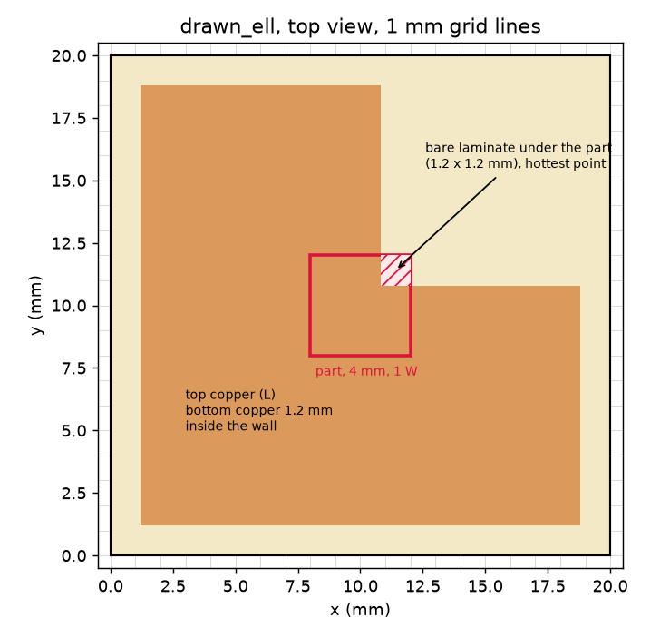
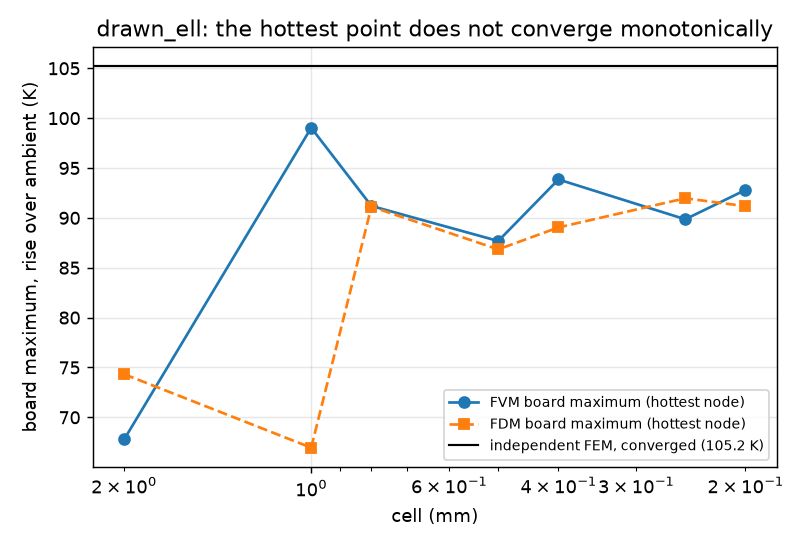

# The 99 K and 67 K of the board `drawn_ell`: a read-out, not a defect

**Question.** A reviewer saw the board maximum of the harness board `drawn_ell` (20 mm square, two layers, top copper an L, bottom copper 1.2 mm inside the wall, 4 mm part with 1 W, h = 10 W/m²K, edge film 200 W/m²K) read 99 K in the FVM and 67 K in the FDM at 1 mm, although both models are of the same layered physics and agree within a few percent elsewhere (validation 51). Is it a read-out, physics, or a defect that affects 2.8.0?

**Answer in short.**

* **Reproduced to the digit** on `development` 6c225276: FVM 99.035 K and FDM 66.955 K at 1 mm (section 1). It is the **board maximum** (`t_max`, the hottest node), not the heater mean.
* **The heater means agree** with an independent finite-element solution (63.8 K, section 3): FVM +1.7 %, FDM -3.8 % at 1 mm (section 2). The gap is in a read-out of one spot.
* **The spot is a 1.2 x 1.2 mm corner of bare laminate under the part**: the part (8 to 12 mm) overlaps the inner corner of the L (copper ends at 10.8 mm). The hottest node of every model is in that corner (11 to 11.75 mm).
* **The converged peak is 105.2 K** (independent FEM, graded mesh, three sizes within 0.2 K, section 3). Against it the layered models read **low at every cell size and without order**: FVM 67.8 / 99.0 / 87.7 K and FDM 74.3 / 67.0 / 86.8 K at 2 / 1 / 0.5 mm, and 88 to 94 K from 0.8 to 0.2 mm (section 2). The 1 mm FVM value (-6 %) is the lucky one; the 1 mm FDM value (-36 %) is the unlucky one; neither is a defect of one model against the other.
* **Cause**: the peak is a point value on a feature (1.2 mm, a copper edge of 35 µm against 1.6 mm of laminate) smaller than the length that governs it (about 0.3 mm, section 4); the layered models, with one node per copper layer and the laminate rule (4 sub-gaps), cannot place the hot node there, and where the nodes of the grid fall against the copper edge at 10.8 mm decides the number. This is the known bare-spot limit (`research/bare-spot-under-source`: FVM -18 %, FDM -25 % on a 6 mm window, 1.6 mm board), here with a part that is mostly over copper.
* **Defect: no.** No energy-balance failure (balance 1e-13 or smaller), no model disagreement in the heater mean, no change from this cycle (section 5). **One small gap in the warnings** (section 6) is proposed in `INTEGRATION.md`.

*Figure 1 (`figures/fig_01_board_and_bare_corner.png`): top view of `drawn_ell`, the L of copper, the part, the bare-laminate corner of the part and the 1 mm grid lines (the cell edge at 11 and 12 mm, the copper edge at 10.8 mm, between nodes).*

## 1. What the reviewer ran (reproduction)

`scripts/study_readouts.py` (harness board `tests/regression/regress_boards.py::drawn_ell`, `api.simulate`, one model, cell = grid cell). Rise over the ambient, `development` 6c225276; board maximum = `SteadyResult.t_max`:

| model | cell (mm) | board max (K) | at (x = y, mm) | heater mean (K) | face max of the part (K) |
| :-- | --: | --: | --: | --: | --: |
| FVM | 2 | 67.786 | 11.00 | 64.361 | 71.432 |
| FVM | 1 | **99.035** | 11.50 | 64.887 | 102.681 |
| FVM | 0.5 | 87.681 | 11.75 | 63.307 | 91.326 |
| FDM | 2 | 74.325 | 12.00 | 60.740 | 68.924 |
| FDM | 1 | **66.955** | 11.00 | 61.386 | 70.601 |
| FDM | 0.5 | 86.844 | 11.50 | 62.181 | 90.490 |

The board is new in 2.8.0 (the frozen file of 2.7.0, `tests/regression/data/v2.7.0.json`, has no `drawn_ell` record). The 99 and 67 K of the report are the 1 mm rows.

## 2. Cell sweep and the other models (same read-outs)

Board maximum and heater mean, K (the same script; `--cells 0.8,0.4,0.25,0.2` and `--models solid3d,fem`):

| model | 2 mm | 1 mm | 0.8 mm | 0.5 mm | 0.4 mm | 0.25 mm | 0.2 mm |
| :-- | --: | --: | --: | --: | --: | --: | --: |
| FVM board max | 67.8 | 99.0 | 91.2 | 87.7 | 93.9 | 89.9 | 92.8 |
| FDM board max | 74.3 | 67.0 | 91.1 | 86.8 | 89.0 | 92.0 | 91.2 |
| FVM heater mean | 64.36 | 64.89 | 62.74 | 63.31 | 63.89 | 63.23 | 63.43 |
| FDM heater mean | 60.74 | 61.39 | 62.50 | 62.18 | 62.07 | 62.77 | 62.76 |

Other program models, cells 2 / 1 / 0.5 mm: 3D solid board max 62.4 / 113.8 / 100.8 K, heater mean 60.54 / 66.76 / 64.68; the program's FEM (column read-out) board max 64.3 / 83.0 / 93.8 K, heater mean 61.36 / 62.98 / 63.84 (its surface read-out 64.4 / 84.1 / 95.3 K; the program's FEM is not converged on this spot either). All energy balances are 1e-12 or smaller in relative terms. The surface read-out of the FVM and the FDM equals the column face maximum here (thin copper: 35 µm), so the read-out is not the cause (the whole-face difference of 3.646 K of the surface notes concerns the board-level maximum of another read-out, not this peak).

Reading: every model sees the same non-monotone, scattered peak at cells of 1 mm or coarser; from 0.8 mm down the FVM and the FDM both give 87 to 94 K (spread 7 %), the face maximum of the part 93 to 97 K.

*Figure 2 (`figures/fig_02_board_maximum_against_cell.png`): board maximum of the FVM and the FDM against the cell, and the converged independent reference.*

## 3. Independent reference

`scripts/study_independent_fem.py` and `scripts/study_graded_fem.py` use the hand-written hexahedral FEM of `research/independent-fem-edge/lib` through `research/drawn-copper-faces/lib/dc_fem.py` (copper resolved as 35 µm elements, 12 elements through the laminate; nothing imported from the program). It is the tool that gave the drawn-copper-faces references.

| mesh | nodes | heater mean (K) | hottest node (K) |
| :-- | --: | --: | --: |
| uniform 1 mm | 6615 | 61.638 | 82.941 |
| uniform 0.5 mm | 25215 | 63.602 | 118.775 |
| uniform 0.25 mm | 98415 | 64.351 | 105.872 |
| graded, 0.25 mm in 9 to 13 mm | 20535 | 63.644 | 105.248 |
| graded, 0.125 mm | 48735 | 63.763 | 105.079 |
| graded, 0.0625 mm | 129735 | 63.807 | 105.262 |

The uniform meshes show the same scatter as the program (82.9, 118.8, 105.9 K): the peak depends on the element size against the copper edge. With the mesh refined around the corner the peak is **105.2 K** (spread 0.2 K, below the CG tolerance) and the heater mean 63.8 K. The 0.03125 mm mesh was refused by the 2 GB guard. Caveat: the FEM peak is a nodal value on the face; the program reads cell values (column mean over the copper slab; the face maximum adds the half-slab term), so even a converged layered model would read a little below it (the part of the 11 % gap at 0.2 to 0.4 mm that is not the laminate rule is of this size, not separated here).

Errors of the program against it (1 mm): heater mean FVM +1.7 %, FDM -3.8 %; board maximum FVM -5.9 %, FDM -36.3 %; at 0.2 to 0.8 mm the board maximum -11 to -17 %.

## 4. Why the peak is hard

Heat of the part enters the top face; over the bare corner it has to cross the laminate (k = 0.3 W/mK, 1.6 mm) to the bottom copper or run sideways to the L. The length over which a 35 µm copper layer on 1.6 mm of laminate takes heat out of the laminate is sqrt(k_cu t_cu t_lam / k_lam) = sqrt(390 x 35e-6 x 1.6e-3 / 0.3) = 0.27 mm (an order-of-magnitude estimate made here, not a published formula). A 1.2 mm bare corner is 4 of those lengths: the peak is physical and well posed (the refined FEM converges), but needs cells of about 0.1 mm to place. The layered models hold copper and half the laminate in one node per layer; under a bare cell the laminate rule adds sub-nodes (4 sub-gaps by default) and the rest is the known 1/n error (`research/bare-spot-under-source`). Which node sits where relative to the copper edge at 10.8 mm (a multiple of no cell here) changes the number by 30 K at 1 mm: this is the scatter of figure 2. A cell edge at 10.8 mm would be aligned only at 0.2 mm.

## 5. Is anything of this cycle responsible?

* **Drawn-copper-faces correction** (merged in this cycle): it changes the faces of cut cells; the heater means moved by <= 1.5 % and are within the stated bound of the FEM (`tests/test_drawn_copper_faces.py`: FVM 64.56 / 62.98 K and FDM 61.98 / 62.57 K at 1 / 0.5 mm; the test reads 64.558 K for FVM at 1 mm; this study prints the same board at 64.887 K because it reads the mean with `analysis.heater_stats` (the part footprint weights of the result), the test with the network weights; both are heater means, 0.3 K apart: not reconciled further here, see 7).
* **Surface read-out** (merged): equal to the column face maximum on this board to every digit (table 1), so not a factor.
* **The 3.646 K of the notes**: a board-level difference of another read-out (surface minus column at the hottest cell of the whole board), small against the 32 K.
* **Frozen numbers**: `drawn_ell` is not in the v2.7.0 file, so there is no earlier release number to compare with; the pending files of this cycle move the board for its face rule, not the board maximum scatter.

## 6. What the program says to the user

`checks.py` warns of a part on bare laminate only when the **centre** of the part is bare (`checks.py` line 865 to 883). Here the centre is on copper, and 9 % of the footprint (the corner) is bare: no warning, and the board maximum reads 6 to 36 % low (up to 20 %, from 0.2 to 0.8 mm). Proposal in `INTEGRATION.md`.

## 7. What was verified and what was not

* **Verified (scripts run on this tree)**: the 99.035 and 66.955 K; the cell sweep of FVM and FDM; the 3D solid and the program's FEM at 2 / 1 / 0.5 mm; the independent FEM (uniform and graded); the energy balances; no warning is printed for the board; tests in `tests/` of this folder (5 passed), `tests/test_docs.py` (848 passed), the licence header test.
* **Not verified**: (a) the identification of the reviewer's exact command: the 99 / 67 K match the 1 mm rows of the harness board with defaults of `SolverOptions`, so it was very probably this; (b) the 0.3 K between the heater mean of this study (analysis read-out) and the test of `test_drawn_copper_faces.py` (network weights): both read the part footprint, the difference was not traced; (c) the 105.2 K peak is a nodal value from one tool (the research FEM, checked against Lee, Culham and an independent scikit-fem cross-check in `research/independent-fem-edge`, not re-run here); the 0.03 mm mesh was refused by the memory guard; (d) the 0.27 mm length of section 4 is an estimate, not tested by a sweep; (e) only this one board: a sweep of the position of the copper edge relative to the grid (shifting the L by fractions of a cell) was not done and would show the scatter directly; (f) the Lumped and Analytic models and the transient were not examined; (g) the scratch suite log of the cycle printed 118.858 K (absolute, ambient 20 degC, so a rise of 98.9 K) for the FVM at 1 mm, 0.2 K from the 99.035 K of this study: a log of an earlier tree, not re-run, not explained.
* **Sources**: no literature; the published cases behind the reference tool are in `research/independent-fem-edge`. Nothing of a third party stored.
