# Effective conductivity, spreading resistance and the layered idealisation: published test cases reproduced

Status: **closed**, reviewed by the reviewer agent on 2026-10-24 (section 8; every study re-run on the program at `0ea5f07`). The review of this folder also read the models of the program and found two defects there (a time constant on boards with an outline, the 3D solid on a one-layer board); both are corrected in the program (`docs/validation.md` section 20) and section 4.11 checks the second against the independent solver. Its one-layer check also led to the laminate nodes of one-layer boards, now in the program in a different form from the candidate of `INTEGRATION.md` 5 (`pcbthermal/laminate.py`, `docs/validation.md` section 21). The three optional proposals (thick-plate warning, `Board.natural_form`, the reference solver as a test helper) were adopted afterwards on `develop` (`docs/validation.md` section 22); their measured impact and where each one lives are in `INTEGRATION.md`, the corrections and text for the project documents in `docs/for-the-project-documents.md`. What stays open is listed in section 6. Studies: `study_culham_1998.py`, `study_lee_spreading.py`, `study_program_vs_coupon.py`, `study_muzychka_2003.py`, `study_natural_convection.py`, `study_biot_definitions.py`, `study_corrections_impact.py`, `study_channel_correlations.py`, `study_one_layer_independent.py`; solver: `lib/layered3d.py`; figures: `make_figures.py` (data) and `make_diagrams.py` (schematics), one numbering (Figures 1 to 20).

## 1. The questions

1. Can the published numerical cases on the effective conductivity of a laminated board (Culham and Yovanovich) and on the spreading resistance of a source on a plate (Seri Lee; Muzychka, Culham and Yovanovich) be reproduced with an **independent** solver, so that the solver can serve as a reference for the program?
2. Do the five models of the program agree with that reference on a board of the same kind?
3. Where does the layered idealisation (one temperature node per layer) stop being valid?
4. Does the natural convection of a vertical board in the program agree with its source, and what would the other form of the same correlation change?

## 2. Findings in short

* **The solver reproduces the publications.** Seri Lee's plate: centre 0.668 against 0.66 K/W (+1.2 %), edge midpoint 1.284 against 1.29 (-0.4 %), corner 2.275 against 2.38 (-4.4 %; the article claims about 5 %). The cross of five sources of Muzychka and others: maximum 80.62 against 80.61 C and area-weighted mean source temperature 78.90 against 78.87. Their first case within 1 % of the rise (+0.9 to +1.0 % from the paper's method): the centroid temperatures lie between the paper's two solutions, the mean source temperatures are 0.5 and 0.75 K above both. The five layer orders of Culham and Yovanovich: 2 to 6 % below the paper (14.67, 11.30, 7.81, 6.99, 4.74 against 15.02, about 11.6, 8.28, about 7.4, 5.00 W/mK).
* **The layer order changes the effective conductivity by a factor of 3** (15 to 5 W/mK for the same copper and FR4), the source size and position and the film coefficient change it too, and none of the averages of the series and parallel conductivities is a good estimate (the geometric mean, 2.7 W/mK, can be 70 % off). The program does not homogenise a stack: every copper layer is a node and every gap a resistor, so the order is represented; an effective conductivity should stay out of the program.
* **The five models of the program agree with the solver** on the Cu / FR4 / Cu version of the coupon, for sources of 1 % to 100 % of the board area: FVM, 3D solid and Analytic within 0.2 %, FDM within 1.2 % (5 mm source on 50 mm), Lumped within 0.3 % (it was +1.0 % at 35 mm before the minimum ring width of `0ea5f07`).
* **One node through the thickness is the mean of the layer; the surface under a source is hotter by at most `q'' t / (2 k)`.** The bound holds when all the heat of the source crosses the layer under it; when the heat spreads sideways the gradient is smaller. Measured in the 3D solver: 0.91 K against a bound of 1.25 K for the cross (10 mm plate, k = 50, strong films), 4.7 and 7.1 K against 8 and 12 K for case 1 (k = 10, where the heat spreads). The program's node agrees with the thickness mean of the 3D solution to 0.2 to 0.3 K; the models fall short of the surface by 2.1 % (cross) and 9 to 10 % (case 1) of the rise. Irrelevant for a 35 um copper layer. *(An earlier version of this README read 12.8 % against a predicted 13.2 % for case 1: that agreement was two errors cancelling, a phantom in-plane FR4 path in the study's model of the plate (+4 points) and a bound taken for the gradient (-4 points); see 4.6.)*
* **Natural convection:** the program's vertical-plate formula is the general Churchill and Chu form and reproduces the worked example of the library `ht` to the digit; the laminar form of the same authors differs from +7 % (Ra 1e4) to -25 % (Ra 1e9), and in the coefficient of a 50 to 200 mm board by +6.5 % to -10 %. No change is proposed until the paper is read.
* **Explained:** the paper's mean base temperature of case 1 (53.06 C) is the mean of the **whole top face** (52.78 C of the bottom face plus Q t / (k A) = 0.28 K); the solver gives 53.056.
* **The Biot plateau of the paper cannot come from this stack:** at a Biot number above about 60 the solver's effective conductivity falls to 0.6 W/mK while the paper's plot stays at about 4.8. Five definitions of the mean wall temperature and the variant with the film on the bottom only all fall (4.9). A bound settles it: the source sits on the top FR4 layer, whose resistance under the source alone is 2.11 K/W (the sideways escape to the free top face is about 25 K/W), while a homogeneous layer of 4.8 W/mK under the same films has 0.62 K/W, 3.4 times less. No laminate whose top layer is that FR4 can have the paper's plateau under this definition; the figure must use another stack, another definition or be in error.
* **What the corrections change** (4.8): the documented "+4.5 %" of the plate check is a 24 mm source (Python's `round()` rounds halves to even, so on 1 mm cells the edges 37.5 and 62.5 mm went to 38 and 62); with the 25 mm source the plate model is +0.6 %, -0.8 % and -4.6 % from the article at the centre, edge and corner, on every cell size from 0.4 to 1.7 mm (+0.5 to +0.8 % at the centre); the laminar form of Churchill and Chu moves the maximum temperature of vertical boards by -0.7 to +0.2 % of the rise; the thick-plate criterion stays below 0.42 % on the 74 block cases of the program.
* **Two defects found in the program by this review, corrected there** (4.11): the 3D solid had no laminate on a one-layer board (a 20 mm pad was 40 % too hot against the independent solver; corrected, +0.2 %), and on a board with an outline the 1 W/K pin of the cells off the board was counted in the time constant (0.02 s instead of 107 s on a round board). The independent solver, extended to patterned copper, also showed how far the one-node FVM was on a one-layer board: -1.9 % with full copper and -10 % with a 20 mm pad on 1.6 mm; with the two laminate nodes now in the program it is -0.0 % and -2.5 % (the FDM, Lumped and Analytic stay 7 to 29 % low on the pad, 4.11).
* **Channels (for the heatsink scenarios):** the correlation of Elenbaas and the blend of Raithby and Hollands, read in Martin, Raithby and Yovanovich (1991), agree within 5.5 % and put the optimum spacing at El = 46 and 59; the composite correlation of Bar-Cohen and Rohsenow, as quoted in the theory notes, gives El = 54.4 (a spacing coefficient of 2.716 against the 2.714 quoted), so the quoted formula and the quoted optimum are consistent.

## 3. Folder layout

| File | What it is |
| :-- | :-- |
| `lib/layered3d.py` | The independent 3D finite-volume solver of a laminated block (about 140 lines, SciPy only); a slab takes one conductivity or a map of the conductivity of every cell (patterned copper). |
| `scripts/study_culham_1998.py` | The coupon of Culham and Yovanovich: limits, layer orders, source size and position, film coefficient (about 15 minutes). |
| `scripts/study_lee_spreading.py` | Seri Lee's plate: centre, edge, corner, in 3D and as a thin plate (seconds). |
| `scripts/study_program_vs_coupon.py` | The five models of the program against the solver on the Cu / FR4 / Cu coupon (about 40 seconds). |
| `scripts/study_muzychka_2003.py` | The cases of Muzychka and others, the measured through-thickness gradient, and the thickness sweep (about 2 minutes). |
| `scripts/study_natural_convection.py` | The two forms of Churchill and Chu and the effect on h (seconds). |
| `scripts/study_biot_definitions.py` | Five definitions of the mean wall temperature against the film coefficient, the series path under the source and the bound on the plateau (about 3 minutes). |
| `scripts/study_corrections_impact.py` | The plate check against the cell size and the side of the source, the laminar form on the program, the thick-plate criterion on the 74 block cases (about 2 minutes). |
| `scripts/study_channel_correlations.py` | Elenbaas against the blend of Raithby and Hollands, and the optimum spacing (seconds). |
| `scripts/study_one_layer_independent.py` | A one-layer board (full copper at three thicknesses, and a 20 mm pad) in the independent solver, the 3D solid and the FVM before and after the corrections, and the FDM, Lumped and Analytic as they are now (about 1 minute). |
| `scripts/make_figures.py`, `scripts/make_diagrams.py` | The data figures (read `out/*.json`, written by the studies; Figure 19 also calls `pcbthermal.convection`) and the schematics (Figure 18 and 20 carry the numbers of the program documents named in their captions). |
| `tests/test_layered3d.py` | The solver against a series circuit, two exact energy balances (with and without a film under the source), a uniform layer and three published numbers; the source alignment check; a conductivity map (uniform map = uniform slab, energy balance with a pattern); the plateau bound; the gradient below its bound. |
| `INTEGRATION.md`, `docs/for-the-project-documents.md` | Where each proposal lives in the program (all adopted) and its measured impact; corrections and text for the project documents. |

## 4. How to run, and the results

```sh
.venv/bin/python research/effective-conductivity/scripts/study_culham_1998.py      # about 15 minutes, writes out/; --mesh-check: four cell sizes
.venv/bin/python research/effective-conductivity/scripts/study_lee_spreading.py
.venv/bin/python research/effective-conductivity/scripts/study_program_vs_coupon.py
.venv/bin/python research/effective-conductivity/scripts/study_muzychka_2003.py    # --mesh-check: finer cells and the film test (30 to 50 minutes)
.venv/bin/python research/effective-conductivity/scripts/study_natural_convection.py
.venv/bin/python research/effective-conductivity/scripts/study_biot_definitions.py
.venv/bin/python research/effective-conductivity/scripts/study_corrections_impact.py
.venv/bin/python research/effective-conductivity/scripts/study_channel_correlations.py
.venv/bin/python research/effective-conductivity/scripts/study_one_layer_independent.py
.venv/bin/python research/effective-conductivity/scripts/make_figures.py           # then make_diagrams.py
QT_QPA_PLATFORM=offscreen .venv/bin/python -m pytest -q research/effective-conductivity/tests
```

The tables below are the output of those scripts.

### 4.1 The coupon and what the effective conductivity means

The coupon of Culham and Yovanovich (1998): 50 x 50 mm, five layers (FR4 0.5263 mm of k 0.4, copper 0.0356 mm of k 400), a concentric source of 25 x 25 mm and 2.5 W on the top face, a film coefficient of 5 W/m2K on the free top face and on the bottom, insulated sides. The **solid-body resistance** is `R_solid = (T_source,mean - T_walls,mean) / Q = R_bulk + R_spread`, and the **effective conductivity** is that of the single layer of the same thickness and boundary conditions that gives the same `R_solid`. The solver measures the same quantities and finds the single layer by bisection.

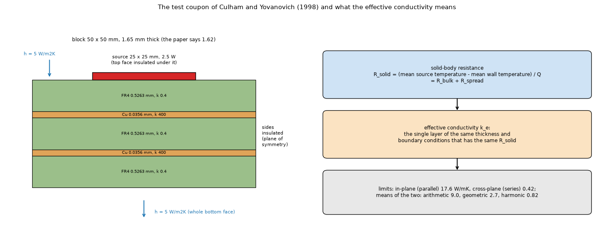

*Figure 1: `figures/fig_01_coupon_and_definition.png`.*

Limits (paper: 17.62, 0.42, 9.02, 2.71, 0.82): in-plane 17.64, cross-plane 0.418, arithmetic 9.03, geometric 2.72, harmonic 0.82; the layers add to 1.6501 mm (the paper says 1.62).

### 4.2 The order of the layers (the paper's Table 2)

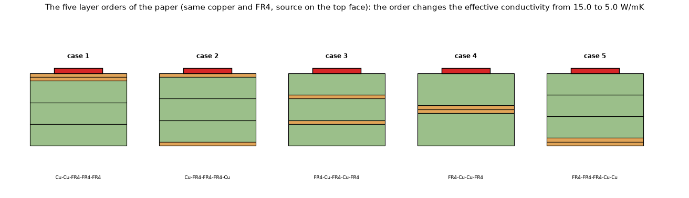

*Figure 2: `figures/fig_02_five_layer_orders.png`.*

| Case (layers from the top) | this work (W/mK) | paper (W/mK) | source of the paper value | difference |
| :-- | --: | --: | :-- | --: |
| 1: Cu-Cu-FR4-FR4-FR4 | 14.67 | 15.02 | text | -2.3 % |
| 2: Cu-FR4-FR4-FR4-Cu | 11.30 | 11.6 | plot | -2.6 % |
| 3: FR4-Cu-FR4-Cu-FR4 | 7.81 | 8.28 | text | -5.7 % |
| 4: FR4-Cu-Cu-FR4 | 6.99 | 7.4 | plot | -5.6 % |
| 5: FR4-FR4-FR4-Cu-Cu | 4.74 | 5.0 | text | -5.2 % |

Cases 1, 3 and 5 are quoted in the text of the paper; cases 2 and 4 are read from its Figure 2 (about 0.5 W/mK). The solver is below the paper by 2.3 to 5.7 %, steadily. Two of the possible causes were tested by the review (section 8). The discretisation is not it: the base case gives 7.84, 7.80, 7.80 and 7.81 W/mK with cells of 2.5, 1.25, 0.625 and 0.5 mm, (`study_culham_1998.py --mesh-check`), and 7.81 with twice the sub-slabs at 0.5 mm (the review's own run, eleven minutes, not kept in the script). The total thickness is about half of it: with the three FR4 layers thinned to 0.5163 mm, so that the stack has the 1.62 mm of the text, the base case gives 8.03 W/mK (-3.1 % instead of -5.7 %; printed by `study_culham_1998.py`), so the paper may have used thinner layers than the 0.5263 mm it states. The definition of the mean wall temperature and the truncation of the paper's series were not tested. The ranking and the spread (15 to 5) are reproduced.

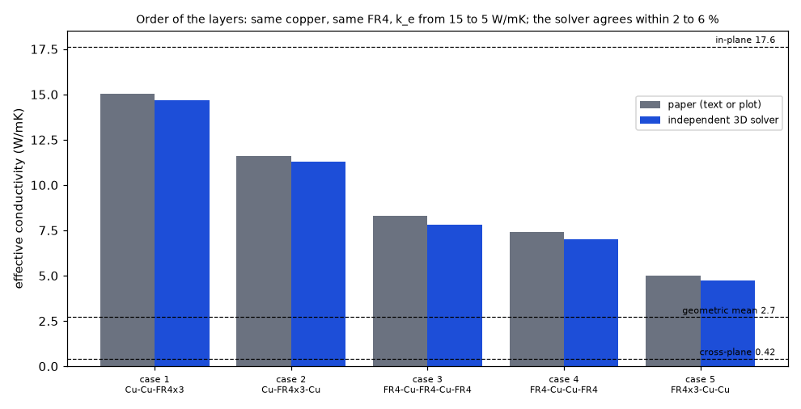

*Figure 3: `figures/fig_03_layer_orders_k_eff.png`.*

### 4.3 Source size, source position and film coefficient

*The source of epsilon 0.5 is 35 mm (epsilon 0.49), so that its edges fall on the 0.5 mm cells; the first version used 35.5 mm, whose edges fell between cells and gave a slightly different heated area (6.17 W/mK).*

| epsilon (source area / board area) | side (mm) | this work (W/mK) | paper (W/mK) | source | difference |
| --: | --: | --: | --: | :-- | --: |
| 0.01 | 5.0 | 3.04 | 3.4 | plot | -10.5 % |
| 0.1 | 16.0 | 7.17 | 7.6 | plot | -5.6 % |
| 0.25 | 25.0 | 7.81 | 8.28 | text | -5.7 % |
| 0.5 | 35.0 | 6.31 | 6.8 | plot | -7.2 % |
| 1.0 | 50.0 | 0.42 | 0.42 | text | -0.5 % |

| source position (assumed layouts) | this work (W/mK) | paper | difference |
| :-- | --: | --: | --: |
| flush with one edge, centred on it (case 2?) | 11.01 | 11.76 (+42 % / +67 % of 8.28) | -6.4 % |
| in a corner (case 3?) | 12.96 | 13.83 (+42 % / +67 % of 8.28) | -6.3 % |

The two layouts of the source position are **assumed** (the text says "a translation along one axis" and "along two axes"; the pictures were not decoded): flush with one edge, centred on it, and in a corner. They give 11.01 and 12.96 against 11.76 and 13.83, the same 6 % below as the base case, which supports the guess.

| film coefficient h (W/m2K) | Biot = h L / k1, L = 25 mm, k1 = 0.4 | this work (W/mK) | paper (plot) | difference |
| --: | --: | --: | --: | --: |
| 0.1 | 0.00625 | 7.98 | 8.6 | -7.2 % |
| 1 | 0.0625 | 7.95 | 8.3 | -4.2 % |
| 10 | 0.625 | 7.63 | 8.3 | -8.1 % |
| 100 | 6.25 | 4.74 | 6.0 | -21.1 % |
| 1000 | 62.5 | 0.75 | 4.8 | -84.3 % |
| 10000 | 625 | 0.61 | 4.8 | -87.4 % |

At low Biot numbers the solver is 4 to 8 % below the paper's plot, as in the other cases; from Bi about 1 the two part: -21 % at Bi 6 (4.7 against 6.0) and **0.75 and 0.61 W/mK above Bi 60 where the paper's plot stays at 4.8**. It is not a mesh effect (0.77, 0.76 and 0.75 W/mK with cells of 2.5, 1.25 and 0.625 mm at h = 1000). Section 4.9 shows that the plateau cannot be reached by this stack under this definition. The paper itself says that most electronics applications have Biot numbers of 0.01 to 1.

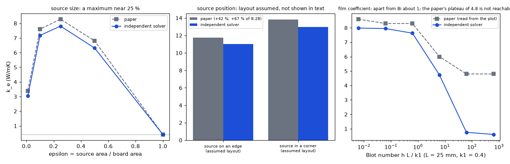

*Figure 4: `figures/fig_04_size_location_biot.png`.*

### 4.4 Seri Lee's plate: a source at the centre, the edge and the corner

An aluminium base of 100 x 100 x 1.3 mm, a 25 x 25 mm source, a catalogue resistance of 1.0 K/W on the fin side (here a film coefficient on the bottom face), the top outside the source insulated. The constriction resistance is the maximum source temperature minus the mean temperature of the film face, per watt.

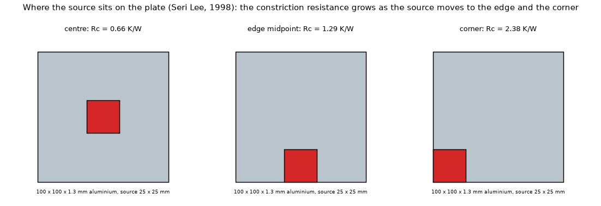

*Figure 5: `figures/fig_05_plate_source_positions.png`.*

| source position | paper Rc (K/W) | 3D solver | difference | thin plate (2D) | difference |
| :-- | --: | --: | --: | --: | --: |
| centre | 0.66 | 0.668 | +1.2 % | 0.664 | +0.6 % |
| edge midpoint | 1.29 | 1.284 | -0.4 % | 1.280 | -0.8 % |
| corner | 2.38 | 2.275 | -4.4 % | 2.270 | -4.6 % |

The article states that its correlation is accurate to about 5 % for aspect ratios up to 2.5; the corner is at -4.4 %. The thin-plate version (lateral conductance `k t`, the model of the program's plate) gives the same numbers: for a 1.3 mm aluminium plate the through-thickness gradient is negligible.

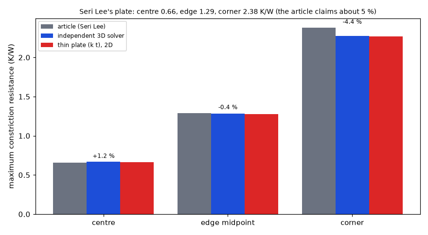

*Figure 6: `figures/fig_06_lee_spreading.png`.*

### 4.5 The five models of the program on the Cu / FR4 / Cu coupon

Most of the paper's cases have an outer FR4 layer above the top copper, which the layered models cannot represent (the outer faces belong to copper). Its case 2, copper / FR4 / copper, can (the 35 mm source stands for epsilon 0.5, so that its edges fall on the 0.5 mm cells of both solvers). The board is the same coupon (isotropic FR4 of k 0.4 and copper of 400 W/mK, 35.6 um layers, a gap of 1.5789 mm, 50 x 50 mm, h = 5 W/m2K on both faces, insulated sides, 2.5 W); the film also acts under the source, as in the program, so the solver does the same. The metric is the mean temperature rise of the top copper under the source.

| side (mm) | epsilon | independent 3D (K) | fvm | fdm | solid3d | lumped | analytic |
| --: | --: | --: | --: | --: | --: | --: | --: |
| 5 | 0.010 | 139.85 | 139.70 (-0.1 %) | 138.21 (-1.2 %) | 139.86 (+0.0 %) | 139.37 (-0.3 %) | 139.54 (-0.2 %) |
| 16 | 0.102 | 113.94 | 113.92 (-0.0 %) | 113.62 (-0.3 %) | 113.94 (+0.0 %) | 114.12 (+0.2 %) | 113.91 (-0.0 %) |
| 25 | 0.250 | 106.75 | 106.74 (-0.0 %) | 106.60 (-0.1 %) | 106.75 (+0.0 %) | 106.68 (-0.1 %) | 106.74 (-0.0 %) |
| 35 | 0.490 | 102.85 | 102.84 (-0.0 %) | 102.78 (-0.1 %) | 102.85 (+0.0 %) | 102.88 (+0.0 %) | 102.84 (-0.0 %) |
| 50 | 1.000 | 100.98 | 100.98 (-0.0 %) | 100.98 (-0.0 %) | 100.98 (+0.0 %) | 100.98 (-0.0 %) | 100.98 (-0.0 %) |

*The Lumped column changed with the minimum ring width of `0ea5f07` (35 mm: 103.91, +1.0 %, before; 102.88, +0.0 %, now); the other models did not move.*

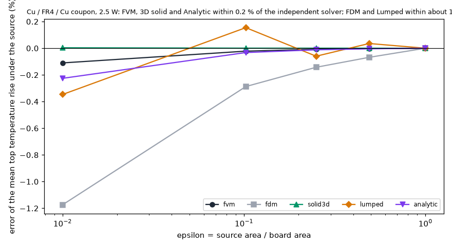

*Figure 7: `figures/fig_07_program_vs_coupon.png`.*

### 4.6 The cases of Muzychka and others, and where one node through the thickness stops being valid

Case 1 (a): a 300 x 300 x 10 mm plate of k 10 with h = 10 W/m2K on the bottom and two sources (10 W and 15 W); case 3: five 20 x 20 mm sources in a cross on a 100 x 100 x 10 mm plate of k 50, h = 50. The program represents the plate as one copper layer of the plate's thickness and conductivity.

```
Case 1a: paper {'centroid': [84.97, 108.43], 'mean': [80.56, 101.81], 'base': 53.06}
  independent 3D solver: centroid [85.48, 109.2], mean [81.07, 102.56], bottom mean 52.78, top-face mean 53.06, max 109.27, area-weighted mean source temperature 91.82
  through-thickness mean over each source [76.35, 95.5]; surface minus that mean [4.72, 7.06] K against q'' t / (2 k) [8.0, 12.0] K
  fvm: centroid [79.94, 100.95], mean [76.18, 95.28], max 101.01
  fdm: centroid [79.69, 100.65], mean [75.93, 94.98], max 100.95
  solid3d: centroid [80.09, 101.11], mean [76.32, 95.44], max 101.18
  lumped: centroid [76.65, 93.01], mean [76.64, 93.01], max 93.96
  analytic: centroid [79.95, 100.96], mean [76.34, 95.53], max 100.99

Case 3: paper {'max_centre': 80.61, 'mean_area': 78.87}
  independent 3D solver: centroid [80.62, 78.95, 78.95, 78.95, 78.95], mean [80.28, 78.55, 78.55, 78.55, 78.55], bottom mean 75.00, top-face mean 75.50, max 80.62, area-weighted mean source temperature 78.90
  through-thickness mean over each source [79.36, 77.74, 77.74, 77.74, 77.74]; surface minus that mean [0.91, 0.81, 0.81, 0.81, 0.81] K against q'' t / (2 k) [1.25, 1.25, 1.25, 1.25, 1.25] K
  fvm: centroid [79.44, 77.81, 77.81, 77.81, 77.81], mean [79.11, 77.49, 77.49, 77.49, 77.49], max 79.44
  fdm: centroid [79.44, 77.73, 77.73, 77.73, 77.73], mean [79.08, 77.39, 77.39, 77.39, 77.39], max 79.44
  solid3d: centroid [79.69, 78.06, 78.06, 78.06, 78.06], mean [79.36, 77.74, 77.74, 77.74, 77.74], max 79.69
  lumped: centroid [79.1, 77.98, 77.98, 77.98, 77.98], mean [79.41, 78.04, 78.04, 78.04, 78.04], max 80.19
  analytic: centroid [79.44, 77.81, 77.81, 77.81, 77.81], mean [79.11, 77.49, 77.49, 77.49, 77.49], max 79.44

Case 3 plate, growing thickness (rise of the centre of the cross):
  t = 0.1 mm: independent 195.17 K (gradient under the centre source 0.01 K = 0.01 %, bound q'' t / (2 k) 0.01 %); fvm 195.15 (-0.01 %), fdm 195.01 (-0.08 %), solid3d 195.15 (-0.01 %), analytic 195.10 (-0.04 %)
  t = 0.5 mm: independent 113.23 K (gradient under the centre source 0.05 K = 0.05 %, bound q'' t / (2 k) 0.06 %); fvm 113.16 (-0.06 %), fdm 113.09 (-0.12 %), solid3d 113.18 (-0.05 %), analytic 113.13 (-0.09 %)
  t = 1 mm: independent 87.30 K (gradient under the centre source 0.10 K = 0.11 %, bound q'' t / (2 k) 0.14 %); fvm 87.17 (-0.15 %), fdm 87.13 (-0.20 %), solid3d 87.20 (-0.12 %), analytic 87.15 (-0.17 %)
  t = 2 mm: independent 70.66 K (gradient under the centre source 0.19 K = 0.27 %, bound q'' t / (2 k) 0.35 %); fvm 70.42 (-0.35 %), fdm 70.39 (-0.38 %), solid3d 70.47 (-0.28 %), analytic 70.40 (-0.37 %)
  t = 5 mm: independent 59.28 K (gradient under the centre source 0.47 K = 0.79 %, bound q'' t / (2 k) 1.05 %); fvm 58.69 (-1.01 %), fdm 58.68 (-1.03 %), solid3d 58.81 (-0.80 %), analytic 58.68 (-1.02 %)
  t = 10 mm: independent 55.62 K (gradient under the centre source 0.91 K = 1.64 %, bound q'' t / (2 k) 2.25 %); fvm 54.44 (-2.12 %), fdm 54.44 (-2.13 %), solid3d 54.69 (-1.67 %), analytic 54.44 (-2.12 %)
```

The solver reproduces the cross (maximum 80.62 against 80.61 C, mean 78.90 against 78.87; 80.61 and 78.88 on 0.5 mm cells) and case 1 within 1 % of the rise (centroids 85.48 and 109.20 against 84.97 and 108.43 by the paper's method and 85.95 and 109.92 by the Fourier series, so between the two; the mean source temperatures 81.07 and 102.56 are above both, 80.56 and 101.81 and 80.20 and 101.26, and fall to 80.81 and 102.18 on 1.25 mm cells: the 2.5 mm cells of the study overstate them by 0.3 to 0.4 K; `--mesh-check`, section 8). The program represents the plate as one copper layer of the plate's thickness and conductivity on a laminate of 0.01 % of it (1 um for 10 mm, 0.02 % of the film resistance). The first version of this study used a board of thickness `2 t`, which adds `t` of FR4 of 0.9 W/mK to the plate (+9 % of lateral conductance for k = 10 and +1.8 % for k = 50, a path the real plate does not have; it made the models 4 points cooler on case 1 and 0.4 to 0.8 points cooler on the cross and the thickness sweep) and, since the corrected 3D solid builds the laminate of a one-layer board (4.11), would put 10 mm of FR4 between the plate and the film.

The program's models are **below** the reference surface: 2.1 % of the rise on the cross (FVM, FDM, Analytic; 3D solid 1.7 %, Lumped 0.8 % at its maximum; the 3D solid keeps each copper layer one slab thick, so it cannot show the gradient inside a 10 mm plate either) and 9 to 10 % on case 1 (FVM, FDM, Analytic, 3D solid; Lumped 8 to 19 %, its rings are not made for a plate of 300 mm with two sources). The cause is the through-thickness gradient that one node cannot show, measured directly in the 3D solution as the mean surface temperature of each source minus its temperature averaged through the thickness:

| case | gradient under the source (3D) | bound `q'' t / (2 k)` | gradient / bound |
| :-- | --: | --: | --: |
| cross, centre source (k 50, h 50) | 0.91 K | 1.25 K | 0.73 |
| case 1, 10 W source (k 10, h 10) | 4.72 K | 8.0 K | 0.59 |
| case 1, 15 W source | 7.06 K | 12.0 K | 0.59 |

The node of the program is the thickness mean: the FVM mean under the sources of case 1 is 76.18 and 95.28 C against 76.35 and 95.50 C of the 3D thickness mean (0.2 K lower: the film acts on the node instead of the cooler bottom face, an effect of about `h t / (2 k)` of the rise, 0.5 % here; tested by the review: with the film in series with half the plate the FVM meets the 3D thickness mean to 0.01 K on the cross and 0.1 K on case 1, section 8). `q'' t / (2 k)` is the gradient when all the heat of the source crosses the plate under it (a linear profile); when part of it leaves sideways the flux falls with depth and the gradient is smaller (a flux falling linearly to zero gives `q'' t / (3 k)`, 0.67 of the bound). It is therefore an **upper bound** of the error, which is what a warning needs (`INTEGRATION.md` 1), not a prediction of it. In the thickness sweep the gradient is 0.7 to 0.8 of the bound and the models fall short by the gradient plus up to 0.5 % (the film on the node).

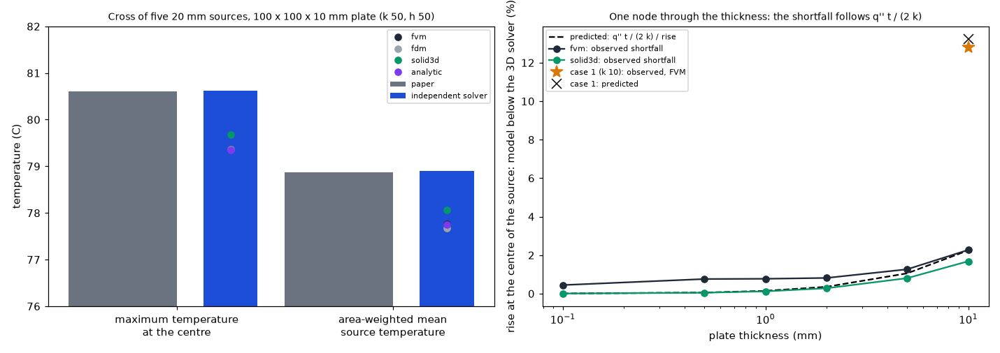

*Figure 8: `figures/fig_08_muzychka_and_the_thickness_rule.png`.*

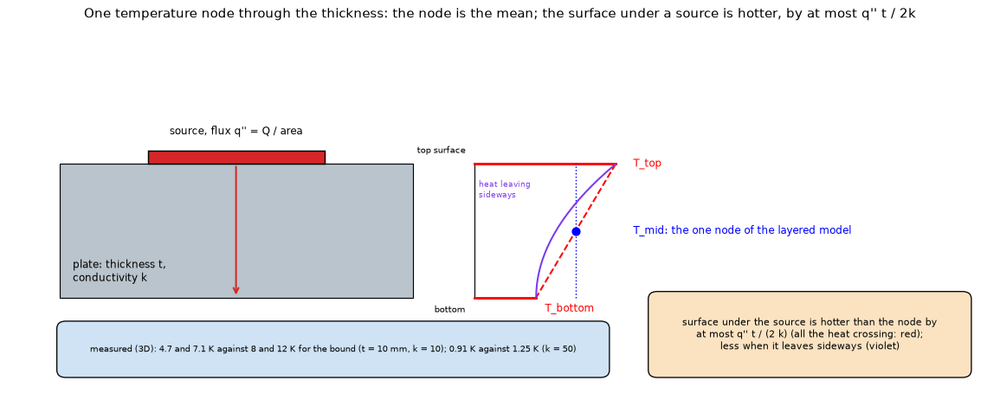

*Figure 9: `figures/fig_09_through_thickness_gradient.png`.*

### 4.7 Natural convection of a vertical board: two forms of one correlation

Worked example of the library `ht` (Pr 0.69, Grashof 2.63e9, Ra = Gr Pr): general form gives 147.16 (library: 147.16)

| Ra | laminar form / general form - 1 (Pr 0.71) |
| --: | --: |
| 1e+04 | +7.2 % |
| 1e+05 | +6.6 % |
| 1e+06 | +2.3 % |
| 1e+07 | -5.2 % |
| 1e+08 | -14.7 % |
| 1e+09 | -25.0 % |

| board height (mm) | rise (K) | Ra | h general (program) | h laminar | difference |
| --: | --: | --: | --: | --: | --: |
| 50 | 10 | 1.1e+05 | 5.02 | 5.35 | +6.5 % |
| 50 | 30 | 2.9e+05 | 6.54 | 6.87 | +5.1 % |
| 50 | 60 | 4.6e+05 | 7.69 | 8.01 | +4.2 % |
| 50 | 80 | 5.4e+05 | 8.20 | 8.51 | +3.8 % |
| 100 | 10 | 9e+05 | 4.26 | 4.37 | +2.6 % |
| 100 | 30 | 2.3e+06 | 5.65 | 5.65 | -0.1 % |
| 100 | 60 | 3.7e+06 | 6.71 | 6.60 | -1.6 % |
| 100 | 80 | 4.3e+06 | 7.18 | 7.02 | -2.1 % |
| 200 | 10 | 7.2e+06 | 3.76 | 3.61 | -3.9 % |
| 200 | 30 | 1.8e+07 | 5.07 | 4.69 | -7.5 % |
| 200 | 60 | 3e+07 | 6.06 | 5.49 | -9.5 % |
| 200 | 80 | 3.5e+07 | 6.49 | 5.84 | -10.1 % |

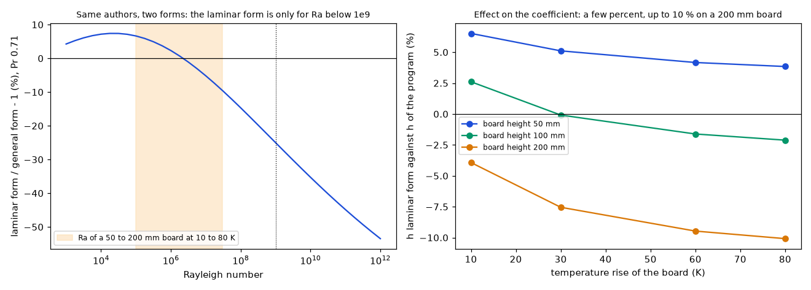

*Figure 10: `figures/fig_10_natural_convection_forms.png`.*

### 4.8 What the corrections and proposals would change (measured on copies of the program; nothing in `pcbthermal/` was edited)

**A. The plate check of the project documents.** The documents say that the plate model (a layer of lateral conductance `k t` under a uniform film) is `+4.5 %` from Seri Lee's centre value. The original check (`research/component-heatsink/scripts/block_contact_study.py`) used 1 mm cells and placed the source with Python's `round()`, which rounds halves to even: the edges 37.5 and 62.5 mm went to the cells 38 and 62, so the "25 mm" source had **24 cells**. A 24 mm source with 0.5 mm cells gives 0.687 K/W (+4.1 %), the documented number; the 25 mm source gives 0.664 K/W (+0.6 %). Both scripts now round halves up (with a tolerance for the round-off of `x / d`) and the original check uses 0.5 mm cells. The model solved again with the cell refined:

| cell (mm) | centre (0.66) | edge midpoint (1.29) | corner (2.38) |
| --: | --: | --: | --: |
| 4 | 0.605 (-8.3 %) | 1.273 (-1.3 %) | 2.355 (-1.1 %) |
| 2 | 0.687 (+4.0 %) | 1.263 (-2.1 %) | 2.185 (-8.2 %) |
| 1 | 0.664 (+0.7 %) | 1.280 (-0.8 %) | 2.270 (-4.6 %) |
| 0.5 | 0.664 (+0.6 %) | 1.280 (-0.8 %) | 2.270 (-4.6 %) |
| 0.25 | 0.664 (+0.6 %) | 1.280 (-0.8 %) | 2.270 (-4.6 %) |

On 2 mm cells the source edges fall a quarter of a cell off and the rounding gives 24 mm again (+4.0 % at the centre); from 1 mm the source keeps 25 mm. A sweep of 46 cell sizes from 1.67 to 0.42 mm, half of them with the source edges on cell edges and half with them half a cell off, gives +0.5 to +0.8 % at the centre: once the source has its size, neither the cell size nor the alignment matters. One millimetre of source side does (0.5 mm cells): 23 mm +7.9 %, 24 mm +4.1 %, 25 mm +0.6 %, 26 mm -2.9 %, 27 mm -6.1 %. With the 25 mm source the model is within **+0.6 %, -0.8 % and -4.6 %** of the article at the centre, the edge and the corner (the article claims about 5 %). *(An earlier version of this section attributed the +4.5 % to the source edge falling half a cell off the grid; the sweep that seemed to show it had the same rounding defect.)*

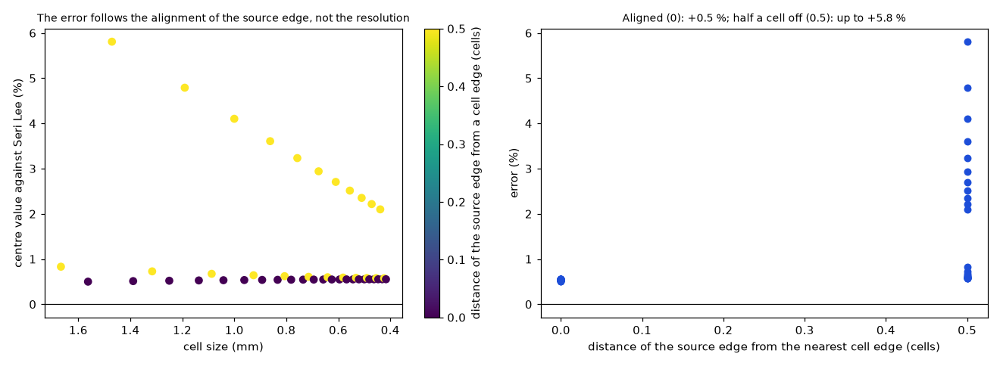

*Figure 14: `figures/fig_14_plate_alignment_sweep.png`.*

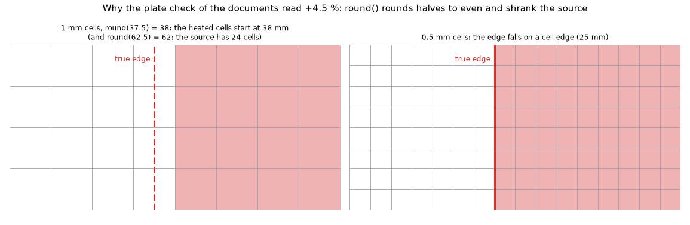

*Figure 16: `figures/fig_16_source_edge_on_the_grid.png`.*

**B. The laminar form of Churchill and Chu** (patched in memory in place of the general form below Ra 1e9), on the example board and a bare two-layer board turned to the vertical, FVM, computed coefficients:

| board | general form (program) | laminar form | change of the rise |
| :-- | --: | --: | --: |
| example board, powers x0.5 | 57.16 C | 56.98 C | -0.18 K (-0.6 %) |
| example board, powers x1 | 86.72 C | 86.50 C | -0.22 K (-0.4 %) |
| example board, powers x2 | 142.74 C | 142.56 C | -0.18 K (-0.1 %) |
| 2-layer board 100 x 60 mm, 3 W | 89.42 C | 88.99 C | -0.43 K (-0.7 %) |
| 2-layer board 100 x 120 mm, 3 W | 84.61 C | 84.58 C | -0.03 K (-0.1 %) |
| 2-layer board 100 x 200 mm, 3 W | 84.33 C | 84.47 C | +0.14 K (+0.2 %) |

The effect on the maximum temperature is **-0.7 to +0.2 % of the rise** (-0.43 to +0.14 K): radiation and the other terms of `h` dilute the 5 to 10 % that the correlations differ by. **No change is warranted by the numbers.**

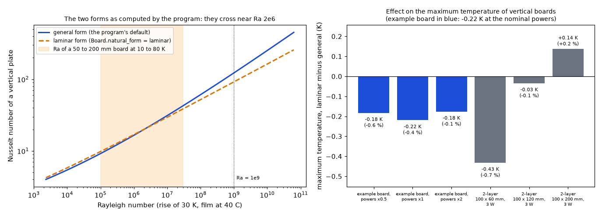

*Figure 19 (`figures/fig_19_natural_form_on_the_example.png`): left, the Nusselt number of the general and the laminar form of Churchill and Chu from the program's own function (`convection.h_natural_vertical`, board heights of 10 mm to 3 m at a rise of 30 K, film at 40 C; the shaded band is the Ra of a 50 to 200 mm board at 10 to 80 K, as in Figure 10); the two forms cross near Ra 2e6 (2.3e6 in this scan). Right, the change of the maximum temperature with the laminar form, in K and in % of the rise, for the six boards of the table above (`out/corrections_impact.json`, FVM with computed h); the example board turned vertical: -0.22 K at the nominal powers. Data: the program's formulas and the study output; nothing estimated.*

**C. The thick-plate criterion** `q'' t / (2 k) / rise` computed for the 74 metal-block cases of `research/block-and-fins` (the heat of the part through the copper pad under the block, the thickness and conductivity of the block, a rise of 90 K):

C. Thick-plate criterion q'' t / (2 k) / rise over the 74 metal-block cases: maximum 0.42 %, median 0.04 %, cases above 5 %: 0
   largest: pad 20x20 in block 80x60, 3 mm steel, R''=1 Kcm²/W (0.42 %)

The check would **never fire on the cases the program is built for** (largest 0.42 %, a 3 mm steel block); it is a safety net for a thick, poorly conducting layer typed by the user. In the program (`checks.check_thick_plates`) the flux is the one that really enters the block, taken from the solution (median 0.07 %, maximum 0.34 % over the same 74 cases, none above 5 %), because the pad flux used here is not conservative (the peak flux into the block is 1.6 times the pad mean at the median) and the footprint flux fires on ordinary designs (`docs/validation.md` section 22).

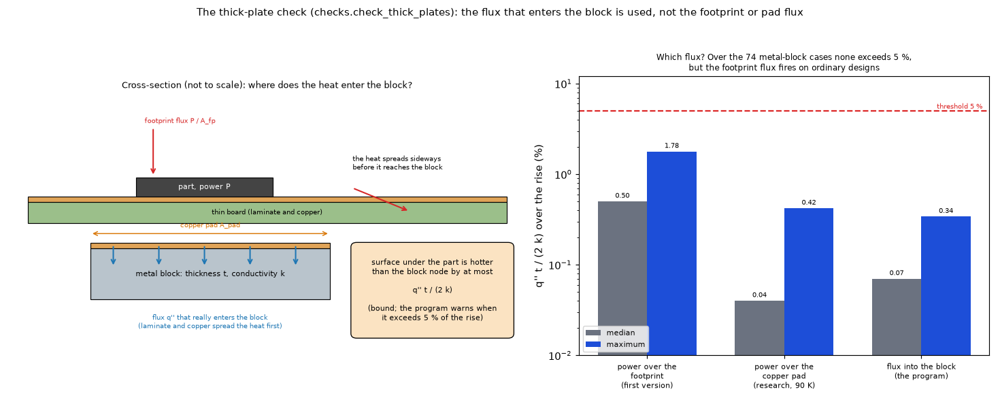

*Figure 18 (`figures/fig_18_thick_plate_flux.png`): the thick-plate check of the program (`checks.check_thick_plates`). Left, a part on a thin board with a metal block under it: the bound `q'' t / (2 k)` is the gap between the surface under the part and the mean of the layer, and `q''` is the flux that really enters the block, not the footprint flux or the pad flux, because the laminate and the copper spread the heat before it reaches a block under the board (the flux into the block is 8 to 22 % of the footprint flux on the 74 cases). Right, the criterion over the 74 metal-block cases of `research/block-and-fins` for the three fluxes, median and maximum (footprint 0.50 and 1.78 %, pad 0.04 and 0.42 %, flux into the block 0.07 and 0.34 %; the first and last pair are those of `docs/validation.md` section 22, the pad pair is Table 4.8 C above). The sketch is not to scale.*

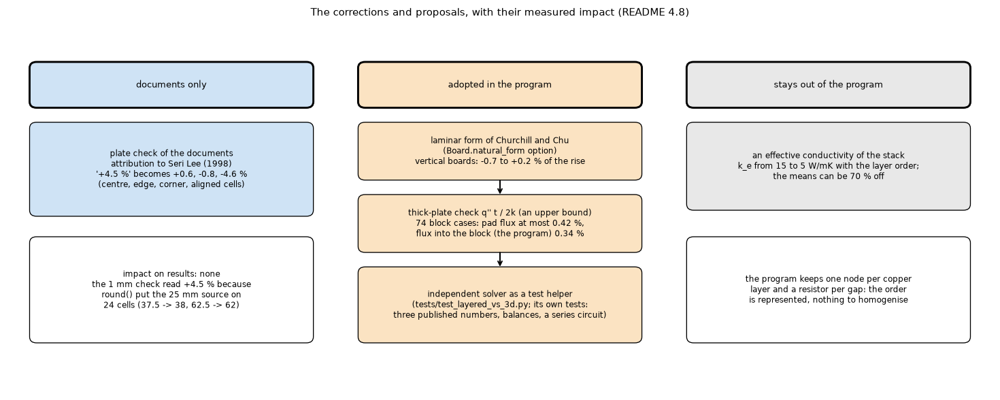

*Figure 15: `figures/fig_15_corrections_map.png`.*

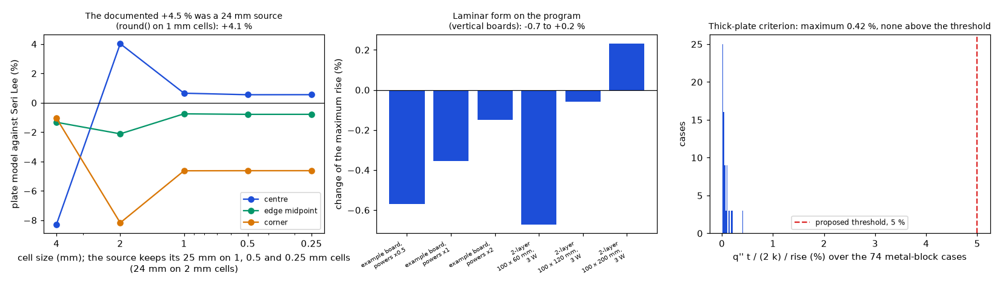

*Figure 12: `figures/fig_12_corrections_impact.png`.*

### 4.9 The Biot plateau of the paper: theories tested

The paper plots the effective conductivity of the base laminate against the Biot number and shows a plateau of about 4.8 W/mK above Bi 100. The solver falls to 0.6. Theories tested, each by recomputing the effective conductivity of the same laminate (cells of 1.25 mm; 0.77, 0.76 and 0.75 W/mK at h = 1000 with cells of 2.5, 1.25 and 0.625 mm, so the fall is not a mesh effect): **A** the mean wall temperature over the free top face and the bottom; **B** over the bottom only; **C** over the free top face only; **D** weighted by the heat flux; **E** the ambient (an ideal sink); and the variant with the **film on the bottom face only**.

Mesh check at h = 1000 W/m2K (definition A): 0.77 W/mK with 2.5 mm cells, 0.76 W/mK with 1.25 mm cells, 0.75 W/mK with 0.625 mm cells

Series resistance of the stack under the footprint of the source: 6.32 K/W
| h (W/m2K) | Bi = h L / k1 | A_top_free+bottom | B_bottom_only | C_top_free_only | D_flux_weighted | E_ambient | film on the bottom only | R_solid (A) (K/W) |
| --: | --: | --: | --: | --: | --: | --: | --: | --: |
| 0.1 | 0.00625 | 7.97 | 7.29 | 8.81 | 7.97 | 7.97 | 6.23 | 5.17 |
| 1 | 0.0625 | 7.94 | 7.25 | 8.78 | 7.90 | 7.94 | 6.21 | 5.17 |
| 10 | 0.625 | 7.62 | 6.92 | 8.47 | 7.24 | 7.62 | 5.94 | 5.13 |
| 100 | 6.25 | 4.73 | 4.03 | 5.64 | 0.89 | 4.73 | 3.54 | 4.86 |
| 1000 | 62.5 | 0.76 | 0.73 | 0.79 | 0.60 | 0.76 | 0.68 | 4.32 |
| 10000 | 625 | 0.61 | 0.61 | 0.61 | 0.60 | 0.61 | 0.57 | 4.13 |
| 100000 | 6.25e+03 | 0.60 | 0.60 | 0.60 | 0.60 | 0.60 | 0.56 | 4.11 |

* **No definition gives the plateau.** All five and the bottom-only variant follow the same course: nearly constant below Bi 1, falling between Bi 1 and 60, 0.6 to 0.8 W/mK above.
* **The mechanism.** The solid-body resistance of the laminate hardly moves (5.17 to 4.11 K/W) while the conductivity of the equivalent single layer falls by a factor of 13, because the two respond differently: with strong films the heat does not have to spread, it goes down through the stack under the footprint of the source (series resistance 6.3 K/W, reduced to 4.1 by the spreading in the two copper layers), and a homogeneous layer that reproduces that resistance has a conductivity close to the cross-plane value (0.42 W/mK), 0.6.
* **A bound rules the plateau out for this stack.** Plateau check at h = 10000 W/m2K (Bi 625): the top FR4 under the source alone is 2.11 K/W, the sideways escape to the free top face about 25 K/W, the laminate 4.13 K/W; a homogeneous layer of 4.8 W/mK gives 0.62 K/W, 3.4 times below the bound. All the heat of the source has to cross the top FR4 layer (or escape sideways through it), so no laminate whose top layer is that 0.5263 mm of FR4 can have less than about 2 K/W under this definition, whatever the films; the plateau needs 0.62 K/W.
* **Consequence.** The trend of the solver (k_e from about 8 at low Biot to about the series value at high Biot) agrees with the paper's own conclusion that the effective conductivity ranges from the cross-plane value upwards, and with the abstract of Teertstra, Culham and Yovanovich (1995), who find that when the fluid side controls the effective conductivity needed exceeds the parallel bound. The plateau of the paper's Figure 5 is **not reproducible with the stated stack and definition**: the figure must use another stack (one with copper on top would spread the heat to the free top face), another definition, or be in error; the pages that would say which were not read.

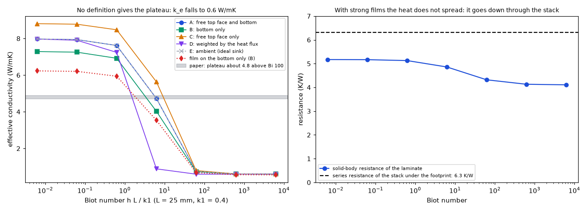

*Figure 11: `figures/fig_11_biot_definitions.png`.*

### 4.10 Channels between vertical plates: Elenbaas and the blend of Raithby and Hollands

The program has no fin-array model yet (the channel effect between fins is a planned topic, `theory/topics/13`). The two correlations that the literature uses, as written by Martin, Raithby and Yovanovich (1991) with the Nusselt number based on the half-width `b` and `Ra* = Ra b / L`: Elenbaas (1942), `Nu = (Ra*/3) [1 - exp(-35/(16 Ra*))]^(3/4)`; the blend of Raithby and Hollands, `Nu = (Nu_fd^m + Nu_bl^m)^(1/m)`, `m = -1.9`, `Nu_fd = Ra*/3`, `Nu_bl = 0.62 Ra*^(1/4)`. In terms of the spacing `S = 2b` (`El = 16 Ra*`, `Nu_S = 2 Nu_b`) the fully developed limit is `Nu_S = El/24`.

| El (spacing) | Elenbaas Nu_S | blend Nu_S | Bar-Cohen and Rohsenow (as quoted) | blend / Elenbaas - 1 | quoted BCR / Elenbaas - 1 |
| --: | --: | --: | --: | --: | --: |
| 1 | 0.042 | 0.042 | 0.042 | -0.3 % | -0.2 % |
| 10 | 0.407 | 0.386 | 0.387 | -5.3 % | -4.9 % |
| 54.3 | 1.295 | 1.327 | 1.307 | +2.5 % | +1.0 % |
| 100 | 1.669 | 1.752 | 1.703 | +4.9 % | +2.0 % |
| 1000 | 3.328 | 3.470 | 3.307 | +4.3 % | -0.6 % |
| 10000 | 5.988 | 6.199 | 5.899 | +3.5 % | -1.5 % |

Maximum difference between the two over El 0.1 to 1e4: 5.5 %
Optimum El for the heat per unit of base area, Elenbaas: 45.9 (S_opt proportional to El^(1/4): 2.602); El_opt of the correlation quoted for Bar-Cohen and Rohsenow: 2.714^4 = 54.3; Simons: about 50
Optimum El for the heat per unit of base area, blend: 59.5 (S_opt proportional to El^(1/4): 2.777); El_opt of the correlation quoted for Bar-Cohen and Rohsenow: 2.714^4 = 54.3; Simons: about 50
Optimum El for the heat per unit of base area, BCR: 54.4 (S_opt proportional to El^(1/4): 2.716); El_opt of the correlation quoted for Bar-Cohen and Rohsenow: 2.714^4 = 54.3; Simons: about 50

The two agree within 5.5 % over five decades; the spacing that dissipates the most heat per unit of base area (maximum of `Nu_S / El^(1/2)`, because the heat per unit of base area of thin plates at pitch `S` goes as `Nu_S / S^2` and `El` as `S^4`) is at El = 46 (Elenbaas), 59 (blend) and 54.4 for the composite correlation of Bar-Cohen and Rohsenow as quoted in the theory notes, `Nu_S = [576/El^2 + 2.873/El^(1/2)]^(-1/2)` (the paper was not opened): its optimum spacing coefficient is 2.716, against the 2.714 (`2.714^4 = 54.3`) quoted for it, so the quoted formula and the quoted optimum are consistent; the practical value of Simons (about 50) lies between the three. Over El 1 to 1e4 the quoted composite stays within 5 % of Elenbaas (the largest difference, -4.9 %, at El = 10). Martin and others also conclude that the fully developed asymptote should not be expected except under very special conditions, and that the numerical studies that seemed to confirm it used inappropriate boundary conditions.

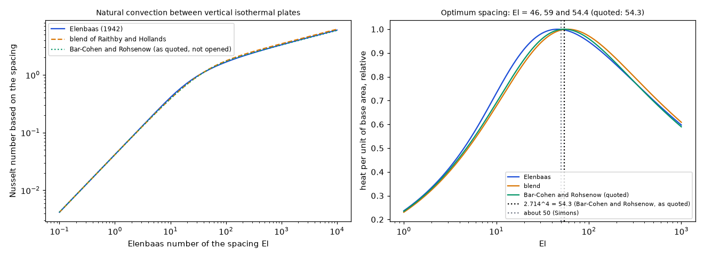

*Figure 13: `figures/fig_13_channel_correlations.png`.*

### 4.11 Defects found in the program by this review, and the one-layer board against the independent solver

Reading the models of the program against `docs/theory.md` found two defects, measured on copies first and then corrected in the program on the branch `fix/model-corrections` (merged into `develop`, with regression tests; `docs/validation.md` section 20):

* **The 3D solid on a one-layer board** built its slabs from the dielectric gaps, and a one-layer board has none, so the board was its copper alone. It now builds the laminate of the layered models as four FR-4 slabs under the copper (`research/solid3d-verification/README.md` 4.4 for the five models).
* **The time constant of a board with an outline** counted the 1 W/K that pins the cells off the board: 0.02 s instead of 107 s on a round board, so the step responses of the power profiles stopped at 12 % of the steady resistance (`research/outline/README.md` 4.4).

The independent solver checks the first. `lib/layered3d.py` now takes a conductivity map per slab, so the copper slab can be copper in a pad and laminate elsewhere, the volume average the 3D solid uses on the cells that the pad covers or not. `scripts/study_one_layer_independent.py`: a 60 × 60 mm one-layer board, 35 um copper, a 6 × 6 mm part of 1 W, FR-4 isotropic at 0.3 W/mK (both solvers then represent the same board), copper 385 W/mK, films of 10 W/m2K on the top face (under the part as well) and 15 on the bottom, no edge loss, 0.5 mm cells; the rise of the hottest copper cell, on the program at `0ea5f07` ("before" columns: the 3D solid on a board whose laminate is 1 um, what it used to see, and the FVM with the laminate nodes switched off in memory, which reproduces the numbers measured on the old code):

| copper | board thickness (mm) | independent 3D (K) | 3D solid | 3D solid without the laminate (before) | FVM | FVM before (one node) | FDM | Lumped | Analytic |
| :-- | --: | --: | --: | --: | --: | --: | --: | --: | --: |
| full | 0.8 | 33.71 | 33.71 (+0.0 %) | 33.77 (+0.2 %) | 33.71 (-0.0 %) | 33.41 (-0.9 %) | 33.71 (-0.0 %) | 33.17 (-1.6 %) | 33.64 (-0.2 %) |
| full | 1.6 | 33.71 | 33.71 (+0.0 %) | 33.77 (+0.2 %) | 33.70 (-0.0 %) | 33.05 (-1.9 %) | 33.70 (-0.0 %) | 33.17 (-1.6 %) | 33.57 (-0.4 %) |
| full | 3.2 | 33.84 | 33.85 (+0.0 %) | 33.77 (-0.2 %) | 33.82 (-0.1 %) | 32.36 (-4.4 %) | 33.82 (-0.1 %) | 33.31 (-1.6 %) | 33.41 (-1.3 %) |
| 20 mm pad | 1.6 | 72.12 | 72.26 (+0.2 %) | 101.03 (+40.1 %) | 70.32 (-2.5 %) | 64.92 (-10.0 %) | 66.76 (-7.4 %) | 61.49 (-14.7 %) | 51.33 (-28.8 %) |

* With full copper the copper carries the heat sideways and the laminate hardly matters: the 3D solid agrees with the independent solver to 0.0 % and the old 3D solid was within 0.2 % as well, so **full copper does not test the correction**; the 20 mm pad does: +0.2 % now, +40 % before.
* Before the correction the FVM (one node, both films on it) was 0.9 to 4.4 % low with full copper, growing with the thickness, and 10 % low with the pad: the bottom film acted on the copper node itself, so the laminate between the copper and the bottom face was missing. The program now gives a one-layer board two laminate nodes under the copper (FVM, FDM and Lumped) and puts the laminate in series with the bottom film in the Analytic (`pcbthermal/laminate.py`, `docs/validation.md` section 21): the FVM is now within 0.1 % with full copper and 2.5 % low with the pad. The FDM, Lumped and Analytic stay 7.4, 14.7 and 28.8 % low on the pad (bare pads on one-layer boards in Lumped and Analytic and the pad-edge sampling of the FDM are open in the roadmap; the same numbers are in `research/solid3d-verification/README.md` 4.4, part 2, from its copy of the solver).
* *An earlier version of this table had a column "FVM, laminate in series under the bottom film (candidate)" (`INTEGRATION.md` 5: -0.1 to -1.1 % with full copper, -7.6 % with the pad, measured on the program before the laminate nodes). Re-run on the corrected program it typed the laminate a second time (+0.8 to +2.7 % with full copper); it was replaced by the FVM before the correction (review of 2026-10-24).*
* *An earlier figure in `docs/validation.md` section 20 (the 3D solid within 0.8 %, the FVM 2.8 % low) came from a quick check with copper of 400 W/mK in the independent solver and the edge loss of a new board in the program; it is replaced by this table.*

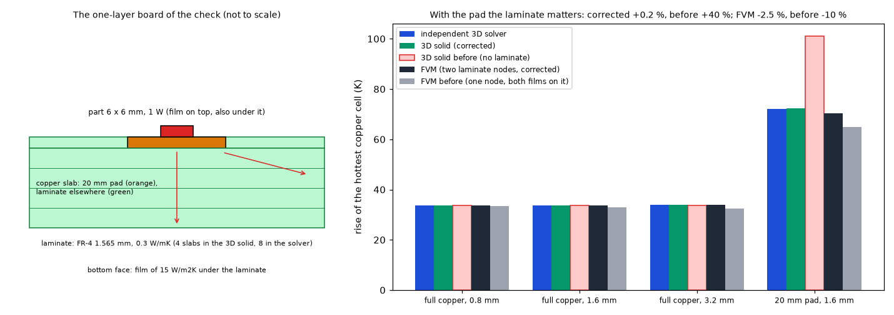

*Figure 17: `figures/fig_17_one_layer_independent.png`: left, the board of the check (the pad in the copper slab, the laminate slabs, the heat going down and sideways; not to scale); right, the rise in the independent solver and in the 3D solid and the FVM before and after the corrections.*

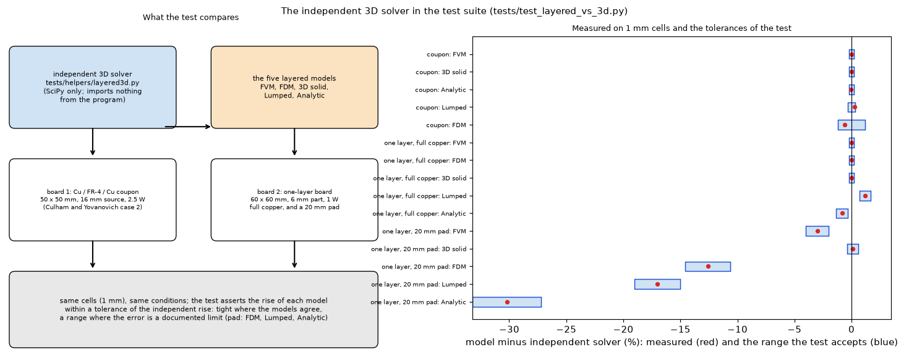

*Figure 20 (`figures/fig_20_independent_solver_in_the_tests.png`): what `tests/test_layered_vs_3d.py` compares (the independent solver `tests/helpers/layered3d.py` against the five layered models on the Cu / FR-4 / Cu coupon and on the one-layer board, 1 mm cells) and, for each model, the difference measured on 1 mm cells (red) with the range the test accepts (blue): tight on the coupon (0.2 % for the FVM, the 3D solid and the Analytic, 0.3 % for the Lumped, 1.2 % for the FDM) and with full copper, ranges around the measured value for the documented limits of a bare pad (FDM -12.6, Lumped -17.0, Analytic -30.2 %). The numbers are copied from the test file and from `docs/validation.md` section 22; they were not re-run for this figure.*

## 5. What this means for the program

The models need no change for the boards they are made for, beyond the two defects of 4.11 and the laminate of one-layer boards (all corrected in `0ea5f07`). A one-layer board with little copper is still where the layered models are farthest from a 3D solution (with a 20 mm pad: FVM -2.5 %, FDM -7.4 %, Lumped -14.7 %, Analytic -28.8 %, 4.11). The three optional proposals (an input check for a thick, poorly conducting plate: `checks.check_thick_plates`; the laminar form of Churchill and Chu as an option: `Board.natural_form`; the solver as a test helper: `tests/helpers/layered3d.py`) are now in the program, and what should stay out (an effective conductivity of the stack) are in `INTEGRATION.md`; the corrections and text for the project documents are in `docs/for-the-project-documents.md`.

## 6. Limits

**What stays open** (nothing blocks the program): which stack or definition the paper's Biot figure uses (its plateau is out of reach of the stated stack, 4.9); the paper's `1.62` mm against the layers' `1.6501` mm; the Bar-Cohen and Rohsenow correlation and the paper of Churchill and Chu, read only through secondary sources; the unread pages of the scans listed in `research/theory/docs/sources-to-obtain.md`.

**Limits of the study**

* The independent solver is checked against the publications only to 2 to 6 % on the layer orders; the cause of the steady shortfall is not isolated. The figures read from plots are good to about 0.5 W/mK.
* The five models were compared on a board that they can represent; the paper's cases with an outer dielectric above the copper could not be run in them.
* The plateau of the paper above Biot 60 is not reproduced; a bound shows that the stated stack cannot give it under the stated definition (4.9), but what the figure does use was not found.
* The review of this folder found three defects in its own studies, fixed with regression tests and the comparisons re-run: an in-plane FR4 path in the program's model of the Muzychka plates (4.6), `round()` shrinking the plate source to 24 mm (4.8 A), and source sizes whose edges fell between the cells of the solver (35.5 mm on 0.5 mm cells, now 35 mm; the solver now refuses such a source); the surface temperature with a film under the source was also wrong in the solver (not used by any result).
* No measurement of a physical board.
* The one-layer check (4.11) uses isotropic FR-4 so that the independent solver represents the same board; the program's default FR-4 is anisotropic (0.3 through, 0.9 in the plane).

## 7. Sources

Culham and Yovanovich (1998); Muzychka, Culham and Yovanovich (2003); Lemczyk, Mack, Culham and Yovanovich (1992); Seri Lee (Electronics Cooling, 1998); Churchill and Chu (1975) and the library `ht`, for the correlations; Milton (2002) for the bounds of composites, read for chapter 3 and section 23.1. The entries, with what was read of each, are in `research/theory/BIBLIOGRAPHY.md` (`[CulhamYovanovich1998]`, `[Muzychka2003]`, `[Lemczyk1992]`, `[EC1998Spreading]`, `[ChurchillChu1975]`, `[HtLibrary]`, `[Milton2002]`, `[MHTLArchive]`).

## What was read and what was not verified

* **Read as images (a scan):** pages 460 to 466 of Culham and Yovanovich (1998); the first two pages of Lemczyk and others (1992), whose results were not read; the last page of Culham and Yovanovich (the references) was not read.
* **Read in full by the review of 2026-10-24** (section 8): the text of the worked cases of Muzychka and others (2003), pages 182 and 183 with Tables 1 and 2, extracted from the PDF of the Waterloo archive (`mhtl03-1.pdf`): every number quoted here matches; the worked example of Seri Lee (1998) again through the page converter (the edge-midpoint and corner sources are centred at (37.5, 0) and (37.5, 37.5) mm from the centre of the plate, as the study places them). Culham and Yovanovich (1998) was not opened again; its values come from the reading recorded in the bibliography. The forms of Elenbaas, Bar-Cohen and Rohsenow and Churchill and Chu, and Example 9.2 of Incropera (Nu about 147), agree with what the reviewer remembers of them; that is memory, not a reading.
* **Read as text:** the three worked cases of Muzychka and others (2003) and their method of images for edge and corner sources (the series coefficients were not checked); the Electronics Cooling article of Seri Lee (its equations 1 and 2 and Figure 4 are images and did not come through; its numbers and statements were read).
* **Taken from secondary sources, not from the paper of Churchill and Chu (never opened):** the general and the laminar forms (the library `ht`, Incropera and DeWitt's textbook through `thermal.mayahtt.com`, and Yovanovich (1993), who writes the laminar blend of Churchill without the leading 0.68 for 1e4 < Gr < 1e9). The general form reproduces the library's worked example, which is Example 9.2 of Bergman and others (the library takes the Grashof number as its argument).
* **Read as images (scans), in part:** Martin, Raithby and Yovanovich (1991), pages 1 and 2 of 7 (the Elenbaas correlation, the blend and the abstract); Yovanovich (1993), pages 1 to 4 of 7 (the correlation equations of Churchill for forced and natural convection, eq. 1 to 4); Teertstra, Culham and Yovanovich (1995), pages 1 to 4 of 13 (the introduction, the series and parallel limits, Table 1 of the test board: 0.429 and 17.27 W/mK, which the formulas reproduce). **Read as text through the page converter:** the vertical-channel and vertical-plate pages of `thermal.mayahtt.com`, the documentation of the library `ht` (the worked examples and references), the Simons article of 2004 (its equations are images). **Downloaded, abstract only:** Yovanovich, Culham and Teertstra (1998), Yovanovich, Muzychka and Culham (1999), Muzychka and others (2004), Teertstra and others (2004); and other papers of the same archive that could not be read as text (listed in the bibliography).
* **Values read from plots** (cases 2 and 4 of the layer orders, the source size curve, the Biot curve): marked "plot", about 0.5 W/mK; the source positions of the paper are assumed.
* **Explained:** the paper's mean base temperature of 53.06 C is the mean of the whole top face (a computation, exact to 0.01 C).
* **Reproduced:** the one-layer board in the independent solver against the corrected 3D solid (4.11; own computation, no publication);
* Seri Lee's three positions, the cross and case 1 of Muzychka and others, the five layer orders and the series and parallel limits of Culham and Yovanovich, the library's worked example; the solver's own tests (series circuit, energy balance to 1e-9 with and without a film under the source, uniform layer).
* **Not reproduced or not explained:** the effective conductivity above Biot 60 (five definitions of the mean wall temperature and a variant tested; a bound shows that the stated stack cannot give it); the 1.62 mm thickness stated against the layers' 1.6501 mm; the Bar-Cohen and Rohsenow correlation (the paper was not obtained, only the quoted optimum); the second case of Muzychka and others (a heat-sink base with four sources) and their compound-plate case 1 (b) were not run.

## 8. Review of 2026-10-24 (reviewer agent)

Every study re-run on the program at `0ea5f07`, then the figures, the diagrams and the tests of the folder (`QT_QPA_PLATFORM=offscreen .venv/bin/python -m pytest -q research/effective-conductivity/tests`, and `tests/test_docs.py`).

**Unchanged by the corrections of the program** (the scripts print the numbers of this README): the five layer orders, the source sizes and positions and the film coefficients of Culham and Yovanovich (4.1 to 4.3, every digit), Seri Lee's plate (4.4), the natural convection forms (4.7), the plate check, the laminar form on the program and the thick-plate criterion (4.8), the Biot definitions and the plateau bound (4.9), the channels (4.10).

**Stale numbers, now replaced by what the scripts print:**

* 4.5: the Lumped column (35 mm: +1.0 % before the minimum ring width, +0.0 % now; 16 and 25 mm by 0.01 K); the findings said "Analytic within 0.1 %" where the table (old and new) has -0.2 % at 5 mm.
* 4.6: the FVM, FDM, Lumped and Analytic of both cases moved by 0.01 K; Lumped on case 1 is 8 to 19 % low (the README said 8 to 18; the 15 W centroid is -19.2 %).
* 4.11, the largest: the FVM column was the program before the laminate nodes (-0.9 to -4.4 %, -10 % with the pad); it is now -0.0 to -0.1 % and -2.5 %. The column of the candidate of `INTEGRATION.md` 5, re-run on the corrected program, typed the laminate a second time (+0.8 to +2.7 % with full copper): the study now prints the FVM before the correction (laminate nodes switched off in memory, which reproduces the old numbers to the digit) and the FDM, Lumped and Analytic as they are; the text that said "the bottom film acts on the copper node itself" described the old program. `INTEGRATION.md` 5 is marked superseded.

**Claims corrected:**

* "Their first case within 1 % of the rise, between the paper's two solutions": only the centroid temperatures lie between the two; the mean source temperatures were 0.5 and 0.75 K above both. With the cells halved (1.25 mm) and twice the sub-slabs the means fall to 80.81 and 102.18 C (+0.4 and +0.5 % of the rise from the paper's method) and the centroids hardly move (85.46 and 109.16 C): the 2.5 mm cells of the study overstate the mean of a 25 mm source by 0.3 to 0.4 K. The cross is converged (0.5 mm cells: maximum 80.61 C, area-weighted mean 78.88 C, against 80.61 and 78.87). All printed by `study_muzychka_2003.py --mesh-check`.
* The number 78.90 for the cross was computed by hand; the study now prints the area-weighted mean source temperature. The mesh check at h = 1000 (0.77, 0.76, 0.75 W/mK) was printed by no script; `study_biot_definitions.py` now prints it (same numbers).
* 4.2, "the likely causes (none tested)": the discretisation is ruled out (7.84 to 7.81 W/mK from 2.5 to 0.5 mm cells, 7.81 with twice the sub-slabs) and the 1.62 mm of the text instead of the 1.6501 mm of the layers explains about half of the shortfall of the base case (8.03 instead of 7.81 W/mK against 8.28; `thickness_check()` in `study_culham_1998.py`). The cell sizes are printed by `study_culham_1998.py --mesh-check`.

**Explanation tested directly:** the 0.2 to 0.3 K between the FVM node and the 3D thickness mean was attributed to the film acting on the node instead of the bottom face (`h t / (2 k)` of the rise). Putting the film in series with half the plate, `1 / (1/h + t / (2 k))`, makes the FVM equal the 3D thickness mean to 0.00 to 0.01 K on the cross and to 0.07 to 0.10 K on case 1 (against the 3D solution on the fine cells; `study_muzychka_2003.py --mesh-check`), so the explanation holds. Also checked: the base temperature 53.06 C of case 1 (b) in the paper, with a 2 mm layer of 350 W/mK on top, is again the mean of the top face (52.78 + 25 (0.010/10 + 0.002/350) / 0.09 = 53.06), which supports the explanation of 4.6.

**Other defects of the folder, fixed:** figures 14 and 16 were generated and never linked (now in 4.8 A); figures 8 and 9 appeared in reverse order; the docstring of `study_culham_1998.py` said 5 minutes (it takes 15 to 20); `docs/for-the-project-documents.md` said sixteen figures (there are seventeen) and repeated the stale Lumped number; `INTEGRATION.md` 1 and the text for the documents said bounds of "14 to 15 %" (15.5 % for the 15 W source).

**Solver copies:** `research/solid3d-verification/lib/layered3d.py` is this solver with two more lines in its `@details` (where the original lives); the code is identical. Its one-layer table (`research/solid3d-verification/README.md` 4.4, part 2) and the new 4.11 table agree to the digit.

**Not verified:** Culham and Yovanovich (1998) was not re-opened (the values of the text and the plots are those of the bibliography); the definition of the mean wall temperature of the paper and the truncation of its series are still untested as causes of the 2 to 6 %; Muzychka case 1 (b) and case 2 were not run; the papers of Churchill and Chu, Elenbaas and Bar-Cohen and Rohsenow are still unread.
