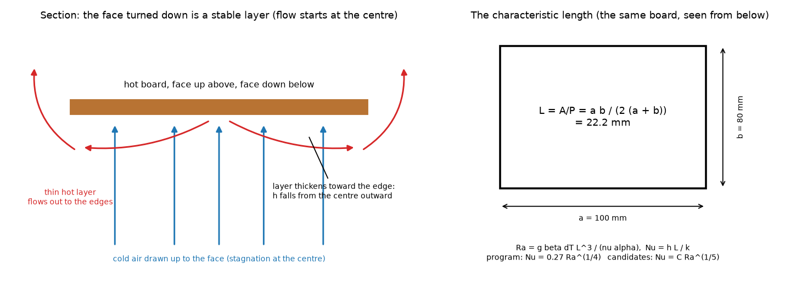
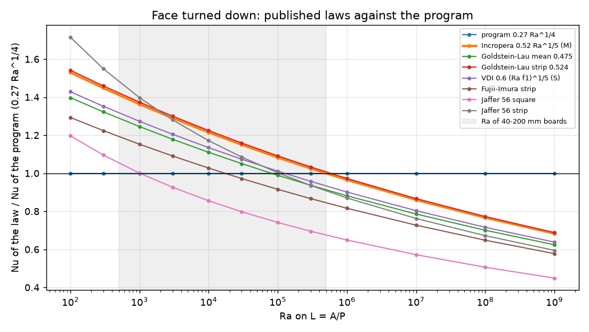
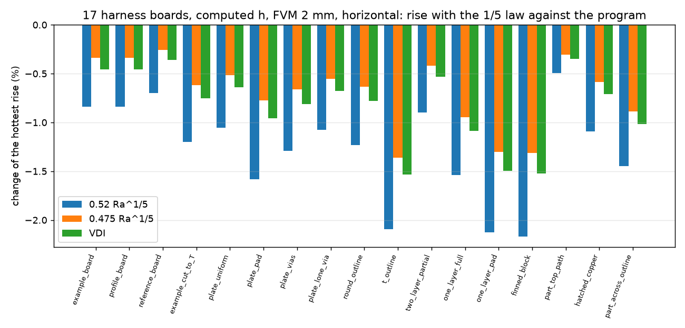

# face-down-convection: can the law of the face turned down be corrected?

*Status (audit 2.7.0): adopted in 2.6.0 as decision B, `Nu = 0.475 Ra^(1/5)` (`convection.DOWN_COEFFICIENT`); "the program" below is the 2.5.x law `0.27 Ra^(1/4)`, the baseline of the study. Review in section 8.*

The maintainer asked whether the natural-convection law of the horizontal face turned down can be corrected. The program uses `Nu = 0.27 Ra^(1/4)` (`pcbthermal/convection.py`,
`h_natural_horizontal`, `L = A/P`; `docs/theory.md` 8), written from memory, and the 2.5.0 decision was to keep it and write the limit, then revisit with the measurement of board D
(`research/convection-laws/docs/measurement-plan.md`). This folder collects what the sources say about that one face, compares the candidates over the Ra of the boards, measures what a change
would do to the program's temperatures (on a copy in memory), and proposes the law and the exact change. The program is untouched (`git diff develop --stat -- pcbthermal tests examples ico` is empty).
Earlier work that this one builds on and does not repeat: `research/horizontal-plate-h`, `research/convection-laws`, `research/theory-sources`.

**Summary**

1. **A correction to an earlier claim**: the program's law is not an invention. `Nu = 0.27 Ra^(1/4)` is the McAdams form that the textbooks printed for the lower surface of a hot plate
   (the documentation of the library `ht` gives it as McAdams, `Ra <= 1e10`; status S) and that Incropera and DeWitt carried in their earlier editions (M). The earlier statement "every published form has the exponent 1/5"
   was too broad: every form **read in this study and in the earlier folders** (Lienhard, Goldstein-Lau, Fujii-Imura, Kadambi-Drake, Schulenberg, Jaffer) has 1/5; the textbook form with 1/4 is the program's own.
2. **The 1/5 laws agree among themselves.** For air at Pr 0.71 the three laws that give a plate-mean level on `A/P` are `0.52 Ra^(1/5)` (Incropera, later editions, range 1e4 to 1e9; **M, the book was not opened**),
   `0.475 Ra^(1/5)` (mean of the Goldstein-Lau constants 0.44 to 0.527, page 8 of Yovanovich and Jafarpur 1993, **R**) and VDI `0.6 (Ra f1)^(1/5)` = `0.486 Ra^(1/5)` (**S**, through the documentation of `ht`).
   They differ by 9.5 % at every Ra (same exponent); the numerical strip of Goldstein and Lau, `0.524 Ra^(1/5)` for 40 < Ra < 8e3 (**R**, same page), sits on the top of that cluster.
3. **Against the program** (section 3): the program's face down is **20 to 27 % below the 1/5 cluster at Ra 1e3** (0.475 / program 1.25, 0.52 / program 1.36), 10 to 18 % at 1e4 (1.11 to 1.22), about equal at Ra of 1e5 to 3e5 and **above it from 1e6** (0.52 / program 0.97 at 1e6, 0.86 at 1e7, 0.68 at 1e9).
   On the boards (A/P 5 to 100 mm, 5 to 80 K) the ratio 0.52 law / program is 1.57 (the smallest, coolest corner) to 0.90 (a 400 x 400 mm board at 80 K); it is 1.12 to 1.33 for 20 to 60 mm parts of the board sizes the program is used for.
4. **The independent solver supports the 1/5 laws** (not re-run here; `research/convection-laws/README.md` 5, strip in a cold box, face down alone): Nu 2.25 at Ra 1e3 and 3.38 at 1e4, against 1.52 and 2.70 for the program, 2.07 and 3.28 for 0.52, 1.93 and 3.06 for VDI
   (the solver is a two-dimensional strip in a closed box: +8 % at most from the box; the program is 33 % and 20 % below it).
5. **Effect on the program** (section 5): the lower face is the bottom face of every horizontal board, so only boards at **computed h** and **horizontal** move (the frozen records, the 17 boards at manual coefficients,
   call the law **zero times**: 0 of 317 records move; vertical boards call it zero times too, bit-identical). At computed h the hottest rise of the 17 boards changes by **-0.5 to -2.2 % with `0.52 Ra^(1/5)`** (mean -1.3 %),
   -0.3 to -1.4 % with 0.475 and -0.3 to -1.5 % with VDI (convection only, no radiation: -1.0 to -5.4 % with 0.52); the example board horizontal: 60.06 -> 59.55 K (-0.84 %) with 0.52. The direction is **cooler**: the program is the hot side at the Ra of the boards.
6. **Recommendation** (`INTEGRATION.md`): replace by `Nu = 0.52 Ra^(1/5)`, if the maintainer confirms the constant in the book (one equation); otherwise `0.475 Ra^(1/5)`, which was read. Same law below 1e4 (the strip of Goldstein-Lau and the solver cover 1e3 to 1e4;
   below 1e3 the low-Rayleigh warning already speaks). One line in `convection.py`, one test of the program changes, no frozen number moves. What decides between the 1/5 levels and the program is only a measurement (board D).
7. **Not verified**: Incropera's page, Goldstein and Lau 1983 itself, the Rohsenow-Hartnett-Cho form (quoted second hand by `ht` and it does not look right: 2.0 to 2.7 times the program at Ra 1e2 to 1e3, left out of the recommendation),
   the effect of components, edge walls and enclosures on the face down (all lower h), and any measurement on a copper board.

## 1. The situation

*Figure 1 (`figures/fig_01_air_under_a_hot_board.png`): left, section of a hot horizontal board: the face turned down is a stable layer, cold air is drawn up to the centre of the face, flows out along it in a thin layer that thickens toward the edge and rises past the edge;
right, the characteristic length `A/P` of a 100 x 80 mm face.*

The face turned down is the last layer of every board in "horizontal" mode (layer 1 looks up). A hot surface looking up uses the 0.54 law; a surface **colder than the air** looking up also takes the lower law (the program swaps up and down when dT < 0).
Lienhard (p 436) warns that these stable cases assume the flow is not obstructed at the edges: "If edge circulation is blocked by an adiabatic wall, for example, h will be lower".

## 2. Sources and how they were read

| key | what it gives for the face down | status |
| :-- | :-- | :-- |
| [Lienhard2024] pp 436 and 437 (PDF 450, 451) | eq. 8.38 `Nu_L = 0.58 Ra_L^(1/5)` (Fujii and Imura, two-dimensional plate of width L, `1e6 <= Ra_L < 1e9`, water), eq. 8.39 `Nu_D = 0.82 Ra_D^(1/5) Pr^0.034` (Kadambi and Drake, disc of diameter D); the stable-case remark on edge circulation; **no worked example for the face down** (checked in the pages available) | **R** (page images rendered and read here) |
| [YovanovichJafarpur1993Bounds] p 8 | Goldstein and Lau: downward `C` 0.44 to 0.527, mean at Pr 0.71 `C = 0.475`, numerical strip `0.524 Ra^(1/5)`, 40 < Ra < 8e3, `L = A/P` | **R** (read in `research/convection-laws`); the paper of Goldstein and Lau **N** |
| [Schulenberg1984KfK] eq. 92, 94 | strip `0.571 Pr^(1/5) Ra^(1/5) / [1 + 1.156 Pr^(3/5)]^(1/3)` (length half the width): **local** Nu at the stagnation point, a lower bound of the plate mean | **R** (`research/horizontal-plate-h`, not re-read) |
| [Jaffer2023] eq. 56 | `0.341 + 0.550 (Ra/Xi_all)^(1/5)` with his length `L_R`; square and strip variants | **R** there (reviewed), not re-read |
| McAdams, *Heat Transmission* 3rd ed. | `Nu = 0.27 Ra^(1/4)`, `Ra <= 1e10` for the lower surface of a hot plate (what the program uses) | **S** (documentation of the library `ht`, which gives the formula and the reference); the book **N** |
| Incropera and DeWitt, chapter 9 | earlier editions: `0.27 Ra^(1/4)`, 1e5 to 1e10 (the program's); later editions, as the maintainer recalls and as I recall: `0.52 Ra^(1/5)`, `1e4 <= Ra <= 1e9`, lower surface of a heated plate | **M** (search found no text quoting either; the book is not in the local library) |
| VDI Heat Atlas (2010) | `Nu = 0.6 (Ra f1)^(1/5)`, `f1 = [1 + (0.492/Pr)^(9/16)]^(-16/9)`, `L = ab / (2(a + b))` | **S** (the documentation of `ht`, the page `ht.readthedocs.io/en/latest/_modules/ht/conv_free_immersed.html`); the Atlas **N** |
| Rohsenow, Hartnett and Cho (1998) | `Nu_T = 0.527 Ra^(1/5) / [1 + (1.9/Pr)^0.9]^(2/9)`, `Nu = 2.5 / ln(1 + 2.5/Nu_T)`, same source | **S**, not checked, **suspect** (section 3) |
| Fujii and Imura (1972), Raithby and Hollands, Churchill, Radziemska and Lewandowski, Al-Arabi | the originals | **N** (paywalled or not found); the forms are read as Lienhard prints them |

Nothing of a third party is stored. The searches for an open copy of Incropera or a statement of its 0.52 found none (the web search returned the McAdams 0.27 in `ht`, VDI and Rohsenow, and nothing for 0.52).

## 3. The candidate laws over Ra

`scripts/study_down_laws.py` (printed table; Pr 0.71, `L = A/P`; ratio to the program in brackets).

| Ra | program | 0.52 Ra^(1/5) | 0.475 (GL mean) | 0.524 (GL strip) | VDI | Fujii-Imura strip | Jaffer 56 square | Jaffer 56 strip |
| --: | --: | --: | --: | --: | --: | --: | --: | --: |
| 1e2 | 0.854 | 1.306 (1.53) | 1.193 (1.40) | 1.316 (1.54) | 1.220 (1.43) | 1.104 (1.29) | 1.022 (1.20) | 1.464 (1.72) |
| 1e3 | 1.518 | 2.070 (1.36) | 1.891 (1.25) | 2.086 (1.37) | 1.933 (1.27) | 1.750 (1.15) | 1.520 (1.00) | 2.122 (1.40) |
| 1e4 | 2.700 | 3.281 (1.22) | 2.997 (1.11) | 3.306 (1.22) | 3.064 (1.13) | 2.773 (1.03) | 2.309 (0.86) | 3.163 (1.17) |
| 1e5 | 4.801 | 5.200 (1.08) | 4.750 (0.99) | 5.240 (1.09) | 4.855 (1.01) | 4.396 (0.92) | 3.560 (0.74) | 4.813 (1.00) |
| 1e6 | 8.538 | 8.241 (0.97) | 7.528 (0.88) | 8.305 (0.97) | 7.695 (0.90) | 6.967 (0.82) | 5.542 (0.65) | 7.429 (0.87) |
| 1e7 | 15.183 | 13.062 (0.86) | 11.931 (0.79) | 13.162 (0.87) | 12.196 (0.80) | 11.041 (0.73) | 8.684 (0.57) | 11.575 (0.76) |
| 1e9 | 48.014 | 32.810 (0.68) | 29.970 (0.62) | 33.062 (0.69) | 30.636 (0.64) | 27.734 (0.58) | 21.557 (0.45) | 28.560 (0.59) |

(The Rohsenow form printed by the script gives 2.00, 2.65, 3.64 at Ra 1e2, 1e3, 1e4, i.e. 2.35, 1.75 and 1.35 times the program: above every other law and above the solver, so either the quotation of `ht` is not what the Handbook prints or it is not a plate-mean law; it is excluded.)

*Figure 2 (`figures/fig_02_down_laws_over_ra.png`): each law divided by the program's `0.27 Ra^(1/4)`; the band is the Ra of 40 to 200 mm boards. The 1/5 laws are straight lines on this plot, parallel to each other: the choice of constant moves the line, the exponent sets the slope.*

* The three 1/5 laws of air differ by 9.5 % at every Ra; Fujii-Imura on a strip (a water, two-dimensional plate, outside its range here) and Jaffer's long strip bracket them; Jaffer's square (his length is half the side, `2 A/P`) is the lowest, 0.86 of the program at 1e4.
  The levels of the published forms scatter by 30 to 40 % at Ra 1e3 to 1e4 (section 3 of `research/convection-laws`): **no law is "the" value**, but all but Jaffer's square are above the program at Ra below 1e5.
* The program is the hot side (lower h) below Ra of about 2e5 and the cold side above it. At the Ra of the program's boards (5e2 to 5e5, most 3e3 to 5e4) it is the hot side: a correction makes the boards cooler.

Boards (convection only, 25 degC ambient, h of the face down in W/m2K; the script prints 21 rows):

| A/P (mm) | dT (K) | Ra | program | 0.52 | 0.475 | VDI | 0.52 / program |
| --: | --: | --: | --: | --: | --: | --: | --: |
| 10 | 20 | 1.66e3 | 4.64 | 6.16 | 5.63 | 5.75 | 1.33 |
| 15 | 20 | 5.60e3 | 4.19 | 5.24 | 4.79 | 4.89 | 1.25 |
| 22.2 (100 x 80) | 5 | 5.09e3 | 2.70 | 3.40 | 3.10 | 3.17 | 1.26 |
| 22.2 (100 x 80) | 20 | 1.82e4 | 3.80 | 4.48 | 4.09 | 4.18 | 1.18 |
| 22.2 (100 x 80) | 80 | 4.72e4 | 5.23 | 5.88 | 5.37 | 5.49 | 1.12 |
| 30.8 (160 x 100) | 20 | 4.85e4 | 3.50 | 3.93 | 3.59 | 3.67 | 1.12 |
| 50 (200 x 200) | 20 | 2.07e5 | 3.10 | 3.24 | 2.96 | 3.02 | 1.04 |
| 100 (400 x 400) | 80 | 4.32e6 | 3.59 | 3.22 | 2.94 | 3.01 | 0.90 |

(`A/P` of 5 mm at 5 K, Ra 58, gives 1.57: below every range, where the low-Rayleigh warning applies.)

## 4. The reference solver

The strip in a closed cold box, face down alone, from `research/convection-laws` section 5 (`lib/mac2d.py`, validated on the de Vahl Davis cavity to 0.0 to 0.5 %): Nu of the lower face 2.248 at Ra 1e3 and 3.376 at 1e4
(balance 1.025 and 1.141: the cold walls of a 4 to 6 half-width box add some heat transfer, so the numbers are an upper estimate, +3 to +14 % by the balance). Against the laws at `L = A/P` of the strip: program 1.518 / 2.70 (-33 % and -20 % of the solver),
0.52 law 2.070 / 3.281 (-8 % and -3 %), 0.475 law 1.891 / 2.997, VDI 1.933 / 3.064, Goldstein-Lau strip 2.086 / 3.306. This was **not re-run in this folder** (the run takes an hour); the numbers are the earlier folder's and the earlier review read them.
The agreement within the solver's box is the best a two-dimensional solver can say; it does not choose between the 1/5 levels and it is not a measurement (section 9).

## 5. What changes in the program

`scripts/study_down_board_effect.py` (21 s): `convection.h_natural_horizontal` replaced in memory (`lib/down_laws.use_down`), FVM, cell 2 mm, horizontal, computed h, emissivity as the board has it.

**Frozen records (part 1 of the script).** The 17 boards of `tests/regression` run with the patched function counting its calls: **0 calls on every board** (all have `h_mode` manual), so none of the 317 frozen records can move.
The vertical orientation does not call it either (example board vertical: 0 calls, the rise is unchanged to the last digit).

**Computed h, horizontal (part 2).** Percent change of the hottest rise against the program:

| board | rise (K) | 0.52 | 0.475 | VDI | 0.52, no radiation |
| :-- | --: | --: | --: | --: | --: |
| example_board | 60.06 | -0.8 | -0.3 | -0.5 | -1.8 |
| reference_board | 65.82 | -0.7 | -0.3 | -0.4 | -1.5 |
| example_cut_to_T | 67.19 | -1.2 | -0.6 | -0.8 | -2.4 |
| plate_uniform | 123.9 | -1.1 | -0.5 | -0.6 | -2.5 |
| plate_pad | 301.59 | -1.6 | -0.8 | -1.0 | -2.8 |
| plate_vias | 104.65 | -1.3 | -0.7 | -0.8 | -2.7 |
| round_outline | 131.8 | -1.2 | -0.6 | -0.8 | -2.8 |
| t_outline | 140.15 | -2.1 | -1.4 | -1.5 | -3.7 |
| one_layer_full | 31.32 | -1.5 | -0.9 | -1.1 | -3.3 |
| one_layer_pad | 73.5 | -2.1 | -1.3 | -1.5 | -3.5 |
| finned_block | 102.6 | -2.2 | -1.3 | -1.5 | -5.4 |
| part_top_path | 49.54 | -0.5 | -0.3 | -0.3 | -1.0 |
| (five more boards) | | -0.8 to -1.4 | -0.3 to -0.9 | | |

(profile_board repeats the example board; the script prints the 17.) The change is always **negative**: the board gets cooler by 0.5 to 2.2 % of the rise with 0.52, up to 5.4 % when convection is the only loss (no radiation, the finned block).
Example board, computed h, power x0.5 / x1 / x2: -1.04 / -0.84 / -0.69 % with 0.52 (h_bottom 9.26 -> 9.91, 10.13 -> 10.76, 11.34 -> 11.95 W/m2K). One of the program's tests pins the law
(`tests/test_orientation.py::test_horizontal_board_matches_the_textbook_formulas_written_out_by_hand`, coefficient 0.27 written out by hand: 5.00 against 4.34 W/m2K); with the patch it is the only failure of 35 tests in the four convection files
and of 95 in `test_model_limit_warnings`, `test_solid3d`, `test_memory` and `test_inverse` (the other tests that use computed h). The whole battery was not run (not needed for a research branch).

*Figure 3 (`figures/fig_03_effect_on_the_hottest_rise.png`): change of the hottest rise of the 17 harness boards (computed h, FVM 2 mm, horizontal, with radiation) when the face down uses a 1/5 law instead of the program's: 0.52 (blue), 0.475, VDI.*

## 6. Limits of the laws for a board

* **Edge circulation.** Lienhard (p 436) says the stable cases assume an unobstructed edge; on a board in a case, with a wall under it or components under it (the program has no such obstruction model), h is lower than any of the laws, and the 0.27 law is not safer by construction: it is only lower at small Ra.
* **Finite size and shape.** The 1/5 constant depends on shape (Jaffer: square 0.86 of the program at 1e4, strip 1.17); a long strip of Fujii-Imura and the numerical strip of Goldstein-Lau are the high end, a square the low end. The cluster 0.475 to 0.524 is the strip and mean level.
* **Range.** The sources cover Ra 40 to 8e3 (Goldstein-Lau strip), 1e4 to 1e9 (Incropera, M), 1e6 to 1e9 (Fujii-Imura, water). The boards sit at 5e2 to 5e5: the 1/5 law is used outside the ranges quoted by Incropera and Fujii-Imura on the low side and is supported there by the Goldstein-Lau strip and the solver (section 4).
* **Radiation** is not touched (it is 40 to 50 % of the loss of a bare bottom face; the line "coefficients have never been compared with a measured copper board" stays).

## 7. What the board D measurement would add

`research/convection-laws/docs/measurement-plan.md`: a plate with one bright face distinguishes the levels (the ratio of the rise face up to face down is 0.62 for the program, 0.69 for 0.475 with Raithby-Hollands, 0.52 for Jaffer's) and, with the bottom face free versus under a wall, would give the size of the edge effect of section 6, which none of the sources gives for a copper board. This folder does not change the plan; it only shows that the lower face is the one for which the existing laws differ most from the program at the Ra of the boards.

## 8. Review

Independent review in the research audit of 2.7.0 (`releases/2.7.0/research-audit/`), on the program of the audit branch (`develop` 6bdef422 merged: 2.6.0 plus the 2.7.0 interface fixes). Status: **reviewed, closed; go**. The folder was written against the program of 2.5.x, whose face-down law was `0.27 Ra^(1/4)`; where the text above says "the program" it means that law (`lib/down_laws.program_down`, kept as the study's baseline).

* **Adopted as decision B.** 2.6.0 implements `Nu = 0.475 Ra^(1/5)` on `L = A/P` (`convection.DOWN_COEFFICIENT`, `DOWN_EXPONENT`, `pcbthermal/convection.py` lines 48, 49 and 80; `fix/face-down-convection`), not the preferred decision A (`0.52`, status M, never confirmed from an open source: INTEGRATION 1). The review evaluated the program's `h_natural_horizontal` face down against `lib/down_laws.gl_mean` at 9 points (`A/P` 5, 22.2, 100 mm; 5, 20, 80 K): identical to the last digit. The recommendation of summary item 6 and INTEGRATION 1 ("0.52 if the book is confirmed") is history: the constant in the program is 0.475, and a change to 0.52 would need the page of Incropera first.
* **Re-run.** `scripts/study_down_laws.py` (under 1 s) reprints the tables of section 3 to the digit. `scripts/study_down_board_effect.py` (34 s) reprints every percentage of section 5 to the digit (part 1: 0 calls on all 17 frozen boards; part 2: -0.5 to -2.2 % with 0.52, -0.3 to -1.4 % with 0.475, -0.3 to -1.5 % with VDI; part 3: -1.04 / -0.84 / -0.69 % with 0.52 at power x0.5 / x1 / x2, bottom h 9.26, 10.13, 11.34 W/m2K unchanged). **The baseline rises moved** by the other 2.6.0 model items (the cut-cell links and edge film, the via barrel length, the laminate edge band): example board 60.06 -> 60.19 K, `example_cut_to_T` 67.19 -> 67.32, `plate_vias` 104.65 -> 104.73, `t_outline` 140.15 -> 140.32, `round_outline` 131.80 -> 131.81 K; the others unchanged; the face-down law is not the cause (it is the baseline of both columns). The example board with the adopted law is therefore 60.19 -> 59.99 K (-0.34 %) on this tree; the 60.06 -> 59.86 K of `docs/theory.md` 8, `docs/validation.md` 5 and the 2.6.0 changelog is the same change measured before the other items entered (left as written there: a record of the change, not a wrong number). The folder tests pass (5).
* **Independent reference.** The 1/5 laws are read from Lienhard (R) and the Goldstein-Lau page of Yovanovich and Jafarpur (R); the strip solver of `research/convection-laws` (Nu 2.25 and 3.38 at Ra 1e3 and 1e4) supports them and was not re-run (an hour; reviewed there). The adopted 0.475 sits 16 % and 11 % below that solver at Ra 1e3 and 1e4 (a closed box, an upper estimate by 3 to 14 %), so the face down is still on the hot side at the boards' Ra, and the program's remaining limit is the one the Results-summary line states: no measured copper board.
* **Limits that stay** (section 6): edge circulation (a wall or parts under the board lower h below every law), shape (Jaffer square to strip, +-17 %), the range below 1e4, and no published worked example of the face down.
* **Corrections made by the review**: this chapter (the status of the recommendation and the moved baselines); no number of sections 3 to 5 was wrong.

## 9. What was read and what was not verified

* **Read in full (R)**: Lienhard 2024 pp 436 and 437 (page images, eq. 8.37 to 8.39 and the stable-case remark); page 8 of Yovanovich and Jafarpur 1993 and the Schulenberg and Jaffer forms through the earlier folders (not re-read here).
* **From a summary (S)**: the McAdams 0.27 law, the VDI form and the Rohsenow form, through the documentation of the library `ht` (a fetch of its source page; the docstring gives formula, range and reference). Not checked against the books.
* **From memory (M)**: Incropera and DeWitt's 0.52 Ra^(1/5), `1e4 <= Ra <= 1e9`: a search found no quotation of either that or the older 0.27 in the book. **This is the constant of the recommendation and it needs the page.**
* **Not obtained (N)**: Goldstein and Lau (1983) itself, Fujii and Imura (1972), McAdams, the VDI Atlas, the Rohsenow handbook, Incropera.
* **Reproduced**: the program's air properties and law through `lib/down_laws.py` (tests in `tests/`, bit-identical to the program with its own law, nothing else moved); a textbook worked example of the face down was **not found** (Lienhard has none in the pages available; Incropera's is not available), so no published number of a case was reproduced for the face down; what stands in its place is the printed equations of Lienhard evaluated by hand
  (`tests/test_down_laws.py`) and the independent solver of the earlier folder (not re-run).
* **Not done**: a measurement; any check of components or enclosures on the face down; the effect of a different law on the finned block's fins (the block case is included in the 17 and moves -2.2 %).

Tests of this folder: `QT_QPA_PLATFORM=offscreen .venv/bin/python -m pytest -q research/face-down-convection/tests` (5 passed). Scripts: `study_down_laws.py`, `study_down_board_effect.py`, `make_diagrams.py`, `make_figures.py`.
