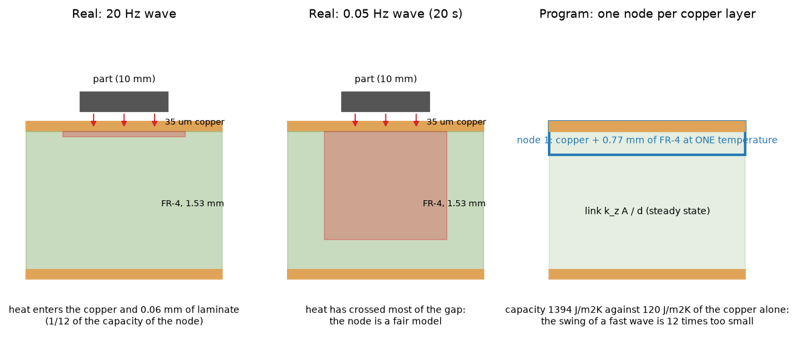
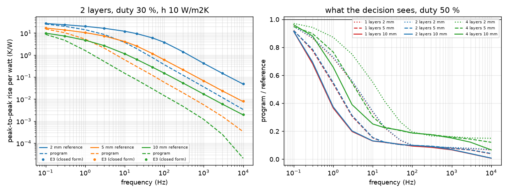
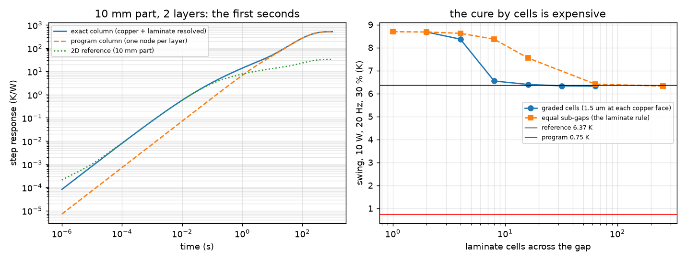
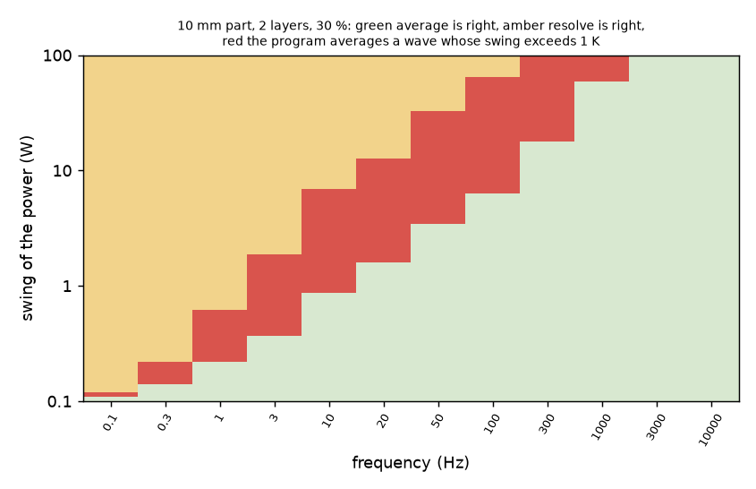
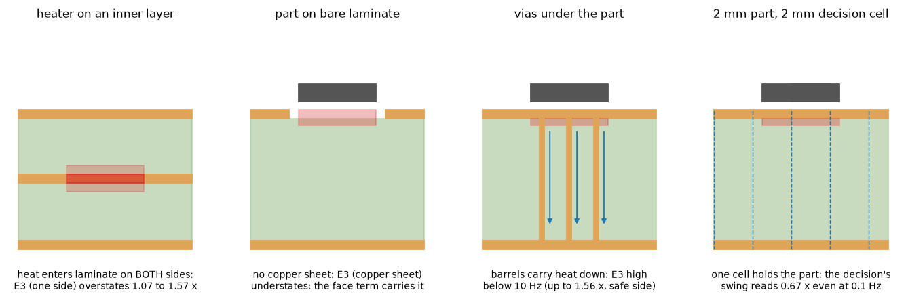
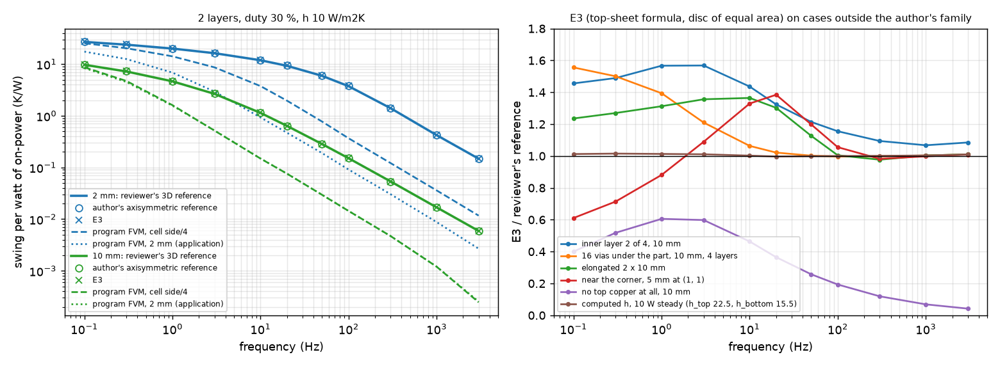
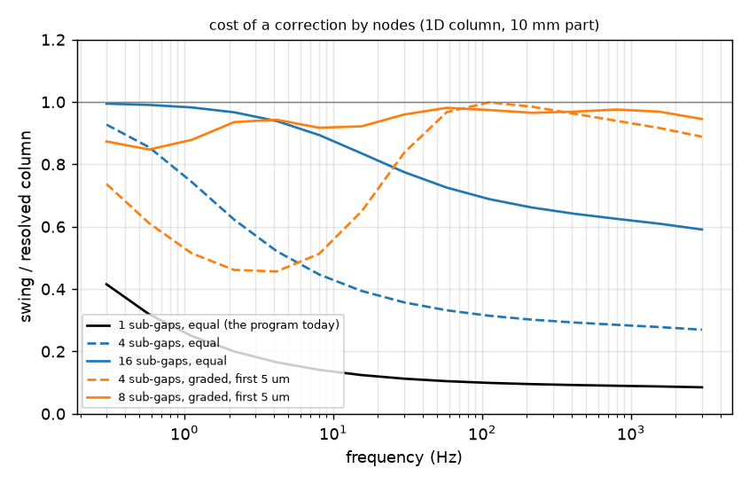

# fast-wave-oscillation

**Status (audit 2.6.1): adopted in 2.6.0** (`fix/fast-wave-ripple`: items A, B, D and W2 of `INTEGRATION.md`; `pcbthermal/stackimpedance.py`, `profiles.decide`, `api.response_cell_mm`, `checks.check_fast_wave`; `docs/theory.md` 10.5, `docs/validation.md` 37). The fix made the heater's copper a slab of the column (the review of the fix), so the program's closed form is not `lib/impedance_layer.py` to the digit: the headline wave reads 6.35 K in the program against the 6.37 K reference (the folder test now holds the program's decision). Sections 2 to 6 describe the program **before 2.6.0** ("the decision today" is the 2.5.x decision); a re-run of `study_impact.py` on the current tree prints the decision with the floor.

Question: with one node per copper layer the FVM and FDM understate the oscillation of fast square waves over full copper (`docs/validation.md` 36.2 and 36.3 of `fix/laminate-edge-band`: a 20 Hz, 30 %, 10 W wave on a 10 mm part of a 1.6 mm board reads 0.75 K, an independent 1D solution 6.3 K). Why, over which frequencies and sizes, how often the average-or-resolve decision (`profiles.decide`, budget 1 K) is wrong because of it, and what is the smallest correction. Nothing of the program is edited; the proposal is in [INTEGRATION.md](INTEGRATION.md).

Run (repository root, `QT_QPA_PLATFORM=offscreen`, about 1.5 minutes in all, peak memory under 0.5 GB):
`study_fast_wave_sweep.py` (writes `out/sweep.json`), `study_correction.py` (the rejected column difference), `study_estimator.py` (tables 3 to 5, writes `out/sweep_e3.json`), `study_impact.py`, `make_diagrams.py`, `make_figures.py`; tests: `research/fast-wave-oscillation/tests` (13 passed). The review (section 8) adds `study_review_reference.py [sample|cases|bare|example]` (about 45 minutes in all, peak memory 1.6 GB), `study_review_tables.py` and `study_resolved_curve.py` (1 minute); run `make_figures.py` after them for figures 6 and 7.

## 1. The reference and the situation

*Figure 1 (`fig_01_section_fast_wave.png`): the section under a part (copper not to scale). A 20 Hz wave heats the copper and about 0.06 mm of laminate; the program holds the copper and 0.77 mm of laminate (half of the 1.53 mm gap) at one temperature.*

**The independent reference** (`lib/axisym_stack.py`, imports nothing from the program): axisymmetric (r, z) finite volumes of the board as the disc of the same area as the rectangle (60 x 40 mm, radius 27.6 mm), the part a disc of the same area as the square part (uniform flux on the top copper), copper 385 W/mK and 3.45 MJ/m3K in four cells per layer, laminate k_z 0.3 / k_r 0.9 W/mK and 1.665 MJ/m3K in cells that grow from 1.5 um at each copper face (16 per side of a gap; the penetration depth of a 10 kHz wave in FR-4 is 4 um), faces h, insulated edge. The system is symmetric, so it is diagonalised once (1360 to 3800 unknowns) and every response is a sum of exponentials: the periodic steady state of a square wave is a closed form per mode, with no time step and no cycle count. Checks (`tests/test_fast_wave.py`): the steady resistance equals the series-parallel circuit (0.2 %); a bare slab follows the semi-infinite solid `2 q sqrt(t/pi)/e` apart from the expected t_cu/(2 k A) offset of a source spread over the first 35 um (the test is loose: absolute 0.68 K/W on 8.7 and 16 K/W); the 1D column gives 6.33 K and the 2D reference 6.37 K for the case of 36.3, against the **6.31 K** of the independent 1D solution of the review (not rerun here: it is the number in `docs/validation.md`).

**The program's number is reproduced**: `profiles.decide` gives 0.747 / 0.758 K at the 2 mm and 1 mm cell (the wave response itself: 0.7578 / 0.7581), steady resistance 33.13 K/W at 1 mm against 33.05 K/W of the reference. The ratio is **8.4**.

## 2. The sweep (question 1)

Full copper, 60 x 40 mm, 1.6 mm, 35 um, simple stack-up (equal gaps), layers 1, 2 and 4, part 2, 5 and 10 mm (cell: side / 4, at most 1 mm), faces 10 and 30 W/m2K, 12 frequencies from 0.1 Hz to 10 kHz, duty 10, 30, 50 and 90 % (a linear system: the swing is the same for D and 1 - D), 864 cases. The swing is per watt of the on-power, at the centre cell of the top copper (the program's hottest cell of a footprint over full copper is its node; over full copper there is no face term). **Computed h**: the program holds the coefficient at its steady value during the time simulation, so a computed-h board is a board with another manual h; 30 W/m2K is the order of a forced-air or radiating board and it changes no conclusion (the 10 and 30 W/m2K rows are in `out/sweep.json`; E3 below ratio 0.994 to 1.111 over both).

*Figure 2 (`fig_02_swing_against_frequency.png`): left, reference, program and the closed-form E3 for three part sizes (2 layers, 30 %); right, program / reference for 1, 2 and 4 layers (50 %).*

**Table 1. Program (decision's oscillation) divided by the reference, duty 50 %, h 10** (`out/sweep.json`):

| layers, part | 0.1 Hz | 0.3 | 1 | 3 | 10 | 20 | 50 | 100 | 300 | 1 k | 3 k | 10 k |
| :-- | --: | --: | --: | --: | --: | --: | --: | --: | --: | --: | --: | --: |
| 2, 2 mm | 0.95 | 0.87 | 0.73 | 0.56 | 0.34 | 0.23 | 0.14 | 0.10 | 0.09 | 0.08 | 0.08 | 0.07 |
| 2, 5 mm | 0.92 | 0.79 | 0.55 | 0.31 | 0.16 | 0.12 | 0.10 | 0.10 | 0.09 | 0.08 | 0.07 | 0.04 |
| 2, 10 mm | 0.91 | 0.70 | 0.37 | 0.20 | 0.13 | 0.12 | 0.11 | 0.10 | 0.09 | 0.07 | 0.04 | 0.01 |
| 1, 10 mm | 0.91 | 0.68 | 0.37 | 0.20 | 0.13 | 0.12 | 0.11 | 0.09 | 0.09 | 0.07 | 0.04 | 0.04 |
| 4, 2 mm | 0.97 | 0.94 | 0.87 | 0.75 | 0.55 | 0.42 | 0.27 | 0.20 | 0.17 | 0.16 | 0.15 | 0.15 |
| 4, 10 mm | 0.96 | 0.88 | 0.66 | 0.39 | 0.25 | 0.23 | 0.21 | 0.19 | 0.18 | 0.15 | 0.12 | 0.07 |

The program understates the swing **at every frequency from about 0.2 Hz up** (periods below roughly 5 s on a 1.6 mm two-layer board): by 10 % at 0.1 to 0.3 Hz, 2 to 3 times at 1 to 3 Hz, about **8 to 10 times from 50 Hz to 1 kHz**, and 5 to 7 times for 4 layers (the slab is half as thick, so half the capacity). Across all 864 cases the program is at 0.06 to 0.97 of the reference (median 0.18, 5 % to 95 %: 0.07 to 0.90). The plateau at 8 to 12 is the ratio of the node capacity (1394 J/m2K) to the copper's own (120 J/m2K); it falls to 0.01 to 0.05 above 3 kHz, where the swing is below 3 mK/W and a numerical limit of the program's time grid (first sample 1.8 us, Crank-Nicolson at the first steps) may add to the physical one: not separated here, and irrelevant to the decision (swing below 0.1 K for 10 W).

## 3. What causes it (question 1 a, b, c)

*Figure 3 (`fig_03_column_and_cells.png`): left, the first seconds of the step response of a 10 mm part (exact column, program column, 2D reference); right, the swing of the 20 Hz, 10 W wave against the number of laminate cells across the gap.*

**(a) Through the thickness: the laminate's capacity that the node holds, not the copper.** The 1D column of the program's structure (one node per layer, the copper plus 0.77 mm of FR-4 of its slab, link k_z A / d, `lib/columns.py`) gives 0.753 K for the wave, the program 0.747 to 0.758 K: the 8.4 is the discretisation. The copper alone is not at fault: one copper cell or four per layer give the same swing (the 35 um of copper is isothermal in 11 us), 6.33 K. What is wrong is the 0.77 mm of laminate at the temperature of the copper: capacity 1394 J/m2K against 120 J/m2K of the copper plus the laminate that actually follows (the depth is `sqrt(alpha_FR4 T / pi)`: 0.06 mm at 20 Hz). In steady state and for periods above a few seconds the node is right.

**What it costs to fix by cells.** Laminate cells across the gap, swing of the 10 W, 20 Hz wave: graded cells (1.5 um at each copper face) 2 / 4 / 8 / 16 / 32 per gap: 8.68 / 8.37 / 6.55 / 6.40 / 6.33 K; **equal** sub-gaps (the laminate rule) 1 / 4 / 16 / 64 / 256: 8.69 / 8.62 / 7.55 / 6.41 / 6.32 K. The 2.33 / 3.62 / 4.93 K of `docs/validation.md` 36.3 for 4 / 8 / 16 sub-gaps are the program's own numbers with the cells only (a different structure from the equal sub-gaps above, where the node keeps its half-gap; the trend is the same: the series reaches the reference only at 16 graded or 64 equal cells). A converged answer needs about 16 cells per gap under the part and a thin first cell: 8 to 16 laminate nodes per gap under the part instead of one. Not tried in the program.

**(c) Lateral spreading.** Over a full-copper sheet it matters only for the slow end and small parts. 1D exact against 2D reference (K/W, duty 30 %): 10 mm part 21.8 / 5.82 / 1.12 / 0.151 / 0.0169 against 9.85 / 4.73 / 1.14 / 0.151 / 0.0169 at 0.1 / 1 / 10 / 100 / 1000 Hz; 2 mm part 546 / 145 / 28.0 / 3.77 / 0.417 against 27.1 / 20.2 / 12.1 / 3.81 / 0.421. From 100 Hz up the 1D column is the answer (a 2 mm part: 1 %); below it the spreading takes over, so a pure column correction fails (section 5.1).

**(b) The quasi-static face term of 2.5.x (part over bare laminate, no copper: 10 mm part, 2 layers, h 10; reference = pure FR-4 board, top face; duty 50 %).** Program / reference: 0.98 / 0.92 / 0.78 / 0.58 / 0.49 / 0.52 / 0.67 / **0.90** / 1.66 / 3.94 / 10.5 / 34 at 0.1 / 0.3 / 1 / 3 / 10 / 20 / 50 / 100 / 300 / 1 k / 3 k / 10 k Hz. The face term `Q t_cu / (2 k_z A)` is right where it was said to be (about 100 Hz: 0.635 against 0.641 K/W), overstates above (not attenuated: 0.58 K/W where the true value falls to 0.014 at 10 kHz; the safe side, as `profiles.py` says) and below 50 Hz the node (capacity again) underestimates by up to 2 times. So the bare case has both effects with the opposite sign at the two ends. The reference with the copper taken out is a bare-board idealisation: the program's bare node still holds `t_cu` of absent copper.

**Corrected by the review (section 8.5): the ratios above 50 Hz in this paragraph are too high.** The reference read the bare surface in a cell-centred laminate cell 8.75 um thick, which reads low by about 0.45 of its width over the penetration depth (16 % at 100 Hz, 40 % at 1 kHz). With a thin surface cell the program / reference of a part on bare laminate is 0.46 / 0.50 / 0.63 / **0.82** / 1.33 / 2.38 / 4.11 at 10 / 20 / 50 / 100 / 300 / 1 k / 3 k Hz (duty 30 %): the face term crosses the truth between 100 and 300 Hz, not at 100 Hz, and overstates 2.4 times at 1 kHz, not 3.9 times. The conclusion (both effects, opposite signs at the two ends; the safe side above about 200 Hz) stands.

## 4. The decision today (question 2)

*Figure 4 (`fig_04_wrong_decisions.png`): 10 mm part, 2 layers, 30 %: the swing of the power and the frequency where the program averages (red) a wave whose true swing exceeds 1 K.*

One heater, budget 1 K, swing of the power 0.5, 1, 2, 5, 10 and 20 W, all 864 cases (5184 decisions): the program **averages a wave whose true swing exceeds the budget in 948 decisions (18.3 %)**, never the other way (0 resolves of a wave that could be averaged: the node errors are all on the low side). By frequency (decisions of 432): 1 Hz 28, 3 Hz 66, 10 Hz 124, 20 Hz 152, **50 Hz 176**, 100 Hz 168, 300 Hz 124, 1 kHz 68, 3 kHz 36, 10 kHz 6. The worst: a 20 W swing on a 2 mm part at 1 kHz, 50 % (the program 0.8 K, the truth 9.97 K). **Review (section 8.3): these counts use a step response at the cell side / 4; the application computes it at `max(cell, 2 mm)` (`api._step_response`), which makes a 2 mm part one cell and the count 24.7 % instead of 20.0 % on the review's sample, worst true swing averaged 37 K.** With the shared budget (several heaters) the sum of the true swings is also higher than the budget by the same factors. The profile curves of a heater that is resolved carry the same error (the same node), so even a correct decision leaves a fast resolved ripple 8 to 12 times too small (fast waves that are resolved are rare: they cost one step per fraction of the period).

## 5. The correction (question 3)

### 5.1 First try, rejected: the difference of two columns

`lib/correction.py`: `Z_corr(t) = Z_program(t) + [Z_exact column(t) - Z_lumped column(t)]`, both columns of the footprint area; zero at t = 0 and at long times. Against the reference over the sweep it is within 0.90 to 1.00 from 100 Hz to 3 kHz (2 layers, 10 mm: 0.98 at 100 Hz), but **overshoots at the slow end** (2 mm part, 2 layers: 8.9, 8.2, 6.0 times at 0.1, 0.3, 1 Hz; 10 mm part 1.7, 1.6, 1.3) because the column has no lateral spreading. Scaling by the share the program keeps, `phi = Z_program / Z_lumped column`, fixes 1 layer at the slow end but spoils the fast end (0.5 for 1 layer, 5 to 10 mm: the program's own spreading is too slow, 3.3 above). Not adopted.

### 5.2 E3: the closed-form impedance of the top sheet (adopted as the proposal)

`lib/impedance.py`. Two derived pieces, both own derivations:

1. `Y(w)`, the admittance per unit area of the stack under the top face of the top copper, from the transfer matrices of the layers (the recursion with `tanh`, stable for a thick laminate; `gamma = sqrt(j w rho c / k)`, convection of both faces) with the layers' real thicknesses and properties.
2. The top copper as a sheet of conductance `S = k_cu t_cu` over the vertical admittance `Y`: `S nabla2(theta) - Y theta = -q(r)`. For a uniform flux on the disc of radius `a` (equal area to the part), `m^2 = Y / S`, the centre rise is `(q0 / Y)(1 - m a K1(m a))` and the disc mean `(q0 / Y)(1 - 2 I1(m a) K1(m a))` (complex Bessel functions). The deeper copper layers are **not** added to `S` (laminate decouples them in a wave: with their conductance the swing is 0.4 to 0.7 of the reference at the slow end).

The swing of a square wave is the peak-to-peak of the sum of the harmonics `Z(k w0) c_k` (16 384 samples per period, one inverse FFT, 2.2 ms). **Against the reference over all 864 cases: ratio 0.994 to 1.111, median 1.000, 5 %-95 % 0.995 to 1.056** (the 5 % high ones are the 10 kHz points, a limit of the harmonic count; 1.057 for four layers at 0.1 Hz, from the inner planes: on the safe side). Spot values (K/W, duty 30 %): 10 mm 2 layers 0.1 / 1 / 20 / 100 / 1000 / 10 000 Hz ratios 0.999 / 0.996 / 0.997 / 0.999 / 1.005 / 1.053; 2 mm: 1.009 / 1.000 / 0.995 / 0.997 / 1.004 / 1.053. Cost: no unknowns, 2 ms per heater and wave.

**Decision with the floor `oscillation = max(program, E3)`** (same 5184 decisions): 0 wrongly averaged (948 before), 12 wrongly resolved (the truth is within 11 % below the budget), which is the E3 overshoot on the boundary.

### 5.3 What it changes in the program's own cases (`study_impact.py`, budget 1 K)

| case | heater | program | E3 | decision |
| :-- | :-- | --: | --: | :-- |
| `example_with_profiles` 100 Hz (`tests/test_profiles.py`), `examples/profile_board` | U1, 13.3 W swing | 0.393 K | 2.013 K | average -> **resolve** |
| the same at 1 kHz (`test_profiles.py` line 160) | U1 | 0.039 K | 0.226 K | stays average |
| mixed regimes test (60 x 50 mm, 10 mm, 20 Hz) | fast | 0.747 K | 6.355 K | average -> **resolve** |
| the slow heaters (0.05 and 0.5 Hz) | U2 / slow | 84.9 / 9.5 K | 97.9 / 23.5 K | already resolved (E3 overstates: no vias, no inner planes, no neighbours) |

*Audit 2.6.1 (`study_impact.py` re-run): the `program` column above is the decision before 2.6.0; on the current program it equals the floor in every row (U1 at 100 Hz 2.013 K, average + ripple; at 1 kHz 0.226 K, average; the fast heater of the mixed test 6.355 K, average + ripple; U2 97.88 K resolved; the slow heater of the mixed test, 0.5 Hz with a 25 % duty, 23.535 K and now average + ripple, because its shortest stretch, 0.5 s, is below the 4 s of the fixed rule). The E3 column is reproduced to the digit; the reference swing of the 20 Hz case is 0.6372 K/W.*

Which frozen numbers move: **none** of the 251 records and 58 times of `tests/regression` (the harness copies the problems without profiles, and the correction is in the decision, not in the step responses). Which tests would move: `tests/test_profiles.py` (the tests that use `example_with_profiles()` at 100 Hz and expect `average` for U1 (lines 46 to 211), the mixed-regimes test that expects `["average", "resolved"]`), `tests/test_gui_profile.py` and the stress scenarios that run the profile page on the example, the screenshots of the profile page (`examples/make_screenshots.py`). They would need expectations that say 'resolved' or a faster U1 (1 kHz). Not run: they were reasoned from the table, because the program is not edited here.

### 5.4 Limits of E3

Tested only with a heater on the top copper of a full-copper board, a disc source, manual h, no vias, no other heater. Not tested: a heater on an inner or bottom layer (the same recursion from that layer, both directions), a partial copper, an elongated part, vias (they carry heat down: E3 overstates at the slow end, as the 97.9 against 84.9 K above, which is the safe side for a floor), the copper edges and the board edge. Because it overestimates at the slow end where the program is already right to 5 to 10 % above 5 s, the floor is applied **only for periods below the threshold of section 6**.

**The review tested all of these (section 8.4)**: E3 holds within 0.98 to 1.04 for a bottom heater, a part off the centre and computed h; it overstates (the safe side) for a heater on an inner layer (1.07 to 1.57; the two-sided form of section 8.4 brings it to 1.00 to 1.03 above 0.3 Hz), vias (up to 1.56 at 0.1 Hz) and an elongated part (up to 1.36); it **understates** near the board edge at the slow end (0.61 at 0.1 Hz for a 5 mm part 1 mm from two edges) and on bare laminate (0.04 to 0.61: not applicable there). The 'program right above 5 s' of this paragraph is not true for short duties (section 8.6).

## 6. The warning rule if E3 is not adopted (question 4)

The program's swing is within 10 % of the truth for `T >= T_w` and below it understates by a factor that grows to 8 to 12 (table 1). From the sweep, per slab of `s = thickness / layers`: `T_w = 5 s * (s / 0.8 mm)^2`: 5 s (0.2 Hz) for the 1.6 mm two-layer or one-layer board, 1.25 s for four layers (ratio 0.88 to 0.97 at 0.3 Hz, 0.66 to 0.87 at 1 Hz; the exponent is read from two thicknesses, not fitted further).

**Corrected by the review (section 8.6): this rule is wrong as written.** The formula gives 20 s, not 5 s, for one layer (s = 1.6 mm), while the one-layer and two-layer boards behave the same (their top node holds the copper and about 0.77 mm of laminate in both). And the error is set by the **shortest stretch** of the wave, not by its period: at T = 10 s with a 10 % duty (1 s on) the program is at 0.69 of the truth on two layers, inside the rule's 'right' region. On the shortest stretch `t_s = min(D, 1 - D) T`: the program is within 7.5 % for `t_s >= 4 s` on every board of the review's sample, 0.89 to 0.94 for 2 to 4 s (one and two layers; four layers 0.95 to 0.97) and down to 0.64 (one and two layers) and 0.87 (four layers) for 1 to 2 s. The warning: *"the heater X switches faster than T_w; the layered models average through the laminate; the real swing is about 8 times larger than computed (up to 12 for 2 layers): use E3 or the 3D solid"*; it needs no run: the period and the stack are enough. A bare part: the same threshold, and above about 300 Hz the face term overstates (safe).

## 7. Conclusions

1. The 8 times is reproduced with an independent reference (6.37 K against 0.75 K, 8.4 times) and the program's own number (0.747 to 0.758 K).
2. It is the laminate capacity held by the single node, not the copper, not the lateral spreading (from 100 Hz up) and not the face term: the program understates the swing at every frequency above about 0.2 Hz, by 2 to 3 times at 1 to 3 Hz and by 8 to 12 times (4 layers 5 to 7) from 50 Hz to 1 kHz.
3. The decision is wrong (averages a wave above the budget) in 948 of 5184 decisions (18 %) in the sweep, never the other way; it is wrong over the whole range of 1 Hz to 10 kHz for the powers of an electronic part (a few watts, a 10 mm part at 10 to 300 Hz).
4. The smallest correction that works over the sweep is a closed-form estimator (E3: the impedance of the layered stack under a disc on the top sheet, no unknowns, 2 ms) used as a floor of the decision: 0 wrong averages, 12 borderline resolves; the column difference tried first is rejected (section 5.1). The curves of a resolved fast heater keep the error (section 4) and are a second step of the proposal (INTEGRATION.md).
5. **After the review (section 8.8)**: 1 to 3 hold on an independent reference; E3 is safe away from the board edge on copper on any layer (with the two-sided form for an inner layer), fails near an edge at slow waves and on bare laminate; the window rule of section 6 is wrong (shortest stretch, not period); the decision of the application is worse than measured here because its step response uses at least a 2 mm cell; and the floor cannot be adopted without the correction of the curves (the resolved curve is 8.6 times too small, and the example board's run would be refused).

## 8. Review

Independent review of the folder (claims, code, numbers), with a reference written by the reviewer that shares no code with `lib/axisym_stack.py`, `lib/columns.py` or `lib/impedance.py`. Every number of this section is printed by `study_review_reference.py`, `study_review_tables.py` (saved as `out/review_tables.txt`) or `study_resolved_curve.py`.

*Figure 5 (`fig_05_review_cases.png`): the sections of the cases tested by the review beyond the author's family: a heater on an inner layer, a part on bare laminate, vias under the part, a 2 mm part on the 2 mm cell of the decision.*

### 8.1 The reviewer's reference

`lib/review_rect3d.py`: Cartesian 3D finite volumes of the **rectangular** board (60 x 40 mm) and the **rectangular** part, copper in 6 cells per layer, laminate graded from 0.5 um at each copper face (ratio 1.25), anisotropic laminate, faces h through the half cell, insulated edge; solved in the **frequency domain** (one complex sparse LU per frequency, 8 frequencies per decade from 1 mHz to 300 kHz, spline of log|H| and phase), the swing of the **hottest footprint cell at every instant** (the quantity of the program's step response) from the harmonic sum on 16 384 samples. It also holds a heater on any layer, copper removed in a rectangle, vias as copper columns (barrel area, the program's plating convention) and a bottom heatsink coefficient. Tests (`tests/test_review_reference.py`, 5 passed): heat out = 1 W to 1e-9; series circuit to 0.2 %; a bare slab against its exact impedance `1 / (A k gamma tanh(gamma d))` within 2 % at 1, 30 and 1000 Hz; the temperature wave in a semi-infinite solid against **Lienhard eq. 5.62** (`e^(-xi) cos(Omega - xi)`, PDF page 248, printed 234) within 0.01; the harmonic sum against implicit-Euler time steps on the same matrices within 2 %; the quarter model against the whole board within 0.2 %. Grid: a finer grid (in-plane cells 0.6 of the default, copper in 8 cells, laminate first cell 0.25 to 0.3 um and ratio 1.15 to 1.18) moves the 10 mm swings at 0.1 / 1 / 20 / 1000 Hz by 0.09 / 0.2 / 0.08 / 0.06 % and the 2 mm ones (against a coarser grid) by at most 0.3 %. **A pitfall found on the way**: a cell-centred surface cell of laminate reads the surface low by about 0.45 of its width over the penetration depth (12 % for 2 um at 1 kHz); the parts on bare laminate are read with a graded surface cell of 0.05 um (`top_first`).

**The headline case**: 20 Hz, 30 %, 10 W, 10 mm part, 2 layers: **6.375 K** (author 6.37 K; implicit-Euler steps 6.41 K at 4000 steps a period), steady 33.26 K/W (author 33.05, program 33.13 K/W at 1 mm). The program's 0.747 / 0.758 K at 2 / 1 mm is reproduced. Ratio 8.4: **confirmed**.

*Figure 6 (`fig_06_review_reference_and_cases.png`): left, the swing per watt of a 2 mm and a 10 mm part (2 layers, 30 %) by the reviewer's reference (line), the author's (circles), E3 (crosses) and the program at the cell side / 4 (dashed) and at the 2 mm cell the application uses (dotted); right, E3 over the reviewer's reference on six cases outside the author's family.*

### 8.2 The author's sweep against the reviewer's reference

528 cases: 12 boards (1, 2, 4 layers x 2, 5, 10 mm at h 10, and 2 layers 2 and 10 mm, 4 layers 5 mm at h 30) x 11 frequencies (0.1 Hz to 3 kHz) x 4 duties. **Reviewer's / author's reference: 0.982 to 1.017, median 0.995** (the disc of equal area is within 2 % of the rectangle: -1.8 to -0.1 % from 0.1 to 100 Hz, up to +1.7 % at 3 kHz). Table 1 is reproduced to 0.02 (program / reference, duty 50 %, h 10, 0.1 Hz to 3 kHz: two layers 10 mm 0.93 0.71 0.38 0.21 0.13 0.12 0.11 0.10 0.09 0.07 0.04). The FDM equals the FVM (ratio 1.000 on all 528). **E3 / reference: 0.995 to 1.079, median 1.009** (above 1 Hz 0.995 to 1.022). Decisions (one heater, budget 1 K, 0.5 to 20 W, 3168 decisions): the program averages a wave above the budget in **634 (20.0 %)**, never the other way; the floor `max(program, E3)` in **0**, with 0 wrong resolves. Claims (1) and (3) are confirmed on an independent reference.

### 8.3 A further defect of the program: the cell of the decision

`api._step_response` computes the step response of the FVM and FDM at `max(cell, 2 mm)`, whatever the cell of the run. A 2 mm part is then one cell, and its decision swing is already wrong at slow waves: program at 2 mm / reference **0.66 to 0.67 at 0.1 Hz**, 0.37 to 0.51 at 1 Hz, 0.025 to 0.048 at 100 Hz (at the cell side / 4: 0.95, 0.73, 0.10); a 5 mm part 0.88 to 0.91 at 0.1 Hz. On the sample the application's decision averages a wave above the budget in **784 of 3168 (24.7 %), worst true swing 37.5 K** (20.0 % and 10.0 K at side / 4). The E3 floor covers it for the decision (0 wrong averages), but the steady peak and the resolved curves of a small part keep the coarse step response. Recorded as a program defect (INTEGRATION.md, item D).

### 8.4 E3 on the cases the author did not test (claim 4)

Duty 30 % and 50 %, 0.1 Hz to 3 kHz, 2 layers, h 10 unless stated (`out/review_tables.txt` section B):

| case | program / reference, 10 Hz to 3 kHz | E3 / reference | decisions (132): program wrong averages; floor wrong averages / wrong resolves |
| :-- | :-- | :-- | :-- |
| heater on layer 2 of 4, 10 mm | 0.15 to 0.36 | 1.07 to 1.57 (two-sided: 0.997 to 1.16) | 15; 0 / 6 (two-sided 0 / 0) |
| heater on layer 2 of 4, 5 mm | 0.16 to 0.40 | 1.07 to 1.40 (two-sided: 0.996 to 1.17) | 19; 0 / 3 (two-sided 0 / 0) |
| heater on the bottom layer of 2 | 0.04 to 0.13 | 0.997 to 1.015 | 30; 0 / 0 |
| 16 vias (0.3 mm, pitch 2.5 mm) under a 10 mm part, 2 layers | 0.05 to 0.14 | 1.32 at 0.1 Hz, 1.22 at 1 Hz, 0.997 to 1.07 from 10 Hz | 30; 0 / 0 |
| the same, 4 layers | 0.14 to 0.27 | 1.56 at 0.1 Hz, 1.39 at 1 Hz, 0.997 to 1.06 from 10 Hz | 20; 0 / 0 |
| elongated 2 x 10 mm | 0.07 to 0.21 | 1.24 to 1.36 from 0.1 to 20 Hz, 0.977 at 300 Hz | 31; 0 / 0 |
| 10 mm part off the centre (8 mm from two edges) | 0.04 to 0.13 | 0.997 to 1.04 | 30; 0 / 0 |
| 5 mm part 1 mm from two edges | 0.06 to 0.20 | **0.61 at 0.1 Hz, 0.71 at 0.3 Hz, 0.88 at 1 Hz**, 1.38 at 20 Hz | 28; 0 / 2 |
| computed h, 1 W (h 14.5 / 10.1 W/m2K) and 10 W (22.5 / 15.5) | 0.05 to 0.14 | 0.997 to 1.015 | 31 and 30; 0 / 0 |
| part on bare laminate (no top copper under it, or none on the layer) | 0.46 to 4.1 (node + face term) | 0.04 to 0.61 | 6; 6 / 8 (E3 does not apply) |
| example board U1 (4 layers, 9 vias, bottom heatsink 30, h 10 / 15; 0.05 to 1000 Hz) | 0.18 to 0.26 from 10 Hz; 0.95 at 0.05 Hz | 1.42 at 0.05 Hz, 1.23 at 1 Hz, 0.99 to 1.03 from 10 Hz | 4 of 30; 0 / 0 |

Where E3 fails: (i) **near the board edge at slow waves** it understates (0.61 to 0.88 below 1 Hz: the insulated edge reflects the heat, the disc on an infinite sheet does not see it); the floor then falls back to the program, which is also low there (0.62 at 0.3 Hz), so the floor gives no protection but makes nothing worse; (ii) **on bare laminate** E3 assumes a copper sheet and is not applicable (the proposal's gate, fill at least 0.9 under the part, is needed); the program there understates up to 2.2 times between 3 and 50 Hz, a gap no proposal covers (a warning, INTEGRATION.md); (iii) it **overstates** (safe side) for an inner-layer heater, vias, inner planes and elongated parts, by up to 1.57. **For an inner layer the cure is direct**: the admittance seen from the heater's copper is the sum of the stack above and the stack below (`lib/impedance_layer.py`, 30 lines on the author's recursion), which gives 0.996 to 1.03 above 0.3 Hz and removes the 6 and 3 wrong resolves. The U1 example of section 5.3 is confirmed: the reference gives **2.02 K** at 100 Hz (E3 2.01 K, program 0.39 K). The FDM equals the FVM within 0.5 % except under vias and near the edge at slow waves (0.93 to 0.98 of the FVM below 1 Hz).

### 8.5 The bare case of section 3 (b)

Corrected in place (section 3): the author's ratios above 50 Hz came from a thick surface cell; the program's face term crosses the truth between 100 and 300 Hz and overstates 2.4 times at 1 kHz.

### 8.6 The window rule T_w

Corrected in place (section 6). On the review's sample, where the rule (on the period) says the program is right, it is at 0.696 to 0.954 of the truth (2 layers, T >= 5 s) and 0.690 to 0.974 (4 layers, T >= 1.25 s); on the shortest stretch with the same T_w, 0.926 to 0.954 and 0.894 to 0.974. As a gate for the floor the rule is not needed: E3 never understates on copper away from an edge, and the price of applying it to a slow wave is a resolve of that wave, which costs few steps. Recommended: no gate on the period; the floor wherever the heater's layer has copper under the part.

### 8.7 The resolved curve (question of the review: is the curve also wrong?)

**Yes, by the same factor.** The 20 Hz, 30 %, 10 W wave resolved on purpose (budget 0, `profiles.run_fvm` and `run_fdm` at 1 mm, implicit Euler and Crank-Nicolson): the ripple of the heater's curve is **0.741 K** in all four runs (decision 0.758 K, reference 6.375 K). So a floor in the decision alone is not consistent: the decision says 'resolve, the swing is 6 K' and the run reports 0.74 K. And it is often not affordable: the example board with U1 (100 Hz) resolved needs **800 004 steps against the limit of 200 000** (`profiles.plan_run` refuses: shortest stretch 3 ms, window 20 s), so `examples/profile_board` and every test that runs its profile would end in a profile error, not in a changed number.

The cost of a correction by nodes, on the 1D column of a 10 mm part (`study_resolved_curve.py`, swing over the resolved column at 1 / 10 / 20 / 100 / 1000 Hz):

| laminate per gap in the program's node structure | 1 Hz | 10 Hz | 20 Hz | 100 Hz | 1 kHz |
| :-- | --: | --: | --: | --: | --: |
| 1 (the program) | 0.26 | 0.135 | 0.119 | 0.100 | 0.089 |
| 4 equal sub-gaps | 0.76 | 0.43 | 0.38 | 0.32 | 0.28 |
| 16 equal sub-gaps | 0.98 | 0.88 | 0.81 | 0.69 | 0.62 |
| 6 graded, first 5 um | 0.68 | 0.96 | 0.95 | 0.89 | 0.98 |
| 8 graded, first 5 um | 0.87 | 0.91 | 0.94 | 0.98 | 0.98 |
| 8 graded, first 2 um | 0.80 | 0.93 | 0.90 | 0.98 | 0.96 |

*Figure 7 (`fig_07_review_node_cost.png`): the swing of the program's node structure with 1, 4 and 16 equal or 4 and 8 graded laminate sub-gaps per gap, over the resolved 1D column (10 mm part, 2 layers, duty 30 %).*

About 8 graded nodes per gap (a 4.5 times larger system on a two-layer board, more on four layers) bring the curve within 10 to 20 %, and the run still needs a step a twentieth of the shortest stretch (the step limit above). **The cheapest consistent fix is the author's proposal B made the rule**: a heater whose wave is faster than the node can follow is averaged in the board run, and its curve and peak get the E3 waveform (the harmonic sum, without its mean) added at that heater; no unknown, 2 ms per heater, no step limit, and the decision and the curve then say the same thing.

### 8.8 Verdict of the review

* Claim (1), the size of the error and the sweep: **confirmed** with an independent reference (2 % agreement between the two references; table 1 to 0.02).
* Claim (2), the cause: **confirmed** for full copper (the node structure in 1D gives the program's number; the node fix converges only with many graded nodes). The bare case of 3 (b) is **corrected** (section 8.5).
* Claim (3), the decision: **confirmed** (20.0 % wrong averages on the sample, 0 wrong resolves; definition in `profiles.decide`: the oscillation per heater, the budget shared among the repeating waves, smallest first, as the study reproduces), and worse in the application (24.7 %, section 8.3).
* Claim (4), E3: **confirmed on the author's family and on bottom heaters, off-centre parts, computed h**; safe-side overstatement for inner layers, vias, planes and elongated parts; **fails near an edge at slow waves and on bare laminate** (section 8.4); the T_w rule is **wrong** (section 8.6).
* Claim (5), the impact: the numbers (0.39 -> 2.01 K, 0.75 -> 6.36 K) are **confirmed**; the list of tests is **incomplete**: with the floor alone the example board's profile run is refused (800 004 steps), which also reaches `tests/test_fdm.py`, `tests/test_convection.py`, `tests/test_memory.py` and the stress and screenshot scripts through `example_profile_board()`.
* Claim (6), the curves: the resolved curve has the same error (0.741 K against 6.375 K); proposal A cannot be adopted without B.

**GO for closing and merging the investigation** with these corrections. For the program: adopt A and B together (with the two-sided E3 and the gate on copper), plus the decision cell (D), in 2.6.0, after the maintainer decides (INTEGRATION.md).

## What was read and what was not verified

* **Read in full**: `CLAUDE.md` (research rules), `docs/validation.md` 36.2 and 36.3 and the `docs/versions.md` 'Planned' note of `fix/laminate-edge-band`, `pcbthermal/profiles.py` (decision, wave_response, face terms), `fvm.py` step_responses_from_network, the `fvm.Network` node rules (capacity, link), `laminate.py` (one-layer nodes). `tests/test_profiles.py` for the decisions.
* **Reproduced**: the 0.75 K of the program and the 6.3 K of the independent solution (6.33 / 6.37 K here); every table above is printed by the scripts and saved in `out/` (git-ignored).
* **Sources by key** (`research/theory/BIBLIOGRAPHY.md`): [CarslawJaeger] for the disc source on a sheet with a vertical loss and the layered slab impedance, **status M** (not opened: the forms of 5.2 are own derivations, checked against the numerical reference to 0.5 % and 5 % at 10 kHz); the semi-infinite step `2 q sqrt(t/pi)/e` is a textbook result checked numerically (status M). No published numerical case of a fast-wave swing was reproduced: the only external anchor is the 6.31 K of the independent 1D solution of the review of `fix/laminate-edge-band` (its script was not rerun).
* **Review**: read in full the folder (README, INTEGRATION.md, every script, lib and test), `pcbthermal/profiles.py` (`decide`, `wave_response`, `plan_run`, `run_windows`), `api._step_response` and `_run_profiles`, `fvm.step_responses_from_network`, `fdm.step_responses`; re-ran every study of the author (all numbers reproduced: 6.372 / 6.334 / 0.753 K, 948 and 12 decisions, E3 0.994 to 1.111, the impact table) and wrote an independent reference (section 8.1). [Lienhard2024] eq. 5.62 (PDF page 248, printed 234) read from the text layer and reproduced by a test; [CarslawJaeger] stays M (Lienhard cites its section 2.6 for eq. 5.62; the book was not opened). No published numerical case of a fast-wave swing in a layered board was found: the library holds steady multilayer papers only (Culham, Muzychka, Yovanovich, Rodero) and the transient multilayer solutions they cite (Gray, Kokkas) were not obtained (status N). Not verified by the review: the Lumped and Analytic step responses (they make the decision when neither the FVM nor the FDM is selected), a board with an outline, a metal block, 10 kHz, several heaters sharing the budget, a measurement.
* **Not verified** (by the author; the review covered the items marked 'review' in section 8.4): a heater on an inner or bottom layer; partial copper, vias, an elongated or rotated part, edges; a real board measurement (none exists); the time grid of the program above 3 kHz as the cause of ratios below 0.05; the Analytic and Lumped models (the study is of the FVM and FDM step responses; the FDM was not run, it shares the node structure); the 17 frozen boards' profile records: there are none (the harness removes profiles), and the tests listed in 5.3 were not run against the correction; computed h as a separate case (only h 10 and 30 W/m2K). The program-side numbers use the cell of side/4 (at most 1 mm) at 60 x 40 mm; the cell dependence of the program's swing was seen only at 1 and 2 mm (0.758 and 0.747 K).
