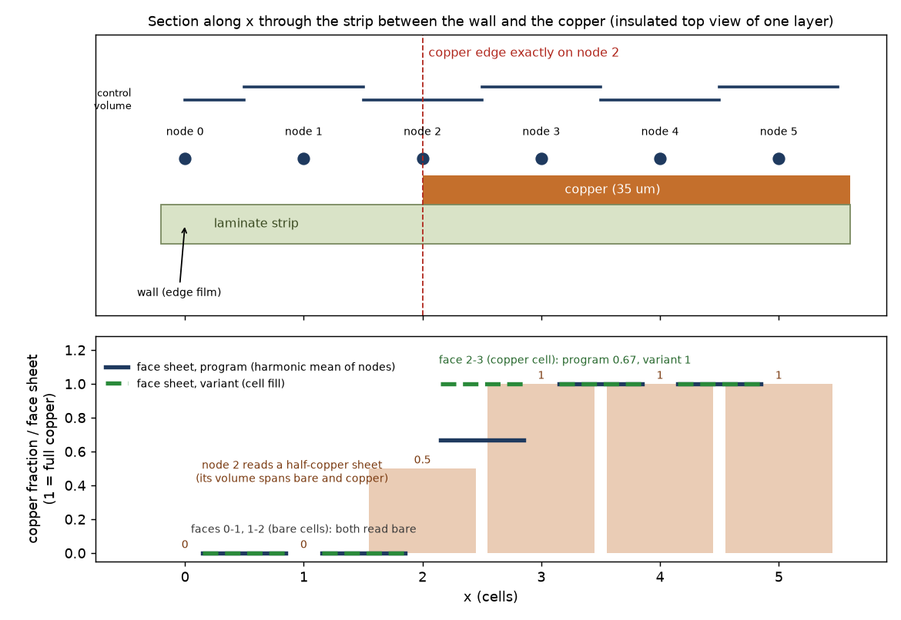
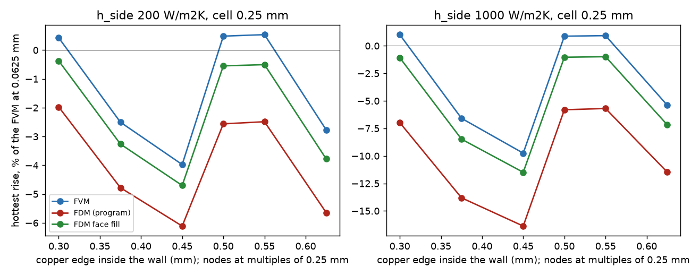
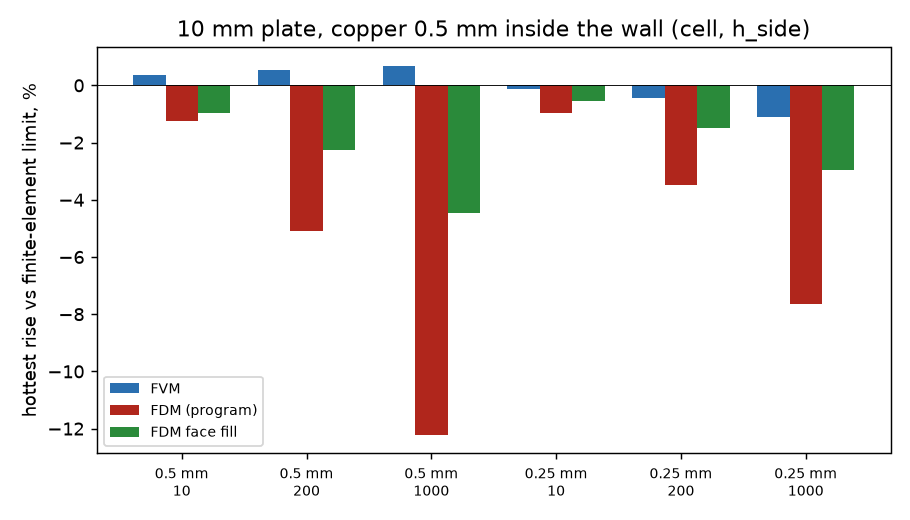
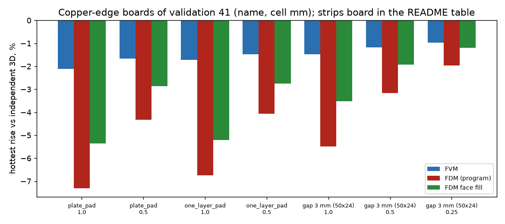

# FDM and a copper edge held inside the board

## 1. Question

A finite-element comparison (`tmp/fem/REPORT.md` 3, local, under review) found that the FDM (harmonic face mean, the default of 2.7.0) reads a copper edge that stops
INSIDE the outline 2 to 3 times colder than the FVM: -7 / -14 % (20 mm square, copper 1.2 mm in, 200 / 1000 W/m2K, 1 mm cell), -7 / -16 % (disc), -5 / -10 % at 0.5 mm,
the via effect 4 to 16 % low, and on the 10 mm plate with the copper 0.5 mm in the wall -1.0 % already at 10 W/m2K and -7.6 % at 1000 (FVM -0.1 / -1.1 %).
The earlier FDM review (`docs/validation.md` 41, 41.1) judged the harmonic mean against the FVM at 0.25 mm and the independent 3D solver and found it better everywhere
it looked, and left "the residual -2 to -7 % ... the first-order error of a node-centred scheme with the copper edge between nodes (not fixed here)". This folder finds
which term that is and measures the smallest correction. The program is not touched: every variant is a copy built from the source text of `pcbthermal/fdm.py`
(`lib/fdm_variant.py`).

*Figure 1 (`fig_01_copper_edge_between_nodes.png`): section through the strip between the wall and the copper; the control volumes of the nodes, the half-copper sheet that
node 2 reads, and the sheet that the face between two nodes reads in the program and in the variant (made by `scripts/make_diagrams.py`).*

## 2. Method

References: the finite-element limits of `tmp/fem/REPORT.md` (quoted, not re-run: plate 53.406 / 41.826 / 33.906 K and square 124.551 / 57.201 / 38.972 K at 10 / 200 / 1000
W/m2K), the FVM at 0.0625 mm where no limit exists, and the independent 3D solver `tests/helpers/layered3d.py` at the same cell (as validation 41). Boards: the 10 mm
four-layer plate of `research/strong-edge-laminate` (copper inset 0 to 0.625 mm) and the 20 mm two-layer square, here kept ALIGNED with the grid and run as a plain
rectangle and as the same rectangle with an explicit outline (separating the plain edge from the outline cut-cell treatment). Scripts: `study_cause.py` (tables 3 and 4),
`study_independent_3d.py` (5), `study_harness_shift.py` (6). All runs under 1 GB, cells 0.25 mm or more (FVM reference 0.0625 mm on the 10 mm plate only).

## 3. The cause

The FDM took the copper fill of a node as the covered share of its control volume (`_node_average` of the cell fills) and joined two nodes by the harmonic mean of the two
nodal sheets. A copper edge that falls on a node (or anywhere in the cells around it) leaves that node with a half-copper sheet; the face on the copper side then reads
`2 x 0.5 x 1 / 1.5 = 0.67` of the copper sheet instead of 1 (the cell between the two nodes is entirely copper), and the bare side keeps a node with copper it does not have.
The copper edge is blurred over a cell and the first copper link is weak, so the board spreads the heat less (Figure 1).

### 3.1 Which term (plate, copper 0.5 mm inside, cell 0.25 mm, hottest rise, % of the finite-element limit; `study_cause.py A`)

| h_side | FVM | FDM (program) | FDM faces from the cell fill | the same, laminate rule at 1 sub-gap: FVM / FDM / face | at 8 sub-gaps: FVM / FDM / face |
| --: | --: | --: | --: | :-- | :-- |
| 10 | -0.11 | -0.97 | -0.56 | -0.53 / -1.25 / -0.81 | +0.30 / -0.67 / -0.41 |
| 200 | -0.45 | -3.47 | -1.48 | -1.93 / -4.79 / -2.40 | +0.99 / -2.13 / -0.98 |
| 1000 | -1.09 | -7.65 | -2.97 | -4.25 / -10.86 / -4.99 | +1.91 / -4.53 / -1.92 |

At 0.5 mm: FDM -1.26 / -5.09 / -12.21 %, face fill -0.95 / -2.28 / -4.45 %, FVM +0.35 / +0.54 / +0.69 %.

Controlled experiments (each a copy of `fdm.py` with one term changed):

| term | result | verdict |
| :-- | :-- | :-- |
| nodal copper fill and the harmonic mean at the copper edge | faces built from the cell fill (cell between two nodes is uniform along the face) take the aligned inset from -12.2 / -7.65 % to -4.5 / -3.0 % (1000 W/m2K, 0.5 / 0.25 mm) and the 20 mm square (copper 1.2 mm in, edge on a node, 0.6 mm) from -3.1 / -6.1 % to -1.2 / -2.3 % (200 / 1000) | **the cause**: 50 to 77 % of the gap to the FVM |
| film switched off (h_side 0.001, the edge term alone) | FDM -0.55 %, face fill -0.21 %, FVM +0.20 % (against the FVM at 0.0625 mm) | the copper-edge term is there without any film; the film only makes it matter (the gap grows with the film because the heat that cannot spread is lost at the wall) |
| laminate rule (sub-gaps 1, 2, 8) | the FDM-to-FVM gap is 2.9, 3.0, 3.1 points at 200 W/m2K (1, 2, 8 sub-gaps) | not the cause |
| edge film on the laminate nodes, half-volume edge nodes, corner nodes | copper to the wall with ONE sub-gap: FDM = FVM to 0.1 point (-10.34 / -10.28 % at 1000 W/m2K, 0.25 mm); with more sub-gaps the FDM converges from the cool side to the limit (-1.10 % at 8 sub-gaps and 0.125 mm) while the FVM overshoots (+2.0 % at 8 sub-gaps and 0.25 mm: the half-cell film) | not defects of the FDM; the FDM at the wall is the better of the two |
| outline cut-cell cover | aligned square as a plain rectangle and as an explicit outline: FDM -3.13 / -3.25 %, face -1.15 / -1.27 % (200 W/m2K, 0.6 mm); -6.10 / -6.28, -2.25 / -2.43 (1000) | not the cause (0.1 to 0.2 point) |
| via edge image | the image acts only in the FVM, but switching it off in the FVM changes the via effect by 0 to 6 points (0.16 mm from the wall) and by 0 at 3 mm; the FDM via error at 3 mm (-3.6 / -9.9 % at 0.25 mm) is the base field being colder (E scales with the rise) | not the cause of the via numbers; they follow the copper-edge and wall terms |

What the variant does NOT remove, stated: the plate with the copper to the wall (FDM -1.10 % at 200 and -5.13 % at 1000 W/m2K, 0.25 mm, identical with the variant) is the
laminate-sub-gap limit shared with the FVM (see the row above) and the via effect at 1000 W/m2K stays 10 to 16 % low at 0.25 mm. The remaining inset gap of the variant
to the FVM (1 to 2 points) is that same wall term.

### 3.2 The position of the copper edge (cell 0.25 mm, error against the FVM at 0.0625 mm; `study_cause.py D`)

| inset mm | 200: FVM / FDM / face | 1000: FVM / FDM / face |
| --: | :-- | :-- |
| 0.300 | +0.43 / -1.97 / -0.37 | +1.02 / -6.97 / -1.08 |
| 0.375 | -2.50 / -4.78 / -3.26 | -6.58 / -13.81 / -8.48 |
| 0.450 | -3.97 / -6.11 / -4.70 | -9.75 / -16.37 / -11.49 |
| 0.500 | +0.49 / -2.56 / -0.55 | +0.88 / -5.81 / -1.03 |
| 0.550 | +0.54 / -2.49 / -0.50 | +0.93 / -5.69 / -0.99 |
| 0.625 | -2.77 / -5.65 / -3.78 | -5.39 / -11.47 / -7.17 |

*Figure 2 (`fig_02_error_against_edge_position.png`): the same numbers; the FVM itself scatters by 4 to 11 points with the edge inside a cell (the cut cell mixes copper and bare
by area), the FDM is 2 to 7 points cooler everywhere, the variant 0.7 to 2.1 points cooler than the FVM.*

The scatter of the FVM when the edge falls inside a cell is a limit of the cell-centred scheme (validation 40, 43) and is not touched. The variant stays on the same side
and 1.3 to 5 times closer to the FVM than the program at every position.

### 3.3 The 20 mm square, aligned (heater mean, % of the finite-element limit; `study_cause.py C`)

| h_side, cell | FVM | FDM | face fill |
| :-- | --: | --: | --: |
| 200, 0.6 | -0.56 | -3.13 | -1.15 |
| 200, 0.4 | -0.97 | -3.40 | -1.86 |
| 1000, 0.6 | -1.05 | -6.10 | -2.25 |
| 1000, 0.4 | -1.76 | -6.17 | -3.23 |
| 200, 0.5 (edge mid-cell) | -2.90 | -5.56 | -4.08 |
| 1000, 0.5 (edge mid-cell) | -5.37 | -10.35 | -7.35 |

The ten turned and shifted boards of `tmp/fem/REPORT.md` 3(c) (not rebuilt as a whole: the first column of `study_cause.py` reproduces the report's -6.97 / -14.23 % at 1 mm):
mean error 1 mm / 0.5 mm, 200 W/m2K: FDM -6.97 / -4.89, face fill -5.77 / -3.77; 1000: FDM -14.23 / -9.12, face -11.99 / -6.86 (FVM -3.07 / -2.68 and -5.53 / -4.68); copper to the
wall unchanged within -0.4 point (-1.62 to -1.78, -4.36 to -4.76 at 1 mm): a turned slanted edge inside a cell leaves most of the gap, because the cell fill of a cut cell is
the same blur. **The variant is not a full cure there** (it removes 1.2 and 2.3 of the 4 and 8 points).

*Figure 3 (`fig_03_inset_plate_against_fem.png`): table 3.1, shipped laminate rule.*

## 4. The smallest correction

`face_fill` (about 25 lines in `fdm.Network.__init__`, no change of the unknowns, the matrix pattern, the capacities, the sources or the vias):

* keep the nodal fill for everything nodal (capacity, vertical links, top and bottom film, via sheets, laminate rule);
* for the in-plane face of a COPPER layer take the sheet from the copper fill of the CELLS the face runs through: `S_face = (A_face + B x f_face) x (mean cover)`, with `B = (k_cu - k_lam) t_cu`,
  `A` the nodal sheet with no copper (after the rule), `f_face` the average of the two cells flanking the face (one at the board edge);
* faces of the laminate nodes, imported-copper faces and boards with a metal block keep the earlier code (the variant applies only with the laminate rule and drawn copper).

Properties checked (`tests/test_variant.py`, 8 passed): the switchless copy of the source is the program bit for bit; uniform copper is bit-identical; the matrix is symmetric to
1e-12, no positive off-diagonal, balance below 1e-9; the copper-to-the-wall plate moves less than 1e-3 K; the plate error against the finite-element limit lies in the measured
band; the gap board stays below the independent solver and closer to it.

## 5. Against the independent 3D solver (validation 41 boards, same cell, hottest rise; `study_independent_3d.py`)

| board | cell mm | FVM % | FDM % (program) | face fill % |
| :-- | --: | --: | --: | --: |
| plate_pad | 1 / 0.5 | -2.12 / -1.66 | -7.31 / -4.32 | -5.36 / -2.86 |
| one_layer_pad | 1 / 0.5 | -1.73 / -1.48 | -6.75 / -4.07 | -5.20 / -2.75 |
| 3 mm gap (50 x 24 mm) | 1 / 0.5 / 0.25 | -1.48 / -1.18 / -0.97 | -5.49 / -3.17 / -1.96 | -3.52 / -1.92 / -1.20 |
| strips 2 / 2 (40 x 20 mm, own geometry) | 1 / 0.5 / 0.25 | -11.77 / -9.58 / -8.22 | -33.63 / -23.43 / -15.89 | -23.05 / -15.00 / -10.37 |

The first three rows reproduce the numbers of validation 41 for the FVM and the FDM to the digit; the variant is cooler than the reference in every row (it never overshoots) and closer in
every row. The strips board is this study's own geometry (the one of validation 41 was not found), so only the variant-against-program difference is comparable.

*Figure 4 (`fig_04_against_independent_3d.png`): table 5.*

## 6. What would move (harness boards, FDM, `study_harness_shift.py`)

Hottest rise, shift of the variant against the program, in K at 2 / 1 / 0.5 mm (FDM above 120 000 unknowns not run: `example_board`, `profile_board`, `example_cut_to_T` at 0.5 mm, an unverified
gap):

| board | shift |
| :-- | :-- |
| plate_pad | +8.19 / +6.55 / +4.81 K (+2.7 / +2.1 / +1.5 % of the rise) |
| one_layer_pad | +1.00 / +1.08 / +0.91 K (+1.6 / +1.7 / +1.4 %) |
| two_layer_partial | +0.117 / +0.393 / +0.314 K (+0.09 / +0.29 / +0.23 %) |
| part_top_path | +0.128 / +0.249 / +0.212 K (+0.27 / +0.51 / +0.44 %; the part mean -0.4 to -0.8 %) |
| example_board, profile_board | -0.0095 K at 2 mm, +0.0077 K at 1 mm (about 0.02 %) |
| example_cut_to_T | -0.0104 / +0.0083 K at 2 / 1 mm |
| t_outline, part_across_outline, round_outline, plate_vias, plate_lone_via, reference_board | 1e-5 to 2.6e-3 K |
| plate_uniform, one_layer_full, finned_block, hatched_copper | 0 |

36 of the 48 steady runs moved by more than the 1e-8 K tolerance of the frozen test (the 12 that do not are the four uniform or metal-block boards and `hatched_copper`). The tiny moves on full-copper boards come
from the laminate band of the edge (the cell fill of the cut cells). All four large rows go the same way as the independent comparison (hotter, closer): `plate_pad` -7.31 to -5.36 % at 1 mm.
Balance of every run below 1e-11 (relative to the power). The times to 63 % and the profile curves (which use the same `Network`) were not measured.

## 7. Limits

* The variant removes 50 to 77 % of the FDM-to-FVM gap for a copper edge on or near a node, 1.2 of 7 points (200 W/m2K) on turned slanted edges at 1 mm; after it the plate with the copper inset stays 1.5 / 3.0 % cool at 200 / 1000 W/m2K (0.25 mm; the aligned square 1.2 to 3.2 %) and the via effect 10 to 16 % low, set by the wall (laminate sub-gaps) term of the FDM and by the cut-cell mixing of a copper edge inside a cell.
* No FDM change touches the half-volume nodes, the film or the outline cover (shown not to be the cause).
* The finite-element limits are quoted from a report that is itself under review.

## 8. What was read and what was not verified

* Read in full: `tmp/fem/REPORT.md` section 3 (tables 3(a) to 3(d)), `pcbthermal/fdm.py`, `docs/validation.md` 41, 41.1, 41.2, `tests/test_fdm_harmonic_face.py`, `viawell.py` (edge image condition), `laminate.py` (`build`, `plan_gaps`).
* Re-run here: every number of tables 3.1 to 6 (scripts above), the report's FDM/FVM numbers for the plate and the square reproduced to the digit; NOT re-run: the finite-element limits (quoted), the full ten-board turned-square set with the variant (done through `tmp/fem`-style builders of `research/imported-copper-edge-film`, mean and worst only, see 3.3), the disc and the T with the variant, the via effect with the variant (equal to the program: it changes only the copper faces; the via effect with the variant read 5.4 / 3.6 / 15.5 / 9.9 % low like the program, which is a base-field effect).
* Not verified: time to 63 % and profile curves with the variant, the harness FDM at 0.5 mm for the three 150 000-unknown boards, imported copper, boards with a metal block (the variant leaves them as they are by construction), several parts, the disc.
* Base: `develop` at the commit this branch starts from (57a28951); `develop` may have moved since.
