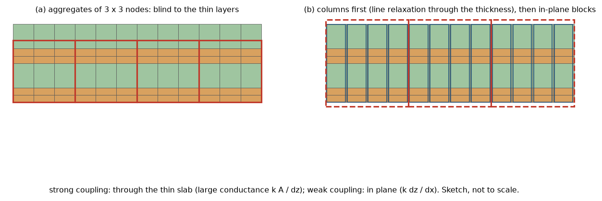
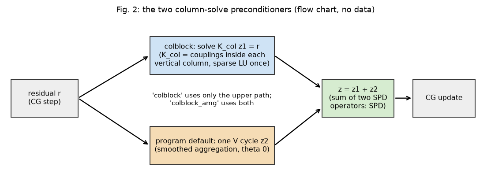
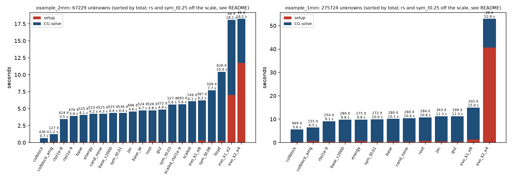
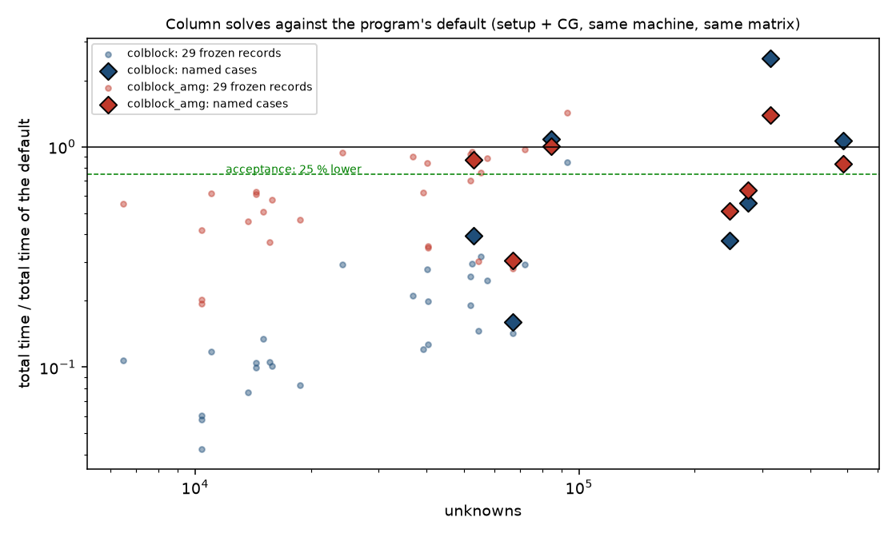

# fem-amg-thin-layers: a cheap AMG for the thin, anisotropic layers of the FEM

**State: run by the executor, NOT yet reviewed.** Tree: `development` 6c225276 plus this branch; reference: the current default of `femcore.Model.solve` (smoothed aggregation, theta 0, V cycle, CG 1e-10); one machine (the maintainer's, shared, `nice 10`), pyamg 5.4.1. Numbers of sections 1 to 4 that are quoted from `releases/2.8.0/fem-model/REVIEW_SPEED.md` are marked there; section 7 holds what was measured here. The conclusions are the executor's reading, for the reviewer to check.

## 1. Question

The finite-element solve (`pcbthermal/femcore.py`, `Model.solve`) above the direct limit is conjugate gradients preconditioned by pyamg smoothed aggregation with
`strength=("symmetric", {"theta": 0.0})`, `max_coarse=200`, V cycle. On the example board at 1 mm (276 000 unknowns) it needs **331 iterations** (70 % of a 15 s run; REVIEW_SPEED, D.2). The reviewer
measured that `strength="evolution"` cuts them to **28 to 34** but its setup costs **37 to 45 s** against 14.5 s of solve, so the total gets worse.

**Can a cheap variant (pyamg only, MIT, no new dependency, all platforms) make the whole solve (setup + CG) faster on thin, strongly anisotropic layered meshes, with the same field?** Why it matters: the
solve is the biggest cost of a FEM run, the memory guard and the 2.8.0 cap are set by it, and the transient FEM repeats solves with one matrix.

*Figure 1 (figures/fig_01_thin_layer_coarsening.png, made by scripts/make_diagrams.py, made by scripts/make_diagrams.py): the thin copper slabs couple strongly through the thickness and weakly in the plane; an aggregation that ignores this (a) mixes the two, columns first (b) respects it. Sketch, not to scale.*

## 2. Hypotheses (to be tested, none is a finding)

* H1. `theta = 0.0` calls **every** link strong, so the aggregation cannot see the 1:30 element aspect ratio of a 35 um slab under a 1 mm cell; a small positive theta (0.01 to 0.25) may recover most of the evolution gain for free (the setup of 'symmetric' is cheap: 0.07 to 6 s in the reviewer's table).
* H2. A smoother that relaxes the strongly coupled direction (block Gauss-Seidel on the columns) or two sweeps may cut iterations at modest cost; needs the column ordering of the nodes.
* H3. Evolution with k = 1 and a coarser epsilon may keep most of the iteration gain at a fraction of its setup (reviewer: k 2, epsilon 4 gave 28 iterations for 40 to 45 s: the setup did not shrink with those two knobs).
* H4. The setup can be amortised: the matrix does not change with the power (any number of right-hand sides), changes little with the films (computed-h loop) and is K + M/dt in the transient. A stale or reused hierarchy stays a valid SPD preconditioner for CG, so even an expensive evolution setup may pay.
* H5. A cheaper preconditioner than AMG (ILU, column block-Jacobi) is only a baseline; expected worse in iterations on 276 000 unknowns, to be shown.

## 3. Boards and metrics

| Case key (`lib/cases.py`) | What | Unknowns (expected) |
| :-- | :-- | :-- |
| `example_1mm`, `example_2mm` | `examples.example_board()` at 1 mm and 2 mm | 276 000 (reviewer), about 40 000 |
| `plate_vias_1mm` | frozen board `plate_vias` (2 layers, 4 x 4 vias) | to be printed |
| `case2_plate_1mm` | Muzychka case 2: 50 x 50 x 10 mm, k 150 (the matrix that needs the restart) | up to 828 000 at refinement 4 (REVIEW_BRANCH4 4.2); 1 mm default to be printed |
| `thin4_1mm` | plain 4-layer 100 x 80 mm, 35 um copper, one part | to be printed |
| `big_cap` | example board at the cell whose unknown count is nearest below 800 000 (the program's FEM cap is set by the memory guard, `femmesh.unknowns`) | about 800 000 |
| the 29 frozen records | `tests/regression/data/pending/fem-records.json`, keys `board|fem|cell` | robustness only |

Metrics per (case, variant), printed by `scripts/study_amg_variants.py`: CG iterations (both passes if the program's restart fires), setup seconds, solve seconds, **total**, operator and grid
complexity (hierarchy memory proxy), peak resident GB of the child process, true relative residual, and the largest difference to the base solution in K.

**Acceptance rule (maintainer's):** total time at least **25 % lower** on the cap-size boards (`big_cap`, `case2_plate_1mm`, `example_1mm`), with no loss of robustness (all 29 frozen FEM records still
converge and case 2 at 828 000 unknowns solves) and the read-outs identical within **1e-8 K** of the current default. Also required: a peak below 4 GB per run; a result that does not repeat to
1e-8 K between two runs of the same variant is rejected (some pyamg measures use random vectors; the frozen numbers must stay frozen).

## 4. Experiments in order (cheapest first)

Each family runs on `example_2mm` first (seconds), then `example_1mm`; only the best two or three variants go to the large cases and to the 29 records.

| # | Experiment | Variants (`lib/variants.py`) | Why first / what decides |
| :-- | :-- | :-- | :-- |
| E0 | Reproduce the baseline | `base` | iterations 331 and 15 s on `example_1mm`, or the study is not comparable (reviewer's numbers are one machine) |
| E1 | Strength threshold | `sym_t0.01`, `0.03`, `0.08`, `0.25` | one parameter, same setup cost; tests H1 |
| E1b | CG tolerance | `rtol` 1e-8, 1e-9 with the true-residual check | free; keep only if the field stays within 1e-8 K |
| E2 | Smoothers | `gs2`, `jac` and, if the node ordering allows columns of equal height, block Gauss-Seidel by column (to be written after reading the ordering of `femmesh`; unused nodes make columns irregular) | tests H2 |
| E3 | Prolongation smoothing | `energy` (reviewer: 275 its, 0.5 + 9.5 s), no smoothing (487 its) | already measured at theta 0; repeat with the best theta |
| E4 | Aggregation | `lloyd`, `pairwise`, `naive` | cheap setups |
| E5 | Cheaper evolution | `evo_k1_e2`, `evo_k2_e4`, `evo_k1_e8` (proj_type variants if pyamg offers them) | H3; stop here if setup stays above 25 s |
| E6 | Other AMG families | `rs` (classical Ruge-Stueben), `root` (root-node) | whether classical coarsening sees the anisotropy by itself |
| E7 | Cycle and coarse level | `base_W`, `base_c2000`, `max_levels` | small knobs |
| E8 | Reuse of the hierarchy | `scripts/study_hierarchy_reuse.py`: same matrix with other sources; stale hierarchy with films x0.5 to x2; K + D (transient) | H4; this can make even `evo` worthwhile, a different acceptance (per solve of a series) is then stated in section 6 |
| E9 | Scaling | symmetric diagonal scaling D^-1/2 A D^-1/2 before CG; then the strength measure sees a unit-diagonal matrix | cheap; may be neutral |
| E10 | Baselines | `scipy.sparse.linalg.spilu` preconditioner, column block-Jacobi | context only, small cases |
| E11 | Near-null space | candidate vectors, `improve_candidates` (reviewer: no gain) | last; scalar diffusion has the constant as null space |
| E12 | Robustness and repeat | `scripts/study_frozen_robustness.py` for the best variant; two repeats for bitwise or 1e-8 K determinism; case 2 at 828 000 | decides the acceptance |

**Stopping criteria.** After E1 to E6, if no variant is at least 10 % better in total than `base` on `example_1mm`, close with a negative result (a documented "no cheap variant", the evolution row
quoted) and go to E8 only (reuse), which does not depend on the variant. A variant that fails one frozen record, needs more than 4 GB or differs by 1e-8 K or more is dropped at once.

## 5. Scripts

| Script | Purpose | Cost (estimate, not measured) |
| :-- | :-- | :-- |
| `scripts/study_amg_variants.py` | (case, variant) matrix, child process each, resumable log `out/variants.jsonl`, table | 5 to 60 s a run on the small cases, 2 to 6 min on the large; about 40 variants x 3 small cases = 40 min; 6 variants x 3 large = about 1 h |
| `scripts/study_extras.py` | E1b, E9, E10, E11 and the column solves, `out/extras.jsonl` | 1 to 60 s a run |
| `scripts/study_repeat.py` | determinism of two runs of a variant | seconds |
| `scripts/make_figures.py` | figures 3 and 4 from `out/` | seconds |
| `scripts/study_frozen_robustness.py` | base against a candidate on the 29 frozen records | 5 to 10 min per candidate |
| `scripts/study_hierarchy_reuse.py` | E8 | 10 to 20 min |
| `scripts/make_diagrams.py` | figure 1 | seconds, no program |
| `tests/test_amg_variants.py` | tiny thin-layer system: every accepted variant reaches the direct solution, restart logic, hierarchy reuse | under a minute (tiny) |

Total, if every family runs: 2 to 3 hours of machine time, one job at a time under the lock `mkdir <scratchpad>/heavy_lock`, each job below 4 GB. These are estimates from the earlier timings, not runs.

## 6. Risks

* **Platform differences**: pyamg wheels are compiled C++ without OpenMP; the iteration counts may differ slightly across platforms and Python/NumPy versions (aggregation uses ties and, in some measures, random vectors). The acceptance (1e-8 K) is designed to tolerate this; a second platform run is requested from the maintainer, not done here.
* **Hierarchy memory**: operator complexity above about 1.6 at 800 000 unknowns would add to the peak that the memory law (`memory.py`) prices; the complexity is printed for every run. A variant that raises the peak changes the guard's law: part of the INTEGRATION.
* **Parameter names**: written from the pyamg documentation as remembered; the first run checks them against the installed 5.4.1, and a refusal is recorded.
* A variant that wins on thin boards but loses on 3D-ish cases (case 2, 10 mm thick) is a trade-off, not a fix; the rule is the cap-size boards without a loss on the others.
* Reuse (E8) is valid for CG for any matrix, but a stale hierarchy can cost iterations; measured, not assumed.

## 7. Results

All times are wall seconds of one process on a shared machine (load 1.5 to 3.3 during the runs): differences of a few percent are not significant, there is one run per cell unless stated. "total" is hierarchy setup plus CG; the assembly is not included. "dT" is the largest difference of the unknown vector (rise in K) to the field of the `base` run of the same case, made in the same study; the reference field of the program itself (`Model.solve`) differs from `base` by 1.7e-10 K, so the pyamg runs do not repeat bitwise (7.5). Every run below printed a true relative residual of at most 7.2e-10.

### 7.1 E0: the default is NOT reproduced as 331 iterations

`Model.solve(force='cg')` of the program on `example_1mm` (275 724 unknowns, not 276 000): **280 CG iterations**, 9.67 s in CG, 11.2 s the whole solve with assembly, balance 1.000000000003, residual 2.3e-10 (this study, script of the session, wrapper counting the calls of `spla.cg`). The study's `base` run: 280 its, 0.51 + 9.64 s. The 331 of the reviewer's table is therefore not reproduced on this tree and machine (cause not investigated: another tree or another mesh option of that measurement is possible). All ratios below are against the 280 / 10.15 s measured here. `example_2mm` has 67 229 unknowns (the plan said about 40 000).

### 7.2 E1 to E7 on the example board

| Variant | what | 2 mm its | 2 mm setup | 2 mm solve | 2 mm total | 1 mm its | 1 mm total | op. complexity (2 mm) |
| :-- | :-- | --: | --: | --: | --: | --: | --: | --: |
| base | program default | 525 | 0.07 | 3.99 | 4.06 | 280 | 10.15 | 1.04 |
| sym_t0.01 | theta 0.01 | 536 | 0.08 | 4.28 | 4.36 | 272 | 9.97 | 1.06 |
| sym_t0.03 | theta 0.03 | 527 | 0.11 | 5.50 | 5.61 | | | 1.17 |
| sym_t0.08 | theta 0.08 | 509 | 0.18 | 7.51 | 7.69 | | | 1.37 |
| sym_t0.25 | theta 0.25 | 372 | 0.81 | 31.35 | 32.15 | | | 4.41 |
| gs2 | 2 symmetric GS sweeps | 372 | 0.07 | 4.79 | 4.86 | 199 | 11.30 | 1.04 |
| jac | weighted Jacobi x2 | 696 | 0.11 | 4.47 | 4.58 | 363 | 11.29 | 1.04 |
| energy | energy-minimising prolongation | 523 | 0.13 | 4.12 | 4.24 | 275 | 9.82 | 1.04 |
| lloyd | Lloyd aggregation, theta 0.03 | 626 | 0.23 | 10.21 | 10.44 | | | 1.42 |
| pairwise | pairwise aggregation | refused by pyamg 5.4.1 (`TypeError: expected csr_array for argument AggOp`, also with csr_array input) | | | | | | |
| evo_k1_e2 | evolution k 1 eps 2 | 46 | 7.00 | 11.09 | 18.09 | | | 12.19 |
| evo_k2_e4 | evolution k 2 eps 4 | 46 | 11.76 | 6.48 | 18.24 | 28 | 52.93 (40.68 + 12.25) | 6.36 |
| evo_k1_e8 | evolution k 1 eps 8 | 387 | 0.28 | 5.95 | 6.23 | 202 | 14.97 | 1.37 |
| rs | classical Ruge-Stueben | 3992 | 0.11 | 41.85 | 41.96 | | | 1.68 |
| root | root-node | 526 | 0.19 | 4.57 | 4.75 | 284 | 10.81 | 1.07 |
| base_W | W cycle | 524 | 0.08 | 4.67 | 4.75 | | | 1.04 |
| base_c2000 | coarse level up to 2000 | 525 | 0.08 | 4.27 | 4.35 | 280 | 9.80 | 1.04 |

(`rs` also printed "Inner denominator was zero." from pyamg; it converged to a true residual of 7.2e-10.) Reading: **no variant is faster than `base` by 10 % on `example_1mm`** (best: `energy` 0.97 and `base_c2000` 0.97 of the base total, inside the noise); the stopping rule of section 4 is met for E1 to E6. The hierarchy of `base` has operator complexity 1.04 and three levels: theta 0 makes huge aggregates, so a V cycle costs about 7.6 ms at 67 000 unknowns, against 140 ms for `evo_k2_e4` (6.36) . Every variant that sees the anisotropy (theta 0.25, evolution) cuts the iterations (372, 46) but pays more than it gains per cycle (H1 and H3 rejected on this board; the reviewer's observation that evolution's setup does not shrink with k and epsilon is confirmed, 7.0 to 11.8 s at 67 000 unknowns, 40.7 s at 276 000, and the first knob that shrinks the setup, epsilon 8, loses the iteration gain). H2: two sweeps cut iterations by 29 % at 2 mm and 29 % at 1 mm but add cost, total 1.20 and 1.11 of base. E3 repeated at theta 0: no gain. E7: the W cycle does nothing (iterations 524), a larger coarse level 0.97 to 1.07.

### 7.3 E1b, E9, E10, E11 (`study_extras.py`, example board)

| Extra | 2 mm its / total s / dT K | 1 mm its / total s / dT K | Verdict |
| :-- | :-- | :-- | :-- |
| CG tolerance 1e-8 | 424 / 3.47 / **1.5e-8** | not run | rejected: the field moves by more than 1e-8 K |
| CG tolerance 1e-9 | 476 / 3.91 / 1.4e-9 | 254 / 9.13 / 1.6e-9 | field within 1e-8 K; saves 4 % (2 mm) and 10 % (1 mm), one run each; a possible free gain, not a structural one; the program's note (theory 4a) says 1e-10 is what the recursive residual delivers on thick-contrast matrices, so it is the reviewer's decision |
| symmetric diagonal scaling | 749 / 6.08 / 2.3e-10 | not run | worse (the matrix is already well scaled) |
| scaling + tol 1e-9 | 693 / 5.63 / 1.5e-9 | not run | worse |
| `improve_candidates=None` | 525 / 4.26 / 2.4e-10 | 280 / 10.40 / 1.2e-10 | no effect (E11; no other near-null-space vector tried: the matrix is scalar diffusion) |
| ILU (drop 1e-4, fill 10) as CG preconditioner | **5000 its, not converged**, 50.8 s | not run | baseline fails (ILU of an SPD matrix is not SPD in general): H5 confirmed |
| multiplicative column solve + AMG | not converged in 5000 its (res 5.2e-7) | not converged (res 2.0e-2) | rejected: block Jacobi without damping is not a contraction, the symmetric product is not positive definite |

### 7.4 Unplanned: vertical-column solves (`colblock`, `colblock_amg`)

Idea (E2 pursued to its end, and the baseline E10): the strong coupling is vertical, so solve exactly the couplings that stay inside each vertical column of nodes (same x, y; found from the node coordinates), a block-diagonal principal submatrix of the SPD matrix, with one sparse LU. `colblock` uses it alone as the CG preconditioner (always SPD); `colblock_amg` adds the program's V cycle to it (a sum of two SPD operators, SPD). The vertical share of the off-diagonal coupling is 0.24 to 0.29 on every case, so it does not tell the cases apart (measured, not usable as a rule).

*Figure 2 (figures/fig_02_column_preconditioner.png, scripts/make_diagrams.py): flow chart of the two preconditioners.*

| Case (unknowns) | base its / total s | colblock its / total s (ratio) | colblock_amg its / total s (ratio) | dT of both K |
| :-- | :-- | :-- | :-- | :-- |
| example 2 mm (67 229) | 525 / 4.06 | 436 / 0.65 (0.16) | 127 / 1.24 (0.31) | 2.9e-10 |
| plate_vias 1 mm (53 181) | 288 / 1.86 | 726 / 0.73 (0.39) | 227 / 1.63 (0.88) | 3.5e-10 |
| case 2 plate 1 mm (84 375) | 56 / 0.67 | 386 / 0.73 (1.09) | 47 / 0.68 (1.01) | 1.8e-10 |
| thin4 1 mm (246 468) | 278 / 8.51 | 609 / 3.19 (0.37) | 121 / 4.35 (0.51) | 1.1e-10 |
| **example 1 mm (275 724)** | 280 / 10.15 | 969 / 5.62 (**0.55**) | 155 / 6.46 (**0.64**) | 3.7e-10 |
| case 2 plate 0.5 mm (315 375) | 46 / 2.09 | 725 / 5.29 (2.53) | 52 / 2.92 (1.40) | 2.8e-10 |
| **example 0.732 mm (487 048)** | 196 / 12.31 | 1156 / 13.17 (1.07) | 147 / 10.33 (**0.84**) | 1.8e-10 |

*Figure 3 (figures/fig_03_variants_setup_solve.png, scripts/make_figures.py): setup and solve seconds of every converged variant on the example board at 2 mm and 1 mm, iterations and total over each bar.*

The gain is large on thin boards of up to about 300 000 unknowns and disappears or reverses above that or on a thick plate: the iterations of `colblock` grow about 1/h (436, 969, 1156) while the default's do not, and on case 2 (one 10 mm slab, k 150) the default is already good (46 to 56 iterations). `big_cap` was run at 487 048 unknowns, not 800 000: at the 6.8 KB per unknown measured at 276 000 the 800 000 case would need about 5.5 GB, above the 4 GB ceiling given for this study (peak measured at 487 000: 3.04 GB for the default and both variants).

*Figure 4 (figures/fig_04_ratio_vs_size.png, scripts/make_figures.py): total time divided by the default's, the 29 frozen records (dots) and the cases of the table above (diamonds).*

### 7.5 E12: the 29 frozen finite-element records (`study_frozen_robustness.py`, all of them below 500 000 unknowns, run through CG)

| Candidate | records converged | max dT (K) | ratio of total time: median / min / max | records slower than the default | the 11 records with at least 50 000 unknowns: median ratio |
| :-- | :-- | :-- | :-- | :-- | :-- |
| colblock | 29 of 29 | 1.09e-9 | 0.14 / 0.04 / 0.85 | 0 | 0.26 |
| colblock_amg | 29 of 29 | 1.06e-9 | 0.61 / 0.19 / 1.42 | 1 (`part_across_outline` at 0.5 mm, 93 060 unknowns, 2.32 s against 1.63 s) | 0.85 |

Repeatability (`study_repeat.py`, example 2 mm, two hierarchies each): `base` 525 and 525 its, the two fields differ by **4.05e-10 K**; `colblock_amg` 127 and 127 its, 2.43e-10 K; `colblock` **0.00 K** (no random vector: a sparse LU). So the default itself does not repeat bitwise; both are far below 1e-8 K. The 29 records are all small (6 480 to 93 060 unknowns), where the column solve wins most; they say nothing about 300 000 and more, section 7.4 does.

### 7.6 E8: reuse of a hierarchy (`study_hierarchy_reuse.py`, example 2 mm)

Iterations of CG with the hierarchy built once (stale) against a fresh one.

| Change | base (setup 0.07 s) | colblock_amg (0.09 s) | evo_k2_e4 (12.4 s) |
| :-- | :-- | :-- | :-- |
| first solve | 525 | 127 | 46 |
| sources x0.5, x2, x3 (same matrix) | 525 | 127 | 46 |
| films x0.5 / x0.8 / x1.25 / x2, stale | 525 / 525 / 531 / 544 | 129 / 127 / 127 / 127 | 46 / 45 / 46 / 48 |
| same, fresh | 525 / 525 / 524 / 522 | 129 / 127 / 127 / 126 | 46 / 46 / 46 / 46 |
| K + s x mean diagonal, s = 0.01 / 0.1 / 1 / 10, hierarchy of K | 2405 / 2746 / 3047 / 5000 (not converged) | 240 / 624 / 1390 / 2626 | 410 / 891 / 2242 / 5000 (not converged) |

(a) The same matrix with other powers keeps the iterations exactly, as expected. (b) A stale hierarchy after a film change of x0.5 to x2 costs at most 4 % more iterations (544 against 522), so a hierarchy can be kept through the computed-h loop. (c) is an **assumption, not the program's transient**: `femcore` has no mass matrix (the FEM is steady in this tree), so K + s x (mean diagonal) stands for K + M/dt with a made-up scale; the stale hierarchy of K is a poor preconditioner of it for every variant (iterations grow from 1.9 times, colblock_amg at s 0.01, to non-convergence in 5000), so on this evidence a transient would need its own hierarchy, but the real M/dt was not measured. **Reuse does not rescue evolution:** even with a free setup, one evolution solve takes 5.5 s against 4.2 s for the default at 2 mm; and since the default's setup is 0.07 s (1 to 5 % of its total, 0.51 s of 10.2 s at 1 mm) there is nothing to amortise for it. Reuse matters only for an expensive setup, and no variant with an expensive setup wins on a solve.

### 7.7 Acceptance rule (section 3), as measured

| Condition | `colblock` | `colblock_amg` |
| :-- | :-- | :-- |
| at least 25 % lower total on `example_1mm` | yes (0.55) | yes (0.64) |
| at least 25 % lower total on case 2 at 1 mm | **no (1.09)** | **no (1.01)** |
| at least 25 % lower on the largest example board that fits 4 GB (487 048) | **no (1.07)** | **no (0.84; 16 %)** |
| 29 frozen records converge | yes | yes |
| case 2 at 828 000 unknowns solves | **not run** (memory above 4 GB) | **not run** |
| read-outs identical to 1e-8 K (this study compares the unknown vector to the default's, not column, surface and hottest node read-outs) | yes, 1.1e-9 K at most | yes, 1.1e-9 K at most |
| peak below 4 GB | yes (3.04 GB at 487 000) | yes |
| repeats to 1e-8 K | yes (0) | yes (2.4e-10) |

**By the letter of the rule, no variant is accepted.** The gain is real on thin boards up to about 300 000 unknowns and on every record of the 29, but it fails on the thick plate and at the largest board size run. Whether a size- or thickness-based selection rule (for instance the column solve only below a unknown count) is worth proposing is a decision for the maintainer; the data for it are two thick cases and three sizes of one thin board, thin evidence.

## 8. Limits

* One machine, shared with the maintainer (load up to 3.3), one run per cell: ratios inside 10 % are noise.
* Only the unknown vector was compared to 1e-8 K; the column, surface and hottest-node read-outs and the energy balance were compared only for the program's own run (balance 1.000000000003 at example 1 mm), not for each variant (the read-outs are linear in the unknown vector, so a 1.1e-9 K difference of the vector bounds them, but they were not computed). `Model.solve` itself was not modified, the variants were run on the assembled matrix with a copy of its CG and restart logic (`variants.timed_cg`); the restart of the program did not fire in the runs of section 7 (every first-pass residual was below 1e-8, flag `restarted` false).
* The cases above 500 000 unknowns (the program's cap is higher) and case 2 at 828 000 were not run (4 GB ceiling).
* The transient case (E8c) is an assumption. Platform differences were not tested. Case `plate_vias_1mm` was run; boards with blocks and finned parts appear only among the 29 records.
* The `colblock` matrix is built from the node coordinates (columns of equal x, y to 1 nm); a mesh with a column that is not vertical (a slanted outline is refused by the mesher) would need another rule.

## 9. What was read and what was not verified

* **Read in full for this plan:** `pcbthermal/femcore.py` `solve` (lines 352 to 408) and `assemble`, `fem.py` header (steady only; the FEM has no mass matrix in this tree), `releases/2.8.0/fem-model/REVIEW_SPEED.md` table D.2 and `DECISIONS_REVIEWER.md` D (quoted in section 1, not re-measured; the 331 is not reproduced, 7.1), the pyamg 5.4.1 signatures and docstrings of `smoothed_aggregation_solver`, `ruge_stuben_solver`, `rootnode_solver` (checked in the installed package: the parameter names used are accepted, only `aggregate='pairwise'` is refused at run time).
* **Literature: none opened** (status N for all, `docs/bibliography-proposal.md`). The column solve is a line-relaxation idea known for anisotropic problems, but no source was read here for it: its description above is the executor's own, not a published claim. No published case was reproduced; the independent reference of every run is the program's own default (same matrix, same CG), plus the direct solve on the tiny system of the tests.
* **Run:** sections 7.1 to 7.6 (one run per cell); `research/fem-amg-thin-layers/tests` (with `tests/test_docs.py` and `tests/test_license_header.py`: 874 passed, 1 skipped).
* **Not run:** case 2 at 828 000 unknowns; any case above 500 000; a second platform; the surface and column read-outs per variant; the real transient matrix; block Gauss-Seidel by column as a smoother inside the hierarchy (pyamg has no hook for it, would need its own cycle); E11 with extra candidate vectors; the `big_cap` case at 800 000.
