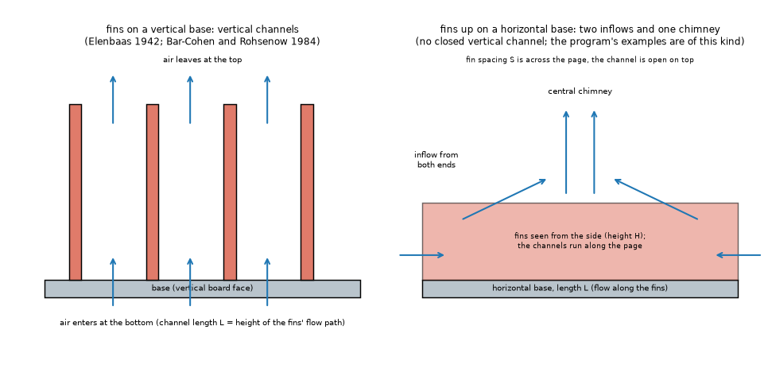
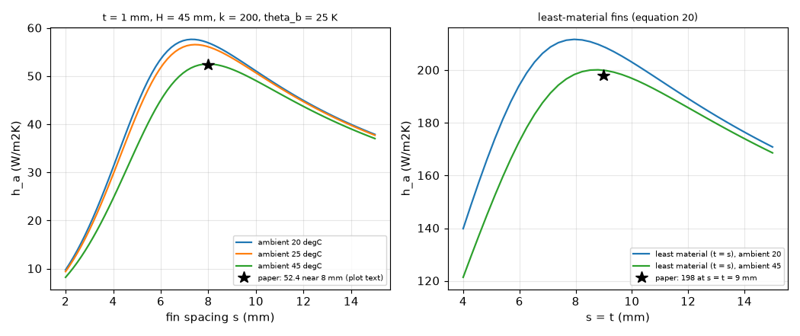
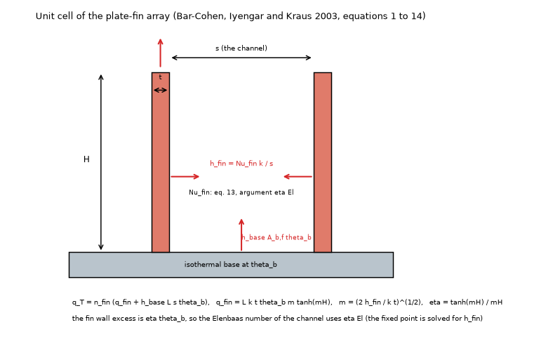
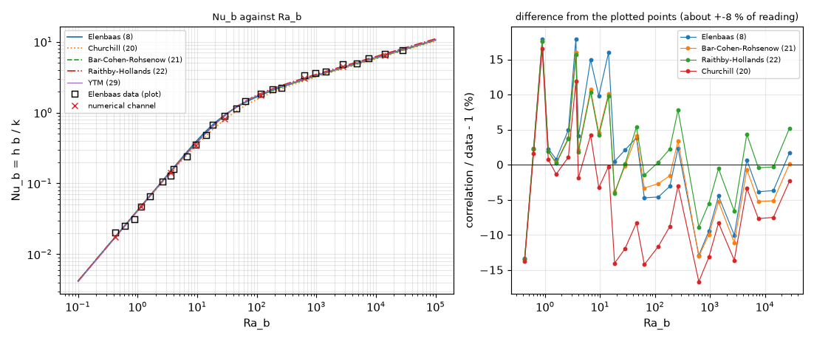
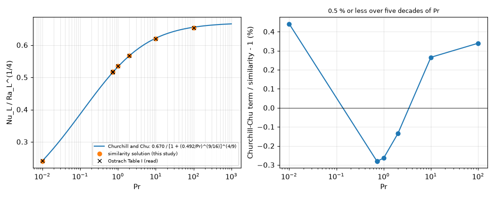
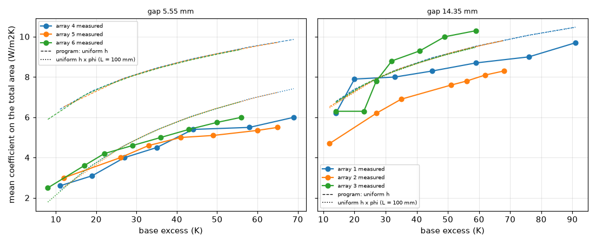

# Sources for the channel effect between close fins (C3, C3a)

Question (`research/ROADMAP.md` C3 and C3a): `research/fin-channel/` read the composite correlations only through the Waterloo review (equations 8, 20 to 22), never opened the originals of Elenbaas (1942) and of Bar-Cohen and Rohsenow (1984), read no experimental fin-array paper in the original, and had no source at all for fins on a **horizontal** base, which is the orientation of the program's examples. This folder hunts for those sources (the originals, then other open papers that print or reproduce them), reads what it obtains, reproduces a published number of each, and says what changes in the conclusions of `fin-channel`.

**Results in short** (the numbers are in the sections named; every number is printed by `scripts/study_source_checks.py`).

* **The two originals were not obtained** (paywalled: Physica 1942 and J. Heat Transfer 1984; no open copy found by the address, the archives or the search). What was obtained instead, and read in full: Yovanovich, Teertstra and Muzychka (2002), which prints Elenbaas's relations and plots his parallel-plate data; Culham, Teertstra and Yovanovich (2000); and Bar-Cohen, Iyengar and Kraus (2003), by the first author of the 1984 paper, which prints the composite correlation with its constants (section 2).
* **The formulas of `fin-channel` match the sources.** Equation 13 of Bar-Cohen, Iyengar and Kraus (576 and 2.873) is equation 21 of the review to 4.6e-5 (`24^2` and `0.59^-2 = 2.8727`); the Elenbaas relation of the review (`1/24`, `35`, `3/4`) is the half-width form of Martin, Raithby and Yovanovich with a boundary-layer limit of 0.600 (printed as 0.6 by Yovanovich and others); the Raithby and Hollands exponent 1.9 and constant 0.62, and Churchill's 1.5, are confirmed (section 3).
* **One discrepancy**: the optimum-spacing constants. Bar-Cohen, Iyengar and Kraus (2003) print `s_opt = 2.66 (...)^(1/4)` and an optimum Nusselt number of 1.25 (attributed to Elenbaas); the constants recomputed from equation 13 are **2.7156 and 1.308** (as in `fin-channel`), and the remembered 2.714 and 1.307 of a lecture note agree with them to 0.06 and 0.08 %. The paper's 2.66 comes from a "recorrelation" it does not show; at the paper's own example it moves the spacing by 2 % (7.67 against 7.83 mm). No other discrepancy of constants, definitions of `Ra_b`, `beta`, the reference temperature or the length was found (section 3).
* **A published array reproduced**: the array coefficient of Bar-Cohen, Iyengar and Kraus (Figure 2: 52.4 W/m2K near 8 mm; Figure 4: 198 W/m2K at `s = t = 9 mm`) is reproduced to **0.2 % and 1.0 %** with a 45 degC ambient (the ambient the paper names for its radiation estimate; with 20 or 25 degC the model is 8 to 10 % and 5 % high), by a model written from its equations (section 4). Its upper bound of 222 W/m2K rests on a reference not read and is not reproduced.
* **Elenbaas's data against the correlations** (26 points, plot values of Figure 11 of Yovanovich and others, +-8 %): the four correlations of the review are within 7.1 to 9.4 % rms of the data (Bar-Cohen and Rohsenow 7.7 %, mean +0.1 %); the independent numerical channel 8.0 %. The data lie 10 to 15 % above the correlations for `Ra_b` of 600 to 3000 (section 5).
* **Ostrach (1953) read and reproduced**: an independent similarity solution (two methods) reproduces Table I of the report to 0.02 % for Pr 0.72, 0.733, 1, 2, 10, 100; the Pr 0.01 row is 0.75 % high in the table (0.0812 against 0.0806 by both methods). The Prandtl function of the laminar term of Churchill and Chu agrees with the exact similarity solution to 0.44 % or better for Pr 0.01 to 100 (section 6; this is the sibling question of the plate level).
* **The horizontal-base question (C3a) has data now**: six measured short arrays (ENCIT 2012, plot values) show that the program's uniform coefficient is **1.85 times too high on the total area for a 5.55 mm gap** (measured / uniform 0.41 to 0.64) and within 8 % on average at a 14.35 mm gap (0.72 to 1.10). The channel fraction `phi` of Proposal B, with the fin length as channel length, brings the prediction to 1.10 times the measurement on average (0.72 to 1.32) at 5.55 mm: used outside its orientation it removes most of the error, without being conservative (section 7).
* **What did not change**: Proposal A (warning on `Ra_b`) and B (the `phi` form) stand as written; the new evidence is for B on a horizontal base and is thin (one paper, six arrays, aluminium, plot values). Nothing was obtained for the open-front arrays at 3 mm of Leung and others.

*Figure 1 (`figures/fig_01_two_flow_topologies.png`). Left: fins on a vertical base, the vertical channels of Elenbaas and of Bar-Cohen and Rohsenow. Right: fins up on a horizontal base, two inflows at the open ends and one central chimney (Harahap and McManus; Tari and Mehrtash); the second is the situation of the program's examples and of the arrays of section 7. Schematic.*

## 1. The sources and how each was found

| Source | Wanted | How found | Obtained | Status |
| :-- | :-- | :-- | :-- | :-- |
| Elenbaas, Physica 9 (1) (1942) 1-28 (plates) | formula, constants, data | search (ScienceDirect, typeset.io, scilit): abstract pages only; the ScienceDirect page returns 403 | no | N |
| Elenbaas, Physica 9 (8) (1942) 865-874 (tubes of several sections) | its relations | printed in Yovanovich and others (2002), equations 7 to 11 and 26 | relations, not the paper | S |
| Bar-Cohen and Rohsenow, J. Heat Transfer 106 (1) (1984) 116-123 | composite constants, optimum, derivation, comparison | search: catalogue records only | no | N |
| Yovanovich, Teertstra and Muzychka, J. Thermophysics Heat Transfer 16 (1) (2002) 116-121 | Elenbaas data, relations | the Waterloo archive `mhtl02-9.pdf` (open) | 6 pages | R |
| Culham, Teertstra and Yovanovich, Electronics Cooling, September 2000 | plate-fin model of the group | the Waterloo archive (`heat_sink_circular-mhtl00-1.pdf`) | 12 pages | R |
| Bar-Cohen, Iyengar and Kraus, J. Electronic Packaging 125 (2) (2003) 208-216 | equation of the composite with constants, optimum spacing, an array case | search (a copy hosted at `files.engineering.com`) | pages 1 to 6 of 9 read, pages 7 to 9 (general optimisation, material table, references) not read | R (pp. 1-6) |
| A course note on natural convection (equation set with `Table 14-1`, author not identified) | the constants 576, 2.873, 2.714, 1.307 | search (`gyansanchay.csjmu.ac.in`) | 2 pages | S |
| Ostrach, NACA Report 1111 (1953) | Table I of the vertical plate | NASA technical reports server | 18 pages (scan; the text layer is unusable: Table I read from the image) | R (Table I) |
| Tari and Mehrtash, Applied Thermal Engineering 61 (2013) 728-736 | horizontal plate-fin heat sinks, upward and downward | the author's page (`users.metu.edu.tr/itari`) | 17 pages (author's copy) | R |
| Tari and Mehrtash, Int. J. Heat Mass Transfer 56 (2013) 574-593 | vertical and inclined, comparison with Leung and Starner-McManus data | the author's page | 38 pages; sections 2.5, 2.6, 3.4 to 3.6 read, the rest searched | R (partial) |
| Da Silva and others, ENCIT 2012, paper 324 | measured horizontal arrays | search (`abcm.org.br`) | 8 pages | R |
| Dogan and Dogan, J. Thermal Science and Technology 37 (1) (2017) 147-157 | measured horizontal arrays, comparison with Tari and Wong and Huang | search (`dergipark.org.tr`) | 11 pages; the introduction, Table 1, section on processing, Figures 10 and 11 and equations 7 to 12 read, the rest searched | R (partial) |
| Leung, Probert and Shilston, Applied Energy 20 (1985) 123-140 and the Leung and Probert series | the arrays of `fin-channel` 4.2, 7 | search: abstracts (PolyU repository, RePEc) | no | S (abstract) |
| Starner and McManus, J. Heat Transfer 85 (1963) 273-278; Harahap and McManus, J. Heat Transfer 89 (1967) 32-38; Harahap and Setio, Applied Energy 69 (2001) 29-38 | fins on a horizontal base | cited by Tari and Mehrtash, Dogan and Dogan; no open copy found | no | N |
| Welling and Wooldridge (1965); Van de Pol and Tierney (1973); Kraus and Bar-Cohen (1995); Incropera and DeWitt chapter 9; Guvenc and Yuncu; Yuncu and Anbar (1998); Wong and Huang (2013); Mobedi and Yuncu; Aihara; Baskaya; Sparrow and Bahrami; Dayan and others; Mittelman and others (2007); Jones and Smith | the rest of the list | search: no open copy, or no record (**Jones and Smith: no record found at all**) | no | N |
| Churchill and Chu (1975); Sparrow and Gregg (1956); Raithby and Hollands (1975 chapter, 1985 handbook) | plate level | search: citation records only (a variable-property report of Gregg and Sparrow is on NTRS, not opened) | no | N |
| Wang and others and the other Waterloo papers `mhtl95-1`, `mhtl91-6`, `mhtl99-6`, `mhtl01-6` | plate-fin and cuboid models | the archive; downloaded, three are scans with no text layer | not read | N |

Downloaded and **not read** (outside this question): Mehrtash and Tari, Applied Thermal Engineering 51 (2013) 1067-1075; a Japanese-language paper of the Hokkaido repository that cites Elenbaas's data (`eprints.lib.hokudai.ac.jp`); Alaaeldin and others (2024), a numerical study of open channels; Jaffer (arXiv 2201.02612; it does not cite Churchill and Chu).

## 2. What the originals could not give, and what stands in for them

* **Elenbaas (1942), plates.** Not opened. Its content reaches this study through four readings: the relation `Nu_b = (1/24) Ra_b [1 - exp(-35/Ra_b)]^(3/4)` (Teertstra review, equation 8); the half-width form of Martin, Raithby and Yovanovich (1991), `Nu = (Ra*/3)[1 - exp(-35/(16 Ra*))]^(3/4)` with the boundary-layer limit 0.60 and data over `0.1 < Ra* < 1e5`; the tube paper's combined relation as printed by Yovanovich and others (2002), equation 11, with exponents satisfying `C2 C3 = 3/4`; and the 26 plotted points of section 5. The algebra that ties the first two is checked here: with `b/2` as length and `Ra* = Ra_b/16`, `Nu_half = Nu_b/2`, so `(Ra*/3)` becomes `Ra_b/24` and `35/(16 Ra*)` becomes `35/Ra_b`. The boundary-layer limit is `35^(3/4)/24 = 0.6001`. **The 1942 paper's own data tables and its definition of the characteristic length were not seen.**
* **Bar-Cohen and Rohsenow (1984).** Not opened. The composite as printed by its first author nineteen years later (equation 13 of the 2003 paper: `Nu_fin = [576/(eta El)^2 + 2.873/(eta El)^(1/2)]^(-1/2)`, `El = g beta theta_b Pr s^4 / (L nu^2)`) is the review's equation 21 with `Ra_b` replaced by `eta El` (the mean fin excess is `eta theta_b`: `fin-channel/lib/channel.py` does the same). The 2003 paper says that the isolated-plate constant `C` has been reported in 0.515 to 0.59 for plates and 0.59 to 0.62 "in widely spaced parallel plate channels" and takes 0.59 (page 209), and that Bar-Cohen and Rohsenow "extended the pioneering Elenbaas correlation to a variety of boundary conditions". **The derivation, the symmetric and asymmetric isoflux cases, the comparison with the data and the optimum spacing equation of the 1984 paper itself were not seen.**
* **The remaining gap** for the originals is only the two papers themselves (citations in the list below, section 9).

## 3. Do the formulas of the review match the originals as far as the sources show?

| Item | `fin-channel` | Source read | Match |
| :-- | :-- | :-- | :-- |
| Elenbaas, constants `1/24`, `35`, `3/4`, `Ra_b` of the gap `b` and length `L` | review eq. 8 | Martin and others (half-width form, algebra above); Yovanovich and others eq. 11 (`C2 C3 = 3/4`) | yes |
| Boundary-layer limit of Elenbaas | 0.5996 (computed) | `0.6` printed (Yovanovich and others eq. 26; Culham and others) | yes (0.600) |
| Bar-Cohen and Rohsenow composite | review eq. 21: 24 and 0.59, `n = 2` | Bar-Cohen, Iyengar and Kraus eq. 13 (576, 2.873); Culham and others "n = 2 (Bar-Cohen and Rohsenow)" | yes, to 4.6e-5 |
| Raithby and Hollands | review eq. 22: `C = 0.62`, `n = 1.9` | Yovanovich and others: "n = 1.9 for the parallel plates" (Raithby and Hollands 1985); `N_Clam = 0.62` for air, equation 14 | yes |
| Churchill (1977) | review eq. 20: exponent 3/2 | Culham and others: "n = 1.5 (Churchill, 1977)" | yes (the printed form was not seen) |
| Channel Rayleigh number | `g beta dT b^4 Pr / (nu^2 L)` | eq. 14 of the 2003 paper (`El`, same group); Culham and others: `Ra*_b = g beta dT b^4 / (nu alpha L)` | yes (`Pr/nu^2 = 1/(nu alpha)`) |
| Reference temperature, `beta` | air at `T_amb + dT/2`, `beta = 1/T_film` | the 2003 paper does not say; the review takes `T_film` and `beta = 1/T_0` | not fixed by any source; the ambient of the 2003 example matters (section 4) |
| Optimum spacing constant, `Nu` at it | 2.7156, 1.308 (derived from eq. 21) | lecture note: 2.714, 1.307; **the 2003 paper: 2.66 and (text) 1.25, "Elenbaas"** | **2.714 and 1.307 agree with the derived values (0.06, 0.08 %); the 2003 values do not (2.0 %, 4.5 %)** |
| Elenbaas's own optimum | `Ra_b` about 50 (Simons) | derived from eq. 8: `K = 2.6027`, `Ra_b = 45.9`, `Nu_b = 1.194` | `Ra_b` is about 46 for the formula, not 54; Simons' "about 50" is between; the "1.25" of the 2003 paper is not the optimum of equation 8 |

The reading of the discrepancy: equation 17 of the 2003 paper is a correlation of the optimum of its own array (it says, on page 210, that changing the isolated-plate constant to 0.515 and "recorrelation of Eq. (17)" gives 2.677), not the optimum of `Nu_b / b^2` of equation 13, which is the quantity `fin-channel` derived and which two other sources reproduce. This is an interpretation: the 2003 paper does not show how 2.66 was obtained.

## 4. The array of Bar-Cohen, Iyengar and Kraus (2003) reproduced

Model written from its equations 1 to 14 (`lib/sources.py: bik_array`): isothermal base, `n_fin = W/(s + t)`, insulated tips and the uncorrected height `H`, `q_fin = L k t theta_b m tanh(mH)`, composite `Nu_fin` of `eta El`, base coefficient `0.59 Ra_L^(1/4) k/L`; `h_a = q_T / (L W theta_b)`. 100 x 100 mm base, `theta_b = 25 K`, `k = 200 W/mK`, fins 45 mm high and 1 mm thick (Figure 2).

| Ambient (degC) | optimum spacing (mm) | `h_a` there (W/m2K) | `h_a(8 mm)` | least material `s = t = 9 mm`: `H` (mm), `h_a` |
| --: | --: | --: | --: | --: |
| 20 | 7.31 | 57.65 | 56.93 | 613, 208.9 |
| 25 | 7.45 | 56.56 | 56.10 | 618, 207.2 |
| **45** | **7.99** | **52.53** | **52.53** | **641, 200.0** |
| paper | about 8 | 52.4 ("approximately", Figure 2) | | 198 (Figure 4, "nearly 198") |

The paper does not state the ambient of Figures 2 and 4; it gives 70 and 45 degC for base and ambient in its radiation estimate (page 213), which is the 25 K excess. With that ambient the reproduction is 0.2 % and 1.0 %; with 20 or 25 degC the model is high by 8 to 10 % and 5 %. This is therefore **a reproduction that fixes an unstated input by choosing the value that fits the 45 degC of another sentence**; it supports the equations (shape, optimum 8 mm, the least-material height from equation 20 and its efficiency 0.6267, which the paper gives as 0.626), not an independent validation of the absolute level. The least-material fin height is 0.64 m for 9 mm fins: a design of the paper, not a heat sink of the program's scale.

*Figure 3 (`figures/fig_03_bik_array_reproduction.png`). `h_a` against the spacing for three ambient temperatures, and the least-material arrays against `s = t`, with the published values (stars). The 45 degC curve passes through both.*

*Figure 6 (`figures/fig_06_array_unit_cell.png`). The unit cell of the array model and its three heat paths. Schematic.*

Also from the same paper: the upper bound of 222 W/m2K for fins of infinite height (reference 24, a Bilitzky and Bar-Cohen work, not read) is **not reproduced**.

## 5. Elenbaas's data against the correlations

Figure 11 of Yovanovich and others plots the parallel-plate measurements of Elenbaas (26 open squares, `Nu_sqrt(A)` against `Ra_sqrt(A) sqrt(A)/L`, the plates treated as a 100:1 rectangle). Converted with the printed factors (`sqrt(A)/b = 10`: `Ra_b = X/1e4`, `Nu_b = Y/10`) and read from a 400 dpi render, **plot values, about +-5 px** (`lib/sources.py: FIG11_PIXELS`), the points span `Ra_b` 0.42 to 2.8e4.

| Correlation | rms difference | mean | `Ra_b < 100` | `Ra_b >= 100` |
| :-- | --: | --: | --: | --: |
| Elenbaas (8) | 8.6 % | +1.2 % | 10.0 % | 6.4 % |
| Churchill (20) | 9.4 % | -5.0 % | 9.1 % | 9.8 % |
| Bar-Cohen and Rohsenow (21) | 7.7 % | +0.1 % | 8.4 % | 6.7 % |
| Raithby and Hollands (22) | 7.1 % | +2.0 % | 8.3 % | 4.9 % |
| Yovanovich and others (29), `n = 2` | 7.0 % | +0.1 % | 7.8 % | 5.8 % |
| numerical channel (9 points) | 8.0 % | -4.5 % | | |

* Yovanovich and others report 6 % rms for their model against the same data; this study gets 7.0 % from the plot, which includes the digitising error.
* The data over `Ra_b < 3` are 0.984 times `Ra_b/24` (6 points) and over `Ra_b > 2000` 0.618 times `Ra_b^(1/4)` (5 points): the two limits of the correlations, within the plot accuracy.
* The model of Yovanovich and others (their equation 29 with `n = 2`, `fRe = 119.56`) is within -1.6 to +1.7 % of equation 21 of the review for `Ra_b` 1e-2 to 1e6: the Waterloo model and the Bar-Cohen and Rohsenow composite are the same curve to 2 %.
* In the range `Ra_b` 600 to 3000 the points lie 10 to 15 % above all correlations (at 626: 3.37 against 2.93); the correlations of the review underestimate the heat of the measured plates there. At the 6.5 mm gap of the program's example (`Ra_b` about 137 at 40 K) the correlations are within 5 % of the data.

*Figure 2 (`figures/fig_02_elenbaas_data_against_correlations.png`). Left: the correlations, the Waterloo model, the independent numerical channel and Elenbaas's points (plot values). Right: correlation over data minus one for the points. The scatter of 10 to 18 % at the lowest `Nu` is the reading error of small values plus the data's own scatter.*

## 6. Ostrach (1953) and the Prandtl function of the vertical plate

Table I of NACA Report 1111 gives the functions `F`, `H` of the similarity solution of the isothermal vertical plate for Pr 0.01, 0.72, 0.733, 1, 2, 10, 100 (1000 on the next page, not read). The values `-H'(0)` and `F''(0)` were read from the image of the table (300 dpi for the first row). The local Nusselt number is `Nu_x = -H'(0) (Gr_x/4)^(1/4)` and the average over the length `Nu_L = (4/3) Nu_x(L)`. An independent solution of `F''' + 3 F F'' - 2 F'^2 + H = 0`, `H'' + 3 Pr F H' = 0` by collocation (`scipy.solve_bvp`, tolerance 1e-9) and by shooting (DOP853 and Newton, Pr <= 2):

| Pr | table `-H'(0)` | collocation | shooting | `F''(0)` | `Nu_L / Ra_L^(1/4)` similarity | Churchill-Chu term | difference |
| --: | --: | --: | --: | --: | --: | --: | --: |
| 0.01 | 0.0812 | 0.0806 (-0.75 %) | 0.0806 | 0.9878 | 0.2403 | 0.2413 | +0.44 % |
| 0.72 | 0.5046 | 0.5046 | 0.5046 | 0.6760 | 0.5165 | 0.5151 | -0.28 % |
| 0.733 | 0.5080 | 0.5079 | 0.5079 | 0.6742 | 0.5175 | 0.5161 | -0.28 % |
| 1 | 0.5671 | 0.5671 | 0.5671 | 0.6422 | 0.5347 | 0.5333 | -0.26 % |
| 2 | 0.7165 | 0.7165 | 0.7165 | 0.5713 | 0.5680 | 0.5673 | -0.13 % |
| 10 | 1.1694 | 1.1693 | - | 0.4192 | 0.6200 | 0.6216 | +0.27 % |
| 100 | 2.1910 | 2.1913 | - | 0.2517 | 0.6533 | 0.6555 | +0.34 % |

* The table and the solver agree to 0.02 % for Pr 0.72 to 100; **the Pr 0.01 row of the 1953 table is 0.75 % off two modern methods** (its `F''(0)` 0.9862 against 0.9878). Irrelevant for air.
* `0.670 / [1 + (0.492/Pr)^(9/16)]^(4/9)` (the Prandtl function in the laminar form of Churchill and Chu, whose paper was not opened) is within 0.44 % of the exact similarity solution for Pr 0.01 to 100. The project's earlier check (0.21 % against LeFevre's fit) is thereby confirmed against the original solution of the boundary-layer equations. The 0.68 added in the laminar form and the all-range form were not checked here (no source).

*Figure 4 (`figures/fig_04_vertical_plate_prandtl_function.png`). `Nu_L / Ra_L^(1/4)` against Pr: the Churchill-Chu term (line), the similarity solution of this study (dots) and Ostrach's table (crosses); right: the difference.*

## 7. Fins on a horizontal base (C3a)

**What the sources say.**

* Tari and Mehrtash (2013, R): CFD (ANSYS, validated at the vertical orientation in their other paper) of aluminium plate-fin heat sinks with `L` 250 and 340 mm, `H` 5 to 25 mm, `S` 8.8 to 14.7 mm, `t` 3 mm, 25 to 125 W. Upward-facing horizontal: `Nu_S = 0.0915 (Gr'_{up,h} Pr)^0.436`, `Gr'_{up,h} = g beta dT S^3 (H/L)^0.5 (S/H)^0.38 / nu^2` (equation 5, valid below `Gr' Pr` 5000, equation 10); downward-facing: `Nu_S = 0.0149 Ra_S^0.5` (equation 4). Optimum spacing by minimum base temperature: **12.3 to 13.9 mm upward and 8.8 to 9.9 mm downward** (`L` = 250 mm; Table 1), against 11.75 mm vertical. Mean error 4.3 % against their own data; against Starner and McManus (1963) data ±27.6 %; Table 2 lists the errors against Harahap's data: sets H1 to H4 (`L` 127 mm, `S` 6.35 to 7.95 mm) 2 to 27 %, sets D1 to D3 (`L` 177 to 254 mm, `S` 6.35 mm) 15 to 91 %. The abstract says the set of correlations is within 20 % for spacings close to the optimum.
* The area on which `h` is defined in Tari and Mehrtash was not found in the text read.
* Dogan and Dogan (2017, R partly): measured aluminium arrays on a horizontal base, `S` 12 mm, `L` 100 mm, `t` 3 mm, `H` 15 to 40 mm, with a stepped fin tip; their `Nu_S` is about **25 % higher** than the correlations of Tari and Mehrtash and of Wong and Huang that they plot. Reading of their equations 7 and 8: the coefficients 0.0929 and 0.2413 are those of the **vertical** correlation of Tari and Mehrtash (equation 28 of the IJHMT paper), not the horizontal one; the comparison seems to be made with the vertical one (inferred from the coefficients, not stated).
* Da Silva and others (2012, R): six short aluminium arrays heated from below, fins up, `L` 100 mm, `W` 100 mm, `t` 2 mm, `H` 7, 14, 20 mm, `S` 14.35 mm (7 fins) and 5.55 mm (14 fins); mean coefficient on the total wetted area against the base excess (Figures 4 to 6, **plot values +-0.3 W/m2K, +-2 K**), radiation neglected by the authors (low emissivity, small differences), heater power less the conduction loss through the MDF insulation; Harahap and Rudianto (2005) as their comparison. The data are noisy (array 1 sits 2.5 times above the Harahap and Rudianto line, array 2 on it).

**Comparison with what the program gives its finned block** (`lib/sources.py: uniform_h_array`): the horizontal-plate coefficient of the program (`convection.h_natural_horizontal`, hot face up, `Nu = 0.54 Ra^(1/4)`, length area over perimeter of the base, 20 degC ambient), fin efficiency with `k = 200 W/mK` (the paper does not give the alloy's conductivity; 6063-T5 is about 200), mean coefficient on the total wetted area (free base, fin sides, tips):

| Array | S (mm) | H (mm) | measured | program, uniform h | measured / uniform | Tari-Mehrtash eq. 5 (out of range) |
| --: | --: | --: | --: | --: | --: | --: |
| 1 | 14.35 | 7 | 6.2 to 9.7 | 6.8 to 10.5 | 0.89 to 1.07 | 0.57 to 0.81 of measured |
| 2 | 14.35 | 14 | 4.7 to 8.3 | 6.5 to 9.8 | 0.72 to 0.85 | 0.80 to 0.87 |
| 3 | 14.35 | 20 | 6.3 to 10.3 | 6.8 to 9.5 | 0.83 to 1.10 | 0.65 to 0.79 |
| 4 | 5.55 | 7 | 2.6 to 6.0 | 6.4 to 9.9 | 0.41 to 0.61 | 0.71 to 0.90 |
| 5 | 5.55 | 14 | 3.0 to 5.5 | 6.5 to 9.7 | 0.46 to 0.57 | 0.78 to 0.83 |
| 6 | 5.55 | 20 | 2.5 to 6.0 | 5.9 to 9.4 | 0.42 to 0.64 | 0.74 to 0.83 |

* **5.55 mm gap**: measured / uniform 0.54 on average (22 points, 0.41 to 0.64): the program's uniform coefficient is 1.85 times the measured one on the total area. **14.35 mm gap**: 0.92 on average (21 points, 0.72 to 1.10).
* The channel fraction of Proposal B used outside its orientation (`phi(Ra_b)` with `Ra_b` from the fin length `L` = 100 mm, multiplying the program's coefficient): `phi` 0.30 to 0.75 at 5.55 mm and 0.99 to 1.00 at 14.35 mm; predicted / measured 1.10 on average at 5.55 mm (0.72 to 1.32) and 1.10 at 14.35 mm (0.91 to 1.38). With half the fin length (the chimney of Harahap and McManus, who also use `l = L/2`): 1.42 at 5.55 mm. The `phi` form does not give the factor 1.85 back; it leaves the model 10 % optimistic on average and up to 32 % at single points, from plot values.
* The correlation of Tari and Mehrtash, used 20 to 40 % below the measured values although these arrays are outside its range (`L` 100 against 250 to 340 mm; `S` 5.55 against 8.8 to 14.7 mm for the narrow ones), is not a better predictor than the `phi` form here, and it does not carry the program's physics (no radiation, no fin conduction law).
* **Limits.** One paper, six arrays, plot values, an assumed conductivity, an uncertain loss correction in the measured coefficient, short arrays with open ends (the program's blocks are 40 mm on a board). The measurement's area basis (total wetted area, no fin-efficiency correction) is the authors' definition; the comparison uses the same one. The effect of the insulation under the base and of the radiation (the program's computed `h` includes it) are not in the comparison.

*Figure 5 (`figures/fig_05_horizontal_arrays_measured.png`). Measured mean coefficients of the six horizontal arrays (plot values; points joined) against the program's uniform coefficient (dashed) and the same with `phi` of Proposal B (dotted, `L` = 100 mm). Left: 5.55 mm gap, right: 14.35 mm gap.*

## 8. What changes in the conclusions of `fin-channel`

* **Section 2 of `fin-channel` (sources)**: the review's equations are corroborated by two further sources, one of them the first author of the 1984 paper; the status of the composite moves from "read in the Waterloo review only" to "read in three sources, the original not seen". The optimum constants stay 2.7156 and 1.308; the 2.66 and 1.25 of the 2003 paper are an unexplained second pair.
* **Section 4 of `fin-channel` (published measurements)**: the data of Elenbaas himself are now compared (section 5 here): the correlations of the review follow them to 7 to 9 % rms and under-predict them 10 to 15 % between `Ra_b` 600 and 3000.
* **Section 7 (what cannot be used)**: the open item "no measured array whose absolute level agrees" is **partly closed for the horizontal orientation** (section 7 here, with the limits above); for the open-front arrays of Leung and others at 3 mm the originals are still not obtained.
* **INTEGRATION.md Proposal A (warning on `Ra_b`)**: unchanged. In the six arrays the rule `Ra_b < 90` with `L` = fin length fires for the 5.55 mm gap (phi 0.30 to 0.75) and not for the 14.35 mm gap; it does not warn for array 2 (14.35 mm), which is 15 to 28 % below the uniform coefficient: one case in six that the rule misses, from plot data.
* **Proposal B (the `phi` correction)**: the new evidence says that on a horizontal base the correction with `L` = fin length reduces the program's error at a 5.55 mm gap from +85 % to +10 % of the heat coefficient, without being conservative. `INTEGRATION.md` of this folder gives what that means for the maintainer's decision 2 and 3.

## 9. Citations the maintainer could fetch (paywalled)

* W. Elenbaas, "Heat dissipation of parallel plates by free convection", Physica 9 (1) (1942) 1-28 (Elsevier; ScienceDirect PII S0031-8914(42)90053-3, the DOI inferred from it is 10.1016/S0031-8914(42)90053-3, not verified).
* A. Bar-Cohen, W. M. Rohsenow, "Thermally optimum spacing of vertical, natural convection cooled, parallel plates", J. Heat Transfer 106 (1) (1984) 116-123 (ASME).
* C. W. Leung, S. D. Probert, M. J. Shilston, Applied Energy 20 (2) (1985) 123-140; Leung and Probert, Applied Energy 22 (1986) 313-318, 29 (1988) 299-306 and 30 (1988) 29-35, 33 (1989) 235-252, 34 (1989) 1-8 (Elsevier).
* K. E. Starner, H. N. McManus, J. Heat Transfer 85 (1963) 273-278; F. Harahap, H. N. McManus, J. Heat Transfer 89 (1967) 32-38; F. Harahap, D. Setio, Applied Energy 69 (2001) 29-38; F. Harahap, E. Rudianto, Heat and Mass Transfer 41 (2005) (pages from the ENCIT paper's reference list, partly garbled: "...-288").
* S. W. Churchill, H. H. S. Chu, Int. J. Heat Mass Transfer 18 (11) (1975) 1323-1329; E. M. Sparrow, J. L. Gregg, Trans. ASME 78 (1956) 435; G. D. Raithby, K. G. T. Hollands, Advances in Heat Transfer 11 (1975) 265-315 and Handbook of Heat Transfer Fundamentals, 2nd ed. (1985) chapter 6.
* Kraus and Bar-Cohen, *Design and Analysis of Heat Sinks* (Wiley 1995); Incropera and DeWitt chapter 9 (equations 9.45, 9.46); Welling and Wooldridge, J. Heat Transfer 87 (1965); Van de Pol and Tierney, J. Heat Transfer 95 (1973) 542-543.
* Bilitzky and Bar-Cohen (reference 24 of the 2003 paper): not identified from the pages read.

## 10. What was read and what was not verified

* **Read in full**: Yovanovich, Teertstra and Muzychka (2002), 6 pages (text and Figures 10 and 11 as images); Culham, Teertstra and Yovanovich (2000), 12 pages; Tari and Mehrtash, Applied Thermal Engineering 2013, 17 pages (equations 4 and 5 and the nomenclature as images); Da Silva and others (2012), 8 pages (Figures 4 to 7 as images); Ostrach (1953), Table I as images (pages 15 and 16; 17 not read).
* **Read in part**: Bar-Cohen, Iyengar and Kraus (2003), pages 1 to 6 of 9; Tari and Mehrtash, IJHMT 2013, sections 2.5, 2.6, 3.4 to 3.6; Dogan and Dogan (2017), the introduction and sections on method, Table 1 and the correlation sections.
* **From a summary**: the Elenbaas tube paper (through YTM), the course note's constants, the abstracts of Leung, Probert and Shilston.
* **Not obtained** (section 1): Elenbaas (1942, plates), Bar-Cohen and Rohsenow (1984), Churchill and Chu (1975), Sparrow and Gregg, Raithby and Hollands, Leung and Probert, Starner and McManus, Harahap and others, Welling and Wooldridge, Van de Pol and Tierney, Kraus and Bar-Cohen, Incropera and DeWitt, Wong and Huang, Yuncu and Anbar, Guvenc and Yuncu; Jones and Smith: no record found.
* **Reproduced**: the array coefficient of Figures 2 and 4 of Bar-Cohen, Iyengar and Kraus (0.2 and 1.0 %, with a 45 degC ambient chosen from another sentence of the paper; not reproduced with 20 to 25 degC: 5 to 10 % high); Table I of Ostrach (0.02 %, except the Pr 0.01 row); the equation 29 curve of Yovanovich and others against equation 21 (within 1.7 %); the optimum constants (2.7156, 1.308) again; the Elenbaas data as plot values against the correlations (7 to 9 % rms).
* **Not reproduced**: the 222 W/m2K bound, the "1.25" optimum Nusselt number, the 2.66 and 2.677 constants (their derivation is not shown), the 6 % rms of Yovanovich and others against the Elenbaas data (7.0 % here from the plot), any number of Tari and Mehrtash's CFD, the Harahap and Rudianto correlation (its equation was not legible in the text extraction of the ENCIT paper), the area basis of Tari's `h`.
* **Plot values**: the 26 points of Elenbaas (Figure 11: +-5 px, about +-8 % of reading), the measured coefficients of the six arrays (+-0.3 W/m2K, +-2 K), the numbers of Ostrach's Table I read from the image (resolution 100 to 300 dpi).
* **Mine, not a source**: the conductivity 200 W/mK for the arrays, the ambient 20 degC for them, the ambient 45 degC of section 4, the channel length choices (`L` and `L/2`) in section 7, the reading of the 2.66 as a correlation of the array optimum and of Dogan and Dogan's comparison as made with the vertical correlation.
* **Tests**: `research/fin-channel-sources/tests/test_sources.py` (12 tests: the limits of the Waterloo model, the Elenbaas limit 0.600, the plot conversion, equation 13 against 21, the published array numbers, the optimum constant, Table I of Ostrach and the second method, the Pr 0.01 row, the Prandtl function against the similarity solution, the array areas, the `phi` form).
