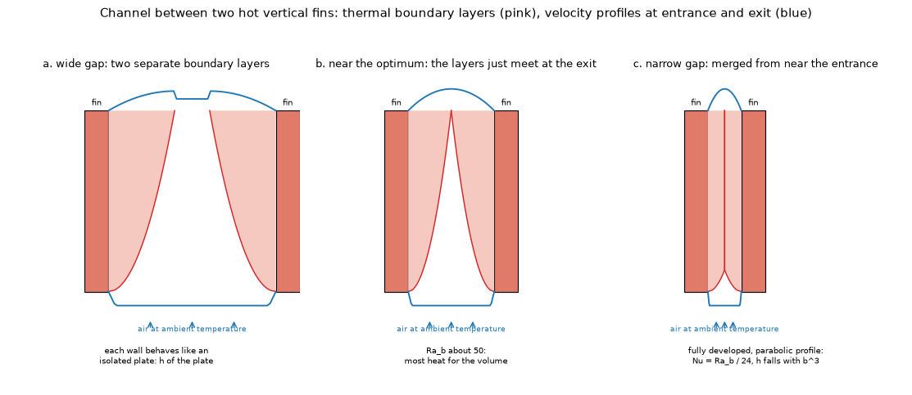
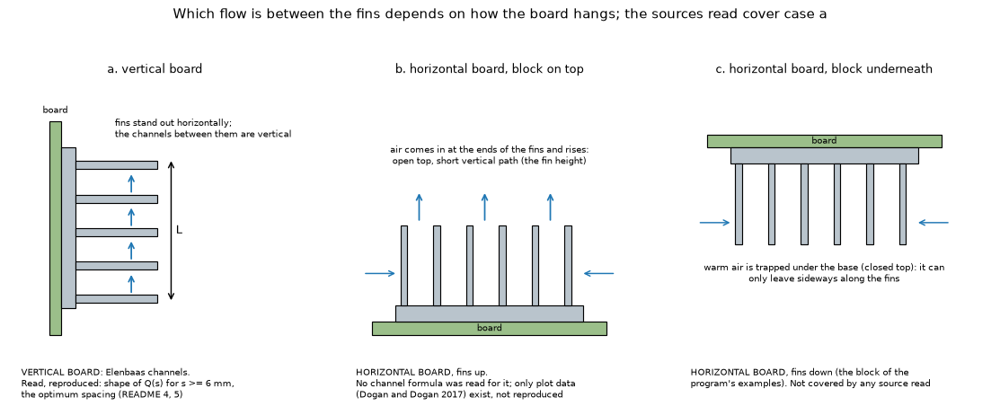
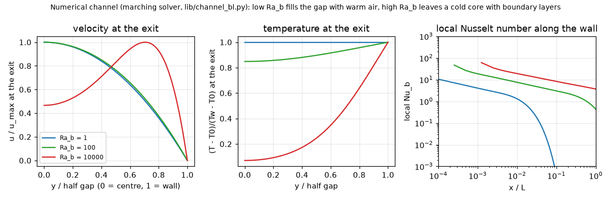
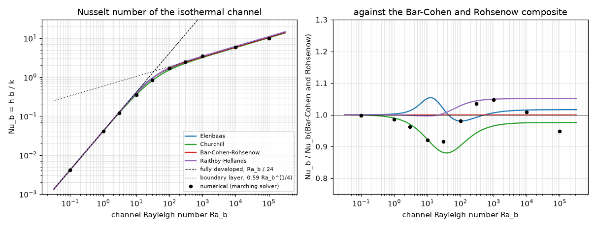
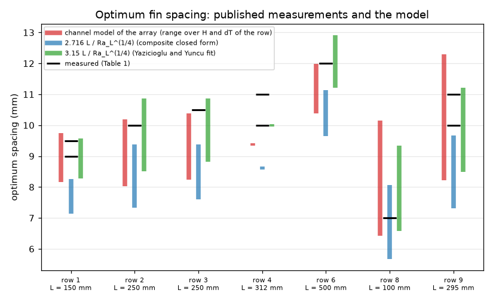
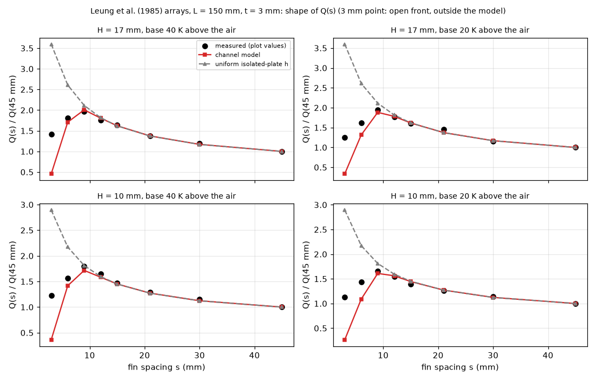
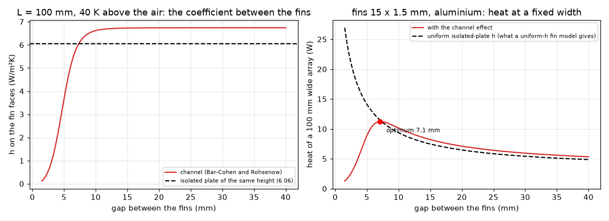
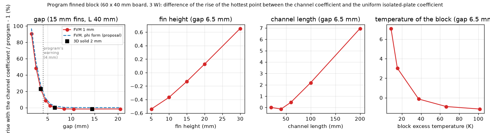
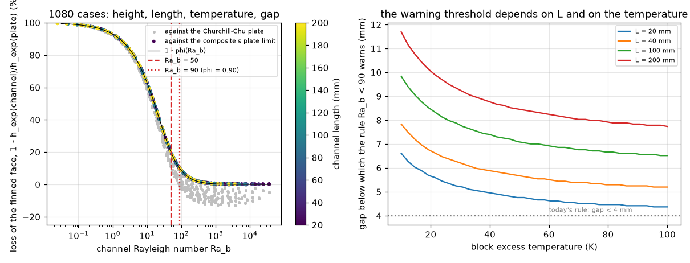
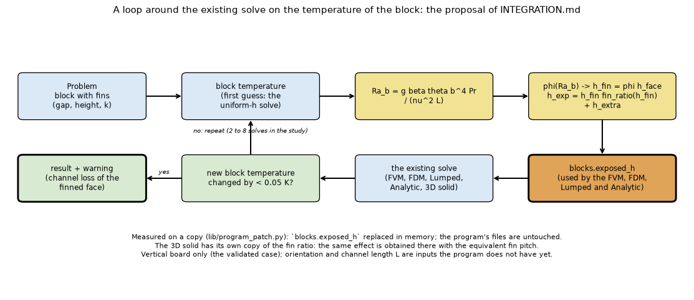

# The channel effect between close fins (C3)

Question (`research/ROADMAP.md` C3): the program's finned metal block uses the fin efficiency `tanh(mL)/(mL)` with one uniform coefficient on every face and only warns at a 4 mm gap; between close fins the air in the channel is slowed and the coefficient falls (Elenbaas 1942; Bar-Cohen and Rohsenow 1984). A remembered correlation put the 6.5 mm gap of the program's finned blocks 10 to 30 % below the typed coefficient (`block-and-fins` 4.1). How large is the effect, from sources that were read, against an independent solution and against measurements; what does it do to the program's results; and what rule or correction should the program have?

**Results in short** (the numbers are in the sections named; everything was computed by the scripts of this folder).

* The correlations were **read** (equations 8, 20, 21 and 22 of the Waterloo review, section 2) and **reproduced** with an independent marching solution of the channel (Bodoia and Osterle formulation, `lib/channel_bl.py`, no program code): the numerical Nusselt number lies inside the envelope of the four correlations to within 3 % (the correlations differ among themselves by 8 to 16 % for `Ra_b` 10 to 1e5) and follows Churchill's lower bound at `Ra_b` 3 to 30; it tends to the exact `Ra_b/24` (within 2 % at `Ra_b = 1`) (section 3). The memory constants of the repository for the optimum spacing, 2.714 and 1.307, are recomputed from equation 21 as **2.7156 and 1.308** (and the optimum channel Rayleigh number as 54.4), which also matches Simons' "about 50" (section 3.3).
* Against **published measurements** (eight families of vertical-base fin arrays collected by Yazicioglu and Yuncu, Table 1; the arrays of Leung and others read from plots): the array model with the channel coefficient puts the optimum spacing at 8.2 to 9.7 mm where 9 to 9.5 mm was measured; over seven rows of the table its range contains the measured value in four, is within 2 % of it in two more and 6 % below it in one; it follows the shape of `Q(s)` from 6 mm up with a mean deviation of 3.6 % (9.2 % for a uniform coefficient, 61 % at worst). **It fails at 3 mm** (channel model 68 to 76 % below the measured shape, uniform coefficient 136 to 187 % above: the arrays are open in front and the Elenbaas channel is closed), and the **absolute level** of two plot data sets disagrees with the model in opposite directions (0.62 to 0.78 of the measurement for one, 1.4 to 1.9 times for the other), so no claim is made about absolute heat (section 4, section 7).
* On the **program's own finned block** (60 x 40 mm board, 3 W, fins 15 x 1.5 mm, 40 mm channels), the channel effect alone (the coefficient the program is given times the channel fraction `phi`) raises the rise of the hottest point by **+1.9 % at the 6.5 mm gap, +4.7 % at 5.5 mm, +11.8 % at 4.5 mm, +27 % at 3.5 mm and +55 % at 2.5 mm**. The full Bar-Cohen and Rohsenow coefficient gives -0.1, +2.4, +8.8, +22.5 and +48 % against an isolated plate of Churchill and Chu: those numbers are lower because the composite's wide-gap limit (`0.59 Ra^(1/4)`) is 7 % above that plate at these sizes, so at 6.5 mm a 6 % channel loss and a 7 % difference between two plate correlations cancel (corrected by the review, section 10; the first version read the -0.1 % as "no channel effect"). The 3D solid agrees with the FVM to 0.1 point. The effect grows with the channel length (6.5 mm gap, `phi` form: +5.5 % at 100 mm, +11.3 % at 200 mm) and as the block gets cooler (+9.4 % at 0.5 W, block 8.6 K above the air). The remembered "10 to 30 % at 6.5 mm" is the right size for the loss of the finned-face conductance with 60 to 100 mm channels at 20 to 40 K (10 to 31 %; 7 and 13 % at 60 K) or 40 mm channels at 20 K (12 %); with 30 to 40 mm channels at 40 to 60 K the loss is 3 to 6 % (section 6, the 6.5 mm paragraph).
* **The warning rule of the program (gap below 4 mm) misses more than half of the cases that lose 10 % of the finned-face conductance**: 367 of 667 in a grid of 1080 when the loss is the channel effect alone (against the composite's own plate limit), 312 of 612 when it is measured against the Churchill and Chu plate; it never warns wrongly. A rule on the channel Rayleigh number `Ra_b = g beta theta b^4 Pr / (nu^2 L) < 90` misses 1 (no false warning) with the first measure and none (54 extra warnings) with the second; `Ra_b < 50` misses 79 or 24. With the first measure the loss is, to the plotting accuracy, `1 - phi(Ra_b)`, so the threshold 90 is `phi = 0.90` by construction (section 6). A correction `h_fin = phi(Ra_b) h_face` with `phi = [1 + (14.16 / Ra_b^(3/4))^2]^(-1/2)` keeps the coefficient the program is given and applies the channel loss of the composite to it; it differs from the full channel coefficient by the 7 % between the two plate correlations, not by a margin of safety; it was **not** validated below `Ra_b` 14 where the open front of real arrays matters (sections 5 and 6, `INTEGRATION.md`).
* **Not done**: a catalogue comparison (the dimensions of the catalogue parts of the program's library are not in the sources found), the horizontal-board orientations (no correlation was read for them), radiation between the fins, a measured array whose absolute level is trustworthy (section 7).

## 1. The situation

*Figure 1 (`figures/fig_01_boundary_layers_in_the_channel.png`): the channel between two hot vertical fins at three gaps. Pink = thermal boundary layer growing up the walls, blue = velocity profile at the entrance and at the exit. Wide gap: two separate layers, each wall is an isolated plate. Near the optimum (`Ra_b` about 50): the layers meet at the exit. Narrow gap: the air is warm from near the entrance, the flow is parabolic, `Nu_b = Ra_b/24`, the coefficient falls with the cube of the gap. Schematic, the drawn thicknesses follow `delta ~ sqrt(x)`.*

*Figure 4 (`figures/fig_04_orientations_of_the_block.png`): how the flow runs between the fins for the three ways a block hangs on a board. The sources read cover case a (vertical channels). The block of the program's examples (case c, horizontal board, block underneath, fins down) traps warm air under the base and is not covered by any source read.*

The program (`pcbthermal/blocks.py`) replaces the fins by the area gain and efficiency of a straight fin with one coefficient, `h_exp = h_face x fin_ratio(h_face) + h_extra`, and the 3D solid has its own copy of the same expression. The program has no fin direction and no channel length, and does not know how the board hangs when the coefficients are typed; its warning (`checks.py`) is "air gap below 4 mm in still air". Here the channel coefficient is measured on copies in memory (`lib/program_patch.py`), never in the program.

## 2. Sources and how they were read

| Source | What it gave | Status |
| :-- | :-- | :-- |
| Teertstra, Culham, Yovanovich, *Comprehensive review of natural and mixed convection heat transfer models for circuit board arrays* (Waterloo; a hosted copy) | equations 1 to 22 of the isothermal channel: Elenbaas (8), Churchill 1977 (20), Bar-Cohen and Rohsenow 1984 (21), Raithby and Hollands 1985 (22), definitions of `Ra_b` and `Nu_b` | **R**: pages 3 to 6 rendered and read as images; the figures of the models against data seen, not digitised; mixed convection pages not read |
| Martin, Raithby, Yovanovich, J. Heat Transfer 113 (1991) 899-905 (the group's archive) | the governing equations, the parabolic limit, why Elenbaas' `Nu(Ra*)` holds only for long channels (`L_c* = L_c/b` large), the blend with `m = -1.9`, `C = 0.62` | **R** for pages 1, 3, 4 and 5 (pages 1 and 2 in the earlier entry); the short-channel formulas (20 to 27) were not used, the exponents could not be told apart in the scan |
| Yazicioglu, Yuncu, J. of Thermal Science and Technology 29 (1) (2009) 99-105 (open copy) | Table 1 of eight published array families, the fit `s_opt/L = 3.15 Ra_L^(-1/4)`, plots of `Q(s)` from Leung and others (1985) | **R** (7 pages; Table 1 rendered and read; Figures 6 and 7 read as **plot values**, +-0.5 W; Figure 5 read at one temperature, +-2 W) |
| Avelar, Ganzarolli, COBEM 2003 (open copy) | a second statement of the scale analysis of the optimum spacing for plates with protruding sources | **R**, used only to confirm that an optimum exists and scales as `Ra^(-1/4)` |
| Abuska, Corumlu, Celal Bayar Univ. J. Sci. 20 (3) (2024) 91-99 (open copy) | one measured plate-fin heat sink with all its dimensions and `R_th` at 16.5 and 33 W | **R**, **not usable as a validation** (section 7) |
| Elenbaas, Physica 9 (1942); Bar-Cohen and Rohsenow, J. Heat Transfer 106 (1984) 116-123 | the originals | **N** (not obtained; only citations and abstracts; the forms come from the review) |
| Simons, Electronics Cooling, Feb 2002; Teertstra et al., Electronics Cooling, Sep 2000 | channel Rayleigh number about 50 for the optimum; the composite plate-fin model of Waterloo | **S**: the pages were fetched but their equations are images that the fetch tool did not return, only the text |
| Doğan, Doğan, J. of Thermal Science and Technology 37 (1) (2017) | horizontal-base fin arrays (spacing 12 mm, 15 to 40 mm high) with `Q/A_b` plots | text read, plots not digitised, not reproduced |

The status of each, with the equations and page numbers, is in `research/theory/BIBLIOGRAPHY.md` (entries `[TeertstraReview]`, `[MartinRaithbyYovanovich1991Pages]`, `[Yazicioglu2009]`, `[AvelarGanzarolli2003]`, `[Abuska2024]`, and the note added to `[ElenbaasBCR]`).

The formulas, with `b` the gap, `L` the channel length, `Nu_b = h b / k`, `Ra_b = g beta (Tw - T0) b^4 Pr / (nu^2 L)` (review, equations 3 and 6; air properties at the film temperature):

| Correlation | Nu_b | Review equation |
| :-- | :-- | :-- |
| Elenbaas 1942 | `(1/24) Ra_b [1 - exp(-35/Ra_b)]^(3/4)` | 8 |
| Churchill 1977 | `[(24/Ra_b)^(3/2) + ([1 + (0.492/Pr)^(9/16)]^(4/9) / (0.75 Ra_b^(1/4)))^(3/2)]^(-2/3)` | 20 |
| Bar-Cohen and Rohsenow 1984 (Pr 0.7, symmetric isothermal) | `[(24/Ra_b)^2 + (1/(0.59 Ra_b^(1/4)))^2]^(-1/2)` | 21 |
| Raithby and Hollands 1985 (`r_T = 1`) | `[(24/Ra_b)^(1.9) + (1/(0.62 Ra_b^(1/4)))^(1.9)]^(-1/1.9)` | 22 |

## 3. The correlations reproduced

`scripts/study_channel_correlations.py`, `lib/channel_bl.py`, `lib/channel.py`.

### 3.1 The independent numerical channel

`lib/channel_bl.py` solves the boundary-layer form of the steady laminar Boussinesq equations of the symmetric channel by marching in the flow direction (finite differences across the half channel, implicit in `x`, the pressure gradient of every station fixed by the mass flow, the entrance speed found by shooting so that the pressure at the exit is the ambient one; entrance pressure from Bernoulli). It imports nothing from `pcbthermal`. Pr = 0.71, 200 x 800 points.

| Ra_b | numerical | energy balance (wall - enthalpy) | Elenbaas (8) | Churchill (20) | Bar-Cohen and Rohsenow (21) | Raithby and Hollands (22) | numerical / BCR - 1 | spread of the four |
| --: | --: | --: | --: | --: | --: | --: | --: | --: |
| 0.1 | 0.0042 | -0.5 % | 0.0042 | 0.0042 | 0.0042 | 0.0042 | -0.2 % | 0 % |
| 1 | 0.0409 | -0.7 % | 0.0417 | 0.0411 | 0.0416 | 0.0415 | -1.5 % | 1 % |
| 3 | 0.1187 | -0.8 % | 0.1250 | 0.1197 | 0.1234 | 0.1232 | -3.8 % | 4 % |
| 10 | 0.3567 | -0.9 % | 0.4072 | 0.3572 | 0.3872 | 0.3858 | -7.9 % | 14 % |
| 30 | 0.8481 | -1.1 % | 0.9449 | 0.8166 | 0.9267 | 0.9302 | -8.5 % | 16 % |
| 100 | 1.6690 | -1.6 % | 1.6692 | 1.5371 | 1.7028 | 1.7517 | -2.0 % | 14 % |
| 300 | 2.4943 | -2.4 % | 2.3895 | 2.2704 | 2.4094 | 2.5150 | +3.5 % | 11 % |
| 1000 | 3.4622 | -3.1 % | 3.3278 | 3.1912 | 3.3073 | 3.4702 | +4.7 % | 9 % |
| 10000 | 5.9539 | -3.3 % | 5.9878 | 5.7503 | 5.8994 | 6.1989 | +0.9 % | 8 % |
| 100000 | 9.9512 | -2.6 % | 10.6606 | 10.2358 | 10.4918 | 11.0253 | -5.2 % | 8 % |

*Nusselt number from the enthalpy gained by the air (the conservative measure); the "energy balance" is the wall-flux integral against it (the wall flux is the less accurate one, the error of the numerical Nu is about that size, up to 3 %).* Grid check (100 x 400, 200 x 800, 300 x 1200): `Ra_b` 1: 0.0409, 0.0409, 0.0409; 10: 0.3566, 0.3567, 0.3567; 100: 1.6697, 1.6690, 1.6689; 1000: 3.4678, 3.4622, 3.4595; 1e4: 5.9628, 5.9539, 5.9490 (the 200 x 800 grid is within 0.1 % of the finest one). At `Ra_b = 1` the exact fully developed value is `Ra_b/24 = 0.0417`: the solver is 1.9 % below it, which is the effect of the entrance (Bernoulli pressure drop and the developing region); Martin and others (1991) show that the fully developed asymptote is reached only by long channels, so this is not an error of the solver. At `Ra_b` 3 to 30 the numerical solution follows Churchill's correlation (the lower bound of the review) to 0.1 to 4 %, at `Ra_b` 100 it matches Elenbaas, and over the whole range it lies between 0.92 and 1.05 of the Bar-Cohen and Rohsenow composite (at `Ra_b` = 1e5 it is 2.8 % below the lowest of the four correlations), inside the "all models bounded by 16 %" that the review states.

*Figure 2 (`figures/fig_02_channel_profiles.png`): velocity and temperature across the half channel at the exit, and the local Nusselt number along the wall, from the marching solution at `Ra_b` 1, 100 and 1e4: at 1 the gap is full of warm air with a parabolic profile, at 1e4 a cold core with thin layers at the wall.*

*Figure 3 (`figures/fig_03_nusselt_against_rayleigh.png`): the four correlations and the numerical points (left) and their ratio to the Bar-Cohen and Rohsenow composite (right). The dashed and dotted lines are the two limits.*

### 3.2 Limits

| correlation | `Nu / Ra_b` at `Ra_b = 1e-3` | `Nu / Ra_b^(1/4)` at 1e9 |
| :-- | --: | --: |
| Elenbaas | 0.04167 (1/24) | 0.5996 (= 35^(3/4)/24) |
| Churchill | 0.04167 | 0.5756 |
| Bar-Cohen and Rohsenow | 0.04167 | 0.5900 |
| Raithby and Hollands | 0.04167 | 0.6200 |

(The earlier note in `BIBLIOGRAPHY.md` that the Elenbaas form tends to "about 0.62 within 3 %" is the 0.5996 here.)

### 3.3 The optimum spacing of the composites

Plates of negligible thickness at pitch `b` give per unit of base area `2 k L dT Nu_b / b^2`, so the optimum is where `Nu_b(Ra_b)/b^2` is largest, with `Ra_b = c b^4`; then `S_opt = K L / Ra_L^(1/4)` with `K = Ra_b(opt)^(1/4)`:

| correlation | K | `Ra_b` at the optimum | `Nu_b` at the optimum |
| :-- | --: | --: | --: |
| Elenbaas | 2.6027 | 45.89 | 1.1938 |
| Churchill | 2.7991 | 61.39 | 1.2296 |
| Bar-Cohen and Rohsenow | **2.7156** | **54.38** | **1.3082** |
| Raithby and Hollands | 2.7777 | 59.53 | 1.3912 |

The remembered Bar-Cohen and Rohsenow constants (`BIBLIOGRAPHY.md`: 2.714 and 1.307, "verify") are reproduced to 0.1 %; they are now derived from equation 21, not read from the paper of 1984 (still not obtained). Simons' "channel Rayleigh number about 50" lies between the Elenbaas (45.9) and the composite (54.4) values; `research/effective-conductivity` 4.10 had found 46, 59 and 54.4 for Elenbaas, Raithby and Hollands and the composite.

## 4. Published measurements

`scripts/study_optimum_spacing.py`, `lib/channel.py` (`array_heat`).

**The array model** (the standard one for a plate-fin sink on a vertical base): `n` fins of thickness `t`, height `H`, gap `s`, length `L` in the flow direction; the `n - 1` channels (the faces of their fins and the free base between the fins) have `h = Nu_b k / s` with `Ra_b` from the mean wall excess (base at `theta_b`, fins at `eta theta_b`, because the mean temperature ratio of an adiabatic-tip fin equals its efficiency), the two outer faces have the isolated-plate coefficient (Churchill and Chu laminar form), each fin the efficiency `tanh(m Hc)/(m Hc)` with `Hc = H + t/2`, the same formula as `blocks.fin_ratio`. Fixed base width `W`, so `n = (W + s)/(s + t)` changes with the spacing. Convection only.

### 4.1 Optimum spacing, eight published families

Table 1 of Yazicioglu and Yuncu (2009), rows with their length, width, thickness (3 mm everywhere except row 5), height, temperature difference, optimum spacing and material. Ambient 20 degC assumed (not stated), conductivity assumed (duralumin 150, light alloy and alloy 170, aluminium 200, stainless 15 W/mK); the model range is over the heights and temperature differences of the row.

| row | L (mm) | H (mm) | dT (K) | material | measured s_opt (mm) | channel model, fins (BCR) | channel model, fins (Elenbaas) | 2.7156 L/Ra_L^(1/4) | 3.15 L/Ra_L^(1/4) (their fit) |
| :-- | --: | --: | --: | :-- | --: | --: | --: | --: | --: |
| 1 | 150 | 10-17 | 20-40 | duralumin | 9 to 9.5 | 8.2 to 9.7 | 8.1 to 9.7 | 7.2 to 8.2 | 8.3 to 9.5 |
| 2 | 250 | 60 | 20-80 | light aluminium alloy | 10 | 8.1 to 10.1 | 7.9 to 9.9 | 7.4 to 9.3 | 8.5 to 10.8 |
| 3 | 250 | 32-90 | 20-60 | duralumin | 10.5 | 8.3 to 10.3 | 8.1 to 10.1 | 7.6 to 9.3 | 8.9 to 10.8 |
| 4 | 312 | 60 | 40 | duralumin | 10 to 11 | 9.4 | 9.2 | 8.6 | 10.0 |
| 6 | 500 | 60 | 20-40 | stainless steel | 12 | 10.4 to 11.9 | 10.1 to 11.6 | 9.7 to 11.1 | 11.2 to 12.9 |
| 8 | 100 | 5-25 | 14-106 | aluminium | 7 | 6.5 to 10.1 | 6.4 to 10.4 | 5.7 to 8.0 | 6.6 to 9.3 |
| 9 | 295 | 5-25 | 21-162 | aluminium alloy | 10 to 11 | 8.3 to 12.2 | 8.1 to 12.6 | 7.4 to 9.6 | 8.5 to 11.2 |

Row 5 (fin thickness 1 to 19 mm) was left out. The range of the model with fins contains the measured value in rows 1, 2, 8 and 9, is within 2 % below it in rows 3 (10.3 against 10.5) and 6 (11.9 against 12) and 6 % below in row 4 (9.4 against 10 to 11); the closed form of the composite (`2.7156 L/Ra_L^(1/4)`, plates of zero thickness) is 4 to 33 % low in six of the seven rows (it contains the measurement only in row 8), and the fit of Yazicioglu and Yuncu contains it in all seven, as it must (it was fitted to them; average error claimed for it: under 24 %). Avelar and Ganzarolli's scale analysis for plates with uniform heat flux gives 3.06 with a Rayleigh number defined on the temperature excess; it was not compared further. The spread of the model within one row comes from the range of `dT` and `H` of that row.

*Figure 7 (`figures/fig_07_optimum_spacing.png`): the measured optimum spacing (black bars) and the three predictions for each row of Table 1; the range of each prediction comes from the heights and temperature differences of the row.*

### 4.2 The shape of Q(s): the arrays of Leung and others (1985)

Plot values read from Figures 6 and 7 of Yazicioglu and Yuncu (`H` = 17 and 10 mm, 20 and 40 K, `L` = 150 mm, `W` = 190 mm, `t` = 3 mm, duralumin; +-0.5 W). The table is the shape `Q(s)/Q(45 mm)`:

| s (mm) | measured (H 17, 40 K) | channel model | uniform isolated-plate h | measured (H 10, 40 K) | channel model | uniform |
| --: | --: | --: | --: | --: | --: | --: |
| 3 | 1.41 | 0.46 | 3.60 | 1.23 | 0.36 | 2.89 |
| 6 | 1.81 | 1.71 | 2.61 | 1.56 | 1.42 | 2.17 |
| 9 | 1.96 | 2.01 | 2.11 | 1.80 | 1.72 | 1.81 |
| 12 | 1.75 | 1.81 | 1.82 | 1.64 | 1.58 | 1.59 |
| 15 | 1.64 | 1.62 | 1.62 | 1.47 | 1.45 | 1.45 |
| 21 | 1.37 | 1.37 | 1.37 | 1.29 | 1.27 | 1.27 |
| 30 | 1.20 | 1.17 | 1.17 | 1.15 | 1.12 | 1.12 |
| 45 | 1.00 | 1.00 | 1.00 | 1.00 | 1.00 | 1.00 |

(The 20 K columns are in the script output and in Figure 6.) From 6 mm up the channel model reproduces the measured shape with a mean deviation of **3.6 %** (maximum 24 % at 6 mm, 20 K, H 10 mm), the uniform coefficient with 9.2 % (maximum 61 %); at 9 to 12 mm, around the maximum, the two models are close because `Ra_b` is large there; what the channel effect does is to turn the monotonic climb of the uniform model (`Q` growing towards small gaps because the fins get denser) into a **maximum near 9 mm**, which is what was measured. At **3 mm** both fail: the channel model is 68 to 76 % below the measured shape, the uniform coefficient 136 to 187 % above; the truth lies in between (section 7: the arrays are open in front).

*Figure 6 (`figures/fig_06_leung_array.png`): the shape of `Q(s)` of the four arrays (measured plot values, channel model, uniform isolated-plate coefficient). The 3 mm point is outside the model.*

## 5. The program's finned block with the channel effect

`scripts/study_program_finned_block.py`, `lib/program_patch.py`. The board is the one of `block-and-fins`: 60 x 40 mm, two layers, copper from 1 to 59 and 1 to 39 mm, a 3 W part of 10 x 10 mm, a 40 x 30 mm, 3 mm aluminium block (k 204) on the bottom face through 5e-5 m2K/W, fins 15 x 1.5 mm, here with the faces taken as those of a vertical board. Two runs of the **program's own code**:

* "program": both faces carry the coefficient of an isolated vertical plate of the height of the channels at the block temperature (Churchill and Chu, laminar form; the coefficient the computed mode gives for a plate of that height), iterated with the block temperature; this is the uniform coefficient on the fins;
* "channel": `blocks.exposed_h` replaced in memory by `channel.exposed_h_channel` (the Bar-Cohen and Rohsenow composite and the fin efficiency with the channel coefficient), iterated with the block temperature (3 to 7 solves); for the 3D solid, which has its own copy of the fin ratio, the fin pitch is replaced on a copy by the one that gives the same exposed coefficient (`program_patch.effective_pitch`). The FVM and the 3D solid agree (table E).

Convection only: no radiation (the coefficient of the faces is the convective one of the plate).

**A. Gap** (fins 15 x 1.5 mm, channels 40 mm, 3 W, FVM 1 mm). `phi` and the last two columns are the correction of section 6.

| gap (mm) | Ra_b | h plate (W/m²K) | h channel | h_exp channel / program | rise program (K) | rise channel (K) | difference (%) | phi | rise phi form (K) | difference of the phi form (%) |
| :-- | --: | --: | --: | --: | --: | --: | --: | --: | --: | --: |
| 1.5 | 0.5 | 6.96 | 0.45 | 0.06 | 60.6 | 115.5 | +90.6 | 0.05 | 119.3 | +96.9 |
| 2.5 | 3.6 | 7.21 | 1.69 | 0.24 | 64.3 | 95.4 | +48.3 | 0.19 | 99.8 | +55.2 |
| 3.5 | 11.9 | 7.38 | 3.61 | 0.49 | 67.3 | 82.5 | +22.5 | 0.42 | 85.6 | +27.1 |
| 4.5 | 29.2 | 7.52 | 5.60 | 0.75 | 69.8 | 75.9 | +8.8 | 0.67 | 78.0 | +11.8 |
| 5.5 | 62.4 | 7.63 | 7.01 | 0.92 | 71.9 | 73.6 | +2.4 | 0.85 | 75.3 | +4.7 |
| **6.5** | 121.5 | 7.71 | 7.75 | 1.00 | 73.7 | 73.6 | **-0.1** | 0.94 | 75.1 | +1.9 |
| 8.5 | 369.0 | 7.85 | 8.29 | 1.06 | 76.6 | 75.4 | -1.5 | 0.99 | 76.8 | +0.4 |
| 10.5 | 892.2 | 7.95 | 8.48 | 1.07 | 78.8 | 77.5 | -1.7 | 1.00 | 78.9 | +0.1 |
| 14.5 | 3423.9 | 8.08 | 8.66 | 1.07 | 82.0 | 80.6 | -1.7 | 1.00 | 82.0 | +0.0 |
| 20.5 | 14348.3 | 8.20 | 8.81 | 1.07 | 85.2 | 83.8 | -1.6 | 1.00 | 85.2 | +0.0 |

At wide gaps the channel coefficient is 7 % above the plate one (the large-`Ra_b` constant 0.59 against the 0.515 plus the leading-edge 0.68 of the plate correlation): this is a difference between correlations, not a gain from the channel; the correction of section 6 never gives more than the program gives.

**How to read the two "difference" columns (review).** The same 7 % offset is present at every gap, because the composite tends to `0.59 Ra^(1/4)` and the baseline is the Churchill and Chu plate (ratio 1.06 to 1.09 for 40 mm channels at 10 to 80 K, 1.01 to 1.13 over the grid of section 6, `study_warning_rule.py` F). The "difference" column therefore mixes the channel effect with that offset: at 6.5 mm the channel keeps `phi = 0.94` of the plate coefficient (a 6 % loss) and the composite starts 7 % higher, so the rise moves by -0.1 %. The `phi` column applies the channel fraction of the composite to the coefficient the program is given and is **the channel effect alone**: +1.9 % at 6.5 mm, +4.7 % at 5.5 mm, +11.8 % at 4.5 mm. Which absolute level is right (0.59, the Churchill and Chu plate, or the 0.515 of laminar boundary-layer theory) is a question of the plate correlation, not of the channel; the first version of this README read the -0.1 % as "no channel effect at 6.5 mm", which was wrong.

**B. Fin height** (gap 6.5 mm): 5 / 10 / 15 / 20 / 30 mm give differences of -0.5 / -0.4 / -0.1 / +0.1 / +0.7 % (the height matters little: `Ra_b` and `h_ch` hardly change). **C. Channel length** (gap 6.5 mm): 20 / 40 / 60 / 100 / 200 mm give `h_exp` ratios 1.00 / 1.00 / 0.98 / 0.93 / 0.81 and rise differences +0.0 / -0.1 / +0.5 / +2.2 / +7.0 % (rises 67.6 to 89.8 K for the program). **D. Power** (gap 6.5 mm, `L` 40 mm): 0.5 / 1 / 3 / 6 / 10 W, block excess 8 to 100 K, give `h_exp` ratios 0.80 / 0.91 / 1.00 / 1.03 / 1.05 and rise differences +7.1 / +3.0 / -0.1 / -0.9 / -1.2 % (`phi` form +9.4 / +5.1 / +1.9 / +1.1 / +0.8 %; block excess 8.6, 15.3, 37.6, 66.5 and 101.6 K in the uniform run): a cool block has a smaller `Ra_b`.

**E. The 3D solid against the FVM** (2 mm cells; the 3D solid with the effective pitch): gap 3.5 mm +22.7 % (FVM +22.8 %), 6.5 mm -0.1 % (-0.1 %), 14.5 mm -1.7 % (-1.7 %).

**F. A typed uniform coefficient on both faces** (gap 6.5 mm, 40 mm channels, 3 W): typed 6 / 8 / 10 / 12 W/m²K give 84.2 / 72.3 / 65.0 / 60.0 K in the program and 77.1 / 73.0 / 69.6 / 66.7 K with the channel coefficient (convection only), that is -8.5 / +1.0 / +7.1 / +11.1 %. A typed coefficient that includes radiation (the program's default emissivity of 0.9 gives about 6 to 8 W/m²K of radiation at these temperatures, by `convection.h_radiation`) is therefore 7 to 11 % too optimistic on the rise when the radiation between the fins is blocked and the typed value is 10 to 12; this is the size of the "10 to 30 %" of `block-and-fins` 4.1 for this geometry, and it comes from the radiation and the choice of the typed value as much as from the channel. Radiation inside the channel was not modelled, so the rows above 8 W/m²K are not a prediction of the real block.

*Figure 5 (`figures/fig_05_coefficient_and_heat_against_gap.png`): left, the coefficient between the fins against the gap (L 100 mm, 40 K above the air) with the isolated-plate value; right, the heat of a 100 mm wide array of 15 x 1.5 mm aluminium fins with and without the channel effect: the optimum is where the layers of Figure 1b meet.*

*Figure 8 (`figures/fig_08_program_error_against_gap.png`): the difference of the rise of the hottest point between the channel coefficient and the uniform coefficient against the gap (FVM, 3D solid, and the correction of section 6), the fin height, the channel length and the temperature of the block.*

## 6. A rule for the warning, and a correction

`scripts/study_warning_rule.py`. A grid of 1080 cases: 18 gaps (1.5 to 20 mm), fin heights 5, 15 and 30 mm, channel lengths 20, 40, 60, 100 and 200 mm, block excess 10, 20, 40 and 80 K (fins 1.5 mm, k 204). For every case: `Ra_b`, the loss of the finned face `1 - rho`, `rho = h_exp(channel)/h_exp(program)` with the program's coefficient the isolated plate of the same height at the same temperature. 612 cases lose 10 % or more.

**Today's rule** (still air, gap below 4 mm): flags 300 cases, **misses 312 of the 612** cases that lose 10 % or more, no false positive on this grid (it never flags a case that loses less).

**Rule on `Ra_b < Ra_crit`**:

| Ra_crit | warns | misses (loss >= 10 %) | false warnings |
| --: | --: | --: | --: |
| 30 | 508 | 104 | 0 |
| 50 | 588 | 24 | 0 |
| 70 | 634 | 3 | 25 |
| **90** | 666 | **0** | 54 |
| 130 | 726 | 0 | 114 |
| 300 | 825 | 0 | 213 |

The loss reaches 10 / 25 / 50 % at `Ra_b` = 57 (range 50 to 88) / 32 (29 to 41) / 14 (13 to 17) over the 60 (height, length, temperature) combinations, so `Ra_b` alone is a sound indicator of the channel effect: the spread comes mostly from the baseline plate. The gap below which `Ra_b < 90` (the rule warns), in mm:

| channel length (mm) | 10 K | 20 K | 40 K | 80 K |
| --: | --: | --: | --: | --: |
| 20 | 6.6 | 5.6 | 4.9 | 4.4 |
| 40 | 7.8 | 6.7 | 5.9 | 5.3 |
| 60 | 8.6 | 7.4 | 6.5 | 5.8 |
| 100 | 9.8 | 8.4 | 7.4 | 6.6 |
| 200 | 11.7 | 10.0 | 8.8 | 7.9 |

The 4 mm of today is below every entry of the table: the right threshold is 4.4 to 11.7 mm depending on the length of the channels and on the temperature.

**With the composite's own plate limit as the baseline** (`study_warning_rule.py` F, added by the review): 667 cases lose 10 % or more; the 4 mm rule misses 367 of them; `Ra_b <` 30 / 50 / 70 / 90 / 110 misses 159 / 79 / 33 / 1 / 0 with 0 / 0 / 0 / 0 / 38 false warnings. The points lie on `1 - phi(Ra_b)` (Figure 9), so with this measure the rule `Ra_b < 90` is the statement `phi < 0.9`. The counts of the table above, and the median `Ra_b` of 57 / 32 / 14 for a loss of 10 / 25 / 50 %, are those of the Churchill and Chu baseline; with the composite's limit they become the `phi` values 90 / 40.5 / 16.5.

**The 6.5 mm gap** of the program's finned blocks (fins 15 x 1.5 mm), by channel length and block excess (`study_warning_rule.py` G), loss of the finned face against the Churchill and Chu plate / against the composite's limit (the channel effect): L 30 mm: 3 / 8, -2 / 4, -4 / 3 % at 20 / 40 / 60 K; L 40 mm: 5 / 12, -2 / 6, -4 / 4 %; L 60 mm: 12 / 19, 1 / 10, -2 / 7 %; L 100 mm: **24 / 31**, 9 / 18, 3 / 13 % (`Ra_b` 32 / 55 / 71). So the "10 to 30 %" of `block-and-fins` 4.1 is the size of the channel loss for 60 to 100 mm channels at 20 to 40 K (10 to 31 %; 7 and 13 % at 60 K) and for 40 mm channels at 20 K (12 %); for 30 to 40 mm channels at 40 to 60 K the channel costs 3 to 6 %. (The first version said "wrong (no loss)" there, reading the negative numbers of the first measure as the channel effect.)

**The correction** `h_fin = phi(Ra_b) h_face`, `phi = [1 + (24 x 0.59 / Ra_b^(3/4))^2]^(-1/2)` (`channel.phi`: the fraction of the isolated-plate limit that the composite keeps; 0.9 at `Ra_b` 90, 0.75 at 40.5, 0.5 at 16.5), applied to the coefficient the program already uses on the fins and the free base between them, `h_exp = h_fin fin_ratio(h_fin) + h_extra`, keeps a typed or computed coefficient where the channel is open and never increases it. Against the full channel result (table A and the typed table): 1.6 to 2.3 points hotter for gaps of 5.5 mm and more (rise +1.9 % at 6.5 mm where the full channel gives -0.1 %, +4.7 % at 5.5 mm against +2.4 %) and 3 to 7 points hotter below (+11.8 % against +8.8 % at 4.5 mm, +27.1 % against +22.5 % at 3.5 mm, +55.2 % against +48.3 % at 2.5 mm); with a typed coefficient of 6 to 12 W/m²K it gives +1.7 to +2.3 % where the full channel gives -8.5 to +11.1 %, because it keeps the typed value (the typed value, not the channel, is then the error). The gap between the two forms is the 7 % by which the composite's plate limit exceeds the Churchill and Chu plate (see "How to read" in section 5), amplified where the rise is sensitive to `h`; it is not a safety margin. The `phi` form is the channel effect of the composite applied to whatever coefficient the program has (the first version called it "conservative", which it is only relative to that higher plate level). **It was not validated below `Ra_b` of about 14** (gaps under about 3.5 mm in these cases), where real arrays are open in front (section 7); there the full channel model is itself pessimistic by a factor of three.

*Figure 9 (`figures/fig_09_warning_rule.png`): left, the loss of the finned face against `Ra_b` for the 1080 cases of the grid, against the composite's own plate limit (colour = channel length; they lie on `1 - phi`, the black line) and against the Churchill and Chu plate (grey: the negative values at large `Ra_b` are the 7 % between the two plate correlations), with the thresholds 50 and 90; right, the gap below which `Ra_b < 90` warns against the temperature of the block for four channel lengths, with today's 4 mm.*

*Figure 10 (`figures/fig_10_where_the_correction_enters.png`): the `phi` form of the proposal as a loop around the existing solve on the temperature of the block (2 to 8 solves in the study, counting the first uniform one); the program is not changed, the function `blocks.exposed_h` is replaced in memory (`lib/program_patch.py`).*

## 7. What does not work, and what cannot be used

* **Narrow gaps of real arrays (3 mm).** The measured `Q(3 mm)/Q(45 mm)` of the four Leung arrays is 1.12 to 1.41; the channel model gives 0.27 to 0.46 and the uniform coefficient 2.9 to 3.6. A closed channel of 3 mm and 150 mm in a fully developed flow can carry at most `m cp dT` of heat (script output D: 0.13 W per channel for H = 17 mm and 40 K, 4.0 W for the 31 channels, 2.3 W for H = 10 mm, against the measured 25.0 and 19.6 W), so the arrays must be drawing air from the open front, as the review of Martin and others describes for short channels and plenums (section 2: `Nu(Ra*)` depends on `L_c*` and the entrance geometry when the channel is short). This was **not modelled** and the numbers of table A below 4 mm gap are therefore the Elenbaas channel closed in front, not what a block does; the direction of the error is that the correction is pessimistic.
* **The absolute level of two measured data sets disagrees with the model in opposite directions**: for the Leung arrays (Figures 6 and 7, `Q_out`) the channel model gives 0.62 to 0.78 (mean 0.71) of the plot value for `s >= 9 mm`; for the arrays of Figure 5 (L 250 mm, W 180 mm, H 25 mm, plot values at 60 K, +-2 W) it gives 1.42 to 1.86 of the value (5.8 mm: 58.8 against 35.5 W; 8.8 mm: 78.0 against 41.8; 14.8 mm: 63.0 against 39.0; 32.4 mm: 41.6 against 29.0; 85.5 mm: 28.5 against 20.0), while for the flat vertical plate of the same base it gives 14.0 W against about 13.8 W. Why was not established (the plot of Leung is labelled `Q_out`, the others `Q_c`, "convective": radiation included in the first is a possibility, not shown; the fin arrays of Figure 5 may not have the base width assumed). The **shape** is used, never the absolute level, and no comparison of this kind is offered for the program's heat.
* **Abuska and Corumlu (2024).** One measured plate-fin sink with all its dimensions (80 x 80 x 5 mm base, ten fins 10 mm high, 2.6 mm thick, 4.33 mm gap, 54 mm long on a horizontal base, measured `R_th` 2.15 to 2.38 K/W; the flat plate of the same base 3.83 to 4.09 K/W). Not usable: the flat plate's resistance corresponds to a total coefficient of 39 W/m²K over its 0.0064 m2, three to four times a textbook plate, so a loss path beyond the surface (support, edges, thermocouple conduction) or an emissivity unknown to us is in the numbers; and the horizontal base with fins up is case b of Figure 4, for which no correlation was read. Not reproduced.
* **Orientation.** The sources read cover vertical channels. For a horizontal board (fins up or down, the case of the program's examples) no source was read, and the Elenbaas correlation with the fin height as the channel length would give a larger coefficient, not a smaller one (`Ra_b` is then large): the "channel effect" of the program's horizontal case is not known. The proposals of `INTEGRATION.md` say so and apply to a vertical board, or as a warning only.
* **The program has no channel length.** A block does not say along which side its fins run; the program has no fin direction. The rule needs `L`; using the longer side of the block is the conservative choice.
* **Catalogue heatsinks.** The library of the program has pin fins and clip-on parts without the dimensions needed; no plate-fin catalogue with its dimensions and a natural-convection `theta_SA` was found in the sources opened. Not done.
* **Radiation between the fins** (blocked by the facing fin) was left out, which is why section 5 F shows what a typed coefficient with radiation does.

## 8. Limits of the study

The array model is a standard one but the comparison with measurements rests on plot values (+-0.5 to 2 W) and on assumed conductivities and ambient temperatures; the original papers of the data (Leung and others) were not opened; the numerical channel is the boundary-layer (parabolic) problem, valid when diffusion along the flow is negligible, and its energy balance closes within 0.5 to 3.3 %; the composite correlations are for the isothermal symmetric channel, whereas fin walls have a temperature falling from the base to the tip (handled by the mean wall excess); two-dimensional flow (no side effects); Pr = 0.71 / 0.7; constant properties at the film temperature; `beta = 1/T_film` where the review uses `1/T0` (with 20 degC air, `Ra_b` is 6.4 % lower at 40 K, 9.3 % at 60 K and 12 % at 80 K than with `1/T0`; not corrected; the program's `convection.air_properties` also uses the film temperature; the threshold 90 would read about 96 to 101 with `1/T0` at 40 to 80 K).

## 9. What was read and what was not verified

* **Read in full**: equations 1 to 22 of the Waterloo review (pages 3 to 6, as images); the paper of Yazicioglu and Yuncu (7 pages, Table 1 as an image); the paper of Avelar and Ganzarolli (10 pages); the paper of Abuska and Corumlu (9 pages, Table 1 as an image); pages 1, 3, 4 and 5 of Martin, Raithby and Yovanovich (1991).
* **From a summary only**: Simons (2002) and Teertstra and others (2000) (the fetched pages kept the text and lost the equations); the abstracts and records of Elenbaas (1942) and of Bar-Cohen and Rohsenow (1984).
* **Not obtained**: the originals of Elenbaas (1942) and of Bar-Cohen and Rohsenow (1984); the original experimental papers of Leung and others, Ko and others, Guvenc and Yuncu, Yazicioglu and Yuncu (2007); Kraus and Bar-Cohen's book; Incropera and DeWitt chapter 9 (equation 9.45 is the equation 21 of the review and was not opened); the short-channel formulas (20 to 27) of Martin and others were seen but not used.
* **Reproduced**: the correlations' limits and the optimum constants (derived from equation 21, not from the paper of 1984); the correlations against an independent numerical channel (section 3: within the correlations' spread, 0.5 to 3.3 % energy balance, 0.1 % grid); the optimum spacing of seven rows of Table 1 and the shape of four arrays of Leung (plot values) with the array model (section 4); the program's finned block with the channel coefficient in the FVM and the 3D solid (section 5).
* **Not reproduced**: the absolute heat of the measured arrays (section 7); the Elenbaas data themselves; Bodoia and Osterle's tables; any measurement of a finned block like the program's (a block on a board).
* **Mine, not a source**: the rule `Ra_b < 90` (or 50), the factor `phi`, the treatment of the channel length, and the conservative reading of the open front are proposals of this study, tested only on the grid and the cases above.
* **Tests**: `research/fin-channel/tests/test_channel.py` (limits of the four correlations, the optimum constants, the fin formula, the numerical channel against the correlations' envelope, grid convergence, the patch restored, the effective pitch, the program with the channel coefficient for close and wide fins in the FVM and the 3D solid, and the regression test of the review for the extra coefficient of the 3D-solid path).

## 10. Review

* **Status**: reviewed by the independent reviewer on the branch; the four studies, both figure scripts, the folder tests, `tests/test_docs.py`, `tests/test_license_header.py` and `research/check_figures.py` re-run with the program at `11b3bc4`: every number of sections 3 to 7 reproduced to the printed digit (the figures were bit-identical before the review's changes). Ready for the maintainer's decisions (`INTEGRATION.md` 6).
* **Independent checks**: the four correlations, their limits (1/24; 0.5996, 0.5756, 0.59, 0.62) and the optimum constants (2.7156, 54.38, 1.3082 and the other three rows) recomputed from the printed formulas by a dense grid search, not with `lib/channel.py`; the numerical channel compared with a second marching solver written by the reviewer (uniform grid, central differences, iterated to convergence at every station, its own shooting): 0.0042, 0.0409, 0.1187, 0.3567, 0.8481, 1.668, 3.451, 5.935, 9.936 at `Ra_b` 0.1 to 1e5, within 0.3 % of section 3.1, with the same grid trend; the 1080-case grid recomputed with the program's air properties (612 / 312 and every row of the `Ra_crit` table reproduced, also with `Ra_b` taken at the block temperature instead of the mean wall temperature: at most one case changes).
* **Defects found and corrected**: (1) the baseline of sections 5 and 6 (the Churchill and Chu plate) is 1 to 13 % below the wide-gap limit of the composite, so the "difference" column and the loss of section 6 mix the channel effect with a correlation offset: the -0.1 % at 6.5 mm was read as no channel effect and the `phi` form as conservative; the text now gives the channel effect alone (`phi` column, `study_warning_rule.py` F and G) and the statement on the remembered 10 to 30 % is corrected; (2) `lib/program_patch.py` passed `h_exp + h_extra` as the target of the 3D-solid pitch, so `h_extra` counted twice (no effect here, `h_extra = 0`; regression test added); (3) the `beta` note said "about 8 %" at 60 K (9.3 %); (4) "+7.1 % at 15 K" was the hottest point, the block was 8.6 K above the air; (5) Figure 10 drew the full channel coefficient and "3 to 5 solves", the proposal is the `phi` form and the study needs 2 to 8.
* **Limits**: the comparisons with measurements rest on plot values and assumed conductivities; the absolute level of the measured arrays is not explained; nothing covers horizontal boards, open-front arrays at 3 mm or radiation between the fins; the plate correlation that sets the absolute level of the program's coefficient is outside this study. The sources were not re-opened by the reviewer (the equations were checked for internal consistency, the limits and the optimum, not against the scans).
* **Text for the project documents**: `docs/` of this folder, with the 6.5 mm sentence as corrected here (channel effect +1.9 % on the example block, 6 % of the finned-face conductance).
