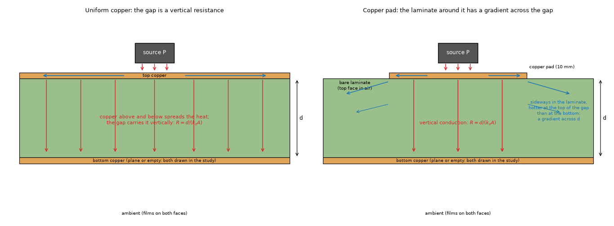
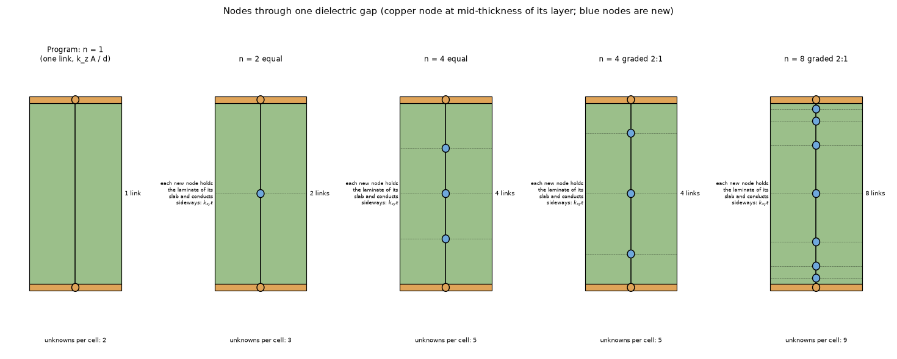
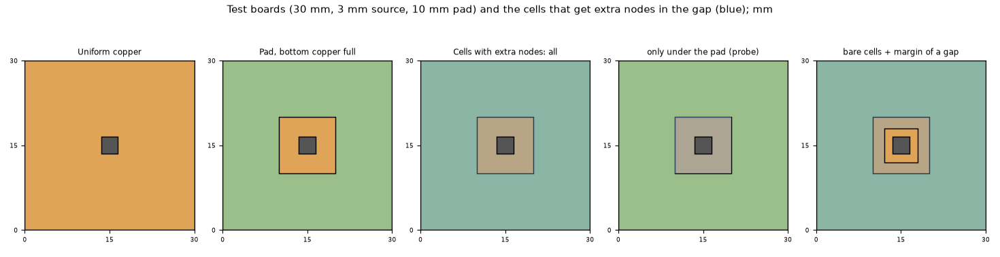
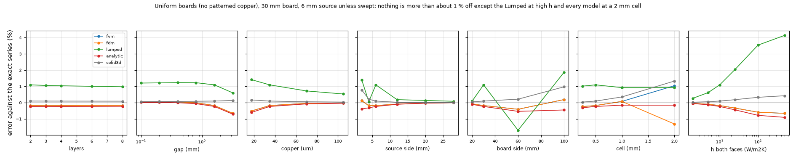
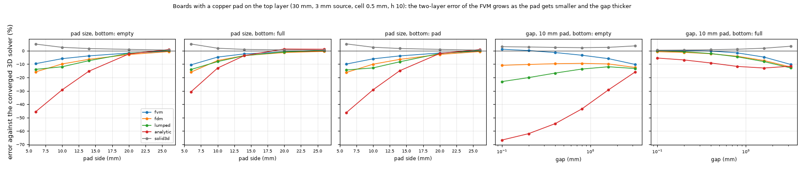
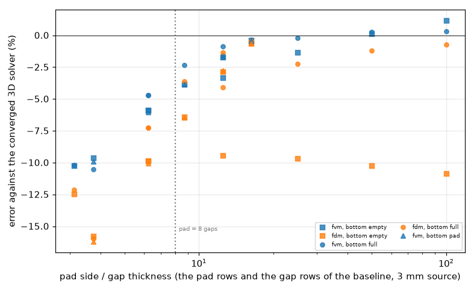
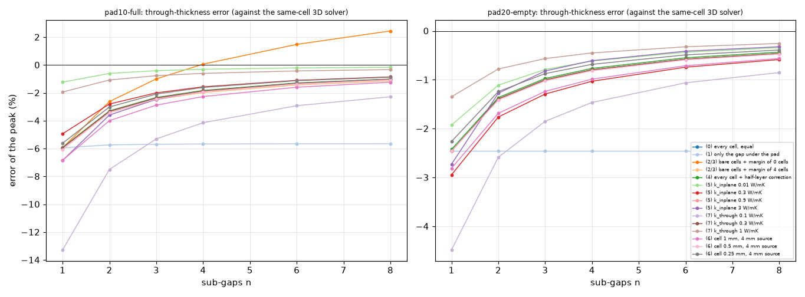
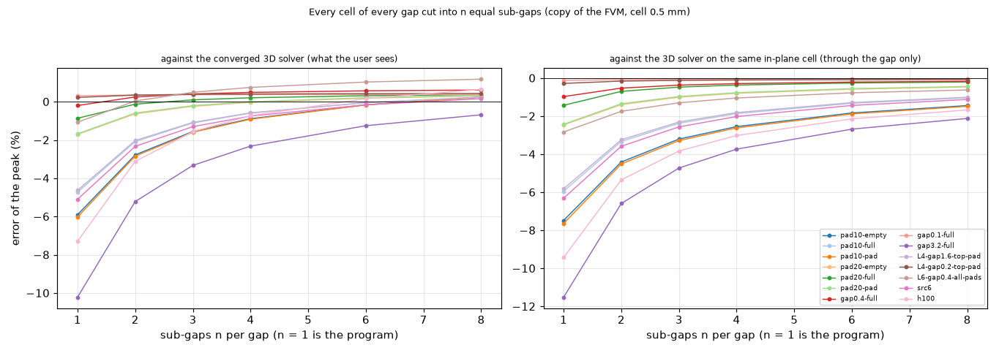
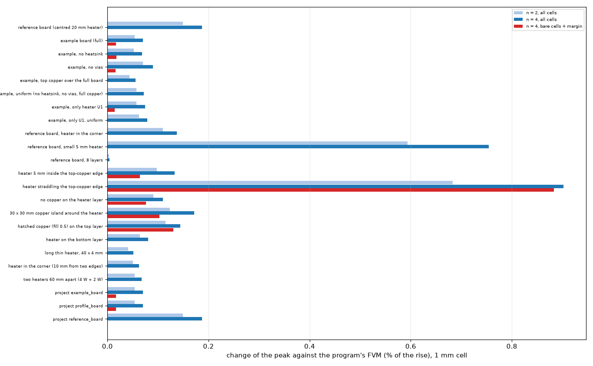

# Subdividing the gap of multilayer boards, and the baseline of the program on simple boards (investigation A1)

**Question.** Does cutting the dielectric gap of a multilayer board into more than one node through its thickness remove the error of the layered models against a resolved 3D solution? The earlier measurement (a 2-layer board reads 2 to 8 % low in the FVM, `power-calculator` 4.5 to 4.7, `docs/validation.md` 21.1) ran from a scratch directory and is not versioned. And: what are the program's current numbers on simple designed boards against independent references, as a common reference for judging the changes proposed for 2.5.0 (the point via, the bare spot, block SOR, Lumped and Analytic vias)?

**Answer in short.**

* **On a board with copper everywhere nothing needs fixing, and the gap nodes change nothing that matters.** Against an exact series solution (no mesh; reproduces two published solutions to 7e-6 and 2.4e-6, section 2.1) the FVM is within -0.72 to +1.04 %, the FDM within -1.31 to +0.19 %, the Analytic within -0.91 to +0.02 %, the 3D solid within 0 to +1.33 %, the Lumped within -1.70 to +4.14 %, over 2 to 8 layers, gaps of 0.1 to 3.2 mm, copper 17.5 to 105 um, sources of 2 to 28 mm, boards of 20 to 100 mm, cells of 0.25 to 2 mm and h of 2 to 500 W/m2K (44 boards, section 3.1; 300 more in a grid: the only FVM errors above 2.5 % are 2 mm sources on 1 mm cells). The energy balance of every model closes to 1.5e-11. Cutting the gaps into 2, 4 or 8 sub-gaps moves these results by 0.0 to 0.26 points with a 6 mm source, and by up to 1.5 points towards the in-plane limit with a 2 mm source (section 5.1).
* **The 2-layer shortfall is real and is a bare-laminate effect, not a property of every 2-layer board.** It appears when a copper pad on the top layer leaves laminate showing around it and the gap is thick: the FVM is -10.5 % (6 mm pad), -4.7 % (10 mm), -2.3 % (14 mm), -0.9 % (20 mm), -0.3 % (26 mm) of the converged 3D answer (3 mm source, 1.6 mm gap, copper plane below; section 3.2). It is -0.2 to +0.3 % with a 0.1 to 0.4 mm gap, -10.2 % with 3.2 mm. The same boards in the other models: FDM -16 to -0.4 %, Lumped -14 to +0.4 %, **Analytic -67 to +1 %** (a model problem of its own, A2), 3D solid +0.4 to +5.1 % (its in-plane error at the 0.5 mm cell plus its four slabs per gap, measured by the review, section 10).
* **Cause, by single-effect probes (section 4).** It is the lateral heat flow in the bare laminate that the single node per layer cannot represent: the laminate under a pad edge is hotter at the top of the gap than at the bottom, and the node holds half a gap at one temperature. Turning the in-plane conductivity of the laminate down to 0.01 W/mK removes the error (-4.7 % to +0.2 %); lowering the through conductivity from 0.3 to 0.1 W/mK doubles it (-11.8 %), raising it to 1 W/mK cuts it to -1.2 %. Extra nodes only **under** the pad do nothing (-4.7 to -4.4 %). The reading of the surface at the copper node (the half-layer correction) moves the result by 0.04 points: **not the cause**.
* **Subdividing helps, slowly, and only where there is bare laminate.** Against the 3D solver on the same in-plane grid (the through-thickness error alone) the pad10-full board goes -5.9 % (n = 1), -3.3 (2), -1.9 (4), -1.0 (8) with equal sub-gaps and -1.5 (4), -0.5 (8) with a symmetric 2:1 grading: about 1 / n, 70 % of the error removed at n = 4 graded and 90 % at n = 8 (section 5.2). Cells with some laminate showing plus a margin of `ceil(d / cell) + 1` cells (a gap thickness and one cell) are within 0.0 to 0.4 points of every cell (-0.71 against -0.59 % on this board, n = 4), at 1.0 to 1.75 times the program's unknowns on the example boards instead of 3.25 (section 5.5).
* **The total error is a cancellation and depends on the cell.** The FVM at 0.5 mm is +1.3 % too warm in the plane on that board (the 3D solver on the same grid against the converged one), so the -4.7 % of the program is -5.9 % of gap error plus +1.3 % of cell error; with n = 4 graded the total is -0.2 % at 0.5 mm, and with n = 4 equal on a 4 mm source it is +0.6, -0.7 and -1.1 % at 1, 0.5 and 0.25 mm. A gap discretisation has to be judged against the same-cell reference, and a user who refines the cell makes n = 1 worse, not better (section 5.4).
* **Real layouts.** On three windows of a real board (Stormduino, section 6.2) two have the hottest cell bare and the FVM is 12.8 to 15.9 % cool against the 3D solver on the program's own cell fill; n = 8 reduces that to 3.7 to 6.3 %. But against the fine reference the three windows are 16 to 31 % cool and n changes the total by at most 9.5 points: the scalar copper fill of the cell is the larger error (A11, the mapping), not the gap. On the validation scenarios and the example boards (copper in almost every cell) n = 4 in every gap moves the peak by +0.00 to +0.92 %.
* **Recommendation (section 7).** Do not subdivide every gap of every board: nothing is gained where the copper is complete and it costs 2.5 to 3.3 times the unknowns. Document the limit now (a screening rule: a copper footprint around the part smaller than about 8 gap thicknesses, about 12 when the far side of the gap has no copper, reads 3 % or more cool in the FVM, about 10 % at 3 to 4 gap thicknesses, more at a finer cell or a higher h, and worse in the other models; section 10.4) and give the maintainer the choice of the option that is already half built by A12: extra nodes (n = 3 or 4, graded 2:1) in the cells that show laminate plus a margin, bit-identical elsewhere. The 1 / n tail means the number of nodes is a cost against accuracy choice, not a way to zero.

The design for entering the program, with the impact of each proposal, is in `INTEGRATION.md`; the text for the project documents in `docs/`. Everything is measured on copies in memory (`lib/gapnodes.py` on `research/bare-spot-under-source/lib/layered.py`, which reproduces the program's FVM peak to 1e-9); `pcbthermal/` is untouched. The baseline is machine readable in `baseline/` and re-run by `scripts/rerun_baseline.py`.

## 1. Situation and method

*Figure 1 (`figures/fig_01_section_under_the_source.png`): section of a two-layer board with a source on the face. Left, copper above and below: the copper spreads the heat and the gap carries it vertically, a series resistance `d / (k_z A)` that one link represents exactly. Right, a copper pad with bare laminate around it: at the pad edge the heat runs sideways in the upper laminate, so the laminate has a temperature gradient across the gap, which one node cannot hold.*

*Figure 2 (`figures/fig_02_nodes_through_the_gap.png`): the program's construction (one node per copper layer, mid-thickness, holding half of each adjacent gap and joined by one link `k_z A / d`) and the gap cut into n = 2, 4 (equal and graded 2:1) and 8 (graded) sub-gaps; the blue nodes are new and conduct sideways `k_xy t` for the laminate of their slab.*

*Figure 3 (`figures/fig_03_top_view_of_the_boards.png`): top view of the test boards (30 mm, 3 mm source, 10 mm pad) and of the cells that get extra nodes: every cell, only under the pad (a probe), the bare cells plus a margin of `ceil(d / cell) + 1` cells, a gap thickness and one cell (the rest keep the single link).*

* **Boards** (`lib/boards.py`): a square board, a centred square source of 1 W, copper of 35 um on every layer, an equal gap between layers (FR-4 0.3 W/mK through, 0.9 in-plane, copper 385 W/mK), films h = 10 W/m2K on both faces (also under the source, as the program does), insulated sides. Uniform boards have copper everywhere; pad boards have a centred square pad on the top layer (laminate around it) and the other layers full, empty (a bare bottom) or with the same pad. Two stack-up modes of the program: simple (equal gaps, slab = thickness / layers) and advanced (the same equal gaps as explicit dielectrics, copper plus half of each adjacent gap).
* **The peak** of every model is the hottest cell, a cell mean; every reference is read as the mean over the same cell (0.5 mm unless said), so that the comparison is like for like.
* **References**: the exact layered series (section 2.1, uniform boards), the converged graded 3D solver (section 2.2, pad boards), and the 3D solver on the model's own in-plane grid with many sub-slabs (section 2.4), which isolates the through-thickness error.
* **The copy** (`lib/gapnodes.py`): the arrays of the program's network are read, the matrix is assembled again with the gap cut into n sub-gaps (equal, or graded), in every cell or only where the layer next to the gap shows laminate (plus a margin), optionally with the half-layer correction of a copper-free node. With one sub-gap it is the program's FVM (1e-9, `tests/test_references.py`).

### 1.1 The simple cases and the single effect each one isolates

Simple boards come first; the real layouts (section 6.2) after them.

| Case (where) | Independent answer | What it isolates | Result |
| :-- | :-- | :-- | :-- |
| source over the whole face (`tests/test_series.py`) | series circuit | the series solution alone | 1e-12 |
| one layer, 4 mm source on a 10 mm plate (2.1) | Eq. 27 of Muzychka, Culham, Yovanovich (2003), **published** | 3D spreading in one layer | +0.0007 % |
| two layers, copper-like over FR-4-like (2.1) | Eqs. 14 and 15 of Yovanovich, Muzychka, Culham (1999), **published** | spreading across a gap, layered | 2.4e-6 or better |
| uniform boards, 2 to 8 layers, gaps 0.1 to 3.2 mm (3.1) | exact series | the layered idealisation with copper in every cell (the gap carries heat vertically only) | within about 1 % |
| the same, n sub-gaps (5.1) | exact series | what the subdivision does when there is nothing to fix | 0.0 to 0.26 points (6 mm source) |
| pad on the top layer, bottom full / empty / pad (3.2) | converged 3D solver | bare laminate around the copper (lateral flow in the gap) | -10.5 to -0.3 % |
| the same with `k_xy` 0.01 to 3 W/mK (4) | converged 3D solver | lateral conduction in the laminate alone | error follows `k_xy` |
| the same with `k_z` 0.1 to 1 W/mK (4) | converged 3D solver | the vertical resistance of the gap | error follows `1 / k_z` |
| nodes only under the pad (4) | same-cell 3D | the part of the gap that has copper on both sides | no effect |
| the half-layer correction (4) | same-cell 3D | the reading of the surface at the copper node | 0.04 points |
| cell of 1, 0.5, 0.25 mm, 4 mm source (5.4) | converged and same-cell 3D | the in-plane error against the gap error | z error nearly constant (-6.8, -6.1, -5.6 %), in-plane error +2.9, +1.2, +0.5 % |
| simple against advanced stack-up (3.3) | exact series, converged 3D | the allocation of the laminate between layers | 0.04 to 0.55 points |

## 2. The references

### 2.1 The exact series, and two published solutions

`lib/series.py`: a laminated plate (any number of layers, each with its `k_xy`, `k_z`), a film on each face, adiabatic sides, a uniform flux on a rectangle of the top face. Each mode `cos(lam x) cos(del y)` has an exact solution through the stack: in a layer `k_z T'' = k_xy beta^2 T`, so the layer has the admittance `beta sqrt(k_xy k_z)` and the exponent `beta sqrt(k_xy / k_z) t`; the admittance from the top of a layer on an admittance `Y_b` is `Y = Y_c (Y_b + Y_c tanh) / (Y_c + Y_b tanh)`. The top face is the sum over the modes of the flux coefficient over the admittance, averaged over the model's cell with a sinc factor. No mesh, no node count: it is the answer that every discretisation through the thickness must approach. Checked by `scripts/study_references.py` (out/references.txt):

| Check | Published or exact | Series | Difference |
| :-- | --: | --: | --: |
| one layer, 4 mm source on 10 mm, k 0.3, h 500: mean rise (Eq. 27 of Muzychka, Culham, Yovanovich 2003) | 214.524292 K | 214.525865 K | +0.0007 % |
| two layers 1 + 1 mm, k 10 / 1, h 500: `R_s` (Eq. 14 and 15 of Yovanovich, Muzychka, Culham 1999) | 12.851853 K/W | 12.851822 K/W | -0.00024 % |
| 0.5 mm of k 200 over 1.5 mm of k 0.3, h 10: `R_s` | 1.802153 K/W | 1.802152 K/W | -0.00009 % |
| 35 um of k 385 over 1.6 mm of k 0.3 (a board), h 10: `R_s` | 12.757973 K/W | 12.757973 K/W | -0.00001 % |

Eq. 15 of the 1999 paper was read on the page image: the text layer of the PDF puts the factor `varphi` on one term of the numerator and the denominator where the printed bracket carries it on two, and the text-layer version does not reduce to the paper's own Eq. 17 (semi-infinite second layer); the printed version does, to 1e-9 (`tests/test_series.py`). The paper's tables were not compared with printed numbers (the two-layer cases are checked against its equations, not its figures).

### 2.2 The converged graded 3D solver

`lib/graded_pad3d.py` (imports nothing from the program; the design follows the solver written by the review of `bare-spot-under-source`, generalised to pads, any stack and films): cell-centred finite volumes on a tensor grid fine at the centre, the source edge, the pad edge and the model cell, growing to the board edge, each gap graded towards both faces, zero-thickness face nodes on the top. Three scales (2, 1.414, 1) and the limit fitted `v0 + C s^p`.

| Check (`study_references.py`) | exact series | graded solver, limit | finest grid |
| :-- | --: | --: | --: |
| uniform, 2 layers, 1.6 mm gap, 3 mm source, fine grid | 77.8542 K | +0.007 % | +0.058 % |
| uniform, 4 layers, 0.4 mm, fine | 74.7099 K | +0.009 % | +0.055 % |
| the same, medium grid (about 2 times fewer unknowns here) | | +0.032 % | +0.113 % |
| uniform, 8 layers, 0.2 mm, medium | 72.8134 K | +0.037 % | +0.102 % |
| pad 10 mm, 2 layers: fine against medium | 100.4001 K (fine) | 100.4012 K (medium), +0.001 % | |

The energy balance of every solve is 1 to 1e-8 on the uniform boards and 1 to 1e-7 on the pad boards (the stored value has seven digits). The medium grid is used for boards of four layers or more (an 8 layer board with 1.6 mm gaps on the fine grid was not run; its estimated size is close to a million unknowns; the references of 6 and 8 layer boards took 2 to 19 minutes with four processes at once on a loaded machine, the fine 3 layer board with 1.6 mm gaps 24). A first attempt with a coarser grid (in-plane cell 0.12 mm at the source edge, 25 um in the gap) was rejected: its fitted exponent hit the lower bound and the limit was 1.0 to 1.3 % off the exact series, which is why the preset is not in the code. The spread between the finest grid and the fitted limit is stored with every reference (0.03 to 0.95 %, `ref_spread_pct` in `baseline/pads.csv`; the fitted exponent is 0.5 to 1.7).

### 2.3 Resolved reference of the bare-spot folder

The older solver `bare-spot-under-source/lib/resolved3d.py` (uniform in-plane grid, 8 sub-slabs per gap) is used here at the model's own cell (below). On pad10-full at 0.25 mm and 8 slabs it reads 101.14 K on the 0.5 mm cell against the converged 100.40 K (+0.7 %): the references of that folder are about 0.5 to 1 % above the converged value on small pads, which the review of that folder had found on the window boards (0.3 to 2.2 %).

### 2.4 The reference on the same in-plane grid, and the decomposition

A layered model has two discretisation errors that this investigation has to keep apart: the through-thickness one (the gap) and the in-plane one (the cell). The 3D solver of `resolved3d.py` run **at the model's cell** with many sub-slabs (`lib/boards.samecell_peak`, 32 sub-slabs per gap; 101.876 / 101.737 / 101.699 / 101.690 K with 8 / 16 / 32 / 64 on pad10-full, so 32 is converged to 0.01 %) differs from the converged answer only by the in-plane error of that cell, `e_xy`; the layered model against it shows the gap alone, `e_z`; and `e_total = (1 + e_z)(1 + e_xy) - 1`. On pad10-full at 0.5 mm: converged 100.400 K, same-cell 3D 101.699 K (`e_xy` = +1.29 %), program -4.73 % total = -5.94 % `e_z`. Tables below give both.

## 3. The baseline of the program

`baseline/uniform.csv` (44 boards), `baseline/uniform_grid.csv` (300), `baseline/pads.csv` (52); columns: the board, the cell, the reference, the five peaks and (uniform) the five energy balances. Re-run and compare with `scripts/rerun_baseline.py` (section 9).

### 3.1 Uniform boards, against the exact series

Base board: 2 layers, 1.6 mm gap, 35 um copper, 30 mm, 6 mm source, h 10 / 10, cell 0.5 mm. One factor at a time; error in percent of the rise, range over the values (`scripts/study_baseline_uniform.py`):

| swept | values | FVM | FDM | Lumped | Analytic | 3D solid |
| :-- | :-- | :-- | :-- | :-- | :-- | :-- |
| layers | 2, 3, 4, 6, 8 | -0.19 to -0.17 | -0.19 to -0.17 | +0.98 to +1.09 | -0.24 to -0.22 | +0.09 to +0.10 |
| gap (mm) | 0.1, 0.2, 0.4, 0.8, 1.6, 3.2 | -0.66 to +0.06 | -0.66 to +0.06 | +0.60 to +1.23 | -0.71 to +0.02 | +0.06 to +0.13 |
| copper (um) | 17.5, 35, 70, 105 | -0.52 to -0.02 | -0.52 to -0.02 | +0.53 to +1.42 | -0.61 to -0.04 | +0.03 to +0.16 |
| source (mm) | 2, 4, 6, 12, 20, 28 | -0.19 to +0.12 | -0.19 to +0.12 | +0.06 to +1.41 | -0.39 to -0.00 | +0.00 to +0.78 |
| board (mm) | 20, 30, 60, 100 | -0.41 to +0.19 | -0.41 to +0.19 | -1.70 to +1.86 | -0.54 to -0.11 | +0.05 to +0.97 |
| cell (mm) | 0.25, 0.5, 1, 2 | -0.24 to +1.04 | -1.31 to +0.07 | +0.92 to +1.09 | -0.31 to -0.16 | +0.03 to +1.33 |
| h (W/m2K) | 2, 5, 10, 25, 100, 500 | -0.66 to -0.04 | -0.66 to -0.04 | +0.27 to +4.14 | -0.91 to -0.06 | +0.02 to +0.42 |
| h on the top face only | 10 / 0 | -0.10 | -0.10 | +0.62 | -0.13 | +0.05 |
| stack-up, 3 to 8 layers | simple, advanced | -0.72 to -0.17 | -0.72 to -0.17 | +0.39 to +1.06 | -0.77 to -0.22 | +0.09 |

*Figure 4 (`figures/fig_04_baseline_uniform.png`): the table above as curves, one panel per swept parameter.*

* **Energy balance** of every model on all 44 boards: 1.5e-11 at most (`study_baseline_uniform.py` writes it with every row).
* **The FVM and FDM are the same number on these boards** (full copper) except in the cell sweep, where the FDM's node-centred grid gives -1.31 to +0.07 % against the FVM's -0.24 to +1.04 % (they differ on the pad rows too, 3.2).
* **The Lumped overshoots with the heat transfer coefficient** (+0.3 % at h 2, +4.1 % at h 500) and wobbles with the board size (-1.7 % at 60 mm, +1.9 % at 100 mm on a 1 mm cell): its rings are tuned at h 10; this is the model's own error (A2 and the ring study), not the gap's.
* **Grid** (300 boards: layers 2 to 8 x gap 0.1 to 1.6 x source 2, 6, 12 x h 10, 100 x cell 1, 0.5): sources of 6 and 12 mm: FVM and FDM -0.59 to +1.04 %, Lumped +0.17 to +4.43 %, Analytic -0.78 to +0.32 %, 3D solid +0.01 to +1.20 %. With the 2 mm source the FVM is up to **+9.69 %** (45 of 300 rows above 2.5 %, all 2 mm sources on 1 mm cells, 25 of them at h 100): a source of two cells; at 0.5 mm the 2 mm source is within +2.14 %. A source of fewer than about three cells is too coarse for a cell-mean peak.
* **The 3D solid** is +0.0 to +1.3 % above the exact series everywhere; it reads the centre of the top copper slab (`q t / (2 k)`, 1.3 mK at this flux), which is not the cause.

### 3.2 Boards with a copper pad, against the converged 3D solver

Base: 2 layers, 1.6 mm gap, 30 mm board, 3 mm source, pad 10 mm on the top layer, bottom copper full ("full") unless said; h 10 / 10; cell 0.5 mm. Error in percent of the rise against the converged graded solver (`scripts/study_baseline_pads.py`; the references and their spread are in `baseline/pads.csv`):

| Board | ref (K) | FVM | FDM | Lumped | Analytic | 3D solid |
| :-- | --: | --: | --: | --: | --: | --: |
| pad 6 mm, bottom empty | 182.18 | -9.65 | -15.80 | -13.90 | -45.64 | +5.00 |
| pad 6 mm, bottom full | 136.64 | -10.53 | -15.98 | -14.01 | -30.69 | +5.07 |
| pad 10 mm, bottom empty | 127.53 | -5.90 | -9.85 | -11.96 | -29.19 | +2.56 |
| **pad 10 mm, bottom full** | 100.40 | -4.73 | -7.28 | -8.09 | -12.91 | +1.90 |
| pad 10 mm, pad below | 124.86 | -6.02 | -10.04 | -12.80 | -29.14 | +2.63 |
| pad 14 mm, bottom full | 87.82 | -2.34 | -3.63 | -3.66 | -3.63 | +1.02 |
| pad 20 mm, bottom empty | 85.69 | -1.70 | -2.84 | -1.96 | -2.42 | +1.03 |
| pad 20 mm, bottom full | 80.63 | -0.86 | -1.34 | -0.86 | +1.33 | +0.69 |
| pad 26 mm, bottom full | 78.26 | -0.33 | -0.45 | +0.28 | +1.13 | +0.47 |
| gap 0.1 mm, pad 10, bottom full | 75.67 | +0.32 | -0.72 | -0.02 | -5.45 | +0.43 |
| gap 0.4 mm | 83.54 | -0.20 | -2.22 | -2.08 | -9.13 | +0.80 |
| gap 0.8 mm | 90.92 | -1.59 | -4.11 | -4.52 | -11.70 | +1.16 |
| gap 1.6 mm (base) | 100.40 | -4.73 | -7.28 | -8.09 | -12.91 | +1.90 |
| gap 3.2 mm | 109.19 | -10.21 | -12.15 | -12.82 | -11.55 | +3.39 |
| gap 0.1 mm, bottom empty | 238.22 | +1.16 | -10.87 | -23.03 | -66.75 | +3.05 |
| gap 3.2 mm, bottom empty | 116.48 | -10.22 | -12.48 | -13.28 | -15.84 | +3.65 |
| 3 layers, 0.2 mm gaps, top pad | 76.03 | +0.23 | -0.93 | -0.43 | -4.60 | +0.51 |
| 3 layers, 1.6 mm gaps, top pad | 101.15 | -4.69 | -7.17 | -7.97 | -12.31 | +1.86 |
| 4 layers, 1.6 mm gaps, top pad | 102.43 | -4.63 | -7.08 | -7.87 | -12.15 | +1.84 |
| 6 layers, 0.4 mm gaps, a pad on every layer | 113.78 | -1.07 | -6.11 | -10.79 | -31.16 | +1.89 |
| 8 layers, 0.4 mm gaps, a pad on every layer | 110.06 | -1.08 | -5.78 | -9.84 | -28.20 | +1.75 |
| 8 layers, 0.2 mm gaps, top pad | 76.23 | +0.20 | -0.90 | -0.42 | -4.03 | +0.47 |
| source 2 mm / 6 mm / 9 mm | 104.22 / 93.23 / 89.34 | -4.03 / -5.09 / -5.19 | -6.48 / -7.88 / -8.17 | -6.30 / -6.16 / -3.61 | -10.49 / -16.34 / -17.60 | +2.47 / +1.94 / +2.30 |
| h 5 / 25 / 100 W/m2K | 156.72 / 64.99 / 41.01 | -3.12 / -6.68 / -7.29 | -4.80 / -10.36 / -11.70 | -5.35 / -11.44 / -12.40 | -8.53 / -18.24 / -20.10 | +1.24 / +2.74 / +3.31 |
| copper 17.5 / 70 um | 115.22 / 91.82 | -4.18 / -5.04 | -5.91 / -8.25 | -5.72 / -10.46 | -9.08 / -16.58 | +1.91 / +1.70 |
| cell 1 / 0.5 / 0.25 mm | 99.48 / 100.40 / 100.68 | -4.48 / -4.73 / -5.07 | -9.24 / -7.28 / -6.40 | -8.19 / -8.09 / -8.35 | -13.22 / -12.91 / -13.15 | +2.86 / +1.90 / +1.15 |

*Figure 5 (`figures/fig_05_baseline_pads.png`): the five models against the pad size (three bottom constructions) and against the gap (two), cell 0.5 mm.*

*Figure 9 (`figures/fig_09_error_vs_pad_over_gap.png`): the FVM and FDM errors of the pad-size and gap rows against the ratio of the pad side to the gap thickness. The FVM error falls from -10 % at a ratio of 3 to -1 % at 12 and is small beyond 16; the FDM has a floor of -10 % with a bare bottom that does not depend on the gap (its pad-edge sampling, a separate item of the roadmap).*

* **The FVM** reads cool when the gap is thick and the copper around the part is small: it is the model whose shortfall the A1 question asked about, and it matches what was recorded before (-2.3, -3.8, -7.7 % on the CSD17308Q3-like boards; here -1.7, -2.3 to -3.8, -5.9 % on 20, 14 and 10 mm pads with a bare bottom). It does not depend on the number of layers (3 and 4 layers with the same gaps and a top pad: -4.69 and -4.63 against -4.73 % on two) and not on the bottom (full, empty or the same pad: within 1.3 points).
* **The FVM error is the same at every cell** (-4.5, -4.7, -5.1 % at 1, 0.5, 0.25 mm): refining the cell does not remove it; section 5.4 shows why.
* **The other models are worse where the pad is small**: the Lumped -8 to -14 %, the Analytic -13 to -46 % (and -67 % with a 0.1 mm gap and a bare bottom, where the gap is not the issue: A2), the FDM -7 to -16 %. On those boards the gap discretisation is not their main error.
* **The 3D solid is +0.4 to +5.1 % above** the converged answer on every pad board (+3.0 to +3.7 % with the bare bottom at 0.1 and 3.2 mm). The review measured what it is made of (section 10.2): the independent same-cell solver with four equal sub-slabs per gap reproduces the program's 3D solid to 0.01 point on six boards, and the excess is the in-plane error of the 0.5 mm cell (+0.4 to +3.5 %, the same as that of the layered models) plus the error of four slabs per gap (0.0 to +1.9 %, largest on the thick gap and the small pad). It is the program's resolved comparison, so a reader who compares the FVM with the 3D solid on a small pad sees a gap of 5 to 15 points, of which 0.4 to 5 points are the 3D solid's own error.

### 3.3 The simple stack-up and equal gaps

Both stack-up modes of the program have the same gaps; they differ in how the laminate is shared between the layer nodes (simple: the slab of every layer is the total thickness over the layers, so an outer node of a 4-layer board holds 0.75 d of laminate instead of 0.5 d). Uniform boards, 1.6 mm gaps: FVM -0.45 / -0.57 / -0.68 / -0.72 % (simple) against -0.19 / -0.18 / -0.18 / -0.17 % (advanced) for 3 / 4 / 6 / 8 layers; two layers are identical. With 0.4 mm gaps the difference is 0.04 to 0.07 %. On pad boards (4 and 6 layers, 0.4 mm gaps, top pad): -0.74 / -0.90 % (simple) against -0.20 / -0.20 % (advanced). So the simple stack-up costs up to 0.5 points more than equal advanced gaps and the difference grows with the gap; it is not a gap-subdivision question. The node sweeps of sections 4 and 5 are made in the advanced mode (the copy takes its lateral laminate from the network, and the simple allocation is a different construction); a subdivision in the program would define the nodes after that allocation.

### 3.4 What the baseline is for

Rows that must not move for a change that touches only bare cells (the point via, the bare spot, block SOR, Lumped and Analytic via fixes): every uniform row and every pad row with a full-copper layer under and over the gap (`gap0.1`, `L4-gap0.2`: within 0.5 %). Rows that must move towards the reference: the pad rows (-10 to -2 %). `scripts/rerun_baseline.py` prints, for every row, the change of every model and the error before and after.

## 4. The cause of the shortfall: single-effect probes

`scripts/study_gap_nodes.py` part C. The boards are pad10-full (converged 100.400 K, same-cell 3D 101.699 K) and pad20-empty (converged 85.694 K, same-cell 86.356 K); errors in percent against the converged solver (tot) and against the 3D solver on the same cell (z), n = 1 2 3 4 6 8 sub-gaps, `all` = every cell, equal sub-gaps:

| Probe (what is changed, what it isolates) | n = 1 (program) | n = 2 | n = 4 | n = 8 | z at n = 1 |
| :-- | --: | --: | --: | --: | --: |
| every cell, equal (reference run) | -4.73 | -2.08 | -0.59 | +0.25 | -5.94 |
| **only the gap under the pad** (copper on both sides) | -4.73 | -4.52 | -4.45 | -4.43 | -5.94 |
| bare cells only, margin 0 | -4.73 | -1.36 | +1.36 | +3.77 | -5.94 |
| bare cells + margin 1 / 2 / 4 / 8 cells | -4.73 | -1.88 / -2.07 / -2.17 / -2.09 | -0.12 / -0.52 / -0.71 / -0.60 | +0.92 / +0.37 / +0.14 / +0.25 | -5.94 |
| every cell + half-layer correction (the reading) | -4.69 | -2.04 | -0.55 | +0.28 | -5.91 |
| `k_xy` 0.01 W/mK (no lateral flow in the laminate) | +0.24 | +0.87 | +1.18 | +1.32 | -1.23 |
| `k_xy` 0.3 W/mK | -3.41 | -1.24 | +0.01 | +0.74 | -4.94 |
| `k_xy` 0.9 (base) | -4.73 | -2.08 | -0.59 | +0.25 | -5.94 |
| `k_xy` 3 W/mK | -6.02 | -2.73 | -1.02 | -0.14 | -6.85 |
| `k_z` 0.1 W/mK | -11.76 | -5.89 | -2.47 | -0.58 | -13.27 |
| `k_z` 0.3 (base) | -4.73 | -2.08 | -0.59 | +0.25 | -5.94 |
| `k_z` 1 W/mK | -1.15 | -0.28 | +0.20 | +0.47 | -1.94 |

*Figure 7 (`figures/fig_07_probes.png`): the through-thickness error of the probes against the number of sub-gaps, on the two boards.*

Reading, one effect at a time:

1. **The gap under the pad is not the problem** (probe 1: -4.73 to -4.43 %): with copper on both sides of a gap the single link is the exact series resistance, and the lateral heat is carried by the copper. The same holds for uniform boards (section 5.1).
2. **The bare laminate is** (every cell vs under only): the whole improvement comes from the cells that show laminate. A margin of zero cells overshoots (+3.8 % at n = 8), because the extra nodes of the bare cells next to copper cells that have none are walled in at the pad edge; 2 or more cells of margin (the gap thickness is 3.2 cells at 0.5 mm) give the result of refining everything within 0.15 point.
3. **Lateral conduction in the laminate is the mechanism** (`k_xy`): with no lateral conduction in the laminate the n = 1 error is +0.24 % (z -1.23 %); it grows with `k_xy` (-3.4, -4.7, -6.0 % at 0.3, 0.9, 3 W/mK). The orthotropic thickness `t sqrt(k_xy / k_z)` of Muzychka, Yovanovich, Culham (2004; the section read in `effective-conductivity`) is 2.8 mm for this gap: the heat spreads in the bare laminate over a distance of that order, of the size of the pad.
4. **The vertical resistance sets the size** (`k_z`): -11.8 % at 0.1, -4.7 % at 0.3, -1.2 % at 1 W/mK. This is consistent with the gap sweep (-10.2 % at 3.2 mm, +0.3 % at 0.1 mm), the Biot number of the gap by itself (`h d / k_z` = 0.05 at the base) is not the quantity.
5. **The reading of the surface at the node mean is not a cause**: the half-layer correction (the part sits on the face, half a layer above the node, and the vertical path of a bare cell is short of the laminate that replaces the copper) moves the result by 0.04 points on a 35 um layer. It matters on 4- and 6-layer boards with a **window under the part** (`bare-spot-under-source`), not here, where the part is on copper.

So the dominant cause of the 2-layer error is **the lateral conduction in the bare laminate through the thickness of the gap**, which a single node per layer with half a gap cannot represent; the cause is not the number of layers and not the reading.

## 5. Subdividing the gap

### 5.1 Uniform boards: nothing to fix

Error against the exact series, every cell refined, n = 1 2 4 8 (`study_gap_nodes.py` part A):

| Board | n = 1 | 2 | 4 | 8 | graded 2:1, n = 2 | 4 | 8 |
| :-- | --: | --: | --: | --: | --: | --: | --: |
| 2 layers, 1.6 mm, 6 mm source, h 10 | -0.18 | +0.01 | +0.06 | +0.08 | +0.01 | +0.06 | +0.07 |
| 2 layers, 1.6 mm, 2 mm source, h 100 | +0.38 | +1.47 | +1.82 | +1.92 | +1.47 | +1.82 | +1.89 |
| 2 layers, 0.4 mm, 6 mm, h 10 | +0.05 | +0.07 | +0.07 | +0.07 | +0.07 | +0.07 | +0.07 |
| 2 layers, 0.4 mm, 2 mm, h 100 | +1.86 | +2.03 | +2.07 | +2.08 | +2.03 | +2.07 | +2.07 |
| 2 layers, 0.1 mm, 2 mm, h 100 | +2.07 | +2.09 | +2.10 | +2.10 | +2.09 | +2.10 | +2.10 |
| 4 layers, 0.4 mm, 6 mm, h 10 | +0.04 | +0.06 | +0.07 | +0.07 | +0.06 | +0.07 | +0.07 |
| 4 layers, 0.4 mm, 2 mm, h 100 | +1.83 | +2.00 | +2.05 | +2.06 | +2.00 | +2.04 | +2.05 |
| 8 layers, 0.2 mm, 6 mm, h 10 | +0.05 | +0.06 | (n = 4) +0.06 | | +0.06 | +0.06 | |
| 8 layers, 0.2 mm, 2 mm, h 100 | +2.01 | +2.08 | (n = 4) +2.10 | | +2.08 | +2.09 | |

With a 6 mm source the subdivision moves the peak by 0.0 to 0.26 points, whatever the layers and the gap (at 1.6 mm: -0.18 to +0.08). With a 2 mm source at h 100 the converged value of the layered model is +2.1 % above the exact one, and n = 1 is closer by the cancellation of section 2.4 (the in-plane error of a 2 mm source on 0.5 mm cells is +2 %); the gap nodes only take the model to the in-plane limit. No board of the uniform set gains from more nodes.

### 5.2 Pad boards: n against the two references

Error in percent, 0.5 mm cell, every cell refined (`study_gap_nodes.py` part B; tot against the converged solver, z against the same-cell 3D solver; "eq" equal sub-gaps, "gr" 2:1 symmetric grading):

| board | n=1 tot | n=1 z | n=2 z | n=4 z eq | n=4 z gr | n=8 z gr | n=4 tot eq | n=4 tot gr | n=8 tot gr | bare + margin, n=4 tot eq |
| :-- | --: | --: | --: | --: | --: | --: | --: | --: | --: | --: |
| pad10-empty | -5.90 | -7.48 | -4.40 | -2.54 | -2.02 | -0.66 | -0.88 | -0.35 | +1.04 | -0.88 |
| pad10-full | -4.73 | -5.94 | -3.33 | -1.86 | -1.50 | -0.50 | -0.59 | -0.23 | +0.78 | -0.71 |
| pad10-pad | -6.02 | -7.64 | -4.51 | -2.61 | -2.07 | -0.67 | -0.91 | -0.36 | +1.07 | -0.99 |
| pad20-empty | -1.70 | -2.46 | -1.39 | -0.80 | -0.64 | -0.24 | -0.03 | +0.12 | +0.53 | -0.03 |
| pad20-full | -0.86 | -1.43 | -0.69 | -0.36 | -0.30 | -0.12 | +0.21 | +0.27 | +0.46 | -0.15 |
| pad20-pad | -1.67 | -2.42 | -1.35 | -0.76 | -0.61 | -0.22 | +0.00 | +0.15 | +0.55 | -0.35 |
| gap 0.4, pad 10, full | -0.20 | -0.97 | -0.52 | -0.29 | -0.22 | -0.09 | +0.49 | +0.55 | +0.69 | +0.46 |
| gap 0.1, pad 10, full | +0.32 | -0.12 | -0.08 | -0.06 | -0.06 | -0.05 | +0.38 | +0.38 | +0.39 | +0.37 |
| gap 3.2, pad 10, full | -10.21 | -11.51 | -6.59 | -3.73 | -3.08 | -1.11 | -2.32 | -1.66 | +0.34 | -2.33 |
| 4 layers, 1.6 mm gaps, top pad | -4.63 | -5.81 | -3.24 | -1.81 | -1.46 | -0.49 | -0.58 | -0.23 | +0.76 | -0.73 |
| 4 layers, 0.2 mm gaps, top pad | +0.23 | -0.27 | -0.15 | -0.10 | -0.08 | -0.05 | +0.41 | +0.42 | +0.45 | +0.39 |
| 6 layers, 0.4 mm, a pad on every layer | -1.07 | -2.83 | -1.74 | -1.04 | -0.80 | -0.29 | +0.75 | +1.00 | +1.52 | +0.73 |
| source 6 mm, pad 10, full | -5.09 | -6.31 | -3.58 | -2.02 | -1.63 | -0.54 | -0.75 | -0.35 | +0.75 | -0.72 |
| h 100, pad 10, full | -7.29 | -9.43 | -5.34 | -3.01 | -2.41 | -0.79 | -0.73 | -0.11 | +1.55 | -1.06 |

*Figure 6 (`figures/fig_06_error_against_n.png`): the peak error against n for every pad board; left against the converged solver (what the user sees), right against the 3D solver on the same cell (through the gap only).*

* **The through-thickness error falls like 1 / n**: -5.9 % (n = 1), -3.3 (2), -2.4 (3), -1.9 (4), -1.3 (6), -1.0 (8) on pad10-full with equal sub-gaps. A fit of `e_z(n)` on n = 4, 6, 8 is `-8 / n` approximately; the pad edge is a singular line in the laminate. Graded 2:1 removes about 70 % at n = 4 and 90 % at n = 8.
* **The total error crosses zero at n = 4 to 6** and then becomes positive (+0.3 to +1.6 % at n = 8 graded) because the in-plane error of the 0.5 mm cell is positive. On the thin-gap rows the total error gets slightly **worse** with n (+0.23 to +0.42 %, +0.32 to +0.38 %): the program's one node is right there only by the same cancellation.
* **What the n = 1 error depends on** is the pad against the gap (figure 9), the laminate (`k_xy`, `k_z`, section 4) and h (-3.1 % at h 5, -7.3 % at h 100), not the number of layers (4 layers: -4.63 against -4.73 %).
* **Bare cells + a margin is close to every cell** (n = 4: -0.71 against -0.59 % on pad10-full; within 0.0 to 0.37 points on the 14 boards, the largest on pad20-full, pad20-pad and h 100, where the cells under a large pad, left out by the mask, carry part of the gain; identical where the bottom is bare, where every cell is flagged).

### 5.3 How the gap is cut

`scripts/study_gap_grading.py` (z error against the same-cell 3D solver, then total, n = 2 3 4 6 8; pad10-full, 0.5 mm):

| cut | z error | total error |
| :-- | :-- | :-- |
| equal | -3.33 -2.37 -1.86 -1.32 -1.03 | -2.08 -1.11 -0.59 -0.04 +0.25 |
| symmetric, ratio 1.5 | -3.33 -2.19 -1.63 -0.98 -0.64 | -2.08 -0.93 -0.36 +0.30 +0.64 |
| symmetric, ratio 2 | -3.33 -2.10 -1.50 -0.82 -0.50 | -2.08 -0.83 -0.23 +0.46 +0.78 |
| symmetric, ratio 3 | -3.33 -2.05 -1.38 -0.73 -0.50 | -2.08 -0.79 -0.10 +0.55 +0.79 |
| top-heavy (thin at the top copper), ratio 2 | -2.75 -1.56 -0.98 -0.52 -0.41 | -1.49 -0.29 +0.31 +0.76 +0.88 |
| top-heavy, ratio 4 | -2.56 -1.54 -1.23 -1.12 -1.12 | -1.30 -0.26 +0.05 +0.16 +0.16 |

The grading buys 20 to 50 % at a given n (graded 2:1: -1.50 against -1.86 % at n = 4; top-heavy ratio 2: -0.98), the top-heavy cut being best at small n and stalling for ratios above 2 (the bottom half-gap becomes one thick link). The singularity of the pad edge is not removed by any of them: the tail stays about `1 / n`. The same ranking holds on pad20-empty and gap 3.2 (`baseline/gap_grading.csv`).

### 5.4 The cell

Probe 6 (pad 10 mm, 4 mm source so that its edge is on a grid line of every cell; `study_gap_nodes.py` part C): total error / through-thickness error at n = 1, 4 equal, 8 equal:

| cell | n = 1 | n = 4 | n = 8 | in-plane error of the cell |
| :-- | :-- | :-- | :-- | :-- |
| 1 mm | -4.12 / -6.84 | +0.58 / -2.27 | +1.64 / -1.24 | +2.9 % |
| 0.5 mm | -4.92 / -6.07 | -0.72 / -1.92 | +0.15 / -1.06 | +1.2 % |
| 0.25 mm | -5.15 / -5.61 | -1.13 / -1.61 | -0.39 / -0.87 | +0.5 % |

The through-thickness error is the same at every cell (-6.8, -6.1, -5.6 % at n = 1: it belongs to the gap), the in-plane error shrinks with the cell, so the total error of **n = 1 gets worse as the user refines the cell** (-4.1, -4.9, -5.2 %) and a fixed n = 4 moves from +0.6 to -1.1 %. The converged limit of the layered model is the converged 3D answer only for n large and cell small together; judged at one cell the n that "makes the total zero" is a coincidence of two errors of opposite sign. What the subdivision removes for sure is the z column.

### 5.5 Cost

`study_gap_nodes.py` part D (pad10-full, 0.5 mm cell, 2 layers = 7200 unknowns in the program; the copy is the in-memory Python assembly, so seconds are only a relative measure): n = 2 / 4 / 8 in every cell: 10 800 / 18 000 / 32 400 unknowns (1.50 / 2.50 / 4.50 times), 0.04 / 0.12 / 0.65 s against 0.02 s; bare cells plus the margin: 1.49 / 2.46 / 4.40 times (this board is bare on most of the cells that count); margin 0: 1.44 / 2.33 / 4.11 times. For a board of L layers with all gaps refined the factor is `1 + (n - 1)(L - 1) / L`. On the boards of the validation rows (section 6.1) with n = 4 in the bare cells plus the margin the unknowns are 1.00 times (copper in every cell: nothing flagged) to 1.75 times (no copper on the heater layer), and 3.25 times with every cell of a 4-layer board. The time of the real implementation was not measured.

## 6. Impact on the validation rows, the examples and a real board

### 6.1 The validation scenarios and the examples (`study_validation_impact.py`, 1 mm cell)

Change of the program's FVM peak when every gap gets n sub-gaps (percent of the rise; the copy with n = 1 equals the program on every row); excerpt, the full table is `baseline/validation_impact.csv`:

| Board | layers | FVM (K) | n=2 all | n=4 all | n=4 graded | n=4 bare + margin | 3D solid (K) | unknowns x, n=4 all | bare |
| :-- | --: | --: | --: | --: | --: | --: | --: | --: | --: |
| reference board (centred 20 mm heater) | 2 | 65.13 | +0.15 | +0.19 | +0.18 | -0.00 | 65.27 | 2.50 | 1.00 |
| reference board, small 5 mm heater | 2 | 78.06 | +0.59 | +0.75 | +0.74 | -0.00 | 78.73 | 2.50 | 1.00 |
| example board (full) | 4 | 60.81 | +0.05 | +0.07 | +0.07 | +0.02 | 60.98 | 3.25 | 1.47 |
| example, no vias | 4 | 69.67 | +0.07 | +0.09 | +0.09 | +0.02 | 69.91 | 3.25 | 1.47 |
| heater straddling the top-copper edge | 4 | 118.89 | +0.68 | +0.90 | +0.92 | +0.88 | 124.27 | 3.25 | 1.47 |
| no copper on the heater layer | 4 | 125.16 | +0.09 | +0.11 | +0.11 | +0.08 | 128.19 | 3.25 | 1.75 |
| hatched copper (fill 0.5) on the top layer | 4 | 80.78 | +0.11 | +0.14 | +0.14 | +0.13 | 81.23 | 3.25 | 1.75 |
| reference board, 8 layers | 8 | 40.70 | +0.00 | +0.00 | +0.00 | +0.00 | refused | 3.62 | 1.00 |
| project example_board / profile_board | 4 | 60.81 | +0.05 | +0.07 | +0.07 | +0.02 | 60.98 | 3.25 | 1.47 |

*Figure 8 (`figures/fig_08_validation_impact.png`): the change of the peak of every validation scenario and example for n = 2 and 4 in every cell and n = 4 in the bare cells plus a margin.*

All the 23 boards (the metal-block rows are skipped) move by +0.00 to +0.90 % with n = 4 in every cell (+0.92 graded, +0.88 in the bare cells plus the margin); the example boards by +0.06 to +0.09 % (the reference board +0.19 %). The scenarios were chosen with copper in nearly every cell. The rows that the bare-spot folder moved by several kelvin with the vertical correction of the bare cell (no copper on the heater layer, the heater straddling the copper edge, hatched copper) move here by +0.1 to +0.9 % with the gap nodes alone, because the nodes without that correction do not touch the vertical path of the bare cell. So the validation of `docs/validation.md` does not change for n alone, and the 3D solid's 0.1 to 4.5 % above the FVM on those rows (+4.5 % on the straddling heater) is not the gap.

### 6.2 Three windows of a real board (`study_real_boards.py`)

The Stormduino drawn as polygons (the windows and the fine reference of `zone-union` and `bare-spot-under-source`; the board is fetched by `research/gerber-import/scripts/fetch_boards.py` and nothing downloaded is committed; the reference, 0.125 mm and 2 sub-slabs per gap, was re-run here). Two layers 1.6 mm, 35 um, laminate 0.3 W/mK isotropic, 6 mm part, 1 W, h 10. Error of the peak in percent: against the fine reference ("fine") and against the 3D solver on the program's own cell fill ("z", 8 sub-slabs per gap; the pattern inside the cell is the program's scalar fill):

| window, cell | fine ref (K) | program: fine / z | n = 2 / 4 / 8, bare cells + margin: fine | z |
| :-- | --: | :-- | :-- | :-- |
| x=142 y=-91, 1 mm | 151.16 | -31.1 / -0.1 | -31.1 / -31.0 / -31.0 | -0.0 / -0.0 / -0.0 |
| x=142 y=-91, 0.5 mm | 151.16 | -30.3 / -12.8 | -29.1 / -27.0 / -25.1 | -11.3 / -8.7 / -6.3 |
| x=134 y=-83, 1 mm | 124.28 | -17.0 / -0.2 | -16.9 / -16.9 / -16.9 | -0.1 / -0.0 / -0.0 |
| x=134 y=-83, 0.5 mm | 124.28 | -16.4 / -0.3 | -16.3 / -16.2 / -16.2 | -0.2 / -0.1 / -0.1 |
| x=118 y=-83, 1 mm | 181.99 | -29.7 / -15.9 | -25.3 / -22.0 / -20.2 | -10.6 / -6.6 / -4.4 |
| x=118 y=-83, 0.5 mm | 181.99 | -26.2 / -15.3 | -21.0 / -17.7 / -16.1 | -9.3 / -5.5 / -3.7 |

* The z column shows the gap effect where the hottest cell is bare: -12.8 % and -15.3 to -15.9 % on two windows (the 12.5 to 14.4 points of `zone-union` 8.3), 0 on the window whose hottest cell is copper. Nodes remove 32 to 64 % of it at n = 4 and 51 to 76 % at n = 8 here (z -15.3, -5.5, -3.7 on the third window at 0.5 mm; -12.8, -8.7, -6.3 on the first), less than on the designed boards (75 and 92 %), the bare cells and the cells flagged being the same set as with every cell (`all` and `bare` print the same numbers on a two-layer board with a bare bottom).
* The fine-reference error is 16 to 31 % (also at n = 8) and **moves by 0 to 9.5 points** with n: the scalar copper fill of the cell (the pattern finer than the cell, hatched copper) is the larger error (`gerber-models` 4.11, A11). With the half-layer correction (a copper-free node) another 1 to 1.4 points (`baseline/real_boards.csv`, variant `bare+half`).
* The three windows are the only real board of this investigation (the other Gerber boards need the same fetch and a window of their own; the fine reference takes 15 to 20 minutes per window).

## 7. Recommendation

| Option | What changes | Measured effect | Cost | Risk |
| :-- | :-- | :-- | :-- | :-- |
| **A. Nothing in the numerics; document the limit and add a warning** | text in `docs/validation.md` 21.1 (the 2-layer paragraph rewritten with the reproducible numbers), a post-run or pre-run warning for a heater on copper smaller than about 8 gap thicknesses (12 with no copper on the far side of the gap; corrected by the review, 10.4) | users learn that the FVM reads 3 % or more cool there (about 10 % at 3 to 4 gap thicknesses) and the other models more | a check in `checks.py` and a text | none for the results |
| **B. Extra nodes in the cells that show laminate, plus a margin** (n = 3 or 4, graded 2:1) | `fvm.py`, `fdm.py` (and the transient capacities of the new nodes), a Preferences entry for n and the margin, user guide, tooltips | pad boards -4.7 to -0.2 % (n = 4 gr, 0.5 mm), -10.2 to -1.7 % at a 3.2 mm gap; z error -5.9 to -1.5 %; real windows z -15 to -5 %; validation rows +0.0 to +0.9 % | 1.0 to 1.75 times the unknowns on the example boards, 2.5 on a board that is all bare | the total error is a cancellation at the cell (5.4): n = 4 at 0.25 mm is -1.1 % total, so the stated accuracy is the z column; the in-plane error of thin cells makes some rows (thin gaps) move by +0.2 points the wrong way |
| C. Extra nodes in every gap of every board (the A1 question as asked) | same as B without the mask | no gain on uniform boards (+0.0 to +0.4 points, 5.1) | 2.5 to 3.6 times the unknowns of every board | the boards that are right today move |

* **Recommended: A now, B as a decision for the maintainer after A12 settles the vertical correction**: B is the same mask and the same nodes as `bare-spot-under-source` (A12) and `laminate.py` (the two nodes of a one-layer board, A11); one implementation should serve the three. B reduces the through-thickness error by 70 % at n = 4 graded and 90 % at n = 8; no value of n reaches zero (1 / n), and B does not touch the in-plane error or the fill error of the real boards. C is **not recommended**: it does nothing where the copper is complete.
* **The baseline answers the maintainer's question about 2.5.0**: the changes already proposed (point via, bare spot, block SOR, the Lumped and Analytic via fixes) act on boards with vias and bare cells; none of the baseline rows has a via, and on the uniform rows the FVM, FDM and the 3D solid are within about 1 % of the exact series, so a change that moves them by more than 0.1 % there has to be explained.
* **Stays bit-identical** under B: every board with copper in every cell of the layers next to a gap (the mask is empty and the copy takes the program's path: `tests/test_references.py`), the Lumped, Analytic and 3D solid, the one-layer boards (A11 is its own item); the validation rows that have a bare cell move by 0.1 to 0.9 % and the others by less.
* **Tests for the adoption**: the uniform-board invariance (n = 1 and the mask-empty path equal to the program), the series reference on a small uniform board, the converged graded reference on a small pad board with the z error falling monotonically, and the baseline tripwire (`tests/test_baseline.py`).

## 8. Limits

* The boards are square, one source, centred, 30 mm unless swept; pads are squares centred under the source; copper 35 um (17.5 to 105 in the sweeps), laminate 0.3 / 0.9 W/mK (0.1 to 1 and 0.01 to 3 in the probes), h 2 to 500; no vias, no metal block, no component, no outline, no time dependence (the transient of the new nodes was not measured).
* The node copy is the FVM; the FDM has the same layers but its node-centred pad edge has its own floor (-10 % with a bare bottom at every gap) and was not run with sub-gaps. The Lumped and Analytic have no through-thickness nodes and were not changed; their pad errors are not the gap's.
* The reference of the 6- and 8-layer pad boards uses the medium grid (fitted limit within 0.04 % of the exact series on uniform boards of 2, 4 and 8 layers; not tested on a pad board of 8 layers against another solver). The reference spread (finest grid against the fitted limit) is 0.04 to 0.95 % on the fine rows (largest on the 6 mm pads, 2 and 9 mm sources, where the fitted exponent is 0.5); a second solver puts the 6 mm pad 0.84 % above the graded reference (section 10.3), so the rows with an exponent near 0.5 carry about 1 % of reference uncertainty (the FVM on pad6-full is -10.5 to -11.3 %).
* The same-cell reference is the solver `resolved3d.py` with 32 sub-slabs (converged to 0.01 % in the slab count) and at the model's cell: the split `e_total = e_z + e_xy` is an identity of the two references, not a physical decomposition (the 3D solver at 0.5 mm also has the staircase of the pad edge on the grid).
* The real-board part uses three windows of one board, one stack-up and a fine reference with 2 sub-slabs per gap (the earlier folders found 1 to 2 % above converged for this reference).
* The Analytic and Lumped results on pad boards are those of the program as it is; this folder does not explain them (A2).

## 9. Reproduce

All from the repository root; scripts find their siblings through `scripts/_bootstrap.py`; `out/` is git-ignored.

| Result | Command | Time |
| :-- | :-- | :-- |
| 2 (references, published checks) | `.venv/bin/python research/gap-subdivision/scripts/study_references.py` | 20 to 30 min |
| 3.1 (uniform baseline, + grid) | `.venv/bin/python research/gap-subdivision/scripts/study_baseline_uniform.py [--grid]` | 1.5 min (+ 14 min) |
| 3.2 (pad baseline, converged references cached in out/) | `.venv/bin/python research/gap-subdivision/scripts/study_baseline_pads.py 4` | 1.5 to 3 h the first time with 4 processes (3 layers and more are slow), a minute with the cache |
| 4, 5.1, 5.2, 5.4, 5.5 (probes, n sweeps, cost) | `.venv/bin/python research/gap-subdivision/scripts/study_gap_nodes.py` | 30 to 60 min |
| 5.3 (grading) | `.venv/bin/python research/gap-subdivision/scripts/study_gap_grading.py` | 5 min |
| 6.1 (validation rows) | `.venv/bin/python research/gap-subdivision/scripts/study_validation_impact.py` | 5 to 10 min |
| 6.2 (real windows; needs the Stormduino fetched) | `.venv/bin/python research/gap-subdivision/scripts/study_real_boards.py` | 20 to 60 min the first time |
| the baseline of a changed program | `.venv/bin/python research/gap-subdivision/scripts/rerun_baseline.py [--update] [--models fvm,fdm]` | 2 min |
| 10 (review: the limit of n, the 3D solid's excess, a second solver on two pad references) | `.venv/bin/python research/gap-subdivision/scripts/study_review.py [1] [2] [3]` | 20 to 25 min |
| figures, diagrams | `make_figures.py`, `make_diagrams.py` | seconds |
| tests | `.venv/bin/python -m pytest -q research/gap-subdivision/tests` | 10 s |

## 10. Review

Status: **reviewed**, program `develop` at 2.4.4 (merged `a3dedf9`; `pcbthermal/` untouched). Every study script was re-run by the reviewer (`study_references.py` from scratch, the others with the cached references of `out/`): `out/references.txt`, `uniform.txt`, `gap_nodes.txt`, `gap_grading.txt`, `validation_impact.txt` and `real_boards.txt` are identical to the researcher's and every CSV of `baseline/` is unchanged; every table of sections 2 to 6 was checked against them. The independent checks of the review are `scripts/study_review.py` (`out/review.txt`).

### 10.1 The layered model at n to infinity reaches the same-cell 3D solver

pad10-full, 0.5 mm cell, error of the copy (every cell refined) against the same-cell solver with 128 sub-slabs per gap (101.687 K; 32 and 64 sub-slabs: 101.699 and 101.690 K):

| n | 1 | 2 | 4 | 8 | 16 | 32 | 64 | fitted limit |
| :-- | --: | --: | --: | --: | --: | --: | --: | --: |
| equal | -5.93 | -3.32 | -1.85 | -1.02 | -0.55 | -0.30 | -0.17 | **-0.025 %** (p = 0.94) |
| graded 2:1 | -5.93 | -3.32 | -1.49 | -0.49 | -0.20 | | | |

The tail is `1 / n` (p = 0.94) and the limit is the same-cell solver to 0.03 %, so `e_z` measured against that solver is the error of the gap discretisation and `e_xy` the error of the cell: the decomposition of 2.4 and the "cancellation" of 5.4 are sound. The earlier note that the layered model stays 0.15 % short at n = 24 (unversioned) was the tail, not a limit; it is withdrawn.

### 10.2 What the 3D solid's excess is made of

The program's `solid3d` cuts every gap into 4 equal slabs on the plan grid of the cell. Errors in percent against the converged graded reference, 0.5 mm cell:

| board | program 3D solid | same-cell solver, 4 sub-slabs | same-cell, 32 sub-slabs (in-plane error) | 4-slab part | FVM | FVM, gap alone |
| :-- | --: | --: | --: | --: | --: | --: |
| pad6-full | +5.07 | +5.07 | +3.49 | +1.53 | -10.53 | -13.55 |
| pad10-full | +1.90 | +1.90 | +1.29 | +0.60 | -4.73 | -5.94 |
| pad20-full | +0.69 | +0.70 | +0.57 | +0.12 | -0.86 | -1.43 |
| gap0.1-full | +0.43 | +0.44 | +0.44 | +0.00 | +0.32 | -0.12 |
| gap3.2-full | +3.39 | +3.39 | +1.47 | +1.90 | -10.21 | -11.51 |
| pad10-empty | +2.56 | +2.56 | +1.70 | +0.84 | -5.90 | -7.48 |

The independent solver with the program's cell and four slabs reproduces the 3D solid to 0.01 point, so the 3D solid is correct as built and its excess is (a) the in-plane error of the cell at the pad edge, which the layered models share, and (b) four slabs per gap, which a 3D solid errs on the **warm** side where a layered model errs on the cool side. This closes doubt 3 and the corresponding open item of `research/ROADMAP.md`. A finer cell or more slabs (`n_diel`) would reduce it; no change of the program is proposed here.

### 10.3 The pad references against a second solver

`resolved3d.py` (uniform plane grid, 16 sub-slabs per gap) at 0.5, 0.25 and 0.125 mm, read on the 0.5 mm cell and extrapolated the same way: pad10-full 100.485 K (order 1.38) against the graded 100.400 K, +0.08 %; pad6-full 137.78 K (order 1.27) against the graded 136.64 K, **+0.84 %**. The graded fit on pad6 has an exponent of 0.49 and a spread of 0.95 % (the graded finest grid is 137.93 K), so its limit is the less trustworthy of the two: the 6 mm pad rows (and the 2 and 9 mm sources, exponents 0.54 and 0.51) carry about 1 % of reference uncertainty, and the FVM shortfall there is -10.5 to -11.3 %, not less. The conclusions do not change; section 8 now says so.

### 10.4 The screening rule of P1

Against the pad and gap rows (h 10, 3 mm source, 0.5 mm cell) the FVM error as a function of pad side over gap thickness: 3.1 to 3.8 gap thicknesses -9.7 to -10.5 %; 6.25: -4.7 % (copper below), -5.9 to -6.0 % (bare or pad below); 8.75: -2.3 % and -3.8 %; 12.5: -0.9 / -1.6 % with copper below, **-3.3 % with a bare bottom** (pad 10 mm on 0.8 mm); 25: -0.2 / -1.3 %. So the "about 8 gap thicknesses for 3 %" holds with copper below the gap and is about 12 without it; h raises the error at the same ratio (-3.1, -4.7, -6.7, -7.3 % at h 5, 10, 25, 100 on pad10-full), and a finer cell makes it larger (the gap part alone is -13.5 % on pad6-full). The condition "a gap of 0.4 mm or more" is not supported by a measurement (no row has a pad below 8 gaps at a gap under 0.8 mm); it is harmless, because at 0.2 mm a footprint of 8 gaps (1.6 mm) is smaller than the part. The text of the rule (README summary, `INTEGRATION.md` P1, `docs/`) was corrected accordingly: "3 % or more", the bare-bottom threshold, the dependence on h and the cell.

### 10.5 Other checks and corrections

* **Eq. 15 of Yovanovich, Muzychka, Culham (1999)** was read again by the reviewer on the page image (p. 496 of the open Waterloo copy): the factor `varphi` multiplies both exponentials of the bracket in the numerator and the denominator, and `lib/yovanovich1999.py`, divided through by `exp(2 zeta (2 t1 + t2))`, is the printed formula term by term; its single-layer limit (`kappa = 1`) is the familiar `(zeta cosh + (h/k) sinh) / (zeta sinh + (h/k) cosh)`. Its agreement with the independent series (2.4e-6) is the real check, since both are exact.
* **The cell window of the series** (`series._window`): the mean of `cos(lam x)` over a cell of width w centred at x0 is `cos(lam x0) sinc(lam w / 2)`, as coded; the hottest cell is centred half a cell from the board centre on an even grid (`boards.exact_peak`), which is where the program's hottest cell is.
* **The cell read by the graded solver** (`[0, cell]^2` of the quadrant) is the program's cell that touches the board centre on an even grid; every pad board has an even number of cells and its pad and source edges on grid lines at 0.5 mm. The same-cell solver (`resolved3d.py`) refuses a source edge between cell edges, which is why 5.4 uses a 4 mm source; that table says so.
* **The bare + margin mask** uses `ceil(d / cell) + 1` cells (2.5 mm for a 1.6 mm gap at 0.5 mm), not "one gap thickness" as the summary said; it is within 0.0 to 0.37 points of every cell (not 0.1 point) on the 14 boards of 5.2. Corrected in the summary, 5.2 and `INTEGRATION.md`.
* **Stated ranges corrected**: the FDM on uniform boards is -1.31 to +0.19 % (the summary and the documents had the FVM's -0.72 to +1.04 % for both); the 3D solid on pad boards +0.4 to +5.1 % (was +0.5); the total at n = 8 graded +0.3 to +1.6 % (was +0.8 to +1.6); the reference spread on the fine rows 0.04 to 0.95 % (section 8 had 0.03 to 0.6); the medium grid is about 2 times smaller than the fine one on a 4-layer board (two code comments said 5 times); `docs/roadmap-entry.md` set a gap error (-1.5 %) beside a total (-1.7 %) as if they were the same measure; the time of a first run of `study_baseline_pads.py` (its header said 10 to 15 minutes, the README 1.5 to 3 h).
* **Not found**: a source that prescribes the number of nodes through the dielectric of a PCB model (the search of the review found none either); Monier-Vinard and others was not retried; the JEDEC constructions are D1.
* **The integration** (`INTEGRATION.md`): P2 now names what it has to carry along that the study did not: the SOR solvers (the point SOR and the coloured block SOR to be implemented assume `nl x nx x ny` unknowns), the unknown count of the memory guard (`fvm.unknowns`), the point-via couplings of A5 (they join copper nodes and stay so; a barrel in a refined cell stays parallel to the whole gap, as in the copy), the option of limiting the nodes to gaps of 0.5 mm or more as A12 P2 does (on thin gaps the total moves +0.2 points the wrong way), and the warning of P1 as one check with A12's P3 (a part on bare laminate).

**No defect of the program was found** by this investigation or its review: the shortfall is a stated limit of the layered idealisation, the 3D solid is correct as built.

**Open decisions for the maintainer** (unchanged by the review, numbers corrected): P0 the baseline as the reference of the 2.5.0 changes; P1 the text and the rule (now "a footprint under about 8 gap thicknesses, 12 with no copper below, reads 3 % or more cool"), alone or merged with A12 P3; P2 the gap nodes with A12 and A11 as one change, n = 3 or 4, and whether only for gaps of 0.5 mm or more.

## What was read and what was not verified

**Read, reproduced, used.**

* Y. S. Muzychka, J. R. Culham, M. M. Yovanovich, *Thermal spreading resistance of eccentric heat sources on rectangular flux channels*, J. Electronic Packaging 125 (2003) 178-185: Eqs. 16 to 28 (already read and reimplemented in `bare-spot-under-source/lib/closed_forms.py`); **reproduced** to +0.0007 % by the series of this folder (2.1).
* M. M. Yovanovich, Y. S. Muzychka, J. R. Culham, *Spreading resistance of isoflux rectangles and strips on compound flux channels*, J. Thermophysics and Heat Transfer 13 (4) (1999) 495-500 (Waterloo archive, open PDF): read here, Eqs. 11 to 18 and Table 1 (Eq. 15 on the page image, p. 496; read again by the review); **reproduced** to 2.4e-6 on three two-layer cases (2.1). Its strip tables and the square-flux-tube correlation were not read; no printed number of the paper was compared (the check is against its equations).
* Y. S. Muzychka, M. M. Yovanovich, J. R. Culham, *Thermal spreading resistance in compound and orthotropic systems*, J. Thermophysics and Heat Transfer 18 (1) (2004) 45-51: the orthotropic section as recorded by `effective-conductivity` (the thickness `t sqrt(k_xy / k_z)`), used in section 4 for the order of magnitude only.

**Searched and not obtained.** The multilayer analytical model of Monier-Vinard, Laraqi and others (Thermal Science 2013; HAL hal-01473763): the Thermal Science host's TLS certificate had expired and the fetch was refused (not bypassed), HAL answers with a bot-protection page; only the search summary ("within about 10 % of numerical results") is known, status N for the text. Sources on the number of nodes through the dielectric of a PCB compact model (Lasance and others; the search found none that states a number or an error): none; the node count of the program was chosen by sweeps (`docs/validation.md` 21) and no source prescribes it. JEDEC board constructions (JESD51-3, -7) were not read here (item D1).

**Own computations (status L).** `lib/series.py`, `lib/graded_pad3d.py`, `lib/boards.py`, `lib/gapnodes.py` and the scripts; the copy of the layered FVM of `bare-spot-under-source/lib/layered.py` is imported as it is.

**Not verified / doubts.**

1. The graded solver's fitted limit rests on three grids and an assumed power law; on the uniform boards it is within 0.04 % of the exact series. On the pad boards the review ran a second solver (section 10.3): it agrees on pad10-full (+0.08 %) and is 0.84 % higher on pad6-full, where the fitted exponent is 0.5; the rows with an exponent near 0.5 (6 mm pads, 2 and 9 mm sources) carry about 1 % of reference uncertainty.
2. The decomposition `e_total = e_z + e_xy` uses the same-cell 3D solver, which is the layered model's own limit only if the copper nodes and the laminate lumping are equivalent at n to infinity. An earlier statement here (n = 24 on a 12 mm board 0.15 % below the same-cell solver, "not zero", from a scratch run that no script reproduces) was withdrawn by the review: `study_review.py` 1 runs n to 64 on pad10-full and the limit fitted on n = 16, 32, 64 is -0.025 % from the same-cell solver (section 10.1), so the remaining difference at finite n is the slow `1 / n` tail, and the decomposition holds.
3. The error of the 3D solid (+0.4 to +5.1 % on pad boards) was left unexplained by the study; the review measured it (section 10.2): the in-plane error of the cell plus its four equal slabs per gap.
4. Whether n = 3 or 4 is the "right" default is a choice between cost and the 1 / n tail; the numbers are in 5.2 and 5.5.
5. The FDM, the transient and any board with a via, a block, a component or an outline were not run with extra nodes.
6. The A1 probe on the reading (the half-layer correction) is only a test of a part sitting on copper; on a part over bare laminate it matters (`bare-spot-under-source`).
