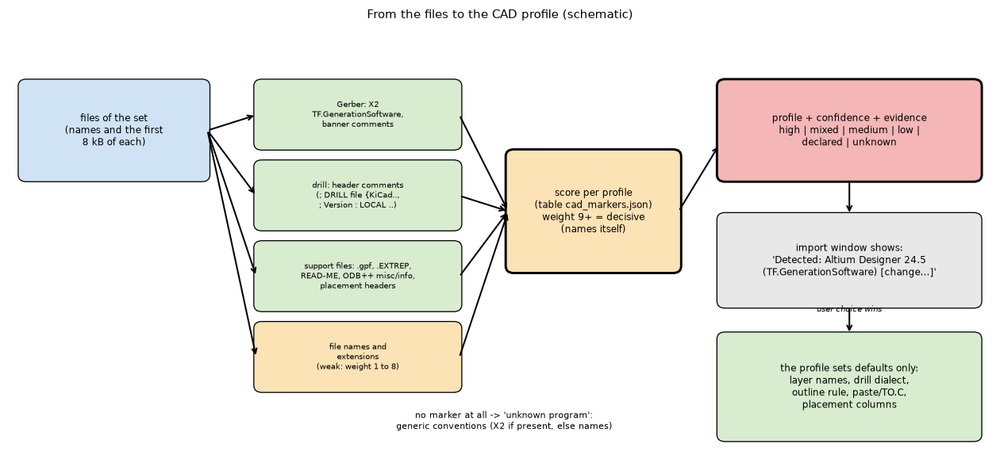
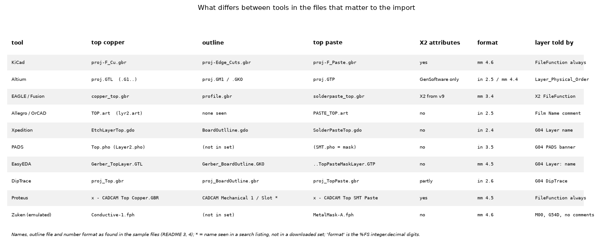
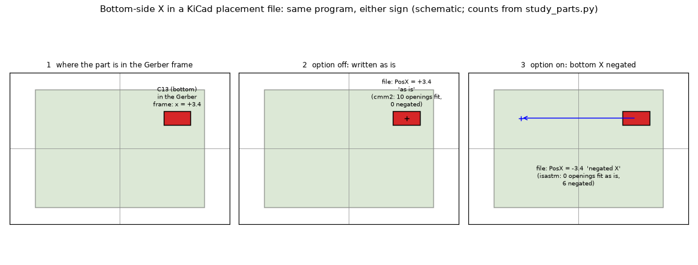
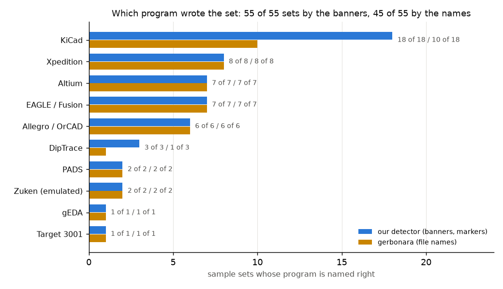

# CAD profiles: recognising the program that wrote a Gerber set

**Status: studies run, written up and reviewed (section 10: go for a minimal 2.5.0 subset, no-go for the full profile design in 2.5.0).** Nothing in `pcbthermal/`, `tests/`, `examples/`, `ico/`, `requirements.txt` or the project documents is changed (the program is only imported; the parts rules are imported from the worktree of the branch `feature/paste-parts`). Everything here is made of open files downloaded into the git-ignored `data/` (133 MB), the committed tables and scripts that reproduce the numbers, and a prototype of the detector (`lib/cadprofiles.py`, `lib/cad_markers.json`, `lib/cad_conventions.json`). **No physical measurement and no board of the maintainer is involved**; the only truths are what a tool wrote in its own files, the labels of `lib/labels.py`, and a second reader (gerbonara + shapely).

The maintainer asked that the Gerber import recognise which eCAD program produced the files, preselect a "CAD profile" that the user can always change, and be tested with many tools, explicitly Siemens Xpedition, Zuken (CR-8000, CR-5000, CADSTAR) and other good tools. The short answers:

* **Recognition works from the files themselves** for 19 programs with real samples (54 of 54 sets, then 28 of 28 held-out sets that the rules were not written from; the held-out sets were found by searching for the same banners, so they test the rules on other files and versions, not the recall on files without a banner: section 10), because almost every tool names itself in a banner comment or an X2 attribute; the exceptions are Fritzing, Upverter, Target 3001 and the Zuken emulation, which are recognised only by a quirk or by a support file (medium confidence), and Zuken real files, which could not be obtained.
* **Xpedition: real files, eight sets, recognised in every file** (100 %), and the program's reader refuses all 17 of its NC drill files (a `G93X0Y0` line) and misclassifies 37 of its 98 files by name. **Zuken: only an emulation** (written by the gerbonara author from Altium files); the program reads its quirks correctly (copper area identical to the original within 0.01 %); no real CR-8000, CR-5000 or CADSTAR file exists in any open archive found.
* **The profile cannot preset everything.** The bottom-side X sign of a placement file is not a property of the tool (two boards of the same KiCad 5.1 line have opposite conventions) and `TO.C` in the paste file depends on a plot option, not on the version. Those two stay detected from the data. What a profile can preset: layer names (the biggest gain), the drill dialect and its quirks, the outline rule, placement columns and preamble.

Sections: 1 question and what would answer it; 2 how a tool is recognised (the table tool to markers); 3 the sample sets (licences, coverage, recognition results, conventions measured); 4 the program's reader on the samples; 5 adjustments per tool; 6 parts rules (paste, placement, bottom X sign); 7 gaps (not tested); 8 design (summary; `INTEGRATION.md` is the design); 9 how to run; 10 review (independent checks, corrections, verdict); 11 what was read and what was not verified.

## 1. The question, and what would answer it

*Can the import tell which eCAD program wrote the files of a set, with a stated confidence and with the evidence shown, and what does knowing it change in how the files are read?*

| Question | What would answer it |
| :-- | :-- |
| Which markers identify each tool, and how reliable are they? | a table tool to markers, every row backed by a real file, a documented statement or marked as memory; a test on sets the rules were not written from |
| What do tools do differently that matters to the program (layer names, outline, drills, units, TO.C, placement)? | counts over the real files (section 3.4) and a run of the program's reader (4) |
| Which refusals and errors are tool specific, and does a small adjustment fix them? | the refused files and the adjusted re-reads with an independent check (5) |
| Which of the paste/placement rules depend on the tool? | the parts rules run on every paste layer (6) |
| What is the rule when markers conflict or are missing? | the confidence rule of `lib/cadprofiles.py` and its tests |

### 1.1 Diagrams



*Figure 1 (`figures/fig_01_recognition_flow.png`): the recognition flow, markers (Gerber, drill, support files, names) to a score per profile, to profile, confidence and evidence, to the import window where the user can change it, and the defaults the profile sets. Schematic.*



*Figure 2 (`figures/fig_02_tool_differences.png`): file names of the top copper, outline and top paste, the X2 attributes and the number format per tool, as found in the sample files (the numbers are those of section 3.4; a name marked * was seen in a search listing, not in a downloaded set).*



*Figure 3 (`figures/fig_03_bottom_x_sign.png`): the bottom-side X of a KiCad placement file written as is (CMM2: 10 bottom parts fit, 0 negated) or negated (ISASTM: 0 fit as written, 6 negated), both KiCad 5.1. Schematic; the counts are those of section 6.*

## 2. How a tool is recognised

### 2.1 The standard mechanism, and what tools really do

The Gerber specification (revision 2026.05, section "`.GenerationSoftware`", page 149, **read in full**) defines the file attribute

`%TF.GenerationSoftware,<vendor>,<application>[,<version>]*%`

"if present, it must be in the header", and the version field was made mandatory in revision 2023.08 (revision history of the specification, read). The XNC specification (2021, section 4 "Attributes", read) says the same attributes are written in Excellon files as comments that start with `#@!`, so that old readers ignore them. In practice (section 3.3) the attribute is **written by KiCad, Altium (Designer 18 to 24 and CircuitMaker), EAGLE from 9.0, Pulsonix, Proteus, LibrePCB and Ucamco's UcamX** (the same `TF.GenerationSoftware,KiCad,Pcbnew,...` also in the drill files as `; #@! TF.GenerationSoftware,Kicad,Pcbnew,...`, note the lower-case `Kicad`). The other tools say who they are in free comments (`G04 ...`) or in the drill header, or not at all.

### 2.2 Table tool to markers

Status of the evidence: **R** = seen in a real file of the study (the set is named), **D** = a documented statement (named), **M** = memory, not seen. The weight is that of `lib/cad_markers.json`: 9 or 10 decisive (the file names its generator in so many words, or carries a quirk only that tool writes), 4 to 8 a quirk or convention, 1 to 3 shared by many tools. All of it is data, the regular expressions are in the file.

| Tool | Marker (where) | Example text read | Status |
| :-- | :-- | :-- | :-- |
| KiCad | X2 in Gerber, X2 comment in drill, banner of old versions, drill header, ODB++ `misc/info` | `%TF.GenerationSoftware,KiCad,Pcbnew,9.0.1-1.fc41*%`; `G04 Created by KiCad (PCBNEW 4.0.6) date ...*`; `; DRILL file {KiCad 7.0.6} date ...`; `SAVE_APP=KiCad EDA 9.0.3` | R (15 sets, versions 4.0.6, 5.1.5 to 5.1.8, 5.99, 6.0, 7.0, 8.0, 8.99, 9.0; ODB++ 9.0.3) |
| KiCad | placement report header | `### Footprint positions - created on ... by ...` | **M** (the maintainer's note; the sets hold only CSV placement files, whose header `Ref,Val,Package,PosX,PosY,Rot,Side` is weight 6) |
| Altium Designer | X2 generation only (no FileFunction in these sets), physical order, colour, aperture parameter comments, drill comments, the report files | `%TF.GenerationSoftware,Altium Limited,Altium Designer,24.5.2 (23)*%`; `G04 Layer_Physical_Order=1*`; `G04:AMPARAMS|DCode=22\|XSize=...`; `;Layer_Color=9474304` in the drill; `Gerber File Extension Report For:` (.EXTREP) | R (7 sets: Designer 18.0.7 to 24.5.2 with X2, and a 2017 set without X2) |
| Altium CircuitMaker | X2 | `TF.GenerationSoftware,Altium Limited,CircuitMaker,2.2.1 (2.2.1.6)` (also writes the Altium macro file: the variant wins over the parent) | R (2 sets) |
| EAGLE and Fusion Electronics | exporter comment, X2 (9.x), drill comment, gerber job file | `G04 EAGLE Gerber RS-274X export*` or `... X2 export*`; `%TF.GenerationSoftware,Autodesk,EAGLE,9.1.3*%`; `;GenerationSoftware,Autodesk,EAGLE,9.0.0*%`; `"Application": "Fusion Electronics"` | R (7 sets; the Fusion 360 files carry the EAGLE banner, only the .gbrjob names Fusion, 9.7.0) |
| Cadence Allegro, OrCAD PCB Editor | identification record, drill comments, support files | `G04 File Origin:  Cadence Allegro 17.2-060*`; `G04 ===== begin FILE IDENTIFICATION RECORD =====*`; `;LEADER: 12`, `;HEADER:`, `;T01 Holesize 1. = 12.000000 ... Quantity = 241`; `art_param.txt: DEVICE-TYPE GERBER_RS274X` | R (6 sets, 16.6 to 17.4; the folder called `orcad` of the gerbonara resources is Allegro 17.4) |
| Siemens Xpedition (Mentor Expedition PCB) | Gerber output definition banner, job/user/layer comments, NC drill header, plot setup, GerbTool | `G04 Mentor Graphics Example Gerber Output Definition*`; `G04 Job   : Z:\...\PCB.pcb*` + `G04 User  :` + `G04 Layer :`; `; Version : LOCAL` + `; Format  : 3.3 / Absolute / MM / Leading`; `.CREATOR "Xpedition Layout Gerber Output"`; `{Program Expedition GerbTool` | R (8 sets; in the 5 development sets every one of the 73 files, support files included, names the tool) |
| PADS (Layout) | banner | `G04 PADS 9.2 Build Number: 406656 generated Gerber (RS-274X) file*` | R (2 sets, 9.2 and 9.5; PADS Professional not seen) |
| Zuken CR-8000 | quirks: aperture prefix `G54D<n>`, flash as `D02*G55D03*`, end `M00`, no comments; extensions `.fph`, `.fdr`, `.fdl`; drill header `ICI,OFF VER,1 FMAT,2 DETECT,ON ATC,ON` | the emulation script `zukenka_gerber.py` of gerbonara (read in full) | **D** only: "manually modified to look like Zuken CR-8000 files" (README of the folder); no real file |
| DipTrace | banner | `G04 DipTrace 2.4.0.1*` (also 3.3.0.0, 4.3.0.3 in held-out sets) | R (3 sets) |
| EasyEDA (Standard) | banner, drill comment | `G04 EasyEDA v6.4.19.4, 2021-07-14T11:09:17--7:00*`; `;EasyEDA v6.4.19.4` | R (4 sets, 6.4 to 6.5) |
| Pulsonix | banner, X2 | `G04 GENERATED BY PULSONIX 12.5 GERBER.DLL 9449*`; `TF.GenerationSoftware,Pulsonix,Pulsonix,12.5.9449` | R (4 sets, 7.6 to 12.5) |
| Proteus (Labcenter) | banner, X2, the READ-ME | `G04 PROTEUS GERBER X2 FILE*`; `TF.GenerationSoftware,Labcenter,Proteus,8.15-SP1-Build34318`; `LABCENTER PROTEUS TOOL INFORMATION FILE`; names ` - CADCAM Top Copper.GBR` | R (4 sets) |
| DesignSpark PCB | banner | `G04 DesignSpark PCB Gerber Version 10.0 Build 5299*` | R (2 sets, 10.0 and 12.0) |
| LibrePCB | X2, header, drill comment | `TF.GenerationSoftware,LibrePCB,LibrePCB,0.1.0`; `G04 --- HEADER BEGIN --- *`; `;Generated by LibrePCB 0.1.0` | R (3 sets, 0.1.0 to 1.1.0) |
| gEDA PCB, pcb-rnd | creator comment | `G04 Creator: pcb 20140316 *`; `G04 Creator: pcb-rnd 2.3.2 *` | R (1 set each) |
| P-CAD | source comment | `G04  Source:          P-CAD 2006 PCB, Version 19.02.958, (...)*` | R (1 set) |
| Target 3001! | support file, aperture-block name, extensions | `CAM output for current project ...` (.Info); `%IN2=CopperbottomL2(X.Bot)*%`; `.Top .Bot .Outline .PasteTop .StopTop .PosiTop` | R (1 set; only the .Info file is decisive: 2 of 28 files) |
| Fritzing | no banner: a header sequence | `%MOIN*%` `%OFA0B0*%` `%FSLAX44Y44*%` `%IPPOS*%` | R (1 set; weight 6, medium) |
| Upverter | no banner: macro names with the size in the name | `%AMRect-W1650000-H1650000-RO1.500*`; drill header `M71,TZ` | R (1 set; medium) |
| CAM350 (a CAM tool) | banner (the original program is lost) | `G04 CAM350 V10.0.1 (Build 312) Date: ...*` | R (1 set; a folder called OrCAD re-exported by CAM350) |
| Ucamco UcamX (a CAM tool) | X2 | `%TF.GenerationSoftware,Ucamco,UcamX,2017.04*%` | D (the specification's own example, page 149) and R (the Ucamco sample sets) |
| Horizon EDA, Sprint-Layout, Ultiboard, Zuken CR-5000, CADSTAR, Siemens PADS Professional, Xpedition Enterprise newer outputs, Cadence Allegro X and OrCAD X, JLCEDA Pro, CircuitStudio | **not obtained**; no marker is known | | N |

### 2.3 The confidence rule (implemented in `lib/cadprofiles.py`, 35 tests in `tests/`)

A set is judged from the names and the first 8 kB of each file; I/O is the caller's. A marker of weight 9 or more is **decisive**.

| Confidence | When | What the window should say |
| :-- | :-- | :-- |
| high | one eCAD profile has decisive markers and no other has (a variant such as CircuitMaker beats its parent Altium) | "Detected: Altium Designer 24.5.2 (TF.GenerationSoftware)" |
| mixed | two eCAD profiles have decisive markers (files of several programs in one set) | "Files from several programs: KiCad (10 files), Allegro (1 file); choose" |
| medium | no decisive marker, weights add up to 5 or more (a quirk, a header sequence, a naming convention) | "Probably Fritzing (header sequence); change if wrong" |
| low | only names of weight 1 to 4 (`.GTL` and friends are shared by a dozen programs) | "Protel-style names: program unknown" |
| declared | no profile matches, but an X2 `TF.GenerationSoftware` names a vendor and application | the profile is "unknown program" and the declared text is shown: "Acme BoardPlot 3.1" |
| unknown | nothing at all | generic conventions: X2 where present, else the names of the existing detector |

A CAM tool (CAM350, UcamX) is reported as the generator of a re-exported set and never overrides an eCAD profile in another file. The user's choice always wins and is remembered with the set.

## 3. The sample sets

`scripts/fetch_samples.py` (the gerbonara test resources through a sparse clone: one request instead of 250, because the first, file by file attempt got HTTP 429) and `scripts/fetch_manifest.py` (repositories found by `scripts/search_code.py`, a banner search with `gh search code`) fill `data/`. Everything is public, nothing is committed, the total is 133 MB for 966 Gerber or drill files in 54 sets and 28 held-out sets, plus three ODB++ archives.

### 3.1 Sources and licences

Licences as recorded at fetch time (the GitHub API's `spdx_id` or the `LICENSE` file of the gerbonara folder). **Files are used for statistics only**; no picture of any board of these sets is made, and no file is committed. Boards with no licence reported, with GPL, AGPL or a share-alike licence are not redistributed (the licences bind a redistribution of the files, not the numbers). The sets of `realboards-*` are those of `research/gerber-real-boards/README.md` section 3, where their licences are given. The `zuken-emulated` folder is CC-BY 3.0 (its LICENSE) and its Gerber files are **not Zuken output**.

| set | source | licence |
| :-- | :-- | :-- |
| allegro | tracespace issue 371 (via gerbonara) | not stated |
| allegro-2 | MinnowBoard-org/design-files, MinnowBoard Max | CC-BY-SA 3.0 (`license.md` of the set) |
| orcad (Allegro 17.4) | gerbonara resources | not stated |
| altium | myriadrf/LimeSDR-QPCIe | CC-BY 3.0 (README of the project, as written in the gerbonara folder) |
| altium-x2: simplefoc, note, linkcard | simplefoc/Arduino-SimpleFOC-PowerShield, blues/note-hardware, peng-zhihui/L-ink_Card | MIT, MIT, GPL-3.0 |
| circuitmaker: yaduino | hishamk/yaduino | CC-BY-4.0 |
| eagle, eagle-newer, eagle-x2/16n, fusion, fusion360 | gerbonara resources, GanzYouthWorkshop/GYW-Electro-Curriculum, 16n-faderbank/16n, maltman23/ArduTouch, camchaney/handheld-cnc | not stated, MIT, NOASSERTION, none, CERN-OHL-W 2 (stated in the gerbonara folder) |
| siemens (MinnowBoard Turbot, Xpedition) | MinnowBoard-org/design-files | CC-BY-SA 3.0 (the folder's LICENSE) |
| siemens-2 | yghdj/lasmo | MIT |
| xpedition: bouled, spirose, hw0004 | bouLED/bouled, friendshipismagic/SpiROSE, jgrobis/HW-0004 | GPL-3.0, none, MIT |
| pads, pads PSDR | OregonStateMarsRover/2011, MichaelRColton/PSDR | GPL-2.0, NOASSERTION |
| zuken-emulated | myriadrf/LimeSDR-QPCIe through the gerbonara author | CC-BY 3.0 |
| diptrace, held-out midTbot, fdskey | codepainters/FD1, bdring/midTbot_esp32, ClusterM/fdskey | BSD (LICENSE of the folder), none, GPL-3.0 |
| easyeda (gerbonara), held-out dagor, datenzwerg, simplefoc-shield | tracespace issue 367, byDagor, romses, simplefoc | not stated, MIT, GPL-3.0, MIT |
| fritzing | ohguma/analog_gyro_2021 | MIT |
| geda, pcb-rnd, pcad, upverter, target3001 | rxdtxd/stepper-lights, EPL-Engineering/epl_isolatedpwr, zxnet, sportiduino/sportiduino, Safecast/Solarcast (IRNAS project) | CERN OHL 1.2, GPL-2, GPL-3, GPL-3, CERN OHL 1.2 |
| kicad (older, wc2, x2-tests, 6, 7, 8, 9) | jaseg/7segstuff (CC BY-SA, not confirmed at the source), tdaede/td-crt, sqfmi/watchy-hardware, will127534/OneInchEye, fossasia/badgemagic-hardware | CC BY-SA, none, MIT, MIT, Apache-2.0 |
| proteus, pulsonix, designspark, librepcb | TengoCharlie/breath-analyzer, intechstudio/ottosdiy, ehajo/ZX81, terminele/rabbit, alastairpatrick/pico-vdp, dbrgn/desklift | Apache-2.0, none, none, Unlicense, GPL-3.0, CC-BY-4.0 |
| held-out (24 more repositories) | listed in `scripts/fetch_manifest.py` (`HELDOUT`) with their licences in each set's `_SOURCE.txt` | MIT, GPL, AGPL, Apache-2.0, CC-BY or none; `scripts/licence_table.py` prints them all |
| orcad/cc1310 (CAM350) | sangphanthanh/CP_SmartGarden | none |
| realboards-* and the Ucamco sets, ODB++ archives | see `research/gerber-real-boards/README.md` section 3 | as stated there |

### 3.2 Coverage: which tools have real samples

| Tool | Real files? | Sets | Versions seen |
| :-- | :-- | --: | :-- |
| Siemens Xpedition | **yes** | 8 | no Gerber or drill file prints the program version; the support files say GerbTool `8.1.2 X1` (3 sets) and plot setup `.VERSION "VB99.0"` (3 sets); every set uses the same "Mentor Graphics Example Gerber Output Definition" template, with file dates from 2015 to 2026 (review, section 10) |
| Siemens PADS Layout | yes | 2 | 9.2, 9.5 |
| Siemens PADS Professional, Valor | **no** | 0 | not obtained |
| Zuken CR-8000 | **emulation only** | 1 | (see 2.2) |
| Zuken CR-5000, CADSTAR | **no** | 0 | none in any open archive found (GitHub code search for the product names and extensions returned nothing; the vendors' pages were not searched for downloadable samples) |
| Altium Designer | yes | 7 | 17 (LimeSDR, no X2) to 24.5 (X2 from 18) |
| Altium CircuitMaker | yes | 2 | 2.2.1 |
| Altium CircuitStudio, Altium 365 | no | 0 | |
| Autodesk EAGLE | yes | 7 | 7.x (RS-274X export, no X2), 9.0 to 9.4 (X2) |
| Autodesk Fusion Electronics | yes, indirectly | 1 | 9.7.0 (gerber job file; Gerber files carry the EAGLE banner) |
| Cadence Allegro / OrCAD PCB Editor | yes | 6 | 16.6, 17.2, 17.4 |
| Cadence Allegro X, OrCAD X | no | 0 | |
| KiCad | yes | 18 | 4.0.6, 5.1.x, 5.99, 6.0, 7.0, 8.0, 8.99, 9.0 |
| EasyEDA Standard | yes | 4 | 6.4 to 6.5 |
| EasyEDA Pro, JLCEDA Pro | no | 0 | |
| DipTrace | yes | 3 | 2.4, 3.3, 4.3 |
| Pulsonix | yes | 4 | 7.6 to 12.5 |
| Proteus | yes | 4 | 8.5 to 8.15 |
| Target 3001! | yes | 1 | one project |
| gEDA PCB, pcb-rnd | yes | 2 | pcb 20140316, pcb-rnd 2.3.2 |
| LibrePCB | yes | 3 | 0.1.0 to 1.1.0 |
| DesignSpark PCB | yes | 2 | 10.0, 12.0 |
| Fritzing, Upverter, P-CAD | yes | 1 each | |
| Horizon EDA, Sprint-Layout, Ultiboard | **no** | 0 | |
| IPC-2581 files | **no** (only IPC-D-356 netlists were found) | 0 | |
| ODB++ | yes, 3 small archives | 3 | KiCad 9.0.3 writes `misc/info` with the program; the other two archives (Altium-like names) have no `misc/info` |

### 3.3 Recognition results (`scripts/study_markers.py`, `scripts/study_heldout.py`)

**Honest caveat first.** The rules of `lib/cad_markers.json` were written after reading the banners of the 54 development sets, so their 54 of 54 is a fit, not a test. The test is the second block: 28 sets from other repositories, other versions and other users, fetched after the rules were committed (the rules were frozen at commit `6ab8e4b`; **none had to change**). Their truth is the tool whose banner the repository was found by in a code search, so they test the rules on other files, not the search.

* **Development sets: 54 of 54** recognised as the tool the source says wrote them (one wrong first, CircuitMaker, which writes the Altium macro file too: fixed by the variant rule; and one wrong truth label of mine, an Proteus set I had marked unknown).
* **Held-out sets: 28 of 28**, all with high confidence, with versions read (Allegro 16.6 and 17.2-S049, Altium 19.1.5 and 22.0.2, DipTrace 3.3 and 4.3, EAGLE 9.4.0, EasyEDA 6.5.34 to 6.5.42, KiCad 7.0.1, 7.0.9 and 9.0.0, LibrePCB 0.1.4 and 1.1.0, PADS 9.5, Pulsonix 7.6 and 8.5, Proteus 8.15, DesignSpark 12.0). One Altium set (OpenSimpleLidar) has no X2 and no version: recognised by `Layer_Physical_Order`.
* **A single file is enough for most tools.** Share of all files of the sets that name the tool by themselves (decisive marker; the count includes every file of the folder, also READMEs and reports):

| tool | sets | files | files that name the tool |
| :-- | --: | --: | --: |
| Xpedition | 5 | 73 | 73 (100 %) |
| EAGLE / Fusion | 5 | 53 | 53 (100 %) |
| KiCad | 15 | 183 | 169 (92 %) |
| Altium | 4 | 91 | 76 (84 %) |
| Allegro | 3 | 59 | 38 (64 %; the drill and support files do not) |
| Proteus | 2 | 42 | 20 (48 %) |
| Target 3001 | 1 | 14 | 1 (7 %) |
| Fritzing, Upverter, Zuken (emulated) | 4 | 30 | 0 (0 %; medium confidence by a quirk) |

(the complete per-tool table is printed by `study_markers.py`.)

### 3.4 What each tool writes (`scripts/study_conventions.py`)

Counts over the Gerber files (966 files in total with the drill files, 887 of them Gerber):

| tool | files | units | number format (FS) | X2 FileFunction | GenerationSoftware | `TO.C` | AperFunction | `G54D` prefix | end |
| :-- | --: | :-- | :-- | --: | --: | --: | --: | --: | :-- |
| KiCad | 187 | mm 187 | 4.6 (all) | 187 | 178 | 47 | 74 | 0 | M02 148 |
| Altium | 95 | in 63, mm 32 | 2.5 (56), 4.4 (25) | 0 | 63 | 0 | 0 | 0 | M02 73 |
| EAGLE | 60 | mm 52, in 8 | 3.4 (50), 3.6 (8) | 28 | 28 | 0 | 0 | 0 | M02 52 |
| Allegro | 84 | in 84 | 2.5 (66), 4.5 (13), T 2.5 (5) | 0 | 0 | 0 | 0 | 80 | M02 72 |
| Xpedition | 81 | in 81 | 2.4 (64), 2.6 (17) | 0 | 0 | 0 | 0 | 74 | M02 51 |
| PADS | 14 | in 14 | 3.5 | 0 | 0 | 0 | 0 | 14 | M02 9 |
| EasyEDA | 32 | mm 25, in 7 | 4.5, 3.6 | 0 | 0 | 0 | 0 | 0 | M02 31 |
| DipTrace | 31 | in 27, mm 4 | 2.6, 4.4, 5.3 | 17 | 0 | 0 | 4 | 0 | M02 31 |
| Pulsonix | 51 | mm 42, in 9 | 3.5 | 44 | 28 | 0 | 44 | 0 | M02 51 |
| Proteus | 40 | mm 40 | 4.5 | 40 | 40 | 0 | 36 | 0 | M02 34 |
| LibrePCB | 25 | mm 24 | 6.6 | 9 | 24 | 8 | 3 | 1 | M02 22 |
| Zuken (emulated) | 8 | mm 8 | 4.6 | 0 | 0 | 0 | 0 | 8 | **M00** 7 |

All use leading-zero omission (`L`) and absolute coordinates except **5 Allegro files** (the MinnowMax "GAF" films, `%FSTAX25Y25*%`, trailing-zero omission, deprecated since revision 2015.06 of the specification), which the program reads (none of them is in the refused list of section 4); no file uses the aperture blocks or the transformations `AB`, `LM`, `LR`, `LS`. The complete table (every tool, drill files) is in `out/conventions.txt` after `scripts/study_conventions.py`. Drill files, per tool: Altium `;FILE_FORMAT=a:b`, `;TYPE=PLATED`, `;Layer_Color=`; EasyEDA the same (it imitates Altium); KiCad a comment header and `FMAT,2` (plated by the X2 comment in 31 of 32 files; a merged file is `MixedPlating`); EAGLE `.xln` with `ICI,OFF`; Allegro `;LEADER:`, `;HEADER:`, `;CODE  : ASCII` and per-tool `Quantity` comments (declared 287 and 1991 holes = holes read); Xpedition `; Format  : 3.3 / Absolute / MM / Leading` (the word names the **suppressed** zeros: `METRIC,TZ` is "Leading", `INCH,LZ` is "Trailing") with a `G93X0Y0` line in all 17 files; Pulsonix `FMAT,1` and `G81`; Upverter `M71,TZ`; Zuken (emulated) `ICI,OFF VER,1 FMAT,2 DETECT,ON ATC,ON`.

### 3.5 What the Zuken evidence is

The gerbonara test resources contain a folder `zuken-emulated`, whose README says: "These are actually Altium files that have been manually modified to look like Zuken CR-8000 files", and whose scripts (`zukenka_gerber.py`, `zukenka_excellon.py`, read in full) show the changes: comments removed, `%LPD*%` moved, `G54` before every aperture selection, every flash written `...D02*G55D03*`, `M02` replaced by `X0Y0D02*M00*`, header lines kept apart and the rest on one line, drill files `.fdr` with a `.fdl` drill list (`***** DRILL LIST *****`, "Host : Windows_Hostname"), extensions `.fph`. The original files of the same board are in the folder (`orig/`, KiCad). **The emulation is the gerbonara author's reading of real CR-8000 files; whether it is faithful to a current CR-8000 version cannot be checked here**, and no real CR-5000 or CADSTAR file was found.

## 4. The program's reader on the samples (`scripts/study_reader.py`)

Every Gerber or drill file (966) was given to `detect_function` (name alone, then name plus head), `read_layer` / `read_drill_file`, `outline_from_layer` for the files taken as outline, and, for copper files up to 600 kB, the copper area of the program's rasteriser against gerbonara + shapely. The truth of a layer's function is the X2 `FileFunction` the tool wrote, else a hand label (`lib/labels.py`; the PADS and EAGLE conventions in it are from memory, "M"; a file of no electrical use counts as right when found "other" or "unknown").

| tool | files | judged | kind right, name only | kind right, name + head | read ok | refused |
| :-- | --: | --: | --: | --: | --: | --: |
| KiCad | 219 | 218 | 210 | 218 | 219 | 0 |
| Altium | 104 | 97 | 88 | 97 | 104 | 0 |
| EAGLE | 65 | 45 | 45 | 45 | 65 | 0 |
| EasyEDA | 41 | 39 | 39 | 39 | 41 | 0 |
| DipTrace | 36 | 36 | 36 | 36 | 36 | 0 |
| Pulsonix | 56 | 44 | 44 | 44 | 56 | 0 |
| Proteus | 40 | 40 | 31 | 40 | 39 | 1 |
| Ucamco (UcamX) | 32 | 32 | 18 | 32 | 32 | 0 |
| Allegro | 85 | 78 | 52 | 52 | 83 | 2 |
| **Xpedition** | 98 | 98 | 44 | 61 | 81 | **17** |
| PADS | 14 | 14 | 8 | 8 | 14 | 0 |
| pcb-rnd | 13 | 13 | 10 | 10 | 13 | 0 |
| gEDA | 18 | 18 | 16 | 16 | 18 | 0 |
| Target 3001 | 10 | 10 | 0 | 1 | 10 | 0 |
| Zuken (emulated) | 10 | 10 | 2 | 2 | 10 | 0 |
| Upverter | 11 | 11 | 11 | 11 | 5 | **6** |
| Fritzing | 9 | 9 | 8 | 8 | 9 | 0 |
| **all** | 966 | 844 | 692 (82 %) | 752 (89 %) | 937 | 29 |

* **Where the function is wrong, the cause is the tool's own names.** Xpedition (`EtchLayerTop`, `SolderPasteTop`, `BoardOutlline`: 37 of 98 wrong; `SoldermaskTop` is found as a mask but its side is lost: the side is right for only 11 of the 70 Xpedition files that have one), Allegro (film names the user chooses: `lyr2.art`, `l1_primary.art`, `SMB.art`, `SPT.art`, `SOLDER_BOT.art` read as copper; 26 of 78 wrong), PADS (`SMT.pho`, `bot-sm.pho`: 6 of 14), Target 3001 (extensions `.Top .Bot .Outline .PasteTop`: 9 of 10), Zuken (8 of 10), pcb-rnd (assembly and fab files read as copper because the project is called `power-art`). **Review: the dangerous ones are the files taken for copper that are not copper** (a mask counted as copper changes the temperatures if the user does not correct the list): Allegro `SOLDER_TOP.art`/`SOLDER_BOT.art`, PADS `top-sm.pho`/`bot-sm.pho`, Zuken (emulated) `Resist-B` and `Symbol-B`, pcb-rnd `.asb`/`.ast`/`.fab`: 9 files. The cause is one generic rule of `functions.py` (a side word with no kind word is copper), not the tool; it should be fixed in the generic rules for every set (section 10). Xpedition `Layer1.gdo` is taken as an inner layer and `Layer4.gdo` (the bottom of a 4-layer board) is labelled inner by `lib/labels.py` too, so the side figures of Xpedition count that file as right while both are wrong. The 7 `realboards-*` KiCad sets carry the names given by `research/gerber-real-boards` (`F.gbr`, `pasteB.gbr`), not KiCad's, so KiCad's "name only" figure is not a measure of KiCad's names. With the X2 attribute or an Excellon header the detector is right: KiCad 218 of 218, Altium 97 of 97 (name alone 88), UcamX 32 of 32. **A profile that carries the tool's own name rules would fix every one of these**, but note that the rules of `lib/labels.py` were written with these names in view (section 10), so the gain is an upper bound for the sets seen, not a measured out-of-sample figure.
* **Refused, by cause** (29 files, all with a message, no crash and no wrong geometry):
  * 17 Xpedition NC drill files: `G93X0Y0` (a zero origin shift) is refused as an "origin shift" (section 5.2).
  * 6 Upverter files: macro names with a hyphen (`Rect-W1650000-...`, not allowed by the specification) and the drill header `M71,TZ` (5.3).
  * 5 files: 2 Allegro assembly films with `%MIA1B0*%` (image mirror) and 3 re-exported CAM350 files whose apertures are used before they are defined.
  * 1 Proteus assembly file (aperture used before defined); the Xpedition punch file `ThruHolePunchPlated.ncd` (tools without a diameter) is among the 17 Xpedition refusals and stays refused after the adjustment.
* **Copper area**: 175 copper files up to 600 kB compared, **174 within 3 %**, median difference 0.03 %, worst 3.4 % (an Xpedition 4-layer plane); this is the reader, and it is the same for every tool: the tool matters for what a file *is*, not for how copper is rasterised.
* **Outline** (`study_adjustments.py` lists 13 files: the 11 below, a second copy of the Target 3001 file and a Proteus workspace file that is not an outline): the files the program takes as outline are closed contours in KiCad, EAGLE (also Fusion), Xpedition, Proteus and Allegro-less sets, and **fail at 0.01 mm in 11 files of 7 tools** (Altium, CircuitMaker, EasyEDA, CAM350, P-CAD, pcb-rnd, Target 3001): section 5.1.

## 5. Adjustments per tool (`scripts/study_adjustments.py`)

### 5.1 Outline files with stubs, doubled lines or gaps (`lib/outline_prune.py`)

Prototype: drop duplicated segments and then dangling segments until none is left, then chain with the program's own `chain_segments`. Judged by the bounding box of the loop against that of the copper of the same set.

| file | at 0.01 mm | at 0.1 mm | after pruning: loops, duplicates, dangling | loop box / copper box |
| :-- | :-- | :-- | :-- | :-- |
| Altium L-ink GM1 | fail | fail | 2, 28, 30 | 1.01 x 1.01 |
| Altium SimpleFOC GM1 | fail | fail | 1, 0, 2 | 1.01 x 1.02 |
| CircuitMaker hydro GKO | fail | fail | 26, 2, 33 | 1.00 x 1.00 |
| CircuitMaker hydro GM1 | fail | fail | 25, 24, 33 | 0.02 x 0.12 (a mechanical layer with other drawings: the wrong layer) |
| EasyEDA SimpleFOC GKO | fail | fail | 1, 4, 1 | 0.99 x 1.02 |
| CAM350 (OrCAD folder) outline.gbr | fail | fail | 1, 0, 2 | 1.12 x 1.09 |
| Target 3001 Outline | fail | fail | 1, 1, 2 | 1.00 x 1.00 |
| P-CAD ZXINET.GKO | fail | **closes** | (not needed) | |
| Altium LimeSDR GM1 | fail | fail | fails (the layer holds the whole mechanical drawing, 15 193 loose joints) | |
| EasyEDA Datenzwerg GKO | fail | fail | nothing left: the contour is a real open chain (5 strokes, a gap) | |
| pcb-rnd power-art.gko | fail | fail | nothing left | |

Result: pruning gives a closed contour of the size of the board in **6 of 11 files** (the list above holds the 11 files; one more, hydro GM1, gives a contour of the wrong layer) (the copper box and the loop box agree within 2 %, 12 % for the CAM350 file, whose board has a connector outside the copper), the join tolerance alone fixes 1 (P-CAD), 1 is the wrong layer and 3 stay open. This is why the profile carries an outline rule ("prune the contour", "the outline is the largest closed loop"), and why the profile for tools with no outline file (Allegro, 6 sets) says there is none.

### 5.2 Xpedition NC drill: `G93X0Y0`

Every one of the 17 `.ncd` files has the lines `G90`, `G93X0Y0` after the tool list. `G93X0Y0` sets the origin to (0, 0), which is a no-op, but the program refuses any `G93`. With the line removed in memory all 16 files that were refused for this reason are read (the 17th, `ThruHolePunchPlated.ncd`, is a punch file with tools without a diameter and stays refused): holes read per file range from 3 to 9690 (the 6-layer SpiROSE has 9690; the three `ContourPlated.ncd` files are routed slots, `G00 ... M15 G01 ... M16`, counted as 44 slot segments), and **0 of 14 802 holes and slots lie outside the board box** (the box of the outline file of the same set, margin 0.5 mm). That is a check of position, not of count (the Xpedition files declare no hole counts). For Allegro the declared counts do equal the counts read (287 of 287, 1991 of 1991).

### 5.3 Upverter

The program refuses the drill file as "without unit information" (it knows `M71` only alone on a line) and the Gerber files as "aperture shape Rect (non-standard)" (the macro name ends at the hyphen for the reader). `M71,TZ` read as `METRIC,TZ` gives 63 holes (the coordinates carry a decimal point, so the zero suppression does not matter); with the macro names rewritten (hyphens and dots to underscores; the specification, section 3.4.5 "Names", allows only letters, digits, `_` and a leading `$`) all 7 non-empty Gerber files are read (the eighth, the top paste, holds no object) and the copper areas agree with gerbonara + shapely within 0.04 to 0.24 %. The program's refusal is consistent with the specification (macro names may not contain a hyphen); the adjustment is a tolerance for this tool.

### 5.4 Other tool specific facts

* **Allegro**: assembly films carry `%MIA1B0*%` (refused by the program; the profile can say "assembly and fab films are not read"). A drill file may have **no `M48` header and no T codes** (BeagleBone AI: coordinates only, the tool sizes in the comment lines `;   Holesize 1. = 8.000000 ... Quantity = 1789`); the program cannot read it, the Allegro profile could (comments give the sizes, the counts allow a check).
* **PADS**: `SMT.pho` and `SMB.pho` are solder masks and `SST.pho` and `SSB.pho` silkscreens (from the layout of the files, M); `Drill.drl` starts with a `%` line before the tools, the program's header detector for `M48` does not see it (the Fritzing drill has the same `%` first line).
* **Xpedition**: `DRILL.gdo` in one set is a **drawing** of the holes in Gerber, named like a drill file; the name rules of the program take it for a drill file (reading it as holes would give nonsense). `DrillDrawingThrough.gdo` is called "other" correctly.
* **KiCad**: a merged drill file `MixedPlating` (KiCad 7.0.1, b-parasite) is read as a drill file with no plating information; the plating of the individual holes is not known. The merged file is the default of the KiCad plot dialog.
* **pcb-rnd, gEDA**: the program's name rules take `power-art.fab` and `.asb`/`.ast` (assembly) for copper because of the word `power` in the project name: a rule bug, not a tool property.

## 6. Parts rules on the paste layers of each tool (`scripts/study_parts.py`)

The parts rules of the branch `feature/paste-parts` (paste openings, `TO.C`, placement files, envelope matching, bottom X sign) run on every set with a paste layer. Counts below are those printed by the script.

* **`TO.C` in the paste file depends on a plot option, not on the version.** KiCad sets with references in every opening: 5.1.6 (ISASTM, 772 of 772), 5.1.7 (OSW light, 206 of 206), 5.1.8 (CMM2, 494 of 494), 8.0.4 (362 of 362), 8.99 (StickHub, 264 of 264), 9.0.1 (1138 of 1138). KiCad sets with none: 5.1.5 (CO60, 0 of 489), 7.0.1 (RP2040, 0 of 129), 7.0.6 (Watchy, 0 of 290), 7.0.9 (VoltLink, 0 of 114), 9.0.0 (LibreVNA, 0 of 1872). Review, a check of the inference: 4 of the 5 KiCad sets without `TO.C` (CO60, RP2040, Watchy, VoltLink) write their X2 attributes as comments (`G04 #@! TF...`, the plot option "use extended X2 format" off), and the fifth (LibreVNA, 9.0.0) writes full X2 without `TO.C` ("include netlist attributes" off); every set with `TO.C` writes full X2. The data therefore point to the plot options, which the dialog can name from the file itself. Without `TO.C` the rule falls to "placement by position" (191 of 193 parts in CO60, 27 of 30 in RP2040, 559 of 568 in LibreVNA). No other tool writes `TO.C` in these sets except LibrePCB (8 files). Altium, EAGLE, EasyEDA, DipTrace, pcb-rnd and Xpedition paste layers have openings but no references: "paste only".
* **The bottom-side X convention is a per-file option, not a property of the tool.** In the same KiCad 5.1 line, ISASTM's placement file is written with the bottom X **negated** (of its 6 bottom openings, 0 fall in a part envelope as written, 6 negated) and CMM2's and CO60's **as is** (10 and 0; 473 and 0); the CSV does not say which. (Review: the main table of `study_parts.py` prints "as is" for ISASTM because `build_parts` decides the convention only for the parts matched by position, and ISASTM's parts are all matched by `TO.C`; the counts quoted here are printed by the second table of the script, added by the review.) A profile can therefore not preset it: it stays detected from the openings (`bottom_convention`).
* **Pulsonix's placement file is refused**: four preamble lines (`rabbit watch - COMPONENT PLACEMENT,`, a date, `Units,mm,`, an empty line) before the header `Ref,Part Name,Side,X,Y,Rotation,`; `parse_placement` stops at the first non-header line ("no placement header found"). With the preamble removed it reads 86 parts (79 top, 7 bottom), but the column "Part Name" (`C 0.1uF 0201 X5R`) is not mapped to a package, so the envelope rule matches **8 of 86 parts**. A Pulsonix profile would say "skip lines until the header" and "Part Name is the package, in the tool's naming".
* **Placement files seen**: KiCad CSV (`Ref,Val,Package,PosX,PosY,Rot,Side`, mm), JLCPCB CPL (`Designator,Val,Package,Mid X,Mid Y,Rotation,Layer`), Pulsonix (above). Altium, Allegro, Xpedition, EAGLE, PADS and Zuken placement files were **not seen** (no sample in any set): their layouts are not described here.
* **Target 3001's `.PosiTop`/`.PosiBot` are Gerber placement-print layers** (they would be taken for silkscreen), not coordinate lists.

## 7. Gaps: what was not tested, and what to ask a user

| Not tested | Why | What to ask a user |
| :-- | :-- | :-- |
| Zuken CR-8000, CR-5000, CADSTAR (real) | no open file found (code search by product name, by banner and by extension found nothing; the vendors' pages and forums were not searched for downloads) | one complete output set of the project (Gerber, drill, placement list, the output setup screenshot), or the first 30 lines of one Gerber and one drill file |
| Siemens PADS Professional, Valor, Xpedition Enterprise newer outputs | only the Expedition PCB 8.1.2 X1 era and PADS Layout 9.x found | the same, plus the version and the output definition name |
| Altium: 365, CircuitStudio, the X3 / ODB++ / IPC-2581 outputs | not found | one Gerber X2 file, the NC Drill and the "Pick Place" file |
| Cadence Allegro X, OrCAD X | only 16.6 to 17.4 found | a film file head and its `art_param.txt` |
| EasyEDA Pro / JLCEDA Pro | no sample with a Pro banner found | one Gerber head and the drill file |
| Horizon EDA, Sprint-Layout, Ultiboard | no sample; markers unknown | one file of each |
| IPC-2581 (all tools) | not read at all; only IPC-D-356 netlists exist in the sets | not asked: out of scope for 2.5.0 |
| ODB++ of any tool except KiCad | only three small archives | not asked |
| Placement files of Altium, Allegro, Xpedition, PADS, EAGLE | no sample | the "pick and place" / centroid file |
| The effect on temperatures | nothing here computes a temperature | n/a |

## 8. Design (summary; `INTEGRATION.md` has it in full)

A data file `pcbthermal/data/cad_profiles.json` (the two files of `lib/`, markers and conventions, merged), a module `pcbthermal/gerber/profiles.py` with `detect_profile(files)` returning `(profile, confidence, evidence)` and `apply(profile, name, head)` giving the layer function when the X2 attribute is missing, a user choice in the import window ("Detected: ... [change...]"), tests per profile with synthetic files made from the real banners, and the documentation (user guide, `docs/models.md`, `docs/theory.md`). **Measured impact of the proposals** is in `INTEGRATION.md` 3: layer function by profile names (an upper bound: the 92 wrong files of 844 are those the labels' own rules cover; an earlier "696 of 858" here was not printed by any script and is withdrawn), 16 Xpedition drill files read again, 6 Upverter files, 6 outlines closed by pruning (and 1 more by a join tolerance of 0.1 mm). The reviewed recommendation is `INTEGRATION.md` 7.

## 9. How to run

From the repository root, with `.venv-research` (needs gerbonara and shapely for the area comparison only):

```
.venv-research/bin/python research/gerber-cad-profiles/scripts/fetch_samples.py        # gerbonara resources (see 3)
.venv-research/bin/python research/gerber-cad-profiles/scripts/fetch_manifest.py       # repositories
.venv-research/bin/python research/gerber-cad-profiles/scripts/fetch_manifest.py --heldout
python3 -I research/gerber-cad-profiles/scripts/study_markers.py                       # 3.3, 54 sets
python3 -I research/gerber-cad-profiles/scripts/study_heldout.py                       # 3.3, 28 sets
python3 -I research/gerber-cad-profiles/scripts/study_conventions.py                   # 3.4
.venv-research/bin/python research/gerber-cad-profiles/scripts/study_reader.py --out research/gerber-cad-profiles/out/reader.json   # 4 (about 2 minutes; --no-area 15 s)
.venv-research/bin/python research/gerber-cad-profiles/scripts/study_adjustments.py     # 5
.venv-research/bin/python research/gerber-cad-profiles/scripts/study_parts.py           # 6 (needs the worktree of feature/paste-parts, PCBT_PARTS_TREE)
.venv/bin/python research/gerber-cad-profiles/scripts/make_diagrams.py                  # figures 1 to 3
.venv-research/bin/python research/gerber-cad-profiles/scripts/make_figures.py          # figure 4 (review)
.venv-research/bin/python research/gerber-cad-profiles/scripts/study_gerbonara_crosscheck.py   # 11, review: gerbonara's own generator guess
.venv-research/bin/python -m pytest -q research/gerber-cad-profiles/tests              # 37 tests, under 1 s
```

(`fetch_samples.py` as committed downloads file by file and is rate limited by the host; the data of this study were taken from a sparse clone of the repository `gitlab.com/gerbolyze/gerbonara`, `tests/resources`, copied by tool name; the folder names are those of `FOLDERS` in the script, with `eagle_files` stored as `eagle`.)

## 10. Review

The reviewer re-ran every study of the folder on the same data (`data/`, 966 files, 82 sets) with the program of `develop` (`c76479e`) and the parts rules of `feature/paste-parts` (`cc62415`), and checked the claims against references that do not share the detector's rules.

### 10.1 What was re-run and what it printed

| Claim | Re-run | Result |
| :-- | :-- | :-- |
| 54 of 54 development sets, 28 of 28 held-out sets, high confidence (medium for Fritzing, Upverter, Zuken emulated) | `study_markers.py`, `study_heldout.py` | reproduced to the row, also after the review's change of two regular expressions (10.3) |
| Held-out sets fetched after the rules were frozen | git history and file times | rules and detector committed in `6ab8e4b`; the 28 held-out sets were written to `data/heldout/` 3 to 8 minutes later; `cad_markers.json` and `cadprofiles.py` did not change after `6ab8e4b` until this review. **But** `lib/labels.py` (the truth of section 4) was committed after the held-out sets were on disk, and the held-out repositories were found by searching for the same banners the rules match, so the held-out test shows that the rules hold on other files, users and versions of tools that write a banner; it says nothing about files without one |
| Conventions table 3.4 | `study_conventions.py` | identical to `out/conventions.txt` |
| Reader table 4, copper areas 174 of 175 within 3 % (median 0.03 %, worst 3.4 %) | `study_reader.py` with areas (153 s, 2.2 GB peak) | reproduced; the worst file is `hw0004/Layer4.gdo`, the bottom copper of a 4-layer board |
| 17 of 17 Xpedition NC drill files carry `G93X0Y0` | `grep` over the 17 `.ncd` files of the 8 sets | 17 of 17, one line each, after the header, always `G93X0Y0` (never another offset) |
| 16 drill files read without the line, 14 802 holes, 0 outside the board box | `study_adjustments.py` | reproduced; three of the 16 are routed contour files (44 slot segments), now said in 5.2 |
| Outline pruning, 6 of 11 closed | `study_adjustments.py` | reproduced (the script lists 13 files, 5.1 explains the two extra); one of the 6 closes at 1.12 x 1.09 of the copper box, and one more file (hydro `GM1`) closes **on a drawing that is not the outline** (0.02 x 0.12 of the copper box) |
| Upverter areas within 0.04 to 0.24 % | `study_adjustments.py` | reproduced; the top paste printed a `TypeError` of the script (the file is empty): fixed, now "empty layer" |
| `TO.C` depends on a plot option | `study_parts.py`, and the reviewer's count of `%TF` against `G04 #@! TF` in the paste files | supported: 4 of the 5 KiCad sets without `TO.C` write X2 as comments, the fifth has full X2 without `TO.C`; within 5.1 and within 9.0 both cases occur (6) |
| Bottom X: ISASTM negated (0 / 6), CMM2 as is (10 / 0) | `study_parts.py` | **the script did not print these counts** (its table printed "as is" for ISASTM, see 6); the review added the second table, which prints them, and CO60 (as is, 473 / 0); figure 3 said "parts", it counts openings: redrawn |
| Xpedition "8.1.2 era" | the support files of the 8 sets | the version is not in any Gerber or drill file; GerbTool `8.1.2 X1` in 3 sets, `VB99.0` in 3 plot setups; same output template in all 8 (3.2 corrected) |
| "696 of 858" (section 8) | every script | not printed by any script; withdrawn |
| Licences per set | `licence_table.py` | every set has a source and a licence field (GitHub API or the folder's LICENSE; several "none reported"); used for statistics only |
| Nothing third-party committed | `git ls-files research/gerber-cad-profiles` | 36 files, all ours (scripts, tables, three schematic figures, documents); `data/` and `out/` ignored; `scripts/gerbonara_listing.json` is a listing of file names of the gerbonara repository, no content |

### 10.2 Independent reference: gerbonara's own generator guess

`scripts/study_gerbonara_crosscheck.py` (new) asks gerbonara (Apache-2.0; its `layer_rules.MATCH_RULES` and `_best_match`, written by another author, sharing none of our rules) which program wrote each set. On the 55 sets of the 11 tools it knows, **gerbonara names the source on 45 and our detector on 55**. The 10 disagreements are all gerbonara reading names: the 7 `realboards-*` KiCad sets (renamed by an earlier study, so gerbonara says PADS), the original KiCad files of the Zuken emulation (no guess) and the two held-out DipTrace sets (PADS). On the 27 sets of tools it does not know, it names some tool on 25 (Pulsonix as PADS, Proteus as Zuken or EAGLE, EasyEDA and LibrePCB as Altium, the Ucamco sets as Zuken; CircuitMaker as Altium is at least its parent). Two things follow: the banners are a far better marker than the names, and **a guess from names alone must never be offered with more than low confidence** (as the confidence rule already does).



*Figure 4 (`figures/fig_04_detection_against_gerbonara.png`): per tool that gerbonara knows, the sample sets whose program is named right by our detector (blue) and by gerbonara's name-based guess (amber); drawn by `scripts/make_figures.py` from the same run as `study_gerbonara_crosscheck.py`.*

### 10.3 Defects found and corrected in the folder

1. **Private text in committed files** (the maintainer's concern): `INTEGRATION.md` 2.3 quoted the user and computer name of a real Xpedition banner, and `tests/test_cadprofiles.py` carried a real path and user name in two cases. Replaced by synthetic text (`C:\path\to\PCB.pcb`, `HOST:user`). The earlier text stays in the history of this branch (not pushed yet): whether to keep it is a decision for the maintainer (`INTEGRATION.md` 7, open question 6).
2. **Quadratic regular expressions**: the generic X2 pattern `,\s*([^,*%\r\n]+)` took 0.26 s on one 8 kB head of blanks (a hostile set of a thousand such files: minutes), and the Target 3001 marker `[A-Za-z]+[^*]*` 0.02 s. Both rewritten to linear forms with the same matches (54 of 54 and 28 of 28 unchanged); `test_review_x2_declaration_is_linear` keeps it. The statement of `INTEGRATION.md` 5 that the patterns are linear because they have no nested quantifiers was wrong: two adjacent quantifiers that accept the same characters are enough.
3. **Evidence that may be shown**: the prototype's `Hit.text` holds the matched text (for Xpedition the path and the user). The review added `public_evidence` and `public_text` (marker ids, file counts, the version and declared generator cut to 40 printable characters without markup), with a test; the program must show and store only that. A declared generator is text from the file: shown in a Qt label it must be escaped (a label in rich-text mode would interpret `<b>`).
4. Study artefacts fixed: the empty Upverter paste file (5.3), the bottom-X counts (6 and figure 3), the wording of 4 ("11 of 70"), 5.1 (13 files listed), 5.2 (contour files), 8 ("696 of 858", the section number of `INTEGRATION.md`, "7 outlines").

### 10.4 Defects of the program found on the way (not edited here; measured and written up)

1. **A mask or an assembly drawing proposed as copper** by the generic name rules of `pcbthermal/gerber/functions.py` (line 161: a side word without a kind word is copper): 9 files of 5 tools (section 4). The user confirms the list, but this is the one default that changes temperatures. Fix in the generic rules (a `sm`/`solder` token with a side is a mask; `assembly`, `asb`, `ast`, `fab` are other), for every set, with a regression test from the names: a `fix/` branch, not a profile.
2. **Numbered copper names without a side** (`Layer1.gdo` ... `Layer4.gdo`): the generic rule makes every one inner; within a set, the lowest number is the top and the highest the bottom when no other side word exists. Generic, set level, with the user's confirmation.
3. **`DRILL.gdo` (a Gerber drawing of the holes) proposed as a drill file**: a file whose head is Gerber and that has no X2 drill function is never an Excellon drill file; at most a Gerber drill layer if it flashes, otherwise "other". Generic content rule.
4. **Reader tolerances** (decided in `INTEGRATION.md` 7): general, not per profile.

### 10.5 What the evidence supports, per tool

| Tool | Real files | What the documents and the user guide may say |
| :-- | :-- | :-- |
| KiCad 4 to 9, Altium Designer 17 to 24, CircuitMaker, EAGLE 7 to 9 / Fusion, Allegro / OrCAD 16.6 to 17.4, EasyEDA Standard 6.4 to 6.5, DipTrace 2.4 to 4.3, Pulsonix 7.6 to 12.5, Proteus 8.5 to 8.15, LibrePCB, DesignSpark 10 and 12, gEDA, pcb-rnd, P-CAD 2006, PADS Layout 9.2 and 9.5 | yes, 1 to 18 sets each | "recognised from its files (tested on N sets, versions ...)"; the name rules only for tools whose names were labelled from files (`R`), PADS and EAGLE extensions as "from memory" until a manual is opened |
| Siemens Xpedition | 8 sets, **one output template**, versions not printed | "recognised from the files written by the Gerber output definition and the NC drill output (tested on 8 sets)"; not "Xpedition all versions"; the newer Xpedition (VX.2 and later) outputs, ODB++ and IPC-2581 of Xpedition: **not tested** |
| Fritzing, Upverter, Target 3001 | 1 set each, no banner (Target only by its `.Info` file) | "probably" (medium); never preselected silently |
| Zuken CR-8000, CR-5000, CADSTAR | **none** (an emulation by a third party) | "not tested; choose Unknown program"; no Zuken profile shipped and the emulation's markers not used for detection |
| PADS Professional (Xpedition-based), Valor, Allegro X, OrCAD X, Altium 365 / CircuitStudio, EasyEDA Pro, Horizon, Sprint-Layout, Ultiboard | none | "not tested"; a tool that writes `TF.GenerationSoftware` is shown as "declared by the files" with generic rules |

What to ask for (users, vendors' sample pages, fabricators' public test sets): one complete output set per tool and version (Gerber, drill, placement), or the first 30 lines of one Gerber and one drill file plus the output setup; priority Zuken CR-8000 (Design Force), a current Xpedition (VX.2.x), PADS Professional, Allegro X, the Altium placement file. Licences of anything received must allow keeping statistics; nothing is committed.

### 10.6 Verdict

**Go** for closing the investigation and for a minimal subset in 2.5.0 (`INTEGRATION.md` 7): the detection line with the profile, confidence, version and marker ids; the user's override stored in the project; the name rules of the tools with real samples, applied below X2 and the Excellon header; plus, on a separate `fix/` branch, the generic corrections of 10.4 and the general reader tolerances. **No-go** in 2.5.0 for the user-file profiles, the outline pruning as an automatic step, the per-tool placement parsers, the Allegro drill without `M48`, and any Zuken profile. The numbers of sections 3 to 6 stand as corrected above; the "upper bound" of the name rules (section 4) is not an out-of-sample measurement.

## 11. What was read and what was not verified

**Read in full**: the Gerber specification revision 2026.05, the section on `.GenerationSoftware` (page 149) and the revision-history lines that mention it (local copy of the maintainer; nothing of it stored here); the XNC specification, section 4 on attributes as standard comments; the README, LICENSE and the three scripts of the gerbonara folder `zuken-emulated`; the banners and headers of every file of every sample set (printed by `peek.py`, `peek_drills.py`, `peek_odb.py`); the `misc/info` of the KiCad ODB++ archive.

**Read from a summary or a search listing**: the names `... - CADCAM Mechanical 1.GBR` of Proteus outlines (a code-search listing, not a downloaded set); the repositories' licences are the GitHub API field (`spdx_id`), not the files.

**From memory (marked M)**: the KiCad placement-report header `### Footprint positions - created on ...` (the maintainer's note); the PADS names `SMT/SMB/SST/SSB` and the EAGLE CAM extensions `.cmp .sol .plc .pls .stc .sts .crc .crs .dim` as layer functions in `lib/labels.py` (no document of those tools opened); the statement that Upverter was discontinued; the layout of Altium, Allegro, Xpedition, PADS, EAGLE placement files (not described because not seen). The ODB++ specification was **not copied**: only the fields of a real `misc/info` and `matrix` are quoted as facts (`JOB_NAME`, `UNITS`, `ODB_SOURCE`, `SAVE_APP`).

**Reproduced**: every table of 3.3, 3.4, 4, 5 and 6 is printed by the script named in its heading (outputs in `out/`, git-ignored). The marker study is a fit on the development sets and a test on the held-out sets (3.3); the held-out sets were found by a code search on the banner of the tool, so a tool whose files do not name it would not have been found that way (selection bias towards recognisable files).

**Not verified**: (1) any real Zuken (CR-8000, CR-5000, CADSTAR), PADS Professional, Valor, Allegro X, OrCAD X, EasyEDA Pro, Horizon, Sprint-Layout or Ultiboard file; (2) the faithfulness of the Zuken emulation; (3) that the hand labels are right for PADS and EAGLE (M); (4) the labels were written after the file names were read (also those of the held-out sets: `lib/labels.py` was committed after them), so the "kind right with profile rules" figure is an upper bound (INTEGRATION.md 5.1); (5) the hole counts of the Xpedition drills (only positions were checked); (6) the outline pruning on more than 11 files, and its effect on a real import (the board box agreed, the area of the board was not compared with the fabricator's); (7) the versions: the file banners give the version of the writer, the table was not checked against the vendors' release lists; (8) licences of the boards beyond what the sources state; (9) anything about temperatures; (10) the bottom X sign for tools other than KiCad (only KiCad placement files exist in the sets); (11) CAM350's and the Allegro "not closed" aperture files were not explained further; (12) a defect of my own found and fixed on the way: the first conventions table read `%FS` and `%MO` only at the start of a line and counted 77 Allegro files as having no format (they write `%FSLAX25Y25*MOIN*%` on one line); the script was corrected and the table re-run.
