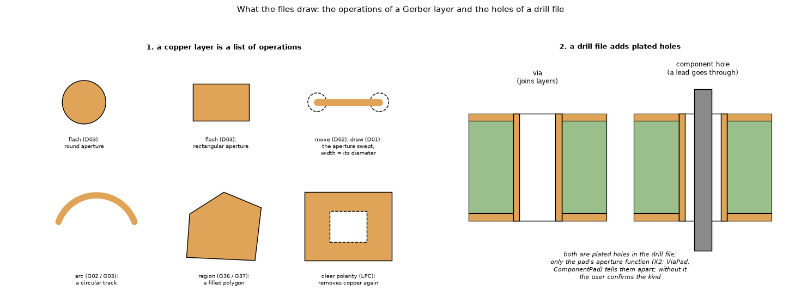
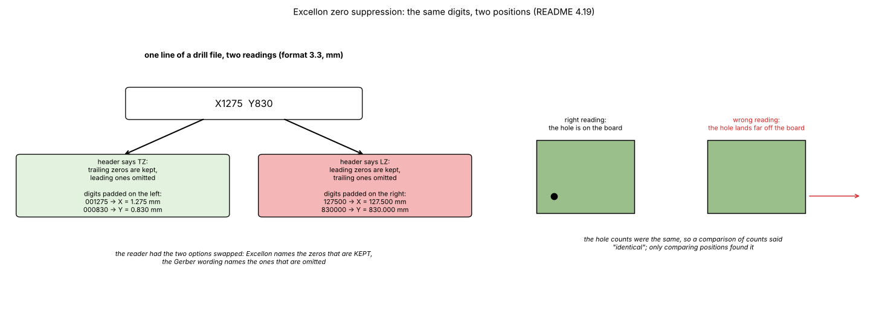
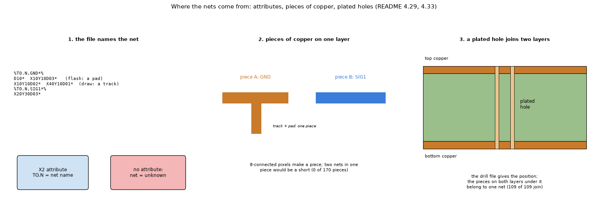
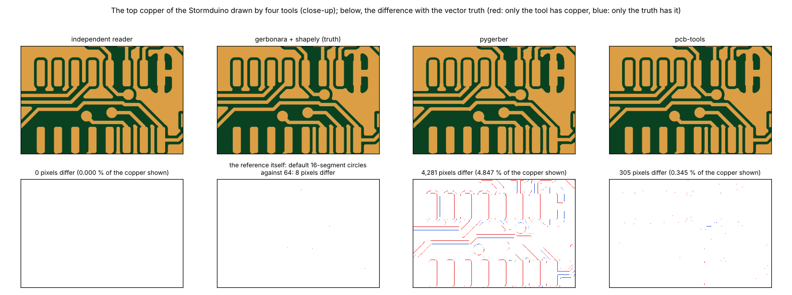
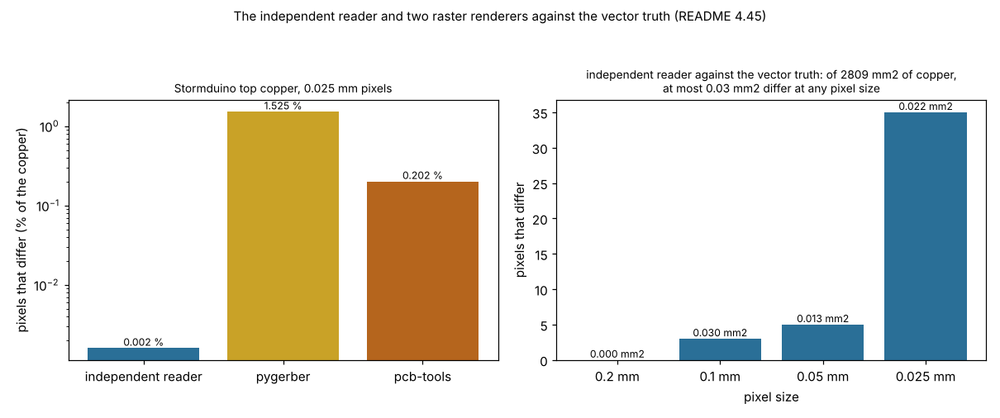
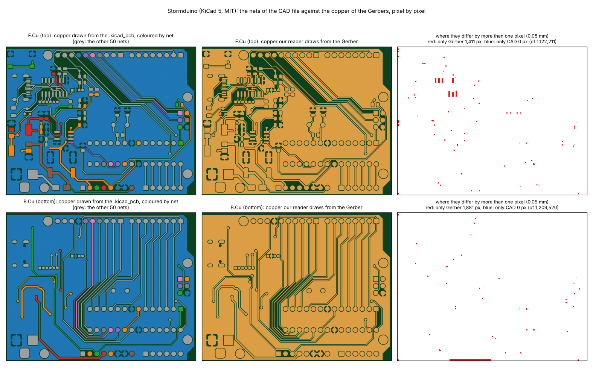
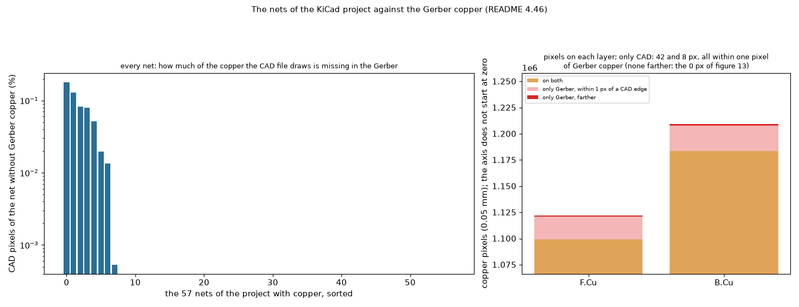
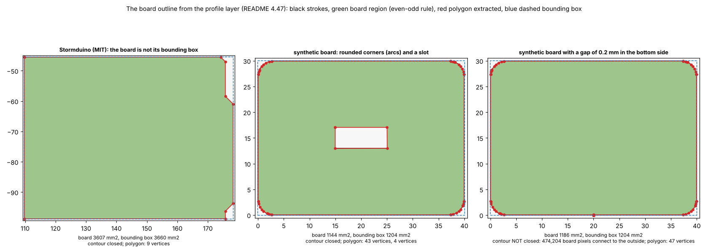

# Gerber import, phase 1: reading the files (copper, drills, nets, vias)

Status: **open**, a research branch (`research/gerbers`): **nothing in `pcbthermal/` was changed**. This folder is **phase 1 of three** of the Gerber research, which started as one study and was split: [`research/gerber-import`](../gerber-import/README.md) (1, reading the files), [`research/gerber-models`](../gerber-models/README.md) (2, the copper in the simulation models) and [`research/gerber-nets`](../gerber-nets/README.md) (3, nets with voltage and current). Dependencies run one way: 2 and 3 use the modules of 1, 3 does not use 2; **1 needs no program**. **Start with [`REPORT.md`](REPORT.md) (does the converter work: the boards, the results, the errors and the differences from other tools) and [`CONCLUSIONS.md`](CONCLUSIONS.md)**; how the result would enter the program is in [`INTEGRATION.md`](INTEGRATION.md); what was read and what was not verified, in the last section of this file; the text for the project documents, in [`docs/`](docs/). The layout is the one of every research folder (`CLAUDE.md`, "Research branches"). **Section numbers (4.1 to 4.50) are those of the original single study, kept so that the references between the three folders and from other documents keep their meaning: the table below lists the sections of this folder, and the map of all of them, folder by folder, is in [`research/README.md`](../README.md) ("The Gerber research: where the sections are").**

### Where the sections are

| Section | Subject |
| :-- | :-- |
| 4.1 | Vectors to polygons (Stormduino, an Arduino Uno clone) |
| 4.17 | The independent reader against gerbonara on gerbonara's own test files |
| 4.18 | How the independent reader differs from the others (details of the other projects from their documentation, not all verified by running them) |
| 4.19 | What can be read: copper layers and drill files |
| 4.22 | Against the other Python tools, on files of known area |
| 4.24 | A third writer: Ucamco's `gerber-writer` |
| 4.29 | Vias and nets |
| 4.30 | A board of our own as a bench: an IC with circular tracks |
| 4.33 | Are the polygons tied to the right nets? A check against a KiCad project |
| 4.41 | The converter on every board, layer by layer |
| 4.45 | Is it the same copper? The same board drawn by four tools, and the difference pixel by pixel |
| 4.46 | The nets against the KiCad project, pixel by pixel |
| 4.47 | The board outline: the profile layer |

## 1. What this folder does and what it leaves to the others; the questions

**This folder** reads the Gerber and Excellon files and imports the board, with no program: the independent reader and its conformance (section 5, 4.17 to 4.19, 4.24), the comparison with the other readers (4.22) and pixel by pixel (4.45), the copper of every layer (4.1, 4.41), the holes, pads, vias and the nets written in the files (4.29) and checked against a KiCad project (4.33, 4.46), the board outline (4.47), the test benches (4.30) and the import itself (`importer.import_board`). Its output is the mask of every layer, the holes with their net, and warnings.

**Left to the others**: what the mask becomes in the thermal models (the copper fraction or face conductances of the cells, the pixel and coverage needed for the temperature, the import into the program's FVM, the effect of the choice of reader on a temperature) is [`gerber-models`](../gerber-models/README.md) (for example 4.2, 4.3, 4.26, 4.31); the current in a net, its Joule heat, the resistance of tracks at any angle, the separate pieces of one net and the electrical sources, sinks and links are [`gerber-nets`](../gerber-nets/README.md) (4.20, 4.23, 4.36, 4.40).

A Gerber file is vector data: strokes with a width, flashes and filled regions; the drill file gives the holes. Phase 1 asks what can be taken from the files and how reliably.

1. Can the Gerber be converted to exact polygons, with holes and islands? **Yes** (4.1).
2. Can it be read **without third-party licences**? **Yes**: an independent reader that needs only NumPy (section 5, 4.17 to 4.19, 4.22, 4.24).
3. Can the plated holes, pads and nets be matched from the files? **Yes** (4.29), and **the nets agree with the CAD file of a real KiCad project** (4.33).
4. Can the result be handed to the next phases without the program? **Yes**: `importer.import_board` returns the board box, a binary and a coverage mask per layer, the holes with pad, kind and net, and warnings.

## 2. Findings in short

| Item | Result |
| :-- | :-- |
| Vectors to polygons | Exact with gerbonara + shapely (union keeps holes and islands). One Uno-clone layer: 103 polygons, 80 holes, 43 285 vertices. |
| Reading without libraries | `native_gerber.py` (NumPy only) draws the copper directly from the file: the same pixels as the gerbonara route except pixel centres that fall exactly on an edge (0.0 to 0.07 % of the area on five boards, 0.7 and 2.1 % on the two boards whose coordinates sit on the pixel lattice, none away from an edge; at most 0.012 % on a shifted grid), same board boxes, same drills; unsupported features are reported, not guessed (section 5; the earlier 0.9 % compared the reader with itself, section 7). |
| Scope | Copper layers 58 of 60 non-empty classified files drawn (2 refused), 58 of 58 within 3 % of gerbonara's area; drills 36 of 38 read (2 without a unit refused), 34 of 34 identical to gerbonara (after fixing inverted TZ/LZ and other defects); reader refuses what it cannot do, including a drill file with no unit (4.19). |
| Other tools | On 14 files of known area the independent reader equals gerbonara + shapely and pcb-tools (binary) to the digit; the error is the pixel (thin tracks), a grey-level coverage keeps 4.4 % where binary masks lose 22 % at 0.1 mm; pygerber is strict and heavier, pcb-tools failed on real boards (4.22). |
| Same copper, pixel by pixel | On 12 layers of 8 boards the independent reader and the vector truth differ in 122 of 4.76 million copper pixels, all within 0.045 px of an exact edge; against the truth with finer circles the difference shrinks (4.45). |
| Nets against the CAD file, pixel by pixel | Of the 2.25 million pixels the Stormduino's `.kicad_pcb` assigns to its nets, 99.998 % lie on Gerber copper; the Gerber copper without any CAD object farther than a pixel is 0.13 % and 0.16 % of the layers (4.46). |
| Reader conformance | 161 of 164 comparable gerbonara test files agree within 3 % of the area (the other 3: two spec tests that differ on purpose, one silkscreen file); 6 refused as unsupported (4.17). |
| Holes, pads, nets | The plated holes of the drill file match the pads (aperture function) and nets by position: 225 of 225 vias of a real four-layer board have one net on the four layers, 68 of 68 plated component holes of the X2 set agree on both layers (4.29). |
| **Nets against a CAD file** | Stormduino (KiCad 5, MIT): every object of the `.kicad_pcb` lies on the copper read (1380 of 1380 track points, 48 of 48 via points, 281 of 281 pad points); no piece of copper or group joined through the 109 plated holes holds two nets; 55 of 56 nets without a zone fill split into the same pieces as in the CAD file (4.33). |
| Bench boards | Our own IC board with circular tracks and the rectangle board of phase 2 (`our_board.py`, `rect_board.py`) are generated by the repository: no licence problem (4.30). |

## 3. Folder layout

Scripts are run from the repository root (`.venv/bin/python research/gerber-import/scripts/<script>.py`) and import the modules of `lib/` through `scripts/_bootstrap.py`; the tests find `lib/` and `scripts/` through `tests/conftest.py`. `data/` (downloaded boards, conformance and synthetic files, **shared by the three phases**) and `out/` are git-ignored.

| Path | What it is |
| :-- | :-- |
| `REPORT.md` | **The validation report**: does the converter work, on which boards, with which errors, and how it differs from the other tools. |
| `README.md`, `CONCLUSIONS.md`, `INTEGRATION.md` | The results in numbered sections, the conclusions, how the reader would enter the program |
| `docs/` | `research.md` summary, `changelog.md`, `decisions-log.md`, `roadmap-entry.md`, `literature.md` (what the project documents would get when the work is adopted). |
| `figures/` | 17 figures, one numbering: data figures 1 to 5 and 9 to 15 (`make_figures.py`: our IC board, the validation summary, the Stormduino coloured by its KiCad nets, the mask on one thin track, the reader as a diagram, the four tools pixel by pixel, the KiCad nets pixel by pixel, the board outline) and diagrams 6 to 8, 16 and 17 (`make_diagrams.py`). Figures 2 to 5 are linked from `REPORT.md`, the others from this README. |
| `tests/` | 51 tests in 10 files (about 5 s; 40 when gerbonara and shapely are not installed: `test_geometry.py`, `test_outline.py` and `test_render_compare.py` are skipped): the reader (`test_native_gerber.py`, `test_geometry.py`, `test_reader_claims.py`), nets and holes (`test_nets.py`, `test_our_board_bench.py`), the import (`test_importer.py`), the nets against a KiCad file (`test_kicad_nets.py`, `test_kicad_pixels.py`, need `data/storm`), the outline (`test_outline.py`), the render comparison (`test_render_compare.py`). |
| `lib/native_gerber.py` | **Independent reader and rasteriser (NumPy only)**: RS-274X (apertures, macros, arcs, regions, polarity, step and repeat), X2 attributes (file function, aperture functions, net names), the layer classifier, Excellon, coverage masks. |
| `lib/importer.py` | **The import**: files to the board box, masks, holes with pad and net, warnings (`import_board`). |
| `lib/nets.py`, `lib/kicad_pcb.py` | Holes, vias, pads and nets matched by position; a small reader of `.kicad_pcb` (5.x) as the independent truth of the nets. |
| `lib/readers.py`, `lib/gerber_geometry.py`, `lib/windows.py`, `lib/boards_synthetic.py` | One interface to the readers; the vector route (gerbonara + shapely) as reference; the 42 windows of 36 mm of the mapping studies; the synthetic board generator of the tests. |
| `lib/our_board.py`, `lib/rect_board.py`, `lib/paths.py` | The IC board of our own; the rectangle board; the folders. |
| `scripts/fetch_boards.py` | Downloads the public test boards and the CAD file into `data/` (licences differ, section 9). |
| `scripts/study_native_check.py`, `study_reader_conformance.py`, `study_reader_scope.py`, `study_gerber_writer.py` | The reader against gerbonara + shapely, against gerbonara's test files, copper layers and drills, and Ucamco's `gerber-writer` (section 5, 4.17, 4.19, 4.24). |
| `scripts/make_synthetic.py`, `compare_readers.py` | Files of known area made with gerbonara; the comparison with gerbonara, pygerber and pcb-tools (4.22). |
| `scripts/study_render_compare.py`, `study_arc_tolerance.py` | The same board drawn by the independent reader, gerbonara + shapely, pygerber and pcb-tools, compared pixel by pixel; how far each differing pixel lies from the exact edge (4.45); the farthest ones tested against the reader's arc tolerance (4.45, section 7). |
| `scripts/study_kicad_pixels.py` | The Stormduino's `.kicad_pcb` drawn on the pixel grid, by net, against the Gerber copper (4.46). |
| `scripts/study_outline.py`, `lib/outline.py` | The board outline from the profile layer: the strokes, the even-odd region, the closed-contour check, the polygon (4.47). |
| `scripts/study_validation_boards.py` | The copper area, pieces and holes of every layer of the eight boards against the vector truth (4.41). |
| `scripts/study_vias_nets.py`, `study_kicad_nets.py` | Holes, vias and nets (4.29); the nets against a KiCad project (4.33). |
| `scripts/make_figures.py` | Draws the data figures (1 to 5 and 9 to 15). |
| `scripts/make_diagrams.py` | Draws the schematic diagrams and illustrations (figures 6 to 8, 16 and 17). |

## 4. How to run, and the results

```sh
python3 -m venv .venv && .venv/bin/pip install -r research/gerber-import/requirements.txt   # once (with the packages of the comparison tools: gerbonara, shapely, pygerber, pcb-tools, gerber-writer, pillow)
.venv/bin/python research/gerber-import/scripts/fetch_boards.py                              # once
cd research/gerber-import && ../../.venv/bin/python -m pytest -q tests                       # 51 tests, about 5 s (40 without gerbonara and shapely)
```

All numbers below come from the independent reader unless the section says otherwise.

### 4.1 Vectors to polygons (Stormduino, an Arduino Uno clone)

gerbonara turns every draw, flash and region into primitives; shapely unions them in file order, adding dark and subtracting clear polarity. The top layer has
6 654 primitives (6 117 are 0.254 mm strokes: the copper pour is drawn as hatch lines) and unions into **103 polygons with 80 holes and 43 285 vertices** (12 462
after simplifying by 5 µm, with 0.07 % less area); the bottom layer 69 polygons, 44 holes, 26 288 vertices. As WKB the polygons are 300 to 500 KB; the same layer
as a 0.1 mm PNG mask is 9 to 12 KB.

### 4.17 The independent reader against gerbonara on gerbonara's own test files (`study_reader_conformance.py`)

272 Gerber-like files of gerbonara's test resources (many CAD tools; each small file tests one feature), drawn by both readers on the same pixels (pixel = half the thinnest aperture, 0.02 to 0.2 mm). Files with a feature thinner than 1.5 pixels at the finest pixel (82) are left out. Of 164 files both readers draw, **161 agree within 3 % of the area** (median difference 0.02 %, median differing pixels 0.0 %); 6 are refused (5 Upverter files with a non-standard `Rect` aperture shape, 1 file with an image mirror `MIA1B0`), none is read by the independent reader and refused by gerbonara. Time: 98 s against 502 s (gerbonara + shapely sampling; repeated run, gerbonara 1.6.3); 21 s against 144 s on the review machine.

The first run found four defects, now fixed and covered by tests: comment statements inside a macro (`0 text`), a straight region after a region closed by a G03 arc (the interpolation mode was not reset), a non-standard aperture shape reported as a file error instead of "unsupported". **After the vector reference was corrected (it ignored stroked arcs, see 4.45) the run was repeated: 161 of the 164 files agree within 3 % of the area (median difference 0.02 %), where 149 agreed before; the 15 files that disagreed were almost all open outlines and silkscreen with arcs, so what was reported as "stroke differences not yet explained" was the reference.** The 3 that still disagree: `example_holes_dont_clear.gbr` (+7.2 %) and `example_am_exposure_modifier.gbr` (+5.6 %) differ on purpose: the file itself states that an aperture hole or a macro clear primitive must **not** clear what was drawn before, which the independent reader follows and gerbonara does not; `zero-length-lines__charliewatch-v2.panel-F_Silkscreen.gbr` (+6.2 %) is a silkscreen file with zero-length lines, not a copper layer. The next largest are +1.4 % (an outline) and +0.5 %.

### 4.18 How the independent reader differs from the others (details of the other projects from their documentation, not all verified by running them)

| | independent reader (`native_gerber.py`) | gerbonara | pygerber | pcb-tools |
|---|---|---|---|---|
| licence | part of the project, NumPy only | Apache-2.0 | MIT | Apache-2.0, unmaintained |
| what it produces | a pixel mask of the copper, directly | vector objects, can modify and write files | renders images (and 2D shapes) following the 2024.05 spec | objects, Cairo rendering |
| dependencies | NumPy | several (including shapely in this study for sampling) | pydantic, pillow and others | Cairo, others |
| Excellon | tolerant (Allegro, OrCAD comment tables, repeat command, slots); declared counts match | refuses some Allegro/OrCAD files | spec files | basic |
| features | RS-274X without AB, LM/LR/LS, moire, mirror, scale; no writing | the most complete of these | the most spec-faithful in intent | older subset |
| unsupported content | reported with an error | mostly handled | varies | silently wrong in places |
| checked on | 8 real boards and 164 test files (161 agree) | the reference here, itself not a ground truth | run with its defaults in 4.22 and 4.45 | run with its defaults in 4.22 and 4.45 |

Honest summary: the independent reader is not a better reader, it is a smaller one that does one job (rasterise copper and holes) with no library whose licence the closed product would have to carry. It supports fewer features, is validated on fewer files, and its remaining disagreements are on silkscreen/outline files and on two spec edge cases where it follows the spec text.

### 4.19 What can be read: copper layers and drill files (`study_reader_scope.py`)



*Figure 7 (`figures/fig_07_what_the_files_draw.png`): what the files draw: the operations of a Gerber copper layer (flash, draw, arc, region, clear polarity) and the plated holes of a drill file, a via and a component hole (illustration, no data).*



*Figure 8 (`figures/fig_08_excellon_zeros.png`): the same digits of a drill line read with the two zero options: 1.275 mm on the board or 127.500 mm far off it; the counts of holes were equal, only the positions differed.*

Only copper layers and drills matter for the program (silkscreen, mask, paste and assembly are ignored; the classifier uses the X2 file function or the file name). On gerbonara's test resources and the downloaded boards:

* **Copper**: 62 files are classified as copper layers (the count depends on what is in `data/`: the run includes our own synthetic files, and `lib/our_board.py` must have written its copper file to `data/synthetic/`, otherwise 61, 57 and 12 are printed); 58 are drawn by the independent reader, 2 are refused (Upverter files with a non-standard `Rect` aperture), 2 had no content. Against gerbonara + shapely: **58 of 58 within 3 % of the area**, median difference 0.02 %, worst 1.4 % (the earlier run had 45 of 50 and a worst of 16.2 %: the difference was the vector reference ignoring arcs, 4.45). 13 files carry net names.
* **Drills**: 38 files look like Excellon. The independent reader reads 36 and refuses 2 on purpose (`drill__pads__Drill.drl` and `drill__upverter__design_export.drl`, files with no unit: the reader says so instead of guessing); gerbonara reads 35 (it refuses the OrCAD file, the PADS file without header and a file with a deliberate syntax error). **On the 34 read by both, the holes are identical (positions to 0.01 mm, diameters to 1 µm) in all 34**, after the fixes below. (An earlier run reported 38 read and 35 of 35 identical, before the reader started refusing files without a unit.)
* **The first drill comparison found real errors in the reader** (the earlier claim "identical" had compared only the hole *counts*): the Excellon zero options were inverted (`TZ` keeps trailing zeros and omits leading ones, `LZ` the opposite; the Gerber wording is the reverse), the format written as `000.000` or `0000.00` in the header or as `;FILE_FORMAT=3:3` in a comment was ignored, `M71`/`M72` as the unit were ignored, a tool line such as `T1F00S00C0.300` lost its diameter, and a routed path with several `G01` segments gave one hole instead of one per segment. All fixed and covered by tests (`test_excellon_*`). A file with no unit anywhere (a PADS drill without header) is now **refused** ("choose the unit") instead of guessed: a wrong guess would place every hole 25 times wrong.
* **So: can any Gerber be read? No, and the reader says why.** Supported: RS-274X with the features of section 5; Excellon from 15 CAD tools in the test set. Refused with a message: aperture blocks, mirrored/rotated/scaled apertures, moire, image offset/mirror/scale/rotation, an axis swap (`AS`) and incremental coordinates (both deprecated; refused since the review, they were ignored before), non-standard aperture shapes, a drill file without a unit. Plated and non-plated holes are told apart only when the file says so (comments, X2 `FileFunction` of the drill file). The layer assignment (which file is which copper layer) comes from the X2 attribute or the name, and the user confirms it.

### 4.22 Against the other Python tools, on files of known area (`make_synthetic.py`, `compare_readers.py`)

**Tools** (installed from PyPI): gerbonara 1.6.3 (Apache-2.0), pygerber 2.4.3 (MIT, raster renderer with anti-aliasing), pcb-tools 0.1.6 (cairo renderer, anti-aliased; `gerber.read` uses the removed `'rU'` file mode, so the text is passed to `gerber.loads`), and the independent reader. **Files**: made with gerbonara's own writer, so none of the readers wrote them, and the exact copper area comes from an independent shapely construction (buffered lines with round caps, polygons, differences): 7 single tracks of 0.03 to 0.3 mm, the same seven together, at 45 degrees, a plane with 28 clear holes of 0.1 to 1.2 mm, a plane with 1600 holes of 0.3 mm at 0.5 mm pitch (webs of 0.2 mm), a cross hatch (0.2 mm lines, 0.8 mm pitch), a plane with a clear ring, an island and a clear slot, and a random board of 60 tracks (0.1 to 0.4 mm) and 40 pads. Error of the copper area against the exact area (mean absolute over the 14 files, signed mean in brackets), by pixel size:

| tool | 0.1 mm | 0.05 mm | 0.025 mm | 0.0125 mm |
| :-- | --: | --: | --: | --: |
| independent reader (centre sampling) | 22.3 % (+3.3) | 7.8 % (+2.7) | 1.4 % (-1.0) | 3.7 % (-3.7) |
| gerbonara, vector area (no raster) | 0.01 % | 0.01 % | 0.01 % | 0.00 % |
| gerbonara + shapely, centre sampling | 20.8 % (+1.7) | 8.6 % (+1.9) | 1.3 % (-1.2) | 3.7 % (-3.7) |
| pcb-tools, pixels above 50 % | 21.9 % (+3.9) | 7.8 % (+7.2) | 1.3 % (-1.3) | 3.7 % (-3.7) |
| **pcb-tools, grey level (coverage)** | **4.4 % (-1.6)** | **2.6 % (-2.6)** | 1.4 % (-1.4) | 0.02 % |
| pygerber (cleaned file) | 30.3 % (+24.0) | 8.1 % (+1.5) | 1.9 % (-1.9) | 4.1 % (-4.1) |

(the 0.0125 mm column holds only the 9 files with the thinnest tracks, so it is not comparable with the others.)

What this shows:

1. **The independent reader gives the same raster as gerbonara + shapely and as pcb-tools above 50 %** (file by file the numbers coincide to the printed digit). On these files nothing separates the readers; **the error is the pixel**, not the reader. A track narrower than 1.5 pixels is rounded to 0, 1 or 2 pixels: 0.03 mm vanishes at 0.1 mm (-100 %), 0.05 mm doubles (+100 %), 0.075 mm gains a third, 0.15 mm loses a third. Only the vector area is exact.
2. **Binary masks lose or invent area on thin copper; a coverage (grey-level) mask does not**: pcb-tools' anti-aliased coverage keeps 4.4 % at 0.1 mm against 22 % for any binary mask. What this means for the thermal mapping (a coverage mask against a binary one in the conduction solver, and the pixel of at most half the thinnest track) is in `gerber-models` 4.26 and 4.3.
3. **pygerber is the worst at coarse pixels** (a 0.03 mm track draws as 0.1 mm: +233 %) and it **did not parse any of gerbonara's 47 written files as they are** (gerbonara writes `G75` without its `*` and an obsolete `%IPPOS*%`; a cleaned copy parses). Its grammar is strict, which is a feature for conformance and a handicap for tolerance.
4. **The independent reader accepts the same files** (it now tolerates a lone `G75` line, found by this test), runs in 0.04 s per file on average against 0.19 s (gerbonara + shapely), 0.06 s (pcb-tools) and 0.23 s (pygerber).
5. **Planes, holes, islands, clear slots and hatches are exact for every tool** at 0.1 mm (errors 0.0 to 0.4 %), except the perforated plane at 0.1 mm (+6 %: the 0.2 mm webs are 2 pixels wide with 0.5 mm holes, so the rounding of the holes shows) and pcb-tools' hatch (-2 %).

**The eight real boards** (top copper layer, reference gerbonara's vector area): independent reader 0.23 % at 0.1 mm and 0.14 % at 0.05 mm (mean absolute); gerbonara + shapely sampling 0.67 % and 0.14 %; pygerber 1.6 % and 1.3 % low, but it failed to parse 4 of the 16 runs; **pcb-tools 63 % low** on the real boards: this is an average over the eight boards, and per board (0.1 mm, pixels above 50 %, printed in the review) pcb-tools draws an **empty image** (-99.8 to -100 % of the copper) on five of them (`alleg`, `dip`, `easyeda`, `fritz`, `pcbrnd`) and is close on the other three (`chibi` -0.8 %, `storm` -0.8 %, `pcad` +1.8 %); an earlier version of this paragraph named only `fritz` and `pcbrnd`. With explicit bounds on the Stormduino top layer it differs from the vector truth in only 0.20 % of the pixels (4.45); why it draws nothing on five files was not investigated, so no conclusion is drawn about its quality in general. Times per board and pixel size: 0.6 s independent, 0.9 s pcb-tools, 3.0 s gerbonara + shapely, 5.7 s pygerber in the first run; 0.10, 0.20, 0.81 and 1.35 s on the review machine (pcb-tools needs the cairo library: on the review machine it was taken from an installed application through `DYLD_LIBRARY_PATH`).

Limits of this comparison: area only (the position of the pixels was not compared between tools; for gerbonara and the independent reader it was, section 5); pygerber's and pcb-tools' defaults were used (one render setting each); the bounds of the pcb-tools render had to be given explicitly (its automatic bounds cut the image); versions are those on PyPI on the day; other tools (KiCad's gerbview, tracespace, gerbv) were not run.

### 4.24 A third writer: Ucamco's `gerber-writer` (`study_gerber_writer.py`)

The Ucamco format page (supplied by the maintainer, `docs/literature.md`, "Ucamco") names `gerber-writer`, a Python library for writing Gerber X2 files. Files written with it (thermal and rounded-thermal pads, rectangles, a rounded rectangle, a regular polygon, a circle, four tilted tracks, a path with a quarter-circle arc, a pentagon region) test the reader on a writer it has never seen. Copper area against the exact value (shapely construction for the tracks and the arc; the region is 300 mm²; the pads have no hand formula, so the reference there is gerbonara):

| file | independent reader | gerbonara 1.6.3 (vector) |
| :-- | --: | --: |
| 6 pads, with `Thermal` and `RoundedThermal` aperture macros | +0.08 % (against gerbonara) | (reference) |
| 4 tilted tracks and a path with a quarter-circle arc | **-0.04 %** | -0.00 % (it was -8.57 % before the defect of our wrapper was fixed, see below) |
| pentagon region | -0.01 % | 0.00 % |

Findings: (1) **the reader handles the thermal-pad macros and the arc path**; (2) **an earlier run showed gerbonara's vector area 8.6 % low on the arc file, and this was our own error**: `gerber_geometry.primitive_polygon`, the wrapper that turns gerbonara's primitives into polygons, ignored stroked arcs (found later by the pixel comparison of 4.45; fixed, regression test `test_vector_reference_includes_the_circular_tracks`), so the table now reads -0.00 %; the statement "a tool used as a reference is not ground truth" of 4.22 stands in general, but this example was not evidence of it; (3) gerber-writer writes its attributes in the compatibility form `G04 #@! TF.FileFunction,Copper,L1,Top*`, which the reader did not understand (file not classified as copper, net names lost): **fixed**, both forms are read now (`test_attributes_written_as_comments`). gerber-writer has no argument for a net name, so this file set does not test nets. Gerber-writer's `ChamferedRectangle` was not exercised.

### 4.29 Vias and nets (`nets.py`, `study_vias_nets.py`, `tests/test_nets.py`)

* **Same vias as the Gerber?** The program's `Via` is a plated through hole (position, finished diameter, fill). In the Gerber set a hole is a position and a diameter in the Excellon file, plated or not (X2 comment `; #@! TF.FileFunction,Plated,1,4,PTH` or `NonPlated,...,NPTH`, now read by `native_gerber.drill_function`; the holes inherit it), and every copper layer has a pad flashed over it whose **aperture function** (`ViaPad`, `ComponentPad`, `SMDPad,CuDef`, now stored per aperture) says what it is. `nets.hole_report` matches the three by position: for each hole the pad, function and net on every layer, and a class (`via`, `component`, `unplated`, `unknown`). A plated `via` maps to a program `Via` directly (hole diameter, position); a `component` hole is a lead hole of a part, copper-plated too (it also conducts between layers); an `unplated` hole is no via.
* **KiCad X2 test set** (2 layers, 80 holes, all variants): 76 plated, 4 non-plated; in the variant with aperture attributes 68 plated holes are classified `component` with a pad on both layers and the same net on both (68 of 68, no conflict), 8 plated holes have no pad found (`unknown`); without aperture attributes 30 are `unknown`, which shows how much the attributes give. The nets of this test file are all `N/C` (a pads-only test board).
* **Vias seen from the pads, a real 4-layer board** (`charliewatch-v2`, KiCad 7, no drill file in the test set): 225 vias found as `ViaPad` flashes at the same position on all four layers, **225 of 225 with the same net on the four layers**, none conflicting, none without a net, every via joining four layers; the nets with most vias are `/X3` (19), `/X1` (18). So the Gerber files do give the polygons-to-nets mapping on every layer and the via connections between layers, when the CAD tool writes the attributes.
* **Net names in the files** (moved here from `gerber-nets` 4.20; counts printed by `gerber-nets/scripts/study_net_joule.py` on the two KiCad 7 `charliewatch-v2` files of gerbonara's test set, statistics only). **Can polygons be mapped to a net? Yes, if the CAD tool wrote it.** KiCad (and others) write the X2 object attribute `%TO.N,<net>*%` before the objects of a net (`%TD*%` ends it). The reader now keeps the net of every operation (`Layer.nets`, `Layer.net_names()`, `Layer.draw(canvas, nets=[...])`; a step and repeat keeps it). Limits found on the two KiCad 7 files of the test set: the pads and tracks carry a net, **the zone fills did not** (one 427 mm² fill on the top layer touches no labelled object, 62 % of that layer's copper, 64 % with the other pieces without a net), and one name is several separate pieces on a layer (12 for `Board_0-/X9` on the top layer). *(Review of `gerber-nets`, its README section 7: the earlier text said the names of a panel repeat on every board, `Board_0-/X9` 25 times; the file is one board of four copper layers and the count is not reproduced: the pieces are most likely joined by vias and the inner layers.)* Hence the working rule of the study: the net of a piece of **connected copper** is the net of the labelled objects it contains (149 of 176 pieces on the top layer have exactly one net, none has two). Files from tools that do not write the attribute (EasyEDA, Fritzing, most older ones) need the net from the user (click a piece) or from a netlist.
* **Polygons to nets**: yes, by the net attribute of the objects (pads, tracks) and by connectivity for the rest (the bullet above); a net across layers is the union of its pieces joined by its vias. Files from tools that do not write the attribute give no nets.

### 4.30 A board of our own as a bench: an IC with circular tracks (`our_board.py`, `tests/test_our_board_bench.py`, figure 1)

Because the third-party test boards cannot be pictured (section 9), the repository has a board of its own that can be drawn, tested and published freely: `our_board.py` writes it as RS-274X with X2 attributes (file function, aperture functions `Conductor`, `SMDPad,CuDef`, `ViaPad`, `ComponentPad`, net names) and as an Excellon drill file with the X2 file function. 40 x 40 mm, an IC in the middle (a 2.4 mm exposed pad with four thermal vias and eight 0.8 x 0.35 mm pads), **eight signal nets that leave the IC radially and run round it on circular arcs (up to 150°, tracks of 0.2 mm, circles 1 mm apart) to 0.8 mm test points with plated holes**, and a ground net (exposed pad, a 0.8 mm spoke, a 0.8 mm ring of radius 18.5 mm with four vias). Copper is 10 % of the area.


*Figure 1 (`figures/fig_01_gerber_render.png`): the Gerber of the board as read by the independent reader (copper in gold on the board, plated holes in black, test points named), and a close-up of the IC at 0.0125 mm pixels: the exposed pad with its four thermal vias, the eight pads and the radial tracks.*

The tests use the board as a bench (`tests/test_our_board_bench.py`, 2 tests): nine nets, each one 8-connected piece, no pixel of a net within a pixel of another net (no short, clearance of at least 0.05 mm), the nets do not overlap; the 16 plated holes (8 vias, 8 test points) found with the right net by position (`nets.hole_report`), the drill file's X2 function read. The same board is a bench for the current of a net (gerber-nets 4.30, figure 3) and for the mapping to the thermal grid (gerber-models 4.30, figure 2). To use it elsewhere: `import our_board`; `our_board.gerber_text()`, `drill_text()`, `holes()`, `net_name(k)`, `squares(k)`, `write(folder)`.

### 4.33 Are the polygons tied to the right nets? A check against a KiCad project (`kicad_pcb.py`, `study_kicad_nets.py`, `tests/test_kicad_nets.py`)



*Figure 17 (`figures/fig_17_nets_from_files.png`): where the nets come from: the X2 attribute names the net of each object (without it the net is unknown), pieces of 8-connected copper pixels on one layer carry one net each, and a plated hole of the drill file joins the pieces of two layers under it into one net (diagram, no data; numbers from 4.29 and 4.33).*


*Figure 6 (`figures/fig_06_nets_check_schematic.png`): the check of the nets against a CAD file: the two independent sources, the four questions and the results (diagram, no data).*

Until now the net of a piece of copper was taken from the Gerber attributes and checked only against itself (4.29). The Stormduino (KiCad 5, MIT) has its Gerbers **and** its `.kicad_pcb`, and its Gerbers carry no net attributes, so the check can be independent: the nets come from the CAD file, the copper from the Gerbers. `lib/kicad_pcb.py` reads the CAD file (nets, tracks, vias, pads with the module rotation applied, zones); `study_kicad_nets.py` splits the copper of each layer into 8-connected pieces, joins the two layers through the 109 plated holes of the drill file, and asks where the objects of the CAD file fall.

| Question | Result |
| :-- | :-- |
| Do the objects of the CAD file (3 points per track, vias on both layers, pads) lie on the copper our reader drew? (position, y axis, rotation, units) | 1380 of 1380 track points, 48 of 48 via points, 281 of 281 pad points |
| Does any piece of copper hold objects of two nets (a short, or a reader error)? | 0 of 170 pieces |
| Do the plated holes join a piece on both layers? | 109 of 109 |
| Does any joined group hold two nets? | 0 of 66 groups |
| Do the nets split into the same number of separate pieces in the Gerbers and in the CAD file's own geometry (tracks, vias, pads)? Nets without a zone fill | 55 of 56 equal |

What the separate pieces are: `+5V` and `+3V3` are two pieces each, and `Net-(J2-PadS1)` (the USB shield) four, **in the CAD file as well as in the Gerbers** (a net that the designer left in several pieces, mechanical pads), so these are not errors of the reader. The one difference, `Net-(J2-PadA7)` (one group in the Gerbers, two in my geometric reading of the CAD file), is most probably the crude overlap test used for the CAD side (a track end within a pad radius); it was not examined further. The two GND zones (fills) are connected in the Gerbers into one group; the CAD-side count of GND (32) ignores zone fills, so GND is not compared.

**Conclusion**: with nets given by a netlist (here the `.kicad_pcb`), the polygons of the Gerbers are tied to them by connectivity and position without a conflict, on a real board of 57 named nets (58 with the unnamed net of the mounting pads) and 109 holes. With Gerber net attributes (4.29) the same follows from the files alone. Limits: one board; KiCad 5 (version 20171130) only; zone fills not compared net by net; the CAD side is my own small reader (it agreed with the Gerbers on position at the pixel, which also checks it). Fetch the CAD file with `scripts/fetch_boards.py storm`.

### 4.41 The converter on every board, layer by layer (`study_validation_boards.py`, `REPORT.md`, figures 2 and 3)

The validation report [`REPORT.md`](REPORT.md) collects the evidence in one place. New here: the reader, run on **all 12 copper layers of the 8 real boards**, against the vector area of gerbonara + shapely: mean absolute error 0.14 % (binary 0.1 mm), 0.13 % (0.05 mm), 0.05 % (coverage 0.1 mm), maximum 0.55 %; the connected pieces are identical in number on all 12 layers (28 to 445 per layer); 109 of 109 holes on the Stormduino. Figure 2 summarises the readers on files of known area and our reader on the 12 layers; figure 3 shows the Stormduino as the converter reads it, coloured by the nets of its KiCad file.

### 4.45 Is it the same copper? The same board drawn by four tools, and the difference pixel by pixel (`study_render_compare.py`, figures 9 to 12)

The claim to test: the independent reader draws **the same copper** as the exact vector geometry of gerbonara + shapely, on real boards, not only the same total area. The method: every tool draws the same layer, the pixels are compared one by one against the vector truth (the exact polygons sampled at the pixel centres), and every pixel that differs is located against the exact edge.


*Figure 9 (`figures/fig_09_render_compare_whole_board.png`): the whole top copper of the Stormduino (KiCad, MIT) at 0.025 mm drawn by the independent reader, gerbonara + shapely (the truth), pygerber and pcb-tools; below, the pixels where each differs from the truth (red: only the tool has copper, blue: only the truth has it; each differing pixel is enlarged for display). The truth cannot differ from itself, so its panel shows the difference of gerbonara's own default circles (16 segments per quarter turn) from the finer ones used as the truth (64): 424 pixels, all blue, along pads, vias and round ends.*



*Figure 10 (`figures/fig_10_render_compare_close_up.png`): a close-up of the 12 x 8 mm window with the most copper edge, same layout; the counts are those of the window.*

**The four tools on the Stormduino top copper (whole layer, 0.025 mm pixels, 4.49 million copper pixels):**

| Tool | Pixels that differ from the truth | % of the copper | Only the tool has copper | Only the truth has it |
| :-- | --: | --: | --: | --: |
| independent reader | 72 | 0.0016 % | 72 | 0 |
| gerbonara + shapely with its default 16-segment circles (against the 64-segment truth) | 424 | 0.0094 % | 0 | 424 |
| pcb-tools (cairo, anti-aliased, 50 % threshold) | 9,084 | 0.20 % | 4,476 | 4,608 |
| pygerber (raster, anti-aliased, 50 % threshold) | 68,445 | 1.52 % | 41,178 | 27,267 |

The rasters of pygerber and pcb-tools are the tools' own images, placed on the common grid by the bounding box of the copper and the best shift of at most 6 pixels (pygerber (0, 1) pixel, pcb-tools none) and thresholded at 50 %; their differences lie along the edges (figures 9 and 10), which is what a half-pixel offset or a different anti-aliasing gives. **That was not examined further**: these two numbers say how a raster renderer compares on a pixel by pixel basis, not that either tool is wrong.


*Figure 11 (`figures/fig_11_how_equal_the_reader_is.png`): left, the pixels that differ on the 12 copper layers of the 8 boards at 0.1 mm, on a grid lined up with the file's coordinates and on a grid shifted by an odd amount (log scale); middle, the distance of each differing pixel to the exact edge of the copper; right, the effect of the truth's own polygon approximation of circles.*



*Figure 12 (`figures/fig_12_tools_and_pixel_size.png`): left, the share of the copper that differs for each tool (the whole layer on the grid lined up with the file, as in the table below: 72 pixels for the independent reader); right, the pixels (and area) that differ for the independent reader against the pixel size, on the shifted grid (35 pixels at 0.025 mm: the ties of the lined-up grid are gone).*

**All 12 copper layers, 0.1 mm pixels, independent reader against the vector truth:**

| Board | Layer | Copper pixels | Differ, grid lined up | Differ, shifted grid | % of the copper | Area difference |
| :-- | :-- | --: | --: | --: | --: | --: |
| storm | F | 280,383 | 118 | 3 | 0.0011 % | +0.0011 % |
| storm | B | 302,606 | 106 | 3 | 0.0010 % | +0.0010 % |
| chibi | F | 649,389 | 2,652 | 5 | 0.0008 % | +0.0008 % |
| easyeda | F | 629,698 | 1 | 5 | 0.0008 % | +0.0008 % |
| pcbrnd | F | 566,202 | 5 | 1 | 0.0002 % | +0.0002 % |
| pcad | F | 264,816 | 10,750 | 2 | 0.0007 % | +0.0007 % |
| dip | F | 313,242 | 0 | 0 | 0.0000 % | +0.0000 % |
| fritz | F | 169,959 | 9 | 5 | 0.0029 % | +0.0029 % |
| alleg | F | 311,394 | 24 | 25 | 0.0080 % | +0.0080 % |
| alleg | L2 | 451,511 | 12 | 9 | 0.0020 % | +0.0007 % |
| alleg | L3 | 438,875 | 29 | 19 | 0.0043 % | +0.0043 % |
| alleg | B | 371,448 | 33 | 45 | 0.0121 % | +0.0089 % |

* **The independent reader and the vector truth draw the same copper**: on the shifted grid **122 pixels differ out of 4.76 million copper pixels** over the 12 layers (0.0000 to 0.0121 % per layer, area difference at most 0.0089 %), and every one of them lies **within 0.045 pixel of the exact edge of the copper**: a pixel centre that falls that close to an edge can go either way, while a real reading error (a missing track, a shifted pad, a wrong aperture) would sit far from any edge. The 4.5 micrometres are the reader's own arc tolerance: it cuts an arc into chords at most 0.005 mm from the true arc (`ARC_TOLERANCE`), and the pixels it draws differently are the ones that chord moves across a pixel centre. **Tested in the review** (`study_arc_tolerance.py`): every pixel farther than 0.0011 px from an edge is on `alleg`, the only board with arcs in its copper (98 of the 122 pixels; the farthest on each of its four layers 0.035 to 0.045 px); with a ten times finer tolerance (0.0005 mm) the 122 pixels fall to 38 and the farthest to 0.0013 px, and with a 256-segment truth as well to 3 pixels (all on `alleg`). On the seven boards without arcs the differing pixels are within 0.0011 px of an edge (ties and the truth's polygons).
* **Why the grid lined up with the file can differ more**: the coordinates in the files are multiples of 0.01 or 0.05 mm, so on a grid that lines up with them (as 0.1 mm pixels from a round origin do) many pixel centres fall exactly on an edge and go either way (pcad: 10,750 pixels; chibi: 2,652); even those lie within 0.040 px of an edge (13,739 differing pixels in total). The shifted grid removes the ties.
* **The remaining difference is the truth's, not ours**: gerbonara + shapely draw round ends, pads and arcs as polygons with 16 segments per quarter circle (an inscribed polygon, a little smaller than the circle). With 16 segments the reader has +0.0107 % more copper than the truth and 478 pixels differ (Stormduino top, 0.025 mm); with 32, 64 and 128 segments the figures fall to +0.0032, +0.0008 and +0.0003 % and to 142, 35 and 12 pixels. The tables above use 64 segments. So the independent reader is closer to the true circle than the reference polygons are.
* **Against the pixel size** (shifted grid, Stormduino top, 2,809 mm2 of copper): 0, 3, 5 and 35 pixels at 0.2, 0.1, 0.05 and 0.025 mm, that is at most 0.030 mm2 (0.001 %) of the copper at any size.
* **A defect of the reference found by this comparison** (fixed, with a regression test): `gerber_geometry.primitive_polygon` ignored stroked arcs (`gp.Arc`, a G02/G03 draw), so the vector reference of our own board (circular tracks) had 41 mm2 of copper where the board has 164 mm2, and the earlier comparison of 4.24 reported "gerbonara's vector area 8.6 % low" on an arc file: that was our wrapper, not gerbonara (now -0.00 %). The arc chords of the reference were also made finer (1 micrometre instead of gerbonara's 10). On the real boards only `alleg` has arcs in its copper and its numbers moved slightly (the tables above are after the fix).
* **What this does and does not show**: it shows that on 12 layers of 8 real boards from 8 different CAD tools the independent reader and the vector route give the same mask, up to sampling ties and the polygonisation of circles. It does not show that either is right about what the file means (both read the same RS-274X semantics; the check against a third tool is 4.22 and against a KiCad project 4.33); and the pixel counts of the other two tools depend on my alignment and threshold. The study uses the readers of this folder and gerbonara 1.6.3, shapely 2.2.0, pygerber 2.4.3 and pcb-tools 0.1.6, installed for this run.

### 4.46 The nets against the KiCad project, pixel by pixel (`study_kicad_pixels.py`, `tests/test_kicad_pixels.py`, figures 13 and 14)

4.33 asked, point by point, whether the objects of the CAD file lie on the copper of the Gerbers and whether each piece holds one net. This study makes the same comparison visible and counts it on every pixel. The Stormduino's own `.kicad_pcb` is drawn on the grid of the Gerber mask (0.05 mm pixels): every track as a segment with round ends, every via as a disc, every pad as a circle, stadium, rectangle or rounded rectangle at the angle written in the file (drilled holes without an annulus are not copper), and the filled polygons of the zones with the stroke KiCad plots along their outline (half the zone's minimum thickness, 0.127 mm). Each pixel keeps the net of the object that covers it. The result is the copper the CAD file says there is, with the net of every pixel, to be compared with the copper our reader draws from the Gerbers (`lib/kicad_pcb.py` reads the CAD file, `study_kicad_pixels.py` rasterises it).



*Figure 13 (`figures/fig_13_kicad_nets_against_gerber.png`): for the top and the bottom layer, left, the copper drawn from the `.kicad_pcb` and coloured by net (the 8 largest nets in colour, the rest grey); middle, the copper our reader draws from the Gerber; right, the pixels where they differ by more than one pixel (red: only the Gerber has copper, blue: only the CAD file; each differing pixel is enlarged for display).*



*Figure 14 (`figures/fig_14_kicad_nets_per_net.png`): left, for each of the 57 nets with copper, the share of the pixels the CAD file draws for it that has no Gerber copper under it (log scale; most are exactly zero and do not show); right, the pixels of each layer: on both, only in the Gerber within one pixel of a CAD edge, and only in the Gerber farther away. The 42 and 8 pixels only in the CAD file all lie within one pixel of Gerber copper, which is why figure 13 (pixels farther than one pixel) shows 0 of them.*

| Layer | Gerber copper (px) | CAD copper (px) | On both | Only the CAD file | Only the Gerber (all) | Only the Gerber, farther than 1 px from the CAD copper |
| :-- | --: | --: | --: | --: | --: | --: |
| F.Cu | 1,122,211 | 1,099,421 | 1,099,379 | 42 | 22,832 | 1,411 (0.13 %) |
| B.Cu | 1,209,520 | 1,183,621 | 1,183,613 | 8 | 25,907 | 1,881 (0.16 %) |

* **Everything the CAD file draws is copper in the Gerber**: of 2,246,416 pixels that the CAD file assigns to the 57 nets of the project, 2,246,366 lie on Gerber copper (0.002 % do not: 50 pixels on the two layers, none farther than one pixel from Gerber copper; an earlier run printed 43 and 9, one pixel more of CAD copper on each layer, and the 52 quoted here did not match the subtraction above). The worst nets are `Net-(D2-Pad2)` (99.82 % of its pixels on Gerber copper, 1,115 pixels), `Net-(D4-Pad2)` (99.87 %), `/D5` (99.92 %) and `Net-(D3-Pad2)` (99.92 %): a few pixels at the ends of thin tracks.
* **The Gerber copper the CAD file does not explain is 0.13 % (top) and 0.16 % (bottom)** of the layer, farther than one pixel from any CAD object; the other 2 % of the Gerber-only pixels lie within one pixel (0.05 mm) of a CAD edge, the width of an edge. The largest of the remainder is a strip 0.08 mm wide along the bottom edge of the bottom zone (1,784 pixels): probably the stroke of the zone outline at the board edge; the rest are scattered groups of a few tens of pixels near the pads of some connectors, probably pad shapes slightly larger than the ones drawn here. **Neither was examined further.**
* **What it adds to 4.33**: the same agreement, now over every pixel of both layers and not over 1,709 points, and it shows where the CAD file and the Gerber differ at all. Together with 4.33 (no piece holds two nets, 55 of 56 nets split into the same pieces) it says the nets of the CAD file are carried by the copper of the Gerbers.
* **Two details found while building it**: KiCad plots a filled zone with a stroke of the minimum thickness along its outline, so the Gerber copper extends 0.127 mm beyond the filled polygon (without it, 2 % of the layer was "only in the Gerber"); and a pad without a net (a mounting pad) is copper with net 0, which must not be taken as "no object" (without that, 4 mounting pads appeared as 8.6 mm2 differences).
* **Limits**: one board; KiCad 5 only; the rasteriser is ours (rounded rectangles, ovals and the zone stroke are modelled, board graphics and text on copper layers are not, and there are none on this board's copper layers); the Gerbers were written by the same CAD tool as the file, so this checks the reader and the association, not the CAD tool.

### 4.47 The board outline: the profile layer (`lib/outline.py`, `study_outline.py`, `tests/test_outline.py`, figures 15 and 16)

**What the files say** (web searches, snippets only; the Ucamco specification itself was not opened, so none of this is quoted from it). The outline of a board is its own layer, the *profile*, marked by the X2 file attribute `%TF.FileFunction,Profile,NP*%` (`NP`: not plated; a viewer that checks attributes reports the attribute invalid without it, [DipTrace forum](https://diptrace.com/forum/viewtopic.php?p=33620)); the attribute is the standard way to tie every file to its layer ([Gerber format](https://en.wikipedia.org/wiki/Gerber_format)). A profile layer is required in fabrication data, and Altium describes it as a connected, closed path generated from the board shape ([Altium](https://altium.com/documentation/node/304685/printable/print?version=22)). Practice reported by users and fabricators: the outline is **strokes, not a filled polygon** (a fabricator rejected an Edge.Cuts file that held a filled polygon, [KiCad forum](https://forum.kicad.info/t/kicad-edge-cuts-rejected-by-jlcpcb/27159)); the contour must be **closed, without gaps or segments that almost touch** ([KiCad forum](https://forum.kicad.info/t/gerber-file-errors-due-to-edge-cuts-not-connected/9467)); the board is cut along the **centre line** of the stroke ([KiCad forum](https://forum.kicad.info/t/how-to-define-the-board-outline-pcb-edge/32166)); the layer should hold nothing else, and the outline is best delivered as a separate file with one unbroken path ([MacroFab](https://help.macrofab.com/knowledge/how-to-ensure-the-board-outline-is-correct)). Router tolerances of a few tenths of a millimetre (0.10 to 0.15 mm) are a fabricator figure, not a parser one. **No source gave a rule for how large a gap a reader should close**, so none is closed here: an open contour is reported.


*Figure 16 (`figures/fig_16_outline_how.png`): 1, the stroke is a band and the cut runs along its centre line; 2, the even-odd rule: the number of strokes crossed along a row says whether a pixel is board, a cut-out or outside (a row that runs along a stroke is wrong, a column is not, so rows and columns vote); 3, a closed contour keeps its interior in, a gap lets the outside reach the board.*

**Method.** The independent reader draws the strokes on the pixel grid (a zero-width aperture, written by some CAD tools, is given a width of one and a half pixel). The background is split into connected pieces; the one that reaches the border of the window is the outside; every other piece is board or cut-out by the even-odd rule along rows and columns (a piece is board when most of its pixels have an odd number of strokes on one side, in both directions). The contour is **closed** when almost no board-like pixel is connected to the outside; otherwise it is flagged. The board polygon is the contour of the mask simplified with the Douglas-Peucker rule (0.7 pixel). No segment chaining is needed, so arcs, slots and cut-outs are handled by the same code. The reference is gerbonara + shapely: the strokes buffered and unioned, the board being the interior rings of that union nested once.



*Figure 15 (`figures/fig_15_board_outline.png`): black strokes, green board region, red polygon extracted, blue dashed bounding box. Left, the Stormduino (MIT): a 9-vertex polygon of 3,604 mm2 where the bounding box says 3,660 (the board has a cut corner on one side); middle, a synthetic board with rounded corners drawn with arcs and a slot (outer polygon of 43 vertices, the slot as a 4-vertex hole of 41 mm2); right, the same board with a gap of 0.2 mm in the bottom side: flagged as not closed (474,204 board pixels connect to the outside).*

| File | Aperture widths (file unit) | Contour found closed | Board area, mask (mm2) | Board area, vector (mm2) | Pixels that differ | Polygon vertices |
| :-- | :-- | :-- | --: | --: | --: | :-- |
| Stormduino | 0.05 | yes | 3606.7 | 3605.1 | 0 | 9 |
| chibi | 0.1, 0.15 | yes | 7773.3 | 7773.3 | 0 | 4 |
| easyeda | 0.01 | yes | 7077.6 | 7077.0 | 22 | 34 |
| pcad | none found by the width scan | yes | 7453.5 | 7453.8 | 0 | 16 |
| dip | 0.0055 | yes | 4527.3 | 4527.9 | 0 | 4 |
| fritz (zero-width aperture) | 0.0 | yes | 8037.4 | 8056.7 | 7,085 | 182 |
| pcbrnd (outline and routing in one file) | 0.01, 0.0787, 0.08, 0.4291 | yes | 9910.3 | 10279.8 | 147,460 | 44 |
| synthetic, rounded corners | 0.1 | yes | 1185.5 | 1185.5 | 40 | 43 |
| synthetic, with a slot | 0.1 | yes | 1144.1 | 1146.9 | 1,160 | 43 + 4 |
| synthetic, gap 0.05 mm | 0.1 | yes (the round ends overlap) | 1185.5 | 1185.5 | 40 | 43 |
| synthetic, gap 0.2 mm | 0.1 | **no** | (not trusted) | - | - | - |
| synthetic, gap 0.5 mm | 0.1 | **no** | (not trusted) | - | - | - |

* **It works on the boards with a plain outline**: the Stormduino, chibi, easyeda, pcad and dip give the same board area as the vector construction to 0.01 % (the Stormduino 0 pixels differing at 0.05 mm), and the polygon has the right number of vertices (4 for a rectangle, 9 for the Stormduino's cut corner). A gap that leaves the round ends overlapping (0.05 mm with a 0.1 mm stroke) is not a gap for a fabricator either and is read as closed; gaps of 0.2 and 0.5 mm are reported as open.
* **It does not work, and says so, when the layer is not a plain outline**: `pcbrnd` writes the outline and routing paths in one file with four aperture widths (0.01 inch for the contour, 0.08 and 0.43 inch for routing: the strokes are tool paths), and the board area differs by 3.6 % from the vector construction (which is itself ambiguous there). The file has several widths, which the study reports so that a caller can refuse it. `fritz` draws with a zero-width aperture (the reader widens it) and differs by 0.24 %; its polygon list has extra contours (182 vertices for the largest) that were not examined.
* **The bounding box is not the board**: the Stormduino's area is 1.5 % below its bounding box (3,607 against 3,660 mm2) because of one cut corner.
* **The mask and the polygon are the inner edge of the stroke band**; the cut is along the centre line, half a stroke further out (0.05 mm for a 0.1 mm line), which a user of the polygon has to add (for the Stormduino the stroke is 0.05 mm: 0.025 mm).
* **Limits**: this is the contour as strokes of one or more widths along the centre line; board outlines drawn as regions or as a filled polygon, mixed layers, and gaps a fabricator would accept are not handled, and no gap is closed. The mask is as exact as the pixel; the polygon is simplified (0.7 pixel: 0.035 mm at 0.05 mm). What the program needs (`Board.outline`, a polygon) is this polygon in millimetres; the mapping to its own axes and the confirmation step (which layer is the profile) are in `INTEGRATION.md`. Not read: the Ucamco specification of the profile; the behaviour of other readers on open contours.

## 5. Without third-party libraries: the independent reader

The research route (gerbonara + shapely) is only the **reference**. `native_gerber.py` reads the files and draws the pixel centres itself, written from the public Gerber layer format specification and common Excellon practice, with NumPy only:

* RS-274X: coordinate formats (leading or trailing zero omission), MM and IN, standard apertures C, R, O, P with holes, aperture macros (primitives 0, 1, 4, 5, 7, 20, 21, 22, variables and arithmetic), draws with round and rectangular apertures, flashes, arcs (G02/G03, G74/G75), regions (G36/G37), dark and clear polarity, step and repeat, image polarity, X2 file attributes and a classifier of the layer from the attribute or the name.
* Not supported, and reported with an error instead of drawing a wrong picture: aperture blocks (AB), mirrored, rotated or scaled apertures (LM, LR, LS), the moire primitive, an image offset, mirror, scale or rotation, an axis swap (AS) and incremental coordinates (G91, or I in the format statement).
* One deviation from the specification kept on purpose: the interpolation mode returns to G01 after a region (G37); the specification keeps it (it is part of the graphics state), but `example_level_holes.gbr` of gerbonara's test set draws a square region after a circle closed by G03 without a G01, which only makes sense with the reset (checked in the review: without it that file changes in 28,676 of 260,596 pixels, and none of the other 160 test files with regions and arcs changes).
* Excellon: metric and inch, tool definitions and the comment tables of some CAD tools, modal coordinates, the repeat command, routed slots (one hole at the middle of every segment, a routed arc at the middle of its chord) and canned slots `G85` (one hole at the middle; read as a hole at the start before the review).

Cross-check (`study_native_check.py`, 42 windows, 0.1 mm pixels, both readers on the same pixels): the copper area of the independent reader is above the gerbonara + shapely route by +0.001 % to +0.07 % on average per board on five boards, +0.70 % on `chibi` and +2.1 % on `pcad` (largest single window 4.1 %); **every differing pixel touches an edge** (away from any edge: 0.0000 % on every board). The windows start on multiples of 0.1 mm, so this is the grid lined up with the file of section 4.45, where pixel centres fall exactly on an edge: the independent reader counts such a centre as copper, shapely's `contains_xy` does not, hence the positive sign and the two boards with many coordinates on the 0.05 mm lattice (`pcad`, `chibi`, the same two that lead the lined-up column of 4.45); on a shifted grid the difference is at most 0.012 % (4.45). The board boxes are identical to 0.01 mm; the Stormduino drill gives the same 109 holes; the Allegro and OrCAD drill files, which gerbonara refuses, give exactly the declared 287 and 859 holes (counted in the review: no script prints these two). On a four-layer board the native and shapely masks differ by 0.01 % (XOR over union). Time on the review machine: 1.7 s for the 42 windows against 4.1 s for the shapely route (union and sampling). **Every table above was produced with the native reader.**

**Correction (review, section 7).** The numbers quoted here before (-0.66 % to +0.89 % per board, largest window 2.4 %, "pixels that differ are on edges") compared the independent reader with itself: the script took the cached window masks as the reference, and those were drawn by the independent reader at the window origin before it was rounded to 0.1 mm in the window list, so the two masks were shifted by up to half a pixel. The script now draws both readers at the same origin.

Licences of what the program would need for the import: NumPy and SciPy (BSD, already in the program). Nothing else.

## 7. Review

Independent review by the reviewer agent: every script whose input exists was re-run (boards fetched with `scripts/fetch_boards.py`, gerbonara's test set by `study_reader_conformance.py`; gerbonara 1.6.3, shapely 2.2.0, pygerber 2.4.3, pcb-tools 0.1.6 and gerber-writer in a separate environment), every figure was re-read, and the reader was checked against the Gerber layer format specification (Ucamco, revision 2024.05, opened in the review: the passages on macro rotation, single-quadrant arcs, aperture holes and exposure off) with small files of known answer and gerbonara as a second opinion.

**Reproduced to the printed digit**: 4.17 (161 of 164, 6 refused, 82 left out), 4.19 (62 / 58 / 2 / 13 copper files with `our_board.py` written to `data/`; drills 36, 35, 34 of 34), 4.22 (both tables, pcb-tools included), 4.24, 4.29 (68 of 68, 225 of 225), 4.33 (every row), 4.41 and `REPORT.md` 3.1 (the 12-layer table), 4.45 (72 / 424 / 9,084 / 68,445 pixels; the 12-layer table; 478, 142, 35, 12 pixels), 4.47 (the outline table). The tests: 51 pass (47 before the review, 4 added).

**Findings, by severity**

1. **The cross-check of section 5 compared the reader with itself** (defect of a study). `study_native_check.py` took the cached window masks as the reference; they are drawn by the independent reader (the default of `readers.py`) at the window origin before `windows.py` rounds it to 0.1 mm in the list, so "-0.66 % to +0.89 %, largest window 2.4 %, pixels that differ on edges" measured a shift of up to half a pixel, not gerbonara. Fixed: both readers drawn at the same origin; the true numbers are in section 5 (0.0 to 0.07 % on five boards, 0.7 and 2.1 % on the two lattice-aligned boards, all on edges). The same "0.0 to 0.9 %" was quoted in `CONCLUSIONS.md`, `INTEGRATION.md` and `REPORT.md`, corrected there.
2. **Four defects of the reader against the specification**, none of which changes a number of this folder (no file of the data uses them; the conformance run gives the same 161 of 164 after the fixes), all fixed with regression tests in `tests/test_native_gerber.py`: the macro primitives 5 (polygon) and 7 (thermal) turned about their own centre instead of the macro origin (a centre at (1, 0) turned by 90 degrees stayed at (1, 0) instead of (0, 1)); a G74 arc whose start equals its end was drawn as a full circle (the specification: a zero-degree arc; 1.19 mm2 instead of a dot); the Excellon canned slot `X..Y..G85X..Y..` gave a hole at its start instead of its middle, and a routed arc (G02/G03) was dropped; the deprecated axis swap `AS` and incremental coordinates `G91` were ignored without a word (now refused). gerbonara's vector route itself draws only the first copy of a step and repeat (`%SR%`), so it cannot be the reference for a panel; no board here uses one.
3. **Stale or wrong numbers in the documents**: 122 differing pixels and 0.045 px (not 85 and 0.042, `REPORT.md`, `CONCLUSIONS.md`); 41 tests (51 now; there were 47); the KiCad pixel table of 4.46 (42 and 8 pixels only in the CAD file, 50 in all, not 43, 9 and 52: the 52 did not even match the subtraction beside it); pcb-tools empty on five of the eight boards, not two of four; "58 nets" (57 named, the 58th is the unnamed net of the mounting pads); the run times (machine dependent, now given for both machines).
4. **Explanations tested directly**: the 0.045 px tail is the reader's arc tolerance (true: `study_arc_tolerance.py`, section 4.45); the 0 px of figure 13 against the 42 and 8 px of figure 14 is the one-pixel threshold (true: none of them is farther than a pixel; both figures now say so); the reset of the interpolation mode after G37 is needed by one test file (true, section 5).
5. **Documents and figures**: `REPORT.md` and `CONCLUSIONS.md` said the importer draws no board outline polygon (4.47 has the prototype); `CONCLUSIONS.md` and `docs/decisions-log.md` said the section numbers end at 4.40 and that the folder has a `LOG.md`; "What was read" listed the literature of phase 2; a cross-reference to "4.9" meant section 9; `make_figures.py` described one figure; `compare_readers.py` never wrote the `out/compare_synthetic.txt` that figure 2 reads (it does now). Figures: figure 8 said "leading ones omitted" (zeros); figure 7 said a Gerber cannot tell a via from a component hole (the aperture function does, 4.29); figure 5 gave the Stormduino's pads aperture functions and nets that its Gerbers do not have; figure 4 called the coverage area exact (-0.2 % on that track); figure 2 hid the 0.01 % of gerbonara's vector area under a symlog axis and clipped its right axis; figure 14 did not say why figure 13 shows 0 CAD-only pixels; figure 12 compared two grids without saying so. All redrawn.
6. **Licences of the figures**: figures 3, 9, 10, 13 and 15 render the Stormduino (MIT, Copyright (c) 2020 Chromico, licence file read at the source in the review); figure 15 also two synthetic boards; figures 1 and 4 our own boards; figures 2, 11, 12 and 14 are statistics of the boards (names only); 5 to 8, 16 and 17 are diagrams. No figure renders a board whose licence is unconfirmed.

**Not verified**: the Excellon side against a specification (Excellon has none in the public domain; the XNC specification of Ucamco was not read); the reader on LM/LR/LS, aperture blocks and the moire primitive (refused, not implemented); `kicad_pcb.py` on KiCad 6 or later; the `Net-(J2-PadA7)` difference and the 182-vertex `fritz` outline (not examined, as before).

## 8. Limits of this phase

* The reader draws copper layers and reads drills; it refuses aperture blocks, mirrored, rotated or scaled apertures, the moire primitive and image offset, mirror or scale; a drill file with no unit is refused (4.19).
* Net names exist only when the CAD tool writes them; zone fills often carry none (4.33): the net of a piece of copper is then found by connectivity, which needs the labelled pads and tracks in the piece.
* The nets were checked against the CAD file on **one** board, KiCad 5 only; zone fills were not compared net by net; the CAD side is a small reader written for this check.
* The Ucamco specification was not read in full: the reader was written from the format as commonly documented (the host was blocked for that session) and checked against real files and three other tools; the review opened revision 2024.05 and checked the passages named in section 7 only.
* All boards are public hobby designs; no power, heavy-copper or metal-core boards.

## 9. Test boards and licences

The files are **not** in the repository (`data/` is git-ignored). `fetch_boards.py` downloads them for private use; the results quoted here are statistics.

| Key | Board | Licence (as stated by the source) |
| :-- | :-- | :-- |
| `storm` | Stormduino Rev 2.2, an Arduino Uno clone (KiCad), 68.6 x 53.4 mm, 2 layers | MIT |
| `chibi` | chibi_2024 (KiCad), 100 x 78 mm (https://github.com/jaseg/7segstuff) | "CC BY-SA" as copied from the gerbonara test resources; **not confirmed at the source** (no licence file found at the repository root). Used for statistics only; no picture of it is kept |
| `easyeda` | an EasyEDA export | not stated |
| `pcbrnd` | epl_isolatedpwr (pcb-rnd) | GPL-2 |
| `pcad` | zxnet_usb (P-CAD) | GPL-3 |
| `dip` | FD1 mainboard (DipTrace) | BSD |
| `fritz` | analog_gyro_2021 (Fritzing) | MIT |
| `alleg` | a 4-layer Cadence Allegro board (tracespace issue 371), inches | not stated |

All but the Stormduino come from the test resources of gerbonara (https://gitlab.com/gerbolyze/gerbonara), each with the licence of its own folder; the licences of those folders could not be read or confirmed at their sources, so **no picture of any of them is kept in the repository** (the figures use our own synthetic boards and the MIT-licensed Stormduino).

## 10. Sources

* gerbonara, https://pypi.org/project/gerbonara/ (Apache-2.0); shapely and GEOS, https://shapely.readthedocs.io/.
* Ucamco, *The Gerber Layer Format Specification* (free download from https://www.ucamco.com/en/gerber): the reference of `native_gerber.py` (not copied; not read by the session that wrote the reader; the review opened revision 2024.05 and read the passages listed in section 7 and in `docs/literature.md`, not the whole document).
* KiCad `.kicad_pcb` file format (text, s-expressions), version 20171130 of the Stormduino project (MIT), https://github.com/Chromico/stormduino.
* pygerber, pcb-tools and Ucamco's `gerber-writer` (used as comparison tools in 4.22 and 4.24).

## What was read and what was not verified

**Read in full**: the Ucamco format page supplied by the maintainer (not the specification); the licence file of the Stormduino repository (MIT, Copyright (c) 2020 Chromico, opened in the review). **Read in part or from a summary**: the Gerber layer format specification (Ucamco, revision 2024.05: not read by the session that wrote the reader, the host was blocked; the review downloaded it and read the passages on macro primitive rotation, single-quadrant arcs, aperture holes, exposure off, the deprecated AS and G91, and regions; the review of the separation of the three folders read the `.N` attribute, the `G04 #@!` form and the aperture functions of pads and drills, `docs/literature.md`), the outline practice of section 4.47 (forum and vendor pages, search snippets), gerbonara, pygerber and pcb-tools through their behaviour on files, not their code. The literature of the copper mapping (Electronics Cooling articles, Bruggeman, Hashin-Shtrikman, Sampson, Blackmore) belongs to phase 2 and is recorded in `research/gerber-models` (it was listed here by mistake after the split).

**Reproduced in the review** (section 7): every table of sections 4.17, 4.19, 4.22, 4.24, 4.29, 4.33, 4.41, 4.45, 4.46 and 4.47 and of `REPORT.md`, with the boards fetched by `scripts/fetch_boards.py`. **Not verified**: any comparison with a physical measurement or a manufactured board; the licences of the gerbonara test boards (statistics only, no picture of them is kept); the drill counts declared by the Allegro and OrCAD files are printed by no script (re-counted by hand in the review: 287 and 859).

* **Re-run after the vector reference was corrected** (gerbonara 1.6.3, pygerber 2.4.3, pcb-tools 0.1.6, gerber-writer installed): `study_reader_conformance.py` (4.17: 161 of 164), `study_reader_scope.py` (4.19), `compare_readers.py` synthetic and boards (4.22: tables identical to the earlier run), `study_gerber_writer.py` (4.24), `study_native_check.py`, `study_validation_boards.py` (4.41) and, in `gerber-models`, `study_import_readers.py` (4.31, identical) and `study_raster_error.py`. `make_synthetic.py` was not re-run (the files of known area are those of the earlier run). The KiCad check reads the KiCad 5 format only, and the `Net-(J2-PadA7)` difference was not examined.
