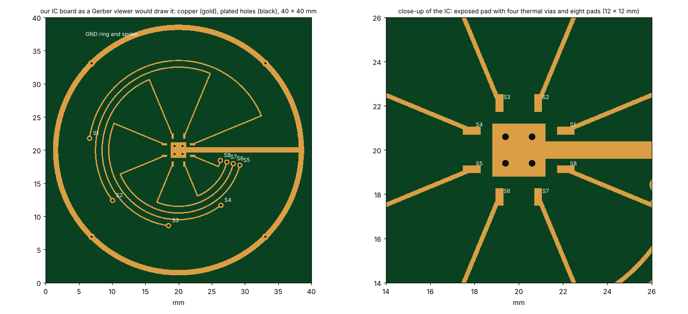
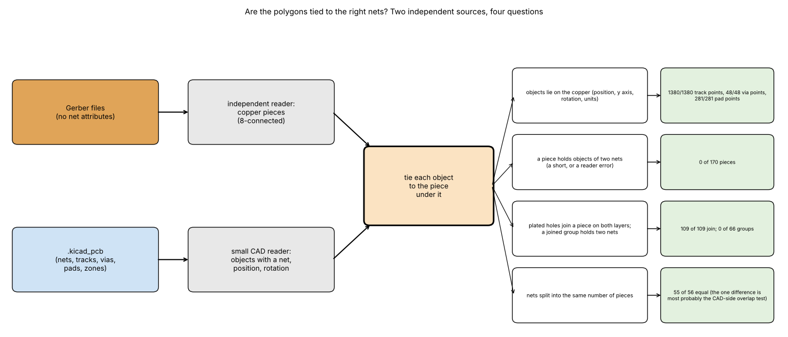

# Gerber import, phase 1: reading the files (copper, drills, nets, vias)

Status: **open**, a research branch (`research/gerbers`): **nothing in `pcbthermal/` was changed**. This folder is **phase 1 of three** of the Gerber research, which started as one study and was split: [`research/gerber-import`](../gerber-import/README.md) (1, reading the files), [`research/gerber-models`](../gerber-models/README.md) (2, the copper in the simulation models) and [`research/gerber-nets`](../gerber-nets/README.md) (3, nets with voltage and current). Dependencies run one way: 2 and 3 use the modules of 1, 3 does not use 2; **1 needs no program**. **Start with [`REPORT.md`](REPORT.md) (does the converter work: the boards, the results, the errors and the differences from other tools) and [`CONCLUSIONS.md`](CONCLUSIONS.md)**; how the result would enter the program is in [`INTEGRATION.md`](INTEGRATION.md); what was read and how, in [`LOG.md`](LOG.md); the text for the project documents, in [`docs/`](docs/). The layout is the one of every research folder (`CLAUDE.md`, "Research branches"). **Section numbers (4.1 to 4.40) are those of the original single study, so that the references between the three folders keep their meaning; the table below says where each one is.**

### Where the sections are

| Section | Folder | Subject |
| :-- | :-- | :-- |
| 4.1 | `gerber-import` **(this folder)** | Vectors to polygons |
| 4.2 | `gerber-models` | Raster against the exact area |
| 4.3 | `gerber-models` | Thin traces and the pixel |
| 4.4 | `gerber-models` | The mappings on 42 windows |
| 4.5 | `gerber-models` | Scalar formulas from the fraction alone |
| 4.6 | `gerber-models` | Fine scan of the parameters |
| 4.7 | `gerber-models` | Copper thickness |
| 4.8 | `gerber-models` | Heater size |
| 4.9 | `gerber-models` | Time response |
| 4.10 | `gerber-models` | Scalar versus fill of a zone: what the program does today |
| 4.11 | `gerber-models` | Regular patterns: what "fill 0.5" means |
| 4.12 | `gerber-models` | Two layers with plated holes |
| 4.13 | `gerber-models` | A real four-layer board |
| 4.14 | `gerber-models` | Through the program's own solver |
| 4.15 | `gerber-models` | Cost |
| 4.16 | `gerber-models` | The Lumped and Analytic models |
| 4.17 | `gerber-import` **(this folder)** | The independent reader against gerbonara on gerbonara's own test files |
| 4.18 | `gerber-import` **(this folder)** | How the independent reader differs from the others |
| 4.19 | `gerber-import` **(this folder)** | What can be read: copper layers and drill files |
| 4.20 | `gerber-nets` | Nets: how much does the 5 V net heat up? |
| 4.21 | `gerber-models` | Literature status |
| 4.22 | `gerber-import` **(this folder)** | Against the other Python tools, on files of known area |
| 4.23 | `gerber-nets` | Tracks at an angle: area, connectivity and resistance on the grid |
| 4.24 | `gerber-import` **(this folder)** | A third writer: Ucamco's `gerber-writer` |
| 4.25 | `gerber-models` | The regime of Sampson's article: heat that must reach fixed-temperature posts, |
| 4.26 | `gerber-models` | Grey-level |
| 4.27 | `gerber-models` | Every model of the program |
| 4.28 | `gerber-models` | An analogue of the post-mounted board of Sampson |
| 4.29 | `gerber-import` **(this folder)** | Vias and nets |
| 4.30 | all three (bench board) **(this folder)** | A board of our own as a bench: an IC with circular tracks |
| 4.31 | `gerber-models` | The import path end to end |
| 4.32 | `gerber-models` | Where the heater is: the set-up of the end-to-end runs |
| 4.33 | `gerber-import` **(this folder)** | Are the polygons tied to the right nets? A check against a KiCad project |
| 4.34 | `gerber-models` | Our board in the five models |
| 4.35 | `gerber-models` | A board of squares and rectangles in the five models |
| 4.36 | `gerber-nets` | Separate pieces of one net: what they are and what could be inferred |
| 4.37 | `gerber-models` | How to validate the models on the rectangle board, and why the FVM looks worse |
| 4.38 | `gerber-models` | The mappings as selectable options |
| 4.39 | `gerber-models` | Measured impact of the two proposed corrections to the program |
| 4.40 | `gerber-nets` | Sources, sinks and links: the electrical side |
| 4.41 | `gerber-import` **(this folder)** | The converter on every board, layer by layer |
| 4.42 | `gerber-models` | The thinnest track and the angle |
| 4.43 | `gerber-models` | Every mapping on every board, in one table |
| 4.44 | `gerber-models` | Diagonal couplings: the nine-point experiment |

## 1. The questions

A Gerber file is vector data: strokes with a width, flashes and filled regions; the drill file gives the holes. Phase 1 asks what can be taken from the files and how reliably.

1. Can the Gerber be converted to exact polygons, with holes and islands? **Yes** (4.1).
2. Can it be read **without third-party licences**? **Yes**: an independent reader that needs only NumPy (section 5, 4.17 to 4.19, 4.22, 4.24).
3. Can the plated holes, pads and nets be matched from the files? **Yes** (4.29), and **the nets agree with the CAD file of a real KiCad project** (4.33).
4. Can the result be handed to the next phases without the program? **Yes**: `importer.import_board` returns the board box, a binary and a coverage mask per layer, the holes with pad, kind and net, and warnings.

## 2. Findings in short

| Item | Result |
| :-- | :-- |
| Vectors to polygons | Exact with gerbonara + shapely (union keeps holes and islands). One Uno-clone layer: 103 polygons, 80 holes, 43 285 vertices. |
| Reading without libraries | `native_gerber.py` (NumPy only) draws the copper directly from the file: within 0.9 % of the copper area of the gerbonara route (max 2.5 %), same board boxes, same drills; unsupported features are reported, not guessed. |
| Scope | Copper layers 50 of 52 non-empty classified files drawn; drills 38 of 38 read, 35 of 35 identical to gerbonara (after fixing inverted TZ/LZ and other defects); reader refuses what it cannot do, including a drill file with no unit (4.19). |
| Other tools | On 14 files of known area the independent reader equals gerbonara + shapely and pcb-tools (binary) to the digit; the error is the pixel (thin tracks), a grey-level coverage keeps 4.4 % where binary masks lose 22 % at 0.1 mm; pygerber is strict and heavier, pcb-tools failed on real boards (4.22). |
| Reader conformance | 149 of 164 comparable gerbonara test files agree within 3 % of the area; 6 refused as unsupported (4.17). |
| Holes, pads, nets | The plated holes of the drill file match the pads (aperture function) and nets by position: 225 of 225 vias of a real four-layer board have one net on the four layers, 68 of 68 plated component holes of the X2 set agree on both layers (4.29). |
| **Nets against a CAD file** | Stormduino (KiCad 5, MIT): every object of the `.kicad_pcb` lies on the copper read (1380 of 1380 track points, 48 of 48 via points, 281 of 281 pad points); no piece of copper or group joined through the 109 plated holes holds two nets; 55 of 56 nets without a zone fill split into the same pieces as in the CAD file (4.33). |
| Bench boards | Our own IC board with circular tracks and the rectangle board of phase 2 (`our_board.py`, `rect_board.py`) are generated by the repository: no licence problem (4.30). |

## 3. Folder layout

Scripts are run from the repository root (`.venv/bin/python research/gerber-import/scripts/<script>.py`) and import the modules of `lib/` through `scripts/_bootstrap.py`; the tests find `lib/` and `scripts/` through `tests/conftest.py`. `data/` (downloaded boards, conformance and synthetic files, **shared by the three phases**) and `out/` are git-ignored.

| Path | What it is |
| :-- | :-- |
| `REPORT.md` | **The validation report**: does the converter work, on which boards, with which errors, and how it differs from the other tools. |
| `README.md`, `CONCLUSIONS.md`, `INTEGRATION.md`, `LOG.md` | The results in numbered sections, the conclusions, how the reader would enter the program, the log. |
| `docs/` | `research.md` summary, `changelog.md`, `decisions-log.md`, `roadmap-entry.md`, `literature.md` (what the project documents would get when the work is adopted). |
| `figures/` | `fig_01_gerber_render.png` (our IC board as the reader draws it), `fig_02_validation_summary.png` (the readers on files of known area, our reader on 12 layers), `fig_03_stormduino_nets.png` (the Stormduino coloured by the KiCad nets), `fig_04_mask_explained.png` (the mask on one thin track: vector, binary, coverage, cell fraction), `fig_05_reader_pipeline.png` (the reader and the matching of holes, pads and nets as diagrams). |
| `tests/` | 39 tests (7 s): the reader (`test_native_gerber.py`, `test_geometry.py`, `test_reader_claims.py`), nets and holes (`test_nets.py`, `test_our_board_bench.py`), the import (`test_importer.py`), the nets against a KiCad file (`test_kicad_nets.py`, needs `data/storm`). |
| `lib/native_gerber.py` | **Independent reader and rasteriser (NumPy only)**: RS-274X (apertures, macros, arcs, regions, polarity, step and repeat), X2 attributes (file function, aperture functions, net names), the layer classifier, Excellon, coverage masks. |
| `lib/importer.py` | **The import**: files to the board box, masks, holes with pad and net, warnings (`import_board`). |
| `lib/nets.py`, `lib/kicad_pcb.py` | Holes, vias, pads and nets matched by position; a small reader of `.kicad_pcb` (5.x) as the independent truth of the nets. |
| `lib/readers.py`, `lib/gerber_geometry.py`, `lib/windows.py`, `lib/boards_synthetic.py` | One interface to the readers; the vector route (gerbonara + shapely) as reference; the 42 windows of 36 mm of the mapping studies; the synthetic board generator of the tests. |
| `lib/our_board.py`, `lib/rect_board.py`, `lib/paths.py` | The IC board of our own; the rectangle board; the folders. |
| `scripts/fetch_boards.py` | Downloads the public test boards and the CAD file into `data/` (licences differ, section 9). |
| `scripts/study_native_check.py`, `study_reader_conformance.py`, `study_reader_scope.py`, `study_gerber_writer.py` | The reader against gerbonara + shapely, against gerbonara's test files, copper layers and drills, and Ucamco's `gerber-writer` (section 5, 4.17, 4.19, 4.24). |
| `scripts/make_synthetic.py`, `compare_readers.py` | Files of known area made with gerbonara; the comparison with gerbonara, pygerber and pcb-tools (4.22). |
| `scripts/study_validation_boards.py` | The copper area, pieces and holes of every layer of the eight boards against the vector truth (4.41). |
| `scripts/study_vias_nets.py`, `study_kicad_nets.py` | Holes, vias and nets (4.29); the nets against a KiCad project (4.33). |
| `scripts/make_figures.py` | Draws the figure. |
| `scripts/make_diagrams.py` | Draws the schematic diagram (figure 6). |

## 4. How to run, and the results

```sh
python3 -m venv .venv && .venv/bin/pip install -r research/gerber-import/requirements.txt   # once (this session used research/gerbers/.venv)
.venv/bin/python research/gerber-import/scripts/fetch_boards.py                              # once
cd research/gerber-import && ../../.venv/bin/python -m pytest -q tests                       # 39 tests, 7 s
```

All numbers below come from the independent reader unless the section says otherwise.

### 4.1 Vectors to polygons (Stormduino, an Arduino Uno clone)

gerbonara turns every draw, flash and region into primitives; shapely unions them in file order, adding dark and subtracting clear polarity. The top layer has
6 654 primitives (6 117 are 0.254 mm strokes: the copper pour is drawn as hatch lines) and unions into **103 polygons with 80 holes and 43 285 vertices** (12 462
after simplifying by 5 µm, with 0.07 % less area); the bottom layer 69 polygons, 44 holes, 26 288 vertices. As WKB the polygons are 300 to 500 KB; the same layer
as a 0.1 mm PNG mask is 9 to 12 KB.

### 4.17 The independent reader against gerbonara on gerbonara's own test files (`study_reader_conformance.py`)

272 Gerber-like files of gerbonara's test resources (many CAD tools; each small file tests one feature), drawn by both readers on the same pixels (pixel = half the thinnest aperture, 0.02 to 0.2 mm). Files with a feature thinner than 1.5 pixels at the finest pixel (82) are left out. Of 164 files both readers draw, **149 agree within 3 % of the area** (median difference 0.04 %, median differing pixels 0.0 %); 6 are refused (5 Upverter files with a non-standard `Rect` aperture shape, 1 file with an image mirror `MIA1B0`), none is read by the independent reader and refused by gerbonara. Time: 51 s against 323 s (gerbonara + shapely sampling).

The first run found four defects, now fixed and covered by tests: comment statements inside a macro (`0 text`), a straight region after a region closed by a G03 arc (the interpolation mode was not reset), a non-standard aperture shape reported as a file error instead of "unsupported". The 15 files that still disagree are almost all not copper layers (silkscreen and outline files with open contours, zero-length lines and strokes with arcs; 4 to 20 %); two small spec-test files differ on purpose: in `example_holes_dont_clear.gbr` and `example_am_exposure_modifier.gbr` the file itself states that an aperture hole or a macro clear primitive must **not** clear what was drawn before, which the independent reader follows (+7 % and +6 %) and gerbonara does not. The stroke differences on open outlines are not yet explained; they do not touch copper layers or the boards of the study.

### 4.18 How the independent reader differs from the others (details of the other projects from their documentation, not all verified by running them)

| | independent reader (`native_gerber.py`) | gerbonara | pygerber | pcb-tools |
|---|---|---|---|---|
| licence | part of the project, NumPy only | Apache-2.0 | MIT | Apache-2.0, unmaintained |
| what it produces | a pixel mask of the copper, directly | vector objects, can modify and write files | renders images (and 2D shapes) following the 2024.05 spec | objects, Cairo rendering |
| dependencies | NumPy | several (including shapely in this study for sampling) | pydantic, pillow and others | Cairo, others |
| Excellon | tolerant (Allegro, OrCAD comment tables, repeat command, slots); declared counts match | refuses some Allegro/OrCAD files | spec files | basic |
| features | RS-274X without AB, LM/LR/LS, moire, mirror, scale; no writing | the most complete of these | the most spec-faithful in intent | older subset |
| unsupported content | reported with an error | mostly handled | varies | silently wrong in places |
| checked on | 8 real boards and 164 test files (149 agree) | the reference here, itself not a ground truth | not run in this study | not run in this study |

Honest summary: the independent reader is not a better reader, it is a smaller one that does one job (rasterise copper and holes) with no library whose licence the closed product would have to carry. It supports fewer features, is validated on fewer files, and its remaining disagreements are on silkscreen/outline files and on two spec edge cases where it follows the spec text.

### 4.19 What can be read: copper layers and drill files (`study_reader_scope.py`)

Only copper layers and drills matter for the program (silkscreen, mask, paste and assembly are ignored; the classifier uses the X2 file function or the file name). On gerbonara's test resources and the downloaded boards:

* **Copper**: 54 files are classified as copper layers; 50 are drawn by the independent reader, 2 are refused (Upverter files with a non-standard `Rect` aperture), 2 had no content. Against gerbonara + shapely: 45 of 50 within 3 % of the area, median difference 0.02 %, worst 16.2 %. 8 files carry net names.
* **Drills**: 38 files look like Excellon. All 38 are read by the independent reader; gerbonara reads 35 (it refuses the OrCAD, the PADS file without header and a file with a deliberate syntax error). **On the 35 read by both, the holes are identical (positions to 0.01 mm, diameters to 1 µm) in all 35**, after the fixes below.
* **The first drill comparison found real errors in the reader** (the earlier claim "identical" had compared only the hole *counts*): the Excellon zero options were inverted (`TZ` keeps trailing zeros and omits leading ones, `LZ` the opposite; the Gerber wording is the reverse), the format written as `000.000` or `0000.00` in the header or as `;FILE_FORMAT=3:3` in a comment was ignored, `M71`/`M72` as the unit were ignored, a tool line such as `T1F00S00C0.300` lost its diameter, and a routed path with several `G01` segments gave one hole instead of one per segment. All fixed and covered by tests (`test_excellon_*`). A file with no unit anywhere (a PADS drill without header) is now **refused** ("choose the unit") instead of guessed: a wrong guess would place every hole 25 times wrong.
* **So: can any Gerber be read? No, and the reader says why.** Supported: RS-274X with the features of section 5; Excellon from 15 CAD tools in the test set. Refused with a message: aperture blocks, mirrored/rotated/scaled apertures, moire, image offset/mirror/scale, non-standard aperture shapes, a drill file without a unit. Plated and non-plated holes are told apart only when the file says so (comments, X2 `FileFunction` of the drill file). The layer assignment (which file is which copper layer) comes from the X2 attribute or the name, and the user confirms it.

### 4.22 Against the other Python tools, on files of known area (`make_synthetic.py`, `compare_readers.py`)

**Tools** (installed from PyPI): gerbonara 1.6.3 (Apache-2.0), pygerber 2.4.3 (MIT, raster renderer with anti-aliasing), pcb-tools 0.1.6 (cairo renderer, anti-aliased; it does not run on Python 3.13 as installed, `gerber.read` uses the removed `'rU'` file mode, so the text is passed to `gerber.loads`), and the independent reader. **Files**: made with gerbonara's own writer, so none of the readers wrote them, and the exact copper area comes from an independent shapely construction (buffered lines with round caps, polygons, differences): 7 single tracks of 0.03 to 0.3 mm, the same seven together, at 45 degrees, a plane with 28 clear holes of 0.1 to 1.2 mm, a plane with 1600 holes of 0.3 mm at 0.5 mm pitch (webs of 0.2 mm), a cross hatch (0.2 mm lines, 0.8 mm pitch), a plane with a clear ring, an island and a clear slot, and a random board of 60 tracks (0.1 to 0.4 mm) and 40 pads. Error of the copper area against the exact area (mean absolute over the 14 files, signed mean in brackets), by pixel size:

| tool | 0.1 mm | 0.05 mm | 0.025 mm | 0.0125 mm |
| :-- | --: | --: | --: | --: |
| independent reader (centre sampling) | 22.3 % (+3.3) | 7.8 % (+2.7) | 1.4 % (-1.0) | 3.7 % (-3.7) |
| gerbonara, vector area (no raster) | 0.01 % | 0.01 % | 0.01 % | 0.00 % |
| gerbonara + shapely, centre sampling | 20.8 % (+1.7) | 8.6 % (+1.9) | 1.3 % (-1.2) | 3.7 % (-3.7) |
| pcb-tools, pixels above 50 % | 21.9 % (+3.9) | 7.8 % (+7.2) | 1.3 % (-1.3) | 3.7 % (-3.7) |
| **pcb-tools, grey level (coverage)** | **4.4 % (-1.6)** | **2.6 % (-2.6)** | 1.4 % (-1.4) | 0.02 % |
| pygerber (cleaned file) | 30.3 % (+24.0) | 8.1 % (+1.5) | 1.9 % (-1.9) | 4.1 % (-4.1) |

(the 0.0125 mm column holds only the 9 files with the thinnest tracks, so it is not comparable with the others.)

What this shows:

1. **The independent reader gives the same raster as gerbonara + shapely and as pcb-tools above 50 %** (file by file the numbers coincide to the printed digit). On these files nothing separates the readers; **the error is the pixel**, not the reader. A track narrower than 1.5 pixels is rounded to 0, 1 or 2 pixels: 0.03 mm vanishes at 0.1 mm (-100 %), 0.05 mm doubles (+100 %), 0.075 mm gains a third, 0.15 mm loses a third. Only the vector area is exact.
2. **Binary masks lose or invent area on thin copper; a coverage (grey-level) mask does not**: pcb-tools' anti-aliased coverage keeps 4.4 % at 0.1 mm against 22 % for any binary mask. For the thermal mapping this suggests rendering at a finer pixel and averaging (coverage per coarse pixel), or keeping the pixel at most half the thinnest track (as 4.3 already said). Not yet tested in the conduction solver.
3. **pygerber is the worst at coarse pixels** (a 0.03 mm track draws as 0.1 mm: +233 %) and it **did not parse any of gerbonara's 47 written files as they are** (gerbonara writes `G75` without its `*` and an obsolete `%IPPOS*%`; a cleaned copy parses). Its grammar is strict, which is a feature for conformance and a handicap for tolerance.
4. **The independent reader accepts the same files** (it now tolerates a lone `G75` line, found by this test), runs in 0.04 s per file on average against 0.19 s (gerbonara + shapely), 0.06 s (pcb-tools) and 0.23 s (pygerber).
5. **Planes, holes, islands, clear slots and hatches are exact for every tool** at 0.1 mm (errors 0.0 to 0.4 %), except the perforated plane at 0.1 mm (+6 %: the 0.2 mm webs are 2 pixels wide with 0.5 mm holes, so the rounding of the holes shows) and pcb-tools' hatch (-2 %).

**The eight real boards** (top copper layer, reference gerbonara's vector area): independent reader 0.23 % at 0.1 mm and 0.14 % at 0.05 mm (mean absolute); gerbonara + shapely sampling 0.67 % and 0.14 %; pygerber 1.6 % and 1.3 % low, but it failed to parse 4 of the 16 runs; **pcb-tools 63 % low** on the real boards (clear polarity and region handling; not investigated, so no conclusion is drawn about its quality in general). Times per board: 0.6 s independent, 0.9 s pcb-tools, 3.0 s gerbonara + shapely, 5.7 s pygerber.

Limits of this comparison: area only (the position of the pixels was not compared between tools; for gerbonara and the independent reader it was, section 5); pygerber's and pcb-tools' defaults were used (one render setting each); the bounds of the pcb-tools render had to be given explicitly (its automatic bounds cut the image); versions are those on PyPI on the day; other tools (KiCad's gerbview, tracespace, gerbv) were not run.

### 4.24 A third writer: Ucamco's `gerber-writer` (`study_gerber_writer.py`)

The Ucamco format page (supplied by the maintainer, `docs/literature.md` section 5) names `gerber-writer`, a Python library for writing Gerber X2 files. Files written with it (thermal and rounded-thermal pads, rectangles, a rounded rectangle, a regular polygon, a circle, four tilted tracks, a path with a quarter-circle arc, a pentagon region) test the reader on a writer it has never seen. Copper area against the exact value (shapely construction for the tracks and the arc; the region is 300 mm²; the pads have no hand formula, so the reference there is gerbonara):

| file | independent reader | gerbonara 1.6.3 (vector) |
| :-- | --: | --: |
| 6 pads, with `Thermal` and `RoundedThermal` aperture macros | +0.08 % (against gerbonara) | (reference) |
| 4 tilted tracks and a path with a quarter-circle arc | **-0.04 %** | **-8.57 %** |
| pentagon region | -0.01 % | 0.00 % |

Findings: (1) **the reader handles the thermal-pad macros and the arc path**; (2) **gerbonara's vector area is 8.6 % low on the arc file** (cause not investigated), so a tool used as a reference is not ground truth, as section 4.22 already said; (3) gerber-writer writes its attributes in the compatibility form `G04 #@! TF.FileFunction,Copper,L1,Top*`, which the reader did not understand (file not classified as copper, net names lost): **fixed**, both forms are read now (`test_attributes_written_as_comments`). gerber-writer has no argument for a net name, so this file set does not test nets. Gerber-writer's `ChamferedRectangle` was not exercised.

### 4.29 Vias and nets (`nets.py`, `study_vias_nets.py`, `tests/test_nets.py`)

* **Same vias as the Gerber?** The program's `Via` is a plated through hole (position, finished diameter, fill). In the Gerber set a hole is a position and a diameter in the Excellon file, plated or not (X2 comment `; #@! TF.FileFunction,Plated,1,4,PTH` or `NonPlated,...,NPTH`, now read by `native_gerber.drill_function`; the holes inherit it), and every copper layer has a pad flashed over it whose **aperture function** (`ViaPad`, `ComponentPad`, `SMDPad,CuDef`, now stored per aperture) says what it is. `nets.hole_report` matches the three by position: for each hole the pad, function and net on every layer, and a class (`via`, `component`, `unplated`, `unknown`). A plated `via` maps to a program `Via` directly (hole diameter, position); a `component` hole is a lead hole of a part, copper-plated too (it also conducts between layers); an `unplated` hole is no via.
* **KiCad X2 test set** (2 layers, 80 holes, all variants): 76 plated, 4 non-plated; in the variant with aperture attributes 68 plated holes are classified `component` with a pad on both layers and the same net on both (68 of 68, no conflict), 8 plated holes have no pad found (`unknown`); without aperture attributes 30 are `unknown`, which shows how much the attributes give. The nets of this test file are all `N/C` (a pads-only test board).
* **Vias seen from the pads, a real 4-layer board** (`charliewatch-v2`, KiCad 7, no drill file in the test set): 225 vias found as `ViaPad` flashes at the same position on all four layers, **225 of 225 with the same net on the four layers**, none conflicting, none without a net, every via joining four layers; the nets with most vias are `/X3` (19), `/X1` (18). So the Gerber files do give the polygons-to-nets mapping on every layer and the via connections between layers, when the CAD tool writes the attributes.
* **Polygons to nets**: yes, by the net attribute of the objects (pads, tracks) and by connectivity for the rest (4.20); a net across layers is the union of its pieces joined by its vias. Files from tools that do not write the attribute give no nets.

### 4.30 A board of our own as a bench: an IC with circular tracks (`our_board.py`, `tests/test_our_board_bench.py`, figure 1)

Because the third-party test boards cannot be pictured (4.9), the repository has a board of its own that can be drawn, tested and published freely: `our_board.py` writes it as RS-274X with X2 attributes (file function, aperture functions `Conductor`, `SMDPad,CuDef`, `ViaPad`, `ComponentPad`, net names) and as an Excellon drill file with the X2 file function. 40 x 40 mm, an IC in the middle (a 2.4 mm exposed pad with four thermal vias and eight 0.8 x 0.35 mm pads), **eight signal nets that leave the IC radially and run round it on circular arcs (up to 150°, tracks of 0.2 mm, circles 1 mm apart) to 0.8 mm test points with plated holes**, and a ground net (exposed pad, a 0.8 mm spoke, a 0.8 mm ring of radius 18.5 mm with four vias). Copper is 10 % of the area.



*Figure 1 (`figures/fig_01_gerber_render.png`): the Gerber of the board as read by the independent reader (copper in gold on the board, plated holes in black, test points named), and a close-up of the IC at 0.0125 mm pixels: the exposed pad with its four thermal vias, the eight pads and the radial tracks.*

The tests use the board as a bench (`tests/test_our_board_bench.py`, 2 tests): nine nets, each one 8-connected piece, no pixel of a net within a pixel of another net (no short, clearance of at least 0.05 mm), the nets do not overlap; the 16 plated holes (8 vias, 8 test points) found with the right net by position (`nets.hole_report`), the drill file's X2 function read. The same board is a bench for the current of a net (gerber-nets 4.30, figure 3) and for the mapping to the thermal grid (gerber-models 4.30, figure 2). To use it elsewhere: `import our_board`; `our_board.gerber_text()`, `drill_text()`, `holes()`, `net_name(k)`, `squares(k)`, `write(folder)`.

### 4.33 Are the polygons tied to the right nets? A check against a KiCad project (`kicad_pcb.py`, `study_kicad_nets.py`, `tests/test_kicad_nets.py`)



*Figure 6 (`figures/fig_06_nets_check_schematic.png`): the check of the nets against a CAD file: the two independent sources, the four questions and the results (diagram, no data).*

Until now the net of a piece of copper was taken from the Gerber attributes and checked only against itself (4.20, 4.29). The Stormduino (KiCad 5, MIT) has its Gerbers **and** its `.kicad_pcb`, and its Gerbers carry no net attributes, so the check can be independent: the nets come from the CAD file, the copper from the Gerbers. `lib/kicad_pcb.py` reads the CAD file (nets, tracks, vias, pads with the module rotation applied, zones); `study_kicad_nets.py` splits the copper of each layer into 8-connected pieces, joins the two layers through the 109 plated holes of the drill file, and asks where the objects of the CAD file fall.

| Question | Result |
| :-- | :-- |
| Do the objects of the CAD file (3 points per track, vias on both layers, pads) lie on the copper our reader drew? (position, y axis, rotation, units) | 1380 of 1380 track points, 48 of 48 via points, 281 of 281 pad points |
| Does any piece of copper hold objects of two nets (a short, or a reader error)? | 0 of 170 pieces |
| Do the plated holes join a piece on both layers? | 109 of 109 |
| Does any joined group hold two nets? | 0 of 66 groups |
| Do the nets split into the same number of separate pieces in the Gerbers and in the CAD file's own geometry (tracks, vias, pads)? Nets without a zone fill | 55 of 56 equal |

What the separate pieces are: `+5V` and `+3V3` are two pieces each, and `Net-(J2-PadS1)` (the USB shield) four, **in the CAD file as well as in the Gerbers** (a net that the designer left in several pieces, mechanical pads), so these are not errors of the reader. The one difference, `Net-(J2-PadA7)` (one group in the Gerbers, two in my geometric reading of the CAD file), is most probably the crude overlap test used for the CAD side (a track end within a pad radius); it was not examined further. The two GND zones (fills) are connected in the Gerbers into one group; the CAD-side count of GND (32) ignores zone fills, so GND is not compared.

**Conclusion**: with nets given by a netlist (here the `.kicad_pcb`), the polygons of the Gerbers are tied to them by connectivity and position without a conflict, on a real board of 58 nets and 109 holes. With Gerber net attributes (4.29) the same follows from the files alone. Limits: one board; KiCad 5 (version 20171130) only; zone fills not compared net by net; the CAD side is my own small reader (it agreed with the Gerbers on position at the pixel, which also checks it). Fetch the CAD file with `scripts/fetch_boards.py storm`.

### 4.41 The converter on every board, layer by layer (`study_validation_boards.py`, `REPORT.md`, figures 2 and 3)

The validation report [`REPORT.md`](REPORT.md) collects the evidence in one place. New here: the reader, run on **all 12 copper layers of the 8 real boards**, against the vector area of gerbonara + shapely: mean absolute error 0.14 % (binary 0.1 mm), 0.13 % (0.05 mm), 0.05 % (coverage 0.1 mm), maximum 0.55 %; the connected pieces are identical in number on all 12 layers (28 to 445 per layer); 109 of 109 holes on the Stormduino. Figure 2 summarises the readers on files of known area and our reader on the 12 layers; figure 3 shows the Stormduino as the converter reads it, coloured by the nets of its KiCad file.

## 5. Without third-party libraries: the independent reader

The research route (gerbonara + shapely) is only the **reference**. `native_gerber.py` reads the files and draws the pixel centres itself, written from the public Gerber layer format specification and common Excellon practice, with NumPy only:

* RS-274X: coordinate formats (leading or trailing zero omission), MM and IN, standard apertures C, R, O, P with holes, aperture macros (primitives 0, 1, 4, 5, 7, 20, 21, 22, variables and arithmetic), draws with round and rectangular apertures, flashes, arcs (G02/G03, G74/G75), regions (G36/G37), dark and clear polarity, step and repeat, image polarity, X2 file attributes and a classifier of the layer from the attribute or the name.
* Not supported, and reported with an error instead of drawing a wrong picture: aperture blocks (AB), mirrored, rotated or scaled apertures (LM, LR, LS), the moire primitive, an image offset, mirror or scale.
* Excellon: metric and inch, tool definitions and the comment tables of some CAD tools, modal coordinates, the repeat command, routed slots (one hole at the middle).

Cross-check (`study_native_check.py`, 42 windows, 0.1 mm pixels): the copper area differs from the gerbonara + shapely route by -0.66 % to +0.89 % on average per board (largest single window 2.4 %); the pixels that differ are on edges (away from any edge: 0.0005 to 0.01 % of the window); the board boxes
are identical to 0.01 mm; the Stormduino drill gives the same 109 holes; the Allegro and OrCAD drill files, which gerbonara refuses, give exactly the declared 287 and 859 holes. On a four-layer board the native and shapely masks differ by 0.01 % (XOR over union). It is also faster (4.0 s for the 42 windows against 5.0 s plus the sampling). The windows chosen are the same, and **every table above was produced with the native reader**.

Licences of what the program would need for the import: NumPy and SciPy (BSD, already in the program). Nothing else.

## 8. Limits of this phase

* The reader draws copper layers and reads drills; it refuses aperture blocks, mirrored, rotated or scaled apertures, the moire primitive and image offset, mirror or scale; a drill file with no unit is refused (4.19).
* Net names exist only when the CAD tool writes them; zone fills often carry none (4.33): the net of a piece of copper is then found by connectivity, which needs the labelled pads and tracks in the piece.
* The nets were checked against the CAD file on **one** board, KiCad 5 only; zone fills were not compared net by net; the CAD side is a small reader written for this check.
* The Ucamco specification was not read in full (the host is blocked, only the format page supplied by the maintainer was read); the reader was written from the format as commonly documented and checked against real files and three other tools.
* All boards are public hobby designs; no power, heavy-copper or metal-core boards.

## 9. Test boards and licences

The files are **not** in the repository (`data/` is git-ignored). `fetch_boards.py` downloads them for private use; the results quoted here are statistics.

| Key | Board | Licence (as stated by the source) |
| :-- | :-- | :-- |
| `storm` | Stormduino Rev 2.2, an Arduino Uno clone (KiCad), 68.6 x 53.4 mm, 2 layers | MIT |
| `chibi` | chibi_2024 (KiCad), 100 x 78 mm (https://github.com/jaseg/7segstuff) | "CC BY-SA" as copied from the gerbonara test resources; **not confirmed at the source** (no licence file found at the repository root). Used for statistics only; no picture of it is kept |
| `easyeda` | an EasyEDA export | not stated |
| `pcbrnd` | epl_isolatedpwr (pcb-rnd) | GPL-2 |
| `pcad` | zxnet_usb (P-CAD) | GPL-3 |
| `dip` | FD1 mainboard (DipTrace) | BSD |
| `fritz` | analog_gyro_2021 (Fritzing) | MIT |
| `alleg` | a 4-layer Cadence Allegro board (tracespace issue 371), inches | not stated |

All but the Stormduino come from the test resources of gerbonara (https://gitlab.com/gerbolyze/gerbonara), each with the licence of its own folder; the licences of those folders could not be read or confirmed at their sources, so **no picture of any of them is kept in the repository** (the figures use our own synthetic boards and the MIT-licensed Stormduino).

## 10. Sources

* gerbonara, https://pypi.org/project/gerbonara/ (Apache-2.0); shapely and GEOS, https://shapely.readthedocs.io/.
* Ucamco, *The Gerber Layer Format Specification* (free download from https://www.ucamco.com/en/gerber): the reference of `native_gerber.py` (not copied; the document was not read in full in this session, only its availability was confirmed).
* KiCad `.kicad_pcb` file format (text, s-expressions), version 20171130 of the Stormduino project (MIT), https://github.com/Chromico/stormduino.
* pygerber, pcb-tools and Ucamco's `gerber-writer` (used as comparison tools in 4.22 and 4.24).
