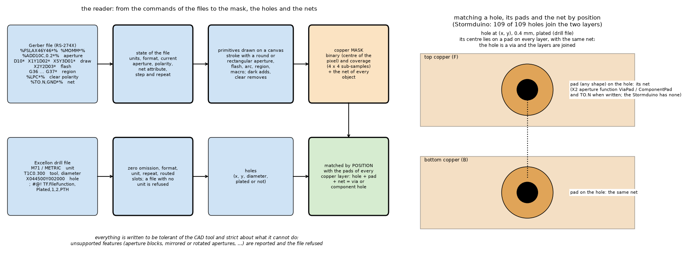
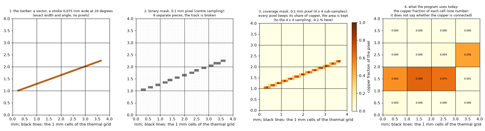
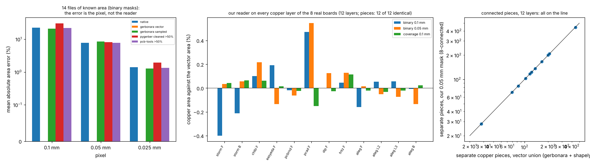
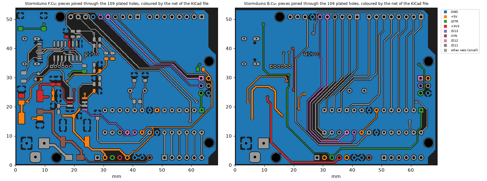
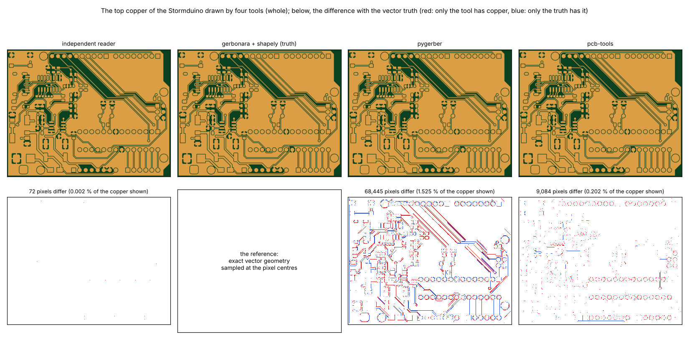
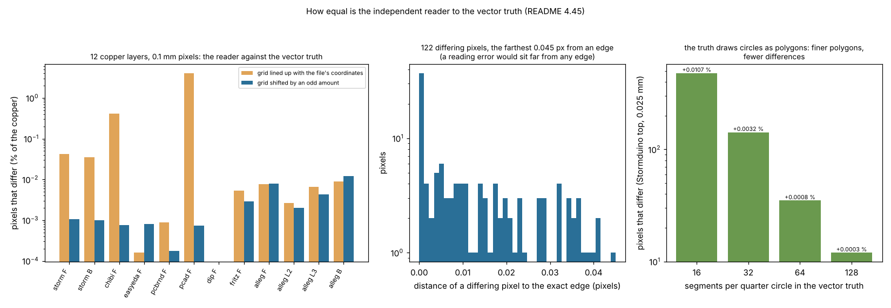

# Validation report: does the Gerber converter work?

Phase 1 of the Gerber research (`research/gerber-import`). **Question**: can the program take the Gerber and Excellon files of a board and obtain from them the copper of every layer, the holes and the nets, correctly, without any third-party library? **Answer: yes, for copper layers, drills and nets, on every board we have; the error of the copper area is 0.14 % on average (0.05 % with a coverage mask), the connected pieces and the holes are identical to the reference, and the nets agree with the CAD file of a real KiCad project.** What it cannot do is listed in section 6. All numbers come from scripts in `scripts/` and tests in `tests/` (41 tests, 8 s); the sections of `README.md` (4.x) have the details.

## 1. What the converter does

`importer.import_board(roles)` takes the files of a set (copper layers from the top, an optional outline, drill files) and returns the board box, **a binary and a coverage mask per copper layer** (pixel at most half the thinnest track, with a warning), **the plated holes with their pad, kind and net**, and warnings. It is the NumPy-only reader `native_gerber.py` (RS-274X with apertures, macros, arcs, regions, polarity, step and repeat, X2 attributes; Excellon) plus `nets.py` (holes, pads and nets matched by position). It needs no program and no new dependency. What is done with the masks (conductances, the thermal models) is phase 2; the current in the nets is phase 3.

### 1.1 How the reader works



*Figure 5 (`figures/fig_05_reader_pipeline.png`): left, a Gerber file is read command by command (apertures, draws, flashes, regions, polarity, net attributes) into the state of the file and drawn as primitives on a canvas, which gives the copper mask and the net of every object; an Excellon file gives the holes; right, a hole is matched by position with the pads of every copper layer and their net, which makes it a via or a component hole and joins the layers.*

### 1.2 The mask, step by step



*Figure 4 (`figures/fig_04_mask_explained.png`): a 0.075 mm track at 20 degrees. 1, the Gerber is a vector with exact width and angle; 2, a binary mask at 0.1 mm (the pixel is copper when its centre is inside the stroke) breaks the track into 9 pieces; 3, the coverage mask keeps in every pixel the share of copper (4 x 4 sub-samples), so the area is exact and the track is continuous; 4, the program today keeps one number per 1 mm cell, the copper fraction, which says how much copper there is but not whether it is connected.*

**Where the mask is used**: it is the common input of everything that follows (the diagram of the chain is Figure 10 of `research/gerber-models`): phase 2 turns it into the sheet conductance of every pixel and from there into the face conductances of the cells (the pixel sets the resolution of that step: at most half the thinnest track); phase 3 takes the mask of one net as the domain where the current is solved; and the pixel-by-pixel solution of the same mask is the reference against which every mapping is judged.

## 2. The test material

| Material | What | Where |
| :-- | :-- | :-- |
| 8 real boards, 12 copper layers | Stormduino (KiCad, 2 layers, MIT), chibi (KiCad), easyeda, pcb-rnd, P-CAD, DipTrace, Fritzing and a 4-layer Allegro board (inches) | `data/` (git-ignored, licences in README section 9) |
| 14 files of known area | tracks of 0.03 to 0.3 mm, planes with holes, hatch, perforated plane, islands, a random board; written with gerbonara; the exact area from an independent shapely construction | `scripts/make_synthetic.py`, 4.22 |
| 272 test files of gerbonara | many CAD tools, each file one feature | 4.17, 4.19 |
| files written by Ucamco's `gerber-writer` | thermal pads, arcs, tilted tracks, regions | 4.24 |
| 38 Excellon drill files | 15 CAD tools | 4.19 |
| Stormduino + its `.kicad_pcb` | the CAD file as the truth of the nets | 4.33 |
| our IC board and the rectangle board | generated by the repository, with X2 attributes and a drill file | 4.30 |

## 3. Results

### 3.1 The copper of 8 real boards, layer by layer (reference: gerbonara + shapely vector area)



*Figure 2 (`figures/fig_02_validation_summary.png`): left, the mean absolute area error of every tool on 14 files of known area, by pixel size (the error is the pixel: our reader coincides with gerbonara + shapely and with pcb-tools above 50 %); middle, our reader against the vector area on every layer of the eight boards; right, the separate pieces of copper found by our 0.05 mm mask against the polygons of the vector union.*

```
board    layer vector mm2   bin 0.1  bin 0.05   cov 0.1  pieces (ours/vector)  holes (ours/gerbonara)
storm    F         2804.5    -0.40%    +0.03%    +0.04%        103/103                        109/109
storm    B         3022.2    -0.21%    +0.06%    +0.06%         69/69                         109/109
chibi    F         6502.3    +0.10%    +0.22%    +0.06%        208/208                            0/-
easyeda  F         6289.4    +0.19%    -0.13%    +0.01%        117/117                            0/-
pcbrnd   F         5659.7    -0.02%    -0.06%    -0.02%         83/83                             0/-
pcad     F         2780.2    +0.47%    +0.55%    -0.15%        445/445                            0/-
dip      F         3125.8    +0.00%    +0.13%    -0.03%        123/123                            0/-
fritz    F         1697.8    +0.05%    +0.13%    +0.11%        200/200                            0/-
alleg    F         3115.8    -0.16%    +0.02%    -0.02%        166/166                    283/refused
alleg    L2        4512.1    +0.05%    -0.05%    -0.03%         28/28                     283/refused
alleg    L3        4388.8    +0.06%    -0.07%    -0.02%         28/28                     283/refused
alleg    B         3713.8    -0.01%    -0.13%    +0.02%        136/136                    283/refused

mean absolute area error over 12 layers: binary 0.1 mm 0.14 %, binary 0.05 mm 0.13 %, coverage 0.1 mm 0.05 % (maximum [0.47, 0.55, 0.15])
```

* **Copper area**: 0.14 % mean absolute error with a 0.1 mm binary mask, 0.13 % at 0.05 mm, **0.05 % with the coverage mask** (4 x 4 sub-samples), maximum 0.55 %; the larger values are the boards with the thinnest features (P-CAD, Stormduino at 0.1 mm).
* **Connected pieces**: the 8-connected pieces of the 0.05 mm mask are **identical in number to the polygons of the vector union on all 12 layers** (28 to 445 pieces per layer).
* **Holes**: 109 of 109 on the Stormduino; the Allegro drill file (283 holes plated in the box, 287 declared in the file) is refused by gerbonara (no number format), so there the check is the declared count.
* Board boxes: identical to 0.01 mm on 7 boards (`study_native_check.py`).

### 3.2 Against the other tools, on files of known area (4.22)

| Tool | 0.1 mm | 0.05 mm | 0.025 mm | Comment |
| :-- | --: | --: | --: | :-- |
| our reader (centre sampling) | 22.3 % | 7.8 % | 1.4 % | the same raster as gerbonara + shapely and pcb-tools (binary) to the digit; the error is the pixel |
| gerbonara, vector area | 0.01 % | 0.01 % | 0.01 % | exact, but no raster |
| gerbonara + shapely, sampled | 20.8 % | 8.6 % | 1.3 % | |
| pcb-tools, pixels above 50 % | 21.9 % | 7.8 % | 1.3 % | **63 % low on the 8 real boards** (not investigated) |
| pcb-tools, grey level | **4.4 %** | **2.6 %** | 1.4 % | a grey-level (coverage) mask keeps thin tracks |
| pygerber | 30.3 % | 8.1 % | 1.9 % | strict grammar: parsed none of gerbonara's 47 written files as they are |

A track narrower than 1.5 pixels is rounded to 0, 1 or 2 pixels with any binary mask: 0.03 mm vanishes at 0.1 mm, 0.05 mm doubles. **That is a property of the pixel, not of the reader, and the coverage mask removes most of it** (README 4.3, 4.22; the thermal consequence is phase 2).

### 3.3 Reader scope and conformance (4.17, 4.19, 4.24)

* gerbonara's own 272 test files: of the 164 both readers draw, **149 agree within 3 % of the area** (median 0.04 %); 6 are refused as unsupported; the 15 that disagree are mostly silkscreen and outline files.
* 54 copper layers classified, 50 drawn, 2 refused (non-standard `Rect` aperture), 2 empty; 45 of 50 within 3 % of gerbonara's area.
* Drills: all 38 files read; on the 35 gerbonara also reads, **the holes are identical (positions to 0.01 mm, diameters to 1 µm) in all 35**.
* Files written by Ucamco's `gerber-writer`: -0.04 % on the tilted tracks and the arc path; gerbonara's vector area is -0.00 % (an earlier -8.57 % was our wrapper ignoring arcs, fixed, see section 5).

### 3.4 Nets and vias (4.29, 4.33)



*Figure 3 (`figures/fig_03_stormduino_nets.png`): the Stormduino (MIT) top and bottom copper as the converter reads them, the pieces joined through the 109 plated holes, each coloured by the net of the CAD objects it holds in the `.kicad_pcb` (the Gerbers have no net attributes). The ground plane is one net on both layers, the signal tracks keep their nets across the holes.*

* **Against a CAD file** (Stormduino): 1380 of 1380 track points, 48 of 48 via points and 281 of 281 pad points of the `.kicad_pcb` lie on the copper we read; **no piece of copper and no group joined through the plated holes holds two nets** (0 of 170 pieces, 0 of 66 groups); 109 of 109 plated holes join a piece on both layers; 55 of 56 nets without a zone fill split into the same number of pieces as in the CAD file's own geometry (the one difference was not examined).
* From the Gerber attributes alone: 225 of 225 vias of a real four-layer KiCad board carry one net on the four layers; 68 of 68 plated component holes of the X2 test set agree on both layers.


*Figure 1 (`figures/fig_01_gerber_render.png`): our own IC board read from its Gerber: copper, plated holes and test points; the close-up shows the exposed pad with its thermal vias.*

### 3.5 The same board drawn by four tools, pixel by pixel (4.45)



*Figure 9: the Stormduino top copper by the independent reader, gerbonara + shapely (the truth), pygerber and pcb-tools; below, the pixels that differ (red: only the tool, blue: only the truth).*

The independent reader differs from the vector truth in **72 of 4.49 million copper pixels** on the whole layer at 0.025 mm (pcb-tools: 9,084; pygerber: 68,445, along the edges, after a bounding-box alignment and a 50 % threshold of my own). On the 12 layers of the 8 boards at 0.1 mm, 85 pixels out of 4.76 million differ on a grid that avoids ties, **all within 0.042 pixel of an exact edge** (a pixel centre that close to an edge goes either way; a reading error would sit far from any edge):



*Figure 11: left, the pixels that differ on 12 layers (grid lined up with the file and shifted grid); middle, the distance of each to the exact edge; right, how the difference falls when the vector truth draws circles with more segments (the truth's 16 segments per quarter circle make it slightly smaller than the true circle).*

## 4. Differences from the methods already known

| | our converter | gerbonara (+ shapely) | pcb-tools | pygerber |
| :-- | :-- | :-- | :-- | :-- |
| Output | pixel masks, holes with net | vector objects, can write files | objects, Cairo image | image (anti-aliased) |
| Dependencies | NumPy | several (shapely for sampling) | Cairo and others | pydantic, pillow, others |
| Area on real boards | 0.14 % (0.05 % coverage) | 0.67 % sampled, exact as vectors | 63 % low (unexplained) | 1.6 % low, 4 of 16 runs failed |
| Excellon | tolerant: Allegro, OrCAD comment tables, repeat, slots | refuses 3 of 38 | basic | spec files |
| Unsupported content | reported with an error | mostly handled | silently wrong in places | varies |
| Features | fewer (no aperture blocks, LM/LR/LS, moire, mirror, scale; no writing) | the most complete | older subset | spec-faithful in intent |
| Time per real layer | 0.6 s | 3 s | 0.9 s | 5.7 s |
| Licence | the project's | Apache-2.0 | Apache-2.0 | MIT |

**Honest summary**: it is not a better reader; it is a smaller one that does one job (copper, holes, nets) with no library whose licence the closed product would carry. Its raster equals the others' at the pixel; its advantages are the coverage mask, the drill tolerance, the speed and the absence of dependencies; its disadvantages are the features it refuses and the fewer files it was validated on.

## 5. Errors found and fixed while validating

The comparisons found real defects, all fixed and covered by tests: **the vector reference of our own wrapper ignored stroked arcs** (G02/G03 draws), so our board's circular tracks were missing (41 mm2 instead of 164 mm2) and an arc file looked 8.6 % low in gerbonara; found by the pixel-by-pixel comparison of 4.45; the Excellon zero options (`TZ`/`LZ`) were inverted (found only when positions, not counts, were compared); the format written as `000.000`, `0000.00` or `;FILE_FORMAT=3:3` was ignored; `M71`/`M72` and a tool line `T1F00S00C0.300` lost their meaning; a routed path with several segments gave one hole; a lone `G75` (gerbonara's writer omits the `*`) swallowed the next command; attributes written as `G04 #@!` comments (`gerber-writer`) were ignored; comment statements inside a macro, a region after a region closed by an arc and a non-standard aperture shape were mishandled. A drill file with no unit is now refused instead of guessed. An earlier claim ("drills identical") that had compared only the counts was wrong and is corrected in the README.

## 6. What is not validated

* No comparison with a manufactured board or a physical measurement; the reference is another reader or a CAD file.
* The nets were checked against a CAD file on **one** board and KiCad 5 only; zone fills were not compared net by net (they carry no net in the Gerber: the net comes from connectivity).
* Not supported (reported, the file refused): aperture blocks, mirrored/rotated/scaled apertures, moire, image offset/mirror/scale, a drill file without a unit; the polygon outline of a non-rectangular board is not drawn (the box only).
* The pixel-by-pixel comparison against pygerber and pcb-tools depends on my alignment and threshold; why pygerber differs by 1.5 % along the edges was not examined.
* All boards are public hobby designs; the Ucamco specification was not read in full; pcb-tools and pygerber were run with their defaults.

## 7. How to reproduce

```
cd research/gerber-import && python -m pytest -q tests                                   # 41 tests, 8 s
.venv/bin/python research/gerber-import/scripts/fetch_boards.py                           # the boards and the CAD file into data/
.venv/bin/python research/gerber-import/scripts/study_validation_boards.py                # section 3.1, about 3 minutes (needs gerbonara and shapely)
.venv/bin/python research/gerber-import/scripts/compare_readers.py synthetic              # section 3.2 (needs gerbonara, pygerber, pcb-tools, shapely, pillow)
.venv/bin/python research/gerber-import/scripts/study_kicad_nets.py                       # section 3.4
.venv/bin/python research/gerber-import/scripts/make_figures.py                           # the figures
```
