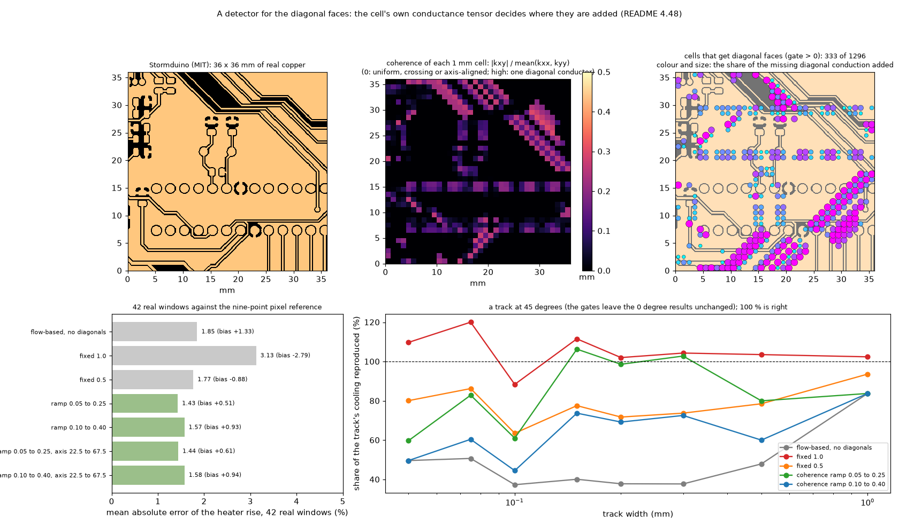
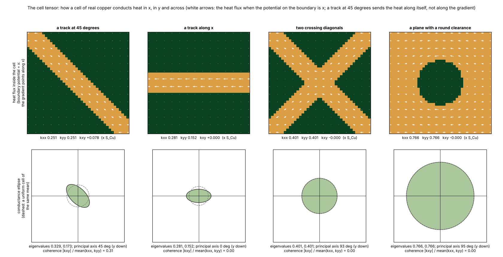
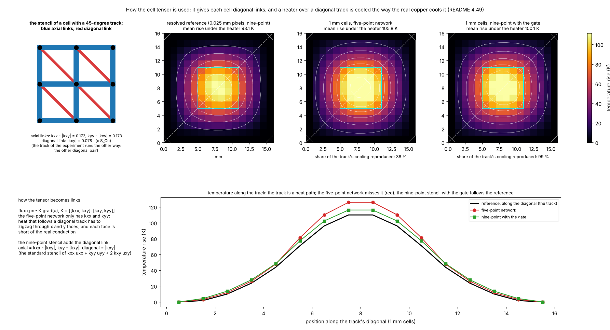
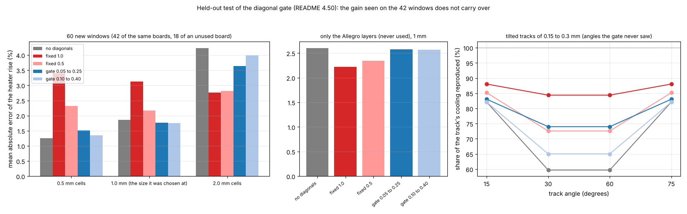
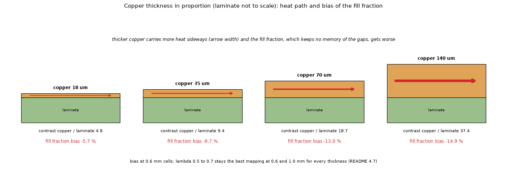
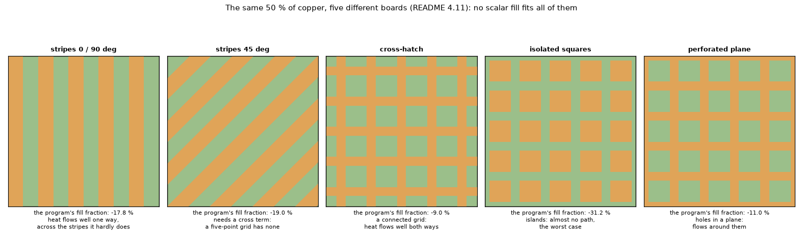
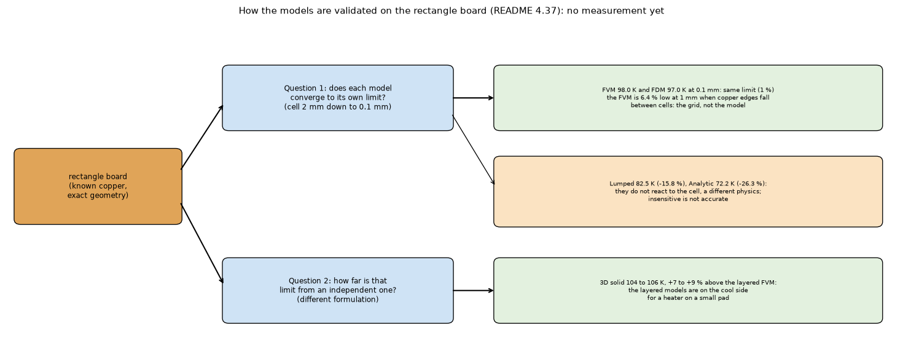
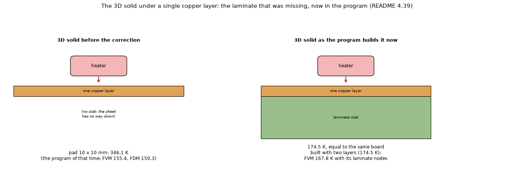

# Gerber import, phase 2: the copper in the simulation models (mapping to conductances, the five models)

Status: **open**, a research branch (`research/gerbers`): **nothing in `pcbthermal/` was changed**. This folder is **phase 2 of three** of the Gerber research, which started as one study and was split: [`research/gerber-import`](../gerber-import/README.md) (1, reading the files), [`research/gerber-models`](../gerber-models/README.md) (2, the copper in the simulation models) and [`research/gerber-nets`](../gerber-nets/README.md) (3, nets with voltage and current). Dependencies run one way: 2 and 3 use the modules of 1, 3 does not use 2; **1 needs no program**. **Start with [`REPORT.md`](REPORT.md) (the problem, the methods, the boards, the results and what to do next, in plain order) and [`CONCLUSIONS.md`](CONCLUSIONS.md)**; how the result would enter the program is in [`INTEGRATION.md`](INTEGRATION.md); what was read and what was not verified, in the last section of this file; the text for the project documents, in [`docs/`](docs/). The layout is the one of every research folder (`CLAUDE.md`, "Research branches"). **Section numbers (4.1 to 4.50) are those of the original single study, kept so that the references between the three folders and from other documents keep their meaning: the table below lists the sections of this folder, and the map of all of them, folder by folder, is in [`research/README.md`](../README.md) ("The Gerber research: where the sections are").**

### Where the sections are

| Section | Subject |
| :-- | :-- |
| 4.2 | Raster against the exact area |
| 4.3 | Thin traces and the pixel |
| 4.4 | The mappings on 42 windows |
| 4.5 | Scalar formulas from the fraction alone |
| 4.6 | Fine scan of the parameters |
| 4.7 | Copper thickness |
| 4.8 | Heater size |
| 4.9 | Time response |
| 4.10 | Scalar versus fill of a zone: what the program does today |
| 4.11 | Regular patterns: what "fill 0.5" means |
| 4.12 | Two layers with plated holes |
| 4.13 | A real four-layer board |
| 4.14 | Through the program's own solver |
| 4.15 | Cost |
| 4.16 | The Lumped and Analytic models |
| 4.21 | Literature status |
| 4.25 | The regime of Sampson's article: heat that must reach fixed-temperature posts, no convection |
| 4.26 | Grey-level (coverage) mask against the binary mask |
| 4.27 | Every model of the program |
| 4.28 | An analogue of the post-mounted board of Sampson |
| 4.30 | Our IC board as a thermal bench |
| 4.31 | The import path end to end |
| 4.32 | Where the heater is: the set-up of the end-to-end runs |
| 4.34 | Our board in the five models |
| 4.35 | A board of squares and rectangles in the five models |
| 4.37 | How to validate the models on the rectangle board, and why the FVM looks worse |
| 4.38 | The mappings as selectable options |
| 4.39 | Measured impact of the two proposed corrections to the program |
| 4.42 | The thinnest track and the angle |
| 4.43 | Every mapping on every board, in one table |
| 4.44 | Diagonal couplings: the nine-point experiment |
| 4.48 | A detector for the diagonal faces |
| 4.49 | The cell tensor: what it is and how it is used |
| 4.50 | Held-out test of the diagonal gate: it does not hold up |

## 1. What this folder does and what it leaves to the others; the questions

**This folder** puts the imported copper in the simulation models: how the fine copper of a mask becomes the conductances of a grid of square cells (the mappings, 4.4 to 4.6, 4.21, 4.38, 4.43), what changes the answer (pixel, coverage, track width and angle, thickness, heater size, time, 4.2, 4.3, 4.7 to 4.9, 4.26, 4.42), diagonal faces and the cell tensor (4.44, 4.48 to 4.50), real layers and patterns (4.11 to 4.13, 4.25, 4.28), the five models of the program on imported copper (4.14 to 4.16, 4.27, 4.30, 4.34, 4.35, 4.37), the import into the program's FVM (4.31, 4.32) and the two corrections to the program it found (4.10, 4.39), with the laminate reference of the review (Review R2).

**Left to the others**: reading the files, the masks, holes, vias, nets and outline, and the readers compared are [`gerber-import`](../gerber-import/README.md) (its masks are the input here; how the import would enter the program is its `INTEGRATION.md`); the current in a net, its Joule heat and the resistance of tracks at any angle are [`gerber-nets`](../gerber-nets/README.md) (a Joule heat enters the models of this folder as an ordinary power per cell).

The whole chain from the Gerber file to the temperature is drawn in Figure 10:


*Figure 10 (`figures/fig_10_pipeline.png`): blue, phase 1; orange, this folder; green, phase 3; the mask is the common currency.*

The program's finite-volume model works on a grid of square cells and knows only one number per cell and layer: the **fraction of copper** (and, for a zone, the fill typed by the user). Phase 2 takes the masks of phase 1 and asks how to put them in the simulation models.

1. How should fine copper be turned into the conductances of a grid of squares? The fill fraction is badly biased; better mappings exist and the best are within 0.3 to 3.6 % of the resolved mask (4.4 to 4.13, 4.38; see Review R2 for what that reference leaves out).
2. What are the cautions (hatched zones, thick copper, several layers, heater size, time response, the program's own tests)? Investigated, 4.6 to 4.14.
3. Does it work through the program's own solver? **Yes, without changing it** (4.14, 4.31).
4. How do the five models of the program (FVM, FDM, Lumped, Analytic, 3D solid) behave on imported copper, on our board and on a board of rectangles? 4.16, 4.27, 4.34, 4.35, 4.37.
5. What would have to change in the program, and what would that change cost? 4.27, 4.39, section 5 and `INTEGRATION.md`.

## 2. Findings in short

| Item | Result |
| :-- | :-- |
| Raster | Area within 0.2 % at 0.1 mm pixels; a binary raster **interrupts** traces thinner than about 1.4 pixels: pixel of at most half the thinnest trace (0.05 mm for 0.1 mm traces). |
| **Fill fraction (the program's)** | **Too cool**: against an independent 3D solution of seven real one-layer windows by 24 to 26 % on average, against the program's own pixel run by 16 to 18 % (Review R2); in the one-sheet studies **by 10 to 11 %** on average (single layer, 35 µm, 42 windows of 7 real boards), 14 % with plated holes on two layers, 3 to 7 % on a real four-layer board, up to 18 % with 140 µm copper, and **7 to 43 % for regular 50 % patterns**. Never too hot: the average assumes the copper is connected where clearances cut it. |
| Geometric mean | `S = S_cu^f S_lam^(1 - f)` from the fraction alone: 2 to 3 % on real copper, but **-20 to +22 % on regular patterns** (connected grids too hot, islands too cool): a fallback, not a rule. |
| Directional bounds, lambda = 0.5 | `Sx`, `Sy` per cell from a fine mask: 1.0 to 1.3 % (single layer, 0.6 and 1.0 mm cells), 0.5 to 1.0 % with plated holes, but 1.3 to 7.5 % on the four-layer board and +10 to +12 % for diagonal stripes at 0.6 mm cells. |
| **Flow-based faces** | The most robust: 0.6 to 0.9 % (single layer), 0.4 to 1.3 % (two layers), 0.3 to 2.0 % (four layers), 0.9 to 3.4 % on every regular pattern at 1 mm cells (diagonal stripes included). It costs 5.5 s per 1.6 M pixels (a 100 x 160 mm layer at 0.1 mm), once, at import. |
| In the program | The mappings run through `pcbthermal.fvm.Network` with only the lateral conductances of the copper changed (plumbing check 1e-6 K; the agreement with the research solver to 3e-12 held before the program's laminate nodes, Review R1 and R3). **Applying the geometric mean to the program's `Zone.fill` would change a hatched zone by +26 to +45 %** and four exact-value tests by 0.05 to 0.07 K: the zone fill and the imported copper must stay separate things. |
| Time response | Heat capacity stays an arithmetic average; with the new conductances the response follows the steady one (0.7 to 3.2 % at 120 s). |
| Lumped and Analytic | Lumped inherits a better `S` (27.7 % to 15.5 % against the program's pixel run); Analytic needs one effective conductance, a heater-influence-weighted power mean with p = -0.2 (30.4 % to 8.8 %), section 4.16. |
| Cell size | 0.6 and 1.0 mm cells map well; at 2 mm every method is limited by the grid itself (the 6 mm heater has 3 x 3 cells). |
| **Import end to end** | Gerber to the program's own FVM: heater error -15.1 % with the program's fill against -2.1 % (binary) and -5.3 % (coverage) with imported faces on the Stormduino, -4.8 % against +7.3 % and +5.2 % on our board (against an independent 3D solution of our board: -12.2 % against -1.2 %); another reader changes it by 0.01 to 0.04 % (4.31). |
| **Five models** | On rectangles the FVM and FDM converge to the same value; the Lumped is 16 % and the Analytic 26 % below the FVM; the 3D solid (two layers) is 7 to 9 % above (4.35, 4.37). |
| **Mapping as an option** | Mean absolute error on eleven boards in the program: fill 7.4 %, **flow-based faces 2.3 %, Wiener upper bound 2.3 %, lambda 0.5 2.4 %, cell problem 2.4 %** (4.38, 4.43). |
| **Diagonal couplings** | A hybrid (the flow-based faces plus the diagonal conduction they miss, damped by 0.5) raises the share of a 45-degree track's cooling reproduced from 37 to 84 % to 64 to 94 % and keeps the 42 real windows at 1.77 % (flow-based faces 1.85 %); undamped it fixes the diagonal (88 to 120 %) but is 3.1 % on the windows with a -2.8 % bias (4.44). |
| **Thin tracks and angles** | The mask recognises a track if the pixel is at most half its width; a 0.05 mm track already cools a 6 mm heater by 3 %; at 0 degrees the cells reproduce 96 to 98 % of a track's effect, at 45 degrees only 38 to 53 % (flow-based faces) against 63 to 106 % (fill fraction): isolated diagonal copper on a coarse grid is the largest known residual error (4.42). |
| **Two corrections to the program** | Zones combined per sample point instead of per cell (copper in abutting zones no longer lost: -8.2 % FVM, -19.1 % FDM on strips; the additive rule is wrong; not applied); laminate under a single copper layer in the 3D solid (346 K to 174.5 K; **in the program since**); the example boards do not move (4.39). |

## 3. Folder layout

Scripts are run from the repository root with `PYTHONPATH=.` when a copy of the program is not given (`.venv/bin/python research/gerber-models/scripts/<script>.py`) and import the modules of this folder and of `research/gerber-import` through `scripts/_bootstrap.py`; the tests do the same through `tests/conftest.py`. `out/` is git-ignored; the boards are in `research/gerber-import/data`.

| Path | What it is |
| :-- | :-- |
| `REPORT.md` | **The guide**: the problem, the methods compared, the boards, the results on 11 boards and 42 windows, the differences from the known methods, thin tracks and angles, what to do next. |
| `README.md`, `CONCLUSIONS.md`, `INTEGRATION.md` | The full record in numbered sections (grouped 4.A to 4.F), the conclusions, how the mapping would enter the program (and the two corrections) |
| `docs/` | `research.md` summary, `changelog.md`, `decisions-log.md`, `roadmap-entry.md`, `literature.md` (the three articles, what was read and how). |
| `figures/` | `fig_01` to `fig_24`, one numbering: data figures 1 to 12 and 18 to 22 and 24 (`make_figures.py`) and diagrams 13 to 17 and 23 (`make_diagrams.py`): 01 copper mapping to cells (a window of the Stormduino, MIT), 02 our IC board thermal maps, 03 the import end to end, 04 its set-up (heater, holes, cells), 05 our board in the five models, 06 the rectangle board in the five models, 07 the thinnest track and the angle, 08 the nine-point experiment, 09 how the cells are linked, 10 the whole chain from the Gerber to the temperature, 11 how the zones are combined, 12 what the copper fraction hides in a cell with a clearance, 13 the laminate of the 3D solid under one copper layer, 14 the validation chain of the rectangle board, 15 the same fill with different copper, 16 copper thickness, 17 the detour under a clearance, 18 the flow-based face conductance at work, 19 the diagonal gate, 20 and 21 the cell tensor, 22 the mapping formulas, 23 the flow window, 24 the held-out test of the gate. |
| `tests/` | 34 tests (about 30 s with the program's dependencies): the solvers and mappings (`test_conduction.py`, `test_claims.py`), the board as a thermal bench (`test_our_board_models.py`), the import to the program (`test_importer.py`), the program's union rule (`test_program_union.py`), the rectangle board in the models (`test_rect_board.py`), the thinnest track and the angle (`test_track_width_angle.py`), the nine-point prototype (`test_diagonal.py`). Most need the program's dependencies. |
| `lib/conduction.py` | The conduction solvers (one layer, two, a stack) and **every mapping**: power mean, Bruggeman, Hashin-Shtrikman, bounds, lambda, cell problem, flow-based faces. |
| `lib/scenarios.py` | Boundary-limited scenarios (posts, held border) and the comparison of the mappings against a resolved reference. |
| `lib/diagonal.py` | **The nine-point experiment**: a network with diagonal faces, the nine-point fine reference, a cell tensor from local problems, and the hybrid faces (4.44). |
| `lib/faces.py` | **From the masks to the program**: the program's `Problem` for the imported board, the face conductances of every layer (`METHODS`), `FaceNetwork` (the program's FVM with those faces), `solve_today`, `solve_fine`. |
| `scripts/study_raster_error.py`, `study_mapping.py`, `study_scalar_formulas.py`, `study_fine_scan.py`, `study_contrast.py`, `study_heater_size.py`, `study_transient.py` | Raster error and thin traces, the mappings on the 42 windows and their parameters (4.2 to 4.9). |
| `scripts/study_patterns.py`, `study_patterns_two_layer.py`, `study_two_layer.py`, `study_multilayer_real.py` | Regular patterns, two layers with plated holes, a real four-layer board (4.11 to 4.13). |
| `scripts/prototype_in_program.py`, `bench_mapping_cost.py` | The mappings through the program's own `fvm.Network` (4.14); time and memory (4.15). |
| `scripts/study_lumped_analytic.py`, `study_models_self.py` | The mappings in the five models of the program (4.16, 4.27; run against a copy of the program with the additive union, set `PYTHONPATH`). |
| `scripts/study_sampson_boundary.py`, `study_post_board.py`, `study_coverage.py`, `study_coverage_real.py` | The regime of Sampson's article and its board analogue (4.25, 4.28); coverage masks (4.26). |
| `scripts/study_import_end_to_end.py`, `study_import_readers.py`, `study_mapping_options.py` | The import on the Stormduino and our board; the same with another reader; every mapping as an option (4.31, 4.38). |
| `scripts/study_models_our_board.py`, `study_models_rect_board.py`, `study_rect_convergence.py` | Our board and the rectangle board in the five models, and their convergence (4.34, 4.35, 4.37). |
| `scripts/study_diagonal.py` | The nine-point experiment on the tracks and on the 42 windows (4.44; about 15 minutes). |
| `scripts/study_track_width_angle.py`, `study_boards_matrix.py` | The thinnest track and the angle (4.42); every mapping on eleven boards (4.43). |
| `scripts/study_fix_impact.py` | The measured impact of the two proposed corrections, one run per variant of the program then `--compare` (4.39). |
| `scripts/study_diagonal_heldout.py` | The held-out test of the gate (4.50): new windows, an unused board, other cell sizes and other track angles (about 3 hours). |
| `scripts/study_laminate_reference.py` | Review: an independent 3D solver against the program's pixel run and the one-sheet research solver on seven real windows and our IC board (`--nodes`: laminate node count; `--rect`: the rectangle board) (Review R2, R4; about 7 minutes, 8 GB). |
| `scripts/study_diagonal_gate.py` | A detector of the cells that should get diagonal faces: the share is decided cell by cell from the cell tensor and compared with the fixed shares (4.48). |
| `scripts/make_figures.py` | Draws the data figures (1 to 12 and 18 to 22) into `figures/`. |
| `scripts/make_diagrams.py` | Draws the schematic diagrams and illustrations (figures 13 to 17 and 23). |

## 4. How to run, and the results

```sh
cd research/gerber-models && PYTHONPATH= ../../.venv/bin/python -m pytest -q tests          # 34 tests, about 30 s (PYTHONPATH=<a copy of the program> to test another one)
.venv/bin/python research/gerber-models/scripts/study_mapping.py                              # 2 min (4 cores); builds the windows on first use
# the others, from the repository root in the same way: study_raster_error (3 min), study_fine_scan (2), study_scalar_formulas (1), study_contrast (7), study_heater_size (2), study_transient (1),
# study_patterns (1), study_patterns_two_layer (3), study_two_layer (2), study_multilayer_real (5), prototype_in_program (3), study_import_end_to_end (10), study_mapping_options (5)
```

The studies use one copper sheet of 35 µm (385 W/mK) on 1.6 mm of FR-4 (0.9 W/mK in plane), 10 W/m²K on each face, and compare the temperature of a heated
block (mean and maximum) with a **reference**: the copper mask solved as it is, pixel by pixel, at 0.1 mm. The coarse grids (0.6, 1.0, 2.0 mm cells) are built
from the same mask, so the error of a mapping is isolated from the fidelity of the pixels. `MAE` is the mean of the absolute errors; `bias` the mean signed error
(negative = too cool = optimistic). All numbers below come from the independent reader of phase 1.

## 4.A The problem and the mappings compared

### 4.4 The mappings on 42 windows (`study_mapping.py`)


*Figure 23 (`figures/fig_23_flow_window_schematic.png`): how the flow-based face conductance is made. Left, the usual way: each cell gets one value (an average) and the face is the harmonic mean of the two; middle, the window of n x n pixels that runs from the centre of one cell to the centre of its neighbour (dashed); right, one conduction problem on that window (hot side left, cold side right, top and bottom insulated), whose heat flow per kelvin is the face conductance. The copper pattern is seen as it is, not as an average.*


*Figure 22 (`figures/fig_22_mapping_formulas.png`, computed with the library): the mapping formulas against the cell problem. Left, the cell conductance (in laminate units, contrast 9.4) against the copper fraction for the arithmetic mean (the fill fraction used today, which is the exact answer only for stripes along the flow), the geometric and harmonic means, Bruggeman and the Hashin-Shtrikman bounds, with the numerical cell problem of 20 x 20 pixel cells as points: stripes along the flow sit on the arithmetic curve, stripes across the flow on the harmonic one, random mixtures lie between and near Bruggeman; the arrangements at f = 0.5 are drawn on the right. The same fraction gives conductances 2.9 times apart at f = 0.5 (stripes along against stripes across), which is why a fraction alone cannot be the whole answer. The checkerboard (2.2 laminates) lies above the harmonic mean (1.8) but below the Hashin-Shtrikman lower bound (2.35) and far below the exact value of an infinite checkerboard, the geometric mean (Dykhne, 3.1), because its squares touch only at corners, which the five-point pixel network cannot pass, and the window is insulated at its sides: a limit of the pixel network, not of the formula. (Review: this caption said "below the harmonic mean", which the figure contradicts.)*


*Figure 18 (`figures/fig_18_cell_flow_lines.png`, computed by `make_figures.fig_cell_flow` with the library's solver): what the flow-based face conductance looks at. Heat crosses a window of three copper patterns (hot on the left, cold on the right; white lines: heat flow, thicker where more heat passes) and the effective conductance of the window is compared with the fill-fraction average and the geometric mean: across stripes the fill fraction is 2.8 times too conductive, along them it is right, and a bar cut by a clearance with a thin neck passes its heat through the neck. This is the physics every mapping tries to condense into one number per cell face.*


*Figure 12 (`figures/fig_12_clearance_cell.png`): a 1 mm cell with a 0.2 mm clearance across it and a 0.2 mm neck (copper fraction 0.84): the fill fraction gives it a conductance of 8.0 laminates, the numerical cell problem 5.3, lambda 0.5 5.4, the two Wiener bounds 4.7 and 6.2: the fill fraction behaves as if the copper were joined, and a conductance too high means a board too cool.*


*Figure 1 (`figures/fig_01_copper_mapping_to_cells.png`): a window of the top copper of the Stormduino board (Stormduino Rev 2.2, MIT licence, https://github.com/Chromico/stormduino, downloaded by `fetch_boards.py storm`; window 2 of the fixed-seed set); the fraction of copper per 1 mm cell (what the program uses today) and where the flow-based conductance is lower (red) or higher (blue) than the arithmetic one.*

Methods (all give the face conductances the solver uses; for the first four the face is the harmonic mean of the two cells, as the FVM does):

* **pmean(p)**: cell sheet conductance `(f S_cu^p + (1 - f) S_lam^p)^(1/p)` from the fill fraction alone. `p = 1` is the program's fill fraction, `p = 0` the geometric mean, `p = -1` the harmonic mean.
* **lam(l)**: directional, `low^(1 - l) * up^l` per direction, with `low` = rows in parallel of series chains (no cross flow, a lower bound) and `up` = series of parallel columns (equipotential column faces, an upper bound).
* **cellnum**: numerical upscaling, a local conduction problem on the cell (potential fixed on two faces, the other two insulated).
* **dual(m)**: flow-based face conductance, a local problem on the window that spans the centres of the two cells, with `m` rows of oversampling margin (transmissibility upscaling, as for reservoir grids).

MAE of the mean-temperature error (%), with the bias in brackets (one-sheet research solver; reproduced to the digit by the review; on the program as it is now the fill fraction is 18.6 / 21.3 / 21.7 % and the flow-based faces 1.5 / 1.9 / 4.1 %, Review R2 and R3):

| Method | 0.6 mm cells | 1.0 mm | 2.0 mm |
| :-- | --: | --: | --: |
| pmean 1 (fill fraction, today) | 9.7 (-9.7) | 11.3 (-11.3) | 11.1 (-11.0) |
| pmean 0 (geometric mean) | 2.2 (-1.0) | 2.4 (-0.8) | 3.0 (+1.7) |
| pmean -1 (harmonic) | 10.2 (+10.2) | 13.7 (+13.7) | 20.9 (+20.9) |
| lam 0 (low) | 2.6 (+2.6) | 4.5 (+4.5) | 9.5 (+9.5) |
| **lam 0.5** | **1.0 (+0.2)** | **1.3 (+0.7)** | 3.2 (+3.2) |
| lam 0.75 | 1.5 (-0.9) | 2.0 (-1.0) | 2.1 (+0.4) |
| lam 1 (up) | 2.3 (-1.9) | 3.1 (-2.6) | 3.6 (-2.2) |
| cellnum | 1.1 (+0.8) | 1.7 (+1.5) | 4.2 (+4.2) |
| dual, m = 0 | 0.6 (-0.1) | 0.9 (+0.4) | 3.6 (+3.6) |
| dual, m/n about 0.2 | 0.7 (-0.4) | 0.8 (+0.2) | 3.1 (+3.1) |

Per board (MAE over the three sizes) the fill fraction is 6.7 to 15.2 % off on every board; lambda = 0.5 is 1.1 to 2.3 % on six boards and 4.4 % on the sparse one
(`fritz`, 18 % copper), where the flow-based faces are best (2.3 to 2.9 %).

### 4.5 Scalar formulas from the fraction alone (`study_scalar_formulas.py`)

| Formula | 0.6 mm | 1.0 mm | 2.0 mm |
| :-- | --: | --: | --: |
| arithmetic (today) | 9.7 (-9.7) | 11.3 (-11.3) | 11.1 (-11.0) |
| geometric | 2.2 (-1.0) | 2.4 (-0.8) | 3.0 (+1.7) |
| Bruggeman 2D | 2.4 (-1.0) | 2.7 (-0.8) | 3.7 (+1.4) |
| Hashin-Shtrikman, geometric mean of the two bounds | 2.1 (-1.0) | 2.2 (-0.7) | 2.8 (+2.0) |
| HS lower / HS upper | 4.3 (+4.1) / 5.6 (-5.6) | 5.8 (+5.7) / 6.3 (-6.3) | 10.3 (+10.2) / 5.5 (-5.1) |

The classical effective-medium formulas of an isotropic 2D two-phase medium give nothing better than the geometric mean (for f = 1/2 Bruggeman is exactly the
geometric mean); they cannot tell a connected copper network from isolated islands, because they only see the fraction.

### 4.6 Fine scan of the parameters (`study_fine_scan.py`)

* Exponent `p`: the minimum is at **-0.05 to 0** for 0.6 and 1.0 mm (MAE 2.1 to 2.4 %); at 2 mm it moves to +0.10. So the geometric mean (`p = 0`) is the natural choice of a scalar.
* Weight `lambda`: the minimum is at **0.5 to 0.6** (average MAE 1.6 to 1.8 %); 0.5 is best at 0.6 and 1.0 mm, 0.7 at 2 mm.

### 4.21 Literature status (`docs/literature.md`)

The three Electronics Cooling articles could not be opened by the assistant (network policy, HTTP 403); **the maintainer supplied a converted text** (equations of article 1 reconstructed by the converter, tables and figures missing), from which `docs/literature.md` keeps notes in our own words. What it changes:

* **The flow-based faces are Sampson's method (2005, article 2017)**: bitmap of the layer, micro-nodes, temperature 1 and 0 on the centrelines of two neighbouring macro-nodes, solve between them, G = Q / dT. Our `dual_faces` is the same construction, so it is prior art, not a new invention; what this research adds is the test against the pixel-resolved solution on real boards, the patterns, the comparison with simpler mappings and the program-in-the-loop check. His worked example (10 % copper: 40 W/m K along the traces, 0.65 across) is reproduced by `map_bounds` in `test_published_parallel_and_series_example`.
* **Blackmore's tile method (2010) is our `lam 0` bound** for k_x and k_y and the arithmetic fraction for k_z (`test_blackmore_tile_formulas_are_the_lower_bound_and_the_arithmetic_mean`); on our windows it alone is 2.6 / 4.5 / 9.5 % too hot at 0.6 / 1.0 / 2.0 mm cells, against 1.0 / 1.3 / 3.2 % for lambda 0.5. His own validation: 3.3 % average (15.3 % maximum) against detailed simulation, 5.7 % against an automotive board, with tiles of 7 to 14 mm.
* **Guenin (2015)** shows that heat enters the dielectric under the traces and that the copper near the package matters most; two ideas not yet tested here: the vertical link of a smeared layer should carry the local copper overlap, and the length of about ten dielectric thicknesses as the cell size below which a trace can be smeared.

Still open: the formulas of Bruggeman, Hashin-Shtrikman and Dykhne were written from memory and are now checked independently (Review R5: each 2D Hashin-Shtrikman bound equals the 2D Maxwell-Garnett form of circular inclusions derived separately, the 2D Bruggeman root obeys the Keller-Dykhne duality exactly, a numerical disc in a square cell lies on the lower bound within 0.1 %; `tests/test_conduction.py`), but no textbook was opened for them; the original images of the articles. The Ucamco specification belongs to the reader (opened in part by the review of `gerber-import`; its status is in `research/gerber-import/docs/literature.md`).

## 4.B What changes the answer: pixel, track width and angle, thickness, heater size, time, coverage

### 4.2 Raster against the exact area (`study_raster_error.py`)

| Pixel (mm) | Area error, top / bottom | RMS error per 1 mm cell (top) | Max error per 1 mm cell (top) |
| --: | --: | --: | --: |
| 0.2 | +0.18 % / +0.48 % | 0.0375 | 0.180 |
| 0.1 | -0.19 % / -0.02 % | 0.0200 | 0.101 |
| 0.05 | 0.00 % / +0.08 % | 0.0080 | 0.064 |
| 0.025 | +0.02 % / +0.03 % | 0.0036 | 0.023 |

Anti-aliasing (4 x 4 samples) at 0.1 mm gives the same as a binary raster at 0.025 mm: only the number of samples matters.

### 4.3 Thin traces and the pixel (`study_raster_error.py`)

Binary raster, synthetic traces at random sub-pixel offsets and two angles (200 each). The mean area kept is always about 100 %; what counts is the share of
traces that come out **interrupted**:

| Trace (mm) | Pixel 0.2 | Pixel 0.1 | Pixel 0.05 | Pixel 0.025 |
| --: | --: | --: | --: | --: |
| 0.05 | 86 % | 26 % | 0 % | 0 % |
| 0.075 | 27 % | 16 % | 0 % | 0 % |
| 0.10 | 24 % | 0 % | 0 % | 0 % |
| 0.15 | 15 % | 0 % | 0 % | 0 % |
| 0.20 and wider | 0 % | 0 % | 0 % | 0 % |

The reference also depends a little on the pixel (single layer, 5 x 5 mm heater): 0.2 mm +2.1 %, 0.1 mm +0.2 % against 0.05 mm.

### 4.42 The thinnest track and the angle (`study_track_width_angle.py`, figure 7)

**Questions** (maintainer): what is the smallest track the chain recognises, and does it handle angles? Two separate things must be told apart: what the **reader and the mask** recognise (a geometric question), and what the **1 mm cells of the thermal model** make of it (a thermal one).

**Set-up.** One track of width w (0.05 to 1.0 mm) at an angle of 0, 15, 30 or 45 degrees crosses the middle of a 16 x 16 mm window under a 6 x 6 mm heater of 1 W (border ring of 1 mm held at 0 K, 10 W/m²K on both faces; the board is symmetric, so 60, 75 and 90 degrees repeat 30, 15 and 0). Reference: the track as a coverage mask (sub-pixel area) on a **0.025 mm pixel** solved pixel by pixel. Candidates: the 1 mm cells from the binary or the coverage mask at 0.1 or 0.05 mm, with four mappings. The heater temperature of the 1 mm cells has a **baseline error of +7.4 % even with no copper** (a 6 mm heater and a held border on 1 mm cells: the grid, not the mapping), so the figure of merit is the **share of the track's cooling that the cells reproduce** (100 % = the track is fully felt; defined in the script).


*Figure 7 (`figures/fig_07_track_width_angle.png`): top left, what one track across the heater does in the reference; top right, how many 8-connected pieces a binary mask at 0.1 mm makes of it (1 = recognised, 0 = lost, many = broken); bottom, the share of the track's cooling reproduced by the 1 mm cells at 0 degrees (left) and 45 degrees (right).*

**1. Recognition (the reader and the mask).** The Gerber carries the exact width and angle, and the reader draws any of them: the copper area is within 0.5 % of the vector area at any angle except where the lattice ties at 45 degrees (`gerber-nets` README 4.23). The mask is what limits:

| Track | binary mask 0.1 mm | binary mask 0.05 mm | coverage mask |
| :-- | :-- | :-- | :-- |
| 0.05 mm, axis-aligned | **lost** (area -100 %, 0 pieces) | 1 piece | area kept |
| 0.05 and 0.075 mm, tilted | **broken into 21 to 67 pieces** | 1 piece | area kept |
| 0.1 mm | axis-aligned lost, tilted 1 piece (area -30 % at 45 degrees) | 1 piece | area kept |
| 0.15 mm and wider | 1 piece (area +33 % on a 0.15 mm axis-aligned track: the rounding to two pixels) | 1 piece | area kept |

So **a track of any width is recognised if the pixel is at most half its width** (the rule of README 4.3); with a binary mask at 0.1 mm the limit is about 0.15 mm, with a coverage mask the area of any track is kept (and the thermal result below is the same as at the finest pixel).

**2. What a track does to the heater (reference).** One track across a 6 mm heater lowers its temperature by 3 % (0.05 mm), 5.8 % (0.1 mm), 15 % (0.3 mm), 22 % (0.5 mm) and 35 % (1 mm) at 0 degrees (a little less when tilted): **even the thinnest track of the study is worth a few percent**, so the converter must not lose it.

**3. What the 1 mm cells reproduce** (share of the cooling, coverage mask at 0.1 mm, angles 0 / 15 / 30 / 45 degrees):

```
 width mm                    fill fraction (tod                        geometric mean                            lambda 0.5                      flow-based faces                    flow-based, margin
    0.050       98     101     108     106       28      30      33      38       97      65      65      72       96      80      62      53       96      83      62      62
    0.075      128      97      99      94       39      31      33      38      126      61      56      64      125      79      58      53      125      82      58      65
    0.100       98      94      93      68       30      31      32      28       97      59      52      46       96      80      58      38       96      82      58      47
    0.150       98      91      87      73       31      33      33      35       97      59      47      47       97      81      58      41       97      83      58      55
    0.200       98      89      83      63       33      35      34      31       97      63      45      41       97      81      59      38       97      83      59      51
    0.300       98      88      78      63       36      39      36      34       98      68      44      38       98      82      63      38       98      83      62      53
    0.500       98      88      76      68       43      47      41      38       98      75      49      40       98      86      69      48       98      87      71      67
    1.000       98      93      84      82       61      66      57      51       98      84      63      49       98      93      85      84       98      93      86      83
```

*(Printed by `study_track_width_angle.py` (research solver, independent of the program), run by the review; the table was missing here, the text held a placeholder `{cap}`. The column titles are cut by the script: "fill fraction (tod" is the program's fill fraction.)*

* **At 0 degrees every mapping except the geometric mean reproduces 96 to 98 % of the track's effect, at every width** (the 125 % at 0.075 mm is a tie: the track is centred on a cell edge). The geometric mean reproduces only 28 to 61 %: it cannot know that an isolated track is a conductor.
* **At 15 to 45 degrees the directional mappings lose much of it**: the flow-based faces reproduce 80 % at 15 degrees, 58 to 69 % at 30 degrees and **38 to 53 % at 45 degrees** for tracks of 0.05 to 0.5 mm (84 to 93 % at 1 mm); lambda 0.5 is worse (38 to 72 % at 45 degrees; "40 to 72" before the review); the margin variant of the flow faces helps a little (47 to 67 %). **The arithmetic fill fraction (today) does better here** (63 to 106 % at 45 degrees, 76 to 108 % at 30 degrees; "76 to 94" before the review, which the table does not give): it spreads the copper isotropically, which happens to suit a diagonal.
* **The cause is the grid, not the copper reading**: the network couples a cell only to its four neighbours, through an x face and a y face; heat that follows a diagonal track must go in a staircase of x and y faces, and each face, computed along its own axis, sees only part of the track (this is the "diagonal copper" limit of README 4.11 and of `gerber-nets` 4.23, now measured on one track). The 0.025 mm reference has fifty steps per mm and does not suffer from it.
* **Consequence**: the mappings of this research are right for axis-aligned and mostly-connected copper (real boards, 4.4 to 4.13, are mostly Manhattan) and weak on **isolated diagonal tracks on a coarse grid**. This does not contradict the board results (a diagonal track amid planes and pads is supported by the rest), but it is the largest known residual error.

**4. What would be needed to go on** (also in `CONCLUSIONS.md`): diagonal couplings in the network (a nine-point stencil, or a conductance tensor with a cross term per cell) with the mapping that goes with it; a test on boards with many diagonal tracks; the same study with 0.5 and 0.25 mm cells; a track on the board edge or near a part. Limits of this study: one track, one heater of 6 mm, laminate FR-4 and 35 µm copper, 1 mm cells; widths down to 0.05 mm only.

### 4.44 Diagonal couplings: the nine-point experiment (`diagonal.py`, `study_diagonal.py`, `tests/test_diagonal.py`, figure 8)

**Why.** 4.42 found that isolated diagonal copper is the largest known residual error: the network couples a cell to its four neighbours only, so heat that follows a track at 30 or 45 degrees goes in a staircase of x and y faces, and the flow-based faces reproduce only 38 to 53 % of a 45-degree track's cooling. The experiment adds **faces to the four diagonal neighbours** and simulates the result.

**What was built** (`lib/diagonal.py`, research code; the program's network is not changed):
* `solve9`: the sheet network with axial and diagonal faces (the same conduction, losses and held cells as the five-point solver; with zero diagonals it is the five-point solver to 1e-9, a test).
* `pixel_reference9`: the fine reference with the isotropic nine-point stencil (axial 2/3, diagonal 1/6), closer to the continuum than the five-point one on thin tilted copper (`gerber-nets` 4.23). **The two references agree**: the effect of a track on the heater differs by at most 0.4 points (for example 0.3 mm at 45 degrees: -12.0 % with five points, -12.1 % with nine), so the diagonal result below is not an artefact of the reference.
* `cell_tensor`: a conductance tensor (kxx, kyy, kxy) per cell from two local problems with an affine boundary condition (the potential on the whole boundary is x, then y), normalised so a uniform cell gives (S, S, 0). A first version with four directional solves gave a spurious cross term for an axis-aligned track that lies off the cell centre (it lost 25 % of the conduction at 0 degrees) and was replaced; the test checks that a horizontal strip has no cross term wherever it lies.
* Two ways to use the tensor: the **pure tensor** with the standard nine-point stencil (axial `kxx - |kxy|`, one diagonal pair of `|kxy|`), and the **hybrid**: the flow-based axial faces unchanged plus the diagonal conduction they miss (the conductance along each diagonal, `(kxx + kyy)/2 +- kxy`, minus what the axial faces already deliver), multiplied by a share `alpha` (1, 0.5, 0.25).

**Results** (coverage mask at 0.1 mm, 1 mm cells, share of a track's cooling reproduced against the nine-point reference):

| Method | 30 degrees, widths 0.05 / 0.075 / 0.1 / 0.15 / 0.2 / 0.3 / 0.5 / 1 mm | 45 degrees, same widths |
| :-- | :-- | :-- |
| fill fraction (today) |  105   97   92   86   82   77   76   84 |   98   90   66   71   62   62   68   82 |
| flow-based faces |   61   57   57   58   59   62   69   85 |   50   51   37   40   38   38   48   84 |
| tensor, nine-point (cell tensor only) |   72   69   70   72   74   76   77   76 |   84   93   68   89   80   82   76   74 |
| flow + diagonal, 0.25 |   66   62   62   64   66   69   75   87 |   65   69   51   59   55   57   64   89 |
| flow + diagonal, 0.5 |   70   67   68   70   72   76   80   90 |   80   86   64   78   72   74   79   94 |
| flow + diagonal, 1.0 |   80   77   78   82   84   87   90   95 |  110  120   88  112  102  104  104  102 |


*Figure 9 (`figures/fig_09_diagonal_faces.png`): top, the program's network links a cell to its 4 neighbours and the experiment adds 4 links to the diagonal neighbours (red: falling to the right, green: rising); the track at 45 degrees is carried by a staircase of x and y faces or by one diagonal face; bottom, the real face conductances (line width) of a 0.3 mm track at 45 degrees on 1 mm cells without and with the diagonal faces.*


*Figure 8 (`figures/fig_08_diagonal.png`): left and middle, the share of a track's cooling reproduced at 30 and 45 degrees; right, the error of every method on the 42 real windows (1 mm cells, nine-point reference).*

The same 42 real windows (the heater at 12 to 18 mm, 1 mm cells, error of the mean heater rise against the nine-point reference):

| Method | mean absolute error | bias | worst window |
| :-- | --: | --: | --: |
| fill fraction (today) | 20.99 % | -20.97 % | 35.1 % |
| lambda 0.5 | 2.24 % | +1.69 % | 9.6 % |
| flow-based faces | 1.85 % | +1.33 % | 5.9 % |
| cell problem | 3.43 % | +3.36 % | 10.8 % |
| tensor, nine-point | 5.31 % | -5.03 % | 13.2 % |
| flow + diagonal, 0.25 | 1.54 % | +0.18 % | 4.4 % |
| flow + diagonal, 0.5 | 1.77 % | -0.88 % | 5.6 % |
| flow + diagonal, 1.0 | 3.13 % | -2.79 % | 7.7 % |

* **The diagonal conduction is real and recoverable**: at 45 degrees the flow-based faces reproduce 37 to 84 % of a track's cooling and the hybrid 88 to 120 % (alpha 1) or 64 to 94 % (alpha 0.5); at 30 degrees 57 to 85 % against 77 to 95 % (alpha 1); at 0 degrees nothing changes (98 to 110 %, the hybrid adds no diagonal faces to an axis-aligned conductor).
* **The price is on real boards**: with all the missing conduction added (alpha 1) the 42 windows get 3.1 % mean error and a bias of -2.8 % (too cool), against 1.85 % and +1.3 % for the flow-based faces: complex cells get conduction that is not there (planes, L-shapes), so the correction over-adds.
* **A share of 0.5 is the compromise**: 1.77 % on the windows (the flow-based faces: 1.85 %, so no worse), bias -0.9 %, and half the diagonal error (45 degrees: mean deviation from 100 % of 23 points against 52). A share of 0.25 is the best on the windows (1.54 %, bias +0.2 %) and halves less of the diagonal error (37 points).
* **The pure tensor is not good enough**: it reproduces 68 to 93 % at 45 degrees but 73 to 100 % at 0 degrees (where the cell problem alone gives 99 to 111 %) and has 5.3 % error and -5.0 % bias on the windows: the affine boundary condition smears conductors that lie near the edge of the cell.
* **So the answer to "does adding diagonal faces fix it" is: yes for a lone diagonal, but only a damped, hybrid form is safe on real boards**, and the damping is a fudge factor chosen on the windows (nothing here says 0.5 is right for other boards). The next step is a detector: add the diagonal conduction only to cells where it is a single dominant diagonal conductor (a strong anisotropy of the cell tensor along a diagonal), not where the copper is a plane or a corner.

Limits: research solver and boards only (the program's `fvm.py` has no diagonal faces; adding them is a change of the matrix assembly, `INTEGRATION.md` section 9); one heater size and one cell size (1 mm); the held-border scenario of the studies; alpha chosen on the same windows it is tested on (no held-out set).

### 4.48 A detector for the diagonal faces (`diagonal.hybrid_faces(gate=...)`, `study_diagonal_gate.py`, figure 19)

4.44 left an open item: a detector of the cells with a single dominant diagonal conductor, so that the diagonal conduction is added only where it belongs (the hybrid adds it with the same share in every cell, and 0.5 was a compromise: a copper plane or a crossing of two diagonals does not need it).

**What the literature gives** (web searches, snippets only; the sources were not read in full). The usual detector in image analysis is the **structure tensor**: the smoothed product of the gradients, whose largest eigenvector is the dominant orientation and whose *coherence* ((l1 - l2) / (l1 + l2), 1 for a pure orientation, 0 for an isotropic structure) says how much a direction dominates ([notes on the structure tensor, DTU](https://people.compute.dtu.dk/vand/notes/ST_intro.pdf); [Brox et al.](https://www.mia.uni-saarland.de/Publications/brox-pp141.pdf); [G'MIC tutorial](https://gmic.eu/oldtutorial/_structuretensors.html)). On a binary mask the gradient exists only on the edges of the copper, so the tensor describes the edges, not the conductor, and depends on the smoothing scale against the track width (my own reasoning, no source). In finite volumes the **cross term of the conductivity tensor** is what a nine-point stencil represents: the five-point stencil cannot carry it and gives strong grid-orientation effects, and cell-centred nine-point schemes for heterogeneous, anisotropic media exist ([Agelas, Eymard and Herbin, 2009](https://comptes-rendus.academie-sciences.fr/mathematique/item/10.1016/j.crma.2009.03.013.pdf)); a linear nine-point scheme that is also monotone and second-order does not exist on distorted meshes or for any anisotropic diffusion ([a positivity paper](https://journal.global-sci.org/intro/article_detail/cicp/12482.html)), so overshoots of the diagonal faces are to be expected, not a bug. Nothing found describes the detector asked for here (which cells get diagonal faces), nor the upscaling of a conductance tensor from a fine mask with a nine-point stencil.

**The detector used.** The cell's own conductance tensor already is the physical analogue of the structure tensor: it comes from the cell problem (energy of the two fields with an affine boundary condition), so it measures the *conduction*, not the edges, and needs no smoothing scale. Its coherence is `|kxy| / mean(kxx, kyy)`: zero for a uniform cell, for two crossing diagonals (their cross terms cancel) and for an axis-aligned conductor, large when one diagonal conductor dominates. The gate is a ramp of the coherence between two thresholds that sets the share of the missing diagonal conduction added in that cell (`hybrid_faces(S, n, gate=...)`); a second variant also asks the principal axis to lie between 22.5 and 67.5 degrees of the x axis (|2 kxy| > |kxx - kyy|).



*Figure 19 (`figures/fig_19_diagonal_gate.png`): top, a Stormduino window, the coherence of every 1 mm cell and the cells the gate (0.05 to 0.25) gives diagonal faces (333 of 1,296); bottom left, the mean absolute error of the heater rise on the 42 windows; bottom right, the share of a 45-degree track's cooling reproduced against the width.*

| Variant | 42 windows, MAE % (bias) | Worst window % | 45-degree tracks, share reproduced (0.05 / 0.1 / 0.2 / 0.3 / 1.0 mm) |
| :-- | --: | --: | :-- |
| flow-based faces, no diagonals | 1.85 (+1.33) | 5.9 | 50 / 37 / 38 / 38 / 84 % |
| diagonal share 1.0 in every cell | 3.13 (-2.79) | 7.7 | 110 / 88 / 102 / 104 / 102 % |
| diagonal share 0.5 in every cell | 1.77 (-0.88) | 5.6 | 80 / 64 / 72 / 74 / 94 % |
| **gate: coherence ramp 0.05 to 0.25** | **1.43 (+0.51)** | **4.3** | 60 / 61 / 99 / 103 / 84 % |
| gate: coherence ramp 0.10 to 0.40 | 1.57 (+0.93) | 5.3 | 50 / 45 / 69 / 73 / 84 % |
| gate 0.05 to 0.25 and principal axis 22.5 to 67.5 degrees | 1.44 (+0.61) | 4.4 | same as the ramp |

* **(Corrected by 4.50: this does not hold on held-out data.) The gate is better than the fixed shares on the real windows**: 1.43 % against 1.85 % (no diagonals), 1.77 % (share 0.5) and 3.13 % (share 1.0), and the worst window falls from 5.6 to 4.3 %. The principal-axis condition adds nothing (1.44 %, the same tracks).
* **On the 45-degree tracks it is right where the track is of a width the cell can see** (0.15 to 0.3 mm: 99 to 106 %), and it does not do the job for the thinnest tracks (0.05 and 0.1 mm: 60 %) nor completely for the widest (0.5 mm: 80 %, 1 mm: 84 %, the same as without diagonals), where the coherence stays under the threshold; a fixed share of 1.0 reproduces all of them but is the worst on real boards (a bias of -2.8 %: it adds diagonal conduction to cells that have none). The tracks at 0 degrees are unchanged by every gate.
* **False positives are visible** in figure 19: some cells along rows of round pads get a small share (the cyan points).
* **Limits**: the thresholds were chosen by trying two ramps on the same 42 windows they are tested on (no held-out set); one cell size (1 mm); one board family for the windows; the references are the nine-point pixel networks of 4.44, not a measurement. It is a promising detector, not a finished one: the open points are the thin and the wide tracks and a held-out test. **The held-out test was done (4.50) and the gate did not hold up: the gain on real windows falls from 0.4 to 0.1 points, vanishes on a board never used and at 0.5 mm, and the best share depends on the cell size.**

### 4.49 The cell tensor: what it is and how it is used (`diagonal.cell_tensor`, `diagonal.hybrid_faces`, figures 20 and 21)

**What it is.** A cell of the thermal grid (1 mm square) contains real copper: tracks, gaps, pads. How does the cell conduct heat? Along x, along y, and, if a track crosses it at an angle, *across*: a temperature gradient along x makes the heat follow the diagonal track, so it also flows in y. That is a symmetric 2 x 2 matrix, the **conductance tensor of the cell**,

`K = [[kxx, kxy], [kxy, kyy]]`, and the heat flux is `q = - K grad(u)`.

`kxx` and `kyy` are the conductances along the two axes (what the five-point network of the program can carry); **`kxy` is the cross term**: zero when the cell conducts along the axes only (a uniform plane, an axis-aligned track, two crossing diagonals whose cross terms cancel) and different from zero when one diagonal conductor dominates. The values are sheet conductances in W/K (a square piece of the sheet), written below as multiples of the sheet conductance of copper. The picture of a tensor is an **ellipse**: its half axes are the eigenvalues, its orientation is the direction in which the cell conducts best.



*Figure 20 (`figures/fig_20_cell_tensor.png`, computed with the library): top, four 1 mm cells (0.025 mm pixels) and the heat flux inside them (white arrows) when the potential on the whole boundary of the cell is x, so that the gradient points along x and the heat flows against it; bottom, the conductance ellipse of each cell (dashed: a uniform cell with the same mean). In the 45-degree track the heat goes along the track (it has a y component although the gradient has none): the ellipse is tilted and `kxy` is not zero. A track along x gives an ellipse along x and `kxy` = 0; two crossing diagonals and a plane with a clearance give circles (`kxy` = 0).*

| Cell | kxx | kyy | kxy | Eigenvalues | Principal axis | Coherence |kxy| / mean(kxx, kyy) |
| :-- | --: | --: | --: | :-- | :-- | --: |
| a track at 45 degrees (0.2 mm) | 0.251 | 0.251 | +0.078 | 0.329 and 0.173 | 45 degrees | **0.31** |
| a track along x (0.2 mm) | 0.281 | 0.152 | 0.000 | 0.281 and 0.152 | 0 degrees | 0.00 |
| two crossing diagonals | 0.401 | 0.401 | 0.000 | 0.401 and 0.401 | none (a circle) | 0.00 |
| a plane with a round clearance | 0.766 | 0.766 | 0.000 | 0.766 and 0.766 | none (a circle) | 0.00 |

**How it is computed** (`diagonal.cell_tensor`). The cell is a small grid of pixels, each with the sheet conductance of copper or of laminate. Two local conduction problems are solved on it, with the potential on the whole boundary of the cell equal to x (first) and to y (second), a condition that is *affine* on the boundary, the same for every cell. The heat dissipated in each problem (sum over the pixel links of conductance x potential difference squared) divided by that of a uniform cell gives `kxx` and `kyy`, and the mixed term (potential difference in x times in y) gives `kxy`. Four directional solves, with two sides held and two insulated, were tried first and gave a spurious cross term (25 % lost) for an axis-aligned track that happened to lie off the centre of the cell; the affine condition removed it (described in 4.44).

**How it is used.**

1. **Links.** The five-point network of the program has one x face and one y face per cell pair; heat that follows a diagonal track has to zigzag through them and each face falls short of the real conduction. The standard nine-point stencil for `kxx uxx + kyy uyy + 2 kxy uxy` adds a diagonal link: axial links `kxx - |kxy|` and `kyy - |kxy|` and a diagonal link `|kxy|` (the pair along the diagonal the copper runs).
2. **The hybrid.** The axial faces stay the flow-based ones (4.4 to 4.13); the diagonal link adds the conduction the axial faces miss (`diagonal.hybrid_faces`).
3. **The gate (4.48).** The coherence `|kxy| / mean(kxx, kyy)` decides in which cells the diagonal link is added: zero for a plane or a crossing, large for one dominant diagonal.



*Figure 21 (`figures/fig_21_tensor_in_use.png`, computed with the library): top left, the nine-point stencil of a cell with a 45-degree track (blue axial links, red diagonal link, line widths proportional to the conductances); top, the temperature of a 6 mm heater of 1 W (cyan square) over a 0.2 mm track at 45 degrees (white dashed line) on a 16 mm window held at 0 K along the border: the resolved reference at 0.025 mm pixels, the five-point network on 1 mm cells and the nine-point network with the gate; bottom, the temperature along the track. The five-point network is too hot under the heater (105.8 K against 93.1 K): it reproduces 38 % of what the track does (the track lowers the reference by 8.6 %); the gated nine-point network gives 100.1 K and reproduces 99 %. Without the track the heater would reach 109.4 K.*

* **What it buys**: a heater over a diagonal track is cooled the way the copper cools it, without a finer grid; the gate keeps the diagonal links out of cells that do not need them (a fixed share in every cell reproduces tracks but spoils real boards at 0.5 and 1.0 mm, 4.48); **but the gate itself did not hold up on held-out data (4.50)**.
* **What it is not**: a measurement, or a replacement for the cell solves: it needs the pixel mask of the cell, so it belongs to the import path, not to hand-drawn zones; one tensor per cell cannot represent two different conductors in the same cell (a track and a plane edge): it gives their average ellipse.
* **Limits**: the nine-point stencil is not monotone for strong anisotropy (the literature says no linear nine-point scheme is, 4.48), so overshoots are possible; the experiment is one track, one width (0.2 mm) and one heater; the gate thresholds come from the 42 windows (4.48) and did not hold up on held-out data (4.50); the figure uses the five-point stencil to draw the flux inside the cell, the tensor itself uses the isotropic nine-point weights of the pixel network.
* **Sign convention**: `x` is the column and `y` the row of the array (down in a picture); `kxy > 0` when the copper runs from the top left to the bottom right (as in the 45-degree cell of figure 20); the track of figure 21 runs from the bottom left to the top right, so it uses the other diagonal pair (`kxy < 0`).

### 4.50 Held-out test of the diagonal gate: it does not hold up (`study_diagonal_heldout.py`, figure 24)

4.48 chose the gate by trying two ramps on the 42 windows it was then tested on, and said a held-out test was open. This section is that test: the gates are **unchanged** (none is retuned) and run on data they never saw. Errors are against the same nine-point pixel reference as 4.48.



*Figure 24 (`figures/fig_24_diagonal_heldout.png`): left, the mean absolute error of the mean heater rise of every variant on 60 new windows at three cell sizes (0.5, 1.0 and 2.0 mm); middle, the layers of the Allegro board that was never used (1.0 mm cells); right, the share of a tilted track's cooling that each variant reproduces at 15, 30, 60 and 75 degrees (tracks of 0.15 to 0.3 mm).*

**Data.** (1) 42 new windows of the same seven boards with another seed (disjoint in position from the 42, but the same boards, so not fully independent); (2) 18 windows of three layers (B, L2, L3) of the Allegro board, a board that was in no earlier window; (3) the same windows at 0.5 and 2.0 mm cells (the gate was chosen at 1.0 mm); (4) tracks at 15, 30, 60 and 75 degrees (the gate was chosen on 0 and 45). 60 windows in all.

**Mean absolute error of the heater rise (bias), in %:**

| Variant | 0.5 mm cells | **1.0 mm cells** | 2.0 mm cells | Allegro layers, 1.0 mm |
| :-- | --: | --: | --: | --: |
| no diagonals (flow-based faces) | **1.26 (-0.48)** | 1.86 (+1.13) | 4.23 (+4.20) | 2.60 |
| diagonal share 1.0 in every cell | 3.40 (-3.02) | 3.12 (-1.86) | **2.76 (+0.50)** | **2.23** |
| diagonal share 0.5 in every cell | 2.32 (-1.85) | 2.17 (-0.46) | 2.81 (+2.23) | 2.35 |
| gate: coherence ramp 0.05 to 0.25 | 1.52 (-0.85) | 1.76 (+0.60) | 3.64 (+3.58) | 2.58 |
| gate: coherence ramp 0.10 to 0.40 | 1.35 (-0.65) | 1.75 (+0.87) | 3.99 (+3.94) | 2.57 |

**Share of a tilted track's cooling reproduced (%), tracks of 0.15 to 0.3 mm, 1.0 mm cells:**

| Variant | 15 degrees | 30 degrees | 60 degrees | 75 degrees |
| :-- | --: | --: | --: | --: |
| no diagonals | 82 | 60 | 60 | 82 |
| diagonal share 1.0 | 88 | 84 | 84 | 88 |
| diagonal share 0.5 | 85 | 73 | 73 | 85 |
| gate 0.05 to 0.25 | 83 | 74 | 74 | 83 |
| gate 0.10 to 0.40 | 82 | 65 | 65 | 82 |

**What it says (an earlier claim corrected).**
* **The gain of the gate on real windows does not carry over.** In 4.48 the gate (1.43 %) beat "no diagonals" (1.85 %) and the fixed shares at 1.0 mm. On the 60 new windows at the same cell size it is 1.76 % against 1.86 %: a gain of 0.1 points, down from 0.4 and well inside what these windows can resolve. On the unused Allegro layers it is 2.58 % against 2.60 %: none.
* **It depends on the cell size.** At 0.5 mm the best variant is no diagonals (1.26 %), and every addition makes it worse; at 2.0 mm the best is the fixed share of 1.0 (2.76 %), and the gate (3.64 %) only recovers part of the bias. The sign of the bias of "no diagonals" changes with the cell (-0.5, +1.1, +4.2 %): the missing diagonal conduction matters more the coarser the cell is against the track, so **a share or a threshold calibrated at one cell size cannot be right at the others.**
* **On tilted tracks it helps, partly.** At 30 and 60 degrees the gate (0.05 to 0.25) reproduces 74 % of a track's cooling against 60 % with no diagonals; at 15 and 75 degrees 83 against 82. The fixed share 1.0 reproduces 84 to 88 % at every angle but is the worst on real windows at 0.5 and 1.0 mm (a bias of -3.0 and -1.9 %).
* **The principal-axis condition changes nothing here either** (1.51 against 1.52 % at 0.5 mm, 1.76 against 1.76 % at 1.0 mm).
* **Verdict.** The gate is **not** a validated detector. The cell tensor and its coherence stay useful as a diagnostic (which cells have one dominant diagonal conductor), but nothing in the program should depend on the thresholds. What would be needed: a share that depends on the ratio of the cell to the track width (the bias of "no diagonals" suggests it), tested on boards with many diagonal tracks that were not used to choose it, and a physical measurement (`research/models-comparison/docs/measurement-protocol.md`).

**Limits.** The 42 new windows come from the same seven boards as the original ones (different places); the only fully new board is the Allegro (18 windows, three layers of one board); the references are the nine-point pixel networks, not a measurement; the track study covers one heater of 6 mm.

### 4.7 Copper thickness (`study_contrast.py`)



*Figure 16 (`figures/fig_16_copper_thickness_scale.png`): the four copper thicknesses in proportion, with the contrast with the laminate and the bias of the fill fraction at 0.6 mm cells (numbers of the table below; the laminate is not to scale).*


*Figure 17 (`figures/fig_17_gap_detour.png`): a clearance in the copper for thin and thick copper (the heat goes down into the laminate and back up) and the half-strength sheet the fill fraction replaces it with; the biases are those of the table below. The one-sheet solver of this table does not model the detour (its laminate conducts in the plane at the copper's temperature, with no resistance across the thickness), so the drawn detour is the physics, not what the numbers measured (Review R2).*

MAE (bias) for 18, 35, 70 and 140 µm of copper (contrast copper / laminate 4.8, 9.4, 18.7, 37.4):

| Copper | Method | 0.6 mm | 1.0 mm | 2.0 mm |
| --: | :-- | --: | --: | --: |
| 18 µm | fill fraction | 5.7 (-5.7) | 6.4 (-6.3) | 5.1 (-4.8) |
| | geometric mean | 1.1 (-0.3) | 1.3 (+0.3) | 3.5 (+3.4) |
| | lam 0.5 / lam 0.7 | 0.6 (+0.3) / 0.7 (-0.2) | 1.1 (+1.0) / 0.9 (+0.2) | 4.1 (+4.1) / 2.7 (+2.7) |
| 35 µm | fill fraction | 9.7 (-9.7) | 11.3 (-11.3) | 11.1 (-11.0) |
| | geometric mean | 2.2 (-1.0) | 2.4 (-0.8) | 3.0 (+1.7) |
| | lam 0.5 / lam 0.7 | 1.0 (+0.2) / 1.4 (-0.6) | 1.3 (+0.7) / 1.8 (-0.6) | 3.2 (+3.2) / 2.0 (+0.9) |
| 70 µm | fill fraction | 13.0 (-13.0) | 15.1 (-15.1) | 15.6 (-15.6) |
| | geometric mean | 3.4 (-1.7) | 3.7 (-1.8) | 3.9 (-0.1) |
| | lam 0.5 / lam 0.7 | 1.5 (+0.3) / 2.0 (-0.9) | 2.0 (+0.6) / 2.8 (-1.3) | 2.9 (+2.4) / 3.0 (-0.7) |
| 140 µm | fill fraction | 14.9 (-14.9) | 17.0 (-17.0) | 17.8 (-17.8) |
| | geometric mean | 4.4 (-2.3) | 4.8 (-2.7) | 4.9 (-1.4) |
| | lam 0.5 / lam 0.7 | 2.1 (+0.4) / 2.6 (-1.0) | 2.6 (+0.5) / 3.7 (-1.8) | 3.2 (+1.8) / 4.1 (-1.8) |

The fill fraction gets worse as the copper gets thicker; lambda 0.5 to 0.7 stays the best at 0.6 and 1.0 mm for every thickness (0.6 to 0.7 for thin copper, 0.5 for heavy).

### 4.8 Heater size (`study_heater_size.py`)

MAE of the block-mean temperature, square heaters on the 42 windows:

| Heater | Cells | fill fraction | geometric | lam 0.5 | cellnum | dual |
| --: | --: | --: | --: | --: | --: | --: |
| 1.2 mm | 0.6 | 10.3 | 4.4 | 5.0 | 5.8 | 3.8 |
| 3 mm | 0.6 | 11.3 | 3.0 | 1.5 | 1.8 | 1.0 |
| 3 mm | 1.0 | 12.3 | 3.6 | 3.1 | 3.9 | 2.5 |
| 6 mm | 0.6 | 9.7 | 2.2 | 1.0 | 1.1 | 0.6 |
| 12 mm | 1.0 | 7.3 | 1.6 | 0.7 | 0.7 | 0.5 |

A heater of a few cells is the hard case (the part sits on a few mapped cells); the flow-based faces are best at every size, and the maximum temperature is less sensitive than the mean (lam 0.5 on the 1.2 mm heater: 2.1 % on the maximum, 5.0 % on the mean).

### 4.9 Time response (`study_transient.py`)

Implicit Euler, 1 W step, 14 windows, error of the block-mean temperature (heat capacity as an arithmetic average in every row):

| Cells | Method | 0.1 s | 1 s | 10 s | 120 s |
| --: | :-- | --: | --: | --: | --: |
| 0.6 mm | fill fraction | +1.2 | -4.3 | -13.8 | -14.0 |
| | geometric | +3.0 | +1.1 | -1.1 | -1.9 |
| | lam 0.5 | +3.1 | +1.9 | +1.2 | +0.5 |
| | dual | +2.7 | +1.6 | +0.6 | -0.1 |
| 1.0 mm | fill fraction | +3.4 | -3.3 | -15.5 | -16.2 |
| | lam 0.5 | +5.5 | +4.6 | +2.6 | +1.1 |
| | dual | +5.1 | +3.9 | +1.9 | +0.6 |

The first fraction of a second is dominated by the heat that has not left the block yet (the coarse grid itself): that error is the same for every mapping; from 10 s on the response follows the steady one.

### 4.26 Grey-level (coverage) mask against the binary mask (`study_coverage.py`, `study_coverage_real.py`)

Does drawing the copper as a coverage per pixel (4 x 4 sub-samples averaged, `native_gerber.render_coverage`; the sheet conductance of a pixel is the arithmetic mix of copper and laminate) help the mapping on thin copper? Protocol: border held at 0 K, 1 W in a 6 x 6 mm block, h = 10 W/m²K, 1 mm cells, 20 mm windows; **truth = the mask drawn at 0.025 mm and solved pixel by pixel**. Error of the mean rise over the heater, MAE % (bias):

| copper | mask | fill fraction | geometric | tile (low) | lambda 0.5 | flow-based faces |
| :-- | :-- | --: | --: | --: | --: | --: |
| 4 random thin-track boards, 30 % copper (tracks 0.08 to 0.3 mm) | binary 0.1 mm | 19.8 (-19.8) | 18.2 (+18.2) | 37.6 | 16.2 | 15.8 (+15.8) |
| | binary 0.025 mm (the truth mask itself) | 19.8 | 18.5 | 38.5 | 16.2 | 10.0 |
| | **coverage 0.1 mm** | 19.8 | 18.5 | 23.4 | 9.0 | **4.6 (+4.6)** |
| 4 dense boards with a pour, 75 % copper | binary 0.1 mm | 9.8 (-9.8) | 13.4 | 30.6 | 13.5 | 11.3 (+11.3) |
| | binary 0.025 mm | 9.8 | 13.5 | 31.9 | 13.8 | 7.8 |
| | **coverage 0.1 mm** | 9.8 | 13.5 | 15.5 | 6.2 | **2.8 (+2.8)** |
| **21 real windows** (7 boards, 3 each) | binary 0.1 mm | 16.8 (-16.8) | 7.1 (+5.7) | 15.4 | 7.8 | 6.5 (+6.3) |
| | **coverage 0.1 mm** | 17.1 | 6.9 | 9.0 | 5.0 | **4.1 (+1.7)** |

* **Coverage cuts the error of the flow-based faces by about a third on real copper (6.5 to 4.1 %) and by a factor 3 to 4 on thin-track layouts**, at the same 0.1 mm grid; the fill fraction does not change (it depends on the area only, which both masks keep to 0.2 %), and the bound-based and flow-based mappings gain.
* **Part of the gain is not about thin tracks.** The flow-based faces on the fine binary mask itself (0.025 mm) still leave +10 % and +7.8 % on the synthetic boards: the local windows are insulated at the sides and miss the cross flow, so the faces are a little low and the board a little hot; the grey pixels add some conductance and cancel part of that bias. So coverage works partly for the right reason (it keeps the area of tracks narrower than the pixel, `gerber-import` 4.22) and partly by compensation; it is a better default than the binary mask, not a proof that the mapping is exact.
* **Sensitivity of the protocol**: on 14 mm windows with a 4 mm heater (border 5 mm away) every mapping is 10 to 24 % off, on real copper too (tried and not kept: a heater of 4 cells with the held border so close is the hard case of 4.8); the tables above use 20 mm windows and a 6 mm heater. The synthetic boards are random tracks at random angles (harder than real copper, which is mostly orthogonal).

## 4.C Real layers, patterns and other scenarios

### 4.11 Regular patterns: what "fill 0.5" means (`study_patterns.py`, `study_patterns_two_layer.py`)



*Figure 15 (`figures/fig_15_same_fill_different_copper.png`): five copper patterns of about 50 % fill and the error of the program's fill fraction on each (the numbers of the table below, over a plane).*

Synthetic patterns of about 50 % copper (pitch 1 mm), single layer and a two-layer board as the program models it (patterned top over a full plane, or over bare laminate). Error of the block-mean
temperature of the top layer (%), cells of 1 mm; positive = too hot:

| Pattern | fill fraction (today), over plane / bare | geometric | lam 0.5 | dual |
| :-- | --: | --: | --: | --: |
| stripes 0 / 90 degrees | -17.8 / -28.1 | +4.1 / +1.5 | +1.0 / +1.1 | +1.0 / +1.1 |
| stripes 45 degrees | -19.0 / -28.9 | +2.5 / +0.2 | +2.4 / +0.0 | +3.4 / +1.9 |
| cross-hatch (a connected grid) | -9.0 / -12.6 | **+14.8 / +22.5** | -0.4 / -0.9 | +1.3 / +1.6 |
| isolated squares | **-31.2 / -43.4** | -12.5 / -19.5 | +1.1 / +1.1 | +2.0 / +2.5 |
| perforated plane | -11.0 / -15.6 | +13.6 / +20.7 | +1.2 / +1.4 | +0.9 / +0.9 |

* The same 50 % can mean a connected grid (heat flows well), stripes (well one way) or islands (almost not at all): **no scalar function of the fraction is right for all of them**, and the program's arithmetic value is the optimistic limit: 7 to 43 % too cool on every pattern.
* The flow-based faces are within 0.1 to 3.4 % on all of them at 0.6 and 1.0 mm cells; lambda 0.5 within 0.0 to 2.4 % except the diagonal stripes at 0.6 mm cells (+9.8 % over a plane, +12.0 % over bare laminate: a five-point grid has no cross term), where the flow-based faces stay at +1.4 and -0.1 %.
* So a hatched or perforated zone drawn in the program should say which pattern it is (`pattern`: solid, hatch lines, cross-hatch, islands, perforated, with a pitch): the program can then synthesise the mask and use the same mapping as for an imported board.

### 4.12 Two layers with plated holes (`study_two_layer.py`)

Stormduino, both layers resolved, 109 drilled holes as copper barrels (25 µm plating), FR-4 0.3 W/mK through the 1.53 mm gap, 6 x 6 mm heater on the top layer at three random places. MAE (%):

| Method | 0.6 mm | 1.0 mm | 2.0 mm |
| :-- | --: | --: | --: |
| fill fraction | 13.6 | 14.9 | 14.4 |
| geometric mean | 3.9 | 4.1 | 2.8 |
| **lam 0.5** | **1.0** | **1.0** | **0.5** |
| cellnum | 0.2 | 0.5 | 2.2 |
| dual, m = 0 | 1.3 | 0.4 | 1.2 |

### 4.13 A real four-layer board (`study_multilayer_real.py`)

A Cadence Allegro board (inner GND and VCC planes, 283 plated holes), six random 30 x 30 mm windows, the 4-layer stack-up of the program (35 / 15.2 / 15.2 / 35 µm copper, 210 / 1065 / 210 µm FR-4, each layer node its copper plus
half of the adjacent gaps), every hole a barrel across all the gaps, 6 x 6 mm heater on the top layer. MAE (bias) of the block-mean temperature (%):

| Stack-up | Cells | fill fraction | geometric | lam 0.5 | lam 0.9 | cellnum | dual |
| :-- | --: | --: | --: | --: | --: | --: | --: |
| 1 oz outer / 0.5 oz inner | 0.6 | 3.0 (-3.0) | 0.4 (+0.4) | 1.5 (+1.5) | 1.3 (+1.3) | 1.6 (+1.6) | **0.3 (0.0)** |
| | 1.0 | 4.6 (-4.6) | 1.5 (+1.5) | 2.8 (+2.8) | 2.5 (+2.5) | 2.9 (+2.9) | **1.1 (+1.0)** |
| | 2.0 | 5.8 (-5.8) | 4.2 (+4.2) | 7.5 (+7.5) | 6.8 (+6.8) | 7.7 (+7.7) | **2.0 (+1.7)** |
| 2 oz outer / 1 oz inner | 0.6 | 3.1 (-3.1) | 0.3 (+0.1) | 1.3 (+1.3) | 1.2 (+1.2) | 1.4 (+1.4) | **0.3 (0.0)** |
| | 1.0 | 5.0 (-5.0) | 0.9 (+0.9) | 2.4 (+2.4) | 2.1 (+2.1) | 2.5 (+2.5) | **1.0 (+0.8)** |
| | 2.0 | 6.9 (-6.9) | 2.8 (+2.8) | 6.1 (+6.1) | 5.6 (+5.6) | 6.3 (+6.3) | **1.4 (+0.9)** |

With strong vertical coupling (planes and many holes) the mapping matters less (the fill fraction is 3 to 7 % off instead of 10 to 14 %), the bounds-based methods become pessimistic (+1.3 to +7.7 %), and only the flow-based faces
stay within 0.3 to 2.0 % everywhere: the bounds assume the heat has to cross each cell in the plane, while here it also leaves through the holes and the dielectric.

### 4.25 The regime of Sampson's article: heat that must reach fixed-temperature posts, no convection (`scenarios.py`, `study_sampson_boundary.py`)

Sampson (2017) found smearing worst when the heat has to cross copper-free regions to posts with little convection. Two families of cases, reference = the mask solved pixel by pixel, error of the mean rise over the heater (1 W, 6 x 6 mm):

* **42 real windows (36 mm) with the whole border held at 0 K**: with no convection (h = 0) MAE of the fill fraction 22.6 % (all cool, worst 37 %), geometric mean 4.8 %, tile method (Blackmore, the lower bound) 11.0 % (all hot), lambda 0.5 2.8 %, flow-based faces **2.3 %** (worst 6.6 %); with h = 10 W/m²K: 20.8, 4.2, 9.7, 2.4, **2.1 %**. The ranking is the one of 4.4 and the errors are about twice those of the insulated-edge case.
* **Copper stripes** (0.5 mm wide, 1 mm pitch, a block of 34 mm in a 36 mm board, posts of 3 x 6 mm at the middle of two opposite edges, no convection), 1 mm cells: heat **across** the stripes: fill fraction **-48.7 %**, geometric mean -13.6 %, tile, lambda and flow-based faces +6.0 %; heat **along** them: fill fraction -19.9 %, geometric mean **+34.9 %**, the three directional mappings +7.5 %. A scalar (the fill fraction or the geometric mean) cannot be right in both directions; the directional mappings can. With 0.3 mm stripes the figures are -44.3 / -1.1 / +6.2 (across) and -17.4 / +46.7 / +7.5 (along).
* **What was not reproduced**: Sampson's board gives 236 °C against 9 °C with smearing (a factor of 26); our stripes give a factor of about 2 in the rise. His traces do not reach the posts over large areas and his board is 100 x 125 mm with 6 layers; ours is a 36 mm single sheet, so the size of his effect is not tested here, only its direction. The cases of 2 mm cells were left out of the tables because the 3 mm posts and the 6 mm heater are not aligned with a 2 mm grid (they are then misrepresented, an artefact of the setup).
* The residual +6 to +7.5 % of the directional mappings on the stripes is the coarse representation of the posts and of the heater edges at 1 mm cells.

### 4.28 An analogue of the post-mounted board of Sampson (`study_post_board.py`)

The article's board (6 layers, 100 x 125 mm, four posts, traces that stop short of the posts, 236 °C against 9 °C smeared) cannot be rebuilt from the text (its trace bitmaps are figures), so this is an **analogue of the mechanism**, not a reproduction: a single equivalent sheet (laminate 0.59 W/m K, 1.6 mm; a copper pixel is six layers of 35 µm superposed), a plane perforated with 0.9 mm clearance holes on a 1.5 mm pitch (73 % copper) that stops a keep-out distance short of four 5 mm posts held at 0 K, 100 x 124 mm, 1 W in a 6 x 6 mm block at the centre, 0.25 mm pixels as the truth. Error of the maximum rise in the heater block:

| convection | keep-out | reference | smeared (one k for the board) | fill 2 mm | flow-based 2 mm | fill 1 mm | flow-based 1 mm |
| :-- | --: | --: | --: | --: | --: | --: | --: |
| none | 4 mm | 75 K | -81 % | +4 % | +26 % | -2 % | +11 % |
| none | 8 mm | 116 K | -87 % | +6 % | +18 % | 0 % | +8 % |
| none | 12 mm | 147 K | -89 % | +7 % | +15 % | +1 % | +6 % |
| none | 16 mm | 173 K | -90 % | +7 % | +13 % | +1 % | +5 % |
| 10 W/m²K | 4 to 16 mm | 17 K | -28 to -35 % | -30 to -31 % | -11 % | -30 to -31 % | -13 % |

* **The mechanism is reproduced**: with the heat forced across copper-free gaps to the posts and no convection, the smeared board predicts 10 to 19 % of the real rise (a factor 5 to 10; the article's factor is 26 on its board). With convection the effect shrinks to -28 to -35 %. The keep-out is what smearing misses, and the copper bitmap carries it.
* **Which mapping wins depends on the regime**: with no convection the fill fraction at 2 mm cells is the best here (+4 to +7 %) because the rise is set by the laminate gap, not by the structure of the plane; the flow-based faces are +13 to +26 % at 2 mm (the 1.5 mm hole pitch does not match the 2 mm cell) and +5 to +11 % at 1 mm. With convection the flow-based faces are better than the fill (-11 against -30 %). No single mapping is best everywhere; the flow-based faces are never worse than 13 % here, the fill fraction is 30 % off whenever the plane structure matters.
* **Limits**: one equivalent sheet instead of six layers, an invented perforation, one board size; the size of the article's effect (a factor 26) is not reproduced and cannot be without its bitmaps.

### 4.43 Every mapping on every board, in one table (`study_boards_matrix.py`)

The boards of phase 1 (the Stormduino, our IC board, the rectangle board on and off the cell edges) and **seven synthetic boards** written as Gerber (a perforated plane, a hatched plane, a plane with holes, an island in a ring, a random board of tracks and pads, diagonal tracks, and a board of pads and arcs written by Ucamco's `gerber-writer`), all through the same chain: binary mask at 0.1 mm, 1 mm cells, a 6 x 6 mm heater of 1 W at the centre of the board, the program's FVM through `FaceNetwork`; error of the mean heater rise against the same network on the 0.1 mm pixel grid (%).

```
mapping        Stormduino (2 la     our IC board rectangles, shif rectangles, shif perforated plane    hatched plane plane with holes  island and ring     random board  diagonal tracks pads and arcs (g  mean |err|
fill                      -15.1             -4.8             +1.7             -7.4             -3.8            -10.5             +0.4            -11.3            -15.0             -4.5             -7.0         7.4
geometric                  -4.8            +23.9             +1.9             +1.2             +5.3            +26.8             +0.6             -2.7             +5.0             +5.2             +5.1         7.5
bruggeman                  -6.6            +28.0             +1.9             +1.5             +0.0            +31.8             +0.5             -1.5             +7.7             +6.7             +7.1         8.5
hs_lower                   +6.9            +32.4             +1.9             +6.5            +35.8            +56.6             +1.4             +2.4            +10.2             +7.5             +8.0        15.4
hs_upper                  -11.3             +5.3             +1.8             -4.5             -1.1             -1.1             +0.5             -8.9             -7.5             -1.0             -2.8         4.1
wiener_low                 +3.9            +18.5             +1.8             +2.7             +2.7             +1.7             +0.7             +2.8             +9.8             +8.8             +2.3         5.1
wiener_up                  -7.4             +3.3             +1.8             +2.2             -2.7             -3.1             +0.4             -1.6             -1.7             -0.9             -0.7         2.3
lambda                     -2.1            +11.0             +1.8             +2.5             -0.1             -0.8             +0.6             +0.5             +3.9             +2.8             +0.8         2.4
cell_problem               -0.6             +7.4             +1.8             +2.5             +0.5             +0.8             +0.5             +1.8             +5.2             +5.2             +0.4         2.4
flow                       -2.1             +7.3             +1.8             -0.4             +0.6             +0.4             +0.5             -2.0             +3.5             +6.4             +0.4         2.3
```

*(Printed by `study_boards_matrix.py` on `develop` at `a6f822b`, review. The table was missing here: the text held a placeholder `{mat}`; `REPORT.md` 4.1 held the table of the program before the laminate nodes. The same board without its 109 vias: fill -15.0, lambda -2.2, cell problem -0.7, flow -2.0 %, so the point via, which is resolved differently at 0.1 mm and at 1 mm, moves the mapping errors by 0.2 points at most here.)*

* **The flow-based faces (2.3 %), the Wiener upper bound (2.3 %), lambda 0.5 (2.4 %) and the numerical cell problem (2.4 %) are equivalent on these eleven boards, and the fill fraction of the program is 7.4 %**; the other mappings are between 4.1 and 15.4 %. The good ones differ by less than the spread between boards, so this study cannot rank them; lambda 0.5 costs nothing (no local solve), the flow-based faces 5.5 s per 100 x 160 mm layer. (Before the program's laminate nodes the study printed 1.3 / 1.4 / 1.5 % for lambda, the cell problem and the faces and 6.2 % for the fill: the ten one-layer boards moved, the Stormduino did not.)
* **The fill fraction is worst where the copper is cut by clearances** (Stormduino -15.1 %, random board -15.0 %, island and ring -11.3 %, hatched plane -10.5 %) and right where the copper is solid or aligned (plane with holes +0.4 %, rectangles on the cells +1.7 %).
* **No mapping from the fraction alone is safe**: the geometric mean is +23.9 % on our board, Bruggeman +31.8 % and Hashin-Shtrikman lower +56.6 % on the hatched plane.
* **These errors are against the program's own pixel run, which is itself 5 to 14 % cool on patterned one-layer copper (Review R2)**: against an independent 3D solution the fill fraction is cooler still and the flow-based faces carry the program's laminate-node error.
* The 42 windows of seven real boards (4.4) and the patterns of 4.11 say the same with more cases; this table puts one heater on every board, including ours, with the same protocol.

## 4.D Through the models of the program

### 4.14 Through the program's own solver (`prototype_in_program.py`)

The program's network (`fvm.Network`: cells, heater, losses, assembly, sparse solve) is built as usual and only the conductances are replaced: for a scalar mapping the `S` array; for the directional and the flow-based ones a 20-line subclass
whose assembly takes the face conductances as given (stage 2 and 3 of `INTEGRATION.md`). One window per board, reference the program's own FVM on the 0.1 mm grid:

* the program's FVM and the research solver agreed to **3e-12** (relative) on the same conductances on the program of that time; since the program gives a one-layer board two laminate nodes they differ by up to 0.24 (relative), which is physics, not numerics (Review R2);
* MAE over the 7 windows on the program of that time: 0.6 mm cells: fill fraction 9.7 %, geometric 1.8 %, lam 0.5 0.8 %, flow-based 0.4 %; 1.0 mm cells: 11.5 %, 2.2 %, 1.3 %, 0.8 %. On the program now, all 42 windows (`prototype_in_program.py --all`, Review R3): 0.6 / 1.0 / 2.0 mm cells, fill 18.6 / 21.3 / 21.7 %, geometric 5.2 / 5.6 / 6.6 %, lambda 0.5 2.4 / 3.0 / 5.0 %, cell problem 2.7 / 3.6 / 6.7 %, flow-based 1.5 / 1.9 / 4.1 %.

### 4.15 Cost (`bench_mapping_cost.py`)

Per layer, 1 mm cells, 0.1 mm pixels, one core: `lam` 0.00 to 0.02 s; the flow-based faces 0.6 s (200 000 pixels), 1.6 s (480 000), 2.7 s (800 000), 5.5 s (1 600 000 = 100 x 160 mm); the cell problem about the same.
Peak memory about 830 bytes per pixel (1.3 GB for 1.6 M pixels): a larger board is processed in strips (not implemented here). The cost is paid once, at import, and the result is cached with the project.

### 4.16 The Lumped and Analytic models (`study_lumped_analytic.py`)

Both models take the copper only through the `fill` of the zones, so an imported mask can reach them through the public API with no change of the program: one zone per 1 mm cell whose `fill` gives, through the program's formula `S = b + f (a - b)`, the wanted conductance. 42 windows, 1 W on a 6 x 6 mm heater, error of the mean heater rise against the resolved 0.1 mm copper (MAE, bias in brackets). Re-run by the review on `develop` at `a6f822b` with the additive zone union (4.27), and with the reference changed to the program's own FVM on the 0.1 mm pixels (with its laminate nodes; before the review the reference was the one-sheet research solver, which no longer describes the program's board, Review R2) (`out/study_lumped_analytic.txt`, 2 minutes):

| conductance of the 1 mm cell | FVM | FDM | Lumped | Analytic | 3D solid |
|---|---|---|---|---|---|
| arithmetic fraction (the program's) | 21.3 % (-21.3) | 26.3 % (-26.3) | 27.7 % (-27.7) | 30.4 % (-30.4) | 19.4 % (-19.2) |
| geometric mean | 5.6 % (-2.1) | 12.7 % (-12.5) | 15.5 % (-15.2) | 22.0 % (-22.0) | 7.0 % (+1.2) |
| lambda 0.5 mean of the bounds | 7.6 % (-6.3) | 15.3 % (-15.3) | 17.6 % (-17.6) | 23.3 % (-23.3) | 7.5 % (-3.2) |
| mean of the four flow-based faces | 9.6 % (-9.6) | 15.9 % (-15.9) | 17.9 % (-17.9) | 23.4 % (-23.4) | 8.7 % (-7.3) |

(Before the review, against the one-sheet reference and on the program before its laminate nodes: FVM 11.9 / 2.6 / 2.9 / 4.0, Lumped 13.0 / 4.8 / 4.9 / 4.9, Analytic 18.6 / 12.2 / 12.5 / 12.4 %.)

* **Lumped** reads the sheet conductance of the FVM network and averages it over rings, so it inherits any better `S`: 27.7 % falls to 15.5 to 17.9 %; the residual is its own model error plus the loss of direction of a cell value (the FVM with the same cell values keeps 5.6 to 9.6 %).
* **Analytic** treats the board as one uniform sheet around the heater, so per-cell conductances do not help much (22 to 23 % left). Given one effective conductance weighted by the influence of the heater, K0(r / lambda): the arithmetic weighting is 30.4 % too cool, the weighted power mean with p = -0.2 gives MAE 8.8 % (p = -0.1: 9.0 %, the geometric mean 10.1 %), the flow-based effective conductance of the window 10.0 %, the harmonic mean 35.8 % too warm. (Before the review: 18.6 % for the arithmetic, 5.9 % for the best power mean.)
* **The 3D solid** (one layer, laminate slabs since `0ea5f07`) takes the cell values too: the geometric mean brings it to 7.0 %, against 19.4 % with the fill.
* Internet search: nothing found that treats the copper fraction of a Lumped (thermal network) or cosine-series model of a PCB; the literature on effective conductivity of PCBs uses area-weighted (arithmetic) copper fractions for the in-plane value, which is what the program does and what the numbers above show to be too cool on real layouts.

### 4.27 Every model of the program (`study_lumped_analytic.py`, `study_models_self.py`, `tests/test_program_union.py`)

The mapped conductance can be given to the five models through the public API (one zone per 1 mm cell whose fill reproduces the mapped conductance). **First finding: that route is distorted by how the program combines zones.** `fvm.py` (line 77 on `develop` at `a6f822b`), `fdm.py` (136), `solid3d.py` (159), `analytic.py` (133, 216) and `checks.py` (37) take the **maximum** of the coverage of the zones in a cell, so two zones that each cover half a cell give a cell with half a zone's copper instead of all of it. The same copper cut into 0.5 mm strips (every 1 mm cell shared by two strips) is hotter by +7 % (FVM), +17 % (FDM), +10 % (3D solid), +7 % (Analytic), +8 % (Lumped) (`test_union_by_maximum_loses_copper_when_zones_share_cells`); zones aligned with the cells are exact (`test_aligned_zones_are_exact`). A 1 mm field built from tiled zones gave FDM +53 % on a uniform board until the union was made additive. Everything below was therefore run against **a copy of the program with the one-line change `np.minimum(fill + coverage, 1)`** (in `$scratchpad/prog_add`, not in the repository; the first version of this table used the unmodified program by mistake and is replaced).

Error of the mean heater rise against the resolved copper, 42 real windows, 1 mm cells (MAE %, bias in brackets): the table of 4.16 (re-run by the review against the program's own pixel run; before, against the one-sheet research solver on the program before its laminate nodes, it read FVM 11.9 / 2.6 / 2.9 / 4.0, FDM 15.9 / 7.1 / 7.8 / 7.8, Lumped 13.0 / 4.8 / 4.9 / 4.9, Analytic 18.6 / 12.2 / 12.5 / 12.4 and 3D solid 49.3 / 69.8 / 66.4 / 49.4 %, the last because the 3D solid then had no laminate under one copper layer).

Each model against itself (the same model on the fine 0.1 mm mask is its truth), 4 real windows; re-run by the review on `develop` at `a6f822b` with the additive union (`out/study_models_self.txt`, 74 s):

| cell conductance | FVM | FDM | Lumped | Analytic | 3D solid |
| :-- | --: | --: | --: | --: | --: |
| arithmetic fill (the program's) | 19.4 (-19.4) | 13.3 (-13.3) | 4.7 (+4.7) | 0.2 (+0.1) | fine run refused |
| geometric | 1.7 (+0.5) | 6.3 (+6.3) | 27.1 (+27.1) | 12.8 (+12.8) | |
| lambda 0.5 mean | 4.2 (-3.0) | 2.7 (+2.7) | 22.9 (+22.9) | 11.1 (+11.1) | |
| flow-based mean | 5.5 (-5.4) | 2.2 (+2.2) | 22.3 (+22.3) | 11.2 (+11.2) | |

(Before the review, on the program before its laminate nodes: FVM 11.6 / 1.3 / 1.8 / 1.9, FDM 8.1 / 3.1 / 2.4 / 2.5, Lumped 2.5 / 11.0 / 10.4 / 11.1, Analytic 0.2 / 8.2 / 8.0 / 8.3, 3D solid 48.0 / 39.2 / 39.9 / 45.0 %. The 3D solid's fine run, 648 000 unknowns, is now refused by the program's limit of 250 000.)

Reading it:
* **FVM**: the reference. The mapping takes it from 21.3 to 5.6 to 9.6 % against its pixel run on 42 windows (4.16) and from 19.4 to 1.7 to 5.5 % against itself on 4 windows; cell values lose the direction, so the faces of 4.43 do better than any cell value here.
* **FDM**: the mapping halves the error or better (26.3 to 12.7 to 15.9 % against the FVM's pixel run; 13.3 to 2.2 to 6.3 % against its own fine run). A node-centred grid at 1 mm stays cool against the cell-centred reference.
* **Lumped and Analytic** are reduced models whose fine run averages the conductance around rings or over the board with an arithmetic weight, so against *themselves* the mapping looks worse (4.7 to 27 %, 0.2 to 13 %) while against the FVM's pixel run it is better (Lumped 27.7 to 15.5 %, Analytic 30.4 to 22.0 %, and 8.8 % with one effective conductance, 4.16). A reduced model is not its own truth; judge it against the physics.
* **3D solid** (as it was when the study was made, before the program built its laminate under one copper layer; kept as the record): not usable as a check of the mapping here. Against the sheet it is already +43 % hot with the arithmetic fill and gets worse as the conductance drops, and against itself its fine run (0.1 mm cells) gives 121 to 496 K where the FVM gives 62 to 95 K on the same copper, so its result depends on the cell size far more than on the mapping. On uniform boards it is close (+3.3 % full copper, +8.6 % half, against the sheet reference), and with no copper at all it gives 924 K against 157 K for the FVM (it seems to use a lower in-plane conductivity for the bare laminate); not investigated, it is the comparison model of the program and belongs to the maintainer's list. **Correction (4.35): the cause was that the program's 3D solid had no laminate under a single copper layer (all these windows are single-layer); corrected in the program since (`0ea5f07`): with the cell values it is now 7.0 to 19.4 % from the FVM's pixel run (4.16).**
* **What was not tested**: directional face conductances in the FDM and the 3D solid (only the FVM has the prototype of 4.14); the FDM and the 3D solid need the faces to be taken from the mask as in `INTEGRATION.md`.

### 4.34 Our board in the five models (`study_models_our_board.py`, figure 5)


*Figure 5 (`figures/fig_05_models_our_board.png`): left, the mean rise of the heater (1 W, 6 x 6 mm, one layer, copper 10 % of the board) from the fine mask and the four 1 mm cell mappings in each model; right, the error against the model's own fine run. The 3D solid has no fine run (refused by the program's limit of 250 000 unknowns).*

Run against a copy of the program with the additive zone union (4.27), without the plated holes (one layer: only the mapping of the copper is tested). Re-run by the review on `develop` at `a6f822b` with that one change (`out/study_models_our_board.txt`). Mean rise over the heater (K):

| | FVM | FDM | Lumped | Analytic | 3D solid |
| :-- | --: | --: | --: | --: | --: |
| fine mask, each its own truth | 130.5 | 123.0 | 115.9 | 97.6 | refused (800 000 unknowns) |
| arithmetic fraction (the program's) | 124.3 (-4.8 %) | 110.8 (-9.9 %) | 117.2 (+1.2 %) | 97.9 (+0.4 %) | 131.5 |
| geometric | +23.9 % | +24.3 % | +42.9 % | +30.4 % | 168.9 |
| lambda 0.5 | +17.9 % | +17.8 % | +34.1 % | +25.0 % | 160.5 |
| mean of the flow-based faces | +14.2 % | +14.5 % | +29.3 % | +25.1 % | 154.9 |

(Before the program's laminate nodes and the corrected 3D solid the fine row was 114.9 / 109.8 / 106.4 / 96.6 / 322.2 K and the cell values gave +8 to +13 % in the FVM; the 3D solid's 262 to 392 K at 1 mm are now 131.5 to 168.9 K.)

Reading it:

* **The models are not the same physics**: against the FVM fine run, the FDM is -5.7 %, the Lumped -11.2 %, the Analytic -25.2 % (its uniform-conductance idealisation of a board that is mostly bare laminate round a pad). The 3D solid at 1 mm with the arithmetic fill (131.5 K) is now within 1 % of the FVM's fine run; it was +180 % before the program built its laminate (4.35).
* **Putting the copper in a cell value (what a model without directional faces can take) is worse than the faces**: the flow-based mean gives +14.2 % in the FVM, but the same flow-based conductances as faces gave +7.3 % in 4.31 (binary mask), because the program's harmonic mean of two cell values is not the face conductance; a cell value loses the direction (here the heat leaves along radial tracks).
* On this copper-poor board the fill fraction is the *closest* in the FVM and FDM (-5 to -10 %) and the mappings that fix the Stormduino are 14 to 24 % hot: the sign of the error depends on the board, as in 4.31. For the Lumped every cell mapping makes it worse (+29 to +43 %); the Analytic's +0.4 % with the fill is a cancellation (it is 25 % cool of the FVM by itself).
* Consequence for the intermediate layer: the faces are worth using only in models that can take faces (FVM; FDM and the 3D solid after a change); the Lumped and the Analytic need their own reduction of the mask (4.16), not a cell value.

### 4.35 A board of squares and rectangles in the five models (`rect_board.py`, `study_models_rect_board.py`, figure 6)


*Figure 6 (`figures/fig_06_rect_board_models.png`): left, the board (40 x 30 mm, six rectangles and squares, one of them floating, heater 6 x 6 mm of 1 W under the large pad) and the same copper moved 0.4 mm (dashed); middle and right, the error of the program's own zones on 1 mm cells against each model's fine run (0.1 mm cells), for the copper edges on the cells (green) and between them (red), with one copper layer and with two (bottom empty).*

Geometry that needs no interpretation, so the differences are the models and the grid, not the copper. Mean heater rise (K), 2 copper layers (the fair setting for the 3D solid, see below), edges on the cells:

| | FVM | FDM | Lumped | Analytic | 3D solid |
| :-- | --: | --: | --: | --: | --: |
| zones, 0.1 mm cells (each its own truth; the 3D solid at 0.25 mm) | 98.0 | 96.9 | 82.5 | 72.2 | 106.5 |
| the same zones, 1 mm cells (the program's fill) | +1.3 % | -9.0 % | +2.1 % | +0.1 % | +2.6 % |
| same, copper moved 0.4 mm (against its own fine run) | -6.9 % | -11.3 % | -2.9 % | -0.2 % | -7.3 % |
| against the FVM fine run | 0 | -1.1 % | -15.8 % | -26.3 % | +8.7 % |

*(Re-run by the review on `develop` at `a6f822b`: `out/study_models_rect_board_2.txt`, `out/study_rect_convergence.txt`. The Lumped column moved with the ring width of the program (+3.0 and -0.4 % before); the 3D solid's 0.1 mm run is now refused by the program's limit of 250 000 unknowns (720 000), so its truth is the 0.25 mm run (106.1 K at 0.1 mm before the limit). With one copper layer the FVM, FDM, Lumped and Analytic give 101.2, 100.0, 83.3 and 82.2 K at 0.1 mm and the 1 mm FDM is -10.7 % (`out/study_models_rect_board_1.txt`); the one-layer 3D solid was refused at 0.1 mm.)*

* **Aligned rectangles are not exact either in the FDM** (-9 %): the node-centred grid puts half a cell of copper at each edge; the FVM, Lumped, Analytic and 3D solid are within 1 to 3 %. With the copper off the cell edges the fill fraction costs the FVM 5 to 7 % and the FDM 11 %: **the grid, not the Gerber, is the cause**, so the mapping of 4.4 to 4.13 is also needed for drawn rectangles that do not fall on the cells.
* **The Lumped (-16 %) and the Analytic (-26 %) differ from the FVM on the physics**, even on rectangles (they idealise the spreading; 4.16): their cell mappings change them by only 0 to 12 %, so the choice of model matters more than the mapping.
* **The cause of the 3D solid's odd results on single-layer boards** (322 K on our board against 115 K in the FVM, 4.34; +150 % here with one layer), **since corrected in the program** (the 3D solid builds the laminate of a one-layer board as FR-4 slabs, `develop` `0ea5f07`): `solid3d.py` built the laminate as gap slabs *between* copper layers, so a **one-layer board has no laminate under the copper** (a 35 µm sheet instead of 1.6 mm). Checked by bisection (`out/` runs): full-board copper agrees (61.4 against 59.7 K), no copper gives 924 against 166 K, and the same pad with a second, empty layer gives 128.6 against 116.7 K (+10 %). So the 3D solid is valid from two layers; with one layer it is wrong in the program itself (not only in this study) and should be reported to the maintainer. It is not a cell-size problem; the earlier failure "at fine cells" (4.27) was this.
* The comparison of the mask path with the program's own zones is by construction here (the same rectangles); a Gerber of the board was not written.

### 4.37 How to validate the models on the rectangle board, and why the FVM looks worse (`study_rect_convergence.py`, `tests/test_rect_board.py`)



*Figure 14 (`figures/fig_14_validation_chain_schematic.png`): the validation chain on the rectangle board: convergence to each model's own limit and distance to an independent formulation (diagram, numbers of this section).*

In 4.35 the Lumped and the Analytic showed errors near 0 % where the FVM showed -7 %. That compared each model with *itself*: the FVM sees the 0.4 mm shift of the copper (its cells change), the two reduced models do not, and they sit 16 and 26 % **below** the FVM anyway. A model that does not react to the grid is not accurate, it is insensitive. The validation therefore asks two separate questions: does each model converge to its own limit, and how far are the limits from each other and from an independent reference.

Mean heater rise (K) of the program's own zones, two layers, by cell size (`out/study_rect_convergence.txt`):

| Cell (mm) | FVM edges on cells | FDM | 3D solid | FVM copper 0.4 mm off | FDM | 3D solid |
| :-- | --: | --: | --: | --: | --: | --: |
| 2 | 94.90 | 83.45 | 101.78 | 89.11 | 82.32 | 93.82 |
| 1 | 99.32 | 88.49 | 109.22 | 91.03 | 85.96 | 96.67 |
| 0.5 | 98.43 | 92.19 | 107.33 | 94.79 | 90.15 | 103.18 |
| 0.25 | 98.12 | 95.33 | 106.49 | 96.01 | 93.42 | 104.29 |
| 0.1 | 98.00 | 96.97 | - | 97.30 | 96.22 | - |

* The FVM and the FDM **converge to the same value** (98.0 and 97.0 K; 97.3 and 96.2 K): the two discretisations of the same layered model agree to 1 % at 0.1 mm. The FVM is closest to its limit from 1 mm for aligned copper (+1.3 %), the FDM needs 0.25 mm (-1.7 %). (Review: "-2.7 %" was not what the table gives: 95.33 against 96.97 K is -1.7 %.)
* The 1 mm FVM is 6.4 % low when the copper edges fall between cells because a cell half covered is given half a copper sheet (README 4.4 explains why this is biased cool); it is the grid, and it goes away with cells that are 0.25 mm or finer or with a better mapping (4.38).
* The Lumped (82.5 K, -15.8 %) and the Analytic (72.2 K, -26.3 %) do not depend on the cell (they use their own geometry) and are a **different physics** (rings, one effective conductance): the model, not the grid, is the choice.
* The 3D solid converges to 104 to 106 K, **+7 to +9 % above the layered FVM**, and an independent 3D solver gives +7.8 and +7.9 % over the FVM on the same board (Review R4), so the layered models are on the cool side by about 8 % for a heater on a small pad. (Review: the explanation first given here, "the real laminate lets heat go through the thickness and spread in 3D, which the layered idealisation does not", points the wrong way, since more spreading would make the 3D solution cooler. The layered nodes hold the laminate at the temperature of their copper, with no resistance across their half of the gap, and so spread the heat too well; tested on one-layer copper in Review R2, where more laminate nodes bring the FVM to the 3D solution.) A measurement would be the real validation, and there is none.
* **As tests**: `tests/test_rect_board.py` (2 tests, 24 s, needs the program): the FVM at 0.25 mm within 1.5 % of 0.1 mm; the 1 mm error between 0 and 3 % for aligned copper and between 4 and 9 % off the cells; the FDM within 4 % of the FVM fine run; the Lumped and the Analytic 10 to 30 % below the FVM; the 3D solid (two layers) 4 to 12 % above it.

## 4.E The import end to end and the mappings as an option

### 4.30 Our IC board as a thermal bench (`tests/test_our_board_models.py`, figure 2)

The board (40 x 40 mm, an IC with circular tracks, one layer, written by `gerber-import/lib/our_board.py`; its description and the render are in gerber-import 4.30) is used here as a case for the mapping of the copper to the thermal grid.


*Figure 2 (`figures/fig_02_ic_board_thermal.png`): 1 W in a 6 x 6 mm block under the IC, border held at 0 K, h = 10 W/m²K; left, the temperature rise resolved at 0.1 mm (110 K mean over the heater); middle and right, the difference of the 1 mm cell models from it. The fill fraction (today) is 5.6 % cool, concentrated in the copper-poor cells round the IC; the flow-based faces are +4.4 % (geometric mean +13 %, lambda 0.5 +6 %, tile bound +13 %); without convection -8.2 % and +5.1 %.*

Test (`tests/test_our_board_models.py`): 1 W under the IC, border held at 0 K, h = 10, 1 mm cells, against the 0.1 mm mask solved pixel by pixel: the fill fraction is cool (about -6 %), the geometric mean hot (about +13 %), the flow-based faces within 8 % (about +4 %).

### 4.31 The import path end to end (`faces.py`, `study_import_end_to_end.py`, `study_import_readers.py`, `tests/test_importer.py`, figure 3)

Until now the pieces were studied apart. `lib/faces.py` chains them: Gerber and Excellon files, copper masks (binary and coverage), plated holes matched to pads and nets (`hole_report`), a `pcbthermal` `Problem` with one `Via` per plated hole and no zones, the face conductances of the copper (flow-based, lambda 0.5), and a `fvm.Network` subclass (`FaceNetwork`) that replaces the lateral couplings of each layer by those faces and keeps the program's vertical couplings and convection. Nothing in `pcbthermal/` is changed.

| Stage | State |
| :-- | :-- |
| Read copper and drills | done (NumPy reader); warns when an aperture is thinner than two pixels |
| Holes, pads, nets | done (`hole_report`); each plated hole becomes a `Via` at its position |
| Copper to face conductances | done (flow-based and lambda 0.5, binary or coverage) |
| Solve with the program's FVM | done through `FaceNetwork`; with the program's own formula the faces reproduce its run to 1e-6 K (plumbing check, test) |
| Layer assignment, board outline, several heaters, user confirmation of what was read | **not done** (an interface, `INTEGRATION.md` section 0) |
| Directional faces in the FDM and the 3D solid | **not done** (only the FVM takes them) |
| Leads and pads of components, a physical measurement | **not done / not available** |

Two boards, a 6 mm heater of 1 W on the top layer, mean temperature of the heater against the reference resolved on the 0.1 mm pixel grid (negative = too cool). The 0.1 mm binary reference lacks features thinner than the pixel, so the coverage result is not necessarily wrong where it differs from it by a few percent.

| Board | Program as it is (fill fraction) | Faces, binary mask | Faces, coverage mask | Lambda 0.5, binary | Lambda 0.5, coverage |
| :-- | --: | --: | --: | --: | --: |
| Stormduino (MIT, 69 x 54 mm, 2 layers, 109 vias) | -15.1 % | -2.1 % | -5.3 % | -2.1 % | -5.1 % |
| Our IC board (40 x 40 mm, 1 layer, 16 holes) | -4.8 % | +7.3 % | +5.2 % | +11.0 % | +10.0 % |

*(Re-run by the review on `develop` at `a6f822b`, `out/study_import_end_to_end.txt`, 11 s and 2.2 GB, not "10 minutes, 8 GB": the Stormduino row is unchanged; our board moved with the program's laminate nodes (it was -5.0 / +4.0 / +2.1 / +5.8 / +4.8 % before them). On our board the fill fraction is now closer to the program's pixel run than the imported faces; against an independent 3D solution of the same board (Review R2) the faces are -1.2 % and the fill fraction -12.2 %, because the program's pixel run is itself 7.6 % cool there.)*


*Figure 3 (`figures/fig_03_import_end_to_end.png`): the temperature of the Stormduino and of our IC board for the three runs and the difference of each from the reference; the import reduces the error of the program's own mapping from 15 % to 2 to 5 % on the Stormduino; on our board it changes it from -4.8 % to +5.2 % (coverage mask) against the program's own pixel run.*

**The choice of reader is not what matters.** The same pipeline with gerbonara + shapely instead of the independent reader (Stormduino): copper area +0.07 % (top) and +0.11 % (bottom), 0.07 to 0.11 % of the pixels differ, and the heater temperature differs by 0.01 to 0.04 % (reference 38.142 K against 38.158 K; coverage faces 36.138 K against 36.142 K).

Limits: two boards, one heater each; no measurement; the program's 3D solid was not used as a check (at the time it had no laminate under one copper layer, 4.35; an independent 3D solution of our board is in Review R2); the sign of the error of our board is hot, the Stormduino cool, so the flow-based faces are not a bias-free method.

### 4.32 Where the heater is: the set-up of the end-to-end runs (`make_figures.py`, figure 4)


*Figure 4 (`figures/fig_04_import_setup.png`): columns, left to right: the top copper of the whole board with the 109 (above) and 16 (below) plated holes in black, the 20 x 20 mm window (dashed) and the 6 x 6 mm heater of 1 W (cyan); the window with the 1 mm cells of the thermal grid; the copper fraction of each cell (what the program's fill uses today); the reference temperature rise in the window.*

Conditions of every run in 4.31: heater 6 x 6 mm, 1 W, on the top layer, centred at (33, 27) mm on the Stormduino and at (20, 20) mm on our board; 10 W/m²K on both faces, insulated edges, 1.6 mm board, 35 µm copper, 1 mm cells, plated holes as vias. What the figure shows:

* **Stormduino**: the heater sits on a solid copper pour (fraction 1.00 under it), so the heat spreads well (38 K mean); the cells around it are a mixture of pour and traces, and that is where the fill fraction loses connectivity and the program is 15 % cool.
* **Our board**: the heater sits on the exposed pad of the IC (fraction 0.29 under the 6 mm block: the pad, four vias, the pads and thin radial tracks); the heat leaves along 0.2 mm tracks and the 0.8 mm spoke (130.5 K mean in the program now, 115 K before its laminate nodes). Here the cells are copper-poor, the fill fraction gives 5 % cool and the flow-based faces 5 to 7 % hot (2 to 4 % before the laminate nodes).
* The heater is a footprint on the top layer, not a part from the file: the position was chosen by hand (the layer and part assignment is the missing interface, 4.31).

### 4.38 The mappings as selectable options (`faces.METHODS`, `study_mapping_options.py`)

The request: implement the different models and compare them as an option. `faces.layer_faces(sheets, ib, problem, method)` now takes every mapping of the research as a method, and the table runs each through the program's FVM on four boards (error of the mean heater rise against the 0.1 mm pixel grid, binary mask, 1 mm cells, 6 x 6 mm heater):

| Mapping | Stormduino | Our IC board | Rectangles on cells | Rectangles 0.4 mm off | mean of the absolute values |
| :-- | --: | --: | --: | --: | --: |
| fill (the program's) | -15.1 | -4.8 | +1.7 | -7.4 | 7.2 |
| geometric | -4.8 | +23.9 | +1.9 | +1.2 | 7.9 |
| Bruggeman | -6.6 | +28.0 | +1.9 | +1.5 | 9.5 |
| Hashin-Shtrikman lower | +6.9 | +32.4 | +1.9 | +6.5 | 11.9 |
| Hashin-Shtrikman upper | -11.3 | +5.3 | +1.8 | -4.5 | 5.7 |
| Wiener lower (low bound) | +3.9 | +18.5 | +1.8 | +2.7 | 6.7 |
| Wiener upper | -7.4 | +3.3 | +1.8 | +2.2 | 3.7 |
| lambda 0.5 | -2.1 | +11.0 | +1.8 | +2.5 | 4.3 |
| cell problem | -0.6 | +7.4 | +1.8 | +2.5 | 3.0 |
| flow-based faces | -2.1 | +7.3 | +1.8 | -0.4 | 2.9 |

*(Re-run by the review on `develop` at `a6f822b`, the first four columns of `out/study_boards_matrix.txt`; the three one-layer boards moved with the program's laminate nodes, the Stormduino did not.)*

* **Sampson's flow-based faces and the numerical cell problem approximate better than the fill fraction here** (mean absolute error 2.9 and 3.0 % against 7.2 %), lambda 0.5 less so (4.3 %); not on every board: on our IC board the fill fraction (-4.8 %) is closer than all of them (+7.3 to +11.0 %, see Review R3). The three from the pixels are within 0.7 % of each other on the rectangles.
* The mappings that use only the fraction (geometric, Bruggeman, Hashin-Shtrikman) are right on regular copper and wrong in sign and size on real boards (-11 to +32 %): they cannot know whether clearances cut the paths.
* The Wiener upper bound is 3.7 % on average but is -7.4 % on the Stormduino and +3.3 % on our board; it is an upper bound on conductance that the copper pattern sometimes approaches, not a method (on the eleven boards of 4.43 it ties with the best, 2.3 %, which says more about the spread of these boards than about the bound).
* **On eleven boards** (4.43, with seven more synthetic boards) the flow-based faces, the Wiener upper bound, lambda 0.5 and the cell problem are equivalent (2.3, 2.3, 2.4, 2.4 %) against 7.4 % for the fill fraction.
* **As an option of the program** (design, nothing implemented): `SolverOptions.copper_mapping` with the default `fill` (the program as it is, bit for bit), and `lambda`, `cell_problem`, `flow` for imported or patterned copper, the choice recorded in the report; the table above, run on the boards of a user, is the way to choose. No board was run with different cell sizes or heater sizes in this table (4.4 to 4.13 did that for fill, geometric, lambda and flow: the order of the methods did not change).

## 4.F What the program does today and the corrections

### 4.10 Scalar versus fill of a zone: what the program does today (`prototype_in_program.py`, and a scratch copy of the program)

The program computes `S = f k_cu t_cu + k_lam (slab - f t_cu)` (`fvm.py:82`, `fdm.py:137`; `solid3d.py:173-181`, `analytic.py:139` on `develop` at `a6f822b`) with `f` the union of the zones, each zone a polygon times
its `fill`. With the geometric mean in those lines (a scratch copy, not committed):

| Board, 100 x 80 mm, 2 layers, 4 W at the centre | zone fill 1 | 0.75 | 0.5 | 0.25 |
| :-- | --: | --: | --: | --: |
| rise of the FVM today (K) | 79.4 | 91.4 | 110.0 | 144.3 |
| rise with the geometric mean | 79.4 | 115.5 | 159.3 | 204.2 |
| change | 0 | +26 % | +45 % | +42 % |

(FDM, Lumped and Analytic move by the same amount.) Test battery on the scratch copy: 321 passed, 6 failed, 38 not run (the GUI stress test); two of the failures are only the documents missing from the copy,
the other four are exact-value tests that move by 0.05 to 0.07 K (the 85.34 °C of the example board becomes 85.39; the "outline equals the smaller board" tests for the FVM, FDM and 3D solid differ by 0.07 to 0.08 K).
So **boards without partial copper do not change; a hatched zone changes by tens of percent**: `Zone.fill` is a number typed by a person ("50 % copper") and its meaning depends on the pattern (4.11).
The conclusion: do not change the zone formula; give the imported copper its own element.

### 4.39 Measured impact of the two proposed corrections to the program (`study_fix_impact.py`)



*Figure 13 (`figures/fig_13_laminate_single_layer_schematic.png`): the 3D solid under a single copper layer, before the correction (346.1 K, measured on the program of that time) and as the program builds it now (174.5 K, equal to the same board with a second, empty layer); diagram, numbers of this section.*


*Figure 11 (`figures/fig_11_zone_union.png`): two zones that abut and two that overlap, and the cell fill that each rule gives (dashed: the right one): the maximum per cell loses half the copper of two abutting zones, the additive rule double counts overlapping zones, the maximum per sample point is right in both.*

Two corrections were proposed: how zones are combined (4.27) and the laminate of the 3D solid under a single copper layer (4.35). **The second is in the program since** (`develop` `0ea5f07`: the 3D solid builds the laminate of a one-layer board as FR-4 slabs); the first is not. Re-run by the review on `develop` at `a6f822b` (`max`, the program as it is) and on two copies of it made by the review in the scratch folder (the copies of the original study were not kept): **additive** (`min(fill + coverage, 1)`, the first idea) and **union** (a `geometry.zone_fill` written again from the description: the maximum of the zones at every point of the 4 x 4 lattice of each cell, then the mean; used by `fvm.py`, `fdm.py`, `solid3d.py`, `analytic.py` and `checks.py`). Peak rise (K) in the program as it is, then the change (`out/study_fix_impact.txt`):

| Case | Program as it is (FVM / FDM / Lumped / Analytic / 3D) | additive | union |
| :-- | :-- | :-- | :-- |
| One zone (reference) | 143.1 / 143.1 / 144.4 / 142.2 / 143.1 | 0 | 0 |
| The same copper in 40 abutting strips of 0.5 mm | 155.9 / 176.8 / 158.3 / 153.6 / 156.1 | -8.2 / -19.1 / -8.8 / -7.4 / -8.3 % | -8.2 / -19.1 / -8.8 / -7.4 / -8.3 % (back to the reference) |
| Two overlapping zones of fill 0.5 (must equal one zone of 0.5) | 155.9 / 155.9 / 158.3 / 153.6 / 156.1 | **-8.2 / -8.2 / -8.8 / -7.4 / -8.3 % (wrong)** | 0 |
| Fills 0.8 and 0.4 overlapping partly | 149.4 / 149.7 / 151.1 / 148.6 / 149.6 | -1.5 / -2.3 / -1.4 / -0.9 / -1.5 % | 0 / -0.5 / 0 / 0 / 0 % |
| Example boards (4, 4 and 2 layers), all five models | - | 0 | 0 |
| Single-layer board, pad 10 x 10 mm | 167.8 / 157.9 / 162.8 / 159.4 / **174.5** | 0 | 0 |
| Two-layer board, same pad | 164.2 / 156.4 / 160.1 / 151.4 / 174.5 | 0 | 0 |

* **The additive rule is wrong**: it fixes the strips but double counts overlapping zones (-8.2 %), which users draw. An earlier run of the program's test battery with it had failed three outline tests and one inspector test for that reason. **The per-sample union fixes the strips and leaves overlapping zones exact** (the FDM moves by -0.5 % on the partly overlapping pair: it averages the cells to its nodes), so it is the proposal.
* **No change at all on the example boards or on any board with disjoint, cell-aligned zones**: the correction only moves boards with copper in several zones sharing cells.
* **The 3D solid on one copper layer**: 346.1 K before the correction (the study's earlier run; not re-run, that program is gone) against 174.5 K in the program now, equal to the same board with a second, empty layer (174.5 K). The FVM of the one-layer board moved too, 155.4 to 167.8 K, because of the laminate nodes (`laminate.py`); the earlier table's "155.4 / 150.3 / 346.1" and "-7.8 / -17.5 / -10.0 %" were of the program before both changes.
* Cost: `zone_fill` evaluates each zone on a grid of 16 sample points per cell, the same work as the present coverage; not timed.
* Program tests with both corrections (the earlier study, on its own copies): 57 passed, 2 GUI errors for lack of `pytest-qt`; **not re-run by the review** on its copies (the program's test battery is not run on a research branch). The whole battery was never run with the union rule.
* Not measured: a board with an outline, with heatsinks or with vias; time simulations.

## 5. Proposal for the program (not implemented)

Three things came out of the study: **a vector is not needed** (a mask at 0.1 mm is enough and smaller), **the zone fill and the imported copper must stay separate**, and **the mapping that sees the pattern is the one to use**.

1. **Keep `Zone.fill` as it is** (4.10): it is a typed density whose pattern is unknown; changing it would move existing results by tens of percent. If a pattern is declared (`pattern`: solid, hatch lines at 0 or 90 degrees, cross-hatch, islands, perforated, pitch), the program synthesises the mask and uses the mapping below (4.11).
2. **A copper element for the imported layers** (a fine mask per layer, from a Gerber or from a pattern): `Sx`, `Sy` per cell for the grid of the run; the capacity, the blocks and the checks keep using the arithmetic fraction.
3. **The mapping**: the **flow-based faces** as the production choice (robust on real copper, patterns, several layers, small heaters; 5.5 s per 100 x 160 mm layer, once); **lambda 0.5** as the quick preview or fallback (1 % on single layers, pessimistic on stacks with strong vertical coupling, weak on diagonal copper); the **geometric mean** only as a last fallback for random imported copper when no mask is kept.
4. **Cells**: 0.6 to 1.0 mm for the mapping to pay off; coarser cells are limited by the grid.
5. **Import** (the files to the masks, holes, outline and layers, with KiCad for parts, stack-up and the via/pad distinction): `research/gerber-import/INTEGRATION.md`.
6. **Before any change**: `docs/validation.md` section, the equations in `docs/theory.md`, the user guide and tooltips, tests, a layer-by-layer validation on a thick-copper board of a real design, and the effect on the existing examples (`INTEGRATION.md`).

## 6. How other projects do it (for ideas only, no code copied)

| Project | Geometry | Grid or mesh |
| :-- | :-- | :-- |
| [FYPA](https://github.com/Tomachie/FYPA) (AGPL-3.0) | gerbonara primitives to shapely; polarity-aware union per layer in batches; arcs by chords of 0.025 mm; Clipper2 for a fast union on a 1 µm integer grid (non-zero fill, holes rebuilt from the poly-tree) with a `verify` mode against shapely | triangular mesh (`triangle`) and a sparse FEM solve |
| [padne](https://github.com/atx/padne) (AGPL-3.0) | shapely (multi)polygons with holes; Gerber through `pygerber`; via holes punched out | CGAL constrained Delaunay mesh: minimum angle 20°, maximum size 0.6 mm, finer near points of interest; disconnected copper meshed more coarsely |
| [kicad-electrothermal-sim](https://github.com/krosa-laboratory/kicad-electrothermal-sim) | filled zones, tracks and pads from the KiCad API, shapely | raster grid, 0.1 mm "usually sufficient", islands flagged |
| [KiCad_Thermal_Sim](https://github.com/Dietschi10/KiCad_Thermal_Sim) | KiCad filled zones and tracks | regular grid of 0.5 then 0.3 mm; an adaptive mode keeps the fine cell at copper edges and merges uniform interiors up to 8 times larger |

None of them maps the copper to the cell conductances as above: the mesh projects either follow the polygons exactly (triangles) or rasterise to a binary grid. Electronics Cooling has published the closest prior art (details in `docs/literature.md`): Sampson (2017, method from 2005) computes the conductance between neighbouring nodes by solving the micro-network between their centrelines, which is our flow-based face; Blackmore (2010) maps each tile to k_x, k_y, k_z by pixel counting (our `low` bound and the arithmetic fraction), validated at 3.3 % average against simulation and 5.7 % against an automotive board; Guenin (2015) shows that the copper near the package and the dielectric under the traces set the heat flow into the planes. The journal's pages were read through a converted text supplied by the maintainer, not directly.

**Licences of the mesh libraries** (summaries read, not the licence texts): Shewchuk's *Triangle* restricts commercial use without permission and the CGAL mesh packages are GPL: a problem for a closed product. shapely is BSD but its wheels bundle GEOS (LGPL); Clipper2 was not checked. The route of this folder needs none of them.

## 7. Limits of this study

* Single copper sheet on laminate for the 42-window studies (7 boards, 6 windows each); two layers with holes on **one** board (three places); four layers on **one** board (six windows). All boards are public designs, mostly hobby boards: no power, heavy-copper or metal-core boards.
* The reference is the 0.1 mm mask, 0.2 to 1 % hotter than a 0.05 mm one; a cell never sees detail below that. In the 42-window studies it is the one-sheet model, 22 % cool against an independent 3D solution of real one-layer copper (Review R2).
* Heater blocks of 1.2 to 12 mm, a uniform face coefficient, insulated edges: no board outline, no copper near the board edge, no parts with a top path.
* Results at 2 mm cells include the error of the coarse grid itself, not only the mapping.
* The geometric mean applied to the program was tried on a scratch copy only; the effect of the other mappings on the program's examples and tests was not measured (they need the copper element).
* Not tested: a reduction of a mask made for the Lumped and Analytic models themselves (they were tested only with cell values and one effective conductance, 4.16: the analytic one averages the fraction over large regions; the lumped one reads the FVM `S`), non-rectangular boards, a comparison with a measurement of a physical board (none exists in the project).
* The diagonal copper limit (five-point grid) is a property of the grid, not of the mapping.

## 8. Sources

* Durlofsky, *Upscaling and gridding of fine scale geological models for flow simulation* (2005), https://pangea.stanford.edu/departments/ere/dropbox/SmartFields/SFC_publications/2005_Durlofsky_upsc_grid_review_ifrs.pdf (local, extended-local and global upscaling; transmissibility).
* Power-law averaging of permeability (exponents between -1 and 1; the geometric mean for isotropic 2D media), https://ccg-server.engineering.ualberta.ca/CCG%20Publications/Other/CVD%20Papers/02-Conference/2002/power-law-averaging02.PDF. The 2D two-phase result of Keller (1964) and Dykhne (1970) (dates from a search summary) and the closed form of the 2D Bruggeman and Hashin-Shtrikman formulas are quoted from memory (checked here only against their limits by the tests).
* Electronics Cooling: R. L. Sampson, *The Problem with Effective Thermal Conductivity* (28 April 2017; method in ASME IPACK2005-73013, 2005); B. Guenin, *Strategies for the Thermal Modeling of Metal Traces on Printed Circuit Boards* (20 March 2015); B. Blackmore, *Creating PCB Thermal Conductivity Maps Using Image Processing* (13 September 2010; validation in SEMI-THERM 2009, pp. 76-86). Read through a converted text supplied by the maintainer. *Modeling heat conduction in printed circuit boards using finite element analysis* (A. Lush, May 2004) is cited by them and not read.
* The four projects of section 6 (repositories linked there).
* Phase 1 for the reading of the files; the test boards and their licences are in `research/gerber-import/README.md`, section 9.

## What was read and what was not verified

**Read in full**: the converted text of the three Electronics Cooling articles supplied by the maintainer (equations of article 1 reconstructed by the converter; tables and figures missing). **Not opened**: the Electronics Cooling pages themselves (host blocked). The sources of the reading of the files (the Ucamco format page, the Gerber specification, gerbonara, pygerber and pcb-tools) are recorded in `research/gerber-import/README.md`, last section; nothing in this folder depends on them beyond the masks. **From memory, then checked independently** (Review R5, no textbook opened): the closed forms of Bruggeman and Hashin-Shtrikman and the duality of Keller and Dykhne; each 2D Hashin-Shtrikman bound equals the 2D Maxwell-Garnett form of circular inclusions derived separately (to 1e-12), the 2D Bruggeman root obeys the Keller-Dykhne duality exactly, and the numerical cell problem of a copper disc in a square cell lies on the lower bound within 0.1 % (`tests/test_conduction.py::test_hashin_shtrikman_and_bruggeman_against_independent_forms`).

**Reproduced** (numbers in `README.md`): the ranking of the mappings, the example of Sampson (40 and 0.65 W/m K) and the tile formulas of Blackmore. **Not reproduced**: Sampson's board (its bitmaps are figures; an analogue was built), Blackmore's validation (no measurement, no board). **Not verified**: any comparison with a physical measurement; the licences of the gerbonara test boards (statistics only, no picture of them is kept); the behaviour of the 3D solid at fine cells.

* **Held-out test of the diagonal gate (4.50)**: run in full (60 windows at three cell sizes, 32 tilted tracks), about three hours; the gate did not hold up and the earlier statement of 4.48 was corrected there. The 18 Allegro windows come from a board that was in none of the earlier sets; the other 42 are new places on the old boards.
* **Re-run (all of them now)**: `study_coverage`, `study_coverage_real`, `study_lumped_analytic`, `study_models_self` (with the copy of the program that adds the coverage of abutting zones, as the script says: the FVM, FDM, Lumped, Analytic and 3D solid columns of the second table of 4.27 reproduce to the digit; run on the unmodified program the FDM, Lumped and Analytic columns differ, because the program's union rule distorts a field made of small zones), `study_sampson_boundary`, `study_post_board` (the table of 4.28 reproduces), `study_contrast` (4.7 to the digit), `study_multilayer_real`, `study_patterns_two_layer` (4.11), `study_transient`, `study_import_readers` (4.31, to the digit), `study_raster_error` (4.2, to the digit) and, new, `study_diagonal_gate` (4.48). For `study_coverage`, `study_coverage_real`, `study_lumped_analytic`, `study_multilayer_real`, `study_patterns_two_layer`, `study_sampson_boundary`, `study_transient` and `study_contrast` 78 to 100 % of the numbers with one decimal in the output appear in this README (the others are rows it does not print); `study_models_self` and `study_post_board` were compared by hand with their tables. The two-layer rectangle-board study still differs in the cell-mapping rows when run against the original program (it needs the additive-union copy, as the script says).
* The two proposed corrections to the program were measured on copies outside the repository; the program's tests that touch zones, the 3D solid, the outline and the stack-up were run on the copies (57 passed, 2 GUI errors for lack of `pytest-qt`), the whole battery was not.
* The share alpha of the hybrid diagonal faces was chosen on the same 42 windows it is tested on (no held-out set).

## Review (independent reviewer)

Status: **reviewed** (findings R1 to R7 fixed in the folder; program defects reported in `research/REVIEW.md`). Program used: `develop` at `a6f822b` (the worktree given on `PYTHONPATH`), which has the laminate nodes of a one-layer board, the 3D solid's laminate under one copper layer, the Lumped ring width and the later corrections; this research branch's own copy of `pcbthermal/` differs from it only in the top-path split and the finned-block sides, which no study here uses. The studies that use only the research solver (`lib/conduction.py`, `lib/scenarios.py`, `lib/diagonal.py`) do not depend on the program. Findings are written here as they are found; each names its evidence.

### R1. The import path was broken on the current program (defect of the folder, fixed)

`tests/test_importer.py` failed twice with NaN. Cause, in this folder: `faces.FaceNetwork._assemble` coupled only the copper layers it was given faces for and dropped the program's `extra_links`; since the program gives a one-layer board two laminate node layers (`laminate.py`), those layers floated and the matrix was singular. Second defect on the same path: `faces.phases` built the pixel conductances from the whole board thickness, while the copper node of a one-layer board now holds only the copper and half a laminate gap (the rest is in the laminate nodes), so the laminate was counted twice in the plane. Both fixed in `lib/faces.py` (the other node layers keep the program's harmonic couplings, the extra links are kept, `phases` takes `laminate.nodes(b).copper_slab`); `scripts/prototype_in_program.py` now uses the same network and phases and no longer forces the repository's own program ahead of `PYTHONPATH` (nor does `tests/test_program_union.py`). After the fix the plumbing test passes (the program's formula through the faces reproduces the program's run to 1e-6 K). The other test failed on its threshold (flow-based faces +7.3 % on our IC board against "within 6 %" and "closer than the fill fraction", both true only on the program before its laminate nodes): it is rewritten to what holds now and says why (`test_imported_faces_and_the_fill_fraction_on_our_board`; R3).

### R2. The reference of the 42-window studies is not the physics the program now models, and it understates the bias of the fill fraction (study limit, measured)

The mapping studies of 4.2 to 4.13, 4.25, 4.26, 4.42 to 4.50 and figures 1, 2, 7, 8, 12, 15 to 22 and 24 use the research solver: **one sheet** that carries the copper and the whole 1.6 mm of laminate in the plane, with both films acting on it. That was the program's idealisation of a one-layer board before `laminate.py`; the program now puts the laminate in two node layers under a copper node that holds the copper and half a laminate gap (contrast of the copper node 36 instead of 10.3). The two differ exactly where the mapping matters: in the one-sheet model a clearance is bridged by the whole laminate at the copper's temperature, with no vertical resistance, so the "detour" of figure 17 is free and the fill fraction looks better than it is.

**Independent check** (`scripts/study_laminate_reference.py`, new): one window per board (the first of each of the seven boards of the 42, the binary mask brought to 0.2 mm pixels) solved by a 3D finite-volume solver written in the study (35 µm copper slab of copper or FR-4 cells, 1.565 mm of FR-4 in 8 sub-slabs, 0.9 W/mK in the plane and 0.3 across, the films of the program, 1 W on the 6 mm heater). The solver itself was checked against `research/effective-conductivity/lib/layered3d.py` (isotropic laminate: 177.33 against 177.29 K) and against the program on full copper (54.18 against 54.15 K); 4 instead of 8 sub-slabs moves the worst window by 1.2 %. Mean heater rise, errors in %:

| | 7 windows, mean (range) | our IC board |
| :-- | --: | --: |
| research solver (one sheet) on the pixels, against 3D | -21.8 (-28.9 to -13.7) | -19.4 |
| program's FVM (two laminate nodes) on the pixels, against 3D | -9.8 (-13.6 to -5.5) | -7.6 |
| fill fraction, 0.8 / 1.2 mm cells of the program, against 3D | -23.9 / -25.8 | -12.2 (0.8 mm) |
| fill fraction, same, against the program's own pixel run | -15.8 / -17.8 | -5.0 |
| fill fraction in the research solver against its own pixel run (the protocol of 4.4) | -7.6 / -10.3 | -5.3 |
| flow-based faces of the program, against 3D | -9.4 / -9.2 | -1.2 |
| flow-based faces of the program, against its own pixel run | +0.4 bias, MAE 1.1 / 1.5 | +6.9 |
| flow-based faces in the research solver, against its own pixel run | MAE 2.1 / 1.0 | +3.3 |

(The IC board column: 0.8 mm cells and a 6.4 mm heater, so that the heater edges fall on the cells; its research-solver row is 110.12 K against 136.57 K in 3D.)

What it says:

* **The bias of the fill fraction on real one-layer copper is about twice what 4.4 states**: against the 3D solution it is 24 to 26 % cool (17 to 38 % per window), against the program's own pixel run 16 to 18 %; the one-sheet protocol of 4.4 gives 8 to 10 % on the same windows. The direction and the ranking of the mappings are unchanged: the flow-based faces stay within 1.1 to 1.5 % of the program's own pixel run.
* **The program's two laminate nodes are themselves 5.5 to 13.6 % cool on patterned copper** (mean -9.8 %), although `laminate.py` reports -0.0 to -0.3 % with full copper and -2.5 % on a 20 mm pad. That validation used solid copper, where a clearance never has to be crossed. With patterned copper the half gap of laminate kept in the copper node is at the copper's temperature and bridges every clearance. Tested directly with `--nodes` (below): with more laminate nodes the program's pixel run approaches the 3D solution while the error of the fill fraction against 3D stays where it is. This is a limit of the program (recorded under "Program defects" in `REVIEW.md`), not of this folder.
* So the numbers of 4.4 to 4.13 (the 42 windows, the patterns, the thickness study, the heater sizes, the time response) are **the mapping error inside the one-sheet idealisation**: valid as a ranking and as the size of the effect of the mapping alone, not as the error of the program on a real board. They are kept as they are (they reproduce), with this warning; the numbers of the program as it is now are in R3.

### R3. The numbers that run the program, re-run on the current program (stale document, replaced)

Most numbers of the sections that run `pcbthermal` were printed by the program before the laminate nodes of a one-layer board, the Lumped ring width and the 3D solid's laminate. Re-run on `develop` at `a6f822b` (outputs in the git-ignored `out/`), and replaced in their sections, each with the earlier values in a note:

| Section | Study | What moved |
| :-- | :-- | :-- |
| 4.43, 4.38, REPORT 4.1 | `study_boards_matrix.py` (2 min) | the ten one-layer boards: mean error of the fill 6.2 to 7.4 %, of the best mappings 1.3 to 1.5 % to 2.3 to 2.4 %; the Wiener upper bound now ties with them; on our IC board the fill fraction (-4.8 %) is closer than every pixel-based mapping (+7.3 to +11.0 %). The Stormduino (two layers, no laminate nodes) did not move. The 4.43 table itself was missing from this README (a placeholder `{mat}`). |
| 4.31, 4.32 | `study_import_end_to_end.py` (11 s, 2.2 GB, not "10 minutes, 8 GB") | our board: -5.0 / +4.0 / +2.1 % to -4.8 / +7.3 / +5.2 %; the Stormduino unchanged |
| 4.34 | `study_models_our_board.py` (additive-union copy) | fine runs 114.9 / 109.8 / 106.4 / 96.6 K to 130.5 / 123.0 / 115.9 / 97.6 K; the cell values +8 to +13 % to +14 to +24 % (FVM); the 3D solid's fine run is now refused (800 000 unknowns over the limit of 250 000) and its 1 mm runs went from 262 to 392 K to 131.5 to 168.9 K |
| 4.35, 4.37 | `study_models_rect_board.py 1` and `2`, `study_rect_convergence.py` | two layers: unchanged except the Lumped (+3.0 / -0.4 % to +2.1 / -2.9 %) and the 3D solid's truth (0.1 mm refused; 0.25 mm: 106.5 K, +8.7 % over the FVM); "the FDM needs 0.25 mm (-2.7 %)" was -1.7 % in the table beside it |
| 4.16, 4.27 | `study_lumped_analytic.py`, `study_models_self.py` (additive-union copy) | now against the program's own pixel run (the one-sheet reference no longer describes the program's board, R2): FVM 11.9 to 21.3 % for the fill, Lumped 13.0 to 27.7 %, Analytic 18.6 to 30.4 %; the best one-conductance Analytic 5.9 to 8.8 %; the 3D solid is usable now (19.4 % with the fill, 7.0 % with the geometric mean) |
| 4.39 | `study_fix_impact.py` on `develop` and two copies made by the review | strips -7.8 / -17.5 / -10.0 % to -8.2 / -19.1 / -8.3 %; the 3D laminate is in the program (174.5 K); the one-layer FVM 155.4 to 167.8 K |
| 4.14, 4.4 | `prototype_in_program.py --all` (new option, 3 minutes) | the "agreement 3e-12" with the research solver no longer holds (up to 0.24 relative: the laminate nodes); the table of 4.4 on the program as it is, 42 windows at 0.6 / 1.0 / 2.0 mm against the program's pixel run: fill 18.6 / 21.3 / 21.7 %, geometric 5.2 / 5.6 / 6.6 %, lambda 0.5 2.4 / 3.0 / 5.0 %, cell problem 2.7 / 3.6 / 6.7 %, flow-based faces 1.5 / 1.9 / 4.1 % (one-sheet: 9.7 / 11.3 / 11.1, 2.2 / 2.4 / 3.0, 1.0 / 1.3 / 3.2, 1.1 / 1.7 / 4.2, 0.6 / 0.9 / 3.6 %). The order of the mappings is the same; the gap between the fill and the rest doubles. |

**Fine cells and vias** (the point via of the FVM and FDM does not converge below 0.5 mm, `research/via-fill`): the studies with plated holes use them at the 0.1 mm pixel of the reference and at the coarse cell of the mapping. Measured by removing the holes on both sides: on the Stormduino in the program the mapping errors move by 0.2 points at most (`study_boards_matrix.py`, the row without vias); in the two-layer research solver of 4.12 (which reproduces to the digit) by up to 0.5 points at 0.6 and 1.0 mm cells and up to 1.5 points at 2 mm (`study_two_layer.py --no-holes`: fill 13.2 / 14.5 / 13.8 %, lambda 0.8 / 0.5 / 1.9 %, flow 0.9 / 0.1 / 2.4 %). The ranking does not depend on the vias; the absolute temperatures of the boards with vias at 0.1 mm carry the via's own cell-size error and are not used as absolute values anywhere here. The four-layer board of 4.13 (283 holes) was not run without them.

### R4. The 3D solid on the rectangle board, checked independently (claim confirmed, explanation corrected)

`study_laminate_reference.py --rect`: the independent 3D solver of R2 on the rectangle board (0.2 mm mask, the same board as two layers with an empty bottom copper) against the program's FVM on the same mask: 105.68 against 98.03 K (+7.8 %) with the copper on the cells, 105.01 against 97.33 K (+7.9 %) with it 0.4 mm off. The program's 3D solid gave +8.7 and +7.2 % at 0.25 mm (4.37). The claim of 4.37 holds; its explanation was wrong and is corrected there.

### R5. Documents: missing tables, a contradicted caption, formulas from memory

* **Two tables were never in this README**: 4.42 held the placeholder `{cap}` instead of its table of shares and 4.43 held `{mat}`; 4.43 is filled with the re-run (R3), 4.42 with the output of `study_track_width_angle.py` (below, research solver, independent of the program).
* **Figure 22's caption contradicted the figure**: it said the checkerboard lies below the harmonic mean; it lies above it (2.24 against 1.81 laminates) and below the Hashin-Shtrikman lower bound (2.35). Corrected.
* **Formulas written from memory, now checked independently** (`tests/test_conduction.py::test_hashin_shtrikman_and_bruggeman_against_independent_forms`): each 2D Hashin-Shtrikman bound of `conduction.py` equals the 2D Maxwell-Garnett form of circular inclusions derived separately (to 1e-12); the 2D Bruggeman root obeys the Keller-Dykhne duality k(a, b) k(b, a) = a b exactly (its f = 1/2 value sqrt(a b) is Dykhne's); the numerical cell problem of a copper disc in a square cell (80 x 80 pixels, f = 0.05 to 0.2) lies on the lower bound within 0.1 %, as it should for small f, and Bruggeman 0.3 to 4 % above it. The Wiener bounds were re-derived (insulated rows: a lower bound by the complementary-energy principle; equipotential columns: an upper bound by the Dirichlet principle) and match the code. No textbook was opened.
* Stale statements fixed in place: the 3e-12 agreement (R1, R3), "10 to 11 %" without its reference (R2), the run times of the end-to-end study, the test count (33 to 34), the list of figures (12 to 24), the section range (4.49 to 4.50), the program's line numbers (`INTEGRATION.md` 1 and 4.27), "Not tested: the Lumped and Analytic models with a mask" (4.16 tested them through cell values), the Gerber specification "not read" (read by the review of `gerber-import`).

### R6. Figures

All 24 figures were read. Redrawn from current data and wording: 01 and 02 ("today" removed: the fill fraction is still the program's mapping), 03, 04, 05 and 06 (re-run data; figure 5 no longer cuts the 3D solid, which now runs at 131.5 to 168.9 K, and says it has no fine run), 10 (the diagonal faces marked experimental: no share passed the held-out test), 11, 12, 22 (labels), 13 (the 3D solid before the correction and as the program builds it now, 174.5 K), 14 to 17 and 23 (diagrams regenerated; 15 relabelled). Checked and not redrawn: 07 (its numbers match `study_track_width_angle.py`, see 4.42), 08, 09, 18 to 21 and 24 (research solver; 08, 19 and 24 need `study_diagonal.py`, `study_diagonal_gate.py` and the three-hour `study_diagonal_heldout.py`, which the review did not re-run: their texts and numbers were compared with the README tables and agree). Figure 17 draws a vertical detour under a clearance that the one-sheet studies it illustrates do not model (R2); its caption now says so. The licences: figures 01, 03, 04 and 19 render the Stormduino (MIT); no other third-party board is pictured.

### R7. What the review did not verify, and the decisions left

* **Not re-run**: `study_diagonal.py`, `study_diagonal_gate.py`, `study_diagonal_heldout.py` (4.44, 4.48, 4.50; research solver, independent of the program; 15 minutes to 3 hours), `study_raster_error.py`, `study_fine_scan.py`, `study_contrast.py`, `study_heater_size.py`, `study_transient.py`, `study_patterns*.py`, `study_coverage*.py`, `study_sampson_boundary.py`, `study_post_board.py` (research solver; the earlier session reports them reproduced, and the five research-solver studies the review ran, 4.4, 4.5, 4.12, 4.13 and 4.42, reproduced to the digit except two ranges of 4.42); `study_import_readers.py` (gerbonara and shapely are not installed in the review's environment; the Stormduino, a two-layer board, did not move in any other run); the whole program battery with the union rule.
* **The independent 3D solver** covers one window per board, one heater size and a 0.2 mm mask (not the 0.1 mm of the studies); 4 instead of 8 laminate sub-slabs moves it by 1.2 %, the lateral resolution was not refined.
* **The per-sample union of 4.39** was re-implemented by the review from the description (the earlier copy was not kept); its numbers agree in kind with the earlier ones.
* **Decisions for the maintainer**: the default mapping of an import (the faces, the cell problem, lambda 0.5 and the Wiener upper bound are equivalent on the eleven boards); the zone union per sample point (a `fix/` branch); whether the laminate of a one-layer board needs more nodes under patterned copper (two nodes: 5.5 to 13.6 % cool against 3D; eight: 1.9 and 5.3 % on two windows), and whether the 42-window studies should be repeated with the program's network as their reference (`prototype_in_program.py --all` gives the main table).
