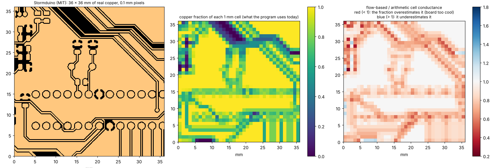
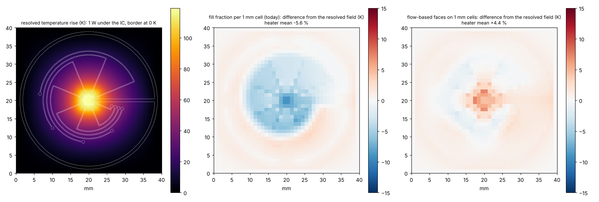
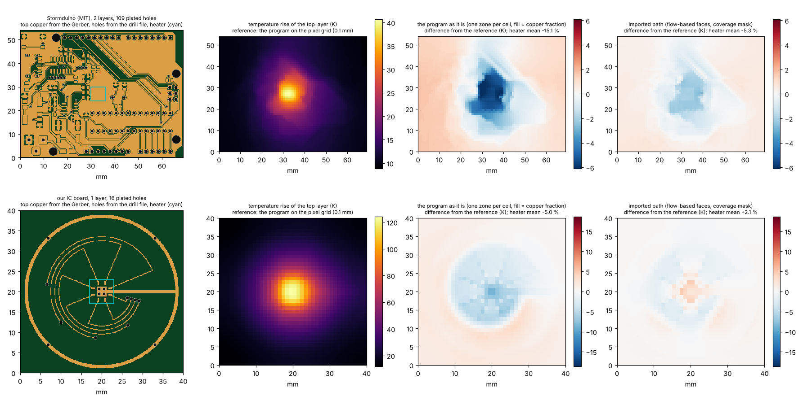
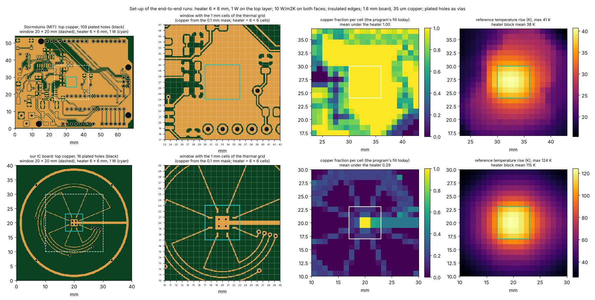
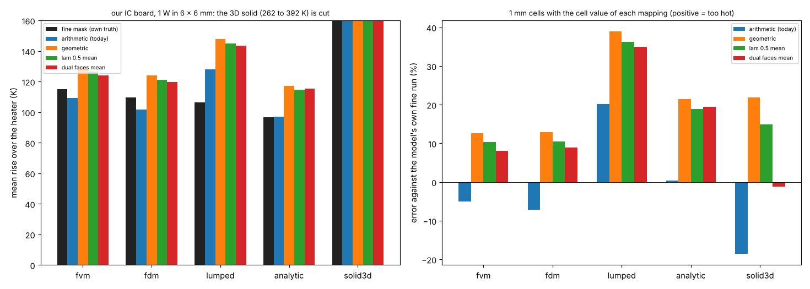
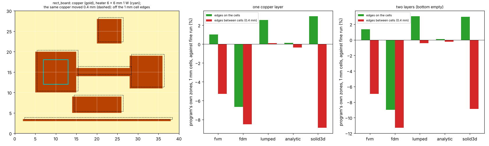

# Gerber import, phase 2: the copper in the simulation models (mapping to conductances, the five models)

Status: **open**, a research branch (`research/gerbers`, started 2026-10-22): **nothing in `pcbthermal/` was changed**. This folder is **phase 2 of three** of the Gerber research, which started as one study and was split on 2026-10-23: [`research/gerber-import`](../gerber-import/README.md) (1, reading the files), [`research/gerber-models`](../gerber-models/README.md) (2, the copper in the simulation models) and [`research/gerber-nets`](../gerber-nets/README.md) (3, nets with voltage and current). Dependencies run one way: 2 and 3 use the modules of 1, 3 does not use 2; **1 needs no program**. **Start with [`CONCLUSIONS.md`](CONCLUSIONS.md)**; how the result would enter the program is in [`INTEGRATION.md`](INTEGRATION.md); what was read and how, in [`LOG.md`](LOG.md); the text for the project documents, in [`docs/`](docs/). The layout is the one of every research folder (`CLAUDE.md`, "Research branches"). **Section numbers (4.1 to 4.40) are those of the original single study, so that the references between the three folders keep their meaning; the table below says where each one is.**

### Where the sections are

| Section | Folder | Subject |
| :-- | :-- | :-- |
| 4.1 | `gerber-import` | Vectors to polygons |
| 4.2 | `gerber-models` **(this folder)** | Raster against the exact area |
| 4.3 | `gerber-models` **(this folder)** | Thin traces and the pixel |
| 4.4 | `gerber-models` **(this folder)** | The mappings on 42 windows |
| 4.5 | `gerber-models` **(this folder)** | Scalar formulas from the fraction alone |
| 4.6 | `gerber-models` **(this folder)** | Fine scan of the parameters |
| 4.7 | `gerber-models` **(this folder)** | Copper thickness |
| 4.8 | `gerber-models` **(this folder)** | Heater size |
| 4.9 | `gerber-models` **(this folder)** | Time response |
| 4.10 | `gerber-models` **(this folder)** | Scalar versus fill of a zone: what the program does today |
| 4.11 | `gerber-models` **(this folder)** | Regular patterns: what "fill 0.5" means |
| 4.12 | `gerber-models` **(this folder)** | Two layers with plated holes |
| 4.13 | `gerber-models` **(this folder)** | A real four-layer board |
| 4.14 | `gerber-models` **(this folder)** | Through the program's own solver |
| 4.15 | `gerber-models` **(this folder)** | Cost |
| 4.16 | `gerber-models` **(this folder)** | The Lumped and Analytic models |
| 4.17 | `gerber-import` | The independent reader against gerbonara on gerbonara's own test files |
| 4.18 | `gerber-import` | How the independent reader differs from the others |
| 4.19 | `gerber-import` | What can be read: copper layers and drill files |
| 4.20 | `gerber-nets` | Nets: how much does the 5 V net heat up? |
| 4.21 | `gerber-models` **(this folder)** | Literature status |
| 4.22 | `gerber-import` | Against the other Python tools, on files of known area |
| 4.23 | `gerber-nets` | Tracks at an angle: area, connectivity and resistance on the grid |
| 4.24 | `gerber-import` | A third writer: Ucamco's `gerber-writer` |
| 4.25 | `gerber-models` **(this folder)** | The regime of Sampson's article: heat that must reach fixed-temperature posts, |
| 4.26 | `gerber-models` **(this folder)** | Grey-level |
| 4.27 | `gerber-models` **(this folder)** | Every model of the program |
| 4.28 | `gerber-models` **(this folder)** | An analogue of the post-mounted board of Sampson |
| 4.29 | `gerber-import` | Vias and nets |
| 4.30 | all three (bench board) **(this folder)** | A board of our own as a bench: an IC with circular tracks |
| 4.31 | `gerber-models` **(this folder)** | The import path end to end |
| 4.32 | `gerber-models` **(this folder)** | Where the heater is: the set-up of the end-to-end runs |
| 4.33 | `gerber-import` | Are the polygons tied to the right nets? A check against a KiCad project |
| 4.34 | `gerber-models` **(this folder)** | Our board in the five models |
| 4.35 | `gerber-models` **(this folder)** | A board of squares and rectangles in the five models |
| 4.36 | `gerber-nets` | Separate pieces of one net: what they are and what could be inferred |
| 4.37 | `gerber-models` **(this folder)** | How to validate the models on the rectangle board, and why the FVM looks worse |
| 4.38 | `gerber-models` **(this folder)** | The mappings as selectable options |
| 4.39 | `gerber-models` **(this folder)** | Measured impact of the two proposed corrections to the program |
| 4.40 | `gerber-nets` | Sources, sinks and links: the electrical side |

## 1. The questions

The program's finite-volume model works on a grid of square cells and, today, knows only one number per cell and layer: the **fraction of copper** (and, for a zone, the fill typed by the user). Phase 2 takes the masks of phase 1 and asks how to put them in the simulation models.

1. How should fine copper be turned into the conductances of a grid of squares? The fill fraction is badly biased; better mappings exist and the best are within 0.3 to 3.6 % (4.4 to 4.13, 4.38).
2. What are the cautions (hatched zones, thick copper, several layers, heater size, time response, the program's own tests)? Investigated, 4.6 to 4.14.
3. Does it work through the program's own solver? **Yes, without changing it** (4.14, 4.31).
4. How do the five models of the program (FVM, FDM, Lumped, Analytic, 3D solid) behave on imported copper, on our board and on a board of rectangles? 4.16, 4.27, 4.34, 4.35, 4.37.
5. What would have to change in the program, and what would that change cost? 4.27, 4.39, section 6 and `INTEGRATION.md`.

## 2. Findings in short

| Item | Result |
| :-- | :-- |
| Raster | Area within 0.2 % at 0.1 mm pixels; a binary raster **interrupts** traces thinner than about 1.4 pixels: pixel of at most half the thinnest trace (0.05 mm for 0.1 mm traces). |
| **Fill fraction (today)** | **Too cool by 10 to 11 %** on average (single layer, 35 µm, 42 windows of 7 real boards), 14 % with plated holes on two layers, 3 to 7 % on a real four-layer board, up to 18 % with 140 µm copper, and **7 to 43 % for regular 50 % patterns**. Never too hot: the average assumes the copper is connected where clearances cut it. |
| Geometric mean | `S = S_cu^f S_lam^(1 - f)` from the fraction alone: 2 to 3 % on real copper, but **-20 to +22 % on regular patterns** (connected grids too hot, islands too cool): a fallback, not a rule. |
| Directional bounds, lambda = 0.5 | `Sx`, `Sy` per cell from a fine mask: 1.0 to 1.3 % (single layer, 0.6 and 1.0 mm cells), 0.5 to 1.0 % with plated holes, but 1.3 to 7.5 % on the four-layer board and +10 to +12 % for diagonal stripes at 0.6 mm cells. |
| **Flow-based faces** | The most robust: 0.6 to 0.9 % (single layer), 0.4 to 1.3 % (two layers), 0.3 to 2.0 % (four layers), 0.9 to 3.4 % on every regular pattern at 1 mm cells (diagonal stripes included). It costs 5.5 s per 1.6 M pixels (a 100 x 160 mm layer at 0.1 mm), once, at import. |
| In the program | The same numbers through `pcbthermal.fvm.Network` (agreement with the research solver to 3e-12): only the conductances change. **Applying the geometric mean to the program's `Zone.fill` would change a hatched zone by +26 to +45 %** and four exact-value tests by 0.05 to 0.07 K: the zone fill and the imported copper must stay separate things. |
| Time response | Heat capacity stays an arithmetic average; with the new conductances the response follows the steady one (0.7 to 3.2 % at 120 s). |
| Lumped and Analytic | Lumped inherits a better `S` (13 % to 4.8 %); Analytic needs one effective conductance, a heater-influence-weighted geometric-type mean (18.6 % to 5.9 %), section 4.16. |
| Cell size | 0.6 and 1.0 mm cells map well; at 2 mm every method is limited by the grid itself (the 6 mm heater has 3 x 3 cells). |
| **Import end to end** | Gerber to the program's own FVM: heater error -15.1 % today against -2.1 % (binary) and -5.3 % (coverage) with imported faces on the Stormduino, -5.0 % against +4.0 % and +2.1 % on our board; another reader changes it by 0.01 to 0.04 % (4.31). |
| **Five models** | On rectangles the FVM and FDM converge to the same value; the Lumped is 16 % and the Analytic 26 % below the FVM; the 3D solid (two layers) is 7 to 9 % above (4.35, 4.37). |
| **Mapping as an option** | Mean absolute error on four boards: fill 6.5 %, flow-based faces 1.9 %, lambda 0.5 2.5 %, cell problem 1.7 % (4.38). |
| **Two corrections to the program** | Zones combined per sample point instead of per cell (copper in abutting zones no longer lost: -7.8 % FVM, -17.5 % FDM on strips; the additive rule is wrong); laminate under a single copper layer in the 3D solid (346 K to 174 K); the example boards do not move (4.39). |

## 3. Folder layout

Scripts are run from the repository root with `PYTHONPATH=.` when a copy of the program is not given (`.venv/bin/python research/gerber-models/scripts/<script>.py`) and import the modules of this folder and of `research/gerber-import` through `scripts/_bootstrap.py`; the tests do the same through `tests/conftest.py`. `out/` is git-ignored; the boards are in `research/gerber-import/data`.

| Path | What it is |
| :-- | :-- |
| `README.md`, `CONCLUSIONS.md`, `INTEGRATION.md`, `LOG.md` | The results in numbered sections, the conclusions, how the mapping would enter the program (and the two corrections), the dated log. |
| `docs/` | `research.md` summary, `changelog.md`, `decisions-log.md`, `roadmap-entry.md`, `literature.md` (the three articles, what was read and how). |
| `figures/` | `fig_01` to `fig_06`: 01 copper mapping to cells (a window of the Stormduino, MIT), 02 our IC board thermal maps, 03 the import end to end, 04 its set-up (heater, holes, cells), 05 our board in the five models, 06 the rectangle board in the five models. |
| `tests/` | 29 tests (49 s): the solvers and mappings (`test_conduction.py`, `test_claims.py`), the board as a thermal bench (`test_our_board_models.py`), the import to the program (`test_importer.py`), the program's union rule (`test_program_union.py`), the rectangle board in the models (`test_rect_board.py`). They need the program's dependencies. |
| `lib/conduction.py` | The conduction solvers (one layer, two, a stack) and **every mapping**: power mean, Bruggeman, Hashin-Shtrikman, bounds, lambda, cell problem, flow-based faces. |
| `lib/scenarios.py` | Boundary-limited scenarios (posts, held border) and the comparison of the mappings against a resolved reference. |
| `lib/faces.py` | **From the masks to the program**: the program's `Problem` for the imported board, the face conductances of every layer (`METHODS`), `FaceNetwork` (the program's FVM with those faces), `solve_today`, `solve_fine`. |
| `scripts/study_raster_error.py`, `study_mapping.py`, `study_scalar_formulas.py`, `study_fine_scan.py`, `study_contrast.py`, `study_heater_size.py`, `study_transient.py` | Raster error and thin traces, the mappings on the 42 windows and their parameters (4.2 to 4.9). |
| `scripts/study_patterns.py`, `study_patterns_two_layer.py`, `study_two_layer.py`, `study_multilayer_real.py` | Regular patterns, two layers with plated holes, a real four-layer board (4.11 to 4.13). |
| `scripts/prototype_in_program.py`, `bench_mapping_cost.py` | The mappings through the program's own `fvm.Network` (4.14); time and memory (4.15). |
| `scripts/study_lumped_analytic.py`, `study_models_self.py` | The mappings in the five models of the program (4.16, 4.27; run against a copy of the program with the additive union, set `PYTHONPATH`). |
| `scripts/study_sampson_boundary.py`, `study_post_board.py`, `study_coverage.py`, `study_coverage_real.py` | The regime of Sampson's article and its board analogue (4.25, 4.28); coverage masks (4.26). |
| `scripts/study_import_end_to_end.py`, `study_import_readers.py`, `study_mapping_options.py` | The import on the Stormduino and our board; the same with another reader; every mapping as an option (4.31, 4.38). |
| `scripts/study_models_our_board.py`, `study_models_rect_board.py`, `study_rect_convergence.py` | Our board and the rectangle board in the five models, and their convergence (4.34, 4.35, 4.37). |
| `scripts/study_fix_impact.py` | The measured impact of the two proposed corrections, one run per variant of the program then `--compare` (4.39). |
| `scripts/make_figures.py` | Draws the six figures into `figures/`. |

## 4. How to run, and the results

```sh
cd research/gerber-models && PYTHONPATH= ../../.venv/bin/python -m pytest -q tests          # 29 tests, 49 s
.venv/bin/python research/gerber-models/scripts/study_mapping.py                              # 2 min (4 cores); builds the windows on first use
# the others, from the repository root in the same way: study_raster_error (3 min), study_fine_scan (2), study_scalar_formulas (1), study_contrast (7), study_heater_size (2), study_transient (1),
# study_patterns (1), study_patterns_two_layer (3), study_two_layer (2), study_multilayer_real (5), prototype_in_program (3), study_import_end_to_end (10), study_mapping_options (5)
```

The studies use one copper sheet of 35 µm (385 W/mK) on 1.6 mm of FR-4 (0.9 W/mK in plane), 10 W/m²K on each face, and compare the temperature of a heated
block (mean and maximum) with a **reference**: the copper mask solved as it is, pixel by pixel, at 0.1 mm. The coarse grids (0.6, 1.0, 2.0 mm cells) are built
from the same mask, so the error of a mapping is isolated from the fidelity of the pixels. `MAE` is the mean of the absolute errors; `bias` the mean signed error
(negative = too cool = optimistic). All numbers below come from the independent reader of phase 1.

### 4.2 Raster against the exact area (`study_raster_error.py`)

| Pixel (mm) | Area error, top / bottom | RMS error per 1 mm cell (top) | Max error per 1 mm cell (top) |
| --: | --: | --: | --: |
| 0.2 | +0.18 % / +0.48 % | 0.0375 | 0.180 |
| 0.1 | -0.19 % / -0.02 % | 0.0200 | 0.101 |
| 0.05 | 0.00 % / +0.08 % | 0.0080 | 0.064 |
| 0.025 | +0.02 % / +0.03 % | 0.0036 | 0.023 |

Anti-aliasing (4 x 4 samples) at 0.1 mm gives the same as a binary raster at 0.025 mm: only the number of samples matters.

### 4.3 Thin traces and the pixel (`study_raster_error.py`)

Binary raster, synthetic traces at random sub-pixel offsets and two angles (200 each). The mean area kept is always about 100 %; what counts is the share of
traces that come out **interrupted**:

| Trace (mm) | Pixel 0.2 | Pixel 0.1 | Pixel 0.05 | Pixel 0.025 |
| --: | --: | --: | --: | --: |
| 0.05 | 86 % | 26 % | 0 % | 0 % |
| 0.075 | 27 % | 16 % | 0 % | 0 % |
| 0.10 | 24 % | 0 % | 0 % | 0 % |
| 0.15 | 15 % | 0 % | 0 % | 0 % |
| 0.20 and wider | 0 % | 0 % | 0 % | 0 % |

The reference also depends a little on the pixel (single layer, 5 x 5 mm heater): 0.2 mm +2.1 %, 0.1 mm +0.2 % against 0.05 mm.

### 4.4 The mappings on 42 windows (`study_mapping.py`)



*Figure 1 (`figures/fig_01_copper_mapping_to_cells.png`): a window of the top copper of the Stormduino board (Stormduino Rev 2.2, MIT licence, https://github.com/Chromico/stormduino, downloaded by `fetch_boards.py storm`; window 2 of the fixed-seed set); the fraction of copper per 1 mm cell (what the program uses today) and where the flow-based conductance is lower (red) or higher (blue) than the arithmetic one.*

Methods (all give the face conductances the solver uses; for the first four the face is the harmonic mean of the two cells, as the FVM does):

* **pmean(p)**: cell sheet conductance `(f S_cu^p + (1 - f) S_lam^p)^(1/p)` from the fill fraction alone. `p = 1` is the program's fill fraction, `p = 0` the geometric mean, `p = -1` the harmonic mean.
* **lam(l)**: directional, `low^(1 - l) * up^l` per direction, with `low` = rows in parallel of series chains (no cross flow, a lower bound) and `up` = series of parallel columns (equipotential column faces, an upper bound).
* **cellnum**: numerical upscaling, a local conduction problem on the cell (potential fixed on two faces, the other two insulated).
* **dual(m)**: flow-based face conductance, a local problem on the window that spans the centres of the two cells, with `m` rows of oversampling margin (transmissibility upscaling, as for reservoir grids).

MAE of the mean-temperature error (%), with the bias in brackets:

| Method | 0.6 mm cells | 1.0 mm | 2.0 mm |
| :-- | --: | --: | --: |
| pmean 1 (fill fraction, today) | 9.7 (-9.7) | 11.3 (-11.3) | 11.1 (-11.0) |
| pmean 0 (geometric mean) | 2.2 (-1.0) | 2.4 (-0.8) | 3.0 (+1.7) |
| pmean -1 (harmonic) | 10.2 (+10.2) | 13.7 (+13.7) | 20.9 (+20.9) |
| lam 0 (low) | 2.6 (+2.6) | 4.5 (+4.5) | 9.5 (+9.5) |
| **lam 0.5** | **1.0 (+0.2)** | **1.3 (+0.7)** | 3.2 (+3.2) |
| lam 0.75 | 1.5 (-0.9) | 2.0 (-1.0) | 2.1 (+0.4) |
| lam 1 (up) | 2.3 (-1.9) | 3.1 (-2.6) | 3.6 (-2.2) |
| cellnum | 1.1 (+0.8) | 1.7 (+1.5) | 4.2 (+4.2) |
| dual, m = 0 | 0.6 (-0.1) | 0.9 (+0.4) | 3.6 (+3.6) |
| dual, m/n about 0.2 | 0.7 (-0.4) | 0.8 (+0.2) | 3.1 (+3.1) |

Per board (MAE over the three sizes) the fill fraction is 6.7 to 15.2 % off on every board; lambda = 0.5 is 1.1 to 2.3 % on six boards and 4.4 % on the sparse one
(`fritz`, 18 % copper), where the flow-based faces are best (2.3 to 2.9 %).

### 4.5 Scalar formulas from the fraction alone (`study_scalar_formulas.py`)

| Formula | 0.6 mm | 1.0 mm | 2.0 mm |
| :-- | --: | --: | --: |
| arithmetic (today) | 9.7 (-9.7) | 11.3 (-11.3) | 11.1 (-11.0) |
| geometric | 2.2 (-1.0) | 2.4 (-0.8) | 3.0 (+1.7) |
| Bruggeman 2D | 2.4 (-1.0) | 2.7 (-0.8) | 3.7 (+1.4) |
| Hashin-Shtrikman, geometric mean of the two bounds | 2.1 (-1.0) | 2.2 (-0.7) | 2.8 (+2.0) |
| HS lower / HS upper | 4.3 (+4.1) / 5.6 (-5.6) | 5.8 (+5.7) / 6.3 (-6.3) | 10.3 (+10.2) / 5.5 (-5.1) |

The classical effective-medium formulas of an isotropic 2D two-phase medium give nothing better than the geometric mean (for f = 1/2 Bruggeman is exactly the
geometric mean); they cannot tell a connected copper network from isolated islands, because they only see the fraction.

### 4.6 Fine scan of the parameters (`study_fine_scan.py`)

* Exponent `p`: the minimum is at **-0.05 to 0** for 0.6 and 1.0 mm (MAE 2.1 to 2.4 %); at 2 mm it moves to +0.10. So the geometric mean (`p = 0`) is the natural choice of a scalar.
* Weight `lambda`: the minimum is at **0.5 to 0.6** (average MAE 1.6 to 1.8 %); 0.5 is best at 0.6 and 1.0 mm, 0.7 at 2 mm.

### 4.7 Copper thickness (`study_contrast.py`)

MAE (bias) for 18, 35, 70 and 140 µm of copper (contrast copper / laminate 4.8, 9.4, 18.7, 37.4):

| Copper | Method | 0.6 mm | 1.0 mm | 2.0 mm |
| --: | :-- | --: | --: | --: |
| 18 µm | fill fraction | 5.7 (-5.7) | 6.4 (-6.3) | 5.1 (-4.8) |
| | geometric mean | 1.1 (-0.3) | 1.3 (+0.3) | 3.5 (+3.4) |
| | lam 0.5 / lam 0.7 | 0.6 (+0.3) / 0.7 (-0.2) | 1.1 (+1.0) / 0.9 (+0.2) | 4.1 (+4.1) / 2.7 (+2.7) |
| 35 µm | fill fraction | 9.7 (-9.7) | 11.3 (-11.3) | 11.1 (-11.0) |
| | geometric mean | 2.2 (-1.0) | 2.4 (-0.8) | 3.0 (+1.7) |
| | lam 0.5 / lam 0.7 | 1.0 (+0.2) / 1.4 (-0.6) | 1.3 (+0.7) / 1.8 (-0.6) | 3.2 (+3.2) / 2.0 (+0.9) |
| 70 µm | fill fraction | 13.0 (-13.0) | 15.1 (-15.1) | 15.6 (-15.6) |
| | geometric mean | 3.4 (-1.7) | 3.7 (-1.8) | 3.9 (-0.1) |
| | lam 0.5 / lam 0.7 | 1.5 (+0.3) / 2.0 (-0.9) | 2.0 (+0.6) / 2.8 (-1.3) | 2.9 (+2.4) / 3.0 (-0.7) |
| 140 µm | fill fraction | 14.9 (-14.9) | 17.0 (-17.0) | 17.8 (-17.8) |
| | geometric mean | 4.4 (-2.3) | 4.8 (-2.7) | 4.9 (-1.4) |
| | lam 0.5 / lam 0.7 | 2.1 (+0.4) / 2.6 (-1.0) | 2.6 (+0.5) / 3.7 (-1.8) | 3.2 (+1.8) / 4.1 (-1.8) |

The fill fraction gets worse as the copper gets thicker; lambda 0.5 to 0.7 stays the best at 0.6 and 1.0 mm for every thickness (0.6 to 0.7 for thin copper, 0.5 for heavy).

### 4.8 Heater size (`study_heater_size.py`)

MAE of the block-mean temperature, square heaters on the 42 windows:

| Heater | Cells | fill fraction | geometric | lam 0.5 | cellnum | dual |
| --: | --: | --: | --: | --: | --: | --: |
| 1.2 mm | 0.6 | 10.3 | 4.4 | 5.0 | 5.8 | 3.8 |
| 3 mm | 0.6 | 11.3 | 3.0 | 1.5 | 1.8 | 1.0 |
| 3 mm | 1.0 | 12.3 | 3.6 | 3.1 | 3.9 | 2.5 |
| 6 mm | 0.6 | 9.7 | 2.2 | 1.0 | 1.1 | 0.6 |
| 12 mm | 1.0 | 7.3 | 1.6 | 0.7 | 0.7 | 0.5 |

A heater of a few cells is the hard case (the part sits on a few mapped cells); the flow-based faces are best at every size, and the maximum temperature is less sensitive than the mean (lam 0.5 on the 1.2 mm heater: 2.1 % on the maximum, 5.0 % on the mean).

### 4.9 Time response (`study_transient.py`)

Implicit Euler, 1 W step, 14 windows, error of the block-mean temperature (heat capacity as an arithmetic average in every row):

| Cells | Method | 0.1 s | 1 s | 10 s | 120 s |
| --: | :-- | --: | --: | --: | --: |
| 0.6 mm | fill fraction | +1.2 | -4.3 | -13.8 | -14.0 |
| | geometric | +3.0 | +1.1 | -1.1 | -1.9 |
| | lam 0.5 | +3.1 | +1.9 | +1.2 | +0.5 |
| | dual | +2.7 | +1.6 | +0.6 | -0.1 |
| 1.0 mm | fill fraction | +3.4 | -3.3 | -15.5 | -16.2 |
| | lam 0.5 | +5.5 | +4.6 | +2.6 | +1.1 |
| | dual | +5.1 | +3.9 | +1.9 | +0.6 |

The first fraction of a second is dominated by the heat that has not left the block yet (the coarse grid itself): that error is the same for every mapping; from 10 s on the response follows the steady one.

### 4.10 Scalar versus fill of a zone: what the program does today (`prototype_in_program.py`, and a scratch copy of the program)

The program computes `S = f k_cu t_cu + k_lam (slab - f t_cu)` (`fvm.py:78`, `fdm.py:134`; `solid3d.py:153`, `analytic.py:139,166`) with `f` the union of the zones, each zone a polygon times
its `fill`. With the geometric mean in those lines (a scratch copy, not committed):

| Board, 100 x 80 mm, 2 layers, 4 W at the centre | zone fill 1 | 0.75 | 0.5 | 0.25 |
| :-- | --: | --: | --: | --: |
| rise of the FVM today (K) | 79.4 | 91.4 | 110.0 | 144.3 |
| rise with the geometric mean | 79.4 | 115.5 | 159.3 | 204.2 |
| change | 0 | +26 % | +45 % | +42 % |

(FDM, Lumped and Analytic move by the same amount.) Test battery on the scratch copy: 321 passed, 6 failed, 38 not run (the GUI stress test); two of the failures are only the documents missing from the copy,
the other four are exact-value tests that move by 0.05 to 0.07 K (the 85.34 °C of the example board becomes 85.39; the "outline equals the smaller board" tests for the FVM, FDM and 3D solid differ by 0.07 to 0.08 K).
So **boards without partial copper do not change; a hatched zone changes by tens of percent**: `Zone.fill` is a number typed by a person ("50 % copper") and its meaning depends on the pattern (4.11).
The conclusion: do not change the zone formula; give the imported copper its own element.

### 4.11 Regular patterns: what "fill 0.5" means (`study_patterns.py`, `study_patterns_two_layer.py`)

Synthetic patterns of about 50 % copper (pitch 1 mm), single layer and a two-layer board as the program models it (patterned top over a full plane, or over bare laminate). Error of the block-mean
temperature of the top layer (%), cells of 1 mm; positive = too hot:

| Pattern | fill fraction (today), over plane / bare | geometric | lam 0.5 | dual |
| :-- | --: | --: | --: | --: |
| stripes 0 / 90 degrees | -17.8 / -28.1 | +4.1 / +1.5 | +1.0 / +1.1 | +1.0 / +1.1 |
| stripes 45 degrees | -19.0 / -28.9 | +2.5 / +0.2 | +2.4 / +0.0 | +3.4 / +1.9 |
| cross-hatch (a connected grid) | -9.0 / -12.6 | **+14.8 / +22.5** | -0.4 / -0.9 | +1.3 / +1.6 |
| isolated squares | **-31.2 / -43.4** | -12.5 / -19.5 | +1.1 / +1.1 | +2.0 / +2.5 |
| perforated plane | -11.0 / -15.6 | +13.6 / +20.7 | +1.2 / +1.4 | +0.9 / +0.9 |

* The same 50 % can mean a connected grid (heat flows well), stripes (well one way) or islands (almost not at all): **no scalar function of the fraction is right for all of them**, and the program's arithmetic value is the optimistic limit: 7 to 43 % too cool on every pattern.
* The flow-based faces are within 0.1 to 3.4 % on all of them at 0.6 and 1.0 mm cells; lambda 0.5 within 0.0 to 2.4 % except the diagonal stripes at 0.6 mm cells (+9.8 % over a plane, +12.0 % over bare laminate: a five-point grid has no cross term), where the flow-based faces stay at +1.4 and -0.1 %.
* So a hatched or perforated zone drawn in the program should say which pattern it is (`pattern`: solid, hatch lines, cross-hatch, islands, perforated, with a pitch): the program can then synthesise the mask and use the same mapping as for an imported board.

### 4.12 Two layers with plated holes (`study_two_layer.py`)

Stormduino, both layers resolved, 109 drilled holes as copper barrels (25 µm plating), FR-4 0.3 W/mK through the 1.53 mm gap, 6 x 6 mm heater on the top layer at three random places. MAE (%):

| Method | 0.6 mm | 1.0 mm | 2.0 mm |
| :-- | --: | --: | --: |
| fill fraction | 13.6 | 14.9 | 14.4 |
| geometric mean | 3.9 | 4.1 | 2.8 |
| **lam 0.5** | **1.0** | **1.0** | **0.5** |
| cellnum | 0.2 | 0.5 | 2.2 |
| dual, m = 0 | 1.3 | 0.4 | 1.2 |

### 4.13 A real four-layer board (`study_multilayer_real.py`)

A Cadence Allegro board (inner GND and VCC planes, 283 plated holes), six random 30 x 30 mm windows, the 4-layer stack-up of the program (35 / 15.2 / 15.2 / 35 µm copper, 210 / 1065 / 210 µm FR-4, each layer node its copper plus
half of the adjacent gaps), every hole a barrel across all the gaps, 6 x 6 mm heater on the top layer. MAE (bias) of the block-mean temperature (%):

| Stack-up | Cells | fill fraction | geometric | lam 0.5 | lam 0.9 | cellnum | dual |
| :-- | --: | --: | --: | --: | --: | --: | --: |
| 1 oz outer / 0.5 oz inner | 0.6 | 3.0 (-3.0) | 0.4 (+0.4) | 1.5 (+1.5) | 1.3 (+1.3) | 1.6 (+1.6) | **0.3 (0.0)** |
| | 1.0 | 4.6 (-4.6) | 1.5 (+1.5) | 2.8 (+2.8) | 2.5 (+2.5) | 2.9 (+2.9) | **1.1 (+1.0)** |
| | 2.0 | 5.8 (-5.8) | 4.2 (+4.2) | 7.5 (+7.5) | 6.8 (+6.8) | 7.7 (+7.7) | **2.0 (+1.7)** |
| 2 oz outer / 1 oz inner | 0.6 | 3.1 (-3.1) | 0.3 (+0.1) | 1.3 (+1.3) | 1.2 (+1.2) | 1.4 (+1.4) | **0.3 (0.0)** |
| | 1.0 | 5.0 (-5.0) | 0.9 (+0.9) | 2.4 (+2.4) | 2.1 (+2.1) | 2.5 (+2.5) | **1.0 (+0.8)** |
| | 2.0 | 6.9 (-6.9) | 2.8 (+2.8) | 6.1 (+6.1) | 5.6 (+5.6) | 6.3 (+6.3) | **1.4 (+0.9)** |

With strong vertical coupling (planes and many holes) the mapping matters less (the fill fraction is 3 to 7 % off instead of 10 to 14 %), the bounds-based methods become pessimistic (+1.3 to +7.7 %), and only the flow-based faces
stay within 0.3 to 2.0 % everywhere: the bounds assume the heat has to cross each cell in the plane, while here it also leaves through the holes and the dielectric.

### 4.14 Through the program's own solver (`prototype_in_program.py`)

The program's network (`fvm.Network`: cells, heater, losses, assembly, sparse solve) is built as usual and only the conductances are replaced: for a scalar mapping the `S` array; for the directional and the flow-based ones a 20-line subclass
whose assembly takes the face conductances as given (stage 2 and 3 of `INTEGRATION.md`). One window per board, reference the program's own FVM on the 0.1 mm grid:

* the program's FVM and the research solver agree to **3e-12** (relative) on the same conductances: the studies are the program's numerics;
* MAE over the 7 windows: 0.6 mm cells: fill fraction 9.7 %, geometric 1.8 %, lam 0.5 0.8 %, flow-based 0.4 %; 1.0 mm cells: 11.5 %, 2.2 %, 1.3 %, 0.8 %.

### 4.15 Cost (`bench_mapping_cost.py`)

Per layer, 1 mm cells, 0.1 mm pixels, one core: `lam` 0.00 to 0.02 s; the flow-based faces 0.6 s (200 000 pixels), 1.6 s (480 000), 2.7 s (800 000), 5.5 s (1 600 000 = 100 x 160 mm); the cell problem about the same.
Peak memory about 830 bytes per pixel (1.3 GB for 1.6 M pixels): a larger board is processed in strips (not implemented here). The cost is paid once, at import, and the result is cached with the project.

### 4.16 The Lumped and Analytic models (`study_lumped_analytic.py`)

Both models take the copper only through the `fill` of the zones, so an imported mask can reach them through the public API with no change of the program: one zone per 1 mm cell whose `fill` gives, through the program's formula `S = b + f (a - b)`, the wanted conductance. 42 windows, 1 W on a 6 x 6 mm heater, error of the mean heater rise against the resolved 0.1 mm copper (MAE, bias in brackets):

| conductance of the 1 mm cell | FVM | Lumped | Analytic |
|---|---|---|---|
| arithmetic fraction (today) | 11.9 % (-11.9) | 13.0 % (-13.0) | 18.6 % (-18.6) |
| geometric mean | 2.6 % (-0.9) | 4.8 % (-3.8) | 12.2 % (-12.2) |
| lambda 0.5 mean of the bounds | 2.9 % (-2.0) | 4.9 % (-4.4) | 12.5 % (-12.5) |
| mean of the four flow-based faces | 4.0 % (-3.9) | 4.9 % (-4.2) | 12.4 % (-12.4) |

* **Lumped** reads the sheet conductance of the FVM network and averages it over rings, so it inherits any better `S`: 13 % falls to about 4.8 %, and that residual is its own model error (it is about the same with the FVM-quality mapping), not the mapping's.
* **Analytic** treats the board as one uniform sheet around the heater, so per-cell conductances do not help (12 % left). It needs one effective conductance weighted by the influence of the heater, K0(r / lambda). Arithmetic weighting is 18.6 % too cool; the weighted **geometric-type mean** (power mean with p between -0.2 and -0.1) gives MAE 5.9 %, the flow-based effective conductance of the window 7.1 %, the harmonic mean 24.7 % too warm.
* Internet search (2026-10-22): nothing found that treats the copper fraction of a Lumped (thermal network) or cosine-series model of a PCB; the literature on effective conductivity of PCBs uses area-weighted (arithmetic) copper fractions for the in-plane value, which is what the program does today and what the numbers above show to be too cool on real layouts.

### 4.21 Literature status (`docs/literature.md`)

The three Electronics Cooling articles could not be opened by the assistant (network policy, HTTP 403); **the maintainer supplied a converted text** (equations of article 1 reconstructed by the converter, tables and figures missing), from which `docs/literature.md` keeps notes in our own words. What it changes:

* **The flow-based faces are Sampson's method (2005, article 2017)**: bitmap of the layer, micro-nodes, temperature 1 and 0 on the centrelines of two neighbouring macro-nodes, solve between them, G = Q / dT. Our `dual_faces` is the same construction, so it is prior art, not a new invention; what this research adds is the test against the pixel-resolved solution on real boards, the patterns, the comparison with simpler mappings and the program-in-the-loop check. His worked example (10 % copper: 40 W/m K along the traces, 0.65 across) is reproduced by `map_bounds` in `test_published_parallel_and_series_example`.
* **Blackmore's tile method (2010) is our `lam 0` bound** for k_x and k_y and the arithmetic fraction for k_z (`test_blackmore_tile_formulas_are_the_lower_bound_and_the_arithmetic_mean`); on our windows it alone is 2.6 / 4.5 / 9.5 % too hot at 0.6 / 1.0 / 2.0 mm cells, against 1.0 / 1.3 / 3.2 % for lambda 0.5. His own validation: 3.3 % average (15.3 % maximum) against detailed simulation, 5.7 % against an automotive board, with tiles of 7 to 14 mm.
* **Guenin (2015)** shows that heat enters the dielectric under the traces and that the copper near the package matters most; two ideas not yet tested here: the vertical link of a smeared layer should carry the local copper overlap, and the length of about ten dielectric thicknesses as the cell size below which a trace can be smeared.

Still open: the formulas of Bruggeman, Hashin-Shtrikman and Dykhne (from memory, checked by limits only), the Ucamco text (host blocked), and the original images of the articles.

### 4.25 The regime of Sampson's article: heat that must reach fixed-temperature posts, no convection (`scenarios.py`, `study_sampson_boundary.py`)

Sampson (2017) found smearing worst when the heat has to cross copper-free regions to posts with little convection. Two families of cases, reference = the mask solved pixel by pixel, error of the mean rise over the heater (1 W, 6 x 6 mm):

* **42 real windows (36 mm) with the whole border held at 0 K**: with no convection (h = 0) MAE of the fill fraction 22.6 % (all cool, worst 37 %), geometric mean 4.8 %, tile method (Blackmore, the lower bound) 11.0 % (all hot), lambda 0.5 2.8 %, flow-based faces **2.3 %** (worst 6.6 %); with h = 10 W/m²K: 20.8, 4.2, 9.7, 2.4, **2.1 %**. The ranking is the one of 4.4 and the errors are about twice those of the insulated-edge case.
* **Copper stripes** (0.5 mm wide, 1 mm pitch, a block of 34 mm in a 36 mm board, posts of 3 x 6 mm at the middle of two opposite edges, no convection), 1 mm cells: heat **across** the stripes: fill fraction **-48.7 %**, geometric mean -13.6 %, tile, lambda and flow-based faces +6.0 %; heat **along** them: fill fraction -19.9 %, geometric mean **+34.9 %**, the three directional mappings +7.5 %. A scalar (the fill fraction or the geometric mean) cannot be right in both directions; the directional mappings can. With 0.3 mm stripes the figures are -44.3 / -1.1 / +6.2 (across) and -17.4 / +46.7 / +7.5 (along).
* **What was not reproduced**: Sampson's board gives 236 °C against 9 °C with smearing (a factor of 26); our stripes give a factor of about 2 in the rise. His traces do not reach the posts over large areas and his board is 100 x 125 mm with 6 layers; ours is a 36 mm single sheet, so the size of his effect is not tested here, only its direction. The cases of 2 mm cells were left out of the tables because the 3 mm posts and the 6 mm heater are not aligned with a 2 mm grid (they are then misrepresented, an artefact of the setup).
* The residual +6 to +7.5 % of the directional mappings on the stripes is the coarse representation of the posts and of the heater edges at 1 mm cells.

### 4.26 Grey-level (coverage) mask against the binary mask (`study_coverage.py`, `study_coverage_real.py`)

Does drawing the copper as a coverage per pixel (4 x 4 sub-samples averaged, `native_gerber.render_coverage`; the sheet conductance of a pixel is the arithmetic mix of copper and laminate) help the mapping on thin copper? Protocol: border held at 0 K, 1 W in a 6 x 6 mm block, h = 10 W/m²K, 1 mm cells, 20 mm windows; **truth = the mask drawn at 0.025 mm and solved pixel by pixel**. Error of the mean rise over the heater, MAE % (bias):

| copper | mask | fill fraction | geometric | tile (low) | lambda 0.5 | flow-based faces |
| :-- | :-- | --: | --: | --: | --: | --: |
| 4 random thin-track boards, 30 % copper (tracks 0.08 to 0.3 mm) | binary 0.1 mm | 19.8 (-19.8) | 18.2 (+18.2) | 37.6 | 16.2 | 15.8 (+15.8) |
| | binary 0.025 mm (the truth mask itself) | 19.8 | 18.5 | 38.5 | 16.2 | 10.0 |
| | **coverage 0.1 mm** | 19.8 | 18.5 | 23.4 | 9.0 | **4.6 (+4.6)** |
| 4 dense boards with a pour, 75 % copper | binary 0.1 mm | 9.8 (-9.8) | 13.4 | 30.6 | 13.5 | 11.3 (+11.3) |
| | binary 0.025 mm | 9.8 | 13.5 | 31.9 | 13.8 | 7.8 |
| | **coverage 0.1 mm** | 9.8 | 13.5 | 15.5 | 6.2 | **2.8 (+2.8)** |
| **21 real windows** (7 boards, 3 each) | binary 0.1 mm | 16.8 (-16.8) | 7.1 (+5.7) | 15.4 | 7.8 | 6.5 (+6.3) |
| | **coverage 0.1 mm** | 17.1 | 6.9 | 9.0 | 5.0 | **4.1 (+1.7)** |

* **Coverage cuts the error of the flow-based faces by about a third on real copper (6.5 to 4.1 %) and by a factor 3 to 4 on thin-track layouts**, at the same 0.1 mm grid; the fill fraction does not change (it depends on the area only, which both masks keep to 0.2 %), and the bound-based and flow-based mappings gain.
* **Part of the gain is not about thin tracks.** The flow-based faces on the fine binary mask itself (0.025 mm) still leave +10 % and +7.8 % on the synthetic boards: the local windows are insulated at the sides and miss the cross flow, so the faces are a little low and the board a little hot; the grey pixels add some conductance and cancel part of that bias. So coverage works partly for the right reason (it keeps the area of tracks narrower than the pixel, section 4.22) and partly by compensation; it is a better default than the binary mask, not a proof that the mapping is exact.
* **Sensitivity of the protocol**: on 14 mm windows with a 4 mm heater (border 5 mm away) every mapping is 10 to 24 % off, on real copper too (tried and not kept: a heater of 4 cells with the held border so close is the hard case of 4.8); the tables above use 20 mm windows and a 6 mm heater. The synthetic boards are random tracks at random angles (harder than real copper, which is mostly orthogonal).

### 4.27 Every model of the program (`study_lumped_analytic.py`, `study_models_self.py`, `tests/test_program_union.py`)

The mapped conductance can be given to the five models through the public API (one zone per 1 mm cell whose fill reproduces the mapped conductance). **First finding: that route is distorted by how the program combines zones.** `fvm.py` (line 72), `fdm.py` (133), `solid3d.py` (91), `analytic.py` (134, 216) and `checks.py` (34) take the **maximum** of the coverage of the zones in a cell, so two zones that each cover half a cell give a cell with half a zone's copper instead of all of it. The same copper cut into 0.5 mm strips (every 1 mm cell shared by two strips) is hotter by +7 % (FVM), +17 % (FDM), +10 % (3D solid), +7 % (Analytic), +8 % (Lumped) (`test_union_by_maximum_loses_copper_when_zones_share_cells`); zones aligned with the cells are exact (`test_aligned_zones_are_exact`). A 1 mm field built from tiled zones gave FDM +53 % on a uniform board until the union was made additive. Everything below was therefore run against **a copy of the program with the one-line change `np.minimum(fill + coverage, 1)`** (in `$scratchpad/prog_add`, not in the repository; the first version of this table used the unmodified program by mistake and is replaced).

Error of the mean heater rise against the resolved sheet model, 42 real windows, 1 mm cells (MAE %, bias in brackets):

| cell conductance | FVM | FDM | Lumped | Analytic | 3D solid |
| :-- | --: | --: | --: | --: | --: |
| arithmetic fill (today) | 11.9 (-11.9) | 15.9 (-15.9) | 13.0 (-13.0) | 18.6 (-18.6) | 49.3 (+43.1) |
| geometric mean | 2.6 (-0.9) | 7.1 (-7.1) | 4.8 (-3.8) | 12.2 (-12.2) | 69.8 (+69.8) |
| lambda 0.5 mean | 2.9 (-2.0) | 7.8 (-7.8) | 4.9 (-4.4) | 12.5 (-12.5) | 66.4 (+66.4) |
| flow-based mean | 4.0 (-3.9) | 7.8 (-7.8) | 4.9 (-4.2) | 12.4 (-12.4) | 49.4 (+49.3) |

Each model against itself (the same model on the fine 0.1 mm mask is its truth), 4 real windows:

| cell conductance | FVM | FDM | Lumped | Analytic | 3D solid |
| :-- | --: | --: | --: | --: | --: |
| arithmetic fill (today) | 11.6 (-11.6) | 8.1 (-8.1) | 2.5 (-0.5) | 0.2 (+0.1) | 48.0 (-48.0) |
| geometric | 1.3 | 3.1 (+3.1) | 11.0 (+11.0) | 8.2 (+8.2) | 39.2 (-39.2) |
| lambda 0.5 mean | 1.8 | 2.4 (+2.4) | 10.4 (+10.4) | 8.0 (+8.0) | 39.9 (-39.9) |
| flow-based mean | 1.9 | 2.5 (+2.4) | 11.1 (+11.1) | 8.3 (+8.3) | 45.0 (-45.0) |

Reading it:
* **FVM**: the reference. The cell field reproduces the research solver to 0.0 % (aligned zones), and the mapping takes it from 11.9 to 2.6 to 4.0 % against the resolved sheet and from 11.6 to 1.3 to 1.9 % against itself.
* **FDM**: the mapping halves the error against the sheet (15.9 to 7.1 to 7.8 %) and brings the coarse run onto its own fine run (8.1 to 2.4 to 3.1 %). A node-centred grid at 1 mm stays a few percent cool against the cell-centred reference.
* **Lumped and Analytic** are reduced models whose fine run averages the conductance around rings or over the board with an arithmetic weight, so against *themselves* the mapping looks worse (2.5 to 11 %, 0.2 to 8 %) while against the *physical* sheet it is better (Lumped 13.0 to 4.8 %, Analytic 18.6 to 12.2 %, and 5.9 % with one effective conductance, 4.16). A reduced model is not its own truth; judge it against the physics.
* **3D solid**: not usable as a check of the mapping here. Against the sheet it is already +43 % hot with the arithmetic fill and gets worse as the conductance drops, and against itself its fine run (0.1 mm cells) gives 121 to 496 K where the FVM gives 62 to 95 K on the same copper, so its result depends on the cell size far more than on the mapping. On uniform boards it is close (+3.3 % full copper, +8.6 % half, against the sheet reference), and with no copper at all it gives 924 K against 157 K for the FVM (it seems to use a lower in-plane conductivity for the bare laminate); not investigated, it is the comparison model of the program and belongs to the maintainer's list. **Correction (4.35): the cause is that the program's 3D solid has no laminate under a single copper layer (all these windows are single-layer); it is valid from two layers.**
* **What was not tested**: directional face conductances in the FDM and the 3D solid (only the FVM has the prototype of 4.14); the FDM and the 3D solid need the faces to be taken from the mask as in `INTEGRATION.md`.

### 4.28 An analogue of the post-mounted board of Sampson (`study_post_board.py`)

The article's board (6 layers, 100 x 125 mm, four posts, traces that stop short of the posts, 236 °C against 9 °C smeared) cannot be rebuilt from the text (its trace bitmaps are figures), so this is an **analogue of the mechanism**, not a reproduction: a single equivalent sheet (laminate 0.59 W/m K, 1.6 mm; a copper pixel is six layers of 35 µm superposed), a plane perforated with 0.9 mm clearance holes on a 1.5 mm pitch (73 % copper) that stops a keep-out distance short of four 5 mm posts held at 0 K, 100 x 124 mm, 1 W in a 6 x 6 mm block at the centre, 0.25 mm pixels as the truth. Error of the maximum rise in the heater block:

| convection | keep-out | reference | smeared (one k for the board) | fill 2 mm | flow-based 2 mm | fill 1 mm | flow-based 1 mm |
| :-- | --: | --: | --: | --: | --: | --: | --: |
| none | 4 mm | 75 K | -81 % | +4 % | +26 % | -2 % | +11 % |
| none | 8 mm | 116 K | -87 % | +6 % | +18 % | 0 % | +8 % |
| none | 12 mm | 147 K | -89 % | +7 % | +15 % | +1 % | +6 % |
| none | 16 mm | 173 K | -90 % | +7 % | +13 % | +1 % | +5 % |
| 10 W/m²K | 4 to 16 mm | 17 K | -28 to -35 % | -30 to -31 % | -11 % | -30 to -31 % | -13 % |

* **The mechanism is reproduced**: with the heat forced across copper-free gaps to the posts and no convection, the smeared board predicts 10 to 19 % of the real rise (a factor 5 to 10; the article's factor is 26 on its board). With convection the effect shrinks to -28 to -35 %. The keep-out is what smearing misses, and the copper bitmap carries it.
* **Which mapping wins depends on the regime**: with no convection the fill fraction at 2 mm cells is the best here (+4 to +7 %) because the rise is set by the laminate gap, not by the structure of the plane; the flow-based faces are +13 to +26 % at 2 mm (the 1.5 mm hole pitch does not match the 2 mm cell) and +5 to +11 % at 1 mm. With convection the flow-based faces are better than the fill (-11 against -30 %). No single mapping is best everywhere; the flow-based faces are never worse than 13 % here, the fill fraction is 30 % off whenever the plane structure matters.
* **Limits**: one equivalent sheet instead of six layers, an invented perforation, one board size; the size of the article's effect (a factor 26) is not reproduced and cannot be without its bitmaps.

### 4.30 Our IC board as a thermal bench (`tests/test_our_board_models.py`, figure 2)

The board (40 x 40 mm, an IC with circular tracks, one layer, written by `gerber-import/lib/our_board.py`; its description and the render are in gerber-import 4.30) is used here as a case for the mapping of the copper to the thermal grid.



*Figure 2 (`figures/fig_02_ic_board_thermal.png`): 1 W in a 6 x 6 mm block under the IC, border held at 0 K, h = 10 W/m²K; left, the temperature rise resolved at 0.1 mm (110 K mean over the heater); middle and right, the difference of the 1 mm cell models from it. The fill fraction (today) is 5.6 % cool, concentrated in the copper-poor cells round the IC; the flow-based faces are +4.4 % (geometric mean +13 %, lambda 0.5 +6 %, tile bound +13 %); without convection -8.2 % and +5.1 %.*

Test (`tests/test_our_board_models.py`): 1 W under the IC, border held at 0 K, h = 10, 1 mm cells, against the 0.1 mm mask solved pixel by pixel: the fill fraction is cool (about -6 %), the geometric mean hot (about +13 %), the flow-based faces within 8 % (about +4 %).

### 4.31 The import path end to end (`faces.py`, `study_import_end_to_end.py`, `study_import_readers.py`, `tests/test_importer.py`, figure 3)

Until now the pieces were studied apart. `lib/faces.py` chains them: Gerber and Excellon files, copper masks (binary and coverage), plated holes matched to pads and nets (`hole_report`), a `pcbthermal` `Problem` with one `Via` per plated hole and no zones, the face conductances of the copper (flow-based, lambda 0.5), and a `fvm.Network` subclass (`FaceNetwork`) that replaces the lateral couplings of each layer by those faces and keeps the program's vertical couplings and convection. Nothing in `pcbthermal/` is changed.

| Stage | State |
| :-- | :-- |
| Read copper and drills | done (NumPy reader); warns when an aperture is thinner than two pixels |
| Holes, pads, nets | done (`hole_report`); each plated hole becomes a `Via` at its position |
| Copper to face conductances | done (flow-based and lambda 0.5, binary or coverage) |
| Solve with the program's FVM | done through `FaceNetwork`; with the program's own formula the faces reproduce its run to 1e-6 K (plumbing check, test) |
| Layer assignment, board outline, several heaters, user confirmation of what was read | **not done** (an interface, `INTEGRATION.md` section 0) |
| Directional faces in the FDM and the 3D solid | **not done** (only the FVM takes them) |
| Leads and pads of components, a physical measurement | **not done / not available** |

Two boards, a 6 mm heater of 1 W on the top layer, mean temperature of the heater against the reference resolved on the 0.1 mm pixel grid (negative = too cool). The 0.1 mm binary reference lacks features thinner than the pixel, so the coverage result is not necessarily wrong where it differs from it by a few percent.

| Board | Program as it is (fill fraction) | Faces, binary mask | Faces, coverage mask | Lambda 0.5, binary | Lambda 0.5, coverage |
| :-- | --: | --: | --: | --: | --: |
| Stormduino (MIT, 69 x 54 mm, 2 layers, 109 vias) | -15.1 % | -2.1 % | -5.3 % | -2.1 % | -5.1 % |
| Our IC board (40 x 40 mm, 1 layer, 16 holes) | -5.0 % | +4.0 % | +2.1 % | +5.8 % | +4.8 % |



*Figure 3 (`figures/fig_03_import_end_to_end.png`): the temperature of the Stormduino and of our IC board for the three runs and the difference of each from the reference; the import reduces the error of the program's own mapping from 15 % to 2 to 5 % on the Stormduino and from 5 % to 2 to 4 % on our board.*

**The choice of reader is not what matters.** The same pipeline with gerbonara + shapely instead of the independent reader (Stormduino): copper area +0.07 % (top) and +0.11 % (bottom), 0.07 to 0.11 % of the pixels differ, and the heater temperature differs by 0.01 to 0.04 % (reference 38.142 K against 38.158 K; coverage faces 36.138 K against 36.142 K).

Limits: two boards, one heater each; no measurement; the 3D solid was not used as a check (single-layer boards: it has no laminate under one copper layer, 4.35); the sign of the error of our board is hot, the Stormduino cool, so the flow-based faces are not a bias-free method, only a much smaller one.

### 4.32 Where the heater is: the set-up of the end-to-end runs (`make_figures.py`, figure 4)



*Figure 4 (`figures/fig_04_import_setup.png`): columns, left to right: the top copper of the whole board with the 109 (above) and 16 (below) plated holes in black, the 20 x 20 mm window (dashed) and the 6 x 6 mm heater of 1 W (cyan); the window with the 1 mm cells of the thermal grid; the copper fraction of each cell (what the program's fill uses today); the reference temperature rise in the window.*

Conditions of every run in 4.31: heater 6 x 6 mm, 1 W, on the top layer, centred at (33, 27) mm on the Stormduino and at (20, 20) mm on our board; 10 W/m²K on both faces, insulated edges, 1.6 mm board, 35 µm copper, 1 mm cells, plated holes as vias. What the figure shows:

* **Stormduino**: the heater sits on a solid copper pour (fraction 1.00 under it), so the heat spreads well (38 K mean); the cells around it are a mixture of pour and traces, and that is where the fill fraction loses connectivity and the program is 15 % cool.
* **Our board**: the heater sits on the exposed pad of the IC (fraction 0.29 under the 6 mm block: the pad, four vias, the pads and thin radial tracks); the heat leaves along 0.2 mm tracks and the 0.8 mm spoke (115 K mean). Here the cells are copper-poor, the fill fraction gives 5 % cool and the flow-based faces 2 to 4 % hot.
* The heater is a footprint on the top layer, not a part from the file: the position was chosen by hand (the layer and part assignment is the missing interface, 4.31).

### 4.34 Our board in the five models (`study_models_our_board.py`, figure 5)



*Figure 5 (`figures/fig_05_models_our_board.png`): left, the mean rise of the heater (1 W, 6 x 6 mm, one layer, copper 10 % of the board) from the fine mask and the four 1 mm cell mappings in each model; right, the error against the model's own fine run. The 3D solid is cut (262 to 392 K).*

Run against a copy of the program with the additive zone union (4.27), without the plated holes (one layer: only the mapping of the copper is tested). Mean rise over the heater (K):

| | FVM | FDM | Lumped | Analytic | 3D solid |
| :-- | --: | --: | --: | --: | --: |
| fine mask, each its own truth | 114.9 | 109.8 | 106.4 | 96.6 | 322.2 |
| arithmetic fraction (today) | 109.1 (-5.0 %) | 101.9 (-7.2 %) | 128.0 (+20.2 %) | 96.9 (+0.4 %) | 262.3 (-18.6 %) |
| geometric | +12.7 % | +13.0 % | +38.9 % | +21.5 % | +21.9 % |
| lambda 0.5 | +10.3 % | +10.5 % | +36.3 % | +18.9 % | +14.9 % |
| mean of the flow-based faces | +8.1 % | +8.9 % | +34.9 % | +19.4 % | -1.1 % |

Reading it:

* **The models are not the same physics**: against the FVM fine run, the FDM is -4.4 %, the Lumped -7.3 %, the Analytic -16.0 % (its uniform-conductance idealisation of a board that is mostly bare laminate round a pad), and the 3D solid +180 %, which is not a plausible result and is **not explained** (the 3D solid already failed on fine cells, README 4.27; here it is also far off at 1 mm, 262 K against 109 K, on a board where it matched on the example board). It is not used as a check. **Correction (4.35): the cause is the missing laminate under a single copper layer in `solid3d.py`.**
* **Putting the copper in a cell value (what a model without directional faces can take) is worse than the faces**: the flow-based mean gives +8.1 % in the FVM, but the same flow-based conductances as faces gave +4.0 % in 4.31 (binary mask), because the program's harmonic mean of two cell values is not the face conductance; a cell value loses the direction (here the heat leaves along radial tracks).
* On this copper-poor board the fill fraction is the *closest* in the FVM and FDM (-5 to -7 %) and the mappings that fix the Stormduino are 8 to 13 % hot: the sign of the error depends on the board, as in 4.31. For the Lumped (+20 % already today, because its rings take the cell values) every cell mapping makes it worse; the Analytic's +0.4 % today is a cancellation (it is 16 % cool of the FVM by itself).
* Consequence for the intermediate layer: the faces are worth using only in models that can take faces (FVM; FDM and the 3D solid after a change); the Lumped and the Analytic need their own reduction of the mask (4.16), not a cell value.

### 4.35 A board of squares and rectangles in the five models (`rect_board.py`, `study_models_rect_board.py`, figure 6)



*Figure 6 (`figures/fig_06_rect_board_models.png`): left, the board (40 x 30 mm, six rectangles and squares, one of them floating, heater 6 x 6 mm of 1 W under the large pad) and the same copper moved 0.4 mm (dashed); middle and right, the error of the program's own zones on 1 mm cells against each model's fine run (0.1 mm cells), for the copper edges on the cells (green) and between them (red), with one copper layer and with two (bottom empty).*

Geometry that needs no interpretation, so the differences are the models and the grid, not the copper. Mean heater rise (K), 2 copper layers (the fair setting for the 3D solid, see below), edges on the cells:

| | FVM | FDM | Lumped | Analytic | 3D solid |
| :-- | --: | --: | --: | --: | --: |
| zones, 0.1 mm cells (each its own truth) | 98.0 | 96.9 | 82.5 | 72.2 | 106.1 |
| the same zones, 1 mm cells (the program's fill) | +1.3 % | -9.0 % | +3.0 % | +0.1 % | +3.0 % |
| same, copper moved 0.4 mm | -6.9 % | -11.3 % | -0.4 % | -0.2 % | -8.9 % |
| against the FVM fine run | 0 | -1.1 % | -15.8 % | -26.3 % | +8.3 % |

* **Aligned rectangles are not exact either in the FDM** (-9 %): the node-centred grid puts half a cell of copper at each edge; the FVM, Lumped, Analytic and 3D solid are within 1 to 3 %. With the copper off the cell edges the fill fraction costs the FVM 5 to 7 % and the FDM 11 %: **the grid, not the Gerber, is the cause**, so the mapping of 4.4 to 4.13 is also needed for drawn rectangles that do not fall on the cells.
* **The Lumped (-16 %) and the Analytic (-26 %) differ from the FVM on the physics**, even on rectangles (they idealise the spreading; 4.16): their cell mappings change them by only 0 to 12 %, so the choice of model matters more than the mapping.
* **The cause of the 3D solid's odd results on single-layer boards** (322 K on our board against 115 K in the FVM, 4.34; +150 % here with one layer): `solid3d.py` builds the laminate as gap slabs *between* copper layers, so a **one-layer board has no laminate under the copper** (a 35 µm sheet instead of 1.6 mm). Checked by bisection (`out/` runs): full-board copper agrees (61.4 against 59.7 K), no copper gives 924 against 166 K, and the same pad with a second, empty layer gives 128.6 against 116.7 K (+10 %). So the 3D solid is valid from two layers; with one layer it is wrong in the program itself (not only in this study) and should be reported to the maintainer. It is not a cell-size problem; the earlier failure "at fine cells" (4.27) was this.
* The comparison of the mask path with the program's own zones is by construction here (the same rectangles); a Gerber of the board was not written.

### 4.37 How to validate the models on the rectangle board, and why the FVM looks worse (`study_rect_convergence.py`, `tests/test_rect_board.py`)

In 4.35 the Lumped and the Analytic showed errors near 0 % where the FVM showed -7 %. That compared each model with *itself*: the FVM sees the 0.4 mm shift of the copper (its cells change), the two reduced models do not, and they sit 16 and 26 % **below** the FVM anyway. A model that does not react to the grid is not accurate, it is insensitive. The validation therefore asks two separate questions: does each model converge to its own limit, and how far are the limits from each other and from an independent reference.

Mean heater rise (K) of the program's own zones, two layers, by cell size (`out/study_rect_convergence.txt`):

| Cell (mm) | FVM edges on cells | FDM | 3D solid | FVM copper 0.4 mm off | FDM | 3D solid |
| :-- | --: | --: | --: | --: | --: | --: |
| 2 | 94.90 | 83.45 | 101.78 | 89.11 | 82.32 | 93.82 |
| 1 | 99.32 | 88.49 | 109.22 | 91.03 | 85.96 | 96.67 |
| 0.5 | 98.43 | 92.19 | 107.33 | 94.79 | 90.15 | 103.18 |
| 0.25 | 98.12 | 95.33 | 106.49 | 96.01 | 93.42 | 104.29 |
| 0.1 | 98.00 | 96.97 | - | 97.30 | 96.22 | - |

* The FVM and the FDM **converge to the same value** (98.0 and 97.0 K; 97.3 and 96.2 K): the two discretisations of the same layered model agree to 1 % at 0.1 mm. The FVM is closest to its limit from 1 mm for aligned copper (+1.3 %), the FDM needs 0.25 mm (-2.7 %).
* The 1 mm FVM is 6.4 % low when the copper edges fall between cells because a cell half covered is given half a copper sheet (README 4.4 explains why this is biased cool); it is the grid, and it goes away with cells that are 0.25 mm or finer or with a better mapping (4.38).
* The Lumped (82.5 K, -15.8 %) and the Analytic (72.2 K, -26.3 %) do not depend on the cell (they use their own geometry) and are a **different physics** (rings, one effective conductance): the model, not the grid, is the choice.
* The 3D solid converges to 104 to 106 K, **+7 to +9 % above the layered FVM**: the real laminate lets heat go through the thickness and spread in 3D, which the layered idealisation does not. This is the independent physical check available here (a different formulation of the same equations), and it says the layered models are on the cool side by 7 to 9 % for a heater on a small pad. A measurement would be the real validation, and there is none.
* **As tests**: `tests/test_rect_board.py` (2 tests, 24 s, needs the program): the FVM at 0.25 mm within 1.5 % of 0.1 mm; the 1 mm error between 0 and 3 % for aligned copper and between 4 and 9 % off the cells; the FDM within 4 % of the FVM fine run; the Lumped and the Analytic 10 to 30 % below the FVM; the 3D solid (two layers) 4 to 12 % above it.

### 4.38 The mappings as selectable options (`faces.METHODS`, `study_mapping_options.py`)

The request: implement the different models and compare them as an option. `faces.layer_faces(sheets, ib, problem, method)` now takes every mapping of the research as a method, and the table runs each through the program's FVM on four boards (error of the mean heater rise against the 0.1 mm pixel grid, binary mask, 1 mm cells, 6 x 6 mm heater):

| Mapping | Stormduino | Our IC board | Rectangles on cells | Rectangles 0.4 mm off | mean of the absolute values |
| :-- | --: | --: | --: | --: | --: |
| fill (the program today) | -15.1 | -5.0 | +1.0 | -4.8 | 6.5 |
| geometric | -4.8 | +12.7 | +1.2 | +0.5 | 4.8 |
| Bruggeman | -6.6 | +15.1 | +1.2 | +0.6 | 5.9 |
| Hashin-Shtrikman lower | +6.9 | +18.2 | +1.2 | +3.3 | 7.4 |
| Hashin-Shtrikman upper | -11.3 | +3.5 | +1.1 | -2.2 | 4.5 |
| Wiener lower (low bound) | +3.9 | +12.1 | +1.1 | +1.1 | 4.6 |
| Wiener upper | -7.4 | -0.1 | +1.1 | +0.6 | 2.3 |
| lambda 0.5 | -2.1 | +5.8 | +1.1 | +0.9 | 2.5 |
| cell problem | -0.6 | +4.1 | +1.1 | +0.9 | 1.7 |
| flow-based faces | -2.1 | +4.0 | +1.1 | -0.3 | 1.9 |

* **Yes: Sampson's flow-based faces approximate better than the fill fraction on every board here, and so do lambda 0.5 and the numerical cell problem** (mean absolute error 1.9, 2.5 and 1.7 % against 6.5 %). The three from the pixels are within 0.6 % of each other on the rectangles. The cell problem is 1.7 % and the flow-based faces 1.9 %: not a difference this study can resolve with four boards.
* The mappings that use only the fraction (geometric, Bruggeman, Hashin-Shtrikman) are right on regular copper and wrong in sign and size on real boards (-5 to +18 %): they cannot know whether clearances cut the paths.
* The Wiener upper bound is 2.3 % on average but is -7.4 % on the Stormduino and -0.1 % on our board; it is lucky on one board, not a method (it is an upper bound on conductance that the copper pattern happens to approach).
* **As an option of the program** (design, nothing implemented): `SolverOptions.copper_mapping` with the default `fill` (the program as it is, bit for bit), and `lambda`, `cell_problem`, `flow` for imported or patterned copper, the choice recorded in the report; the table above, run on the boards of a user, is the way to choose. No board was run with different cell sizes or heater sizes in this table (4.4 to 4.13 did that for fill, geometric, lambda and flow: the order of the methods did not change).

### 4.39 Measured impact of the two proposed corrections to the program (`study_fix_impact.py`)

Two corrections have been proposed: how zones are combined (4.27) and the laminate of the 3D solid under a single copper layer (4.35). Both were applied to copies of the program outside the repository and measured; nothing in `pcbthermal/` was changed. Variants: **additive** (`min(fill + coverage, 1)`, the first idea), **union** (`geometry.zone_fill`: the maximum per sample point of the 4 x 4 lattice of every cell, then the mean: overlapping zones keep the larger fill, abutting zones add up) and **union + laminate**. Peak rise (K) in the program as it is, then the change:

| Case | Program today (FVM / FDM / 3D) | additive | union | union + laminate |
| :-- | :-- | :-- | :-- | :-- |
| One zone (reference) | 139.4 / 139.4 / 140.9 | 0 | 0 | 3D +1.6 % |
| The same copper in 40 abutting strips of 0.5 mm | 151.2 / 169.0 / 156.5 | -7.8 / -17.5 / -10.0 % | -7.8 / -17.5 / -10.0 % (back to the reference) | same, 3D -8.5 % |
| Two overlapping zones of fill 0.5 (must equal one zone of 0.5) | 151.2 / 151.2 / 156.5 | **-7.8 / -7.8 / -10.0 % (wrong)** | 0 | 0 |
| Fills 0.8 and 0.4 overlapping partly | 145.3 / 145.6 / 148.6 | -1.4 / -2.2 / -1.8 % | 0 / -0.4 / 0 % | same |
| Example boards (4, 4 and 2 layers), all five models | - | 0 | 0 | 0 |
| Single-layer board, pad 10 x 10 mm | 155.4 / 150.3 / **346.1** | 0 | 0 | **3D -49.6 % (174.0 K)** |
| Two-layer board, same pad | 164.2 / 156.4 / 174.5 | 0 | 0 | 0 |

* **The additive rule is wrong**: it fixes the strips but double counts overlapping zones (-7.8 %), which users draw. An earlier run of the program's test battery with it had failed three outline tests and one inspector test for that reason. **The per-sample union fixes the strips (151.2 to 139.4 K) and leaves overlapping zones exact**, so it is the proposal.
* **No change at all on the example boards or on any board with disjoint, cell-aligned zones**: the correction only moves boards with copper in several zones sharing cells.
* The 3D solid on one copper layer drops from 346 to 174 K and then agrees with the same board built with two layers (174.5 K).
* Cost: `zone_fill` evaluates each zone on its bounding box with 16 sample points per cell, the same work as the present coverage, so no measurable change in run time was seen (not timed).
* Program tests with both corrections (the five files that touch zones, the 3D solid, the outline and the stack-up): **57 passed** (the 3D solid and its verification, outline, stack-up, copper, heatsink and template tests); 2 errors, both GUI tests that need the `pytest-qt` fixture `qtbot`, which the research environment lacks, not failures of the change. The whole battery was not run (this is a measurement on copies of the program, not an adoption).
* The correction of the 3D solid alone passes the 3D solid, outline, stack-up and via-fill tests (41 passed; one test needs `pytest-qt`, which the research environment lacks).
* Not measured: a board with an outline, with heatsinks or with vias on single-layer 3D (the via area in the added laminate slab uses the same formula as the gaps, not separately checked); time simulations (the 3D solid has none).

## 6. Proposal for the program (not implemented)

Three things came out of the study: **a vector is not needed** (a mask at 0.1 mm is enough and smaller), **the zone fill and the imported copper must stay separate**, and **the mapping that sees the pattern is the one to use**.

1. **Keep `Zone.fill` as it is** (4.10): it is a typed density whose pattern is unknown; changing it would move existing results by tens of percent. If a pattern is declared (`pattern`: solid, hatch lines at 0 or 90 degrees, cross-hatch, islands, perforated, pitch), the program synthesises the mask and uses the mapping below (4.11).
2. **A copper element for the imported layers** (a fine mask per layer, from a Gerber or from a pattern): `Sx`, `Sy` per cell for the grid of the run; the capacity, the blocks and the checks keep using the arithmetic fraction.
3. **The mapping**: the **flow-based faces** as the production choice (robust on real copper, patterns, several layers, small heaters; 5.5 s per 100 x 160 mm layer, once); **lambda 0.5** as the quick preview or fallback (1 % on single layers, pessimistic on stacks with strong vertical coupling, weak on diagonal copper); the **geometric mean** only as a last fallback for random imported copper when no mask is kept.
4. **Cells**: 0.6 to 1.0 mm for the mapping to pay off; coarser cells are limited by the grid.
5. **Import**: Gerber copper and outline, Excellon holes (a Gerber cannot tell a via from a component pad: a filter by diameter and a preview), the layer assignment pre-filled from the X2 attribute or the file name; KiCad (`.kicad_pcb`, text) for parts, stack-up and the via/pad distinction.
6. **Before any change**: `docs/validation.md` section, the equations in `docs/theory.md`, the user guide and tooltips, tests, a layer-by-layer validation on a thick-copper board of a real design, and the effect on the existing examples (`INTEGRATION.md`).

## 7. How other projects do it (read on 2026-10-22; for ideas only, no code copied)

| Project | Geometry | Grid or mesh |
| :-- | :-- | :-- |
| [FYPA](https://github.com/Tomachie/FYPA) (AGPL-3.0) | gerbonara primitives to shapely; polarity-aware union per layer in batches; arcs by chords of 0.025 mm; Clipper2 for a fast union on a 1 µm integer grid (non-zero fill, holes rebuilt from the poly-tree) with a `verify` mode against shapely | triangular mesh (`triangle`) and a sparse FEM solve |
| [padne](https://github.com/atx/padne) (AGPL-3.0) | shapely (multi)polygons with holes; Gerber through `pygerber`; via holes punched out | CGAL constrained Delaunay mesh: minimum angle 20°, maximum size 0.6 mm, finer near points of interest; disconnected copper meshed more coarsely |
| [kicad-electrothermal-sim](https://github.com/krosa-laboratory/kicad-electrothermal-sim) | filled zones, tracks and pads from the KiCad API, shapely | raster grid, 0.1 mm "usually sufficient", islands flagged |
| [KiCad_Thermal_Sim](https://github.com/Dietschi10/KiCad_Thermal_Sim) | KiCad filled zones and tracks | regular grid of 0.5 then 0.3 mm; an adaptive mode keeps the fine cell at copper edges and merges uniform interiors up to 8 times larger |

None of them maps the copper to the cell conductances as above: the mesh projects either follow the polygons exactly (triangles) or rasterise to a binary grid. Electronics Cooling has published the closest prior art (details in `docs/literature.md`): Sampson (2017, method from 2005) computes the conductance between neighbouring nodes by solving the micro-network between their centrelines, which is our flow-based face; Blackmore (2010) maps each tile to k_x, k_y, k_z by pixel counting (our `low` bound and the arithmetic fraction), validated at 3.3 % average against simulation and 5.7 % against an automotive board; Guenin (2015) shows that the copper near the package and the dielectric under the traces set the heat flow into the planes. The journal's pages were read through a converted text supplied by the maintainer, not directly.

**Licences of the mesh libraries** (summaries read, not the licence texts): Shewchuk's *Triangle* restricts commercial use without permission and the CGAL mesh packages are GPL: a problem for a closed product. shapely is BSD but its wheels bundle GEOS (LGPL); Clipper2 was not checked. The route of this folder needs none of them.

## 8. Limits of this study

* Single copper sheet on laminate for the 42-window studies (7 boards, 6 windows each); two layers with holes on **one** board (three places); four layers on **one** board (six windows). All boards are public designs, mostly hobby boards: no power, heavy-copper or metal-core boards.
* The reference is the 0.1 mm mask, 0.2 to 1 % hotter than a 0.05 mm one; a cell never sees detail below that.
* Heater blocks of 1.2 to 12 mm, a uniform face coefficient, insulated edges: no board outline, no copper near the board edge, no parts with a top path.
* Results at 2 mm cells include the error of the coarse grid itself, not only the mapping.
* The geometric mean applied to the program was tried on a scratch copy only; the effect of the other mappings on the program's examples and tests was not measured (they need the copper element).
* Not tested: the Lumped and Analytic models with a mask (the analytic one averages the fraction over large regions; the lumped one reads the FVM `S`), non-rectangular boards, a comparison with a measurement of a physical board (none exists in the project).
* The diagonal copper limit (five-point grid) is a property of the grid, not of the mapping.

## 10. Sources

* Durlofsky, *Upscaling and gridding of fine scale geological models for flow simulation* (2005), https://pangea.stanford.edu/departments/ere/dropbox/SmartFields/SFC_publications/2005_Durlofsky_upsc_grid_review_ifrs.pdf (local, extended-local and global upscaling; transmissibility).
* Power-law averaging of permeability (exponents between -1 and 1; the geometric mean for isotropic 2D media), https://ccg-server.engineering.ualberta.ca/CCG%20Publications/Other/CVD%20Papers/02-Conference/2002/power-law-averaging02.PDF. The 2D two-phase result of Keller (1964) and Dykhne (1970) (dates from a search summary) and the closed form of the 2D Bruggeman and Hashin-Shtrikman formulas are quoted from memory (checked here only against their limits by the tests).
* Electronics Cooling: R. L. Sampson, *The Problem with Effective Thermal Conductivity* (28 April 2017; method in ASME IPACK2005-73013, 2005); B. Guenin, *Strategies for the Thermal Modeling of Metal Traces on Printed Circuit Boards* (20 March 2015); B. Blackmore, *Creating PCB Thermal Conductivity Maps Using Image Processing* (13 September 2010; validation in SEMI-THERM 2009, pp. 76-86). Read through a converted text supplied by the maintainer. *Modeling heat conduction in printed circuit boards using finite element analysis* (A. Lush, May 2004) is cited by them and not read.
* The four projects of section 7 (repositories linked there).
* Phase 1 for the reading of the files; the test boards and their licences are in `research/gerber-import/README.md`, section 9.
