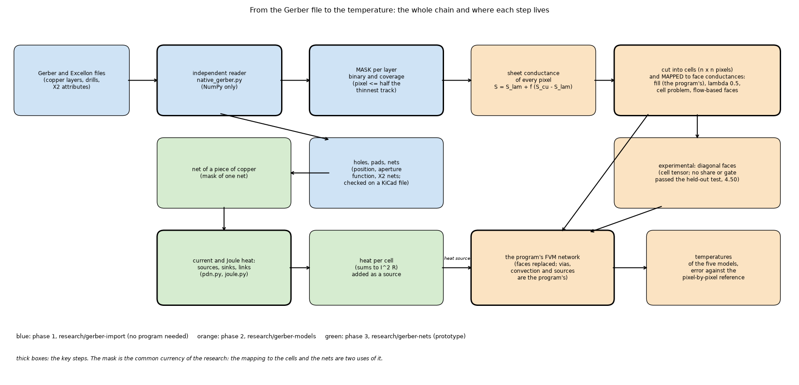
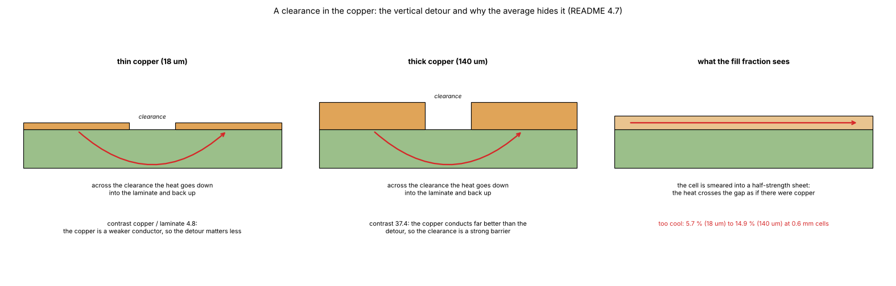
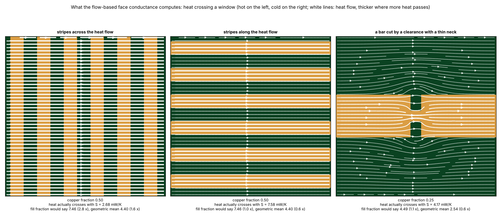
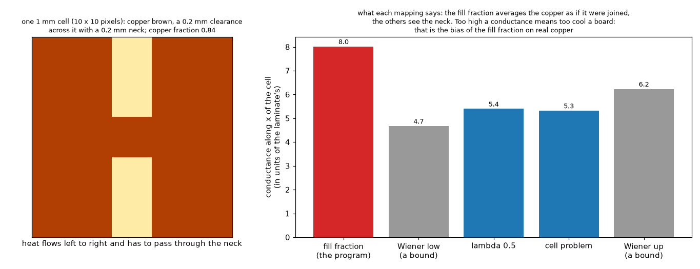
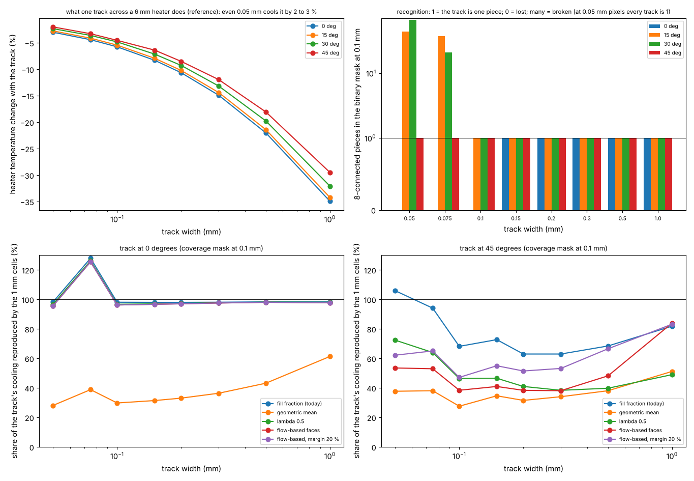
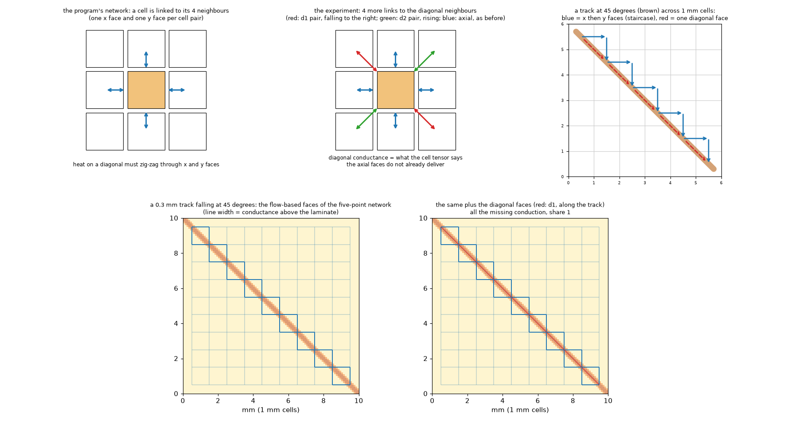
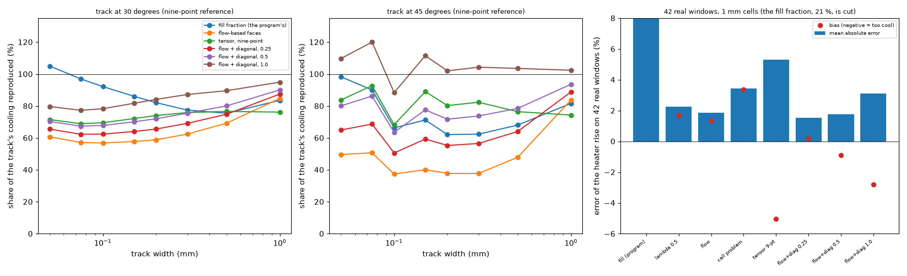
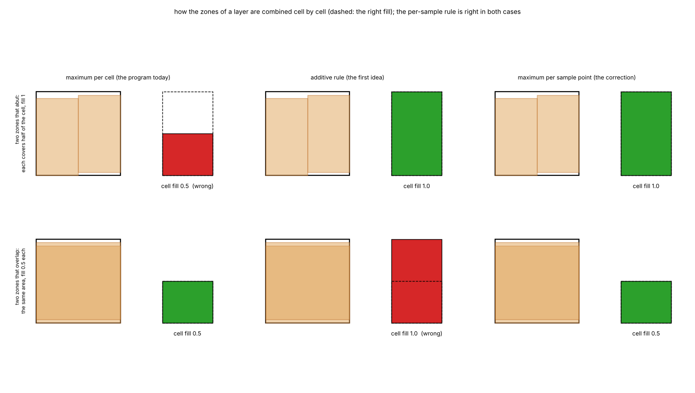

# Report: the copper in the simulation models (the mapping of copper to the thermal grid)

Phase 2 of the Gerber research (`research/gerber-models`). This is the guide to the folder: it says the problem, the methods, the boards, the results and the open points in plain order; `README.md` holds the full record, section by section (4.2 to 4.43).

## 1. The problem in one paragraph

The program's finite-volume model works on square cells (0.6 to 2 mm) and knows one number per cell and layer: **the fraction of copper**, from which it makes a sheet conductance `S = f k_Cu t_Cu + k_lam (slab - f t_Cu)`. For a big solid zone that is exact. For real copper (tracks, clearances, hatches) almost every cell is partial and the **average hides connectivity**: a clearance that cuts a path is averaged as if the copper were still joined, so the board comes out **too cool, by 10 to 23 % on real boards**. A Gerber is the first source of such copper, so the question is how to turn a fine mask of copper (0.1 mm pixels, phase 1) into the conductances of the coarse cells.


*Figure 1 (`figures/fig_01_copper_mapping_to_cells.png`): a 36 mm window of the top copper of the Stormduino (MIT), the copper fraction per 1 mm cell (what the program uses today) and where the flow-based conductance differs from it.*

### 1.1 The whole chain in one diagram



*Figure 10 (`figures/fig_10_pipeline.png`): blue, phase 1 (reading, `research/gerber-import`); orange, this folder (the mask becomes face conductances and runs through the program's network); green, phase 3 (nets and the electrical side). The mask is the common currency; thick boxes are the key steps.*

### 1.2 What the copper fraction hides



*Figure 17: a clearance in the copper, the vertical detour of the heat and the half-strength sheet the fill fraction replaces it with.*



*Figure 18: the heat crossing three windows of copper (across stripes, along stripes, a bar cut by a clearance): what the flow-based face conductance computes, against the fill-fraction average.*



*Figure 12 (`figures/fig_12_clearance_cell.png`): a 1 mm cell with a 0.2 mm clearance across it and a 0.2 mm neck: the copper fraction is 0.84 and the fill fraction gives the cell a conductance of 8.0 laminates, the numerical cell problem 5.3 and lambda 0.5 5.4: the fill fraction behaves as if the copper were joined. Too high a conductance means too cool a board, which is the bias of the fill fraction on real copper.*

## 2. The methods compared

All are tried on the same masks and judged against the same reference: **the mask solved as it is, pixel by pixel, at 0.1 mm**, with the program's own network. The error is that of the mean temperature rise over a heated block.

| Method | What it does | Needs | Cost | Origin |
| :-- | :-- | :-- | :-- | :-- |
| **fill fraction** (today) | arithmetic mean of the two phases by the copper fraction of the cell | the fraction | none | the program |
| geometric mean | `S = S_Cu^f S_lam^(1-f)` | the fraction | none | power-law averaging (Durlofsky), Keller-Dykhne for 2D |
| Bruggeman, Hashin-Shtrikman (lower, upper) | effective-medium formulas of a two-phase medium | the fraction | none | closed forms (from memory, checked by limits) |
| Wiener lower and upper bounds | per direction: rows in parallel of series chains (low), columns in series of parallel pixels (up) | the pixels | negligible | classical bounds; **the low bound plus the arithmetic fraction is Blackmore's tile method (2010)** |
| **lambda 0.5** | geometric mean of the two bounds per direction (`Sx`, `Sy` per cell) | the pixels | negligible | this research |
| cell problem | numerical upscaling: a local conduction problem on the cell | the pixels | seconds | homogenisation |
| **flow-based faces** | the conductance of each face from a local problem between the two cell centres | the pixels | 5.5 s per 100 x 160 mm layer, once | **Sampson (2005, article 2017): prior art, not ours** |

## 3. The boards

| Board | Source | What it tests |
| :-- | :-- | :-- |
| 42 windows of 7 real boards | Stormduino, chibi, easyeda, pcb-rnd, P-CAD, DipTrace, Fritzing (phase 1) | real copper, six heater positions per board |
| Stormduino (whole, 2 layers, 109 vias) | KiCad, MIT | the import end to end |
| a real 4-layer board | Allegro (phase 1) | planes and vias |
| **our IC board** | generated by the repository (phase 1) | an IC with circular tracks, thermal vias, a ring |
| **rectangle board** | generated by the repository (phase 1) | squares and rectangles on the cells and 0.4 mm off them |
| **seven synthetic boards** | written by gerbonara and by Ucamco's `gerber-writer` (phase 1) | perforated plane, hatched plane, plane with holes, island in a ring, random board, diagonal tracks, pads and arcs |
| single tracks | written by the study | width 0.05 to 1 mm, angles 0 to 45 degrees |

## 4. Results

### 4.1 The mappings on 11 whole boards (one heater each, 1 mm cells, the program's FVM; section 4.43)

```
mapping        Stormduino (2 la     our IC board rectangles, shif rectangles, shif perforated plane    hatched plane plane with holes  island and ring     random board  diagonal tracks pads and arcs (g  mean |err|
fill                      -15.1             -5.0             +1.0             -4.8             -3.0             -8.2             +0.4             -9.1            -12.3             -4.4             -5.1         6.2
geometric                  -4.8            +12.7             +1.2             +0.5             +1.9            +10.5             +0.5             -3.2             +2.2             +2.3             +3.1         3.9
bruggeman                  -6.6            +15.1             +1.2             +0.6             +0.0            +11.8             +0.4             -2.7             +4.1             +3.4             +4.4         4.6
hs_lower                   +6.9            +18.2             +1.2             +3.3             +9.3            +22.4             +0.7             -0.7             +6.6             +4.2             +5.2         7.1
hs_upper                  -11.3             +3.5             +1.1             -2.2             -0.7             -0.4             +0.4             -6.3             -5.2             -1.1             -1.1         3.0
wiener_low                 +3.9            +12.1             +1.1             +1.1             +2.1             +1.7             +0.6             +0.5             +8.2             +6.1             +2.1         3.6
wiener_up                  -7.4             -0.1             +1.1             +0.6             -2.0             -2.0             +0.4             -3.0             -4.2             -3.4             -0.8         2.3
lambda                     -2.1             +5.8             +1.1             +0.9             -0.0             -0.2             +0.5             -1.3             +1.6             +0.6             +0.6         1.3
cell_problem               -0.6             +4.1             +1.1             +0.9             +0.5             +0.8             +0.5             -0.4             +3.0             +2.6             +0.4         1.4
flow                       -2.1             +4.0             +1.1             -0.3             +0.5             +0.6             +0.4             -1.5             +1.8             +3.3             +0.4         1.5
```

**The fill fraction the program uses today is 6.2 % off on average (worst: Stormduino -15.1 %, random board -12.3 %); lambda 0.5 (1.3 %), the cell problem (1.4 %) and the flow-based faces (1.5 %) are equivalent and 4 to 5 times better.** The mappings that use only the fraction are never safe (the geometric mean +12.7 % on our board, Hashin-Shtrikman lower +22 % on the hatched plane).

### 4.2 The same on 42 real windows (section 4.4; single layer, MAE of the mean rise, 0.6 / 1.0 / 2.0 mm cells)

fill 9.7 / 11.3 / 11.1 %, geometric 2.2 / 2.4 / 3.0 %, tile (low bound) 2.6 / 4.5 / 9.5 %, **lambda 0.5 1.0 / 1.3 / 3.2 %, flow-based faces 0.6 / 0.9 / 3.6 %**. Two layers with plated holes: 13.6 to 14.9 % against 0.4 to 1.3 % (flow). A real four-layer board: 3.0 to 4.6 % against 0.3 to 1.1 %. Regular patterns at 1 mm: 7 to 43 % against 0.9 to 3.4 %.

### 4.3 Where each method fails

* **Fill fraction**: always cool on cut copper; right on solid or aligned copper.
* **Geometric, Bruggeman, Hashin-Shtrikman**: wrong in sign on regular patterns (-20 to +22 %): they cannot know whether clearances cut the paths.
* **Wiener bounds**: bounds, not estimates (lucky on one board, 10 % off on another).
* **Flow-based faces and lambda 0.5**: good on connected copper; **weak on isolated diagonal tracks on a coarse grid** (section 6 of this report).
* Cells of 2 mm and larger: every method is limited by the grid (a 6 mm heater is 3 cells).

## 5. What differs from the methods already known

| | Sampson 2005 / 2017 | Blackmore 2010 | Guenin 2015 | this research |
| :-- | :-- | :-- | :-- | :-- |
| Idea | conductance between neighbouring nodes from a local solve | tiles of 7 to 14 mm by pixel counting | smeared plane near the package | the same two ideas, compared with eight more, on cells of 0.6 to 1 mm |
| Relation | identical to our `flow-based faces` | identical to the `low` bound plus the fraction | not implemented | |
| Validation | a fine model, one post-mounted board | a finer simulation (3.3 %) and a measured board (5.7 %) | explicit-trace FEA | the resolved mask; **no measurement** |
| Mappings compared | 2 | 1 | 3 | 10 |

Where the articles are ahead: Blackmore validates against a physical measurement; Sampson treats a post-mounted board at a very different scale (our analogue reproduces the mechanism, a factor 5 to 10 where he has 26). What is new here: the ranking of ten mappings against the resolved solution on real boards and patterns, the lambda mix of the Wiener bounds, the check in all five models, the import chain, the track study.

## 6. Thin tracks and angles (section 4.42; the questions asked)



*Figure 7 (`figures/fig_07_track_width_angle.png`): see section 4.42.*

* **What is the thinnest track recognised?** The reader draws any width exactly (vector); the mask recognises a track if **the pixel is at most half its width**. A binary mask at 0.1 mm loses axis-aligned tracks of 0.1 mm or less and breaks tilted ones of 0.05 to 0.075 mm into 21 to 67 pieces; at 0.05 mm every track of the study (0.05 to 1 mm) is one piece; **a coverage mask keeps the area of any track** and gives the same thermal result as the finest pixel.
* **Does it matter thermally?** Yes: one 0.05 mm track across a 6 mm heater cools it by 3 %, a 0.1 mm track by 5.8 %, 0.3 mm by 15 %, 1 mm by 35 %.
* **Does it handle angles?** The reading does (any angle, area within 0.5 % except lattice ties at 45 degrees). The 1 mm cells do **not** on an isolated diagonal: at 0 degrees every mapping except the geometric one reproduces 96 to 98 % of the track's effect; at 45 degrees the flow-based faces reproduce 38 to 53 %, lambda 0.5 40 to 72 %, the fill fraction 63 to 106 %. The cause is the grid (x and y faces only, diagonal heat flows in a staircase), not the copper reading.

### 6.1 Diagonal couplings, simulated (section 4.44, figures 8 and 9)



*Figure 9 (`figures/fig_09_diagonal_faces.png`): top, the program's network links a cell to its 4 neighbours (heat on a diagonal must zig-zag through x and y faces) and the experiment adds 4 links to the diagonal neighbours (red: falling to the right, green: rising); bottom, the real face conductances (line width) of a 0.3 mm track at 45 degrees on 1 mm cells, with the flow-based faces only (the track is carried by a staircase of x and y faces) and with the diagonal faces added (a red line along the track).*



*Figure 8 (`figures/fig_08_diagonal.png`): see section 4.44.*

Faces to the four diagonal neighbours were added to the research network (`lib/diagonal.py`) and the track and window studies repeated, with a nine-point fine reference that agrees with the five-point one to 0.4 points. **A hybrid (the flow-based faces plus the diagonal conduction they miss) fixes the lone diagonal**: at 45 degrees the share of the track's cooling reproduced goes from 37 to 84 % to 88 to 120 % (all of the missing conduction) or 64 to 94 % (half of it), and nothing changes at 0 degrees. **On the 42 real windows all of it over-adds** (3.1 % error, -2.8 % bias against 1.85 % and +1.3 %), half of it keeps the windows at 1.77 % (no worse than the flow-based faces) and a quarter at 1.54 %. A pure tensor stencil is worse (5.3 %). So a damped hybrid is safe and halves the diagonal error; the damping is a fudge factor, and the next step is to add the diagonal conduction only where a cell holds a single dominant diagonal conductor.

## 7. The five models and the program

* On rectangles the **FVM and FDM converge to the same value**; the **Lumped is 16 % and the Analytic 26 % below**, the **3D solid** (two layers) 7 to 9 % above (4.35, 4.37). The cell mappings change the Lumped and Analytic by 0 to 12 %, less than the choice of model.
* Through the program's own `fvm.Network` only the conductances change (agreement with the research solver 3e-12): on the Stormduino the heater error goes from -15.1 % to -2.1 %, on our board from -5.0 % to +4.0 % (4.31).
* **Two corrections to the program were found and measured** (4.39): zones combined by the maximum per sample point (strips: -7.8 % FVM, -17.5 % FDM; overlapping zones and the example boards unchanged) and the laminate under a single copper layer in the 3D solid (346 to 174 K).

### 7.1 How the program combines zones



*Figure 11 (`figures/fig_11_zone_union.png`): two zones that abut and two that overlap, and the cell fill that each rule gives (dashed: the right one). The maximum per cell (the program today) loses half the copper of two abutting zones; the additive rule double counts overlapping zones; the maximum per sample point is right in both.*

## 8. What to do to keep discussing and improving the copper mapping

1. **Diagonal copper**: done as an experiment (6.1): the hybrid with a share of 0.5 halves the error on a lone diagonal and keeps real windows as they are; to do: a detector of cells with a single dominant diagonal conductor instead of a global share, a held-out set of boards with many diagonal tracks, and the nine-point faces in the program's `fvm.py` (`INTEGRATION.md` section 9).
2. **A measurement**: one real board with a heater and a thermocouple or an infrared image is the only thing that turns "agrees with the resolved model" into "agrees with the world".
3. **Finer reference and pixel**: repeat the mapping studies with a 0.05 mm pixel and the nine-point stencil for the reference; repeat the track study with 0.5 and 0.25 mm cells.
4. **More boards**: power boards, heavy copper (up to 140 µm: the fill error grows to 18 %), metal-core, boards with many diagonal tracks.
5. **Decide**: which mapping is the default of an import (flow-based faces or lambda 0.5, equivalent on the boards tried), the option `SolverOptions.copper_mapping` (default `fill`), the zone `pattern` for hatched zones, and the two corrections to the program (`INTEGRATION.md`).

## 9. Limits

Every number is against a resolved mask of the **same physics**, never a measurement; one copper layer for most studies (two and four layers on three boards); heater blocks of 1.2 to 12 mm, uniform face coefficient, insulated edges; the Lumped and Analytic are reduced models judged against the FVM, not the real board; the closed forms of Bruggeman and Hashin-Shtrikman are from memory; the track study uses one track and 1 mm cells.

## 10. How to reproduce

```
cd research/gerber-models && python -m pytest -q tests                                   # 33 tests, about 1.5 minutes
PYTHONPATH=. .venv/bin/python research/gerber-models/scripts/study_boards_matrix.py        # section 4.1, about 15 minutes
PYTHONPATH=. .venv/bin/python research/gerber-models/scripts/study_track_width_angle.py    # section 6, about 5 minutes
.venv/bin/python research/gerber-models/scripts/study_mapping.py                           # section 4.2, about 3 minutes
.venv/bin/python research/gerber-models/scripts/make_figures.py                            # the figures
```
