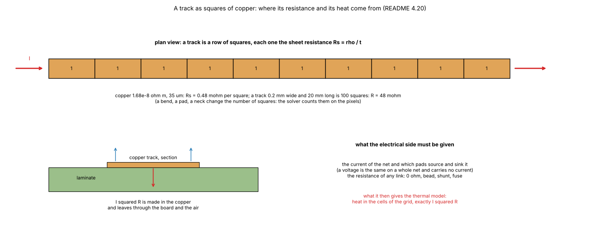
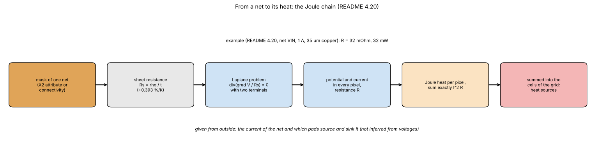
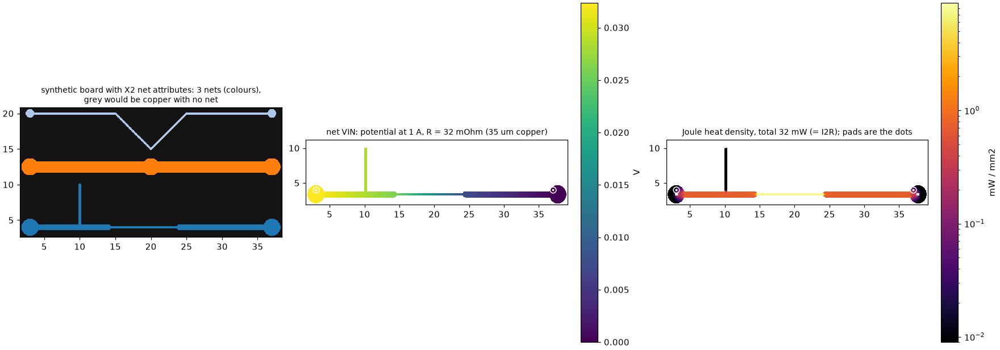
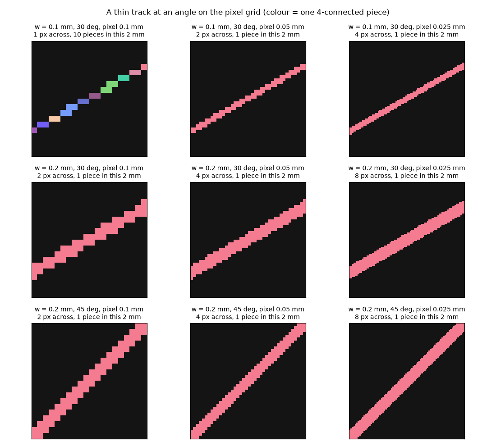
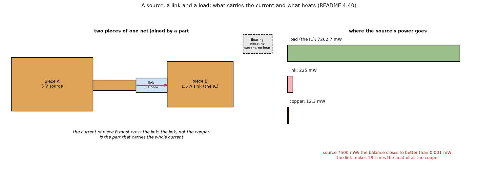
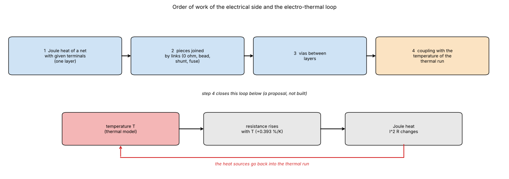
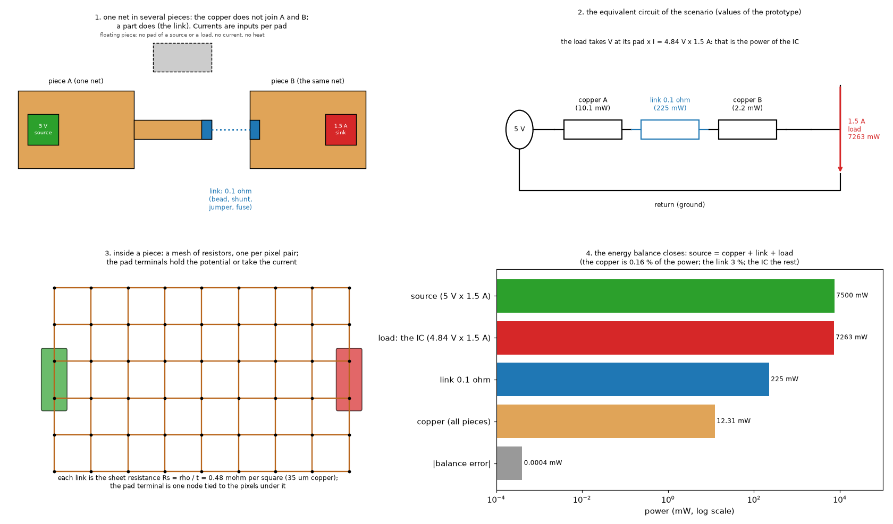
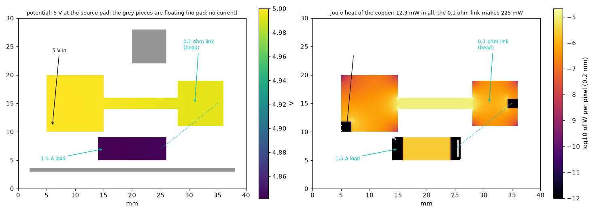

# Gerber import, phase 3: nets with voltage and current (Joule heat, links, sources and sinks)

Status: **open and early** (the electrical side is a prototype and a design, a good start but still green), a research branch (`research/gerbers`): **nothing in `pcbthermal/` was changed**. This folder is **phase 3 of three** of the Gerber research, which started as one study and was split: [`research/gerber-import`](../gerber-import/README.md) (1, reading the files), [`research/gerber-models`](../gerber-models/README.md) (2, the copper in the simulation models) and [`research/gerber-nets`](../gerber-nets/README.md) (3, nets with voltage and current). Dependencies run one way: 2 and 3 use the modules of 1, 3 does not use 2; **1 needs no program**. **Start with [`CONCLUSIONS.md`](CONCLUSIONS.md)**; how the result would enter the program is in [`INTEGRATION.md`](INTEGRATION.md); what was read and what was not verified, in the last section of this file; the text for the project documents, in [`docs/`](docs/). The layout is the one of every research folder (`CLAUDE.md`, "Research branches"). **Section numbers (4.1 to 4.50) are those of the original single study, so that the references between the three folders keep their meaning; the table below says where each one is.**

### Where the sections are

| Section | Folder | Subject |
| :-- | :-- | :-- |
| 4.1 | `gerber-import` | Vectors to polygons |
| 4.2 | `gerber-models` | Raster against the exact area |
| 4.3 | `gerber-models` | Thin traces and the pixel |
| 4.4 | `gerber-models` | The mappings on 42 windows |
| 4.5 | `gerber-models` | Scalar formulas from the fraction alone |
| 4.6 | `gerber-models` | Fine scan of the parameters |
| 4.7 | `gerber-models` | Copper thickness |
| 4.8 | `gerber-models` | Heater size |
| 4.9 | `gerber-models` | Time response |
| 4.10 | `gerber-models` | Scalar versus fill of a zone: what the program does today |
| 4.11 | `gerber-models` | Regular patterns: what "fill 0.5" means |
| 4.12 | `gerber-models` | Two layers with plated holes |
| 4.13 | `gerber-models` | A real four-layer board |
| 4.14 | `gerber-models` | Through the program's own solver |
| 4.15 | `gerber-models` | Cost |
| 4.16 | `gerber-models` | The Lumped and Analytic models |
| 4.17 | `gerber-import` | The independent reader against gerbonara on gerbonara's own test files |
| 4.18 | `gerber-import` | How the independent reader differs from the others |
| 4.19 | `gerber-import` | What can be read: copper layers and drill files |
| 4.20 | `gerber-nets` **(this folder)** | Nets: how much does the 5 V net heat up? |
| 4.21 | `gerber-models` | Literature status |
| 4.22 | `gerber-import` | Against the other Python tools, on files of known area |
| 4.23 | `gerber-nets` **(this folder)** | Tracks at an angle: area, connectivity and resistance on the grid |
| 4.24 | `gerber-import` | A third writer: Ucamco's `gerber-writer` |
| 4.25 | `gerber-models` | The regime of Sampson's article: heat that must reach fixed-temperature posts, |
| 4.26 | `gerber-models` | Grey-level |
| 4.27 | `gerber-models` | Every model of the program |
| 4.28 | `gerber-models` | An analogue of the post-mounted board of Sampson |
| 4.29 | `gerber-import` | Vias and nets |
| 4.30 | all three (bench board) **(this folder)** | A board of our own as a bench: an IC with circular tracks |
| 4.31 | `gerber-models` | The import path end to end |
| 4.32 | `gerber-models` | Where the heater is: the set-up of the end-to-end runs |
| 4.33 | `gerber-import` | Are the polygons tied to the right nets? A check against a KiCad project |
| 4.34 | `gerber-models` | Our board in the five models |
| 4.35 | `gerber-models` | A board of squares and rectangles in the five models |
| 4.36 | `gerber-nets` **(this folder)** | Separate pieces of one net: what they are and what could be inferred |
| 4.37 | `gerber-models` | How to validate the models on the rectangle board, and why the FVM looks worse |
| 4.38 | `gerber-models` | The mappings as selectable options |
| 4.39 | `gerber-models` | Measured impact of the two proposed corrections to the program |
| 4.40 | `gerber-nets` **(this folder)** | Sources, sinks and links: the electrical side |
| 4.41 | `gerber-import` | The converter on every board, layer by layer |
| 4.42 | `gerber-models` | The thinnest track and the angle |
| 4.43 | `gerber-models` | Every mapping on every board, in one table |
| 4.44 | `gerber-models` | Diagonal couplings: the nine-point experiment |
| 4.45 | `gerber-import` | Is it the same copper? Four tools, pixel by pixel |
| 4.46 | `gerber-import` | The nets against the KiCad project, pixel by pixel |
| 4.47 | `gerber-import` | The board outline from the profile layer |
| 4.48 | `gerber-models` | A detector for the diagonal faces |
| 4.49 | `gerber-models` | The cell tensor: what it is and how it is used |
| 4.50 | `gerber-models` | Held-out test of the diagonal gate: it does not hold up |

## 1. The questions

Once the copper of a layer is known with its nets (phase 1), the current that flows in it makes heat. Phase 3 asks how much, and how an application could take the voltage and the current of a net.

1. Can the net of a piece of copper be used to compute the current and the Joule heat of the net? **Yes**, and the heat sums exactly to I²R (4.20).
2. How accurate is the resistance of tracks at any angle on a pixel grid? Area within 0.5 %, the five-point stencil too resistive on a thin tilted track (4.23).
3. What are the separate pieces of one net, and what can be inferred about them? A piece with no source or load carries nothing; pieces are joined outside the copper by parts; the current per pad is an input (4.36).
4. How could sources, sinks and links be modelled in the application? A network with voltage sources, current sinks per pad and resistors that join pieces; prototype and design (4.40, `INTEGRATION.md`).

## 2. Findings in short

| Item | Result |
| :-- | :-- |
| Tracks at an angle | Area exact except at 45 degrees on the lattice (±6 %); a track as narrow as the pixel breaks into pieces with 4-connectivity (not with 8); the five-point stencil is up to 2x too resistive on a tilted 1.5 to 2 px track, 6 % at 12 px across (4.23). |
| Nets and heat | The X2 attribute `TO.N` gives the net of pads and tracks; zone fills may carry none; `joule.py` solves the current in a net and returns `I²R` per cell (4.20). |
| **Links** | In the prototype a 0.1 ohm link (bead, shunt) between two pieces of one net makes 225 mW at 1.5 A, 18 times the 12 mW of all the copper of the rail; the energy balance closes to 0.0004 mW in 7.5 W (4.40). |
| **Pad currents** | They are inputs (a power budget, a datasheet, a netlist): the copper cannot infer them, and a piece without pads of a source or load has no current and no heat whatever its voltage (4.36, 4.40). |

## 3. Folder layout

Scripts are run from the repository root (`.venv/bin/python research/gerber-nets/scripts/<script>.py`) and import the modules of this folder and of `research/gerber-import` through `scripts/_bootstrap.py`; the tests do the same through `tests/conftest.py`. `out/` is git-ignored.

| Path | What it is |
| :-- | :-- |
| `README.md`, `CONCLUSIONS.md`, `INTEGRATION.md` | The results in numbered sections, the conclusions, the design for the electrical side |
| `docs/` | `research.md` summary, `changelog.md`, `decisions-log.md`, `roadmap-entry.md`. |
| `figures/` | `fig_01` to `fig_09`: 01 tracks at angles on the pixel grid, 02 nets and Joule heat of a synthetic board (X2 attributes), 03 our IC board (nets and Joule heat of net S1), 04 the electrical prototype with a link, 05 the diagrams of the electrical network (pieces and link, equivalent circuit, pixel mesh, energy balance); 06 to 09 are diagrams (`make_diagrams.py`). |
| `tests/` | 18 tests (1 s): the Joule solver (`test_joule.py`), the electrical prototype (`test_pdn.py`), a tilted track (`test_track_angle.py`), the arc net of our board (`test_our_board_nets.py`), the prototypes against closed forms and exact networks (`test_references.py`, section 7). |
| `lib/joule.py` | Current and Joule heat of a net: the Laplace equation on the pixels of a net mask (four-point and nine-point stencils); the heat per cell sums to I²R. |
| `lib/pdn.py` | DC network of the copper with voltage sources, current sinks and links (resistors between pieces); the energy balance. |
| `scripts/study_net_joule.py`, `study_angles.py`, `study_pdn_links.py` | The heat of a net (4.20), tracks at any angle (4.23), sources, sinks and links (4.40). |
| `scripts/study_references.py` | The prototypes against references that do not share their assumptions (section 7). |
| `scripts/make_figures.py` | Draws figures 1 to 5. |
| `scripts/make_diagrams.py` | Draws the schematic diagrams and illustrations (figures 6 to 9). |

## 4. How to run, and the results

```sh
cd research/gerber-nets && ../../.venv/bin/python -m pytest -q tests        # 18 tests, 1 s
.venv/bin/python research/gerber-nets/scripts/study_pdn_links.py             # seconds
.venv/bin/python research/gerber-nets/scripts/study_references.py            # section 7, seconds
# study_angles.py, study_net_joule.py and figure 1 need gerbonara and shapely (research/gerber-import/requirements.txt)
```

### 4.20 Nets: how much does the 5 V net heat up? (`joule.py`, `study_net_joule.py`, `tests/test_joule.py`)



*Figure 8 (`figures/fig_08_track_in_squares.png`): a track as a row of squares of sheet resistance (R = Rs x squares, 100 squares of 0.48 mohm for a 0.2 mm x 20 mm track in 35 um copper: 48 mohm), the section with the heat leaving through the board and the air, and what the electrical side must be given (current, terminals, links; a voltage carries no current).*



*Figure 6 (`figures/fig_06_joule_chain_schematic.png`): from the mask of a net to its Joule heat in the cells (diagram).*

**Can polygons be mapped to a net? Yes, if the CAD tool wrote it.** KiCad (and others) write the X2 object attribute `%TO.N,<net>*%` before the objects of a net (`%TD*%` ends it). The reader now keeps the net of every operation (`Layer.nets`, `Layer.net_names()`, `Layer.draw(canvas, nets=[...])`; a step and repeat keeps it). Limits found on the two KiCad 7 files of the test set: the pads and tracks carry a net, **the zone fills did not** (one 427 mm² fill on the top layer touches no labelled object, 62 % of that layer's copper, 64 % with the other pieces without a net), and one name is several separate pieces on a layer (12 for `Board_0-/X9` on the top layer). *(Review, section 7: the earlier text said the names of a panel repeat on every board, `Board_0-/X9` 25 times; the file is one board of four copper layers and the count is not reproduced: the pieces are most likely joined by vias and the inner layers.)* Hence the working rule of the study: the net of a piece of **connected copper** is the net of the labelled objects it contains (149 of 176 pieces on the top layer have exactly one net, none has two). Files from tools that do not write the attribute (EasyEDA, Fritzing, most older ones) need the net from the user (click a piece) or from a netlist.

**The heat of a net.** With the net mask, the sheet resistance `Rs = rho / t` (copper 1.68e-8 ohm m at 20 °C, +0.393 %/K) and two terminals, `joule.solve_net` solves div(grad V / Rs) = 0 on the pixels (4-connected, face conductance 1/Rs, harmonic mean when `Rs` varies) and returns the resistance, the potential and the Joule power of every pixel, whose sum is exactly `I²R`. `joule.to_cells` sums it into the cells of the thermal grid (the total is conserved), which is exactly the heat source the models need. Checks (8 tests): a strip gives `Rs (L-1)/W` to 1e-9, a width step is a series circuit (within 3 %, the constriction adds a spreading term), parallel strips, the cell sum, and unconnected or overlapping terminals are refused.



*Figure 2 (`figures/fig_02_nets_and_joule.png`): a small synthetic Gerber of our own (`make_figures.synthetic_nets_gerber`, 40 x 26 mm, three nets written with the X2 attribute `%TO.N,<net>*%` ended by `%TD*%`). Left, the three nets (VIN, SIG, GND) found by the reader; middle and right, potential and Joule heat density of net VIN at 1 A between its two pads (35 µm copper): R = 32 mΩ and 32 mW (32.27 to 32.34 mΩ for pixels of 0.0125 to 0.05 mm on a lattice with no edge on a pixel centre, section 7; the earlier "30.7 to 32.4" came from ties at the finer pixels; by hand 70 squares of 0.48 mΩ = 34 mΩ, 32 mΩ when the 2.4 mm of track under the end pads is left out). The heat sits in the 0.25 mm neck and the 0.4 mm dead-end spur carries no current (black). The pixel lattice is anchored so that no track edge falls on a pixel centre; otherwise the neck is drawn 0.30 mm wide and R is 29 mΩ (section 4.23).*

On a real KiCad panel (the `charliewatch-v2` files of gerbonara's test set, used here for statistics only, not drawn; 1 A, 35 µm copper, terminals on the two farthest pads of the largest piece of each net): the signal nets of 22 mm span give 80 to 81 mΩ (80 to 81 mW at 1 A, hottest 1 mm cell 3.1 to 4.0 mW), a 11.6 mm net 31.5 mΩ, the GND piece of 388 mm² 4.6 mΩ (hottest cell 0.2 mW). Quick sanity check: 0.2 mm tracks of 22 mm are 110 squares of 0.5 mΩ, about 55 mΩ before the pads and bends (45 % below the solve: not explained; the hand count uses the pad span, not the route, and the tracks are 4 px across, section 7).

**Is it possible in the future? Yes**, and the pieces exist; what is missing, in order: (1) the current of the net (a number from the user, a table by net, or later the output of an electrical solve); (2) the terminals (which pads source and sink the current; for a power net with several loads, a list of currents per pad, solved as one Laplace problem with several sinks); (3) the vias and plated holes joining layers (the same Laplace problem on a stack, with the via barrel resistance); (4) the coupling with temperature, `rho(T)`: a fixed-point loop between the electrical and the thermal solve (the program already has such a loop for the power coefficient, `api._solve_with_tc`); (5) the user interface (pick a net, enter the current, see the heat map and the voltage drop). The voltage drop and the hot spots (current crowding at a neck) come out of the same solve.

### 4.23 Tracks at an angle: area, connectivity and resistance on the grid (`study_angles.py`, `make_figures.py`)

Until now only 45° had been tried (7 widths together, 4.22). A 30 mm track written with gerbonara at 0 to 90° in steps of 7.5° (widths 0.1 to 0.3 mm, pixels 0.1, 0.05 and 0.025 mm) gives the following. Picture (regenerate with `make_figures.py`):



*Figure 1 (`figures/fig_01_angles_pixel_grid.png`): the 0.1 mm track at 30° is 10 pieces at a 0.1 mm pixel and one piece from 0.05 mm; the 0.2 mm track is one piece everywhere but its edge is a staircase.*

* **Area**: within 0.5 % at every angle except exactly 45°, where it is **±6 %**, and except a track whose edges fall on the pixel centres on the axes (0.15 mm at a 0.1 mm pixel: −33 % at 0 and 90°) (the edge of the track runs exactly through the pixel centres of the lattice and the tie goes one way or the other, +6 % or -6 % depending on width; 0.1 mm wide at a 0.1 mm pixel: -29 %). A 45° track on a 0.05 or 0.1 mm coordinate grid is common in real layouts, so this is not a rare case. Adding a half-pixel offset or a coverage (grey-level) mask removes the tie.
* **Connectivity**: a track as narrow as the pixel falls to pieces with 4-connected pixels at any angle but 0 and 90° (0.1 mm at a 0.1 mm pixel: 38 pieces at 7.5°, 111 at 30°, 213 at 45°; the conduction solver has no path at all). **With 8-connected labelling it is one piece again** (1/1/1) as long as the track is at least one pixel wide; a track thinner than the pixel is broken whatever the connectivity, because centre sampling misses it (0.05 mm at 0.1 mm: 40 and 110 pieces at 7.5 and 30°, nothing at all at 45°; 0.03 mm at 0.05 mm: 79 and 162 pieces, but one 8-connected chain at 45°, where the lattice ties).
* **Resistance** (ratio of the solved resistance between the two ends to the ideal `Rs L / w`, 1.00 = exact): the 4-point stencil is exact along the axes and **too resistive when the track is tilted, the worse the fewer pixels across**: at 37.5° it is 1.97 (w 0.15 mm, 1.5 px), 1.59 (0.2 mm, 2 px), 1.32 (0.3 mm, 3 px) at 0.1 mm pixels; 1.61 (2 px), 1.33 (3 px), 1.23 (4 px), 1.13 (6 px) at 0.05 mm; 1.23 (4 px), 1.14 (6 px), 1.10 (8 px), 1.06 (12 px) at 0.025 mm. The isotropic nine-point stencil (`stencil="9"`) removes most of the angle dependence from about 8 px across (1.04 to 1.07 at 8 px, 1.02 to 1.04 at 12 px; at 2 px it still goes from 1.20 on the axes to 1.43) but adds a bias that also shows on the axes (+9 % at 4 px across, +4 % at 8 px, +2 % at 12 px: the pixels at the walls miss their diagonal links). Rule of thumb for a net's resistance: **at least 8 to 10 pixels across the thinnest track that matters** (0.2 mm tracks need a pixel of 0.02 to 0.025 mm; about 6 % error at 12 px for the 4-point stencil at the worst angle, 4 % for the nine-point stencil), or take the resistance of thin tracks from the vector geometry (length and width of the track, which the Gerber has) instead of from the raster.
* **For nets** (section 4.20): the question "which piece belongs to which net" is a question of connectivity, so it should not be answered from a coarse raster. Cheap and sound: label with 8-connectivity at a pixel not larger than the thinnest track, and for anything thinner use the vector geometry (shapely polygons that touch) or the objects' own net attribute. In the worst case, a thin wire that joins two copper areas must be kept as an explicit link, as the maintainer noted.

The same sweep says something about the mapping of copper to cells (4.4 to 4.14): those studies used the same four-neighbour solves, but their features (stripes, hatch, real copper at 0.1 mm) are mostly 3 pixels wide or more and their results were validated against the same four-neighbour solve of the fine mask, so the *relative* comparison between mappings holds; the *absolute* resistance of a very thin tilted track in that reference is too high by the percentages above. Not yet repeated with finer pixels or with the nine-point stencil.

### 4.30 Our IC board as a bench for the current of a net (`tests/test_our_board_nets.py`, figure 3)

The board (40 x 40 mm, eight signal nets that leave the IC radially and run round it on circular arcs, and a ground net; written by `gerber-import/lib/our_board.py`, described in gerber-import 4.30) is used here to check the current and the Joule heat of a net.


*Figure 3 (`figures/fig_03_ic_board_nets_and_joule.png`): left, the nine nets found by the reader; middle and right, potential and Joule heat density of net S1 (a radial stub and a 150° arc, 229 squares) at 1 A between its IC pad and its test point: R = 119 mΩ and 119 mW (35 µm copper, 0.025 mm pixels); the hand count of 229 squares gives 110 mΩ, so the grid is 8 % high on a curved 8-pixel track, as 4.23 predicts (section 7: +18, +8, +4 % at 4, 8, 16 px, extrapolating to the hand count; the nine-point stencil is as high, so it is the staircase of the thin curved track, not the stencil).*

Test (`tests/test_our_board_nets.py`): the resistance of the longest arc net within +15 % of its squares and its heat equal to I²R.

### 4.36 Separate pieces of one net: what they are and what could be inferred (a proposal, `research/gerber-import/scripts/study_kicad_nets.py`)

In 4.33 the Stormduino's `+5V` is two pieces of copper in the CAD file as well as in the Gerbers, `+3V3` two, the USB shield four. The maintainer's remark: such pieces are normally tied by vias and inner layers, and few should float; and an idea: two pieces of the same net, with the voltage and current known, could allow an inference.

* **What the separate pieces are (from the data, not examined piece by piece)**: on a 2-layer board the pieces were already joined through the 109 plated holes, so what remains is a gap in copper. In a real design that is a connection made **outside the copper**: a through-hole part or a header whose pins share the net (a pin header, a jumper), a connector pad, a part that bridges them (0 ohm link, fuse, ferrite bead, shunt), or an unfinished route. Which one it is was not checked on the Stormduino (the CAD file names the parts, my small reader did not keep their references). On boards with inner planes and more vias the number of such pieces is lower; the four-layer board of 4.29 was not run through this test.
* **Is the idea sound?** Physically yes. The Joule heat of a piece is I²R of the current that actually flows through its copper: the current enters at the pads of sources, leaves at the pads of loads, and its path inside a piece depends only on the piece's shape (`joule.py`). Two pieces of one net have the same voltage only if something connects them; if only a load pad sits in a piece and the supply pad in the other, the current has to cross the part that links them, so that part carries the whole current (a link with its own resistance and heat) and the pieces' heat follows from the currents of each pad. If the piece holds no source or load pad it carries no current and has no Joule heat, whatever the voltage. The voltage is not needed for the heat of the copper, only to turn a power into a current (I = P / V), so the **input needed is a current (or power and voltage) per pad, not per net**; the link elements (0 ohm, fuse, shunt: their resistance) would be part of the interface.
* **What the literature search gave (two web searches, snippets only)**: commercial power-integrity tools (Cadence Allegro IR drop, Altium PDN Analyzer, Altair PollEx) treat nets as sources and sinks with a current per pad and report I²R per shape and per via; an Altium guide describes shapes with a small resistance each that dropped a 5 V rail to 4.5 V; a Siemens/FloEFD study of a four-layer board uses nets as connections between copper regions and components. **Nothing found describes the case of islands bridged by components, or an inference of current from voltage alone**; I did not read any of these documents in full. The KiCad electro-thermal plug-ins listed in section 7 were read earlier from their descriptions only.
* **What would not work**: inferring the current of a piece from the voltage of the net (voltage is the same on a whole net and carries no current); a piece without pads or links is left out. **What would**: a table "pad: current" read from a netlist and a power budget (the KiCad schematic, or the user), plus the link elements, feeding `joule.solve_net` piece by piece, and the heat added to the board model as a source per cell (the Joule layer, 4.20).
* **Not done**: no net with links was solved; no piece-by-piece examination of the Stormduino's split nets.

### 4.40 Sources, sinks and links: the electrical side (`pdn.py`, `study_pdn_links.py`, `tests/test_pdn.py`, figure 4)



*Figure 9 (`figures/fig_09_where_the_power_goes.png`): the plan of the scenario below (piece A with the 5 V source, a 0.1 ohm link, piece B with the 1.5 A sink, a floating piece) and the split of the 7.5 W: 7262.7 mW in the load, 225 mW in the link, 12.3 mW in all the copper.*



*Figure 7 (`figures/fig_07_electro_thermal_loop_schematic.png`): the proposed order of work of the electrical side and the electro-thermal loop (diagram, a proposal, not built).*

The question: how could the sinks and resistors be done in the application, and has anyone done it. What is known (from web searches, snippets only; the repositories of kicad-electrothermal-sim and padne returned 404 to the fetch tool; the Altium host could not be resolved; nothing was read in full): commercial power-integrity tools model **supply pins as voltage sources, loads as current sinks (a current per pad or per device), series elements as resistances, and the copper as a resistor network**; in the DC case the capacitances are shorted and the analysis is the solution of that network (OpenROAD PDNSim documentation snippet; Altium PDN Analyzer: source voltage and internal resistance, load as a current sink). In `docs/roadmap.md` (on `develop`) FYPA and padne are listed with text directives on `DESIGNATOR.PAD` endpoints, a sidecar file and the current solution as heat source (AGPL: ideas only).

`lib/pdn.py` is the prototype of that design. Terminals are named sets of pixels (the copper under a pad), elements are `vsource`, `isink` and `link`, the unknowns are the pixel potentials and one node per terminal. A piece with no voltage source floats: no current, no heat. Scenario (`study_pdn_links.py`, figure 4): the rectangle board with 5 V at the large pad, a **0.1 ohm link** (a bead or a shunt) from the 8 x 8 mm pad to a second piece of the same net, a 1.5 A sink on that piece:



*Figure 5 (`figures/fig_05_network_diagram.png`): 1, one net in several pieces (the copper does not join A and B, a part does; a piece with no source or load is floating); 2, the equivalent circuit with the numbers of the scenario; 3, inside a piece the copper is a mesh of resistors of one sheet resistance each, and a pad is one node tied to its pixels; 4, the energy balance (source = copper + link + load).*



*Figure 4 (`figures/fig_04_pdn_links.png`): left, the potential (the grey pieces are floating); right, the Joule heat per pixel on a log scale; the black pixels are the equipotential pad terminals.*

| Quantity | Value |
| :-- | --: |
| voltage at the load pad | 4.8418 V (drop 0.158 V: 0.008 V in the copper, 0.150 V across the link; the series circuit of the two pieces solved alone gives the same to 0.3 µV, section 7) |
| heat of the copper | 12.3 mW (large pad, track and pad 10.1 mW; second piece 2.2 mW; floating square and thin track 0) |
| heat of the link | **225 mW** (1.5 A through 0.1 ohm) |
| the load (V at its pad x current) | 7262.7 mW: this is the power of the IC |
| balance: source 7499.999 mW | copper + link + load, difference −0.0004 mW (5e-8 of the power) |

* **The link makes 18 times the heat of all the copper**: for a net in several pieces the bridge element, not the copper, is the part to model. The copper of a 5 V rail at 1.5 A in this board heats by 12 mW, a ferrite bead of 0.1 ohm by 225 mW.
* The load power comes out of the network (V at the pad times the current) and can feed the thermal model as the power of the IC; the voltage matters only there.
* The pad currents are inputs (power budget, datasheet, netlist), not inferable from the copper; **a floating piece needs nothing** (a sink on a piece that no source reaches is refused).
* The sink is grounded ideally: the same 1.5 A returns through the ground copper, which also heats; it is not in the scenario (section 7).

How it could be made in the application (design; the details are in `INTEGRATION.md`; no code for it exists in `pcbthermal/`):

1. **Data**: `Problem.electrical`, a list of named terminals (a pad position and size per terminal, a net) and elements `vsource`, `isink`, `link`, stored in the project file; absent = nothing changes. The existing `Heater` gets an optional `current` and `net` so that a part's power budget and its sink are one thing: `P = V_pad * I` and the heat in the footprint are then consistent.
2. **Where the values come from**: typed in a pads table (Components), read from the KiCad netlist and part fields (research branch 4.33, and the roadmap's sidecar idea), links from the netlist: the parts that join two pieces of one net (0 ohm, ferrite, shunt, fuse) with their resistance from the field `Value` or a library.
3. **Solve**: per copper layer, the network above on the same mask that gives the face conductances (the pixels already exist); vias join the layers through their barrel resistance; the temperature dependence of the resistivity (+0.39 %/K) closes in the same fixed-point loop that `api._solve_with_tc` already has; the Joule heat per cell is added to the source term of the thermal grid (`joule.to_cells`).
4. **Outputs**: voltage drop and current density per net, heat per piece, per link and per via, a warning for a link or a track beyond its rating (IPC-2152 is the usual check, not implemented here).
5. **Not done**: nothing of this has been joined to a thermal run; the vias of a multilayer net; time dependence; the regulators (a load that depends on its input voltage: constant power, FYPA's regulator model). The sheet resistance used is a constant 0.48 mohm/square at 20 degrees.

## 7. Review

Independent review by the `reviewer` agent (first review of this folder). No program is involved: `joule.py` and `pdn.py` are prototypes, and **no code for the electrical side exists in `pcbthermal/`** (`docs/roadmap.md` lists it as "electro-thermal coupling"; `Problem.electrical` is only the design of `INTEGRATION.md`). The studies were run with `.venv/bin/python` and, for the ones that need gerbonara and shapely (`study_angles.py`, `study_net_joule.py`, figure 1), with the environment of `research/gerber-import/requirements.txt`; the reader is the corrected one of the `gerber-import` review (its tests pass, and every table of this folder that uses it reproduces).

**Reproduced to the digit**: the angle sweep of 4.23 (every ratio quoted: 1.97 / 1.59 / 1.32, 1.61 / 1.33 / 1.23 / 1.13, 1.23 / 1.14 / 1.10 / 1.06; the area of ±6 % at 45°; 38 / 111 / 213 pieces), the 8-connected counts (1/1/1, now printed by `study_angles.py`), the `charliewatch-v2` table of 4.20 (80.3 to 81.2 mΩ, 31.5 mΩ, 4.6 mΩ, hottest cell 3.6 mW, 149 of 176 pieces with one net, none with two), the scenario of 4.40 (4.8418 V, 10.100 + 2.214 = 12.314 mW, 225.0 mW, 7262.685 mW), figure 3 (119 mΩ) and the 29 mΩ of the tie lattice of figure 2.

**Checked against references that do not share the prototypes' assumptions** (`scripts/study_references.py`, `tests/test_references.py`):

| Reference | Result |
| :-- | :-- |
| Straight strip, `Rs (L - 1) / W` | exact (ratio 1.000000) |
| L bend, the corner square counts 0.559 squares (conformal map) | +0.55 % at 4 px, +0.15 % at 10 px, +0.06 % at 20 px across |
| Ring sector, current round it: `R = Rs θ / ln(ro / ri)` (ri 1, ro 3 mm, 90°) | four-point 1.085, 1.039, 1.021 at 20, 40, 80 px across: first-order convergence to the closed form (Richardson from 40 and 80 px: 1.003); the nine-point stencil the same |
| Net VIN of figure 2 against its hand count (67 squares = 32.16 mΩ without the track under the end pads) | 32.34, 32.30, 32.27 mΩ at 0.05, 0.025, 0.0125 mm on a lattice with no edge on a pixel centre: within 0.6 % |
| Net S1 of figure 3 against its 228.7 squares (109.8 mΩ) | +18.2 %, +8.4 %, +4.2 % at 4, 8, 16 px across: first order, extrapolates (16 and 8 px) to 109.8 mΩ. **The nine-point stencil is as high** (+16.6, +7.8, +3.9 %): the excess is the staircase of a thin curved track in a binary mask, which both stencils share, not the choice of stencil |
| `pdn.py` against the series circuit `5 - I (R_A + R_link + R_B)`, `R_A`, `R_B` solved alone by `joule.py` | load voltage equal to 0.3 µV; copper heat equal to 1e-6 |
| Two strips 4 and 8 px wide sharing 3 A | 1.000000 and 2.000000 A (exact) |
| Energy balance of 4.40 | source − copper − link − load = −0.0004 mW of 7500 mW (5e-8): the "7500.001 mW, 0.002 mW" of the earlier text were from an earlier run |
| Electro-thermal loop, a 0.2 x 20 mm track (48 mΩ) at one temperature with a lumped `Rth`, constant current: closed form `T* = (Ta + K R20 (1 − 20 α)) / (1 − α K R20)`, `K = Rth I²` | plain fixed point through `joule.solve_net` with `rho(T)` equals the closed form to 1e-4 K; it converges with ratio `α Rth I² R20` (6 iterations at 0.009, 35 at 0.47, 124 at 0.80) and has no solution when `α Rth I² R20 ≥ 1` (runaway at 7.28 A for 100 K/W, 10.30 A for 50 K/W; detected) |

**Findings and fixes** (ranked):

1. **Defect in the prototype, fixed**: `joule.to_cells` cut off the last partial row and column of cells, so "the total is conserved" was false whenever the map is not a multiple of the cell (15 of 63 W lost on a 7 x 9 map in 2 x 2 cells). It now pads with zeros; test `test_cell_sum_keeps_partial_cells`. The maps of the studies were multiples of the cell, so no number moved.
2. **Defect in the prototype, fixed**: `pdn.solve` silently dropped a current sink placed on a piece that no voltage source reaches (the current vanished, no error). It now raises `ValueError`; test `test_a_sink_on_a_piece_without_a_source_is_refused`.
3. **Broken import path, fixed**: `scripts/_bootstrap.py` and `tests/conftest.py` inserted the folder's own `scripts/` only when it was not already on `sys.path`; Python already puts it there (the script's folder) at the end of the order, so `gerber-import/scripts/make_figures.py` shadowed this folder's `make_figures.py`. Both now move their folders to the front.
4. **Wrong numbers, fixed**: figure 2's caption gave "30.7 to 32.4 mΩ for pixels of 0.0125 to 0.05 mm": that range is ties, not convergence. The lattice of `make_figures.py` puts pixel centres on the edges of the 0.25 mm neck at 0.025 and 0.0125 mm (drawn 0.275 and 0.2625 mm wide: 30.66 and 31.42 mΩ), and on its round caps in x even at 0.05 mm, where the result then depends on rounding (32 mΩ in the figure, 31.62 mΩ with a 0.1 mm wider margin in `study_references.py`). On a tie-free lattice R is 32.27 to 32.34 mΩ. The nine-point stencil "at 12 px, 2 % at the worst angle" is 4.2 % (1.042 at 22.5 to 30°); "the same within a few percent at every angle" holds from about 8 px across (at 2 px it goes from 1.20 on the axes to 1.43). "Area within 0.5 % at every angle except 45°" misses the 0.15 mm track at a 0.1 mm pixel (1.5 px): −33 % on the axes, its edges on the pixel centres. The energy balance digits (finding above). Figure 4 said "12.6 mW in all" (12.3); figures 5 and 9 carried the old balance; the three are redrawn from the solved numbers.
5. **Explanations tested**: the 8 % excess of S1 is the discretisation (it halves with the pixel and extrapolates to the hand count), but not "the five-point stencil": the nine-point stencil gives the same. The `charliewatch-v2` file is **one board** (every net is prefixed `Board_0`) **of four copper layers** (the set has `In1_Cu`, `In2_Cu`); "the net names of a panel repeat on every board (`Board_0-/X9` 25 times)" is not reproduced (X9 is 12 pieces on the top layer and 50 flashes): the several pieces of one net on a layer are most likely joined by vias and the inner layers. The largest no-net fill is 427 mm², 62 % of the top copper (64 % with the other 26 pieces without a net). The 80 mΩ of a 22 mm signal net against "55 mΩ before the pads and bends" (45 % apart) is not explained: the hand count uses the pad span, not the route, and the tracks are 4 px across (4.23: +10 to +23 % when tilted); not checked further.
6. **Stale or wrong references, fixed**: 11 tests (now 18), "6 tests" of `test_joule.py` (now 8), "INTEGRATION.md, section 7" (it has no sections), `study_kicad_nets.py` and `test_a_track_as_wide_as_the_pixel_can_vanish_on_the_lattice` cited as if they were here (they are in `gerber-import`), "five figures" of the layout table (nine). The same stencil is called "four-point" and "five-point" in the documents (four neighbours, five points): kept, noted here.
7. **Limits recorded** (not checked against a source in this review, from memory): the resistivity 1.68e-8 Ω m is the handbook value of pure copper; 0.393 %/K is the coefficient of the annealed copper standard (IACS, 1.724e-8 Ω m), about 2.6 % more resistive; PCB foils and plated copper are often higher still, and the outer layers are plated on top of the foil (thicker than 35 µm). The **return current** is not modelled: the scenario of 4.40 grounds the sink ideally (figure 5, "return (ground)"), while the same 1.5 A flows back through the ground copper and heats it; a ground net needs its own solve. The pad terminals are equipotential, so the copper under a pad makes no heat. `joule.to_cells` keeps the row order of the mask (rows from the top) while the program's grid counts y upwards, and the cells start at the first pixel: the lattice must be anchored on the program's cells.
8. **For the design** (`INTEGRATION.md`): with a constant current, the Joule heat of a track at one temperature is exactly a power with a temperature coefficient, `P = I² R20 (1 + α (T − 20))`, so the program's loop `api._solve_with_tc` has the right form, but it uses `tc` about 25 °C (`α / (1 + 5 α)` = 0.386 %/K) and the hottest point under the part (an upper bound for a track, whose resistance follows its mean temperature weighted by the current), and it stops after 80 iterations, which the loop above needs near runaway (124 at a ratio of 0.8).

Not verified: a physical measurement (none exists); the plate with a hole (no such case in this folder); the KiCad 7 origin of the `charliewatch-v2` files; the pieces of the Stormduino's split nets (4.36, as before).

## 8. Limits of this phase

* A **single layer** at a time: vias between layers are not in the network; the net comes from the file (X2 attributes) or from connectivity.
* Sheet resistance of copper is a constant 0.48 mohm/square (35 µm, 20 degrees, pure copper; the annealed standard is about 2.6 % higher and plated outer copper is thicker); the resistivity rising 0.39 %/K and the loop with the temperature are not coupled to a thermal run (the loop is checked on a lumped track, section 7).
* The return current in the ground net is not modelled (the sinks are grounded ideally).
* DC only: no time dependence, no regulators (a load that depends on its input voltage), no ratings (IPC-2152).
* The five-point stencil is up to 2 times too resistive on a tilted 1.5 to 2 pixel track (4.23): the prototype uses axis-aligned copper, where it is exact.
* The heat of the copper was **not** added to a thermal run in this folder (the way is `joule.to_cells` and the source term of phase 2's network); no physical measurement exists.
* Web search for how others model sources, sinks and links gave excerpts only; the repositories of kicad-electrothermal-sim and padne could not be fetched (404) and the Altium host could not be resolved; nothing was read in full (4.40).

## 10. Sources

* OpenROAD PDNSim documentation (supply pins as voltage sources, loads as current sources, the metal as resistances; static analysis solves the resistor network), https://openroad.readthedocs.io/ (a search excerpt).
* Altium PDN Analyzer example guide (source voltage and internal resistance, a load as a current sink, shapes with a resistance that dropped a 5 V rail to 4.5 V), https://altium.com/documentation/altium-nexus/pdn-analyzer-example-guide-v2 (search excerpts).
* Cadence, *The influence of the Joule heating effect on PCBs and ICs*, and the IR drop analysis pages, https://resources.pcb.cadence.com/ (search excerpts).
* FYPA and padne (AGPL-3.0; ideas only, listed in `docs/roadmap.md` on `develop`).

## What was read and what was not verified

**Read in full**: the converted text of the three Electronics Cooling articles supplied by the maintainer (equations of article 1 reconstructed by the converter; tables and figures missing); the Ucamco format page supplied by the maintainer. **Read in part or from a summary**: the Gerber specification (not read; the host is blocked), the Electronics Cooling pages themselves (blocked), gerbonara, pygerber and pcb-tools through their behaviour on files, not their code. **From memory, checked by limits only**: the closed forms of Bruggeman and Hashin-Shtrikman and the duality of Keller and Dykhne.

**Reproduced** (numbers in `README.md`): the ranking of the mappings, the reader against four other tools, the example of Sampson (40 and 0.65 W/m K) and the tile formulas of Blackmore. **Not reproduced**: Sampson's board (its bitmaps are figures; an analogue was built), Blackmore's validation (no measurement, no board). **Not verified**: any comparison with a physical measurement; the licences of the gerbonara test boards (statistics only, no picture of them is kept); the behaviour of the 3D solid at fine cells.

* Split nets (4.36): two web searches, snippets only, nothing read in full; the Stormduino's split nets were not examined piece by piece. The electrical prototype (4.40) is reproduced here; the web part was two searches and four failed fetches (kicad-electrothermal-sim and padne returned 404, the Altium host could not be resolved), nothing read in full.
